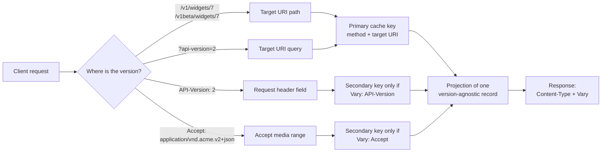

# API Versioning Topologies Compared: URI Path (/v1), Header, Accept Media-Type, Query, and Stability Channels (AIP-185)

> [!summary] Claim
> The real difference between versioning topologies is where the version lives in the HTTP message: a path segment or query parameter is part of the target URI and therefore part of every cache's primary key, while a request header or `Accept` media type is invisible to caches unless every response, including the default one, names that field in `Vary` (RFC 9110 Section 12.5.5, RFC 9111 Section 4.1).

Part of [Versioning Evolution and API Guidelines](README.md) in [API Engineering](../README.md).

## TL;DR

- Mechanism: the server reads one version signal from the path (`/v1`), the query (`?api-version=2`), a request header (`API-Version: 2`), or the `Accept` media type (`application/vnd.acme.v2+json`), and projects one version-agnostic stored record into that version's representation.
- Contract rule: header and media-type versioning must send `Vary: Accept, API-Version` on every cacheable response from the negotiated resource, including the default response a client gets when it sends no version, because RFC 9111 Section 4.1 only lets an absent field match an absent field.
- The trap: a wildcard `Accept: */*` or a missing header must select the pinned default version, never the latest, and duplicate or conflicting signals must be rejected with `400`, because Starlette's own `Headers.__getitem__` is first-wins while `QueryParams.__getitem__` is last-wins (starlette 1.10.0 starlette/datastructures.py, Headers.__getitem__ and ImmutableMultiDict.__getitem__).
- Portability fact: the lab's 31 tests pass on the whole pinned matrix (CPython 3.12.16, 3.13.18, 3.14.10, 3.15.2, and free-threaded 3.15.2t with `-X gil=0`) on macOS, and for the four GIL builds also in Debian Trixie and Alpine musl containers, with real-socket runs on Uvicorn 0.54.0, Hypercorn 0.18.0, and Granian 2.8.7 over HTTP/1.1 and on Hypercorn and Granian over HTTP/2; header field names are lowercased on the wire in HTTP/2 and HTTP/3 (RFC 9113 Section 8.2, RFC 9114 Section 4.2), and both HTTP/2 servers refuse an uppercase `API-Version` name with `PROTOCOL_ERROR`, so field-name case never distinguishes versions.
- When not to use it: do not pick `Accept` media-type versioning for a public API behind shared caches you do not control, because `Accept` strings that negotiate the same representation fragment the cache (4 entries for 4 spellings in the lab) and some caches have ignored `Vary` entirely (Kettle, PortSwigger, 2018); AIP-185 itself mandates the path major version for Google APIs and recommends stability channels on top of it.

## Mental model



A request can carry its version in four places, and the arrows split into two families.
Path and query signals flow into the target URI, which RFC 9110 Section 12.5.5 excludes from `Vary` because it is already the identity of the response ("aside from the method and target URI"), so every cache keys on it automatically.
Header and `Accept` signals flow into request fields, which a cache considers only when the stored response nominated them in `Vary`; without that, the arrow from `H` or `A` to the secondary key does not exist and the cache serves whichever version it stored first.
All four routes end in the same projection step: the lab stores one record and shapes it per surface, the same "single, version-agnostic representation" AIP-185 describes for interface-based versioning.

## How it works

### Path major versions and AIP-185 stability channels

AIP-185 requires that "All Google API interfaces **must** provide a _major version number_, which is encoded at the end of the protobuf package, and included as the first part of the URI path for REST APIs" (AIP-185, Guidance).
It forbids minor and patch numbers in that segment: "Google APIs use `v1`, not `v1.0`, `v1.1`, or `v1.4.2`", because minor and patch changes are delivered in place.
For alpha and beta stability, the stability level is appended to the major version using one of four strategies: channel-based (recommended), interface-based, release-based, or visibility-based.
Under channel-based versioning there are at most three channels per major version; `v1beta` and `v1alpha` must carry the suffix and the stable channel must not, so `v1stable` is invalid.
The superset rule is normative: "The beta channel's functionality **must** be a superset of the stable channel's functionality, and the alpha channel's functionality **must** be a superset of the beta channel's functionality."
Deprecation has a promotion constraint: "Deprecated API functionality **must not** graduate from alpha to beta, nor beta to stable", so nothing arrives "pre-deprecated".
Beta functionality may be removed after deprecation for "a sufficient period; we recommend 180 days", while alpha-only functionality may be removed without notice.
Release-based versioning (`v1beta1`, `v1beta2`) is marked "not commonly used for new services", and a backwards-incompatible beta change should increment the release number.

The lab encodes the segment grammar as one regular expression and turns the superset and pre-deprecation rules into a CI-style gate over a channel catalog (`channel_violations` and `promotion_violations` in the [implementation](../labs/src/api_labs/f07_versioning_evolution_and_api_guidelines/versioning_topologies.py)).
`v1.1`, `v1.0`, `v1stable`, `V1`, `v01`, `v0`, and `v1beta0` are rejected; `v1beta2` parses as release-based but returns `404` because the catalog does not publish it.

### Interface-based and visibility-based versioning in AIP-185

Interface-based versioning (IBV) carries the version identifier in a header or query parameter instead of a path suffix: requests "**must** send the API version identifier using either the `X-Goog-Api-Version` HTTP header or the `$apiVersion` URL query parameter", stable versions are `YYYY-MM-DD`, and previews are `YYYY-MM-DD-preview`.
When a request names no version, AIP-185 says it may default to a producer-chosen version, may respect a consumer override, or must be rejected with an error if no default is available, and it states that producers store resource definitions "in a single, version-agnostic representation".
Visibility-based versioning tags elements with labels such as `PREVIEW`; a client may send `X-Goog-Visibilities: PREVIEW`, and "A single API request can specify at most one visibility label."
IBV and visibility are header or query topologies, so the cache rules below apply to them in full.

### Header and query versioning in industry guidelines

The Azure guidelines take the query topology: "**DO** use a required query parameter named `api-version` on every operation", with `YYYY-MM-DD` values and a `-preview` suffix, and "**DO NOT** include a version number segment in any operation path".
A missing value returns `400` with `MissingApiVersionParameter`, and an unknown value returns `400` with `UnsupportedApiVersionValue` (Azure REST API Guidelines, versioning section, as of 2026-11).
GitHub takes the header topology: "You should use the `X-GitHub-Api-Version` header to specify an API version", requests without it "will default to use the `2022-11-28` version", and an unsupported version gets `410 Gone` (GitHub REST API docs, API versions, as of 2026-11).
The same page lists `2026-03-10` as the latest version and `2022-11-28` as supported until March 10, 2028, after which unversioned requests "default to the next oldest supported version, not the closing down version" (as of 2026-11), so the default is a moving contract.
GitHub's current documented media type is `application/vnd.github+json`, with a version-free vendor subtype, so its `Accept` header now selects a format rather than a version.
`API-Version`, the custom header in this lab, is not in the IANA HTTP Field Name Registry (checked against `field-names.csv`, 2026-11); `Accept`, `Vary`, `Deprecation`, and `Sunset` are.
See [[Microsoft-Azure-REST-API-Guidelines-in-Depth]] and [[Stripe-Date-Based-Versioning-and-Version-Change-Gates]] for those systems in depth.

### Accept media-type versioning down to the grammar

A vendor type such as `application/vnd.acme.v2+json` combines the RFC 6838 Section 3.2 vendor tree (the leading `vnd.` facet) with the `+json` structured syntax suffix (RFC 6838 Section 4.2.8, RFC 6839 Section 3.1), which tells generic tooling that the payload follows `application/json` rules.
RFC 6838 Section 4.2 caps type and subtype names at 127 characters by grammar (`restricted-name-first *126restricted-name-chars`) and says they SHOULD be limited to 64.
RFC 9110 Section 8.3.1 makes type and subtype tokens case-insensitive, so `Application/VND.ACME.V2+JSON` must select version 2, and parameter names are case-insensitive too (RFC 9110 Section 5.6.6), so the lab reads `;Q=0.4` as a weight.
The `Accept` grammar is `#( media-range [ weight ] )` (RFC 9110 Section 12.5.1), and the weight grammar allows at most three decimals, `qvalue = ( "0" [ "." 0*3DIGIT ] ) / ( "1" [ "." 0*3("0") ] )` (RFC 9110 Section 12.4.2).
The lab maps qvalues to integer thousandths (`q=0.001` -> `1`, `q=1.000` -> `1000`) and rejects `q=0.0001`, `q=1.1`, `q=.5`, and `q=2` with `400`, which avoids float comparison entirely.
The quality of a candidate comes from "the media range with the highest precedence that matches the type" (RFC 9110 Section 12.5.1): `type/subtype;params` beats `type/subtype`, which beats `type/*`, which beats `*/*`.
RFC 9110 Table 5 prints `text/html;level=3` as `0.7`, which contradicts its own rule; verified erratum 7138 (verified 2022-11-09) corrects it to `0.3`, and the lab test reproduces the corrected table exactly.

RFC 9110 uses precedence only to pick the weight of each candidate; it does not say which candidate wins when two have equal weight, and that tie is where versioning bugs live.
With `Accept: */*`, every version's vendor type has weight `1000` at precedence `(0, 0)`.
The lab ranks candidates by weight, then by the precedence of the range that matched, then by candidate order with the default version first, so `*/*`, `application/*`, and `application/json` select version 1, `application/vnd.acme.v2+json, */*;q=0.1` selects version 2 on weight, and `application/vnd.acme.v2+json, */*` selects version 2 on specificity.
The specificity step is a lab policy, not an RFC rule, and it has a sharp edge: `application/json, application/vnd.acme.v2+json` names two candidates at equal weight and equal specificity, so candidate order serves version 1.
Flipping the sign of the order term (`-index` to `index` in `resolve_version`, a one-character mutation that the wildcard test kills) silently upgrades every wildcard client to the newest major version, which is exactly a breaking change shipped to clients who never opted in.
If no candidate has a nonzero weight, the server may honor the field with `406 Not Acceptable` or ignore it (RFC 9110 Section 12.4.1); the lab honors it and, as RFC 9110 Section 15.5.7 says it SHOULD, lists the available representations in the body.
A media range that carries a parameter other than `q`, such as `application/vnd.acme.v2+json;charset=utf-8`, matches none of the lab's parameterless types and also gets `406`.

### The cache-key consequence

RFC 9111 Section 4.1 says a cache "MUST NOT use that stored response without revalidation unless all the presented request header fields nominated by that Vary field value match those fields in the original request".
Two requests' fields match if and only if one can be turned into the other by adding or removing whitespace, combining field lines, or normalizing values "in a way that is known to have identical semantics".
A cache is never obliged to reuse a stored response, so one that skips the semantic normalization (the text itself says "after any normalization that might take place") stays correct and only loses hits.
Absence is a value: "If (after any normalization that might take place) a header field is absent from a request, it can only match another request if it is also absent there."
The same section warns that "Some resources mistakenly omit the Vary header field from their default response", which is the exact failure the lab reproduces: a default `v1` response stored without `Vary` is then served to a client that sent `API-Version: 2`.
The cache-side remedy in the same section is only a SHOULD: among several stored responses for one URI, choose the most recent one with a valid `Vary`, which does not help when the `Vary`-less default is the only response stored.
Starlette appends rather than replaces `Vary`: `MutableHeaders.add_vary_header` joins existing values with `", "` (starlette 1.10.0 starlette/datastructures.py, MutableHeaders.add_vary_header), and `GZipMiddleware` calls it with `Accept-Encoding` for every eligible response body at or above `minimum_size`, whether or not the client asked for `gzip` (starlette 1.10.0 starlette/middleware/gzip.py, IdentityResponder.send_with_compression).
The lab confirms the composition: with `GZipMiddleware(minimum_size=0)` both the `gzip` response and the uncompressed one carry `Vary: Accept, API-Version, Accept-Encoding`.
The path and query topologies need none of this: with `Vary` switched off entirely, the lab's cache still keeps `/v1/widgets/7`, `/v2/widgets/7`, `/widgets/7?api-version=1`, and `/widgets/7?api-version=2` in four separate entries, because the target URI is the primary key.

### Duplicate signals and parser disagreement

Starlette exposes both first-wins and last-wins lookups.
`Headers.__getitem__` scans `_list` and returns the first match, while `QueryParams` inherits `ImmutableMultiDict.__getitem__`, which returns `self._dict[key]` built by `{k: v for k, v in _items}`, so the last value wins (starlette 1.10.0 starlette/datastructures.py, Headers.__getitem__ and ImmutableMultiDict.__init__).
An API that reads `request.headers["api-version"]` and a gateway that reads the last occurrence will route the same request to different versions.
The lab calls `getlist` for both and rejects more than one value with `400 ambiguous_version`, rejects header-versus-query disagreement with `400 conflicting_version_signals`, and validates the value against `[1-9][0-9]{0,2}`, which also refuses `01`, `+2`, and non-ASCII digits that `int()` would accept.
Uvicorn (both its `httptools` and `h11` parsers), Hypercorn, and Granian all hand two `API-Version` field lines to the application as two entries, so the `400` is reached on every server in the lab matrix.
The same holds over HTTP/2 on Hypercorn and Granian, where the two `api-version` fields arrive as two entries of one `HEADERS` frame.
An HTTP/2 request that spells the name `API-Version` on the wire is malformed (RFC 9113 Section 8.2.1), and both servers refuse it with `PROTOCOL_ERROR` before the application sees anything.
RFC 9113 Section 8.1.1 requires a stream error for a malformed request and Section 5.4.1 lets an endpoint treat a stream error as a connection error, which is what both servers did when observed with the `h2` client here: each sent a `GOAWAY` frame.

## Numbers and limits

Lab measurements were taken on an Apple M3 Pro, macOS 27.2 (`Darwin 27.2.0 arm64`), CPython 3.14.6 (the workspace `.venv`), with `uv run --frozen python` and `timeit.repeat(number=20000, repeat=7)`, reporting the best time per call across 16 such runs made on 2026-11-10 while the machine was heavily loaded (1-minute load average between 32 and 42), so single runs varied by up to 5.3x and the figures are the fastest observed on this hardware, not service-level numbers.

| Quantity | Value | Source or measurement |
|---|---:|---|
| qvalue precision | 3 decimal digits, `0` to `1` | (RFC 9110 Section 12.4.2) |
| Media type type and subtype name length | <= 127 characters by grammar, SHOULD be <= 64 | (RFC 6838 Section 4.2) |
| Channels per major version | <= 3 (`alpha`, `beta`, stable) | AIP-185, Channel-based versioning |
| Recommended beta deprecation before removal | 180 days | AIP-185, Channel-based and Release-based versioning |
| Visibility labels per request | <= 1 | AIP-185, Visibility-based versioning |
| GitHub default when no version header | `2022-11-28` | GitHub REST docs, as of 2026-11 |
| GitHub support for a previous version | >= 24 months after the next release | GitHub REST docs, as of 2026-11 |
| GitHub unsupported version | `410 Gone` | GitHub REST docs, as of 2026-11 |
| GitHub latest version, and end of support for `2022-11-28` | `2026-03-10`, March 10, 2028 | GitHub REST docs, as of 2026-11 |
| Azure missing or unknown `api-version` | `400` (`MissingApiVersionParameter`, `UnsupportedApiVersionValue`) | Azure REST API Guidelines, as of 2026-11 |
| Cache entries for 4 `Accept` spellings that negotiate the same representation, raw `Vary: Accept` | 4 | Lab test `test_equivalent_accept_strings_fragment_cache_until_edge_normalizes` |
| Same, with an edge normalizer that maps `Accept` to the negotiated type | 1 | Same lab test |
| Same 4 requests with `API-Version: 2` and no `Accept` | 1 | Same lab test |
| Origin hits for default then `API-Version: 2`, no `Vary` vs `Vary` | 1 (wrong body) vs 2 | Lab test `test_shared_cache_serves_wrong_version_when_default_response_omits_vary` |
| Origin hits for `/v1`, `/v2`, `?api-version=1`, and `?api-version=2`, each requested twice with `Vary` switched off | 4 (4 entries, the second round is all cache hits) | Lab test `test_path_and_query_versions_are_primary_cache_keys_even_without_vary` |
| `parse_version_segment("v1beta")` | 0.58 us/call | Measured, best of 16 runs x 7 repeats x 20000 calls |
| `resolve_version`, header `2`, no `Accept` | 0.96 us/call | Measured, same method |
| `resolve_version`, `Accept: application/vnd.acme.v2+json, */*;q=0.1` | 11.48 us/call | Measured, same method |
| `resolve_version`, 32-range `Accept` (the lab's limit: 31 non-matching `text/x<i>;q=0.5` ranges, then `application/vnd.acme.v2+json`; 514 characters) | 118.42 us/call | Measured, same method |
| `MAX_ACCEPT_LENGTH`, `MAX_MEDIA_RANGES` | 1024 characters (one byte each, because Starlette decodes field values as Latin-1), 32 ranges, both inclusive | Lab design choice, not a standard |

The measured costs say negotiation parsing is cheap but roughly linear in the number of ranges (about 3.6 us per extra range here), which is why the lab bounds both the byte length and the range count before parsing.

## Portability

Every leg ran on 2026-11-10 with the final 31-test module, on an Apple M3 Pro with macOS 27.2 (`Darwin 27.2.0 arm64`) and uv 0.11.26, or in a container on that machine.
`frozen` means `UV_PROJECT_ENVIRONMENT=<temporary env> uv run --frozen --python <interpreter> pytest <test module> -q -p no:cacheprovider` from `labs/`, which installs the whole `uv.lock`.
`pinned subset` means `PYTHONPATH=src uv run --no-project --python <interpreter> --with <pin> ... python -X gil=0 -m pytest <test module> -q -p no:cacheprovider` with fastapi 0.162.0, starlette 1.10.0, pydantic 2.14.3, pydantic-core 2.50.4, httpx 0.28.1, httpcore 1.0.9, anyio 4.16.0, pytest 9.2.0, pytest-asyncio 1.4.1.post1, uvicorn 0.54.0, httptools 0.9.0, h11 0.16.0, hypercorn 0.18.0, granian 2.8.7, h2 4.4.1, hpack 4.2.0, hyperframe 6.1.0, priority 2.0.0, and wsproto 1.3.2; the frozen workspace cannot install on a free-threaded build because `psycopg-binary==3.3.8` has no wheel for one.
`container` means `docker run --rm` (Docker 29.8.2, `linux/aarch64`) on the `python:<version>-trixie` or `python:<version>-alpine` image, with `labs/` mounted read-only and copied inside, then `pip install uv==0.11.26`, `uv sync --frozen`, and `uv run --frozen pytest <test module> -q -p no:cacheprovider` on the image's interpreter.

| Leg | Result | Evidence |
|---|---|---|
| CPython 3.12.16 | 31 passed on macOS, Debian Trixie, and Alpine | `frozen` and `container`; uv 0.11.26 offers no build newer than 3.12.13 (also 31 passed), so the macOS 3.12.16 interpreter was downloaded with uv 0.13.7 |
| CPython 3.13.18 | 31 passed on macOS, Debian Trixie, and Alpine | `frozen` and `container` |
| CPython 3.14.10 | 31 passed on macOS, Debian Trixie, and Alpine; the workspace `.venv` (3.14.6) also gives 31 passed | `frozen` and `container` |
| CPython 3.15.2 | 31 passed on macOS, Debian Trixie, and Alpine | `frozen` and `container` |
| CPython 3.15.2t free-threaded | 31 passed on macOS with `-X gil=0` and `sys._is_gil_enabled()` `False` | `pinned subset`; interpreter downloaded with uv 0.13.7; not run in a container |
| CPython 3.14.6t free-threaded | 31 passed on macOS with `-X gil=0` and `sys._is_gil_enabled()` `False` | `pinned subset` |
| CPython 3.15.0b3 free-threaded (pre-release, outside the pinned matrix) | 30 passed with the `uvicorn-httptools` case deselected; with that case the interpreter segfaults | `pinned subset`; httptools 0.9.0 alone exits with status 139 on this beta in a standalone script that feeds one request to `HttpRequestParser`, with the GIL on or off, and the same release works on 3.14.6t and 3.15.2t |
| Debian Trixie (glibc 2.41) and Alpine 3.24 (musl) containers | 31 passed on each of the eight image and interpreter pairs (3.12.16, 3.13.18, 3.14.10, 3.15.2) | `container` |
| starlette 1.10.0 duplicate lookups | header first-wins, query last-wins | Lab test plus source read (installed file identical to the `1.10.0` tag on GitHub) |
| Python `parse_qsl` and `;` | `;` is not a separator, so `api-version=1;api-version=2` is one value, rejected by the lab as `invalid_version` | Lab test; CPython documents the default `separator='&'` as "Changed in version 3.10", and the fix was backported to 3.6.13, 3.7.10, 3.8.8, and 3.9.2 for CVE-2021-23336 (NVD) |
| Uvicorn 0.54.0 (`httptools` 0.9.0 and `h11` 0.16.0 parsers), Hypercorn 0.18.0 (`h11`), Granian 2.8.7 (embedded server, ASGI interface) | Identical on all four: two `API-Version` lines -> `400 ambiguous_version`, `API-VERSION: 2` -> v2, two `Accept` lines combined, `;`-cloaked query -> `400 invalid_version`, `/v1beta` served without `Vary` | Lab test `test_real_servers_pass_duplicate_and_mixed_case_version_fields_to_the_app`, raw HTTP/1.1 bytes over loopback sockets |
| HTTP/1.1 | Field names case-insensitive | (RFC 9110 Section 5.1); the socket test above sends `API-VERSION` and `api-version` |
| HTTP/2 | Identical on Hypercorn 0.18.0 and Granian 2.8.7 over cleartext with prior knowledge (RFC 9113 Section 3.3): `api-version: 2` -> v2 with `Vary`, two `api-version` fields -> `400 ambiguous_version`, two `accept` fields combined, `/v1beta` served without `Vary`, and the name `API-Version` sent uppercase -> `PROTOCOL_ERROR` with no response | Lab test `test_http2_servers_pass_duplicate_fields_and_refuse_uppercase_field_names` with the `h2` 4.4.1 client; field names "MUST be converted to lowercase" (RFC 9113 Section 8.2) and an uppercase name makes the request malformed (RFC 9113 Section 8.2.1) |
| HTTP/3 | Uppercase field names make the message malformed; not run in the lab | (RFC 9114 Section 4.2) |

## Worked example

The [implementation](../labs/src/api_labs/f07_versioning_evolution_and_api_guidelines/versioning_topologies.py) exposes one stored widget through every topology: `/{version_segment}/widgets/{id}` for path and AIP-185 channels, and `/widgets/{id}` for header, query, and `Accept` negotiation.
The [test](../labs/tests/f07_versioning_evolution_and_api_guidelines/test_api_versioning_strategies_uri_header_media_type_and_channel_aip_185.py) drives it in-process, through a small shared cache that applies only the whitespace and line-combining transforms of RFC 9111 Section 4.1 (no semantic normalization), over loopback sockets with raw HTTP/1.1 bytes on Uvicorn, Hypercorn, and Granian, and with HTTP/2 frames from the `h2` client on Hypercorn and Granian.

Version resolution (excerpt, byte-identical to lines 214-265 of `versioning_topologies.py`):

```python
def resolve_version(
    *,
    accept_values: list[str],
    header_values: list[str],
    query_values: list[str],
    policy: NegotiationPolicy,
) -> VersionDecision:
    """Pick one version from header, query, and Accept, refusing duplicates and conflicts."""
    pinned: dict[Strategy, int] = {}
    if policy.use_header and (v := _single_version(header_values, VERSION_HEADER, policy)):
        pinned[Strategy.HEADER] = v
    if policy.use_query and (v := _single_version(query_values, VERSION_QUERY, policy)):
        pinned[Strategy.QUERY] = v
    if len(set(pinned.values())) > 1:
        raise VersioningError(400, "conflicting_version_signals", repr(sorted(pinned.items())))

    # Candidate order is the tie-breaker: a wildcard Accept pins the default, never the latest.
    if pinned:
        version = next(iter(pinned.values()))
        candidates = [(vendor_media_type(version), version), ("application/json", version)]
    else:
        candidates = [
            (vendor_media_type(policy.default), policy.default),
            ("application/json", policy.default),
            *((vendor_media_type(v), v) for v in policy.supported if v != policy.default),
        ]
    if not accept_values:  # RFC 9110 12.4.1: absence means no preference
        media_type, version = candidates[0]
        source = next(iter(pinned)) if pinned else Strategy.DEFAULT
        return VersionDecision(version, media_type, source, vary_fields(policy))

    ranges = parse_accept(", ".join(accept_values))
    best: tuple[tuple[int, tuple[int, int], int], str, int] | None = None
    for index, (media_type, version) in enumerate(candidates):
        match = _best_match(ranges, media_type, {})
        if match is None or match[0] == 0:
            continue
        rank = (match[0], match[1], -index)
        if best is None or rank > best[0]:
            best = (rank, media_type, version)
    if best is None:
        available = [media_type for media_type, _ in candidates]
        raise VersioningError(406, "not_acceptable", ", ".join(available))

    (_, precedence, _), media_type, version = best
    if pinned:
        source = next(iter(pinned))
    elif precedence[0] == 2 and _VENDOR_SUBTYPE_RE.fullmatch(media_type.partition("/")[2]):
        source = Strategy.MEDIA_TYPE  # the client named a vendor type, not a wildcard
    else:
        source = Strategy.DEFAULT
    return VersionDecision(version, media_type, source, vary_fields(policy))
```

The cache-poisoning proof (excerpt, byte-identical to the test function in the test module):

```python
@pytest.mark.unit
@pytest.mark.asyncio
async def test_shared_cache_serves_wrong_version_when_default_response_omits_vary() -> None:
    results: dict[bool, tuple[bytes, bool, int]] = {}
    for emit_vary in (False, True):
        cache = SharedCache()
        async with _client(build_app(NegotiationPolicy(emit_vary=emit_vary))) as client:
            await fetch_through_cache(client, cache, "/widgets/7", [])  # default v1, stored
            _, body, from_cache = await fetch_through_cache(
                client, cache, "/widgets/7", [("API-Version", "2")]
            )
        results[emit_vary] = (body, from_cache, cache.origin_hits)

    assert results[False] == (b'{"id":7,"name":"sprocket"}', True, 1)  # v2 client got v1
    assert results[True] == (b'{"display_name":"sprocket","id":7}', False, 2)
```

The fragmentation proof (excerpt, byte-identical to the test function in the test module):

```python
@pytest.mark.unit
@pytest.mark.asyncio
async def test_equivalent_accept_strings_fragment_cache_until_edge_normalizes() -> None:
    media_only = NegotiationPolicy(use_header=False, use_query=False)
    variants = [
        "application/vnd.acme.v2+json",
        "application/vnd.acme.v2+json;q=1",
        "Application/vnd.acme.v2+json",
        "application/vnd.acme.v2+json, */*;q=0.1",
    ]
    hits: dict[str, int] = {}
    for label, cache in (
        ("raw", SharedCache()),
        ("normalized", SharedCache(normalizer=edge_accept_normalizer(media_only))),
    ):
        async with _client(build_app(media_only)) as client:
            for accept in variants:
                _, body, _ = await fetch_through_cache(
                    client, cache, "/widgets/7", [("Accept", f"  {accept} ")]
                )
                assert body == b'{"display_name":"sprocket","id":7}'
        hits[label] = cache.origin_hits
        assert cache.entry_count() == cache.origin_hits

    header_cache = SharedCache()
    async with _client(build_app()) as client:
        for _ in variants:
            await fetch_through_cache(client, header_cache, "/widgets/7", [("API-Version", "2")])
    hits["header"] = header_cache.origin_hits

    assert hits == {"raw": 4, "normalized": 1, "header": 1}
```

Captured from `labs/` with `uv run --frozen pytest tests/f07_versioning_evolution_and_api_guidelines/test_api_versioning_strategies_uri_header_media_type_and_channel_aip_185.py -v -p no:cacheprovider` on macOS 27.2 (`Darwin 27.2.0 arm64`, Apple M3 Pro), CPython 3.14.6 (the absolute `labs/` path is shortened to `...` and the `plugins:` line is omitted):

```text
============================= test session starts ==============================
platform darwin -- Python 3.14.6, pytest-9.2.0, pluggy-1.7.0 -- .../.venv/bin/python
hypothesis profile 'default'
rootdir: ...
configfile: pyproject.toml
asyncio: mode=Mode.STRICT, debug=False, asyncio_default_fixture_loop_scope=function, asyncio_default_test_loop_scope=function
collecting ... collected 31 items

tests/f07_versioning_evolution_and_api_guidelines/test_api_versioning_strategies_uri_header_media_type_and_channel_aip_185.py::test_qvalue_grammar_maps_to_integer_thousandths PASSED [  3%]
tests/f07_versioning_evolution_and_api_guidelines/test_api_versioning_strategies_uri_header_media_type_and_channel_aip_185.py::test_rfc9110_table5_precedence_with_erratum_7138 PASSED [  6%]
tests/f07_versioning_evolution_and_api_guidelines/test_api_versioning_strategies_uri_header_media_type_and_channel_aip_185.py::test_accept_parser_enforces_size_limits_and_grammar PASSED [  9%]
tests/f07_versioning_evolution_and_api_guidelines/test_api_versioning_strategies_uri_header_media_type_and_channel_aip_185.py::test_vendor_media_type_matching_is_case_insensitive PASSED [ 12%]
tests/f07_versioning_evolution_and_api_guidelines/test_api_versioning_strategies_uri_header_media_type_and_channel_aip_185.py::test_wildcard_accept_pins_default_version_not_latest PASSED [ 16%]
tests/f07_versioning_evolution_and_api_guidelines/test_api_versioning_strategies_uri_header_media_type_and_channel_aip_185.py::test_equal_weight_ties_break_by_range_specificity_then_default_first PASSED [ 19%]
tests/f07_versioning_evolution_and_api_guidelines/test_api_versioning_strategies_uri_header_media_type_and_channel_aip_185.py::test_version_value_grammar_rejects_leading_zero_sign_and_non_ascii_digits PASSED [ 22%]
tests/f07_versioning_evolution_and_api_guidelines/test_api_versioning_strategies_uri_header_media_type_and_channel_aip_185.py::test_unacceptable_accept_returns_406_listing_available_types PASSED [ 25%]
tests/f07_versioning_evolution_and_api_guidelines/test_api_versioning_strategies_uri_header_media_type_and_channel_aip_185.py::test_path_topology_routes_each_major_version_without_vary PASSED [ 29%]
tests/f07_versioning_evolution_and_api_guidelines/test_api_versioning_strategies_uri_header_media_type_and_channel_aip_185.py::test_unknown_widget_is_404_without_vary_or_cache_control_on_both_routes PASSED [ 32%]
tests/f07_versioning_evolution_and_api_guidelines/test_api_versioning_strategies_uri_header_media_type_and_channel_aip_185.py::test_aip185_channels_are_nested_supersets_of_stable PASSED [ 35%]
tests/f07_versioning_evolution_and_api_guidelines/test_api_versioning_strategies_uri_header_media_type_and_channel_aip_185.py::test_version_segment_grammar_rejects_minor_versions_and_stable_suffix PASSED [ 38%]
tests/f07_versioning_evolution_and_api_guidelines/test_api_versioning_strategies_uri_header_media_type_and_channel_aip_185.py::test_promotion_gate_rejects_pre_deprecated_arrival_and_broken_superset PASSED [ 41%]
tests/f07_versioning_evolution_and_api_guidelines/test_api_versioning_strategies_uri_header_media_type_and_channel_aip_185.py::test_header_topology_selects_version_and_declares_vary PASSED [ 45%]
tests/f07_versioning_evolution_and_api_guidelines/test_api_versioning_strategies_uri_header_media_type_and_channel_aip_185.py::test_query_topology_selects_version_inside_the_target_uri PASSED [ 48%]
tests/f07_versioning_evolution_and_api_guidelines/test_api_versioning_strategies_uri_header_media_type_and_channel_aip_185.py::test_policy_switches_ignore_disabled_signals_and_drop_them_from_vary PASSED [ 51%]
tests/f07_versioning_evolution_and_api_guidelines/test_api_versioning_strategies_uri_header_media_type_and_channel_aip_185.py::test_duplicate_version_signals_are_rejected_not_first_or_last_wins PASSED [ 54%]
tests/f07_versioning_evolution_and_api_guidelines/test_api_versioning_strategies_uri_header_media_type_and_channel_aip_185.py::test_conflicting_header_and_query_signals_are_400 PASSED [ 58%]
tests/f07_versioning_evolution_and_api_guidelines/test_api_versioning_strategies_uri_header_media_type_and_channel_aip_185.py::test_shared_cache_serves_wrong_version_when_default_response_omits_vary PASSED [ 61%]
tests/f07_versioning_evolution_and_api_guidelines/test_api_versioning_strategies_uri_header_media_type_and_channel_aip_185.py::test_path_and_query_versions_are_primary_cache_keys_even_without_vary PASSED [ 64%]
tests/f07_versioning_evolution_and_api_guidelines/test_api_versioning_strategies_uri_header_media_type_and_channel_aip_185.py::test_equivalent_accept_strings_fragment_cache_until_edge_normalizes PASSED [ 67%]
tests/f07_versioning_evolution_and_api_guidelines/test_api_versioning_strategies_uri_header_media_type_and_channel_aip_185.py::test_edge_normalizer_rewrites_only_accept_and_keeps_versions_apart PASSED [ 70%]
tests/f07_versioning_evolution_and_api_guidelines/test_api_versioning_strategies_uri_header_media_type_and_channel_aip_185.py::test_shared_cache_matches_after_whitespace_trim_and_line_combining_only PASSED [ 74%]
tests/f07_versioning_evolution_and_api_guidelines/test_api_versioning_strategies_uri_header_media_type_and_channel_aip_185.py::test_shared_cache_never_stores_errors_or_reuses_vary_star PASSED [ 77%]
tests/f07_versioning_evolution_and_api_guidelines/test_api_versioning_strategies_uri_header_media_type_and_channel_aip_185.py::test_version_vary_composes_with_gzip_middleware_add_vary_header PASSED [ 80%]
tests/f07_versioning_evolution_and_api_guidelines/test_api_versioning_strategies_uri_header_media_type_and_channel_aip_185.py::test_real_servers_pass_duplicate_and_mixed_case_version_fields_to_the_app[uvicorn-httptools] PASSED [ 83%]
tests/f07_versioning_evolution_and_api_guidelines/test_api_versioning_strategies_uri_header_media_type_and_channel_aip_185.py::test_real_servers_pass_duplicate_and_mixed_case_version_fields_to_the_app[uvicorn-h11] PASSED [ 87%]
tests/f07_versioning_evolution_and_api_guidelines/test_api_versioning_strategies_uri_header_media_type_and_channel_aip_185.py::test_real_servers_pass_duplicate_and_mixed_case_version_fields_to_the_app[hypercorn-h11] PASSED [ 90%]
tests/f07_versioning_evolution_and_api_guidelines/test_api_versioning_strategies_uri_header_media_type_and_channel_aip_185.py::test_real_servers_pass_duplicate_and_mixed_case_version_fields_to_the_app[granian] PASSED [ 93%]
tests/f07_versioning_evolution_and_api_guidelines/test_api_versioning_strategies_uri_header_media_type_and_channel_aip_185.py::test_http2_servers_pass_duplicate_fields_and_refuse_uppercase_field_names[hypercorn-h2] PASSED [ 96%]
tests/f07_versioning_evolution_and_api_guidelines/test_api_versioning_strategies_uri_header_media_type_and_channel_aip_185.py::test_http2_servers_pass_duplicate_fields_and_refuse_uppercase_field_names[granian-h2] PASSED [100%]

============================== 31 passed in 1.39s ==============================
```

Every test was proven discriminating: 63 single-site mutations of `versioning_topologies.py` were applied one at a time (the tie-break sign and specificity term, case folding of media types and parameter names, `Vary` emission on success and error paths, the policy switches that disable the header and query signals, the duplicate and conflict checks, each error status code, the qvalue and version grammars, both size limits at their boundaries, quoted-string handling, the cache's URL key, whitespace trim, line combining, storability conditions, and `Vary: *` rule, the edge normalizer, the channel superset direction, the pre-deprecation gate, and others), each made at least one of the 31 tests fail, and each of the 31 tests was failed by at least one mutation.

## Pitfalls

> [!warning] The default response omits `Vary`
> - Trigger: the server adds `Vary: API-Version` only when the request carried `API-Version`, or never adds it.
> - Symptom: a shared cache stores the default `v1` body for a client that sent nothing and serves it to a later client that sent `API-Version: 2`; RFC 9111 Section 4.1 names this exact mistake ("Some resources mistakenly omit the Vary header field from their default response").
> - Fix: send the same `Vary` on every cacheable response from a negotiated resource, independent of which fields were present; the lab test `test_shared_cache_serves_wrong_version_when_default_response_omits_vary` shows 1 origin hit with the wrong body without it and 2 hits with correct bodies with it.

> [!warning] A wildcard `Accept` silently selects the newest major version
> - Trigger: the negotiation loop iterates versions newest-first, or picks the maximum version among equal weights.
> - Symptom: every client that sends `Accept: */*` (the `httpx` default, for example: httpx 0.28.1 httpx/_client.py, BaseClient.headers) receives the new major version the day it ships, which is a breaking change for clients that never opted in.
> - Fix: order candidates so the pinned default wins ties, and test `*/*`, `application/*`, and `application/json` explicitly; flipping `-index` to `index` in the lab's rank tuple is the one-character version of this bug, and the wildcard test fails on it.

> [!warning] Caches that ignore or crudely honor `Vary`
> - Trigger: header or media-type versioning deployed behind a CDN or shared cache whose `Vary` handling you have not tested.
> - Symptom: in 2018 James Kettle reported that "in practice, the Vary header is only used in a rudimentary way, CDNs like Cloudflare ignore it outright" (PortSwigger Research, "Practical Web Cache Poisoning", 2018-08-09); that statement is dated and is not a claim about any CDN's behavior as of 2026-11.
> - Fix: prefer the path or query topology for cacheable public resources, or mark negotiated responses `Cache-Control: private` (RFC 9111 Section 5.2.2.7) and test the actual cache with two versions before launch; see [[Web-Cache-Poisoning-and-Cache-Deception-Attacks]].

> [!warning] Query parsers that disagree on separators
> - Trigger: a cache keys the query string one way and the origin parses it another, for example `?api-version=1;api-version=2`.
> - Symptom: CVE-2021-23336 (CVSS 3.1 base score 5.9 per NVD) describes web cache poisoning "via urllib.parse.parse_qsl and urllib.parse.parse_qs by using a vector called parameter cloaking" when `;` was accepted as a separator in CPython before 3.6.13, 3.7.10, 3.8.8, and 3.9.2.
> - Fix: on CPython 3.10 and later, where `&` is the only default separator, the lab sees one value `1;api-version=2`, and its strict version grammar `[1-9][0-9]{0,2}` rejects it with `400 invalid_version`; never fall back to "first number found".

> [!warning] First-wins headers and last-wins query parameters
> - Trigger: code reads `request.headers["API-Version"]` and `request.query_params["api-version"]` in Starlette, and a gateway reads duplicates differently.
> - Symptom: Starlette returns the first header value and the last query value (starlette 1.10.0 starlette/datastructures.py), so `API-Version: 1` plus `API-Version: 2` routes to `v1` in the app but possibly `v2` at the edge.
> - Fix: read with `getlist` and reject more than one value; the lab returns `400 ambiguous_version`.

> [!warning] Minor versions in the path
> - Trigger: publishing `/v1.1/` alongside `/v1/` for an additive change.
> - Symptom: clients must migrate URLs for a change that AIP-185 says should arrive in place, and caches hold duplicate copies of nearly identical resources.
> - Fix: keep only the major version in the path (AIP-185 "must not expose minor or patch version numbers") and evolve additively within it; see [[Additive-Schema-Evolution-and-Tolerant-Reader-Patterns]].

## Security and robustness

Version selection is input parsing on every request, so it belongs in the threat model under OWASP API Security Top 10 2023 `API4:2023 - Unrestricted Resource Consumption` and `API8:2023 - Security Misconfiguration`.
Every live version is also attack surface: `API9:2023 - Improper Inventory Management` is the risk of old, forgotten versions and channels that still answer, which is why every published version and channel belongs in a catalog that a gate checks.

- Bounded parsing: the lab rejects an `Accept` value over 1024 bytes or over 32 ranges before matching, because the measured cost grows from 11.48 us for 2 ranges to 118.42 us for 32 ranges per call on the test machine; RFC 9110 Section 5.6.1.2 requires recipients to parse and ignore "a reasonable number of empty list elements" but "not so much that they could be used as a denial-of-service mechanism".
- Strict grammar: qvalues outside RFC 9110 Section 12.4.2, whitespace around `=` in parameters (forbidden by RFC 9110 Section 5.6.6), unterminated quoted-strings, and `*/json` all return `400 malformed_accept` instead of being guessed at.
- Single source of truth: duplicates and header-query conflicts return `400`, closing the parameter-pollution gap between components with different first-wins and last-wins rules.
- Cache isolation: negotiated `200` responses and version-selection errors (`400`, `406`) carry the same `Vary`, and those errors carry `Cache-Control: no-store`, so a `406` for one client is never replayed to another; the `404` for an unknown widget carries neither on either route, because its body does not depend on the version.
- Preview access control: AIP-185 visibility labels are an allow-list, "like an ACL'ed API version", so a preview channel is an authorization decision as well as a routing decision; a header that unlocks a preview surface must be checked against the caller's grants, not merely parsed.
- Version-agnostic storage: projecting one stored record per version (the lab's `project`) prevents a v1 handler from leaking a v2-only field, because each surface lists its fields explicitly.

## The principal's view

The decision is not "which syntax is prettiest" but "which component owns version identity": the URI (every cache, log line, and access-control rule sees it for free) or a request field (only components that parse it and honor `Vary` see it).
For public, cacheable, resource-oriented APIs, the strongest default is AIP-185's: one major version as the first path segment, stability channels as suffixes (`v1beta`, `v1alpha`) with machine-checked superset rules, and in-place additive evolution inside a major version.
The organizational cost of that choice is that a new major version is a new URL space, so it must be rare; the benefit is that routing, caching, rate limiting, and deprecation telemetry all key on a string every proxy already understands.
Choose the query topology (Azure `api-version`) when the platform needs dated, fine-grained versions on a stable URL space and wants caches to key on the version without `Vary`; the downside is that every `nextLink` and `Operation-Location` has to carry the parameter, which the Azure guidelines require for `nextLink` and recommend for `Operation-Location`.
Choose the header topology (GitHub, Stripe, AIP-185 IBV) when versions are dated per account or per request and responses are mostly private; the downside is mandatory `Vary` discipline and a default-version policy that becomes a contract in itself, as GitHub's `2022-11-28` default shows.
Choose `Accept` media-type versioning only when representation format and version genuinely co-vary and the consumers are few and controlled; otherwise cache fragmentation and wildcard tie-breaking make it the most fragile option.
Whatever the topology, make the version gate executable: the lab's `promotion_violations` is a few lines that turn AIP-185's superset and no-pre-deprecation rules into a CI check, and [[Compatibility-Taxonomy-Wire-Source-and-Semantic-Compatibility-AIP-180]] supplies the definition of what must not change within one version.

## Interview questions

> [!question] L5: Why does a `/v2/` path need no `Vary` header while `API-Version: 2` does?
>
> > [!success]- Answer
> > RFC 9110 Section 12.5.5 defines `Vary` as the parts of the request "aside from the method and target URI" that influenced selection.
> > The path is part of the target URI, so `/v1/widgets/7` and `/v2/widgets/7` are different primary cache keys.
> > A request header is not part of the key unless the response nominates it in `Vary`, so without it a cache treats both versions as one resource.
> >
> > Follow-up: Does `?api-version=2` need `Vary`, and what does a CDN configured to ignore query strings do to it?

> [!question] L5: What does AIP-185 forbid in the version path segment, and why?
>
> > [!success]- Answer
> > It forbids minor and patch numbers: Google APIs use `v1`, not `v1.1` or `v1.4.2`.
> > Minor and patch changes are delivered in place, so users get new functionality without migrating URLs.
> > It also forbids a stability suffix on the stable channel, so `v1stable` is invalid while `v1beta` and `v1alpha` are required forms for those channels.
> >
> > Follow-up: When would AIP-185 have you publish `v1beta2` instead of updating `v1beta` in place?

> [!question] L6 (Predict-the-output): The server supports versions 1 (default) and 2 and offers `application/vnd.acme.v1+json`, `application/json`, and `application/vnd.acme.v2+json`; what version does each `Accept` select: `*/*`; `application/vnd.acme.v2+json;q=0.4, application/json`; `application/vnd.acme.v2+json, */*;q=0.1`; `Application/VND.ACME.V2+JSON`?
>
> > [!success]- Answer
> > `*/*` gives every candidate weight 1 at the same precedence, so the tie-breaker decides, and a correct server picks the default, version 1.
> > `application/vnd.acme.v2+json;q=0.4, application/json` gives `application/json` weight 1 and v2 weight 0.4, so version 1 is served as `application/json`.
> > `application/vnd.acme.v2+json, */*;q=0.1` gives v2 weight 1, so version 2.
> > `Application/VND.ACME.V2+JSON` is version 2, because type and subtype tokens are case-insensitive (RFC 9110 Section 8.3.1).
> > The lab test `test_wildcard_accept_pins_default_version_not_latest` asserts the first three.
> >
> > Follow-up: What quality value does RFC 9110 Table 5 assign to `text/html;level=3`, and what does erratum 7138 say?

> [!question] L6 (Debug-this-API): After launching `API-Version: 2`, some v2 clients intermittently receive v1 bodies with `Age` greater than 0, and the problem disappears when you purge the CDN, even though v2 responses carry `Vary: Accept, API-Version`; what is wrong?
>
> > [!success]- Answer
> > The default response, sent when a request has no `API-Version`, is missing `Vary`, so the CDN stores it under the bare URI with no secondary key.
> > Under RFC 9111 Section 4.1 a stored response without `Vary` matches any later request to that URI, including one that sends `API-Version: 2`.
> > Purging clears the poisoned entry until the next versionless request refills it.
> > It is intermittent because the same section asks a cache (SHOULD) to prefer a stored response that has a valid `Vary`, so a v2 client is only hit when no matching v2 entry is stored.
> > The fix is to emit the same `Vary` on every cacheable response from the negotiated resource, including the default and error responses, and to add a two-request cache test like the lab's.
> >
> > Follow-up: Why is `Vary: API-Version` still needed even if every client sends the header?

> [!question] L6: Why does `Accept` versioning fragment shared caches more than header versioning, and how can an edge reduce it?
>
> > [!success]- Answer
> > With `Vary: Accept`, a cache that skips semantic normalization, which RFC 9111 Section 4.1 permits, compares the whole `Accept` value after only whitespace and line-combining transforms.
> > Four spellings that negotiate the same v2 representation became four entries in the lab, while a numeric `API-Version: 2` stayed one entry.
> > An edge that runs the same negotiation and replaces `Accept` in the key with the selected media type collapses them to one entry, but only when `Accept` alone determines the representation.
> >
> > Follow-up: What breaks if that edge normalizer runs while the origin also honors `API-Version`?

> [!question] L6: A client sends `API-Version: 1` and `API-Version: 2` in one request to a Starlette app; what does `request.headers["API-Version"]` return, what does `request.query_params["api-version"]` return for `?api-version=1&api-version=2`, and what should the API do?
>
> > [!success]- Answer
> > `Headers.__getitem__` returns the first value, `"1"`, and `QueryParams` returns the last value, `"2"`, because its `_dict` is built by a dict comprehension over all pairs (starlette 1.10.0 starlette/datastructures.py).
> > Any intermediary that picks the other occurrence will route the request differently, which is a parameter-pollution vector.
> > The API should read `getlist` and reject more than one value with `400`, as the lab does with `ambiguous_version`.
> >
> > Follow-up: How would you detect this disagreement across a gateway and an origin in production logs?

> [!question] L7+: If you turn AIP-185 channel rules into a release gate, what exactly does the gate check, and what can it not check statically?
>
> > [!success]- Answer
> > Within each major version it checks that `v1beta` fields are a superset of `v1` fields and that `v1alpha` fields are a superset of `v1beta` fields.
> > Across a release, comparing the before and after catalogs, it rejects any element that newly appears in a channel already marked deprecated, which is AIP-185's rule that functionality must not arrive "pre-deprecated" in any channel.
> > It cannot decide semantic compatibility of an element whose name and type did not change, such as a tightened validation rule, which needs the AIP-180 taxonomy and contract tests.
> > It also cannot enforce the recommended 180-day beta deprecation window without deprecation timestamps in the catalog.
> >
> > Follow-up: How would you extend the catalog so the gate also enforces the 180-day window?

> [!question] L7+: Your organization runs path versioning (`/v1`) for public REST and wants dated per-account versions like Stripe or GitHub for fast iteration; how do you combine them, and what are the failure modes?
>
> > [!success]- Answer
> > Keep the major version in the path as the coarse, cache-visible identity, and add a dated header such as AIP-185's `X-Goog-Api-Version` pattern for in-major evolution, with an account-pinned default when the header is absent.
> > Every response under the dated surface then carries `Vary` for the dated header, or is marked `Cache-Control: private` if responses are per-account anyway.
> > The failure modes are a missing `Vary` on the default response, an account pin that changes without the client knowing, and conflicting path and header signals, which must return `400` rather than letting one silently win.
> > The default version policy is itself a contract: GitHub documents its default as `2022-11-28` and says unversioned requests move to the next oldest supported version once a version is retired (as of 2026-11), and changing a default is a breaking change.
> >
> > Follow-up: When the dated header and the path major disagree, for example `/v1` with a date only valid in v2, which status code do you return and why?

> [!question] L7+: When is `406 Not Acceptable` the wrong answer to an unknown version, and what do GitHub and Azure return instead?
>
> > [!success]- Answer
> > `406` is defined for proactive negotiation over `Accept`-family fields (RFC 9110 Section 15.5.7), so it fits only media-type versioning, where the server SHOULD list the available representations.
> > For a header or query version that is no longer supported, GitHub returns `410 Gone`, and Azure returns `400` with `UnsupportedApiVersionValue`.
> > A removed path version is a resource that no longer exists, which `404` or `410` describes, not a negotiation failure.
> >
> > Follow-up: How do `Deprecation` and `Sunset` response headers let clients learn about the removal before the status code changes?

## Related

Prerequisites: [[Additive-Schema-Evolution-and-Tolerant-Reader-Patterns]]

Next: [[Stripe-Date-Based-Versioning-and-Version-Change-Gates]]

See also: [[API-Fundamentals]], [[02-Programming-Languages/Python/Python-Backend-Interview-Prep/05-REST-API-Design]], [[Compatibility-Taxonomy-Wire-Source-and-Semantic-Compatibility-AIP-180]], [[Anatomy-of-Breaking-Changes-in-HTTP-and-JSON-APIs]], [[Google-AIP-System-Architecture-and-Core-Tenets]], [[Microsoft-Azure-REST-API-Guidelines-in-Depth]], [[Deprecation-Header-RFC-9745-and-Sunset-Header-RFC-8594]], [[Brownout-Schedules-Per-Client-Usage-Telemetry-and-Safe-Sunsetting]], [[Content-Negotiation-Media-Types-and-Charsets]], [[Vary-Header-Mechanics-and-Cache-Hit-Collapse]], [[Web-Cache-Poisoning-and-Cache-Deception-Attacks]], [[HTTP-Caching-Architecture-Private-Shared-and-Gateway-Caches]]

- Lab: `labs/tests/f07_versioning_evolution_and_api_guidelines/test_api_versioning_strategies_uri_header_media_type_and_channel_aip_185.py`

## Further reading

- [AIP-185: API Versioning](https://google.aip.dev/185) - the normative source for path major versions, the four alpha and beta strategies, channel superset rules, and the 180-day beta recommendation.
- [RFC 9110 Section 12: Content Negotiation](https://www.rfc-editor.org/rfc/rfc9110.html#section-12) - the `Accept` grammar, qvalues, precedence, `Vary`, and `406`.
- [RFC 9110 Erratum 7138](https://www.rfc-editor.org/errata/eid7138) - the verified correction to Table 5 that a correct `Accept` implementation must reproduce.
- [RFC 9111 Section 4.1: Calculating Cache Keys with the Vary Header Field](https://www.rfc-editor.org/rfc/rfc9111.html#section-4.1) - why absent fields, unnormalized values, and a default response without `Vary` decide cache correctness.
- [RFC 6838: Media Type Specifications and Registration Procedures](https://www.rfc-editor.org/rfc/rfc6838.html) - the vendor tree, name length limit, and structured syntax suffixes behind `application/vnd.acme.v2+json`.
- [RFC 6839 Section 3.1: The +json Structured Syntax Suffix](https://www.rfc-editor.org/rfc/rfc6839.html#section-3.1) - what the `+json` suffix promises to generic tooling.
- [Microsoft Azure REST API Guidelines](https://github.com/microsoft/api-guidelines/blob/vNext/azure/Guidelines.md) - the mandatory `api-version` query parameter and its error codes.
- [GitHub REST API: API versions](https://docs.github.com/en/rest/about-the-rest-api/api-versions) - a production header topology with a documented default and a 24-month support promise.
- [James Kettle, Practical Web Cache Poisoning (2018)](https://portswigger.net/research/practical-web-cache-poisoning) - the original research on unkeyed inputs and the practical limits of `Vary`.
- [CVE-2021-23336](https://nvd.nist.gov/vuln/detail/CVE-2021-23336) - query parser disagreement between proxy and origin as a cache-poisoning vector.
