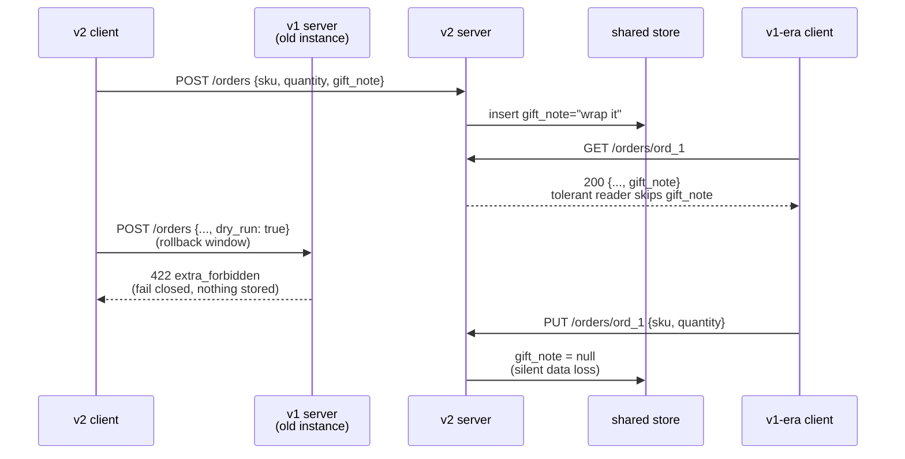

# Evolving APIs Without Versioning: Additive Fields, Optionality Invariants, and the Tolerant Reader Pattern

> [!summary] Claim
> An API can grow for years without a new version only if three invariants hold at once: every new field is optional with a default that reproduces the old behavior, every reader ignores (or preserves) members and enum values it does not know, and every writer fails closed on input it does not understand, because during a rolling deploy or a rollback old and new code read each other's messages.

Part of [Versioning Evolution and API Guidelines](README.md) in [API Engineering](../README.md).

## TL;DR

- Mechanism: an additive change adds a response member, an optional request member, or an enum value; old readers survive it only because they skip unknown keys, which in Pydantic is the default `extra='ignore'` path where `pydantic-core` never even records unknown keys (`pydantic-core 2.50.4 src/validators/model_fields.rs, ModelFieldsValidator::validate_json_by_iteration`).
- Contract rule: a new request field must be optional and its default must equal the behavior before the field existed (AIP-180, "Adding components"), and a new response field must be read with a default on the client, because old server instances keep answering during a rollout or a rollback.
- Trap: a tolerant reader that ignores unknown members and then sends a full-replacement `PUT` erases data written by newer clients; the lab shows `gift_note` going from `"wrap it"` to `null` after one read-modify-write by a v1-era client.
- Portability fact: in Pydantic v2 `str | None` without a default is a required field, unlike Pydantic v1 (pydantic 2.14.3 `docs/migration.md`, "Required, optional, and nullable fields"); the lab proves the `missing` error identically on CPython `3.12.13` and `3.12.16`, `3.13.18`, `3.14.6` and `3.14.10`, `3.15.2`, and free-threaded `3.15.2t`, across macOS, Debian Trixie (glibc), and Alpine (musl).
- When not to use it: when the meaning of an existing field changes, when a field becomes required, or when a client cannot be trusted to ignore unknown input (for example, generated SDKs with closed enums), additive evolution is not enough and you need an explicit version; see [[API-Versioning-Strategies-URI-Header-Media-Type-and-Channel-AIP-185]].

## Mental model



The diagram is one rollout seen from the shared store.
The v2 client writes a new field through a v2 instance, and a v1-era client reads the same record; it survives only because its reader skips `gift_note` instead of rejecting the object.
During a rollback window the load balancer sends a v2 request carrying `dry_run: true` to an old v1 instance; if that instance ignores unknown members it executes a real order, so it must reject with `422` and let the client retry or degrade.
Finally the v1-era client writes back what it read, minus the member it skipped, and full-replacement `PUT` semantics turn that omission into a deletion.
Each arrow is a separate test in the lab below.

## How it works

### Where the rule comes from

The robustness principle is stated in (RFC 1122 Section 1.2.2) as "Be liberal in what you accept, and conservative in what you send", and the same section already contains the tolerant-reader rule for enumerations: "this enumeration must be assumed to be incomplete", so "if a protocol specification defines four possible error codes, the software must not break when a fifth code shows up".
Martin Fowler's TolerantReader entry (2011) applies it to service payloads: read only the elements you need, ignore the rest, and keep that reading code in one place so the rest of the system does not see the wire shape.
HTTP builds the same contract into its own extension points: recipients "SHOULD ignore unrecognized header and trailer fields" (RFC 9110 Section 5.1), and a client "MUST understand the class of any status code" and treat an unrecognized one as the `x00` code of its class, so an unknown `471` is handled as `400 Bad Request` (RFC 9110 Section 15).

The IAB's (RFC 9413 Section 2.2) draws the line that makes this note's design work: a well-designed extensibility mechanism "establishes clear rules for the handling of elements like new messages or parameters", so "new messages or parameters thereby become entirely expected", which is different from relying on implementations to tolerate arbitrary unexpected input.
(RFC 9413 Section 4.1) describes what happens when tolerance is applied to errors instead of to declared extension points: flaws become entrenched as a de facto standard, and its example is TLS servers that failed on a `ClientHello` ending in an empty extension, which forced every client to avoid that legal encoding.
(RFC 9413 Section 5.1), titled "Virtuous Intolerance", names the counterweight: choosing to "generate fatal errors for unspecified conditions instead of attempting error recovery can ensure that faults receive attention".
The design that follows is therefore asymmetric on purpose: tolerate the extension points the contract declares (unknown response members, new enum strings, unknown status codes), and be intolerant of everything else, including unknown request members on the server.

### What counts as additive

Google AIP-180 ("Adding components") allows new fields, enums, and enum values in the same major version on three conditions: new required fields must not be added to existing request messages or resources, "Any field being populated by clients must have a default behavior matching the behavior before the field was introduced", and "Any field previously populated by the server must continue to be populated".
AIP-180 ("Serializing defaults") adds a presence rule: an API must not change whether a field equal to its default is serialized, because clients may treat presence or absence as meaningful.
Zalando rule 107 ("SHOULD prefer compatible extensions") splits the rules by direction: input-only schemas may add optional fields only; output-only schemas may add mandatory or optional fields but "enum ranges cannot be extended"; schemas used for both may add only optional fields.
The direction matters because the two parties evolve at different speeds: the server owns the schema, but it does not own the deployed clients.

### Optionality invariants

"Optional" has three independent bits on the wire: whether the member may be absent, whether it may be `null`, and what absence means.
JSON Merge Patch fixes one meaning: `null` in a merge patch removes the target member (RFC 7396 Section 1), so a merge patch can remove a member but cannot set it to `null`, and the same section says the format suits documents that "do not make use of explicit null values"; see [[Partial-Updates-JSON-Merge-Patch-RFC-7396-vs-JSON-Patch-RFC-6902]].
Pydantic v2 encodes absence and nullability separately: the guide's table lists `f3: Optional[str]` as "Required, can be `None`" and `f4: Optional[str] = None` as "Not required, can be `None`, is `None` by default", and its code example notes that `Optional[str]` is the "same as str | None" (pydantic 2.14.3 `docs/migration.md`, "Required, optional, and nullable fields").
That is the optionality trap for new readers: a client written against the v2 docs that declares `gift_note: str | None` will fail with `missing` against every v1 instance still serving traffic, which the lab's `EagerOrderViewV2` proves.
`model_fields_set` records which members were actually present (pydantic 2.14.3 `pydantic/main.py`, `BaseModel.model_fields_set`), so a reader can still distinguish "absent because the server is old" from "explicitly `null`".

### How Pydantic implements the three `extra` modes

`ConfigDict.extra` is annotated `ExtraValues | None`, where `ExtraValues = Literal['allow', 'ignore', 'forbid']`, and its docstring says "Defaults to `'ignore'`" (pydantic 2.14.3 `pydantic/config.py`, `ConfigDict.extra`).
The stored default is `extra=None` (pydantic 2.14.3 `pydantic/_internal/_config.py`, `config_defaults`), and `pydantic-core` is what turns the unset value into `Ignore`.
`ModelFieldsValidator::build` resolves the mode with `ExtraBehavior::from_schema_or_config(py, schema, config, ExtraBehavior::Ignore)` (`pydantic-core 2.50.4 src/validators/model_fields.rs, ModelFieldsValidator::build`), and `validate_fields` applies any per-call override with `state.extra_behavior_or(self.extra_behavior)` and maps the result to `ModelExtraValidator::Forbid`, `Ignore`, or `Allow` (`pydantic-core 2.50.4 src/validators/model_fields.rs, ModelFieldsValidator::validate_fields`).
On the JSON path, `validate_json_by_iteration` walks the object once, writes each known key into a per-field slot held in `SmallVec<[...; 16]>`, and creates the `possible_extra` map only when the mode is not `Ignore` (`pydantic-core 2.50.4 src/validators/model_fields.rs, ModelFieldsValidator::validate_json_by_iteration`).
On the Python-dict path, `validate_by_get_item` likewise skips its `used_keys` set in `Ignore` mode (`pydantic-core 2.50.4 src/validators/model_fields.rs, ModelFieldsValidator::validate_by_get_item`).
So `ignore` is not just permissive, it is the cheapest mode: on the JSON path unknown members are never recorded or converted to Python objects, and on the dict path the input is not iterated at all.
In `validate_extra_key_value`, `Forbid` pushes one `ErrorTypeDefaults::ExtraForbidden` line error per unknown key with the key as its location, and `Allow` stores the value in the extra dict and also adds the key to `fields_set` (`pydantic-core 2.50.4 src/validators/model_fields.rs, ModelFieldsValidationState::validate_extra_key_value`).
The lab test `test_per_call_extra_overrides_validation_but_only_config_allow_dumps_extras` pins the consequence, and the lab's `PUT` test depends on it: with `extra='allow'` in `model_config`, `model_dump()` and `model_dump_json()` emit the extra members, which is exactly what makes `allow` the right mode for a preserving client and the wrong mode for a server request model.
`BaseModel.model_validate` also accepts a per-call `extra` override in 2.14.3 (pydantic 2.14.3 `pydantic/main.py`, `BaseModel.model_validate`), so one model class can be strict on one path and lenient on another.
The same test confirms it: `extra='forbid'` passed to an `ignore` model raises `extra_forbidden`, and `extra='ignore'` passed to a `forbid` model parses.
A per-call `extra='allow'` on a model configured `forbid` fills `model_extra`, but `model_dump()` still omits the extras, so a preserving client must set `allow` in `model_config`.

### Where FastAPI applies the contract

For a request body, FastAPI collects validation errors into `RequestValidationError`, and the default handler returns `JSONResponse(status_code=422, content={"detail": jsonable_encoder(exc.errors())})` (fastapi 0.162.0 `fastapi/exception_handlers.py`, `request_validation_exception_handler`); the lab asserts `detail` is `[{"type": "extra_forbidden", "loc": ["body", "dry_run"], ...}]`.
For a response, `serialize_response` calls `field.validate(response_content, {}, loc=("response",))`, raises `ResponseValidationError` on errors, and then serializes through the response model (fastapi 0.162.0 `fastapi/routing.py`, `serialize_response`).
Two consequences follow, and the lab proves both on the v1 build: a stored member the v1 response model does not declare (`gift_note`) is filtered out of the v1 response, and a stored enum value the v1 response model does not declare (`on_hold`) makes the old instance raise `ResponseValidationError` with `loc` `("response", "status")`, which reaches the client as `500`.
That second failure is why writers of a new enum value must be deployed only after every reader instance accepts it, and why a rollback must not cross that line.
Pydantic also publishes the mode into the schema (lab tests `test_extra_mode_is_published_as_additional_properties_in_json_schema` and `test_forbid_request_model_publishes_closed_schema_response_model_stays_open`): `extra='forbid'` generates `"additionalProperties": false`, `extra='allow'` generates `"additionalProperties": true`, and `ignore` emits nothing, which per (JSON Schema 2020-12 Core Section 10.3.2.3) has "the same assertion behavior as an empty schema", that is, open.

### Binary formats

Protocol Buffers bakes the tolerant reader into the decoder: "old binaries simply ignore the new field when parsing" (protobuf.dev proto3 guide, "Updating A Message Type", as of 2026-11), and proto3 messages "preserve unknown fields and include them during parsing and in the serialized output" (same guide, "Unknown Fields").
Its "Retaining Unknown Fields" subsection lists the ways unknown fields are lost: serializing to JSON and copying a message field by field; preservation needs binary encoding and `CopyFrom()` or `MergeFrom()`.
JSON has no field numbers, so the JSON equivalent of "preserve unknown fields" is an explicit choice in every reader, which is what `extra='allow'` makes possible.

## Numbers and limits

| Quantity | Value | Source or measurement |
|---|---|---|
| Pydantic default `extra` mode | `'ignore'` | pydantic 2.14.3 `pydantic/config.py`, `ConfigDict.extra` |
| FastAPI status for request validation failure | `422` | fastapi 0.162.0 `fastapi/exception_handlers.py`, `request_validation_exception_handler` |
| Inline field-input slots before heap allocation in JSON model validation | `16` | `SmallVec<[Option<(LookupFieldInfo, &JsonValue)>; 16]>` (`pydantic-core 2.50.4 src/validators/model_fields.rs, validate_json_by_iteration`) |
| `model_validate_json`, 4-field model (`id: str`, `sku: str`, `quantity: int`, `status: str`), 58-byte body, no unknown members | Best per-call time `575` ns (`ignore`), `575` ns (`allow`), `556` ns (`forbid`); across six runs the per-run minimum ranged `575` to `626`, `575` to `986`, and `556` to `783` ns, so the three modes are within run-to-run noise | Measured: minimum of `timeit.repeat(number=20000, repeat=15)`, six runs, `uv run --frozen python` in `labs/`, CPython `3.14.6`, macOS `27.2` arm64, Apple M3 Pro; the machine was under heavy concurrent load (load average about `60` on `12` cores), so read these as upper bounds (as of 2026-11) |
| Same model, 538-byte body with 20 unknown string members | Best per-call time `ignore` `945` ns; `allow` `2611` ns; `forbid` rejection `3847` ns (includes raising `ValidationError`); per-run minimum ranged `945` to `1413`, `2611` to `6243`, and `3847` to `6381` ns | Same method and machine as above |
| `422` response size for unknown members on an `extra='forbid'` FastAPI body | 1 unknown member (`{"sku":"A-1","quantity":1,"dry_run":true}`): 41-byte request -> 116-byte response; 1000 unknown members (`unknown_0000` to `unknown_0999`, each an 8-character string): 26026-byte request -> 115012-byte response with 1000 `detail` entries | Asserted byte for byte by the lab test `test_forbid_rejection_adds_one_detail_entry_per_unknown_member`, in-process with `httpx.ASGITransport` against `build_v1_app(..., request_extra="forbid")`; identical on every leg of the Portability matrix (as of 2026-11) |
| Lab runtime | `16 passed in 0.52s` | `uv run --frozen pytest` on CPython `3.14.6`, macOS `27.2` arm64, see Worked example |
| Protobuf field number range | `1` to `536,870,911`; `19,000` to `19,999` reserved for the implementation | protobuf.dev proto3 guide, "Assigning Field Numbers" (as of 2026-11) |
| Unknown HTTP status code fallback | treated as `x00` of its class | (RFC 9110 Section 15) |

The two measured rows say the mode costs nothing measurable when the payload matches the model, and that `allow` costs about `2.8x` `ignore` once unknown members appear (`2611 / 945`), because every extra value is materialized and stored.
The `422` row is an amplification ratio of about `4.4x` at 1000 unknown members (`115012 / 26026`), because each error entry repeats its `type`, `loc`, and `msg` and echoes its `input`.

## Portability

| Runtime or component | Behavior | Evidence |
|---|---|---|
| CPython `3.12.16` (and `3.12.13` on macOS) | All 16 lab tests pass; the lab's `type` alias statements (PEP 695, Python `3.12`) make `3.12` the floor, and CPython `3.11.15` rejects the module with `SyntaxError` at `type ExtraMode = ...` | `3.12.16`: `python:3.12.16-trixie` -> `16 passed in 0.50s` and `python:3.12.16-alpine` -> `16 passed in 0.84s` (container method in the two container rows below); `3.12.13`: macOS, `UV_PROJECT_ENVIRONMENT=<separate venv> uv run --frozen --python <3.12.13> pytest ... -q -p no:cacheprovider` -> `16 passed in 0.80s`; `3.11.15`: `compile()` of the lab module on macOS |
| CPython `3.13.18` | All 16 pass | macOS, `uv run --frozen --python /opt/homebrew/bin/python3.13` in a separate environment -> `16 passed in 1.15s`; Trixie container `0.32s`; Alpine container `1.06s` |
| CPython `3.14.6` (workspace) and `3.14.10` | All 16 pass | macOS, `uv run --frozen pytest` -> `16 passed in 0.52s` (`3.14.6`); `--python /opt/homebrew/bin/python3.14` (`3.14.10`) in a separate environment -> `16 passed in 1.00s`; `3.14.10` in the Trixie container `0.55s` and the Alpine container `0.79s` |
| CPython `3.15.2` | All 16 pass with the full locked environment | macOS, `uv run --frozen --python /opt/homebrew/bin/python3.15` in a separate environment -> `16 passed in 1.30s`; Trixie container `0.68s`; Alpine container `1.61s` |
| Free-threaded CPython `3.15.2t` | All 16 pass, and `sys._is_gil_enabled()` is `False` before and after the run | uv-managed `cpython-3.15.2+freethreaded`, installed by `uv 0.13.7` inside `python:3.15.2-trixie` (glibc) and `python:3.15.2-alpine` (musl): `PYTHONPATH=src uv run --no-project --python 3.15.2+freethreaded` with `pydantic 2.14.3`, `pydantic-core 2.50.4`, `fastapi 0.162.0`, `starlette 1.10.0`, `httpx 0.28.1`, `httpcore 1.0.9`, `anyio 4.16.0`, `pytest 9.2.0`, and `pytest-asyncio 1.4.1.post1`, with transitive dependencies held to the `uv.lock` versions through `UV_CONSTRAINT` -> `16 passed in 1.24s` (glibc) and `16 passed in 3.20s` (musl); macOS `3.15.0b3t`, same method -> `16 passed in 0.66s`; the full lock does not install on a free-threaded build (on macOS `3.15.0b3t`, `uv sync --frozen` reports that `psycopg-binary 3.3.8` has no source distribution or wheel for the platform) |
| Debian Trixie container (Debian `13`, glibc `2.41`, linux/arm64) | All 16 pass on CPython `3.12.16`, `3.13.18`, `3.14.10`, and `3.15.2` with the full locked environment | `docker run --rm -v <labs>:/src:ro python:<version>-trixie` under OrbStack (kernel `7.2.12`), workspace copied inside the container, `uv 0.11.26`, `uv sync --frozen`, then `uv run --frozen pytest ... -q -p no:cacheprovider` -> `16 passed` in `0.50s`, `0.32s`, `0.55s`, and `0.68s` (as of 2026-11) |
| Alpine container (Alpine `3.24`, musl `1.2.6`, linux/arm64) | All 16 pass on the same four versions with the full locked environment | Same method with `python:<version>-alpine` -> `16 passed` in `0.84s`, `1.06s`, `0.79s`, and `1.61s` (as of 2026-11) |
| Pydantic v1 vs v2 | `Optional[T]` without a default is required in v2, which the guide marks as a breaking change from V1 | pydantic 2.14.3 `docs/migration.md`, "Required, optional, and nullable fields" |
| `pydantic 2.14.3` `model_validate(extra=...)` | per-call override of the configured mode | pydantic 2.14.3 `pydantic/main.py`, `BaseModel.model_validate` signature, plus the lab test `test_per_call_extra_overrides_validation_but_only_config_allow_dumps_extras` on every leg above |
| Protocol Buffers (binary) | unknown fields preserved; lost through JSON or field-by-field copy | protobuf.dev proto3 guide, "Unknown Fields" (as of 2026-11) |
| Uvicorn `0.54.0` (`h11` and `httptools`), Hypercorn `0.18.0`, Granian `2.8.7` over HTTP/1.1; Hypercorn and Granian over cleartext HTTP/2 with prior knowledge; Hypercorn over HTTP/2 on TLS | Same results as in-process: `422` with `extra_forbidden` at `["body", "dry_run"]`, `gift_note` filtered from the v1 `200`, and `500` for the `on_hold` record | Probe, not a lab test: each server ran as a subprocess on a loopback port serving `build_v1_app(..., request_extra="forbid")` over a store holding one record with `gift_note` and one with `status: "on_hold"`, driven by `httpx 0.28.1` with `h2 4.4.1` (`http1=False, http2=True` for the HTTP/2 legs), CPython `3.14.6`, macOS `27.2` arm64 (as of 2026-11) |
| HTTP/3 over QUIC | Same three results on Hypercorn `0.18.0` started with `--quic-bind`, with ALPN `h3` negotiated | Probe, not a lab test: an `aioquic 1.7.2` client (`H3Connection`) against the Hypercorn subprocess on a loopback UDP port with a self-signed P-256 certificate, CPython `3.14.6`, macOS `27.2` arm64 (as of 2026-11); Uvicorn and Granian have no HTTP/3 leg, because `uvicorn --help` lists the `--http` choices `auto`, `h11`, `httptools`, and `zttp`, and `granian --help` lists `auto`, `1`, and `2` |
| Legs not run | x86_64 hosts; CPython `3.12.16` and `3.15.2t` on macOS (both ran in the Linux containers above); the real-server and HTTP/3 probes on any interpreter other than macOS CPython `3.14.6`; Uvicorn's `zttp` implementation, which is not in the lock | Recorded here as the note contract requires; the lab tests themselves run in-process through `httpx.ASGITransport` and open no socket |

## Worked example

The lab models one order resource served by two builds that share one `OrderStore`, the way two releases share one database during a rolling deploy.
v1 knows `sku`, `quantity`, and `status`; v2 adds the request and response field `gift_note`, the request-only flag `dry_run`, and the status value `on_hold`.
The [implementation](../labs/src/api_labs/f07_versioning_evolution_and_api_guidelines/tolerant_reader.py) also defines five client readers (three v1-era, two v2-era) and a duplicate-key gate, and the [test](../labs/tests/f07_versioning_evolution_and_api_guidelines/test_additive_schema_evolution_and_tolerant_reader_patterns.py) drives every mixed-version path in-process.

### Implementation (`labs/src/api_labs/f07_versioning_evolution_and_api_guidelines/tolerant_reader.py`)

```python
"""Additive schema evolution: tolerant readers, optionality defaults, and fail-closed writers.

Two server builds share one order store, as they do during a rolling deploy or a rollback:
v1 knows `sku`, `quantity`, `status`; v2 additively adds the response and request field
`gift_note`, the request-only flag `dry_run`, and the status value `on_hold`.
"""

import json
from dataclasses import dataclass, field
from typing import Annotated, Any, Literal

from fastapi import FastAPI, HTTPException, Response
from pydantic import BaseModel, BeforeValidator, ConfigDict, Field

type ExtraMode = Literal["allow", "ignore", "forbid"]
type Record = dict[str, Any]


@dataclass
class OrderStore:
    """Shared persistence for every server build, keyed by order id."""

    orders: dict[str, Record] = field(default_factory=dict[str, Record])
    next_id: int = 1

    def insert(self, record: Record) -> str:
        order_id = f"ord_{self.next_id}"
        self.next_id += 1
        self.orders[order_id] = {**record, "id": order_id}
        return order_id


# --- server v1 -------------------------------------------------------------------------------


class OrderOutV1(BaseModel):
    """v1 response contract; FastAPI validates every response through it."""

    id: str
    sku: str
    quantity: int
    status: Literal["pending", "shipped"]


def build_v1_app(store: OrderStore, *, request_extra: ExtraMode) -> FastAPI:
    """Old server build whose request model handles unknown fields per `request_extra`."""

    class OrderCreateV1(BaseModel):
        model_config = ConfigDict(extra=request_extra)

        sku: str = Field(min_length=1, max_length=64)
        quantity: int = Field(ge=1, le=1000)

    app = FastAPI()

    @app.post("/orders", status_code=201)
    async def create_order(body: OrderCreateV1) -> OrderOutV1:
        # Spreading the body last is the mass-assignment bug that extra="allow" arms.
        order_id = store.insert({"status": "pending", **body.model_dump()})
        return OrderOutV1.model_validate(store.orders[order_id])

    @app.get("/orders/{order_id}", response_model=OrderOutV1)
    async def get_order(order_id: str) -> Record:
        # FastAPI validates the raw record against OrderOutV1 (serialize_response):
        # unknown members are dropped, unknown enum values fail the response.
        if order_id not in store.orders:
            raise HTTPException(status_code=404)
        return store.orders[order_id]

    return app


# --- server v2: additive only ----------------------------------------------------------------


class OrderCreateV2(BaseModel):
    """v2 request: every new field is optional and its default reproduces v1 behavior."""

    model_config = ConfigDict(extra="forbid")

    sku: str = Field(min_length=1, max_length=64)
    quantity: int = Field(ge=1, le=1000)
    gift_note: str | None = Field(default=None, max_length=200)
    dry_run: bool = False


class OrderReplaceV2(BaseModel):
    """PUT body: a full replacement of the client-writable state (RFC 9110 Section 9.3.4)."""

    model_config = ConfigDict(extra="forbid")

    sku: str = Field(min_length=1, max_length=64)
    quantity: int = Field(ge=1, le=1000)
    gift_note: str | None = Field(default=None, max_length=200)


class OrderOutV2(BaseModel):
    """v2 response: a superset of OrderOutV1 plus one new enum value."""

    id: str
    sku: str
    quantity: int
    status: Literal["pending", "shipped", "on_hold"]
    gift_note: str | None = None


def build_v2_app(store: OrderStore) -> FastAPI:
    """New server build: additive fields, fail-closed request models."""
    app = FastAPI()

    @app.post("/orders", status_code=201)
    async def create_order(body: OrderCreateV2, response: Response) -> OrderOutV2:
        record: Record = {**body.model_dump(exclude={"dry_run"}), "status": "pending"}
        if body.dry_run:
            response.status_code = 200
            return OrderOutV2.model_validate({**record, "id": "preview"})
        order_id = store.insert(record)
        return OrderOutV2.model_validate(store.orders[order_id])

    @app.get("/orders/{order_id}")
    async def get_order(order_id: str) -> OrderOutV2:
        if order_id not in store.orders:
            raise HTTPException(status_code=404)
        return OrderOutV2.model_validate(store.orders[order_id])

    @app.put("/orders/{order_id}")
    async def replace_order(order_id: str, body: OrderReplaceV2) -> OrderOutV2:
        if order_id not in store.orders:
            raise HTTPException(status_code=404)
        store.orders[order_id] = {**store.orders[order_id], **body.model_dump()}
        return OrderOutV2.model_validate(store.orders[order_id])

    return app


# --- client readers --------------------------------------------------------------------------

KNOWN_STATUSES = frozenset({"pending", "shipped"})


def _unknown_status_to_fallback(value: object) -> object:
    """Map an unknown status string to "unknown"; leave non-strings to fail validation."""
    if isinstance(value, str) and value not in KNOWN_STATUSES:
        return "unknown"
    return value


type TolerantStatus = Annotated[
    Literal["pending", "shipped", "unknown"], BeforeValidator(_unknown_status_to_fallback)
]


class StrictOrderViewV1(BaseModel):
    """Anti-pattern: a v1-era client that treats every response object as closed."""

    model_config = ConfigDict(extra="forbid")

    id: str
    sku: str
    quantity: int
    status: Literal["pending", "shipped"]


class TolerantOrderViewV1(BaseModel):
    """v1-era tolerant reader: drops unknown members, maps unknown enum values."""

    model_config = ConfigDict(extra="ignore")

    id: str
    sku: str
    quantity: int
    status: TolerantStatus


class PreservingOrderViewV1(TolerantOrderViewV1):
    """v1-era tolerant reader that keeps unknown members for read-modify-write."""

    model_config = ConfigDict(extra="allow")


class TolerantOrderViewV2(TolerantOrderViewV1):
    """v2-era reader: the new field has a default because v1 servers still answer."""

    gift_note: str | None = None


class EagerOrderViewV2(TolerantOrderViewV1):
    """Bug: `str | None` without a default is required in Pydantic v2, not optional."""

    gift_note: str | None


def writable_state(view: TolerantOrderViewV1) -> Record:
    """Build a PUT body from a reader: writable fields plus any preserved unknown members."""
    return view.model_dump(exclude={"id", "status"})


# --- defense in depth ------------------------------------------------------------------------


class DuplicateKeyError(ValueError):
    """Raised when a JSON object repeats a member name (RFC 8259 Section 4)."""


def _reject_duplicates(pairs: list[tuple[str, Any]]) -> dict[str, Any]:
    result: dict[str, Any] = {}
    for key, value in pairs:
        if key in result:
            raise DuplicateKeyError(f"duplicate member name {key!r}")
        result[key] = value
    return result


def loads_rejecting_duplicate_keys(raw: bytes) -> Any:
    """Parse JSON, failing closed on duplicate member names instead of keeping the last one."""
    return json.loads(raw, object_pairs_hook=_reject_duplicates)
```

### Test (`labs/tests/f07_versioning_evolution_and_api_guidelines/test_additive_schema_evolution_and_tolerant_reader_patterns.py`)

```python
"""Additive field rollouts: tolerant readers, optional defaults, and fail-closed writers."""

import json
from typing import Any

import httpx
import pytest
from fastapi import FastAPI
from fastapi.exceptions import ResponseValidationError
from pydantic import ValidationError

from api_labs.f07_versioning_evolution_and_api_guidelines.tolerant_reader import (
    DuplicateKeyError,
    EagerOrderViewV2,
    OrderCreateV2,
    OrderStore,
    PreservingOrderViewV1,
    StrictOrderViewV1,
    TolerantOrderViewV1,
    TolerantOrderViewV2,
    build_v1_app,
    build_v2_app,
    loads_rejecting_duplicate_keys,
    writable_state,
)


def _client(app: FastAPI, *, raise_app_exceptions: bool = True) -> httpx.AsyncClient:
    transport = httpx.ASGITransport(app=app, raise_app_exceptions=raise_app_exceptions)
    return httpx.AsyncClient(transport=transport, base_url="http://test")


def _error_types(exc: ValidationError) -> list[tuple[str, tuple[int | str, ...]]]:
    return [(e["type"], e["loc"]) for e in exc.errors(include_url=False)]


def _rejection(response: httpx.Response) -> tuple[int, list[tuple[str, list[str]]]]:
    return response.status_code, [(d["type"], d["loc"]) for d in response.json()["detail"]]


@pytest.mark.unit
@pytest.mark.asyncio
async def test_additive_response_field_breaks_strict_reader_not_tolerant_reader() -> None:
    store = OrderStore()
    async with _client(build_v2_app(store)) as v2:
        created = await v2.post("/orders", json={"sku": "A-1", "quantity": 2, "gift_note": "hi"})
    assert created.status_code == 201
    body = created.content
    assert json.loads(body) == {
        "id": "ord_1",
        "sku": "A-1",
        "quantity": 2,
        "status": "pending",
        "gift_note": "hi",
    }

    with pytest.raises(ValidationError) as strict_err:
        StrictOrderViewV1.model_validate_json(body)
    assert _error_types(strict_err.value) == [("extra_forbidden", ("gift_note",))]

    tolerant = TolerantOrderViewV1.model_validate_json(body)
    assert tolerant.model_dump() == {
        "id": "ord_1",
        "sku": "A-1",
        "quantity": 2,
        "status": "pending",
    }
    assert tolerant.model_extra is None


@pytest.mark.unit
def test_unknown_enum_string_maps_to_fallback_but_wrong_type_still_fails() -> None:
    raw = {"id": "ord_9", "sku": "A-1", "quantity": 1, "status": "on_hold"}
    with pytest.raises(ValidationError) as strict_err:
        StrictOrderViewV1.model_validate(raw)
    assert _error_types(strict_err.value) == [("literal_error", ("status",))]

    assert TolerantOrderViewV1.model_validate(raw).status == "unknown"

    with pytest.raises(ValidationError) as type_err:
        TolerantOrderViewV1.model_validate({**raw, "status": 7})
    assert _error_types(type_err.value) == [("literal_error", ("status",))]


@pytest.mark.unit
@pytest.mark.asyncio
async def test_new_reader_needs_a_default_because_old_servers_omit_the_field() -> None:
    store = OrderStore()
    async with _client(build_v1_app(store, request_extra="forbid")) as v1:
        created = await v1.post("/orders", json={"sku": "A-1", "quantity": 1})
    assert created.status_code == 201
    assert "gift_note" not in created.json()

    reader = TolerantOrderViewV2.model_validate_json(created.content)
    assert reader.gift_note is None
    assert "gift_note" not in reader.model_fields_set

    with pytest.raises(ValidationError) as eager_err:
        EagerOrderViewV2.model_validate_json(created.content)
    assert _error_types(eager_err.value) == [("missing", ("gift_note",))]


@pytest.mark.unit
@pytest.mark.asyncio
async def test_new_server_reads_and_replaces_a_record_written_by_the_old_server() -> None:
    store = OrderStore()
    async with _client(build_v1_app(store, request_extra="forbid")) as v1:
        await v1.post("/orders", json={"sku": "A-1", "quantity": 1})
    assert store.orders == {
        "ord_1": {"id": "ord_1", "sku": "A-1", "quantity": 1, "status": "pending"}
    }

    async with _client(build_v2_app(store)) as v2:
        read = await v2.get("/orders/ord_1")
        replaced = await v2.put(
            "/orders/ord_1", json={"sku": "A-1", "quantity": 2, "gift_note": "g"}
        )
    assert read.status_code == 200
    assert read.json() == {
        "id": "ord_1",
        "sku": "A-1",
        "quantity": 1,
        "status": "pending",
        "gift_note": None,
    }
    assert replaced.status_code == 200
    assert replaced.json() == {
        "id": "ord_1",
        "sku": "A-1",
        "quantity": 2,
        "status": "pending",
        "gift_note": "g",
    }


@pytest.mark.unit
@pytest.mark.asyncio
async def test_old_server_in_ignore_mode_silently_drops_dry_run_and_commits() -> None:
    payload = {"sku": "A-1", "quantity": 3, "dry_run": True}

    ignoring_store = OrderStore()
    async with _client(build_v1_app(ignoring_store, request_extra="ignore")) as v1_ignore:
        silent = await v1_ignore.post("/orders", json=payload)
    assert silent.status_code == 201
    assert list(ignoring_store.orders) == ["ord_1"]

    forbidding_store = OrderStore()
    async with _client(build_v1_app(forbidding_store, request_extra="forbid")) as v1_forbid:
        loud = await v1_forbid.post("/orders", json=payload)
    assert loud.status_code == 422
    assert [(d["type"], d["loc"]) for d in loud.json()["detail"]] == [
        ("extra_forbidden", ["body", "dry_run"])
    ]
    assert forbidding_store.orders == {}


@pytest.mark.unit
@pytest.mark.asyncio
async def test_new_request_fields_default_to_v1_behavior() -> None:
    assert OrderCreateV2.model_fields["dry_run"].default is False
    assert OrderCreateV2.model_fields["gift_note"].default is None

    store = OrderStore()
    async with _client(build_v2_app(store)) as v2:
        v1_shaped = await v2.post("/orders", json={"sku": "A-1", "quantity": 1})
        preview = await v2.post("/orders", json={"sku": "A-1", "quantity": 1, "dry_run": True})
    assert v1_shaped.status_code == 201
    assert v1_shaped.json()["gift_note"] is None
    assert preview.status_code == 200
    assert preview.json()["id"] == "preview"
    assert store.orders == {
        "ord_1": {
            "id": "ord_1",
            "sku": "A-1",
            "quantity": 1,
            "gift_note": None,
            "status": "pending",
        }
    }


@pytest.mark.unit
@pytest.mark.asyncio
async def test_ignoring_reader_erases_new_field_on_put_preserving_reader_keeps_it() -> None:
    store = OrderStore()
    async with _client(build_v2_app(store)) as v2:
        await v2.post("/orders", json={"sku": "A-1", "quantity": 1, "gift_note": "wrap it"})
        await v2.post("/orders", json={"sku": "B-2", "quantity": 1, "gift_note": "wrap it"})

        lossy = TolerantOrderViewV1.model_validate_json((await v2.get("/orders/ord_1")).content)
        lossy.quantity = 5
        put_lossy = await v2.put("/orders/ord_1", json=writable_state(lossy))

        keeper = PreservingOrderViewV1.model_validate_json((await v2.get("/orders/ord_2")).content)
        keeper.quantity = 5
        assert keeper.model_extra == {"gift_note": "wrap it"}
        put_keeper = await v2.put("/orders/ord_2", json=writable_state(keeper))

    assert put_lossy.status_code == 200
    assert put_keeper.status_code == 200
    assert store.orders["ord_1"]["gift_note"] is None
    assert store.orders["ord_2"]["gift_note"] == "wrap it"
    assert store.orders["ord_2"]["quantity"] == 5


@pytest.mark.unit
@pytest.mark.asyncio
async def test_old_server_returns_500_for_record_with_new_enum_value_and_filters_new_field() -> (
    None
):
    store = OrderStore()
    async with _client(build_v2_app(store)) as v2:
        await v2.post("/orders", json={"sku": "A-1", "quantity": 1, "gift_note": "n"})
        await v2.post("/orders", json={"sku": "B-2", "quantity": 1})
    store.orders["ord_2"]["status"] = "on_hold"

    async with _client(
        build_v1_app(store, request_extra="forbid"), raise_app_exceptions=False
    ) as v1:
        filtered = await v1.get("/orders/ord_1")
        broken = await v1.get("/orders/ord_2")
    assert filtered.status_code == 200
    assert filtered.json() == {"id": "ord_1", "sku": "A-1", "quantity": 1, "status": "pending"}
    assert broken.status_code == 500

    async with _client(build_v1_app(store, request_extra="forbid")) as v1_raising:
        with pytest.raises(ResponseValidationError) as exc_info:
            await v1_raising.get("/orders/ord_2")
    assert [(e["type"], e["loc"]) for e in exc_info.value.errors()] == [
        ("literal_error", ("response", "status"))
    ]


@pytest.mark.unit
@pytest.mark.asyncio
async def test_allow_mode_on_server_request_model_enables_mass_assignment() -> None:
    attack = {"sku": "A-1", "quantity": 1, "status": "shipped", "dry_run": True}
    outcomes: dict[str, tuple[int, Any]] = {}
    rejections: dict[str, Any] = {}
    for mode in ("allow", "ignore", "forbid"):
        store = OrderStore()
        async with _client(build_v1_app(store, request_extra=mode)) as v1:
            response = await v1.post("/orders", json=attack)
        outcomes[mode] = (response.status_code, store.orders.get("ord_1"))
        rejections[mode] = response.json().get("detail")
    assert outcomes == {
        "allow": (
            201,
            {"id": "ord_1", "sku": "A-1", "quantity": 1, "status": "shipped", "dry_run": True},
        ),
        "ignore": (201, {"id": "ord_1", "sku": "A-1", "quantity": 1, "status": "pending"}),
        "forbid": (422, None),
    }
    assert rejections["allow"] is None
    assert rejections["ignore"] is None
    assert [(d["type"], d["loc"]) for d in rejections["forbid"]] == [
        ("extra_forbidden", ["body", "status"]),
        ("extra_forbidden", ["body", "dry_run"]),
    ]


@pytest.mark.unit
@pytest.mark.asyncio
async def test_forbid_rejection_adds_one_detail_entry_per_unknown_member() -> None:
    one = {"sku": "A-1", "quantity": 1, "dry_run": True}
    many = {"sku": "A-1", "quantity": 1} | {f"unknown_{i:04d}": "x" * 8 for i in range(1000)}
    store = OrderStore()
    async with _client(build_v1_app(store, request_extra="forbid")) as v1:
        small = await v1.post("/orders", json=one)
        large = await v1.post("/orders", json=many)
    assert (small.status_code, large.status_code) == (422, 422)
    assert (len(small.request.content), len(small.content)) == (41, 116)
    assert (len(large.request.content), len(large.content)) == (26026, 115012)
    detail = large.json()["detail"]
    assert len(detail) == 1000
    assert detail[0] == {
        "type": "extra_forbidden",
        "loc": ["body", "unknown_0000"],
        "msg": "Extra inputs are not permitted",
        "input": "xxxxxxxx",
    }
    assert store.orders == {}


@pytest.mark.unit
def test_forbid_request_model_publishes_closed_schema_response_model_stays_open() -> None:
    schemas = build_v2_app(OrderStore()).openapi()["components"]["schemas"]
    assert schemas["OrderCreateV2"]["additionalProperties"] is False
    assert schemas["OrderReplaceV2"]["additionalProperties"] is False
    assert "additionalProperties" not in schemas["OrderOutV2"]
    assert "gift_note" not in schemas["OrderCreateV2"]["required"]


@pytest.mark.unit
def test_extra_mode_is_published_as_additional_properties_in_json_schema() -> None:
    assert StrictOrderViewV1.model_json_schema()["additionalProperties"] is False
    assert PreservingOrderViewV1.model_json_schema()["additionalProperties"] is True
    assert "additionalProperties" not in TolerantOrderViewV1.model_json_schema()


@pytest.mark.unit
def test_per_call_extra_overrides_validation_but_only_config_allow_dumps_extras() -> None:
    raw = {"id": "ord_1", "sku": "A-1", "quantity": 1, "status": "pending", "gift_note": "n"}
    known = {"id": "ord_1", "sku": "A-1", "quantity": 1, "status": "pending"}

    with pytest.raises(ValidationError) as forbid_err:
        TolerantOrderViewV1.model_validate(raw, extra="forbid")
    assert _error_types(forbid_err.value) == [("extra_forbidden", ("gift_note",))]

    relaxed = StrictOrderViewV1.model_validate(raw, extra="ignore")
    assert relaxed.model_extra is None
    assert relaxed.model_dump() == known

    per_call = StrictOrderViewV1.model_validate(raw, extra="allow")
    assert per_call.model_extra == {"gift_note": "n"}
    assert per_call.model_dump() == known

    configured = PreservingOrderViewV1.model_validate(raw)
    assert "gift_note" in configured.model_fields_set
    assert configured.model_dump() == raw
    assert json.loads(configured.model_dump_json()) == raw


@pytest.mark.unit
def test_duplicate_member_names_take_last_value_unless_rejected() -> None:
    raw = b'{"id":"ord_1","sku":"A-1","quantity":1,"quantity":1000,"status":"pending"}'
    assert TolerantOrderViewV1.model_validate_json(raw).quantity == 1000
    assert json.loads(raw)["quantity"] == 1000
    with pytest.raises(DuplicateKeyError, match="'quantity'"):
        loads_rejecting_duplicate_keys(raw)
    assert loads_rejecting_duplicate_keys(b'{"a":1,"b":{"a":2}}') == {"a": 1, "b": {"a": 2}}
    assert loads_rejecting_duplicate_keys(b'{"a":{"a":2}}') == {"a": {"a": 2}}
    with pytest.raises(DuplicateKeyError, match="'a'"):
        loads_rejecting_duplicate_keys(b'{"b":{"a":1,"a":2}}')


@pytest.mark.unit
@pytest.mark.asyncio
async def test_unknown_order_id_is_404_on_every_build() -> None:
    store = OrderStore()
    async with _client(build_v1_app(store, request_extra="forbid")) as v1:
        v1_get = await v1.get("/orders/ord_404")
    async with _client(build_v2_app(store)) as v2:
        v2_get = await v2.get("/orders/ord_404")
        v2_put = await v2.put("/orders/ord_404", json={"sku": "A-1", "quantity": 1})
    assert (v1_get.status_code, v2_get.status_code, v2_put.status_code) == (404, 404, 404)
    assert store.orders == {}


@pytest.mark.unit
@pytest.mark.asyncio
async def test_request_field_bounds_are_enforced_on_every_build() -> None:
    edge = {"sku": "S" * 64, "quantity": 1000}
    out_of_range: list[tuple[dict[str, Any], tuple[str, list[str]]]] = [
        ({"sku": "", "quantity": 1}, ("string_too_short", ["body", "sku"])),
        ({"sku": "S" * 65, "quantity": 1}, ("string_too_long", ["body", "sku"])),
        ({"sku": "A-1", "quantity": 0}, ("greater_than_equal", ["body", "quantity"])),
        ({"sku": "A-1", "quantity": 1001}, ("less_than_equal", ["body", "quantity"])),
    ]
    long_note: tuple[dict[str, Any], tuple[str, list[str]]] = (
        {"sku": "A-1", "quantity": 1, "gift_note": "n" * 201},
        ("string_too_long", ["body", "gift_note"]),
    )

    v1_store = OrderStore()
    async with _client(build_v1_app(v1_store, request_extra="forbid")) as v1:
        assert (await v1.post("/orders", json=edge)).status_code == 201
        for body, error in out_of_range:
            assert _rejection(await v1.post("/orders", json=body)) == (422, [error])
    assert list(v1_store.orders) == ["ord_1"]

    v2_store = OrderStore()
    async with _client(build_v2_app(v2_store)) as v2:
        seeded = await v2.post("/orders", json={**edge, "gift_note": "n" * 200})
        assert seeded.status_code == 201
        for body, error in [*out_of_range, long_note]:
            assert _rejection(await v2.post("/orders", json=body)) == (422, [error])
            assert _rejection(await v2.put("/orders/ord_1", json=body)) == (422, [error])
    assert v2_store.orders == {
        "ord_1": {"id": "ord_1", **edge, "gift_note": "n" * 200, "status": "pending"}
    }
```

### Captured output

Run from `labs/` with `uv run --frozen pytest tests/f07_versioning_evolution_and_api_guidelines/test_additive_schema_evolution_and_tolerant_reader_patterns.py -q` on CPython `3.14.6`, `macOS-27.2-arm64-arm-64bit-Mach-O`:

```text
................                                                         [100%]
16 passed in 0.52s
```

What each test pins down:

- `test_additive_response_field_breaks_strict_reader_not_tolerant_reader`: the same v2 body raises `extra_forbidden` at `("gift_note",)` in a closed reader and parses in a tolerant one.
- `test_unknown_enum_string_maps_to_fallback_but_wrong_type_still_fails`: `on_hold` becomes `unknown`, while the integer `7` still fails, so tolerance is limited to the declared extension point (RFC 9413 Section 2.2).
- `test_new_reader_needs_a_default_because_old_servers_omit_the_field`: a v1 response gives `gift_note is None` and `"gift_note" not in model_fields_set`; the same field without a default fails with `missing`.
- `test_new_server_reads_and_replaces_a_record_written_by_the_old_server`: a record stored by v1 has no `gift_note` member; v2 `GET` still returns `200` with `gift_note: null` because `OrderOutV2` gives the field a default, and v2 `PUT` merges over the stored record so the server-owned `status` survives.
- `test_old_server_in_ignore_mode_silently_drops_dry_run_and_commits`: an `ignore` v1 instance returns `201` and stores an order the client asked only to preview; a `forbid` v1 instance returns `422` and stores nothing.
- `test_new_request_fields_default_to_v1_behavior`: a v1-shaped request to v2 is stored with `status: "pending"`, `gift_note: None`, and no `dry_run` member; `dry_run: true` returns `200` and stores nothing.
- `test_ignoring_reader_erases_new_field_on_put_preserving_reader_keeps_it`: read-modify-write through `extra='ignore'` sets `gift_note` to `None`; through `extra='allow'` it survives.
- `test_old_server_returns_500_for_record_with_new_enum_value_and_filters_new_field`: a v1 instance drops `gift_note` from its response and fails with `ResponseValidationError` and `500` on `on_hold`.
- `test_allow_mode_on_server_request_model_enables_mass_assignment`: `{"status": "shipped", "dry_run": true}` in a create request lands in storage with `allow`, is dropped with `ignore`, and is rejected with two `extra_forbidden` entries with `forbid`; this is the predict-the-output question below.
- `test_forbid_rejection_adds_one_detail_entry_per_unknown_member`: 1000 unknown members produce 1000 `detail` entries, each echoing its `input`, and the request and response byte counts in Numbers and limits are asserted exactly.
- `test_forbid_request_model_publishes_closed_schema_response_model_stays_open`: the generated OpenAPI has `additionalProperties: false` on `OrderCreateV2` and `OrderReplaceV2` and no `additionalProperties` on `OrderOutV2`.
- `test_extra_mode_is_published_as_additional_properties_in_json_schema`: `forbid` publishes `additionalProperties: false`, `allow` publishes `true`, and `ignore` publishes no keyword.
- `test_per_call_extra_overrides_validation_but_only_config_allow_dumps_extras`: `model_validate(..., extra=...)` overrides the configured mode in both directions, a per-call `allow` fills `model_extra` without changing `model_dump()`, and only `extra='allow'` in `model_config` round-trips the unknown member.
- `test_duplicate_member_names_take_last_value_unless_rejected`: both `pydantic-core` and `json.loads` keep the last duplicate (`quantity` `1000`), and the gate rejects it, including a duplicate inside a nested object, while a child that repeats its parent's name is accepted.
- `test_unknown_order_id_is_404_on_every_build`: the `404` guards on v1 `GET`, v2 `GET`, and v2 `PUT`, so a `PUT` cannot create a record by accident.
- `test_request_field_bounds_are_enforced_on_every_build`: the boundary values (`sku` of 64 characters, `quantity` `1000`, `gift_note` of 200 characters) are accepted, and one step outside each bound returns `422` with `string_too_short`, `string_too_long`, `greater_than_equal`, or `less_than_equal` on v1 `POST`, v2 `POST`, and v2 `PUT`, with nothing stored.

Each test was mutation-checked on CPython `3.14.6`: 40 single-site mutations of the implementation (for example flipping a reader to `extra='ignore'`, removing the `gift_note` default, setting `dry_run` to default `True`, flipping the record spread order, making the duplicate gate not raise, loosening a field bound, and deleting the `PUT` `404` guard) each made at least one test fail, and every test failed under at least one mutation.
Six of the 40 survived earlier versions of the tests, and each one bought an assertion: switching `OrderReplaceV2` to `extra='ignore'` (the schema test also checks `OrderReplaceV2`), storing `dry_run` in the record (the default-behavior test compares the whole stored record), removing the `gift_note` default from `OrderOutV2` (the old-record test), dropping the v1 `quantity` bounds or the `gift_note` length limit (the bounds test), and a duplicate gate that also rejected a child repeating its parent's name (the nested assertions).

## Pitfalls

> [!warning] Closed readers break on the first additive change
> - Trigger: a client deserializes responses with `extra='forbid'`, a generated class from a schema with `additionalProperties: false`, or a closed enum type.
> - Symptom: the server adds a response member or enum value, which AIP-180 and Zalando rule 107 both call compatible, and every such client fails at once with `extra_forbidden` or `literal_error`; RFC 9413 Section 4.1 records the same shape at Internet scale in TLS servers that rejected a legal `ClientHello` layout and froze it for every client.
> - Fix: read responses with `extra='ignore'` (or `allow` if you write back), map unknown enum strings to an explicit fallback, and never reuse a strict server request model as a client response model (Zalando rules 108 and 111).

> [!warning] Ignoring unknown request fields executes requests the client did not mean
> - Trigger: a server request model uses `extra='ignore'`, and a newer client sends a semantic flag (`dry_run`, `notify: false`, a currency, an idempotency hint) to an instance that predates it, during a canary, a rolling deploy, or a rollback.
> - Symptom: the old instance returns `201` and performs the unflagged action; nothing in the logs shows the flag was dropped, and misspelled optional fields are indistinguishable from future ones (Zalando rule 109, "SHOULD design APIs conservatively").
> - Fix: request models fail closed with `extra='forbid'` so the client gets `422` with `extra_forbidden` at the field's `loc` (Zalando rule 109 asks for `400`; `422` is FastAPI's default), and the client either retries elsewhere or degrades; deploy the server half of a new request field everywhere before shipping a client that sends it.

> [!warning] Read-modify-write through a tolerant reader deletes newer data
> - Trigger: a client reads with `extra='ignore'`, edits one field, and sends a full `PUT`, which replaces the resource state (RFC 9110 Section 9.3.4).
> - Symptom: members added after the client was built are silently reset; in the lab `gift_note` goes from `"wrap it"` to `None`.
> - Fix: clients that write back must preserve unknown members (`extra='allow'`, then send `model_dump()`), as Zalando rule 108 requires ("ignore new fields but do not eliminate them from payload if needed for subsequent PUT requests"), or use `PATCH` with merge patch or field masks so absent means unchanged; see [[Full-Replacement-PUT-and-Upsert-Semantics]] and [[Field-Masks-and-Update-Masks-AIP-134-and-AIP-161]].
> Preserving clients also echo server-owned members they do not recognize, so the server's `PUT` must accept and ignore output-only members rather than reject them; AIP-203 states the server "must not throw an error as a result of the presence of a value in this field on input" ([[Field-Behavior-Semantics-Input-Only-Output-Only-and-Immutable-AIP-203]]).

> [!warning] New enum values written before every reader accepts them
> - Trigger: v2 starts writing `status: on_hold` while v1 instances still serve reads from the same store, or v2 is rolled back after writing it.
> - Symptom: v1 response validation raises `ResponseValidationError` and returns `500` for exactly the records v2 touched, so the failure looks data-dependent and intermittent.
> - Fix: ship the reader change (accept and render the new value) in one release and start writing the value in a later one; treat the first release as the rollback floor.

> [!warning] `Optional` is not optional in Pydantic v2
> - Trigger: a field written as `gift_note: str | None` or `Optional[str]` with no default, often ported from Pydantic v1 code.
> - Symptom: `missing` errors against every server instance that omits the field, which during a rollout is the old fleet.
> - Fix: every field added after v1 of a contract gets an explicit default in client models; add a test that parses a recorded old response.

## Security and robustness

- Mass assignment (OWASP API3:2023, Broken Object Property Level Authorization): `extra='allow'` on a server request model turns every unknown member into data, and a handler that spreads `body.model_dump()` over server-owned fields lets the client set them; the lab stores `status: "shipped"` from a create request.
OWASP's prevention list says to avoid functions that automatically bind client input into internal objects; GitHub's March 4, 2012 incident, where a user added his public key to the `rails` organization through the public key update form, had "a problem known as the mass-assignment vulnerability" as its root cause, per GitHub's own postmortem.
See [[Defeating-BOPLA-and-Mass-Assignment-API3-2023-Strict-Input-Output-Schemas]].
- Duplicate member names: (RFC 8259 Section 4) says names "SHOULD be unique" and that behavior on duplicates is "unpredictable"; `pydantic-core` documents last-wins for the same path (`{"a": 1, "a": 2}` uses `2`, `pydantic-core 2.50.4 src/validators/model_fields.rs, validate_json_by_iteration`), and the lab confirms `json.loads` agrees.
Bishop Fox (Jake Miller, Feb 25, 2021) shows how a last-key parser in one service and a first-key parser in another let a validated cart carry a different quantity to payment; reject duplicates at the edge (the lab's `loads_rejecting_duplicate_keys`) or re-serialize the validated object instead of forwarding the raw bytes.
- Error amplification: `extra='forbid'` produces one `422` detail entry per unknown member, each echoing its `input`; the lab asserts a 26026-byte request producing a 115012-byte response.
Cap request body size and member count before validation, or install a `RequestValidationError` handler that truncates the list; see [[Unrestricted-Resource-Consumption-API4-2023-Payload-Depth-and-Limit-Guards]].
- Response filtering is a security boundary: FastAPI's `serialize_response` drops members the response model does not declare, which is what kept the v2 `gift_note` out of the v1 `GET` response in the lab; returning `Response` objects or `response_model=None` bypasses it, and the lab's mutation of `response_model` to `None` made the filtering test fail.
- Tolerant enum mapping must not become type laundering: map unknown strings only, so a wrong JSON type still fails; the lab tests both.

## The principal's view

The decision is not "tolerant or strict", it is where each sits: readers of responses are tolerant of declared extension points, writers' request models are strict, and the contract states that response objects are open and request objects are closed.
That asymmetry lets one team add response fields and enum values without coordinating with every consumer, while making sure a client that sends something new to an old server learns it immediately instead of getting a silently wrong result.
The organizational cost is that the server's published request schema says `additionalProperties: false`, so SDK generators and contract tests must be configured to treat response schemas as open; review this in the style guide, not per endpoint ([[Synthesizing-an-Organizational-API-Style-Guide]]).
Zalando settles the published schema the other way: rule 111 says API formats "must not declare `additionalProperties` to be false", while rule 109 still has the server reject unknown input at runtime, so a team following Zalando must strip the keyword that `extra='forbid'` generates or record the deviation.
Additive evolution moves the cost of change into deploy ordering: reader before writer, server before client for new request fields, reader release before writer release for new enum values, and every rollback target must be at or after the last reader change.
Enforce it mechanically with a schema diff in CI that classifies each change by direction ([[Breaking-Change-Detection-and-Semantic-OpenAPI-Diffing]]) and with consumer-driven contracts that record which fields each client actually reads ([[Consumer-Driven-Contract-Testing-vs-Bi-Directional-Contract-Verification]]); Fowler's entry recommends sending the provider "the reader and its tests" for the same reason.
Choose explicit versions instead when a field's meaning changes, when an input must become required, or when your client population includes code you cannot make tolerant; Stripe-style per-account version pinning ([[Stripe-Date-Based-Versioning-and-Version-Change-Gates]]) exists precisely for changes additive evolution cannot express.
Choose binary Protocol Buffers when you need unknown-field preservation across intermediaries without writing it into every reader, and accept that the preservation ends at the first JSON transcoding hop.

## Interview questions

> [!question] L5: Why is adding a field to a JSON response usually safe, and when is it not?
>
> > [!success]- Answer
> > It is safe when every client ignores members it does not declare, which is the default `extra='ignore'` in Pydantic and the behavior Zalando rule 108 requires of clients.
> > It breaks clients that deserialize into closed types, such as `extra='forbid'` models or classes generated from a schema with `additionalProperties: false`.
> > It also breaks clients that read-modify-write with full `PUT`, because they drop the new member and the server resets it.
> >
> > Follow-up: How would you detect closed readers among your consumers before you ship the field?

> [!question] L5: What is the difference between `gift_note: str | None` and `gift_note: str | None = None` in Pydantic v2?
>
> > [!success]- Answer
> > The first is required and may be `null`; the second is not required and defaults to `None`.
> > Against an old server that omits the member, the first raises a `missing` error and the second parses, with `gift_note` absent from `model_fields_set`.
> > The Pydantic migration guide calls this a breaking change from V1, so ported code changes behavior.
> >
> > Follow-up: How would a reader distinguish "absent because the server is old" from "explicitly `null`"?

> [!question] L6: Predict the status code and the stored record when a client posts `{"sku": "A-1", "quantity": 1, "status": "shipped", "dry_run": true}` to a FastAPI v1 endpoint whose model `OrderCreateV1` declares only `sku: str` and `quantity: int` and whose handler stores `{"status": "pending", **body.model_dump()}`, under `extra='ignore'` (the default), `extra='allow'`, and `extra='forbid'`.
>
> > [!success]- Answer
> > Default config is `ignore`: the response is `201`, `status` and `dry_run` are dropped, and the stored record is a real order with `status: "pending"`.
> > With `allow`: `201`, and because extras are part of `model_dump()` and the body is spread last, the stored record has `status: "shipped"` and `dry_run: true`.
> > With `forbid`: `422` with two `extra_forbidden` entries at `["body", "status"]` and `["body", "dry_run"]`, and nothing is stored.
> >
> > Follow-up: Which of the three is the correct default for a request model and why is the `ignore` outcome still a bug here?

> [!question] L6: Your team adds an optional `page_size` to a list endpoint that previously returned everything; is that change additive?
>
> > [!success]- Answer
> > Only if the default reproduces the old behavior, which means the default must return all items, as AIP-180 notes in "Adding components".
> > If the default is smaller, old clients that never send `page_size` and never look for a next-page token will silently treat a partial result as complete.
> > The field is syntactically additive and semantically breaking.
> >
> > Follow-up: How would you introduce pagination to that endpoint without breaking existing clients?

> [!question] L6: Debug this API: after a release adding `gift_note`, support reports that gift notes "disappear" for some orders a day after they are set, with no errors anywhere; what is the most likely cause, and how do you confirm it?
>
> > [!success]- Answer
> > A client that predates `gift_note` reads the order with a tolerant reader that discards unknown members, edits another field, and sends a full-replacement `PUT`, which resets `gift_note`.
> > Confirm by correlating the writes that cleared the field with the client identity or `User-Agent` on `PUT` requests, and check that those requests lack the member entirely rather than sending `null`.
> > Fix on both sides: clients that write back preserve unknown members, and the API offers `PATCH` or field masks so absent means unchanged.
> >
> > Follow-up: What would you change in the server so this class of loss becomes visible instead of silent?

> [!question] L6: Why does the lab's v1 server return `500` for some orders after v2 starts writing `status: on_hold`, and how should the rollout have been ordered?
>
> > [!success]- Answer
> > FastAPI validates every response through the response model in `serialize_response`, and the v1 model's `Literal["pending", "shipped"]` rejects `on_hold`, raising `ResponseValidationError`.
> > Readers of an enum must be deployed fleet-wide before any writer emits a new value, and the release that adds reader support becomes the rollback floor.
> > Clients need the same treatment, which is why Zalando rule 107 says output enum ranges cannot be extended unless the enum is declared open-ended (rule 112).
> >
> > Follow-up: What would a client-side fallback for unknown enum values look like without hiding real type errors?

> [!question] L7+: RFC 9413 argues against the robustness principle while Fowler's TolerantReader argues for it, so how do you reconcile them for an API platform?
>
> > [!success]- Answer
> > RFC 9413 Section 2.2 distinguishes declared extension mechanisms, where new parameters are "entirely expected", from tolerating unexpected or malformed input, which Section 4.1 shows leads to protocol decay.
> > A tolerant reader of response members and enum values is the first kind when the contract declares objects open and enums extensible; it is not license to accept wrong types or duplicate keys.
> > Request validation on the server is where RFC 9413 Section 5.1 ("Virtuous Intolerance") applies, because a fatal `422` gives the newer client immediate feedback.
> > The platform rule is: tolerance only at declared extension points, intolerance everywhere else, written into the style guide and enforced by schema diffing.
> >
> > Follow-up: Which of your current tolerance behaviors would you remove, and how would you find the clients depending on them?

> [!question] L7+: Zalando says servers should reject unknown request members while clients should preserve unknown response members for `PUT`, so where do these rules collide, and how do you design around it?
>
> > [!success]- Answer
> > A preserving client echoes server-owned members it does not recognize, such as a newly added read-only timestamp, so a `PUT` model with `extra='forbid'` would reject a correct client.
> > The resolution is to declare output-only fields in the request schema and ignore them on input, which AIP-203 requires ("must not throw an error as a result of the presence of a value in this field on input"), while still rejecting members that appear in neither the request nor the response schema.
> > Alternatively move writes to `PATCH` with field masks so clients send only what they change.
> >
> > Follow-up: How do you keep the list of output-only members in the request model in sync without hand-maintaining it?

> [!question] L7+: When would you stop evolving additively and cut a new version?
>
> > [!success]- Answer
> > When the change alters the meaning of an existing field, makes an input required, changes a default, or changes presence semantics, all of which AIP-180 classifies as breaking.
> > When a significant share of consumers cannot be made tolerant on your timeline, such as embedded or mobile clients with long update cycles, because RFC 9413 Section 3 notes its guidance depends on the ability to update implementations.
> > The cost of a version is parallel maintenance and migration; the cost of forcing additive evolution past its limits is ambiguous fields that mean different things to different clients.
> >
> > Follow-up: How would per-account version pinning change this decision?

## Related

Prerequisites: [[Anatomy-of-Breaking-Changes-in-HTTP-and-JSON-APIs]]

Next: [[API-Versioning-Strategies-URI-Header-Media-Type-and-Channel-AIP-185]]

See also: [[02-Programming-Languages/Python/Python-Backend-Interview-Prep/04-FastAPI]], [[02-Programming-Languages/Python/Python-Backend-Interview-Prep/05-REST-API-Design]], [[Compatibility-Taxonomy-Wire-Source-and-Semantic-Compatibility-AIP-180]], [[Zalando-RESTful-API-and-Event-Guidelines-in-Depth]], [[Stripe-Date-Based-Versioning-and-Version-Change-Gates]], [[Full-Replacement-PUT-and-Upsert-Semantics]], [[Partial-Updates-JSON-Merge-Patch-RFC-7396-vs-JSON-Patch-RFC-6902]], [[Field-Behavior-Semantics-Input-Only-Output-Only-and-Immutable-AIP-203]], [[Lax-vs-Strict-Validation-Modes-and-Coercion-Tables]], [[Response-Serialization-Pipeline-Response-Model-and-Double-Validation-Cost]], [[Breaking-Change-Detection-and-Semantic-OpenAPI-Diffing]], [[Consumer-Driven-Contract-Testing-vs-Bi-Directional-Contract-Verification]], [[Defeating-BOPLA-and-Mass-Assignment-API3-2023-Strict-Input-Output-Schemas]]

- Lab: `labs/tests/f07_versioning_evolution_and_api_guidelines/test_additive_schema_evolution_and_tolerant_reader_patterns.py`

## Further reading

- [RFC 1122 Section 1.2.2](https://www.rfc-editor.org/rfc/rfc1122.html): the robustness principle and the rule that enumerations must be assumed incomplete.
- [RFC 9413](https://www.rfc-editor.org/rfc/rfc9413.html): the IAB's case for declared extensibility and virtuous intolerance over blanket tolerance.
- [RFC 9110](https://www.rfc-editor.org/rfc/rfc9110.html): Sections 5.1, 9.3.4, 15, and 16.3 on ignoring unknown fields, `PUT` replacement, and status code classes.
- [RFC 8259 Section 4](https://www.rfc-editor.org/rfc/rfc8259.html): why duplicate member names are not interoperable.
- [RFC 7396](https://www.rfc-editor.org/rfc/rfc7396.html): JSON Merge Patch, where `null` means remove.
- [Martin Fowler, TolerantReader](https://martinfowler.com/bliki/TolerantReader.html): the pattern's original statement for service integration.
- [Google AIP-180](https://google.aip.dev/180): what may be added in a major version and the default and presence rules.
- [Google AIP-203](https://google.aip.dev/203): output-only fields and why the server ignores them on input.
- [Zalando RESTful API Guidelines](https://opensource.zalando.com/restful-api-guidelines/): rules 107, 108, 109, 111, and 112 on compatible extension.
- [Protocol Buffers proto3 guide](https://protobuf.dev/programming-guides/proto3/): unknown-field preservation and how it is lost.
- [pydantic-core 2.50.4 `model_fields.rs`](https://raw.githubusercontent.com/pydantic/pydantic/v2.14.3/pydantic-core/src/validators/model_fields.rs): the `ignore`, `forbid`, and `allow` code paths.
- [OWASP API3:2023](https://owasp.org/API-Security/editions/2023/en/0xa3-broken-object-property-level-authorization/): mass assignment as broken object property level authorization.
- [Bishop Fox, An Exploration of JSON Interoperability Vulnerabilities](https://bishopfox.com/blog/json-interoperability-vulnerabilities): duplicate-key parser differentials across services.
