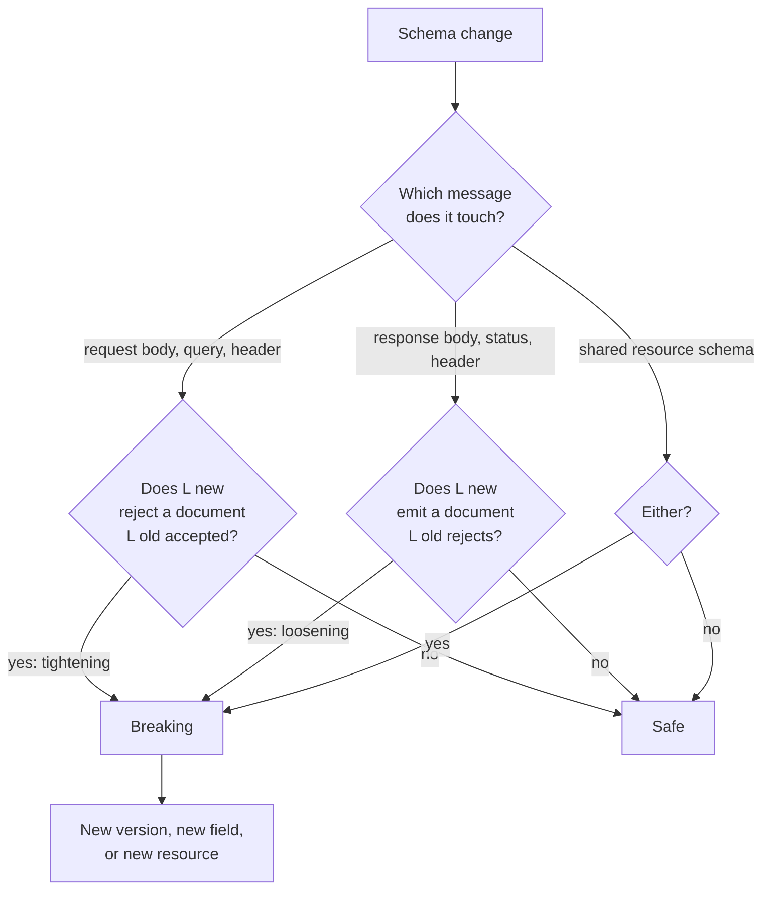

# Catalog of Breaking Changes in HTTP/JSON APIs: Request Tightening, Response Loosening, Enum Additions, and Behavioral Shifts

> [!summary] Claim
> Every schema change either narrows or widens a set of valid documents, and the message direction decides which one breaks: a request schema must never narrow (old clients wrote the bytes), a response schema must never widen (old clients read the bytes), so "add an enum value" is safe in a request and breaking in a response, and the lab reproduces all 19 catalogued verdicts with a real JSON Schema validator.

Part of [Versioning Evolution and API Guidelines](README.md) in [API Engineering](../README.md).

## TL;DR

- Mechanism: treat a schema as the set of documents it accepts; a request change is backward compatible iff `L(old) <= L(new)` (the new server accepts everything old clients send), and a response change iff `L(new) <= L(old)` (old clients accept everything the new server emits).
- Contract rule: requests may only loosen (optional fields, higher limits, more enum values), responses may only tighten (more fields guaranteed, fewer enum values), and a schema used in both directions may do neither, which is exactly Zalando rule `#107`.
- Trap: the same words mean opposite things by direction, the content model (`additionalProperties` open or closed) flips the verdict for "add a field", and behavioral shifts (`201` -> `202`, `400` -> `422`, integer IDs past `2**53`) break clients with no schema diff at all.
- Portability fact: the verdicts are properties of JSON and HTTP, not of the runtime; the lab gives `80 passed` on CPython 3.12.13, 3.13.18, 3.14.6, 3.14.10, and 3.15.2 on macOS, on 3.12.16, 3.13.18, 3.14.10, and 3.15.2 in Debian Trixie and Alpine containers, and on free-threaded 3.15.2, and the status code shifts reproduce under Uvicorn, Hypercorn, and Granian over HTTP/1.1, HTTP/2, and HTTP/3.
- When not to use it: if every caller deploys in lockstep with the server (AIP-180 tells such APIs to consider their own compatibility requirements), or the API is alpha, where AIP-181 says breaking changes must be allowed and expected, the full catalog is overhead; ship the change and the client together.

## Mental model



A change enters at the top and is routed by the message it touches, because the writer and the reader swap sides between requests and responses.
On the request branch the old client is the writer and the new server is the reader, so the only question is whether the new schema rejects something the old one accepted (tightening).
On the response branch the new server is the writer and the old client is the reader, so the question is whether the new schema can emit something the old one would reject (loosening).
A resource schema reused for `PUT` bodies and `GET` responses takes both branches, so it must neither narrow nor widen.
Every breaking verdict leads to the same three exits RFC 9205 lists for incompatible change: a new link relation, a new media type, or a new header field (RFC 9205 Section 4.16), or, in Google's and Zalando's terms, a new field, resource, or version.

## How it works

### Compatibility is set inclusion, and direction picks the inclusion

AIP-180 requires that old clients work against newer servers of the same major version and splits that into source, wire, and semantic compatibility (see [[Compatibility-Taxonomy-Wire-Source-and-Semantic-Compatibility-AIP-180]] for the axes).
For the wire axis, a JSON Schema defines a set `L(S)` of valid documents, and every keyword either shrinks or grows that set.
The lab's `classify` labels each keyword delta with two booleans, `narrows` and `widens`, and `breaking` applies the direction rule:

| Delta | Effect on `L` | Request (old writes, new reads) | Response (new writes, old reads) |
|---|---|---|---|
| name added to `required` | narrows | breaking | safe |
| name removed from `required` | widens | safe | breaking |
| `maxLength` or `maximum` lowered | narrows | breaking | safe |
| `maxLength` or `maximum` raised | widens | safe | breaking |
| `enum` value added | widens | safe | breaking |
| `enum` value removed | narrows | breaking | safe |
| `"null"` added to `type` | widens | safe | breaking |
| `integer` -> `number` | widens | safe | breaking |
| property added to a closed object | widens | safe | breaking |
| typed property added to an open object | narrows | breaking | safe |
| property removed from a closed object | narrows | breaking | safe |
| property removed from an open object | widens | safe | breaking |

This is Postel's robustness principle restated with a direction: "be conservative in what you do, be liberal in what you accept from others" (RFC 761 Section 2.10), which RFC 1122 Section 1.2.2 restates as "Be liberal in what you accept, and conservative in what you send".
A server may grow what it accepts and shrink what it emits, never the reverse.

### The content model decides what "add a field" means

The last four rows are why teams disagree about whether adding a field is breaking.
In an open object (`additionalProperties` absent or `true`), an undeclared key may hold any value, so declaring `isbn: {"type": "string"}` removes every document where `isbn` was a number: the set narrows.
In a closed object (`additionalProperties: false`), the key was forbidden, so declaring it lets new documents in: the set widens.
Zalando's guidelines encode the consistent pairing: servers should reject unknown input fields with `400` (Zalando `#109`), and clients must treat response objects as open for extension (Zalando `#111`).
Zalando `#111` also says API formats must not declare `additionalProperties` to be `false`, so its closed request model is server behavior under `#109`; the lab writes it as `additionalProperties: false` only so that a validator can enforce it.
With closed requests and open responses, the set-inclusion rule reproduces every line of Zalando `#107`: for input, add optional fields but never mandatory ones, make mandatory fields optional but not the reverse, do not remove fields, never make validation more restrictive, and extend `enum` ranges but reduce them only if the server still accepts the old values; for output, add fields, make optional fields mandatory but not the reverse, do not remove fields, and reduce but do not extend `enum` ranges; for shared schemas, only the intersection.
The lab's 19-entry `CATALOG` checks that claim row by row.
The one row where an open request schema breaks, `rq_open_schema_add_typed_field`, is Zalando's own warning in `#109`: future extensions of the input structure might conflict with fields servers already ignored, breaking clients that already send that field with a different type.
A client model that rejects unknown keys, such as pydantic's `extra="forbid"`, is a closed response schema, so for that client any additive field is a wire break (`rs_closed_schema_add_field`); the lab's `BookClosedClient` fails an added `isbn` with `extra_forbidden`.

### Request tightening

A tightening change makes the new server reject a document an old client was already sending.
AIP-180 forbids new required fields in existing request messages and requires every new client-populated field to default to the old behavior.
Zalando `#107` adds that server-side validation must never become more restrictive.
In FastAPI the failure is concrete: when request validation fails, `request_validation_exception_handler` returns `JSONResponse(status_code=422, content={"detail": ...})` (fastapi 0.162.0 fastapi/exception_handlers.py, request_validation_exception_handler).
The length check itself is `StrConstrainedValidator::validate`, which compares `str.chars().count()` against `max_length` and raises `ErrorType::StringTooLong` (pydantic-core 2.50.4 src/validators/string.rs, StrConstrainedValidator::validate).
`chars().count()` counts Unicode scalar values, so a limit can also tighten without its number changing: moving enforcement from a byte-sized column or a JavaScript client's `.length` (UTF-16 code units) to pydantic changes which inputs pass, and the lab measures `"\U0001f600" * 3` as 3 code points, 6 UTF-16 units, and 12 UTF-8 bytes.
AIP-180 notes the same effect for resource names: if their format becomes more restrictive, a request that previously succeeded now fails.

### Response loosening

A loosening change lets the new server emit a document an old client rejects or misreads.
AIP-180 requires every field the server previously populated to stay populated, and Azure's guidelines call it a breaking change to remove a required field or to make an optional field required or vice versa, because SDKs model required fields as non-nullable.
Azure applies that rule even to optional -> required, which Zalando allows for output-only schemas, because Azure requires one schema for `PUT` requests and `GET` responses on a path, so its resources take the shared-schema rule.
In pydantic a non-optional `str` field has no `nullable` wrapper; `NullableValidator::validate` returns `None` only when `input.is_none()` and otherwise delegates (pydantic-core 2.50.4 src/validators/nullable.rs, NullableValidator::validate), so a `null` reaches the string validator and fails with `string_type`.
Widening an integer's range is loosening even when the JSON type stays `integer`.
RFC 8259 Section 6 says integers in `[-(2**53)+1, (2**53)-1]` are interoperable in the sense that IEEE 754 binary64 implementations agree exactly on their values, and the lab shows `2**53` and `2**53 + 1` decoding to the same `9007199254740992.0` in a binary64 reader.
X's documentation is the canonical example: its 64-bit Snowflake IDs lose precision in JavaScript, v1.1 returns both `id` and `id_str`, and v2 returns IDs as strings by default (X IDs documentation, as of 2026-11).
Format changes are loosening too: AIP-180 calls an `ip_address` field that starts carrying IPv6 a breaking change, and treats increases to a string's upper size bound as incompatible.

### Enum additions

An enum addition is the purest case of direction dependence.
AIP-180 says enum values may be freely added to enums used only in requests, and that response enums expected to grow should document it; AIP-126 asks enums to document whether they are frozen and, as a rule of thumb, to gain values no more than once a year.
Zalando `#112` treats JSON Schema `enum` as closed by definition and recommends `examples` plus an "Extensible enum" description prefix (it recommended `x-extensible-enum` until October 2025); Azure recommends extensible enums (`x-ms-enum` with `modelAsString: true`) and forbids removing values.
The pydantic mechanics decide what an old Python client does.
`LiteralValidator::validate` looks the input up in its expected set and otherwise returns `ErrorType::LiteralError` (pydantic-core 2.50.4 src/validators/literal.rs, LiteralValidator::validate).
`EnumValidator::validate` tries its lookup, then falls back to calling the enum class so `_missing_()` can run, and maps a `ValueError` to `ErrorType::Enum` (pydantic-core 2.50.4 src/validators/enum_.rs, EnumValidator::validate).
That fallback makes a fallback member easy and dangerous: `LossyStatus._missing_` turns `"ARCHIVED"` into `UNKNOWN`, and the next full-replacement `PUT` writes `"UNKNOWN"` back.
Zalando `#108` names the requirement precisely: provide default behavior for unknown values and do not eliminate them when passed to subsequent `PUT` requests, which a closed language enum cannot do.
The lab's `BookOpenClient` keeps the raw wire string and derives `known_status` on demand, so it round-trips `"ARCHIVED"` unchanged.
[[Additive-Schema-Evolution-and-Tolerant-Reader-Patterns]] covers the tolerant-reader side of this in depth.

### Behavioral shifts

Some breaking changes leave every schema identical.
A synchronous `201 Created` that becomes `202 Accepted` changes meaning: `202` says processing has not completed and its representation ought to describe the request's status and point to a status monitor (RFC 9110 Section 15.3.3).
A client that checks only for `2xx` keeps going and reads the operation's `id` as the book's name; the lab's `legacy_created_id` returns `operations/1` against v2.
AIP-180's further reading points to AIP-151 for compatibility around long-running operations; see [[Long-Running-Operations-202-Accepted-and-Operation-Resources-AIP-151]].
Error codes shift the same way.
FastAPI's default validation status is `422`, so a rewrite that drops a custom `400` handler changes the status for the same bad input.
A client that special-cases `400` and retries everything else turns a permanent client error into a retry loop.
RFC 9110 Section 15 requires clients to understand the class of any status code and treat an unrecognized code as the `x00` code of its class, so a `471` is handled as `400`; RFC 9205 Section 4.6 asks applications to tell clients to handle all applicable status codes by falling back to the generic `n00` semantics.
Azure's guidelines draw the line for error codes: `x-ms-error-code` is a response header whose value must equal the top-level error `code` in the body, existing values are part of the contract, new values may be added over time, and it is only a breaking change if the same conditions result in a different top-level error code.
AIP-180 also lists changed defaults and changed serialization of defaulted fields as breaking, and its own example is pagination added after the fact with a `page_size` default below what was previously returned, so older clients wrongly assume they received every result; [[Compatibility-Taxonomy-Wire-Source-and-Semantic-Compatibility-AIP-180]] works that case, so it is not repeated here.

### The probe oracle

A classifier that only reads keywords can be wrong, so the lab checks it against `jsonschema` 4.26.0's `Draft202012Validator` (jsonschema 4.26.0 jsonschema/validators.py, Draft202012Validator).
`witnesses(old, new, direction, PROBES)` returns every probe document that is valid under the old schema and invalid under the new one (request) or the reverse (response).
For every catalog entry and both directions, the classifier's verdict must equal "a witness exists" over a 19-document probe pool.
Sixteen further keyword edges (a bound, `enum`, or `type` added where none existed, `maximum` lowered, `number` -> `integer`, `"null"` removed, `additionalProperties` closed, and each of those reversed) get the same check against their own 8-document pool, plus the shared-schema rule.
The classifier is conservative rather than exact: it compares one keyword at a time, so it reports a `maximum` added to a `string` property as narrowing although `maximum` constrains only numbers and no document changes validity, which is the safe way for a gate to be wrong.
The lab pins both halves of that claim exhaustively over a family of 52 single-property schemas (13 property shapes, each optional or required, open or closed) and a 20-document pool: across all 5408 ordered pairs and directions, none of the 960 "safe" verdicts has a witness, 4214 "breaking" verdicts have one, and 234 "breaking" verdicts have none.
The family includes `enum: [1]` against `enum: ["1"]`, so a classifier that compared enum values as strings would report that retyping as safe and fail the check.
The classifier refuses what it does not model with `ValueError`: any other keyword (`pattern`, `minimum`, `oneOf`, and the rest), a root schema whose `type` is not `"object"`, a schema-valued `additionalProperties`, and a boolean property schema, because a diff tool that silently ignores a keyword reports "safe" for exactly the changes it cannot see.
It also refuses a schema that is not itself valid against the 2020-12 metaschema (jsonschema 4.26.0 jsonschema/validators.py, Draft202012Validator), so a misspelled `"type": "strng"` or a `maxLength` of `null` is an error rather than a "safe" verdict.

## Numbers and limits

| Quantity | Value | Source |
|---|---|---|
| Interoperable JSON integer range | `[-(2**53)+1, (2**53)-1]` | RFC 8259 Section 6 |
| `2**53` and `2**53 + 1` in a binary64 reader | both `9007199254740992.0` | lab, `test_integer_ids_beyond_2_pow_53_collide_in_binary64_readers` |
| X documentation's example ID `10765432100123456789` in binary64 | `10765432100123457536` (X shows JavaScript printing `10765432100123458000`) | lab, same test; X IDs documentation (as of 2026-11) |
| `"\U0001f600" * 3` under three length units | 3 code points, 6 UTF-16 units, 12 UTF-8 bytes | lab, `test_max_length_counts_code_points_not_utf16_units_or_bytes` |
| Catalogued changes and verdicts | 19 (10 request, 9 response); 12 breaking, 7 safe | lab, `CATALOG` and `EXPECTED_BREAKING` |
| Probe pool for the oracle | 19 documents | lab, `PROBES` |
| Keyword edge cases checked against the validator | 16 (8 narrowing pairs, each also reversed) over 8 probe documents | lab, `NARROWING_EDGES` and `EDGE_PROBES` |
| Exhaustive soundness check | 52 schemas, 20 probe documents, 5408 directed verdicts: 960 safe with no witness, 4214 breaking with a witness, 234 breaking without one | lab, `test_classifier_never_reports_safe_when_a_witness_exists` |
| `max_length=40` boundary on the v2 server | 40 characters -> `202`, 41 characters -> `422` | lab, `test_request_tightening_turns_201_into_422_for_an_unchanged_client` |
| Enum value additions, rule of thumb | no more than once a year | AIP-126, When to use enums |
| EC2 longer resource ID format and transition | resource identifier plus a 17-character string; opt-in until early December 2016 | AWS News Blog |
| Lab runtime, 80 tests | `0.44s` to `0.99s` per run | measured over 12 consecutive runs of `uv run --frozen pytest <lab> -q` from `labs/`, macOS 27.2 arm64, CPython 3.14.6 (as of 2026-11) |

## Portability

| Leg | Version | Result and evidence |
|---|---|---|
| CPython 3.12 | `3.12.13` on macOS 27.2 arm64 (uv-managed); `3.12.16` in the `python:3.12.16-trixie` and `python:3.12.16-alpine` containers | `80 passed` on all three; macOS command `UV_PROJECT_ENVIRONMENT=<scratch venv> uv run --frozen --python 3.12 pytest <lab> -q`; container command in the container row |
| CPython 3.13 | `3.13.18` on macOS (Homebrew) and in the `python:3.13.18-trixie` and `python:3.13.18-alpine` containers | `80 passed` on all three; macOS command as above with `--python /opt/homebrew/bin/python3.13` |
| CPython 3.14 | `3.14.6` (workspace `.venv`) and `3.14.10` (Homebrew) on macOS; `3.14.10` in the `python:3.14.10-trixie` and `python:3.14.10-alpine` containers | `80 passed` on all four; `3.14.10` on macOS with `--python /opt/homebrew/bin/python3.14` |
| CPython 3.15 | `3.15.2` on macOS (Homebrew) and in the `python:3.15.2-trixie` and `python:3.15.2-alpine` containers | `80 passed` on all three; macOS with `--python /opt/homebrew/bin/python3.15` |
| CPython 3.15t free-threaded | `3.15.2` free-threading build installed by `uv python install 3.15.2+freethreaded` (uv 0.13.7) in the `ghcr.io/astral-sh/uv:python3.15-trixie` container (glibc 2.41, aarch64); `3.15.0b3` free-threading build on macOS | `80 passed` on both, and `sys._is_gil_enabled()` is `False` after importing `pydantic_core` on both; command `UV_CONSTRAINT=<uv export --frozen output> PYTHONPATH=src uv run --no-project --python <interpreter> --with <the seven pins in the container row> pytest <lab> -q`, which installs 26 packages at their `uv.lock` versions; the full lock cannot sync on `3.15.0b3` free-threaded because `psycopg-binary==3.3.8` has no wheel for it, and the Alpine free-threaded leg was not run |
| pydantic | `2.14.3` / pydantic-core `2.50.4` | Proven by lab: `literal_error`, `enum`, `string_type`, `string_too_long`, and `extra_forbidden` error types, `_missing_` fallback |
| FastAPI | `0.162.0` | Proven by lab: default `422` for validation errors, `status_code=202` on the route |
| jsonschema | `4.26.0` (`Draft202012Validator`) | Proven by lab as the oracle for all 19 entries and 16 keyword edges in both directions, and for the 52-schema soundness family |
| ASGI servers | Uvicorn `0.54.0` (`--http h11` and `--http httptools`), Hypercorn `0.18.0`, Granian `2.8.7` | Socket run, not part of the lab test: each server was started from the workspace `.venv` on `127.0.0.1` with the lab's `build_books_server_v1` and `build_books_server_v2` factories (CPython 3.14.6, macOS 27.2 arm64) and sent `{"title": "SICP"}`, a 50-character title, and `{"title": 7}` with httpx `0.28.1`; every server returned `201`, `201`, `400` from v1 and `202`, `422` (`string_too_long`), `422` from v2, and `legacy_created_id` returned `operations/1` from v2 |
| HTTP/1.1, HTTP/2, HTTP/3 | HTTP/1.1 on all three servers; HTTP/2 with prior knowledge over cleartext on Hypercorn and on Granian `--http 2` (httpx `0.28.1` with h2 `4.4.1`, `Response.http_version == "HTTP/2"`); HTTP/3 on Hypercorn `--quic-bind` with a self-signed certificate and an aioquic `1.7.2` client | Same socket run: the same six status codes and the same `id` values on every version, and over HTTP/3 the only response pseudo-header was `:status`; status code classes and their `x00` fallback are defined in HTTP semantics, not in a version's framing (RFC 9110 Section 15); Uvicorn was run over HTTP/1.1 only and Granian was not run over HTTP/3 |
| Debian Trixie (glibc 2.41) and Alpine v3.24 (musl) containers | `python:3.12.16`, `python:3.13.18`, `python:3.14.10`, and `python:3.15.2` official images, each as `-trixie` and `-alpine` | `80 passed` in all eight (Docker 29.8.2 on OrbStack, linux/arm64, as of 2026-11): the lab mounted read-only at `/lab`, `python -m venv /tmp/v`, `pip install -c <uv export --frozen output>` of `fastapi==0.162.0 pydantic==2.14.3 pydantic-core==2.50.4 httpx==0.28.1 jsonschema==4.26.0 pytest==9.2.0 pytest-asyncio==1.4.1.post1` (26 packages at their `uv.lock` versions), then `PYTHONPATH=src python -m pytest <lab> -q -p no:cacheprovider`; these runs install the seven pins under lock constraints, not the full frozen lock |

## Worked example

The [implementation](../labs/src/api_labs/f07_versioning_evolution_and_api_guidelines/breaking_change_catalog.py) holds the classifier, the 19-entry catalog, the probe pool, two FastAPI servers, and the client readers; the [test](../labs/tests/f07_versioning_evolution_and_api_guidelines/test_anatomy_of_breaking_changes_in_http_and_json_apis.py) runs 80 tests.

The classifier and the direction rule (byte-identical to the implementation file):

```python
def classify(old: Schema, new: Schema) -> list[Delta]:
    """Diff two object schemas and label each delta as narrowing and/or widening."""
    _check_supported(old)
    _check_supported(new)
    deltas: list[Delta] = []
    old_open, new_open = _is_open(old), _is_open(new)
    if old_open and not new_open:
        deltas.append(Delta("$", "additionalProperties closed", narrows=True, widens=False))
    if new_open and not old_open:
        deltas.append(Delta("$", "additionalProperties opened", narrows=False, widens=True))
    old_props: dict[str, Schema] = old.get("properties", {})
    new_props: dict[str, Schema] = new.get("properties", {})
    for name in sorted(old_props.keys() | new_props.keys()):
        path = f"$.{name}"
        if name not in old_props:
            # The key was free (open schema) or forbidden (closed schema) before.
            if old_open:
                deltas.append(Delta(path, "property added", bool(new_props[name]), False))
            else:
                deltas.append(Delta(path, "property added", narrows=False, widens=True))
        elif name not in new_props:
            if new_open:
                deltas.append(Delta(path, "property removed", False, bool(old_props[name])))
            else:
                deltas.append(Delta(path, "property removed", narrows=True, widens=False))
        else:
            deltas.extend(_property_deltas(path, old_props[name], new_props[name]))
    old_required = set(old.get("required", []))
    new_required = set(new.get("required", []))
    deltas += [
        Delta(f"$.{n}", "required added", True, False) for n in sorted(new_required - old_required)
    ]
    deltas += [
        Delta(f"$.{n}", "required removed", False, True)
        for n in sorted(old_required - new_required)
    ]
    return deltas


def breaking(deltas: Iterable[Delta], direction: Direction) -> list[Delta]:
    """Requests must not narrow, responses must not widen, shared schemas must do neither."""
    if direction == "request":
        return [d for d in deltas if d.narrows]
    if direction == "response":
        return [d for d in deltas if d.widens]
    return [d for d in deltas if d.narrows or d.widens]
```

The oracle check, run for every catalog entry in both directions (byte-identical to the test file):

```python
@pytest.mark.unit
@pytest.mark.parametrize("entry", CATALOG, ids=ENTRY_IDS)
def test_classifier_agrees_with_a_real_validator_in_both_directions(entry: CatalogEntry) -> None:
    deltas = classify(entry.old, entry.new)
    for direction in ("request", "response"):
        predicted = bool(breaking(deltas, direction))
        observed = witnesses(entry.old, entry.new, direction, PROBES)
        assert predicted is bool(observed), (direction, deltas, observed)
```

The v2 "framework rewrite" server and the v1 client helper that misreads it (byte-identical to the implementation file):

```python
def build_books_server_v2() -> FastAPI:
    """v2: `max_length=40` on `title`, FastAPI's default `422`, and an asynchronous `202`."""
    app = FastAPI()

    @app.post("/books", status_code=202)
    async def create_book(body: CreateBookV2) -> dict[str, str | bool]:
        return {"id": "operations/1", "done": False}

    return app


def legacy_created_id(response: httpx.Response) -> str:
    """v1 SDK: any 2xx is success and the body's `id` is the new book's name."""
    response.raise_for_status()
    return str(response.json()["id"])
```

The behavioral shift with no schema diff, as the old client experiences it (byte-identical to the test file):

```python
@pytest.mark.unit
@pytest.mark.asyncio
async def test_201_to_202_is_silently_misread_by_a_2xx_client() -> None:
    body = {"title": "SICP"}
    async with _client(build_books_server_v1()) as client:
        v1 = await client.post("/books", json=body)
    async with _client(build_books_server_v2()) as client:
        v2 = await client.post("/books", json=body)
    assert (v1.status_code, v2.status_code) == (201, 202)
    assert legacy_created_id(v1) == "books/1"
    assert legacy_created_id(v2) == "operations/1"  # an operation id stored as a book id
    assert strict_created_id(v1) == "books/1"
    with pytest.raises(UnexpectedStatusError, match="got 202"):
        strict_created_id(v2)
```

The lossy enum fallback against the raw-preserving reader (byte-identical to the test file):

```python
@pytest.mark.unit
def test_lossy_enum_fallback_corrupts_read_modify_write_but_raw_reader_does_not() -> None:
    wire = b'{"name": "books/1", "status": "ARCHIVED"}'
    lossy = BookLossyClient.model_validate_json(wire)
    open_reader = BookOpenClient.model_validate_json(wire)
    assert json.loads(lossy.model_dump_json())["status"] == "UNKNOWN"
    assert json.loads(open_reader.model_dump_json())["status"] == "ARCHIVED"
    assert open_reader.known_status is None
    assert BookOpenClient(name="books/1", status="ACTIVE").known_status is Status.ACTIVE
```

Captured run on CPython 3.14.6, macOS 27.2 arm64, from `labs/`:

```text
$ uv run --frozen pytest tests/f07_versioning_evolution_and_api_guidelines/test_anatomy_of_breaking_changes_in_http_and_json_apis.py -q
........................................................................ [ 90%]
........                                                                 [100%]
80 passed in 0.65s
```

The implementation was checked with 60 scripted single-edit mutations, each of which fails at least one test, and every test function is failed by at least one of them (as of 2026-11).
For example, swapping the request and response rules in `breaking` fails 55 tests, ignoring the `maximum` keyword fails 6, comparing enum values as strings fails only the exhaustive soundness check, moving the v2 limit from 40 to 49 fails the boundary assertion, dropping the metaschema check fails the three malformed-schema cases, and dropping the `{"copies": 1.5}` probe fails the oracle check for `rs_integer_to_number`.

## Pitfalls

> [!warning] Calling a change "additive" without naming the direction
> Trigger: a review approves "we only added a value to `status`" because additions are listed as compatible in AIP-180's "Adding components".
> Symptom: old clients with closed enums fail every read of a resource in the new state; the lab's `Literal` reader raises `literal_error` and the `StrEnum` reader raises `enum` on `"ARCHIVED"`.
> Fix: classify by direction, document growing response enums as extensible (AIP-180; Zalando `#112`; Azure `x-ms-enum` with `modelAsString: true`), and add response values only after clients have shipped an unknown-value path.

> [!warning] An unknown-value fallback that discards the value
> Trigger: an SDK maps unknown enum strings to an `UNKNOWN` member through `_missing_`, then performs read-modify-write with full replacement.
> Symptom: the `PUT` body carries `"UNKNOWN"`, so the server either rejects it or overwrites the real state; the lab shows `"ARCHIVED"` -> `"UNKNOWN"` after a round trip.
> Fix: keep the raw string and derive the known member (`BookOpenClient.known_status`), as Zalando `#108` requires, and prefer partial updates ([[Field-Masks-and-Update-Masks-AIP-134-and-AIP-161]]) over [[Full-Replacement-PUT-and-Upsert-Semantics]].

> [!warning] Numeric IDs that outgrow binary64
> Trigger: a service issues 64-bit integer IDs in a JSON `integer` field that was safe while values stayed small.
> Symptom: JavaScript and other binary64 readers silently round distinct IDs to the same value, so lookups hit the wrong object; the lab collides `2**53` and `2**53 + 1`.
> Fix: send IDs as strings from the first version; X's documentation tells developers to always use string IDs, keeps `id_str` alongside `id` in v1.1, and returns strings by default in v2 (as of 2026-11); see [[Resource-Identifiers-UUIDv4-vs-UUIDv7-ULID-and-Public-IDs]].

> [!warning] Longer identifiers break clients that never parse JSON wrongly
> Trigger: a server raises the length of an existing string field, typically resource IDs.
> Symptom: fixed-width columns, regular expressions, and URL budgets reject only newly created resources.
> Fix: treat string upper bounds as contract (AIP-180, "Changing string length"); when AWS lengthened EC2 IDs to a resource identifier plus a 17-character string, it ran a per-region, per-user opt-in transition until early December 2016 and told builders to check fixed-length fields, schema elements, string operations, and regular expressions (AWS News Blog).

> [!warning] A framework rewrite that changes status codes
> Trigger: a service moves to FastAPI and drops a custom handler, so validation failures go from `400` to `422`, or a create endpoint goes asynchronous and returns `202`.
> Symptom: clients that compare exact codes retry permanent errors forever or store operation IDs as resource IDs, with no error logged anywhere; the lab proves both.
> Fix: pin the status code set in contract tests, write clients that branch on status class (RFC 9110 Section 15), and introduce asynchronous creation as a new method or with a migration path rather than changing an existing one; see [[Error-Taxonomy-Retryability-and-Client-Contract-Design]].

## Security and robustness

- Tightening is the safe direction for security fixes, but it is still breaking: a new `maxLength` that stops OWASP API4:2023 Unrestricted Resource Consumption returns `422` to every old client that sent long values, so announce it with [[Deprecation-Header-RFC-9745-and-Sunset-Header-RFC-8594]] and measure who would fail before enforcing.
- Loosening a request schema is not free: accepting unknown keys on a server model invites OWASP API3:2023 Broken Object Property Level Authorization (mass assignment), which is why Zalando `#109` makes servers reject unknown input fields.
- Parser changes are behavioral shifts with security impact: Apache CouchDB before 1.7.0 and 2.x before 2.1.1 used different JSON parsers that disagreed on duplicate `roles` keys, letting non-admin users grant themselves admin privileges (CVE-2017-12635, NVD); replacing a JSON library is a compatibility change and needs differential tests on duplicates, big numbers, and invalid UTF-8.
- Clients consume untrusted input (OWASP API10:2023 Unsafe Consumption of APIs): an unknown-value path must map to an explicit sentinel and keep validating the rest, not fall back to an unvalidated dictionary.
- Keeping old behavior alive for compatibility keeps old attack surface alive (OWASP API9:2023 Improper Inventory Management); every compatibility shim needs an owner and a sunset, see [[Brownout-Schedules-Per-Client-Usage-Telemetry-and-Safe-Sunsetting]].
- Intolerance can be a feature: RFC 9413 Section 5.1 argues that generating fatal errors for unspecified conditions makes faults visible early, and Section 4.1 shows how tolerating a quirk (TLS servers that failed on a ClientHello ending in an empty extension) forces every later implementation to be bug-for-bug compatible.

## The principal's view

The decision is where the catalog is enforced, not whether engineers have read it.
Put a direction-aware schema diff in CI for every OpenAPI change, run it separately over request bodies, response bodies, parameters, and headers, and fail closed on keywords the tool does not understand, as the lab's classifier does.
Pair it with a golden-fixture suite: every released response is parsed by every supported client SDK version, and every released request is sent to the new server, because behavioral shifts never appear in a schema diff.
Choose the content model deliberately and write it down: closed requests and open responses (Zalando) make "add an optional field" safe in both directions, while generated SDKs with strict models silently turn every additive response field into a break.
The organizational trade-off is review cost against blast radius: AIP-180 tells APIs with lockstep consumers to consider their own compatibility requirements, Azure routes every breaking change through a review board with a lengthy deprecation period, and Stripe-style date-pinned versions ([[Stripe-Date-Based-Versioning-and-Version-Change-Gates]]) let you ship breaking response changes per cohort at the price of maintaining transformers forever.
Choose a different paradigm when the catalog keeps blocking you: protobuf binary makes field renames free and numbering sacred, schema-registry-gated event streams make compatibility an enforced property per subject, and a new resource or media type (RFC 9205 Section 4.16) is cheaper than contorting an old one.

## Interview questions

> [!question] L5: Is adding a value to an enum a breaking change?
>
> > [!success]- Answer
> > It depends on the direction of the message that carries the enum.
> > In a request it widens the accepted set, so old clients, which never send the new value, are unaffected; AIP-180 says such values may be freely added.
> > In a response it widens the emitted set, so old clients with closed enums fail to parse or misbehave on the new value.
> > In a schema shared by requests and responses it is breaking, because the response rule applies.
> >
> > Follow-up: How do you document a response enum so that adding values later is not a contract violation?

> [!question] L5: Why is making an optional request field required breaking, while making an optional response field required is safe?
>
> > [!success]- Answer
> > Adding a name to `required` narrows the set of valid documents.
> > For a request, old clients that omit the field now get `422`, so narrowing breaks them.
> > For a response, the server now always sends the field, and every document it emits was already valid for old clients, so narrowing is safe.
> >
> > Follow-up: Which response change is the mirror image and breaks old clients?

> [!question] L6: Predict the output: if the old SDK runs `response.raise_for_status(); return response.json()["id"]` after `POST /books`, and v2 changes the endpoint from `201` with `{"id": "books/1"}` to `202` with `{"id": "operations/1", "done": false}`, what does the old SDK return?
>
> > [!success]- Answer
> > It returns `"operations/1"` with no exception.
> > `raise_for_status` returns normally for every `2xx` (httpx 0.28.1 httpx/_models.py, Response.raise_for_status), so `202` passes, and the body still has an `id` key.
> > The caller stores an operation ID as a book ID, and later `GET` calls fail or hit the wrong resource.
> > The schema diff is empty for the request and the `id` type is unchanged, so only a behavioral contract test catches it.
> >
> > Follow-up: How would you introduce asynchronous creation without breaking this client?

> [!question] L6: Debug this API: after a platform migration, a partner's batch job that used to give up after one attempt now resends the same invalid `POST /orders` payload thousands of times an hour, so what changed?
>
> > [!success]- Answer
> > The old service returned `400` for validation errors through a custom handler, and the migrated FastAPI service returns its default `422`.
> > The partner's client retries every non-success code except `400`, so a permanent client error became a retry loop.
> > The schema did not change, so diff tools reported nothing; this is a behavioral shift in the status code contract.
> > Fix the server by restoring `400` for that version or versioning the change, and fix clients to branch on status class (RFC 9110 Section 15) and treat any `4xx` other than `429` as non-retryable.
> >
> > Follow-up: Which status codes would you allow a client to retry automatically, and on what evidence?

> [!question] L6: Why does adding an optional field break a request schema in one API and not in another?
>
> > [!success]- Answer
> > The content model decides it.
> > In a closed schema the key was forbidden, so declaring it widens the accepted set, which is safe for requests.
> > In an open schema the key could hold anything, so declaring it with a type narrows the set, and an old client that already sent that key with a different type now fails.
> > Zalando avoids the second case by having servers reject unknown fields, which is a deliberate deviation from Postel's Law.
> >
> > Follow-up: Which content model should response schemas use, and why?

> [!question] L6: If a Python SDK maps unknown enum values to `UNKNOWN` with `_missing_`, what can go wrong, and what would you ship instead?
>
> > [!success]- Answer
> > Parsing succeeds, but the server's value is lost.
> > If the SDK performs read-modify-write with full replacement, it sends `UNKNOWN` back and either fails or overwrites the real state.
> > Keep the raw string on the model and expose a derived property that returns the known member or `None`, so round trips preserve the value.
> > Prefer partial updates so fields a client does not understand are never rewritten.
> >
> > Follow-up: How does pydantic-core reach `_missing_` at all when its lookup fails?

> [!question] L7+: How would you design a CI gate that blocks breaking OpenAPI changes, and what will it still miss?
>
> > [!success]- Answer
> > Diff schemas per direction: request bodies, parameters, and request headers must not narrow; response bodies, status codes, and response headers must not widen; shared components take both rules.
> > Fail closed on keywords the tool does not model, because ignoring `pattern` or `oneOf` reports exactly those changes as safe.
> > Fix the content model by policy (closed requests, open responses) so the rules are predictable.
> > It will miss behavioral shifts: status code changes, defaults, ordering, pagination, error codes, formats inside unchanged strings, and integer ranges, so pair it with golden fixtures replayed against every supported SDK version and per-client telemetry before risky rollouts.
> >
> > Follow-up: How do you prove the gate itself is correct?

> [!question] L7+: If security asks you to add `maxLength` limits to every string in a public API this quarter, how do you do it without breaking customers?
>
> > [!success]- Answer
> > Adding a limit narrows request schemas, so it is breaking for any client that already sends longer values.
> > Measure first: log the length distribution per field and per client, and set limits above observed maxima where possible.
> > Announce the change with deprecation signals, run a report-only phase, then enforce per client cohort or behind a new version where real traffic would fail.
> > Watch the unit: pydantic counts code points, while databases and clients may count bytes or UTF-16 units.
> > For responses the same limit is safe, so limit what you emit immediately and document it.
> >
> > Follow-up: What would you do about the customer whose traffic exceeds your limit by design?

> [!question] L7+: When is it right to ignore this catalog and ship a breaking change in place?
>
> > [!success]- Answer
> > When every consumer deploys in lockstep with the server, which AIP-180 says should consider its own compatibility requirements, or when the surface is alpha, where AIP-181 says users must have no expectation of stability.
> > When the old behavior is a security hole and the cost of keeping it exceeds the breakage, with a review board, direct notice, and a deprecation period as Azure requires.
> > Otherwise prefer a new field, resource, media type, or dated version, because, as AIP-180 puts it, code will often depend on API behavior even when that behavior is not documented.
> >
> > Follow-up: What evidence would you require before declaring that no client depends on the old behavior?

## Related

Prerequisites: [[Compatibility-Taxonomy-Wire-Source-and-Semantic-Compatibility-AIP-180]]

Next: [[Additive-Schema-Evolution-and-Tolerant-Reader-Patterns]]

See also: [[API-Fundamentals]], [[02-Programming-Languages/Python/Python-Backend-Interview-Prep/05-REST-API-Design]], [[API-Versioning-Strategies-URI-Header-Media-Type-and-Channel-AIP-185]], [[Stripe-Date-Based-Versioning-and-Version-Change-Gates]], [[Deprecation-Header-RFC-9745-and-Sunset-Header-RFC-8594]], [[Brownout-Schedules-Per-Client-Usage-Telemetry-and-Safe-Sunsetting]], [[Zalando-RESTful-API-and-Event-Guidelines-in-Depth]], [[Microsoft-Azure-REST-API-Guidelines-in-Depth]], [[Google-AIP-System-Architecture-and-Core-Tenets]], [[HTTP-Status-Code-Taxonomy-and-Selection-Decision-Trees]], [[Long-Running-Operations-202-Accepted-and-Operation-Resources-AIP-151]], [[Error-Taxonomy-Retryability-and-Client-Contract-Design]], [[Problem-Details-for-HTTP-APIs-RFC-9457]], [[Mapping-Pydantic-Validation-Errors-to-RFC-9457-Problem-Details]], [[Field-Masks-and-Update-Masks-AIP-134-and-AIP-161]], [[Full-Replacement-PUT-and-Upsert-Semantics]], [[Resource-Identifiers-UUIDv4-vs-UUIDv7-ULID-and-Public-IDs]], [[Pydantic-v2-Architecture-CoreSchema-and-Rust-Pydantic-Core]]

- Lab: `labs/tests/f07_versioning_evolution_and_api_guidelines/test_anatomy_of_breaking_changes_in_http_and_json_apis.py`

## Further reading

- [AIP-180 Backwards compatibility](https://google.aip.dev/180): the add, remove, rename, type, string length, resource name, default, and serialization rules, with per-direction enum guidance.
- [AIP-126 Enumerations](https://google.aip.dev/126): when enums are worth their evolution cost and how to document frozen versus growing enums.
- [Zalando RESTful API Guidelines, Compatibility](https://opensource.zalando.com/restful-api-guidelines/#compatibility): rules `#107` (input, output, and shared schema changes), `#108` (tolerant clients), `#109` (strict servers), `#111` (open schemas), and `#112` (extensible enums).
- [Microsoft Azure REST API Guidelines](https://github.com/microsoft/api-guidelines/blob/vNext/azure/Guidelines.md): required versus optional fields, extensible enums, error code compatibility, and the breaking change review process.
- [RFC 9110 HTTP Semantics](https://www.rfc-editor.org/rfc/rfc9110.html): Section 15 (status code classes and the `x00` fallback) and Section 15.3.3 (`202 Accepted`).
- [RFC 9205 Building Protocols with HTTP](https://www.rfc-editor.org/rfc/rfc9205.html): Section 4.6 (status code use in applications) and Section 4.16 (mechanisms for incompatible change).
- [RFC 8259 JSON](https://www.rfc-editor.org/rfc/rfc8259.html): Section 6, the interoperable integer range that makes numeric ID growth a breaking change.
- [RFC 9413 Maintaining Robust Protocols](https://www.rfc-editor.org/rfc/rfc9413.html): why unlimited tolerance decays protocols and when intolerance is virtuous.
- [RFC 1122 Requirements for Internet Hosts](https://www.rfc-editor.org/rfc/rfc1122.html): Section 1.2.2, the robustness principle that the direction rule refines.
- [X IDs](https://docs.x.com/fundamentals/x-ids): a production API that moved IDs to strings because of binary64 precision.
- [pydantic-core 2.50.4 `enum_.rs`](https://github.com/pydantic/pydantic/blob/v2.14.3/pydantic-core/src/validators/enum_.rs): the lookup-then-`_missing_` fallback that decides how a Python client meets a new enum value.
