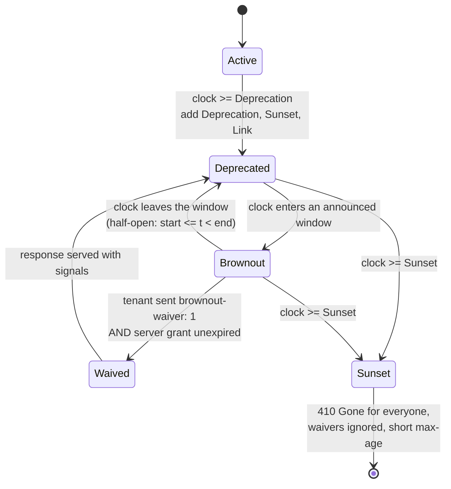

# Executing an API Sunset: Per-Tenant Version Telemetry, Automated Brownout Windows, and 410 Gone Cutover

> [!summary] Claim
> A sunset is safe only when it is driven by per-tenant usage telemetry and rehearsed with announced, uncacheable `410 Gone` brownout windows that reproduce the post-sunset failure exactly, so the last callers surface while rollback is still a configuration change and not an incident.

Part of [Versioning Evolution and API Guidelines](README.md) in [API Engineering](../README.md).

## TL;DR

- Mechanism: one pure ASGI middleware maps the clock to a phase (`active` -> `deprecated` -> `brownout` windows -> `sunset`), adds `Deprecation`, `Sunset`, and `Link` signals to every deprecated response, answers brownout and post-sunset requests with `410 Gone` plus `application/problem+json`, and counts every outcome per tenant.
- Contract rule: signals are hints that change no behavior (RFC 9745 Section 5), so the only thing that makes a client migrate is a failure it can observe; a brownout is that failure, announced in advance, bounded in time, and identical in shape to the final cutover.
- The trap: `410` is heuristically cacheable (RFC 9110 Section 15.5.11), so a brownout `410` without `Cache-Control: no-store` can keep failing clients from a cache after the window closes; `503` with `Retry-After` is the other trap, because urllib3's default `Retry(3)` retries an idempotent request whose `503` carries `Retry-After`, which hides the brownout.
- Portability fact: the lab passes unchanged on CPython 3.12.16, 3.13.18, 3.14.10, and 3.15.2 on Debian Trixie and Alpine musl and on 3.12.13 through 3.15.2 on macOS, and the signals and the `410` arrive identical behind Uvicorn, Hypercorn, and Granian over HTTP/1.1, HTTP/2 (Hypercorn and Granian), and HTTP/3 (Hypercorn); the one runtime-sensitive piece is `email.utils.format_datetime(..., usegmt=True)`, which rejects any `tzinfo` that is not `datetime.timezone.utc`, including `ZoneInfo("UTC")`.
- When not to use it: if every consumer is an internal team you can name, ask them and flip the switch; if you can afford to keep translating old versions forever (the Stripe model), do not sunset at all; brownouts are for consumers you cannot enumerate or cannot make answer.

## Mental model



Every request under the retired prefix enters at the phase the clock selects, never at a phase stored in the request.
Before the deprecation instant the middleware is a pass-through that only counts the call, which gives the baseline that later shows whether traffic is actually falling.
From the deprecation instant on, every served response carries `Deprecation`, `Sunset`, and `Link` signals, which change nothing for clients that ignore them.
Inside an announced window the middleware answers `410 Gone` itself, without calling the application, unless the tenant both asks for a waiver with a header and holds an unexpired grant on the server; the arrow back to `Deprecated` at the window end is what makes a brownout a rehearsal and not an outage.
At the sunset instant every arrow converges: waivers stop working, the `410` becomes briefly cacheable, and the telemetry that was counting `brownout_rejected` starts counting `gone`.

## How it works

### The phase function and its half-open boundaries

`SunsetPolicy.phase(at)` checks `at >= sunset` first, then `at < deprecation`, then the brownout windows, so a misconfigured window can never keep a version alive past its sunset `(api_labs brownout_sunset.py, SunsetPolicy.phase)`.
Each `Window` is half-open, `start <= t < end`, so back-to-back windows tile time without a doubly-claimed instant and a window `HH:00` to `HH:15` rejects `HH:14:59.999999` and serves `HH:15:00`.
`SunsetPolicy.__post_init__` rejects a contract that cannot be honored: a naive or non-zero-offset datetime, `sunset < deprecation` (which RFC 9745 Section 4 forbids: "The timestamp given in the Sunset HTTP header field MUST NOT be earlier than the one given in the Deprecation header field"), a window that overlaps its predecessor or leaves `[deprecation, sunset]`, and a waiver that outlives the sunset.
The edges the contract permits are accepted: a `sunset` equal to the `deprecation`, a window that ends exactly at the sunset, and a waiver that expires exactly at the sunset all construct, and `test_policy_accepts_the_inclusive_edges_of_a_contract` pins them.
Every instant must be an aware datetime with a zero UTC offset, so the same instant written in `+02:00` is rejected by `Window`, `SunsetPolicy`, `hourly_windows`, and `sf_date` (`test_every_instant_must_be_an_aware_utc_datetime`).
Because the windows are validated as sorted and non-overlapping, `window_at` is a `bisect.bisect_right` over the window start instants, `O(log n)` per request instead of a scan.

### The signals, byte for byte

The middleware wraps `send` and, on the `http.response.start` message, builds `MutableHeaders(scope=message)`, which rebinds `message["headers"]` to a list and edits it in place `(starlette 1.10.0 starlette/datastructures.py, Headers.__init__)`.
`MutableHeaders.__setitem__` lowercases the name, encodes name and value as `latin-1`, replaces the first existing entry, and deletes duplicates `(starlette 1.10.0 starlette/datastructures.py, MutableHeaders.__setitem__)`, so an application that already set its own `Sunset` cannot produce two conflicting values; `test_signals_replace_values_the_application_already_set` asserts the resulting raw header list.
The wrapper edits only the `http.response.start` message, so `http.response.body` and an `http.response.trailers` message (announced by the `trailers` key of `http.response.start` in the ASGI HTTP spec) pass through unchanged, which `test_signals_are_added_to_the_response_start_message_only` asserts on the raw messages.
Lowercase names are required by the ASGI HTTP spec ("Header names must be lowercased" for `http.response.start`), by HTTP/2 (RFC 9113 Section 8.2.1 forbids `0x41-0x5a` in field names), and by HTTP/3 (RFC 9114 Section 4.2, "Characters in field names MUST be converted to lowercase prior to their encoding").

These are the raw `http.response.start` headers the lab middleware emitted for a deprecated-phase `GET /v1/items` and then for a request at `2027-03-01T03:05:00Z`, inside the `03:00` to `03:15` window (captured on CPython 3.14.6 by calling the middleware with a recording `send`):

```text
status 200
  b'content-length' b'12'
  b'content-type' b'application/json'
  b'deprecation' b'@1798761600'
  b'sunset' b'Thu, 01 Apr 2027 00:00:00 GMT'
  b'link' b'<https://developer.example.com/v1-retirement>; rel="deprecation"; type="text/html", <https://developer.example.com/v1-retirement>; rel="sunset"; type="text/html"'
 body b'{"items":[]}'
status 410
  b'deprecation' b'@1798761600'
  b'sunset' b'Thu, 01 Apr 2027 00:00:00 GMT'
  b'link' b'<https://developer.example.com/v1-retirement>; rel="deprecation"; type="text/html", <https://developer.example.com/v1-retirement>; rel="sunset"; type="text/html"'
  b'cache-control' b'no-store'
  b'content-length' b'288'
  b'content-type' b'application/problem+json'
 body b'{"type":"https://developer.example.com/problems/api-version-retired","title":"API version retired","status":410,"detail":"/v1/ is retired; see https://developer.example.com/v1-retirement","phase":"brownout","sunset":"2027-04-01T00:00:00+00:00","brownout_ends":"2027-03-01T03:15:00+00:00"}'
```

`Deprecation` is an Item Structured Header Field whose value "MUST be a Date" (RFC 9745 Section 2.1), a delta in seconds from `1970-01-01T00:00:00Z` written with a leading `@` (RFC 9651 Section 3.3.7; the ABNF `sf-date = "@" sf-integer` is in RFC 9651 Appendix C); `@1798761600` is `2027-01-01T00:00:00Z`.
`Sunset` is an `HTTP-date` (RFC 8594 Section 3), and a sender "MUST generate those timestamps in the IMF-fixdate format", which ends in the literal `GMT` (RFC 9110 Section 5.6.7).
The lab's `http_date` converts with `astimezone(UTC)` before calling `email.utils.format_datetime(value, usegmt=True)`, because that function raises `ValueError("usegmt option requires a UTC datetime")` whenever `dt.tzinfo != datetime.timezone.utc` `(CPython 3.14.6 Lib/email/utils.py, format_datetime)`, and a `ZoneInfo("UTC")` instance does not compare equal to `timezone.utc`.
`Link` carries two `link-value`s, one with `rel="deprecation"` (RFC 9745 Section 3) and one with `rel="sunset"` (RFC 8594 Section 6), using the `#link-value` list syntax of RFC 8288 Section 3.
The brownout `410` carries the same three signals, so a client that logs headers on failure learns the dates from the failure itself.
A real client receives the same values behind every server in the lab: the `socket`-tier tests serve the middleware from Uvicorn, Hypercorn, and Granian on loopback ports and assert each signal exactly once, `cache-control: no-store`, and the `288`-byte body over HTTP/1.1, HTTP/2, and HTTP/3.

### The brownout response

The rejection is a Starlette `JSONResponse` with `media_type="application/problem+json"` and `status_code=410`, whose `render` uses `json.dumps(..., ensure_ascii=False, allow_nan=False, indent=None, separators=(",", ":"))` `(starlette 1.10.0 starlette/responses.py, JSONResponse.render)`, and whose `init_headers` appends `content-length` and `content-type` after the caller's headers `(starlette 1.10.0 starlette/responses.py, Response.init_headers)`, which is why those two come last in the captured `410`.
The body's `status` member equals the HTTP status because "Generators MUST use the same status code in the actual HTTP response" (RFC 9457 Section 3.1.2); `phase`, `sunset`, and `brownout_ends` are extension members (RFC 9457 Section 3.2).
`410` and not `404` is the honest code after the sunset: `410` "indicates that access to the target resource is no longer available at the origin server and that this condition is likely to be permanent" (RFC 9110 Section 15.5.11), and RFC 8594 Section 9 uses `410 Gone` as its own post-sunset example.
During a brownout the condition is deliberately not permanent, and the lab still returns `410`, because the point of the rehearsal is that the client's error handling meets the exact status, body, and headers it will meet after the sunset.
That choice has one mandatory consequence: "A 410 response is heuristically cacheable" (RFC 9110 Section 15.5.11), and a cache may assign heuristic freshness to such a response when no explicit expiration is present (RFC 9111 Section 4.2.2), so the brownout `410` carries `Cache-Control: no-store`, which a cache "MUST NOT store" (RFC 9111 Section 5.2.2.5).
After the sunset the lab sends `Cache-Control: max-age=300`: explicit freshness disables heuristics (RFC 9111 Section 4.2.2), and five minutes bounds how long a rollback stays invisible behind caches.

### The waiver: a client ask and a server grant

A tenant whose production breaks during a window needs a way out that is cheaper than a support escalation, but a header that any client may send becomes the new permanent dependency and makes the next brownout invisible.
The lab requires both: the request header `brownout-waiver: 1` (the client's explicit, logged acknowledgement) and an entry in `SunsetPolicy.waivers` with an expiry in the future (the server's consent).
The header name has no `X-` prefix, following RFC 6648 Section 3 ("SHOULD NOT prefix their parameter names with \"X-\" or similar constructs").
Waivers cannot outlive the sunset, because `__post_init__` rejects them, and they are ignored after the sunset anyway, because `phase` returns `SUNSET` before any waiver is consulted.

### Per-tenant telemetry

`SunsetTelemetry.record` increments a `Counter` keyed by `(tenant, Outcome)` and keeps `last_seen[tenant]`; `stragglers(since)` returns every tenant that touched the retired prefix at or after an instant, which is the cutover gate ("nobody but waived tenants in 14 days").
The tenant set is capped (`max_tenants`, default `1000`); new tenants beyond the cap fold into `(other)` so a flood of distinct identities cannot grow memory or metric cardinality without bound.
Kubernetes shows why the per-tenant key matters: its `apiserver_requested_deprecated_apis` metric is a gauge set to `1` with labels for the API group, version, resource, subresource, and `removed_release`, which says that something called a deprecated API but not who, and the post points administrators to audit events annotated `"k8s.io/deprecated":"true"`, which they "can use ... to identify specific clients or objects that need to be updated" (Kubernetes blog, 2020-09-03).

## Numbers and limits

Lab measurements ran on an Apple M3 Pro, macOS 27.2 (`Darwin 27.2.0 arm64`), CPython 3.14.6, `uv 0.11.26`, with an ad hoc `timeit` script (best of 7 repeats, probe in the deprecated phase after the last window, which is the worst case for a scan), re-measured 2026-11; the script is not part of the lab, its complete source follows this table, and it was run from `labs/` with `uv run --frozen python <script>`.
The machine was running other jobs during the timing runs (load average about 46), so read the timings as ratios between the two lookups and not as absolute costs.

| Quantity | Value | Source or measurement |
|---|---:|---|
| Hourly brownout duty cycle, `minute=0`, `duration=15 min` | `0.25` of wall-clock time (`6 h` per day, `24` windows) | `test_hourly_windows_cover_exactly_a_quarter_of_each_hour` |
| Windows in a 90-day hourly schedule | `2160` | `test_bisect_window_lookup_matches_arithmetic_reference` |
| Linear window scan (`linear_phase` in the script, a reference that is not lab code) | `1.209 us` at 24 windows, `78.172 us` at 2160 windows | measured, CPython 3.14.6; three runs gave `1.209` to `1.232 us` and `77.111` to `82.376 us` |
| `SunsetPolicy.phase()` with `bisect_right` (lab code) | `0.340 us` at 24 windows, `0.400 us` at 2160 windows | measured, CPython 3.14.6; three runs gave `0.339` to `0.350 us` and `0.390` to `0.401 us` |
| Brownout problem body | `288` bytes | measured, the `content-length` of the captured brownout `410` above, and asserted behind every server by the `socket`-tier tests |
| Lab size | `51` test cases in `25` test functions, `43` in the `unit` tier and `8` in the `socket` tier; `1.15 s` wall clock | the captured run below |
| Added signal headers (`deprecation`, `sunset`, `link`), names plus values | `222` bytes per response (`11 + 11`, `6 + 29`, `4 + 161`) | measured from `SunsetPolicy.signal_headers()`; before HPACK or QPACK compression |
| Post-sunset `max-age` | `300 s` | lab default `SunsetPolicy.gone_max_age`, a design choice |
| Telemetry tenant cap | `1000` | lab default `SunsetTelemetry.max_tenants`, a design choice |
| Structured Field Date range parsers must accept | years 1 to 9999 (`-62,135,596,800` to `253,402,214,400`) | RFC 9651 Section 3.3.7 |
| GitHub query-parameter auth brownouts | `12 h`, `24 h`, `48 h` from `14:00 UTC` on 2021-05-05, 2021-06-09, 2021-08-11; removal 2021-09-08 `14:00 UTC` | GitHub developer changelog, 2020-02-10 |
| GitHub deprecated Teams API brownouts | `12 h` on 2022-03-01, `24 h` planned 2022-03-08, removal planned 2022-03-15; sunset paused 2022-03-04 | GitHub changelog, 2022-02-22 and 2022-03-04 |
| urllib3 statuses retried on `Retry-After` | `413`, `429`, `503` | `(urllib3 2.8.0 urllib3/util/retry.py, Retry.RETRY_AFTER_STATUS_CODES)` |

```python
# measurement script (not part of the lab); run from labs/ with `uv run --frozen python <file>`
import timeit
from datetime import UTC, datetime, timedelta

from api_labs.f07_versioning_evolution_and_api_guidelines.brownout_sunset import (
    Phase,
    SunsetPolicy,
    hourly_windows,
)

dep, sun = datetime(2027, 1, 1, tzinfo=UTC), datetime(2027, 4, 1, tzinfo=UTC)
quarter = timedelta(minutes=15)
probe = sun - timedelta(minutes=30)  # deprecated phase, after the last window: worst case for a scan


def linear_phase(policy: SunsetPolicy, at: datetime) -> Phase:
    if at.tzinfo is None or at.utcoffset() != timedelta(0):
        raise ValueError("clock must be an aware UTC datetime")
    if at >= policy.sunset:
        return Phase.SUNSET
    if at < policy.deprecation:
        return Phase.ACTIVE
    for window in policy.windows:
        if window.contains(at):
            return Phase.BROWNOUT
    return Phase.DEPRECATED


for first in (sun - timedelta(days=1), dep):
    windows = hourly_windows(first, sun, minute=0, duration=quarter)
    policy = SunsetPolicy("/v1/", dep, sun, windows, "https://developer.example.com/v1-retirement")
    assert policy.phase(probe) is linear_phase(policy, probe) is Phase.DEPRECATED
    for name, call, n in (
        ("bisect", lambda p=policy: p.phase(probe), 200_000),
        ("linear", lambda p=policy: linear_phase(p, probe), 2_000),
    ):
        best = min(timeit.repeat(call, number=n, repeat=7)) / n
        print(f"{len(windows):>4} windows  {name}  {best * 1e6:.3f} us")
```

The duty cycle is the lever that matters operationally: GitHub escalated duration (12, 24, 48 hours) across months, while an hourly 15-minute pattern rejects 25 percent of evenly spread calls every hour and is guaranteed to reach only a client whose calls are never more than 15 minutes apart.
A fixed window minute is deterministic against periodic callers: evaluated with `SunsetPolicy.phase` over the lab's one brownout day, an hourly job that fires at `HH:00` is rejected on 24 of 24 calls and one that fires at `HH:30` on 0 of 24, so rotate the window minute or lengthen the windows before reading a quiet brownout as proof of migration.

## Portability

| Leg | Version | Result and evidence |
|---|---|---|
| Debian Trixie containers | `python:<version>-trixie` images for `3.12.16`, `3.13.18`, `3.14.10`, `3.15.2`; glibc `2.41`, `aarch64`, Docker `29.8.2` | `51 passed` on each of the four with the full locked workspace (194 packages); command: `docker run --rm -v <labs>:/labs:ro -w /labs -e UV_PROJECT_ENVIRONMENT=/tmp/venv python:<version>-trixie sh -c "pip install -q uv==0.11.26 && uv run --frozen --python /usr/local/bin/python3 pytest <test> -q -p no:cacheprovider"`, run here with a uv cache directory mounted and `UV_LINK_MODE=copy` |
| Alpine containers | `python:<version>-alpine` images for the same four versions; Alpine `3.24`, musl `1.2.6`, `aarch64` | `51 passed` on each of the four with the full locked workspace, same command with the `-alpine` image |
| macOS | `27.2` (`Darwin 27.2.0 arm64`, Apple M3 Pro); CPython `3.12.13`, `3.13.18`, `3.14.6` (workspace `.venv`), `3.14.10`, `3.15.2` | `51 passed` on each of the five; `uv run --frozen pytest <test> -q` for the workspace and `UV_PROJECT_ENVIRONMENT=<tmp> uv run --frozen --python <interpreter> pytest <test> -q -p no:cacheprovider` for the others; the matrix pin `3.12.16` ran only in the containers |
| CPython 3.15 interpreter selection | uv-managed `3.15.0b3` on macOS | a bare `--python 3.15` selects this beta instead of Homebrew's `3.15.2`, and pytest then fails at startup with `ModuleNotFoundError: No module named 'hypothesis._native'`, because the locked `hypothesis 6.170.14` ships `_native.abi3t-darwin.so` and that beta's `importlib.machinery.EXTENSION_SUFFIXES` is `['.cpython-315-darwin.so', '.abi3.so', '.abi3t.so', '.so']` |
| CPython 3.15t | `3.15.2` free-threaded (uv-managed build in the `ghcr.io/astral-sh/uv:python3.15-trixie` image, `Py_GIL_DISABLED=1`) | `50 passed, 1 skipped` with `PYTHON_GIL=0` and `sys._is_gil_enabled()` reported `False` at the end of the session; the environment is the locked workspace minus four packages (`uv sync --frozen --no-install-package psycopg-binary --no-install-package aioquic --no-install-package pylsqpack --no-install-package orjson`), because `psycopg-binary==3.3.8` has no wheel for that interpreter and `pylsqpack==1.0.0` and `orjson==3.13.0` fail to build; the skip is the HTTP/3 test, which needs `aioquic`; without `PYTHON_GIL=0` the run also passes, but importing `_brotli` turns the GIL back on |
| CPython 3.15t pre-release | `3.15.0b3` free-threaded on macOS (`sys._is_gil_enabled()` is `False`) | `49 passed, 1 skipped, 1 deselected` with `PYTHONPATH=src uv run --no-project --python <path to python3.15t> --with-requirements <pins> pytest <test> -q -p no:cacheprovider --deselect <uvicorn-httptools case>` and the pins `starlette==1.10.0`, `httpx==0.28.1`, `httpcore==1.0.9`, `anyio==4.16.0`, `pytest==9.2.0`, `pytest-asyncio==1.4.1.post1`, `uvicorn==0.54.0`, `httptools==0.9.0`, `hypercorn==0.18.0`, `granian==2.8.7`, `h11==0.16.0`, `h2==4.4.1`, `hpack==4.2.0`, `hyperframe==6.1.0`, `priority==2.0.0`, `wsproto==1.3.2`, `cryptography==50.0.2`; the skip is HTTP/3 (`aioquic==1.7.2` fails to build), and the deselected `uvicorn-httptools-http1.1` case ends the interpreter with `Fatal Python error: Segmentation fault` while `HttpToolsProtocol.data_received` feeds the parser `(uvicorn 0.54.0 uvicorn/protocols/http/httptools_impl.py, HttpToolsProtocol.data_received)`; the same case passes on `3.15.2` free-threaded |
| `format_datetime(usegmt=True)` with `ZoneInfo("UTC")` | every interpreter above | raises `ValueError`, asserted by `test_sunset_http_date_requires_utc_normalization` on each |
| Thread safety of `SunsetTelemetry` | free-threaded `3.15.2` (Debian Trixie) and `3.15.0b3` (macOS); GIL builds `3.14.6` and `3.15.2` (macOS) | not thread-safe without the GIL: with the script below, 8 threads making 200,000 `record` calls each kept `539,850` to `617,313` of `1,600,000` increments in three runs on `3.15.2` free-threaded and `363,294` to `511,883` in seven runs on `3.15.0b3` free-threaded, and all `1,600,000` in every run on each GIL build; the middleware calls `record` only on the event-loop thread, so the lab path is unaffected, but one `SunsetTelemetry` shared across threads needs a lock or per-thread shards |
| Starlette | `1.10.0` | header editing via `MutableHeaders(scope=message)` read in source, exercised by every ASGI test, and asserted on raw messages by `test_signals_replace_values_the_application_already_set` and `test_signals_are_added_to_the_response_start_message_only` |
| Uvicorn | `0.54.0`, `http="h11"` and `http="httptools"` | HTTP/1.1 on a loopback socket: the `uvicorn-h11-http1.1` and `uvicorn-httptools-http1.1` cases of `test_real_servers_put_the_same_signals_and_brownout_410_on_the_wire` pass on every leg above, except the `httptools` case on `3.15.0b3` free-threaded; the `zttp` implementation `(uvicorn 0.54.0 uvicorn/config.py, HTTP_PROTOCOLS)` was not run |
| Hypercorn | `0.18.0` | HTTP/1.1 (`hypercorn-http1.1`), HTTP/2 with prior knowledge over cleartext (RFC 9113 Section 3.3, `hypercorn-h2c-prior-knowledge`), HTTP/2 negotiated by ALPN over TLS (RFC 9113 Section 3.2, `hypercorn-h2-over-tls-alpn`), and HTTP/3 over QUIC with an `aioquic 1.7.2` client (`test_hypercorn_http3_over_quic_carries_the_same_signals_and_brownout_410`); all pass on every leg above, with HTTP/3 skipped on the two free-threaded legs |
| Granian | `2.8.7`, embedded server `(granian 2.8.7 granian/server/embed.py, Server)` with `Interfaces.ASGINL` | HTTP/1.1 (`granian-http1.1`) and HTTP/2 with prior knowledge over cleartext (`granian-h2c-prior-knowledge`) pass on every leg above; Granian's multi-process server and its TLS listener were not run |
| HTTP/1.1, HTTP/2, HTTP/3 | on loopback sockets, cases above | each case asserts the version the client negotiated and the `http_version` the server put in the ASGI scope (`"1.1"`, `"2"`, `"3"`); the three signals, `cache-control: no-store`, `content-type: application/problem+json`, and the `288`-byte body are identical on all three versions, and field names arrive lowercase, as RFC 9113 Section 8.2.1 and RFC 9114 Section 4.2 require |
| Not run | `x86_64` hosts, Windows, Uvicorn `zttp`, Granian multi-process and TLS, HTTP/3 behind a server other than Hypercorn | no evidence either way; the workspace has no checked-in container definitions yet (`labs/README.md`), so the container legs used the public `python` images named above |

```python
# thread-safety script (not part of the lab); run with PYTHONPATH=labs/src on the interpreter under test
import sys
import threading
from datetime import UTC, datetime

from api_labs.f07_versioning_evolution_and_api_guidelines.brownout_sunset import (
    Outcome,
    SunsetTelemetry,
)

THREADS, CALLS = 8, 200_000
at = datetime(2027, 3, 1, tzinfo=UTC)
telemetry = SunsetTelemetry()
barrier = threading.Barrier(THREADS)


def work() -> None:
    barrier.wait()
    for _ in range(CALLS):
        telemetry.record("acme", Outcome.SERVED_DEPRECATED, at)


threads = [threading.Thread(target=work) for _ in range(THREADS)]
for thread in threads:
    thread.start()
for thread in threads:
    thread.join()
kept = telemetry.counts["acme", Outcome.SERVED_DEPRECATED]
gil = getattr(sys, "_is_gil_enabled", lambda: True)()
print(f"{sys.version.split()[0]} gil_enabled={gil} kept {kept:,} of {THREADS * CALLS:,}")
```

## Worked example

The [implementation](../labs/src/api_labs/f07_versioning_evolution_and_api_guidelines/brownout_sunset.py) is one module with no network and an injected clock; the [test](../labs/tests/f07_versioning_evolution_and_api_guidelines/test_brownout_schedules_per_client_usage_telemetry_and_safe_sunsetting.py) drives it in-process through `httpx.AsyncClient(transport=httpx.ASGITransport(app=app), base_url="http://test")` with a mutable fake clock, and its `socket`-tier tests serve the same middleware from Uvicorn, Hypercorn, and Granian on ephemeral loopback ports.

### Implementation (`labs/src/api_labs/f07_versioning_evolution_and_api_guidelines/brownout_sunset.py`)

```python
"""Per-tenant sunset telemetry, announced brownout windows, and 410 Gone cutover (pure ASGI)."""

from __future__ import annotations

import enum
from bisect import bisect_right
from collections import Counter
from dataclasses import dataclass, field
from datetime import UTC, datetime, timedelta
from email.utils import format_datetime
from typing import TYPE_CHECKING, Any

from starlette.datastructures import Headers, MutableHeaders
from starlette.responses import JSONResponse

if TYPE_CHECKING:
    from collections.abc import Callable, Mapping

    from starlette.types import ASGIApp, Message, Receive, Scope, Send

PROBLEM_TYPE = "https://developer.example.com/problems/api-version-retired"
OVERFLOW_TENANT = "(other)"
ANONYMOUS_TENANT = "(anonymous)"


class Phase(enum.StrEnum):
    """Lifecycle phase of the deprecated surface at one instant."""

    ACTIVE = "active"
    DEPRECATED = "deprecated"
    BROWNOUT = "brownout"
    SUNSET = "sunset"


class Outcome(enum.StrEnum):
    """What the middleware did with one request to the deprecated surface."""

    SERVED = "served"
    SERVED_DEPRECATED = "served_deprecated"
    WAIVED = "waived"
    BROWNOUT_REJECTED = "brownout_rejected"
    GONE = "gone"


def _require_utc(name: str, value: datetime) -> None:
    if value.tzinfo is None or value.utcoffset() != timedelta(0):
        raise ValueError(f"{name} must be an aware UTC datetime, got {value!r}")


def http_date(value: datetime) -> str:
    """Render an aware instant as an IMF-fixdate (RFC 9110 Section 5.6.7)."""
    if value.tzinfo is None:
        raise ValueError("HTTP-date needs an aware datetime")
    # format_datetime(usegmt=True) accepts only tzinfo == timezone.utc, so normalize first.
    return format_datetime(value.astimezone(UTC), usegmt=True)


def sf_date(value: datetime) -> str:
    """Render an instant as a Structured Field Date (RFC 9651 Section 3.3.7)."""
    _require_utc("sf-date", value)
    return f"@{int(value.timestamp())}"


@dataclass(frozen=True, slots=True)
class Window:
    """One announced brownout window, half-open: start <= t < end."""

    start: datetime
    end: datetime

    def __post_init__(self) -> None:
        _require_utc("window start", self.start)
        _require_utc("window end", self.end)
        if self.start >= self.end:
            raise ValueError(f"empty window {self.start.isoformat()}..{self.end.isoformat()}")

    def contains(self, at: datetime) -> bool:
        return self.start <= at < self.end


def hourly_windows(
    first: datetime, until: datetime, *, minute: int, duration: timedelta
) -> tuple[Window, ...]:
    """Windows starting at HH:minute every hour from first's hour while the start is < until."""
    _require_utc("first", first)
    _require_utc("until", until)
    if not 0 <= minute < 60 or not timedelta(0) < duration <= timedelta(hours=1) - timedelta(
        minutes=minute
    ):
        raise ValueError("window must start and end inside its own hour")
    hour = first.replace(minute=0, second=0, microsecond=0)
    windows: list[Window] = []
    while (start := hour + timedelta(minutes=minute)) < until:
        if start >= first:
            windows.append(Window(start, start + duration))
        hour += timedelta(hours=1)
    return tuple(windows)


@dataclass(frozen=True, slots=True)
class SunsetPolicy:
    """Retirement contract for every path under one version prefix."""

    path_prefix: str
    deprecation: datetime
    sunset: datetime
    windows: tuple[Window, ...]
    policy_url: str
    waivers: Mapping[str, datetime] = field(default_factory=dict[str, datetime])
    waiver_header: str = "brownout-waiver"
    gone_max_age: int = 300
    _starts: tuple[datetime, ...] = field(init=False, repr=False, compare=False)

    def __post_init__(self) -> None:
        if not (self.path_prefix.startswith("/") and self.path_prefix.endswith("/")):
            raise ValueError("path_prefix must look like '/v1/'")
        _require_utc("deprecation", self.deprecation)
        _require_utc("sunset", self.sunset)
        if self.sunset < self.deprecation:
            # RFC 9745 Section 4: Sunset MUST NOT be earlier than Deprecation.
            raise ValueError("sunset is earlier than deprecation")
        previous_end = self.deprecation
        for window in self.windows:
            if window.start < previous_end or window.end > self.sunset:
                raise ValueError(f"window {window.start.isoformat()} overlaps or leaves range")
            previous_end = window.end
        # Sorted, non-overlapping windows make the per-request lookup a binary search.
        object.__setattr__(self, "_starts", tuple(w.start for w in self.windows))
        for tenant, expiry in self.waivers.items():
            _require_utc(f"waiver for {tenant}", expiry)
            if expiry > self.sunset:
                raise ValueError(f"waiver for {tenant} outlives the sunset")

    def matches(self, path: str) -> bool:
        return path == self.path_prefix[:-1] or path.startswith(self.path_prefix)

    def phase(self, at: datetime) -> Phase:
        _require_utc("clock", at)
        if at >= self.sunset:
            return Phase.SUNSET
        if at < self.deprecation:
            return Phase.ACTIVE
        if self.window_at(at) is not None:
            return Phase.BROWNOUT
        return Phase.DEPRECATED

    def window_at(self, at: datetime) -> Window | None:
        index = bisect_right(self._starts, at) - 1
        if index >= 0 and self.windows[index].contains(at):
            return self.windows[index]
        return None

    def waiver_honored(self, tenant: str, headers: Headers, at: datetime) -> bool:
        """Both the client's explicit ask and an unexpired server-side grant are required."""
        expiry = self.waivers.get(tenant)
        asked = headers.get(self.waiver_header) == "1"
        return asked and expiry is not None and at < expiry

    def signal_headers(self) -> dict[str, str]:
        return {
            "deprecation": sf_date(self.deprecation),
            "sunset": http_date(self.sunset),
            "link": (
                f'<{self.policy_url}>; rel="deprecation"; type="text/html", '
                f'<{self.policy_url}>; rel="sunset"; type="text/html"'
            ),
        }


@dataclass(slots=True)
class SunsetTelemetry:
    """Bounded per-tenant counters for the deprecated surface."""

    max_tenants: int = 1000
    counts: Counter[tuple[str, Outcome]] = field(default_factory=Counter[tuple[str, Outcome]])
    last_seen: dict[str, datetime] = field(default_factory=dict[str, datetime])

    def record(self, tenant: str, outcome: Outcome, at: datetime) -> str:
        if tenant not in self.last_seen and len(self.last_seen) >= self.max_tenants:
            tenant = OVERFLOW_TENANT
        self.counts[tenant, outcome] += 1
        self.last_seen[tenant] = max(at, self.last_seen.get(tenant, at))
        return tenant

    def stragglers(self, since: datetime) -> list[str]:
        """Tenants that still called the deprecated surface at or after `since`."""
        return sorted(tenant for tenant, seen in self.last_seen.items() if seen >= since)


def _problem(policy: SunsetPolicy, phase: Phase, window: Window | None) -> dict[str, Any]:
    body: dict[str, Any] = {
        "type": PROBLEM_TYPE,
        "title": "API version retired",
        "status": 410,
        "detail": f"{policy.path_prefix} is retired; see {policy.policy_url}",
        "phase": phase.value,
        "sunset": policy.sunset.isoformat(),
    }
    if window is not None:
        body["brownout_ends"] = window.end.isoformat()
    return body


class SunsetMiddleware:
    """Signals deprecation, enforces brownout windows, and serves 410 after the sunset."""

    def __init__(
        self,
        app: ASGIApp,
        *,
        policy: SunsetPolicy,
        telemetry: SunsetTelemetry,
        tenant_of: Callable[[Scope], str | None],
        clock: Callable[[], datetime],
    ) -> None:
        self.app = app
        self.policy = policy
        self.telemetry = telemetry
        self.tenant_of = tenant_of
        self.clock = clock

    async def __call__(self, scope: Scope, receive: Receive, send: Send) -> None:
        if scope["type"] != "http" or not self.policy.matches(scope["path"]):
            await self.app(scope, receive, send)
            return
        now = self.clock()
        phase = self.policy.phase(now)
        tenant = self.tenant_of(scope) or ANONYMOUS_TENANT
        if phase is Phase.ACTIVE:
            self.telemetry.record(tenant, Outcome.SERVED, now)
            await self.app(scope, receive, send)
            return
        if phase is Phase.SUNSET:
            self.telemetry.record(tenant, Outcome.GONE, now)
            cache = f"max-age={self.policy.gone_max_age}"
            await self._gone(scope, receive, send, phase, None, cache)
            return
        if phase is Phase.BROWNOUT:
            if not self.policy.waiver_honored(tenant, Headers(scope=scope), now):
                self.telemetry.record(tenant, Outcome.BROWNOUT_REJECTED, now)
                window = self.policy.window_at(now)
                await self._gone(scope, receive, send, phase, window, "no-store")
                return
            self.telemetry.record(tenant, Outcome.WAIVED, now)
        else:
            self.telemetry.record(tenant, Outcome.SERVED_DEPRECATED, now)
        await self.app(scope, receive, self._signalling(send))

    def _signalling(self, send: Send) -> Send:
        extra = self.policy.signal_headers()

        async def wrapped(message: Message) -> None:
            if message["type"] == "http.response.start":
                headers = MutableHeaders(scope=message)
                for name, value in extra.items():
                    headers[name] = value
            await send(message)

        return wrapped

    async def _gone(
        self,
        scope: Scope,
        receive: Receive,
        send: Send,
        phase: Phase,
        window: Window | None,
        cache_control: str,
    ) -> None:
        headers = {**self.policy.signal_headers(), "cache-control": cache_control}
        response = JSONResponse(
            _problem(self.policy, phase, window),
            status_code=410,
            headers=headers,
            media_type="application/problem+json",
        )
        await response(scope, receive, send)
```

### Tests (simplified excerpt)

Simplified excerpt: three of the twenty-five test functions, copied from the test module; imports, the `FakeClock`, `make_policy`, `tenant_from_header`, `build_app`, and `build` helpers, and the `socket`-tier server harness are omitted.

```python
@pytest.mark.unit
@pytest.mark.asyncio
async def test_brownout_window_returns_uncacheable_410_problem_details() -> None:
    at = BROWNOUT_DAY + timedelta(hours=3, minutes=5)
    client, harness = build(at)
    async with client:
        response = await client.get("/v1/items", headers={"tenant-id": "globex"})
    assert response.status_code == 410
    assert response.headers["content-type"] == "application/problem+json"
    assert response.headers["cache-control"] == "no-store"
    assert response.headers["deprecation"] == "@1798761600"
    assert "retry-after" not in response.headers
    problem = response.json()
    assert problem == {
        "type": PROBLEM_TYPE,
        "title": "API version retired",
        "status": 410,
        "detail": f"/v1/ is retired; see {POLICY_URL}",
        "phase": "brownout",
        "sunset": "2027-04-01T00:00:00+00:00",
        "brownout_ends": "2027-03-01T03:15:00+00:00",
    }
    assert problem["status"] == response.status_code  # RFC 9457 Section 3.1.2
    assert harness.inner_hits == []
    assert harness.telemetry.counts["globex", Outcome.BROWNOUT_REJECTED] == 1


@pytest.mark.unit
@pytest.mark.asyncio
@pytest.mark.parametrize(
    ("tenant", "waiver_header", "offset_from_sunset", "expected_status", "outcome"),
    [
        ("acme", "1", timedelta(days=28), 200, Outcome.WAIVED),
        ("acme", None, timedelta(days=28), 410, Outcome.BROWNOUT_REJECTED),
        ("acme", "0", timedelta(days=28), 410, Outcome.BROWNOUT_REJECTED),
        ("globex", "1", timedelta(days=28), 410, Outcome.BROWNOUT_REJECTED),
        ("acme", "1", timedelta(days=7), 410, Outcome.BROWNOUT_REJECTED),
        ("acme", "1", timedelta(days=6), 410, Outcome.BROWNOUT_REJECTED),
    ],
    ids=[
        "granted-and-asked",
        "granted-not-asked",
        "granted-but-declined",
        "asked-not-granted",
        "grant-expiry-instant-exclusive",
        "grant-expired",
    ],
)
async def test_waiver_needs_client_ask_and_unexpired_server_grant(
    tenant: str,
    waiver_header: str | None,
    offset_from_sunset: timedelta,
    expected_status: int,
    outcome: Outcome,
) -> None:
    at = SUNSET - offset_from_sunset
    windows = (Window(at - timedelta(minutes=1), at + timedelta(minutes=14)),)
    harness = Harness(clock=FakeClock(at), telemetry=SunsetTelemetry())

    async def items(request: Request) -> JSONResponse:
        harness.inner_hits.append(request.url.path)
        return JSONResponse({"items": []})

    wrapped = SunsetMiddleware(
        Starlette(routes=[Route("/v1/items", items)]),
        policy=make_policy(windows=windows),
        telemetry=harness.telemetry,
        tenant_of=tenant_from_header,
        clock=harness.clock,
    )
    headers = {"tenant-id": tenant}
    if waiver_header is not None:
        headers["brownout-waiver"] = waiver_header
    transport = httpx.ASGITransport(app=wrapped)
    async with httpx.AsyncClient(transport=transport, base_url="http://test") as client:
        response = await client.get("/v1/items", headers=headers)
    assert response.status_code == expected_status
    assert harness.telemetry.counts[tenant, outcome] == 1
    if expected_status == 200:
        assert response.headers["sunset"] == "Thu, 01 Apr 2027 00:00:00 GMT"
        assert harness.inner_hits == ["/v1/items"]
    else:
        assert harness.inner_hits == []


@pytest.mark.unit
@pytest.mark.asyncio
async def test_telemetry_counts_outcomes_per_tenant_and_names_stragglers() -> None:
    client, harness = build(DEPRECATION + timedelta(days=1))
    async with client:
        await client.get("/v1/items", headers={"tenant-id": "acme"})
        await client.get("/v1/items", headers={"tenant-id": "initech"})
        harness.clock.now = BROWNOUT_DAY + timedelta(minutes=1)
        await client.get("/v1/items", headers={"tenant-id": "globex"})
        await client.get("/v1/items")
        harness.clock.now = BROWNOUT_DAY + timedelta(minutes=30)
        await client.get("/v1/items", headers={"tenant-id": "globex"})
        await client.get("/v2/items", headers={"tenant-id": "initech"})
    counts = harness.telemetry.counts
    assert dict(counts) == {
        ("acme", Outcome.SERVED_DEPRECATED): 1,
        ("initech", Outcome.SERVED_DEPRECATED): 1,
        ("globex", Outcome.BROWNOUT_REJECTED): 1,
        ("(anonymous)", Outcome.BROWNOUT_REJECTED): 1,
        ("globex", Outcome.SERVED_DEPRECATED): 1,
    }
    assert harness.telemetry.stragglers(since=BROWNOUT_DAY) == ["(anonymous)", "globex"]
    assert harness.telemetry.stragglers(since=DEPRECATION) == [
        "(anonymous)",
        "acme",
        "globex",
        "initech",
    ]
```

### Captured run

Run from `labs/` with `uv run --frozen pytest tests/f07_versioning_evolution_and_api_guidelines/test_brownout_schedules_per_client_usage_telemetry_and_safe_sunsetting.py -v` on CPython 3.14.6, macOS 27.2 (`Darwin 27.2.0 arm64`, Apple M3 Pro); the only edit to the output is that the absolute workspace path is shortened to `<labs>`.

```text
============================= test session starts ==============================
platform darwin -- Python 3.14.6, pytest-9.2.0, pluggy-1.7.0 -- <labs>/.venv/bin/python
cachedir: .pytest_cache
hypothesis profile 'default'
rootdir: <labs>
configfile: pyproject.toml
plugins: platformdirs-4.14.5, schemathesis-4.33.1, cov-7.1.0, hypothesis-6.170.14, inline-snapshot-0.36.1, Faker-40.44.0, locust-2.47.0, typeguard-4.6.0, anyio-4.16.0, asyncio-1.4.1.post1, respx-0.23.1
asyncio: mode=Mode.STRICT, debug=False, asyncio_default_fixture_loop_scope=function, asyncio_default_test_loop_scope=function
collecting ... collected 51 items

tests/f07_versioning_evolution_and_api_guidelines/test_brownout_schedules_per_client_usage_telemetry_and_safe_sunsetting.py::test_phase_boundaries_are_half_open[before-deprecation] PASSED [  1%]
tests/f07_versioning_evolution_and_api_guidelines/test_brownout_schedules_per_client_usage_telemetry_and_safe_sunsetting.py::test_phase_boundaries_are_half_open[at-deprecation] PASSED [  3%]
tests/f07_versioning_evolution_and_api_guidelines/test_brownout_schedules_per_client_usage_telemetry_and_safe_sunsetting.py::test_phase_boundaries_are_half_open[before-first-window] PASSED [  5%]
tests/f07_versioning_evolution_and_api_guidelines/test_brownout_schedules_per_client_usage_telemetry_and_safe_sunsetting.py::test_phase_boundaries_are_half_open[window-start-inclusive] PASSED [  7%]
tests/f07_versioning_evolution_and_api_guidelines/test_brownout_schedules_per_client_usage_telemetry_and_safe_sunsetting.py::test_phase_boundaries_are_half_open[window-last-microsecond] PASSED [  9%]
tests/f07_versioning_evolution_and_api_guidelines/test_brownout_schedules_per_client_usage_telemetry_and_safe_sunsetting.py::test_phase_boundaries_are_half_open[window-end-exclusive] PASSED [ 11%]
tests/f07_versioning_evolution_and_api_guidelines/test_brownout_schedules_per_client_usage_telemetry_and_safe_sunsetting.py::test_phase_boundaries_are_half_open[last-window] PASSED [ 13%]
tests/f07_versioning_evolution_and_api_guidelines/test_brownout_schedules_per_client_usage_telemetry_and_safe_sunsetting.py::test_phase_boundaries_are_half_open[day-after-brownouts] PASSED [ 15%]
tests/f07_versioning_evolution_and_api_guidelines/test_brownout_schedules_per_client_usage_telemetry_and_safe_sunsetting.py::test_phase_boundaries_are_half_open[just-before-sunset] PASSED [ 17%]
tests/f07_versioning_evolution_and_api_guidelines/test_brownout_schedules_per_client_usage_telemetry_and_safe_sunsetting.py::test_phase_boundaries_are_half_open[at-sunset] PASSED [ 19%]
tests/f07_versioning_evolution_and_api_guidelines/test_brownout_schedules_per_client_usage_telemetry_and_safe_sunsetting.py::test_hourly_windows_cover_exactly_a_quarter_of_each_hour PASSED [ 21%]
tests/f07_versioning_evolution_and_api_guidelines/test_brownout_schedules_per_client_usage_telemetry_and_safe_sunsetting.py::test_bisect_window_lookup_matches_arithmetic_reference PASSED [ 23%]
tests/f07_versioning_evolution_and_api_guidelines/test_brownout_schedules_per_client_usage_telemetry_and_safe_sunsetting.py::test_policy_rejects_inconsistent_retirement_contracts PASSED [ 25%]
tests/f07_versioning_evolution_and_api_guidelines/test_brownout_schedules_per_client_usage_telemetry_and_safe_sunsetting.py::test_every_instant_must_be_an_aware_utc_datetime[window-start] PASSED [ 27%]
tests/f07_versioning_evolution_and_api_guidelines/test_brownout_schedules_per_client_usage_telemetry_and_safe_sunsetting.py::test_every_instant_must_be_an_aware_utc_datetime[window-end] PASSED [ 29%]
tests/f07_versioning_evolution_and_api_guidelines/test_brownout_schedules_per_client_usage_telemetry_and_safe_sunsetting.py::test_every_instant_must_be_an_aware_utc_datetime[waiver-expiry] PASSED [ 31%]
tests/f07_versioning_evolution_and_api_guidelines/test_brownout_schedules_per_client_usage_telemetry_and_safe_sunsetting.py::test_every_instant_must_be_an_aware_utc_datetime[hourly-first] PASSED [ 33%]
tests/f07_versioning_evolution_and_api_guidelines/test_brownout_schedules_per_client_usage_telemetry_and_safe_sunsetting.py::test_every_instant_must_be_an_aware_utc_datetime[hourly-until] PASSED [ 35%]
tests/f07_versioning_evolution_and_api_guidelines/test_brownout_schedules_per_client_usage_telemetry_and_safe_sunsetting.py::test_every_instant_must_be_an_aware_utc_datetime[sf-date-offset] PASSED [ 37%]
tests/f07_versioning_evolution_and_api_guidelines/test_brownout_schedules_per_client_usage_telemetry_and_safe_sunsetting.py::test_every_instant_must_be_an_aware_utc_datetime[sf-date-naive] PASSED [ 39%]
tests/f07_versioning_evolution_and_api_guidelines/test_brownout_schedules_per_client_usage_telemetry_and_safe_sunsetting.py::test_policy_accepts_the_inclusive_edges_of_a_contract PASSED [ 41%]
tests/f07_versioning_evolution_and_api_guidelines/test_brownout_schedules_per_client_usage_telemetry_and_safe_sunsetting.py::test_back_to_back_windows_tile_time_without_a_gap_or_a_shared_instant PASSED [ 43%]
tests/f07_versioning_evolution_and_api_guidelines/test_brownout_schedules_per_client_usage_telemetry_and_safe_sunsetting.py::test_sf_date_is_integer_seconds_from_the_unix_epoch PASSED [ 45%]
tests/f07_versioning_evolution_and_api_guidelines/test_brownout_schedules_per_client_usage_telemetry_and_safe_sunsetting.py::test_sunset_http_date_requires_utc_normalization PASSED [ 47%]
tests/f07_versioning_evolution_and_api_guidelines/test_brownout_schedules_per_client_usage_telemetry_and_safe_sunsetting.py::test_active_phase_passes_through_without_signals PASSED [ 49%]
tests/f07_versioning_evolution_and_api_guidelines/test_brownout_schedules_per_client_usage_telemetry_and_safe_sunsetting.py::test_deprecated_phase_serves_with_rfc9745_and_rfc8594_signals PASSED [ 50%]
tests/f07_versioning_evolution_and_api_guidelines/test_brownout_schedules_per_client_usage_telemetry_and_safe_sunsetting.py::test_signals_replace_values_the_application_already_set PASSED [ 52%]
tests/f07_versioning_evolution_and_api_guidelines/test_brownout_schedules_per_client_usage_telemetry_and_safe_sunsetting.py::test_signals_are_added_to_the_response_start_message_only PASSED [ 54%]
tests/f07_versioning_evolution_and_api_guidelines/test_brownout_schedules_per_client_usage_telemetry_and_safe_sunsetting.py::test_brownout_window_returns_uncacheable_410_problem_details PASSED [ 56%]
tests/f07_versioning_evolution_and_api_guidelines/test_brownout_schedules_per_client_usage_telemetry_and_safe_sunsetting.py::test_window_edge_instants_over_http PASSED [ 58%]
tests/f07_versioning_evolution_and_api_guidelines/test_brownout_schedules_per_client_usage_telemetry_and_safe_sunsetting.py::test_waiver_needs_client_ask_and_unexpired_server_grant[granted-and-asked] PASSED [ 60%]
tests/f07_versioning_evolution_and_api_guidelines/test_brownout_schedules_per_client_usage_telemetry_and_safe_sunsetting.py::test_waiver_needs_client_ask_and_unexpired_server_grant[granted-not-asked] PASSED [ 62%]
tests/f07_versioning_evolution_and_api_guidelines/test_brownout_schedules_per_client_usage_telemetry_and_safe_sunsetting.py::test_waiver_needs_client_ask_and_unexpired_server_grant[granted-but-declined] PASSED [ 64%]
tests/f07_versioning_evolution_and_api_guidelines/test_brownout_schedules_per_client_usage_telemetry_and_safe_sunsetting.py::test_waiver_needs_client_ask_and_unexpired_server_grant[asked-not-granted] PASSED [ 66%]
tests/f07_versioning_evolution_and_api_guidelines/test_brownout_schedules_per_client_usage_telemetry_and_safe_sunsetting.py::test_waiver_needs_client_ask_and_unexpired_server_grant[grant-expiry-instant-exclusive] PASSED [ 68%]
tests/f07_versioning_evolution_and_api_guidelines/test_brownout_schedules_per_client_usage_telemetry_and_safe_sunsetting.py::test_waiver_needs_client_ask_and_unexpired_server_grant[grant-expired] PASSED [ 70%]
tests/f07_versioning_evolution_and_api_guidelines/test_brownout_schedules_per_client_usage_telemetry_and_safe_sunsetting.py::test_sunset_is_unconditional_and_briefly_cacheable PASSED [ 72%]
tests/f07_versioning_evolution_and_api_guidelines/test_brownout_schedules_per_client_usage_telemetry_and_safe_sunsetting.py::test_gone_max_age_and_waiver_header_come_from_the_policy PASSED [ 74%]
tests/f07_versioning_evolution_and_api_guidelines/test_brownout_schedules_per_client_usage_telemetry_and_safe_sunsetting.py::test_prefix_match_does_not_capture_sibling_versions PASSED [ 76%]
tests/f07_versioning_evolution_and_api_guidelines/test_brownout_schedules_per_client_usage_telemetry_and_safe_sunsetting.py::test_telemetry_counts_outcomes_per_tenant_and_names_stragglers PASSED [ 78%]
tests/f07_versioning_evolution_and_api_guidelines/test_brownout_schedules_per_client_usage_telemetry_and_safe_sunsetting.py::test_telemetry_tenant_cardinality_is_bounded PASSED [ 80%]
tests/f07_versioning_evolution_and_api_guidelines/test_brownout_schedules_per_client_usage_telemetry_and_safe_sunsetting.py::test_last_seen_never_moves_backwards_and_straggler_bound_is_inclusive PASSED [ 82%]
tests/f07_versioning_evolution_and_api_guidelines/test_brownout_schedules_per_client_usage_telemetry_and_safe_sunsetting.py::test_non_http_scopes_bypass_the_policy PASSED [ 84%]
tests/f07_versioning_evolution_and_api_guidelines/test_brownout_schedules_per_client_usage_telemetry_and_safe_sunsetting.py::test_real_servers_put_the_same_signals_and_brownout_410_on_the_wire[uvicorn-h11-http1.1] PASSED [ 86%]
tests/f07_versioning_evolution_and_api_guidelines/test_brownout_schedules_per_client_usage_telemetry_and_safe_sunsetting.py::test_real_servers_put_the_same_signals_and_brownout_410_on_the_wire[uvicorn-httptools-http1.1] PASSED [ 88%]
tests/f07_versioning_evolution_and_api_guidelines/test_brownout_schedules_per_client_usage_telemetry_and_safe_sunsetting.py::test_real_servers_put_the_same_signals_and_brownout_410_on_the_wire[hypercorn-http1.1] PASSED [ 90%]
tests/f07_versioning_evolution_and_api_guidelines/test_brownout_schedules_per_client_usage_telemetry_and_safe_sunsetting.py::test_real_servers_put_the_same_signals_and_brownout_410_on_the_wire[hypercorn-h2c-prior-knowledge] PASSED [ 92%]
tests/f07_versioning_evolution_and_api_guidelines/test_brownout_schedules_per_client_usage_telemetry_and_safe_sunsetting.py::test_real_servers_put_the_same_signals_and_brownout_410_on_the_wire[hypercorn-h2-over-tls-alpn] PASSED [ 94%]
tests/f07_versioning_evolution_and_api_guidelines/test_brownout_schedules_per_client_usage_telemetry_and_safe_sunsetting.py::test_real_servers_put_the_same_signals_and_brownout_410_on_the_wire[granian-http1.1] PASSED [ 96%]
tests/f07_versioning_evolution_and_api_guidelines/test_brownout_schedules_per_client_usage_telemetry_and_safe_sunsetting.py::test_real_servers_put_the_same_signals_and_brownout_410_on_the_wire[granian-h2c-prior-knowledge] PASSED [ 98%]
tests/f07_versioning_evolution_and_api_guidelines/test_brownout_schedules_per_client_usage_telemetry_and_safe_sunsetting.py::test_hypercorn_http3_over_quic_carries_the_same_signals_and_brownout_410 PASSED [100%]

============================== 51 passed in 1.15s ==============================
```

Each test was proven discriminating by applying 82 single-change mutations to `brownout_sunset.py` one at a time and rerunning the module, among them making the window end inclusive, dropping `no-store`, ignoring the server grant, matching `/v1` without the trailing slash, removing UTC normalization, removing the tenant cap, not recording rejections, not adding signal headers, generating windows every two hours, dropping the RFC 9745 ordering check, an off-by-one `bisect`, never reaching the sunset, accepting non-zero offsets, honoring the waiver header by presence, answering `404` instead of `410`, and rendering `Deprecation` in milliseconds.
Eighty-one of the 82 make at least one test fail, and each of the 25 test functions is failed by at least one of them.
Fifteen of the first 74 survived the 31-test module this note was first verified with: a `sunset` equal to the `deprecation` rejected, a window that ends at the sunset rejected, a window before the deprecation accepted, a waiver that expires at the sunset rejected, the UTC check dropped from `Window`, from waiver expiries, from `hourly_windows`, and from `sf_date`, a negative window minute accepted, a window that fills its hour rejected, an unchecked leading slash in `path_prefix`, `gone_max_age` ignored, `waiver_header` ignored, `record` not returning the overflow bucket, and signals written into messages other than `http.response.start`.
`test_every_instant_must_be_an_aware_utc_datetime`, `test_policy_accepts_the_inclusive_edges_of_a_contract`, `test_back_to_back_windows_tile_time_without_a_gap_or_a_shared_instant`, `test_sf_date_is_integer_seconds_from_the_unix_epoch`, `test_signals_are_added_to_the_response_start_message_only`, `test_gone_max_age_and_waiver_header_come_from_the_policy`, and assertions added to `test_policy_rejects_inconsistent_retirement_contracts` and `test_telemetry_tenant_cardinality_is_bounded` now kill all fifteen.
The one survivor, consulting the waiver after the sunset, is an equivalent mutant: `__post_init__` rejects a grant that expires after the sunset, so `at < expiry` cannot hold once `at >= sunset`.

## Pitfalls

> [!warning] A brownout `410` served from cache after the window closed
> - Trigger: the brownout response has no explicit cache controls and passes through a cache that applies heuristic freshness, which RFC 9110 Section 15.5.11 permits for `410` and RFC 9111 Section 4.2.2 describes.
> - Symptom: clients keep failing after the announced end time, and the origin sees no requests from them, so origin-side telemetry undercounts exactly the clients that are hurting.
> - Fix: send `Cache-Control: no-store` on every brownout response (RFC 9111 Section 5.2.2.5), and an explicit, short `max-age` on post-sunset `410`s so a rollback propagates; `test_brownout_window_returns_uncacheable_410_problem_details` fails if `no-store` is removed.

> [!warning] Signalling a brownout with `503` and `Retry-After`
> - Trigger: choosing `503 Service Unavailable` because the outage is temporary; RFC 9110 Section 15.6.4 defines `503` for "temporary overload or scheduled maintenance".
> - Symptom: client retry layers treat it as transient, for example urllib3's `Retry.is_retry` returns true for a retryable method when `total` is non-zero, `respect_retry_after_header` is set (its default), `Retry-After` is present, and the status is in `RETRY_AFTER_STATUS_CODES = frozenset([413, 429, 503])` `(urllib3 2.8.0 urllib3/util/retry.py, Retry.is_retry)`, and a pool created without `retries` uses `Retry.DEFAULT`, which is `Retry(3)` `(urllib3 2.8.0 urllib3/connectionpool.py, HTTPConnectionPool.__init__)`, so the brownout becomes added latency instead of an alert, and your own availability SLO burns on a deliberate event.
> - Fix: use the status the client will see after the sunset (`410`) so the rehearsal exercises the real error path, and exclude brownout rejections from availability SLIs by their `Outcome`, not by status code.

> [!warning] Running a brownout without a per-tenant view of who will break
> - Trigger: scheduling brownouts against aggregate traffic numbers only.
> - Symptom: the first window overturns the schedule; GitHub ran a 12-hour brownout of the deprecated Teams API endpoints on 2022-03-01 and on 2022-03-04 wrote that after gathering "metrics and consumer feedback on the brownout, we formed a new understanding of its impact on our consumers and parallel work" and that "we are deciding to pause the remainder of the sunset", which had been planned to end with removal on 2022-03-15 (GitHub changelog, 2022-02-22 and 2022-03-04); the posts do not say what telemetry GitHub had beforehand, so they show that a first brownout can stop a sunset, not why this one did.
> - Fix: know the straggler list before the first window (`SunsetTelemetry.stragglers`), contact the top tenants directly, and write the pause criterion into the plan in advance, so a pause is a planned branch and not a reversal.

> [!warning] A `Sunset` value that is not an IMF-fixdate
> - Trigger: formatting the sunset instant from a datetime whose `tzinfo` is `ZoneInfo("UTC")` or a regional zone, or copying the RFC 9745 Section 4 example `Sunset: Sun, 30 Jun 2024 23:59:59 UTC`.
> - Symptom: `email.utils.format_datetime(dt, usegmt=True)` raises `ValueError` for any `tzinfo` other than `datetime.timezone.utc`; hand-rolled formatting emits a zone of `UTC` or `+0000`, while IMF-fixdate requires the literal `GMT` (RFC 9110 Section 5.6.7), so whether the hint survives depends on the client's parser: on CPython 3.14.6 a literal match such as `datetime.strptime(value, "%a, %d %b %Y %H:%M:%S GMT")` raises `ValueError` for both forms, while the lenient `email.utils.parsedate_to_datetime` accepts the `UTC` form.
> - Fix: normalize with `astimezone(datetime.UTC)` before formatting, as `http_date` does, and assert the exact header string in a test.
> - Status: the RFC Editor errata search returns "No matching errata found" for RFC 9745 (as of 2026-11), so the `UTC` example in Section 4 stands uncorrected.

> [!warning] Legacy `Deprecation: true`
> - Trigger: following the Zalando guideline text, which says the `Deprecation` header "can either be set to `true` - if a feature is retired -, or carry a deprecation timestamp" (Zalando RESTful API Guidelines rule 189, as of 2026-11).
> - Symptom: RFC 9745 Section 2.1 says the value "MUST be a Date"; `true` parses as a Structured Field Token (RFC 9651 Section 3.3.4; a Boolean would be `?1`, Section 3.3.6), so a conforming RFC 9745 parser rejects it as the wrong type.
> - Fix: always emit `@<epoch-seconds>`; the lab test checks `Deprecation` against `^@-?[0-9]{1,15}$`.

> [!warning] Prefix matching that retires a neighbor
> - Trigger: `path.startswith("/v1")` as the retirement predicate.
> - Symptom: `/v10/items` and `/v1beta/items` start returning `410` at the sunset of `/v1`.
> - Fix: match the bare prefix exactly or `prefix + "/"`, as `SunsetPolicy.matches` does; `test_prefix_match_does_not_capture_sibling_versions` covers `/v10/items`.

## Security and robustness

- OWASP API9:2023 Improper Inventory Management names the reason to finish a sunset at all: "Threat agents usually get unauthorized access through old API versions or endpoints left running unpatched", and "There is no retirement plan for each API version" is one of the conditions of its "documentation blindspot"; a retired version that is still served is an unpatched one.
- The waiver is an authorization decision, so the tenant identity must come from the authenticated principal, never from a client-supplied header as in the lab's `tenant_from_header` shortcut; otherwise any caller can claim a waived tenant and bypass the brownout.
- Telemetry keyed by caller-controlled identifiers is a resource-consumption target (OWASP API4:2023 Unrestricted Resource Consumption); the `max_tenants` cap with an `(other)` bucket bounds memory and metric cardinality, and `test_telemetry_tenant_cardinality_is_bounded` proves the cap.
- Problem details must not leak internals (RFC 9457 Section 5); the lab body names the retired prefix, the policy URL, and the dates, and never the tenant, the waiver list, or who else is still calling.
- Sunset dates themselves can leak plans (RFC 8594 Section 8, "information about upcoming sunsets can leak information that otherwise might not be available"), so publish them only on surfaces whose audience may know them.
- Clients should treat `Sunset` and `Deprecation` as hints (RFC 8594 Section 8, RFC 9745 Section 7), because a `Sunset` indication "may have been inserted by an intermediary" (RFC 8594 Section 8); the server must therefore enforce retirement with status codes, never only with headers.
- Brownout edges depend on every node's clock, and RFC 9110 Section 5.6.7 says a clock implementation "ought to use NTP ([RFC5905]), or some similar protocol, to synchronize with UTC"; with skew, nodes disagree at the window edges, so announce windows on round instants, keep edges far from peak traffic, and read the clock once per request, as the middleware does.
- The middleware rejects before calling the application, so a brownout never runs handler code with side effects, and it never reads the request body.

## The principal's view

The decision is not "how to send `410`", it is who owns the kill switch and what evidence moves it.
A staff-plus engineer writes the sunset as a schedule with gates: deprecation date, a telemetry review, an escalating set of announced windows, a written pause criterion, and a cutover gated on `stragglers()` containing only tenants with waivers that expire before the sunset.
The organizational trade-off is consent against progress: Zalando rule 185 says the producer "must make sure, that all clients have given their consent on a sunset date", which works inside a company and is impossible for a public API with anonymous callers, where brownouts substitute observed failure for consent.
The cost of not sunsetting is real but different: Stripe-style version translation (see [[Stripe-Date-Based-Versioning-and-Version-Change-Gates]]) avoids breaking anyone at the price of carrying every transformation forever, and it is the right choice when the API is the product and churn costs more than code.
Brownouts are the wrong tool when consumers are regulated or safety-critical systems that cannot absorb an intentional failure; there, keep the old version as a frozen, security-patched adapter at the edge and retire it on a contractual date.
Put the middleware at one layer only, the gateway or the service, and make the policy data (dates, windows, waivers) a reviewed configuration artifact, because the GitHub pause shows the schedule can change after the first window.

## Interview questions

> [!question] L5: Why does the brownout response use `410 Gone` instead of `503 Service Unavailable`, and what header must accompany it?
>
> > [!success]- Answer
> > The brownout rehearses the post-sunset failure, so it must have the exact status the client will see after the sunset, which is `410` (RFC 9110 Section 15.5.11, and RFC 8594 Section 9's own example).
> > `503` reads as transient overload, and retry layers such as urllib3's default `Retry(3)` retry an idempotent request whose `503` carries `Retry-After`, which hides the brownout.
> > Because `410` is heuristically cacheable, the brownout response must carry `Cache-Control: no-store` so no cache serves it after the window.
> >
> > Follow-up: What cache directive would you put on the post-sunset `410`, and why not `no-store` there as well?

> [!question] L5: What does a client have to do differently when it receives `Deprecation: @1798761600`?
>
> > [!success]- Answer
> > Nothing at the protocol level: RFC 9745 Section 5 says "The act of deprecation does not change any behavior of the resource."
> > The value is a Structured Field Date, seconds since the epoch, here `2027-01-01T00:00:00Z`, and it is a hint that should feed the client team's alerting.
> > The action comes from `Sunset` and the linked policy, and in practice from the first brownout.
> >
> > Follow-up: Which RFC rule relates the `Sunset` and `Deprecation` timestamps?

> [!question] L6 (predict-the-output): With a brownout window from `2027-03-01T03:00:00Z` to `2027-03-01T03:15:00Z`, what status do requests at `03:14:59.999999Z` and `03:15:00Z` get, and what is `brownout_ends` in the first body?
>
> > [!success]- Answer
> > The first gets `410` with `Cache-Control: no-store` and `"brownout_ends": "2027-03-01T03:15:00+00:00"`, because windows are half-open and `03:14:59.999999` is inside.
> > The second gets `200` with the three signal headers, because the end instant is excluded.
> > `test_window_edge_instants_over_http` pins both responses, and making the end inclusive fails `test_phase_boundaries_are_half_open[window-end-exclusive]`.
> >
> > Follow-up: Why are half-open windows the right choice when windows are scheduled back to back?

> [!question] L6 (predict-the-output): What does `email.utils.format_datetime(datetime(2027, 4, 1, tzinfo=ZoneInfo("UTC")), usegmt=True)` do?
>
> > [!success]- Answer
> > It raises `ValueError("usegmt option requires a UTC datetime")`, because the function checks `dt.tzinfo != datetime.timezone.utc` and a `ZoneInfo("UTC")` object is not equal to `timezone.utc`.
> > Converting first with `.astimezone(datetime.UTC)` yields `Thu, 01 Apr 2027 00:00:00 GMT`.
> > The lab asserts both behaviors on CPython 3.12 through 3.15t.
> >
> > Follow-up: Why must the output end in `GMT` and not `UTC`?

> [!question] L6 (debug-this-API): After a 15-minute brownout ended at `03:15Z`, a partner reports `410` responses until about `04:00Z` while your origin logs show no requests from them in that period, so what happened and how do you fix it?
>
> > [!success]- Answer
> > A cache between the partner and the origin stored the brownout `410`; `410` is heuristically cacheable (RFC 9110 Section 15.5.11), so with no explicit freshness the cache picked its own lifetime (RFC 9111 Section 4.2.2).
> > The origin saw nothing because the cache answered, which is also why origin telemetry undercounted that partner.
> > Fix it with `Cache-Control: no-store` on brownout responses, verify through the partner's path, and ask the partner to purge the cached entry.
> >
> > Follow-up: Which cache would you suspect first if the requests carried `Authorization`, given RFC 9111 Section 3.5?

> [!question] L6: When designing the brownout waiver, why does the lab require both a request header and a server-side grant?
>
> > [!success]- Answer
> > A header alone is free for every client to add, so it becomes the new permanent dependency and silences every future brownout.
> > A server grant alone exempts a tenant silently, so the client team never acknowledges the deprecation in its own code.
> > Requiring both makes the waiver explicit on both sides, telemetry counts it as `waived`, the grant has an expiry that `__post_init__` forbids past the sunset, and after the sunset no waiver is consulted.
> >
> > Follow-up: Where must the tenant identity come from for this to be safe?

> [!question] L7+: Your telemetry shows 40 tenants still calling `/v1/` two weeks before the sunset, three of them responsible for 90 percent of the calls; what is your plan?
>
> > [!success]- Answer
> > Contact the three heavy tenants directly with their own call volumes and offer time-boxed waivers that expire before the sunset.
> > Run escalating announced windows (for example 1 hour, then 12, then 24) and review `stragglers()` after each, because every window converts unknown callers into known ones.
> > Write the pause criterion before the first window, for example "a tier-1 customer outage with no workaround", so a pause is planned.
> > Gate the cutover on stragglers being only waived tenants, keep the post-sunset `max-age` short, and keep rollback a configuration change.
> >
> > Follow-up: GitHub paused its Teams API sunset after one brownout; what in this plan would have changed that outcome, and what would not?

> [!question] L7+: When would you refuse to sunset an API version at all?
>
> > [!success]- Answer
> > When the API is the product and churn costs more than code, as with Stripe's date-based versions that keep transformers per version instead of retiring them.
> > When consumers are regulated or safety-critical and cannot absorb an intentional failure; then freeze the old version behind a patched adapter at the edge.
> > Otherwise refusing has its own cost: OWASP API9:2023 lists old, unpatched versions as a primary attack path, so "never sunset" must come with a funded patching commitment.
> >
> > Follow-up: How do you measure the carrying cost of an old version so the decision is data and not opinion?

> [!question] L7+: Kubernetes exposes `apiserver_requested_deprecated_apis` as a gauge, so why is that insufficient for a sunset decision, and what did Kubernetes pair it with?
>
> > [!success]- Answer
> > The gauge is set to `1` with labels for group, version, resource, subresource, and `removed_release`, so it says a deprecated API was used, not by whom or how often.
> > A sunset decision needs a per-caller list, which Kubernetes provides through audit events annotated `"k8s.io/deprecated":"true"`.
> > The lab follows the same split: bounded per-tenant counters plus a `last_seen` map that answers "who is still calling".
> >
> > Follow-up: How do you keep a per-caller dimension from exploding metric cardinality?

## Related

Prerequisites: [[Deprecation-Header-RFC-9745-and-Sunset-Header-RFC-8594]]

Next: [[API-Discovery-and-Well-Known-API-Catalog-RFC-9727]]

See also: [[API-Versioning-Strategies-URI-Header-Media-Type-and-Channel-AIP-185]], [[Stripe-Date-Based-Versioning-and-Version-Change-Gates]], [[Anatomy-of-Breaking-Changes-in-HTTP-and-JSON-APIs]], [[Multi-Tenancy-and-Region-Routing-in-API-Contracts]], [[Problem-Details-for-HTTP-APIs-RFC-9457]], [[Error-Taxonomy-Retryability-and-Client-Contract-Design]], [[Cache-Control-Directives-and-Freshness-Lifetime-Calculation]], [[Caching-Authenticated-and-Multi-Tenant-API-Responses]], [[Pure-ASGI-Middleware-Onion-Architecture-and-Send-Receive-Wrapping]], [[In-Process-Testing-of-ASGI-Apps-with-HTTPX-ASGITransport]], [[Retries-Exponential-Backoff-Full-vs-Decorrelated-Jitter-and-Stamina]], [[Feature-Flags-Dynamic-Configuration-and-Safe-Kill-Switches-in-APIs]], [[Multi-Year-API-Migrations-Strangler-Fig-Proxies-and-Client-Telemetry-Tracking]], [[API-Estate-Inventory-Cataloging-RFC-9727-and-Shadow-API-Discovery]]

- Lab: `labs/tests/f07_versioning_evolution_and_api_guidelines/test_brownout_schedules_per_client_usage_telemetry_and_safe_sunsetting.py`

## Further reading

- [RFC 8594: The Sunset HTTP Header Field](https://www.rfc-editor.org/rfc/rfc8594.html) - defines `Sunset` as an `HTTP-date` hint, the `sunset` link relation, and the post-sunset `410` example.
- [RFC 9745: The Deprecation HTTP Response Header Field](https://www.rfc-editor.org/rfc/rfc9745.html) - defines `Deprecation` as a Structured Field Date, the `deprecation` link relation, and the rule that `Sunset` must not precede `Deprecation`.
- [RFC 9110: HTTP Semantics](https://www.rfc-editor.org/rfc/rfc9110.html) - Section 15.5.11 (`410`), Section 15.6.4 (`503`), Section 10.2.3 (`Retry-After`), and Section 5.6.7 (IMF-fixdate).
- [RFC 9111: HTTP Caching](https://www.rfc-editor.org/rfc/rfc9111.html) - Section 4.2.2 on heuristic freshness and Section 5.2.2.5 on `no-store`, the two rules behind the cached-brownout failure.
- [RFC 9457: Problem Details for HTTP APIs](https://www.rfc-editor.org/rfc/rfc9457.html) - the body format of the `410`, including the `status` consistency rule and extension members.
- [RFC 9651: Structured Field Values for HTTP](https://www.rfc-editor.org/rfc/rfc9651.html) - Section 3.3.7 defines the Date type that `Deprecation` uses.
- [ASGI HTTP and WebSocket specification](https://asgi.readthedocs.io/en/latest/specs/www.html) - the `http.response.start` contract the middleware edits.
- [GitHub: Deprecating API authentication through query parameters](https://developer.github.com/changes/2020-02-10-deprecating-auth-through-query-param/) - a primary example of escalating, announced brownouts (12, 24, 48 hours) before removal.
- [GitHub changelog: Paused sunset of deprecated Teams API endpoints](https://github.blog/changelog/2022-03-04-paused-sunset-of-deprecated-teams-api-endpoints/) - a primary record of a sunset paused after its first brownout.
- [Kubernetes: Warning: Helpful Warnings Ahead](https://kubernetes.io/blog/2020/09/03/warnings/) - deprecation warnings, the `apiserver_requested_deprecated_apis` gauge, and per-client audit annotations.
- [Zalando RESTful API Guidelines: Deprecation](https://opensource.zalando.com/restful-api-guidelines/#deprecation) - rules 185 to 191 on client consent, monitoring, and `Deprecation`/`Sunset` headers.
- [OWASP API9:2023 Improper Inventory Management](https://api-security.owasp.org/editions/2023/en/0xa9-improper-inventory-management) - why unretired versions are an attack surface.
