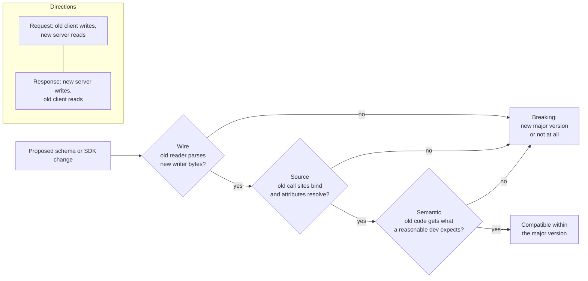

# Compatibility Taxonomy: Wire, Source (SDK), and Semantic Backward and Forward Compatibility (AIP-180)

> [!summary] Claim
> A change is backward compatible only if it passes three independent tests - the old client still exchanges bytes correctly (wire), old client code still binds and runs against the new SDK (source), and old client code still gets the answer a reasonable developer expects (semantic) - and the lab shows each axis failing while the other two pass.

Part of [Versioning Evolution and API Guidelines](README.md) in [API Engineering](../README.md).

## TL;DR

- Mechanism: AIP-180 defines source, wire, and semantic compatibility as three separate requirements; at the message level, an API stays backward compatible when request schemas are readable by the new server (new reader, old writer) and response schemas are readable by the old client (old reader, new writer).
- Contract rule: add, never remove or rename; new request fields default to the old behavior; new response values and fields must be absorbable by clients that ignore unknown keys and map unknown enum values.
- Trap: the axes are independent - a pydantic alias rename is byte-identical on the wire yet raises `AttributeError` in old code, and a new default `page_size` is wire- and source-clean yet makes old code silently see 2 of 5 books.
- Portability fact: wire compatibility is a property of the encoding, not the schema - renaming a protobuf field is safe in binary (field numbers on the wire) and a `ParseError` in ProtoJSON (names on the wire), proven identical on CPython 3.12 through 3.15.2t, in Debian Trixie and Alpine musl containers, and on both the `upb` and pure-Python protobuf backends, while the HTTP probes give the same results over real sockets on seven server and protocol legs (Uvicorn, Hypercorn, and Granian; HTTP/1.1, HTTP/2, and HTTP/3).
- When not to use it: AIP-180 itself scopes the full rule set to APIs with many independent consumers; an internal API whose callers you deploy in lockstep can buy speed by relaxing it, and alpha surfaces under AIP-181 promise no stability at all.

## Mental model



A proposed change enters on the left and must clear three gates in order of increasing judgment.
The wire gate is mechanical: serialize with one schema, parse with the other, in both message directions shown in the subgraph, because an API is backward compatible only when the new server reads old requests and the old client reads new responses.
The source gate asks whether code compiled or type-checked against the previous SDK still binds, which in Python means call sites still bind to the same parameters and attributes still resolve.
The semantic gate is where AIP-180 admits a judgment call: the bytes parse and the code runs, but the meaning changed, for example a new default or a new format inside an unchanged field.
Failing any gate sends the change to a new major version (see [[API-Versioning-Strategies-URI-Header-Media-Type-and-Channel-AIP-185]]) or out of the design entirely.

## How it works

### The three axes, as AIP-180 defines them

AIP-180 states that existing client code must not be broken by a service updating to a new minor or patch release, and that old clients must work against newer servers with the same major version.
It then names three distinct compatibility types: source compatibility (code written against a previous version must compile against, and run with, a newer client library), wire compatibility (serialization and deserialization expectations continue to match), and semantic compatibility (code continues to receive what most reasonable developers would expect).
AIP-180 assumes protocol buffers and JSON transports and says the guidance is indicative rather than exhaustive.
SemVer 2.0.0 encodes the same promise as a version number: item 8 requires the major version to increment for any backward incompatible change to the public API, and item 7 requires the minor version to increment when new backward compatible functionality is introduced.

### Backward and forward are per message direction

AIP-180 speaks only of backward compatibility from the client's point of view: old clients against new servers.
The schema-registry vocabulary is more precise and is the one to use when reasoning about bytes.
Confluent defines `BACKWARD` as "consumers using the new schema can read data produced with the last schema" and `FORWARD` as "data produced with a new schema can be read by consumers using the last schema".
Map those onto an API and one AIP-180 promise splits in two:

| Message | Writer | Reader | Required property |
|---|---|---|---|
| Request | old client | new server | schema-registry `BACKWARD` (new reader, old data) |
| Response | new server | old client | schema-registry `FORWARD` (old reader, new data) |
| Request from a new client to an old server (rollback, canary, multi-region skew) | new client | old server | `FORWARD` on requests, which AIP-180 does not require but production does |

The third row is where the lab finds its most dangerous result: a new client sending `validate_only: true` to a v1 server that never heard of the field.

### Wire: what the decoder does with what it does not know

HTTP itself is built on the ignore-the-unknown rule.
Recipients other than proxies `SHOULD` ignore unrecognized header and trailer fields, and a proxy `MUST` forward unrecognized header fields unless the name is listed in `Connection` or the proxy is configured to block or transform them, so that HTTP can be extended without updating deployed intermediaries (RFC 9110 Section 5.1).
A client `MUST` understand the class of any status code and treat an unrecognized code as the `x00` code of its class, so an unknown `471` is handled as `400` (RFC 9110 Section 15).
HTTP's extension points (methods, status codes, fields) are not versioned, so the protocol version in use does not change their semantics (RFC 9110 Section 16), and the minor version increments only for additions to message semantics while an incompatible message syntax bumps the major version (RFC 9110 Section 2.5).

JSON payloads inherit none of that automatically; the client's decoder decides.
In pydantic, `ModelFieldsValidator` is built with `ExtraBehavior::Ignore` as the default when neither schema nor config sets `extra` (pydantic-core 2.50.4 src/validators/model_fields.rs, ModelFieldsValidator::build), and with `extra="forbid"` every unknown key becomes an `ErrorTypeDefaults::ExtraForbidden` line error (pydantic-core 2.50.4 src/validators/model_fields.rs, ModelFieldsValidationState::validate_extra_key_value).
The pydantic-core source for this release lives in the pydantic monorepo at tag `v2.14.3` under `pydantic-core/`, whose `Cargo.toml` declares version `2.50.4`.
So an additive response field is wire compatible for a default pydantic client and wire breaking for a strict one; the lab's `wire_error` returns `None` and `"extra_forbidden"` respectively.

Enums are the sharpest edge.
`EnumValidator::validate` returns an exact instance of the enum class unchanged, otherwise tries its value lookup, then falls back to calling the enum class with the input, and converts a `ValueError` into the `enum` error type (pydantic-core 2.50.4 src/validators/enum_.rs, EnumValidator::validate).
That fallback is why a `_missing_` classmethod works as a tolerant-reader hook: the lab's `TolerantBookFormat` maps the server's new `EBOOK` to `FORMAT_UNSPECIFIED`, while the closed `BookFormat` fails with `enum`.
AIP-180 permits adding enum values but warns that user code may not handle them gracefully and that response enums expected to grow should say so; AIP-126 adds that enums should document whether they are frozen and, as a rule of thumb, gain values no more than once a year.

Protobuf moves the boundary to a different place, and the encoding decides which changes are wire safe.
In the binary format the wire carries field numbers, not names: each record starts with a varint tag `(field_number << 3) | wire_type` followed by the value (encoding guide, "Message Structure"), so the lab's field 3 varint record starts with `0x18`.
The proto3 guide therefore calls adding fields, removing fields (without reusing the number), and adding enum values binary wire safe, and calls changing a field number or moving a field into an existing `oneof` wire unsafe (proto3 guide, "Updating A Message Type").
It also lists conditionally safe changes such as `int32` <-> `int64`, where a value above `INT32_MAX` is truncated as a C++ cast would truncate it.
ProtoJSON puts field and enum value names on the wire and does not support unknown fields, so removing a field triggers a parse error and names become much harder to change (ProtoJSON guide, "Does not have as good schema-evolution guarantees as binary wire format").
Its implementations generally do not propagate unknown fields, and changing a field number is safe there because field numbers are not used in the format (ProtoJSON guide, "ProtoJSON Wire Safety").
The Python runtime exposes this as `json_format.ParseDict(..., ignore_unknown_fields=False)`, which raises unless the flag is set (protobuf 7.36.2 google/protobuf/json_format.py, ParseDict).

The lab measured the exact bytes.
The v2 message sets `copies = 2**31 + 5` in an `int64` field and serializes field 3 as `18 85 80 80 80 08` (tag plus a 5-byte varint).
A v1 reader with `int32 copies = 3` parses it as `-2147483643`, and when it re-serializes, it writes `18 85 80 80 80 f8 ff ff ff ff 01`, because negative `intN` values are two's complement and use all ten varint bytes (encoding guide, "Signed Integers"), so every downstream v2 reader now also sees `-2147483643`.
The same value through ProtoJSON is emitted as the string `"2147483653"` (int64 is quoted) and the v1 parser raises `ParseError` with `Failed to parse copies field: Value out of range: 2147483653.` instead of truncating.
Unknown fields survive a binary relay: proto3 preserves them on parse and re-serialization (proto3 guide, "Unknown Fields"), but serializing to JSON loses them (proto3 guide, "Retaining Unknown Fields"), and the lab proves both.

### Source: what the SDK user's code binds to

AIP-180 lists source-only breaks explicitly: moving a component between proto files is wire compatible but breaks generated `import` and `#include` paths, moving a field into a `oneof` breaks the Go stubs, and changing a field type is forbidden even when wire compatible because generated code changes.
AIP-4232 adds the client-library rule that generators must always keep accepting the full request object, and that only appending `google.api.method_signature` annotations is guaranteed backward compatible.
In a hand-written or generated Python SDK, the source contract is the method signature and the attribute names.
The lab's `source_breaks` makes the check mechanical: it builds two call shapes the old signature accepts (as many arguments by position as it allows, then as many by keyword), binds them against the new signature with `inspect.Signature.bind`, and reports `TypeError`s and silent rebinding.
Inserting `request_id` before `validate_only` produces `["positional: validate_only -> request_id"]`, and the old call `create_book("shelves/1", book, True)` runs without error and returns `shelves/1:books/1:True:False`: the dry-run flag landed in `request_id` and the resource is created.
Renaming `parent` to `shelf` only breaks keyword callers (`missing a required argument: 'shelf'`), and declaring flags keyword-only (`*`) in v1 makes later insertion invisible to every old call shape.
The mirror-image defense for required parameters is positional-only syntax (`/`): PEP 570 gives library authors the flexibility to change the name of positional-only parameters without breaking callers, and the lab's `BooksClientPositionalOnlyV1` takes the same `parent` to `shelf` rename with no finding in either direction, because no v1 caller could ever write `parent=`.
The probe checks exactly those two call shapes; it does not model mixed positional-and-keyword calls, `*args` or `**kwargs` parameters, or annotation changes.
Attribute renames behave the same way: `display_name: str = Field(alias="title")` keeps the JSON key and the bytes `model_dump_json(by_alias=True)` byte-identical to v1, while `book.title` raises `AttributeError`.

### Semantic: same bytes, different meaning

AIP-180 forbids changing default values, the format or construction algorithm of an existing field (its example is an `ip_address` that starts carrying IPv6), and even how a defaulted field is serialized, because clients may treat presence or absence as meaningful.
Its sharpest example is pagination added after the fact: if the new `page_size` default is smaller than what was previously returned, older clients incorrectly assume they received everything.
The lab runs exactly that against FastAPI: the v1 client parses the v2 response cleanly (pydantic ignores `next_page_token`), the code is unchanged, and the count drops from 5 to 2.
Nothing is lost on the server: a v2-aware client that follows `next_page_token` collects all 5 books in three pages, and `page_size=5` returns the v1 view with an empty token, so only code that never learned about pagination is wrong.
AIP-180 also says new fields populated by clients must default to the pre-existing behavior, which the v2 `validate_only: bool = False` does (the lab posts a body without the field to both servers and both store the book and return `books/6`); the semantic hole is the reverse direction, where a v1 server with pydantic's default `extra="ignore"` drops `validate_only` and performs the mutation.
Hyrum's Law is the reason the semantic axis never closes: with enough users, all observable behaviors of a system will be depended on by somebody, regardless of the documented contract.

## Numbers and limits

| Quantity | Value | Source |
|---|---|---|
| JSON integers interoperable across implementations | `[-(2**53)+1, (2**53)-1]` | RFC 8259 Section 6 |
| ProtoJSON `int64` encoding | quoted string, to avoid double-precision loss | ProtoJSON guide, "Strings for int64" (as of 2026-11) |
| `2**31 + 5` written as `int64`, read as `int32` (binary) | `-2147483643` | lab, `test_protobuf_int32_to_int64_truncates_in_binary_and_fails_loudly_in_protojson` |
| Varint size of field 3 before and after an old-reader relay | 5 bytes -> 10 bytes | lab, same test (byte assertions) |
| Old client's view of the collection after the v2 default `page_size` | 2 of 5 books | lab, `test_new_default_page_size_is_wire_and_source_compatible_but_semantically_breaking` |
| Beta time box before promotion to stable (rule of thumb) | 90 days | AIP-181, Beta (as of 2026-11) |
| Enum value additions (rule of thumb) | no more than once a year | AIP-126, When to use enums (as of 2026-11) |
| EC2 long resource ID format and opt-in window | identifier plus a 17-character string; transition until early December 2016 | AWS News Blog, "They're Here - Longer EC2 Resource IDs Now Available" (13 Jan 2016) |
| Pages a client that follows `next_page_token` needs at the v2 default `page_size` | 3 pages (2, 2, and 1 books) | lab, `test_v2_client_that_follows_page_tokens_recovers_the_full_collection` |
| Lab runtime, 18 tests | `0.29s` - `0.42s` per run over 9 runs | measured (as of 2026-11), `uv run --frozen pytest tests/f07_versioning_evolution_and_api_guidelines/test_compatibility_taxonomy_wire_source_and_semantic_compatibility_aip_180.py -q` from `labs/`, macOS 27.2 arm64 (Apple M3 Pro), CPython 3.14.6 |

Every row sourced to the lab was produced by the command in the last row on the same machine and interpreter (as of 2026-11).

## Portability

| Leg | Version | Result and evidence |
|---|---|---|
| CPython 3.12 | `3.12.13` on macOS (uv 0.11.26 offers nothing newer, as of 2026-11) and `3.12.16` in the containers below | `18 passed`, `UV_PROJECT_ENVIRONMENT=... uv run --frozen --python 3.12 pytest ...`; protobuf backend `upb` |
| CPython 3.13 | `3.13.18` | `18 passed`, same command with `--python /opt/homebrew/bin/python3.13`; protobuf backend `upb` |
| CPython 3.14 | `3.14.6` (workspace) and `3.14.10` | `18 passed` on both (`3.14.10` with `--python /opt/homebrew/bin/python3.14`); protobuf backend `upb` |
| CPython 3.15 | `3.15.2` | `18 passed`, `--python /opt/homebrew/bin/python3.15`; protobuf backend `upb` |
| CPython 3.15t free-threaded | `3.15.2t`, built from the python.org `Python-3.15.2.tar.xz` with `./configure --disable-gil` inside `python:3.15.2-trixie` (`linux/arm64`, GCC 14.2.0), and `3.15.0b3+freethreaded` from uv on macOS (uv 0.11.26 offers no newer free-threaded 3.15, as of 2026-11) | `18 passed` on both with the 10 pinned packages the lab imports (`pytest`, `pytest-asyncio`, `fastapi`, `starlette`, `pydantic`, `pydantic-core`, `httpx`, `httpcore`, `anyio`, `protobuf`), installed with `pip` in the container and with `PYTHONPATH=src uv run --no-project --python 3.15t --with ...` on macOS; `sys._is_gil_enabled()` is `False` after the imports on both; the full lock was not used because `uv sync --frozen` on macOS `3.15.0b3+freethreaded` stops at `psycopg-binary==3.3.8`, which has no source distribution or wheel for that interpreter |
| protobuf backend | `upb` vs pure Python, protobuf `7.36.2` | The lock holds `cp310-abi3` wheels for macOS, manylinux, and Windows plus one `py3-none-any` wheel; both free-threaded builds and Alpine musl run the pure-Python backend (`api_implementation.Type()` is `python`) while macOS and Trixie run `upb`; on 3.14.6 `PROTOCOL_BUFFERS_PYTHON_IMPLEMENTATION=python` also gives `18 passed`, so truncation, sign extension, unknown-field retention, and ProtoJSON errors are backend independent |
| Protobuf runtimes in other languages | C++, Java, Go, C# | Not run; the enum guide documents that Go and C# treat all enums as open and C++, Java, and Kotlin treat proto3 enums imported into proto2 files as closed, while Python is conformant in versions above `4.22.0` (enum guide, "Known Issues", as of 2026-11) |
| pydantic | `2.14.3` / pydantic-core `2.50.4` | Proven by lab; `serialize_by_alias` defaults to `False` (pydantic 2.14.3 pydantic/config.py, ConfigDict.serialize_by_alias), which is why the alias-rename test sees `display_name` on the wire; the same docstring says the default is expected to change to `True` in v3 |
| FastAPI | `0.162.0` | Proven by lab for request validation; response models serialize by alias because `response_model_by_alias` defaults to `True` (fastapi 0.162.0 fastapi/routing.py, get_request_handler) |
| ASGI servers (Uvicorn, Hypercorn, Granian) | `0.54.0`, `0.18.0`, `2.8.7` | Run over loopback sockets on CPython 3.14.6, macOS 27.2 arm64 (as of 2026-11): one Starlette app mounting `build_server_v1()`, `build_server_v2()`, and the strict v1 server was served by `uvicorn.Server`, `hypercorn.asyncio.serve`, and Granian's `granian.server.embed.Server` (ASGI interface) and probed with `httpx` `0.28.1`; all three returned the in-process results (5 books, then 2 with token `"2"`; the dry run stored by v1 and not by v2; `422` `extra_forbidden` from the strict server); the socket harness was a one-off script and is not checked in, so the checked-in lab stays in-process (`httpx.ASGITransport`) |
| HTTP/1.1, HTTP/2, HTTP/3 | HTTP/1.1 on all three servers; HTTP/2 on Hypercorn (cleartext prior knowledge, and TLS with ALPN `h2`) and Granian (cleartext prior knowledge); HTTP/3 over QUIC on Hypercorn with an `aioquic` `1.7.2` client | Same run, same results on all seven legs, with a self-signed certificate for the TLS and QUIC legs; not run: Uvicorn on HTTP/2, whose `zttp` protocol needs a `zttp` package that is not in the lock (uvicorn 0.54.0 uvicorn/protocols/http/zttp_h2_impl.py, `import zttp`), and Granian on HTTP/3, which it does not offer (granian 2.8.7 granian/constants.py, HTTPModes); HTTP extension points are version independent (RFC 9110 Section 16), which is why the same JSON body has the same compatibility on every HTTP version |
| Debian Trixie and Alpine musl containers | Debian 13.7 (glibc 2.41) and Alpine 3.24.4 (musl 1.2.6), `linux/arm64`, official `python:<version>-trixie` and `python:<version>-alpine` images | `18 passed` on CPython `3.12.16`, `3.13.18`, `3.14.10`, and `3.15.2` in both, each with the full frozen lock (`pip install uv==0.11.26`, `uv sync --frozen`, then `uv run --frozen pytest ... -q -p no:cacheprovider` on a read-only mount of `labs/`, as of 2026-11); no container definition is checked into the workspace yet |

## Worked example

The [implementation](../labs/src/api_labs/f07_versioning_evolution_and_api_guidelines/compatibility_taxonomy.py) holds the client models, the SDK signature probe, two FastAPI servers, and a runtime protobuf message builder; the [test](../labs/tests/f07_versioning_evolution_and_api_guidelines/test_compatibility_taxonomy_wire_source_and_semantic_compatibility_aip_180.py) runs eighteen probes across the three axes.

Wire probes: closed and tolerant client models (excerpt, byte-identical to the implementation file):

```python
class TolerantBookFormat(StrEnum):
    """Open enum: pydantic-core falls back to calling the class, so `_missing_` absorbs news."""

    FORMAT_UNSPECIFIED = "FORMAT_UNSPECIFIED"
    HARDBACK = "HARDBACK"
    PAPERBACK = "PAPERBACK"

    @classmethod
    def _missing_(cls, value: object) -> TolerantBookFormat:
        return cls.FORMAT_UNSPECIFIED


class BookV1(BaseModel):
    """SDK v1 resource model; pydantic's default `extra="ignore"` drops unknown keys."""

    name: str
    title: str
    format: BookFormat


class StrictBookV1(BookV1):
    """SDK v1 model with `extra="forbid"`: every additive response field is a wire break."""

    model_config = ConfigDict(extra="forbid")


class TolerantBookV1(BaseModel):
    """Tolerant reader: keeps unknown keys (`extra="allow"`) and maps unknown enum values."""

    model_config = ConfigDict(extra="allow")

    name: str
    title: str
    format: TolerantBookFormat


class BookV2Sdk(BaseModel):
    """SDK v2 renames the attribute `title` -> `display_name` but keeps the JSON key `title`."""

    model_config = ConfigDict(validate_by_name=True, validate_by_alias=True)

    name: str
    display_name: str = Field(alias="title")
    format: BookFormat
```

Source probe: binding old call shapes against a new signature (excerpt, byte-identical):

```python
def source_breaks(old: Callable[..., object], new: Callable[..., object]) -> list[str]:
    """List the old-legal call shapes that the new signature rejects or silently rebinds."""
    new_sig = inspect.signature(new)
    findings: list[str] = []
    for shape, (args, kwargs) in _call_shapes(inspect.signature(old)).items():
        try:
            bound = new_sig.bind(*args, **kwargs)
        except TypeError as exc:
            findings.append(f"{shape}: TypeError: {exc}")
            continue
        for param_name, value in bound.arguments.items():
            # A pure rename leaves the old name absent from the new signature and is harmless
            # positionally; a value landing on another slot while its own name still exists is
            # the silent rebinding that an inserted parameter causes.
            if not isinstance(value, _Arg) or value.name == param_name:
                continue
            if value.name in new_sig.parameters:
                findings.append(f"{shape}: {value.name} -> {param_name}")
    return findings
```

Semantic probe: the v2 server whose new defaults are wire- and source-clean (excerpt, byte-identical):

```python
def build_server_v2() -> tuple[FastAPI, list[str]]:
    """v2 Books API: list gains a default `page_size`, create gains `validate_only`."""
    app = FastAPI()
    created: list[str] = []

    @app.get("/v1/books")
    async def list_books(
        page_size: Annotated[int, Query(ge=1)] = V2_DEFAULT_PAGE_SIZE,
        page_token: str = "",
    ) -> dict[str, Any]:
        start = int(page_token or "0")
        end = start + page_size
        token = str(end) if end < len(CATALOG) else ""
        return {"books": list(CATALOG[start:end]), "next_page_token": token}

    @app.post("/v1/books")
    async def create_book(body: CreateBookRequestV2) -> dict[str, str]:
        if not body.validate_only:
            created.append(body.title)
        return {"name": f"books/{len(CATALOG) + len(created)}"}

    return app, created
```

The silent positional rebinding, as an old untyped call site experiences it (excerpt from the test, byte-identical):

```python
@pytest.mark.unit
def test_inserted_positional_parameter_silently_rebinds_old_call_sites() -> None:
    old = BooksClientV1().create_book
    new = BooksClientV2Inserted().create_book
    assert source_breaks(old, new) == ["positional: validate_only -> request_id"]
    book = BookV1.model_validate_json(V1_BOOK)
    # An untyped v1 call site: `validate_only=True` passed positionally.
    call_site: Callable[..., str] = new
    assert old("shelves/1", book, True) == "shelves/1:books/1:True"
    assert call_site("shelves/1", book, True) == "shelves/1:books/1:True:False"
```

The forward-direction semantic break: a new client's dry run against an old server (excerpt from the test, byte-identical):

```python
@pytest.mark.unit
@pytest.mark.asyncio
async def test_new_client_flag_is_silently_ignored_by_old_server_and_mutates() -> None:
    body = {"title": "Dry run only", "validate_only": True}
    old_app, old_store = build_server_v1()
    new_app, new_store = build_server_v2()
    async with _client(old_app) as client:
        old_response = await client.post("/v1/books", json=body)
    async with _client(new_app) as client:
        new_response = await client.post("/v1/books", json=body)
    assert old_response.status_code == 200
    assert old_store == ["Dry run only"]
    assert new_response.status_code == 200
    assert new_store == []
```

The protobuf width change, down to the varint bytes (excerpt from the test, byte-identical):

```python
@pytest.mark.unit
def test_protobuf_int32_to_int64_truncates_in_binary_and_fails_loudly_in_protojson() -> None:
    book_v1 = build_book_message("lab.v1", "title", INT32)
    book_v2 = build_book_message("lab.v2", "title", INT64)
    big = 2**31 + 5
    sent = book_v2(name="books/1", title="SICP", copies=big)
    # Field 3, wire type 0 (varint): tag byte 0x18, then a 5-byte varint for 2**31 + 5.
    assert sent.SerializeToString().endswith(b"\x18\x85\x80\x80\x80\x08")
    old_reader = book_v1()
    old_reader.ParseFromString(sent.SerializeToString())
    assert old_reader.copies == big - 2**32
    # The old reader re-encodes its negative int32 as a sign-extended 10-byte varint.
    assert old_reader.SerializeToString().endswith(b"\x18\x85\x80\x80\x80\xf8\xff\xff\xff\xff\x01")
    relayed = book_v2()
    relayed.ParseFromString(old_reader.SerializeToString())
    assert relayed.copies == big - 2**32
    # ProtoJSON quotes int64, and the int32 parser rejects the value instead of truncating it.
    assert '"copies": "2147483653"' in json_format.MessageToJson(sent)
    with pytest.raises(json_format.ParseError, match="Value out of range: 2147483653"):
        json_format.Parse(json_format.MessageToJson(sent), book_v1())
```

Captured run on CPython 3.14.6, macOS 27.2 arm64, from `labs/`:

```text
$ uv run --frozen pytest tests/f07_versioning_evolution_and_api_guidelines/test_compatibility_taxonomy_wire_source_and_semantic_compatibility_aip_180.py -q
..................                                                       [100%]
18 passed in 0.38s
```

Each test was also proven discriminating by mutation (as of 2026-11): 47 small mutations of the implementation each fail at least one test, and every test is failed by at least one of them (for example, changing `V2_DEFAULT_PAGE_SIZE` from `2` to `5` fails the two pagination tests, and dropping `_missing_` fails only the tolerant-enum test).

## Pitfalls

> [!warning] Lengthening an identifier is a semantic break even though the type is still `string`
> Trigger: a server starts issuing longer IDs in an existing `string` field.
> Symptom: client databases with fixed-width columns, regular expressions, and URL length limits reject or truncate new IDs while old IDs keep working, so the failure appears only for new resources.
> Fix: treat string length upper bounds as part of the contract (AIP-180, "Changing string length"); when AWS lengthened EC2 instance and reservation IDs to a 17-character string in January 2016, it ran a region-by-region, user-by-user, type-by-type opt-in transition until early December 2016 and told builders to check fixed-length fields, schema elements, and regular expressions (AWS News Blog).

> [!warning] Ignoring unknown request fields turns a new flag into a silent no-op on old servers
> Trigger: a client upgraded to v2 sends `validate_only: true`, and a load balancer, a rollback, or a lagging region routes it to a v1 server whose pydantic model uses the default `extra="ignore"`.
> Symptom: `200 OK` and a real mutation during what the caller believes is a dry run; the lab's `old_store` contains `"Dry run only"`.
> Fix: reject unknown request fields (`extra="forbid"` returns `422` with `extra_forbidden`, proven in the lab), roll servers forward before clients, and gate safety-critical flags on a capability the server advertises; see [[Dry-Run-and-Validate-Only-Requests-AIP-163]].

> [!warning] A tolerant reader that writes back a full resource erases fields it never knew
> Trigger: an old client reads a v2 resource, edits one field, and sends the whole model back with `PUT`.
> Symptom: the server receives a body without `isbn`, and full replacement semantics clear it; the lab shows `BookV1.model_dump_json()` drops `isbn` while `extra="allow"` keeps it.
> Fix: use partial updates with update masks ([[Field-Masks-and-Update-Masks-AIP-134-and-AIP-161]]) instead of full replacement ([[Full-Replacement-PUT-and-Upsert-Semantics]]), or make SDK models preserve unknown keys the way proto3 binary preserves unknown fields.

> [!warning] An alias rename is wire-safe only if the SDK serializes by alias
> Trigger: SDK v2 renames `title` to `display_name` with `Field(alias="title")` and its request builder calls `model_dump_json()` without `by_alias=True`.
> Symptom: pydantic's `serialize_by_alias` default of `False` emits `display_name`, and the v1 server reports `missing` for `title`.
> Fix: set `serialize_by_alias=True` in the SDK base model config (the lab shows it restores the v1 bytes from a plain `model_dump_json()`) and keep a byte-level round-trip test against the previous release's fixtures.

> [!warning] Widening an integer through an old relay corrupts data permanently
> Trigger: `int32` -> `int64` in a published protobuf message while some intermediaries still run the old schema.
> Symptom: values above `INT32_MAX` arrive negative, and after the old relay re-serializes them every new reader also sees the wrong value, with no error anywhere.
> Fix: the proto3 guide's rule - only write values legal in the old type until every endpoint has the new schema, and do not make such changes to schemas published outside your organization.

## Security and robustness

- Parser differentials are a compatibility problem with a CVE number: Apache CouchDB before 1.7.0 and 2.x before 2.1.1 let the Erlang and JavaScript JSON parsers disagree on duplicate `roles` keys, so non-admin users could grant themselves `_admin` (CVE-2017-12635, NVD); RFC 8259 Section 4 says only that object names `SHOULD` be unique and that behavior with duplicates is unpredictable, so every layer that validates must parse exactly what the layer that acts will parse.
- `extra="allow"` on a server request model is mass assignment waiting to happen (OWASP API3:2023 Broken Object Property Level Authorization); tolerance belongs on the client's response models, strictness on the server's request models.
- Old versions kept alive for compatibility are attack surface that must stay in the inventory (OWASP API9:2023 Improper Inventory Management); [[Deprecation-Header-RFC-9745-and-Sunset-Header-RFC-8594]] covers announcing their retirement.
- Clients are consumers of untrusted input too (OWASP API10:2023 Unsafe Consumption of APIs): a tolerant reader should map unknown enum values to an explicit sentinel and keep validating everything it does understand, not fall back to unvalidated dictionaries.
- Prefer loud failure to silent loss at trust boundaries: ProtoJSON's out-of-range `ParseError` is safer than binary truncation, and a `422` is safer than an ignored flag.

## The principal's view

The decision is not "version or not" but where each axis is enforced and by what machine.
Wire compatibility is cheap to automate: keep golden request and response fixtures for every released version and parse them with every newer schema in CI, plus the reverse for responses; for protobuf, a breaking-change detector that compares descriptors catches field renumbering before review.
Source compatibility belongs to the SDK team and needs its own gate: a signature diff like `source_breaks` for Python, API-surface diffs for compiled languages, and a style rule that every optional SDK parameter is keyword-only from the first release.
Semantic compatibility cannot be fully automated, so it is a review checklist item owned by the API review board: defaults, formats, ordering, pagination, and presence of defaulted fields, with Hyrum's Law as the default assumption.
The organizational trade-off is speed against blast radius: AIP-180 itself tells APIs whose callers are written by the same team, or whose deployment can enforce updates, to consider their own compatibility requirements, and AIP-181 lets alpha components break freely, so classify each surface before choosing the rule set.
Choose a different paradigm when the axes keep colliding: schema-registry-gated event streams make `BACKWARD` or `FORWARD` an enforced property per subject, gRPC with binary protobuf makes renames free and numbering sacred, and date-pinned versions with request and response transformers ([[Stripe-Date-Based-Versioning-and-Version-Change-Gates]]) let semantics change per client cohort at the price of maintaining every transformer forever.

## Interview questions

> [!question] L5: Name the three compatibility types in AIP-180 and give one change that breaks only one of them.
>
> > [!success]- Answer
> > Wire compatibility means old and new serializers and parsers still agree on the bytes.
> > Source compatibility means code written against the old SDK still compiles and runs against the new one.
> > Semantic compatibility means old code still gets what a reasonable developer expects.
> > Renaming a pydantic attribute behind `Field(alias="title")` breaks only source: the JSON is byte-identical but `book.title` raises `AttributeError`.
> >
> > Follow-up: Which change breaks only the semantic axis?

> [!question] L5: Is adding a field to a JSON response backward compatible?
>
> > [!success]- Answer
> > It is wire compatible for clients that ignore unknown keys, which is pydantic's default `extra="ignore"`.
> > It is a wire break for any client configured with `extra="forbid"`, which reports `extra_forbidden`.
> > AIP-180 allows additions in the same major version, so strict response parsing is a client bug the producer still has to plan for.
> >
> > Follow-up: Why should a server's request model nevertheless be strict?

> [!question] L6: Predict the output: if SDK v1 is `def create_book(self, parent, book, validate_only=False)`, SDK v2 is `def create_book(self, parent, book, request_id=None, validate_only=False)`, and each returns its bound values joined by colons, what does the old call `create_book("shelves/1", book, True)` return against v2?
>
> > [!success]- Answer
> > It returns `shelves/1:books/1:True:False` with no exception.
> > The positional `True` binds to `request_id`, and `validate_only` keeps its default `False`, so a dry run becomes a real creation.
> > A static type checker would flag `bool` passed to `str | None`, but untyped call sites and dynamic callers get no warning.
> > Making optional parameters keyword-only in v1 prevents this class of break entirely.
> >
> > Follow-up: How would you detect this in CI without running the call?

> [!question] L6: Why is renaming a protobuf field safe in one deployment and breaking in another?
>
> > [!success]- Answer
> > The binary wire format carries field numbers, not names, so an old reader parses the renamed field into its old name with the same value.
> > ProtoJSON carries lowerCamelCase field names, so an old parser raises `ParseError` on `displayName`, or silently leaves `title` empty with `ignore_unknown_fields=True`.
> > Either way generated code changes, so AIP-180 treats a rename as remove-plus-add and forbids it within a major version.
> >
> > Follow-up: Which change is wire safe in ProtoJSON but unsafe in binary?

> [!question] L6: Debug this API: after a canary of the new mobile client, finance reports duplicate orders created by requests that set `validate_only: true`, and the logs show `200 OK` from a region still on the previous release - what happened and what do you change?
>
> > [!success]- Answer
> > The previous release's request model ignores unknown keys, so it dropped `validate_only` and executed the create.
> > This is a forward-direction break on requests: new writer, old reader, which AIP-180's old-client-new-server rule does not cover.
> > Make server request models reject unknown fields with `422`, roll servers out before clients, and have clients send safety-critical flags only when the server has advertised support.
> > Then reconcile the duplicate orders, because idempotency keys alone do not prevent a dry run from being executed.
> >
> > Follow-up: How do you advertise a server capability without inventing a new version?

> [!question] L6: Why might you refuse an `int32` -> `int64` change that the protobuf guide lists as wire compatible?
>
> > [!success]- Answer
> > It is only conditionally compatible: an old binary reader truncates values above `INT32_MAX`, so `2**31 + 5` becomes `-2147483643`.
> > If an old service relays the message, it re-encodes the wrong negative value as a 10-byte varint, so new readers downstream also see corrupt data.
> > ProtoJSON fails loudly with a `ParseError` (`Value out of range: 2147483653`) instead, which is safer but still breaking.
> > AIP-180 also forbids type changes because generated code changes, so it is a source break even when the bytes parse.
> >
> > Follow-up: What rollout sequence makes the widening safe inside one organization?

> [!question] L7+: When one proto generates both the REST/JSON and the gRPC surface of a resource, which compatibility rules do you adopt and who enforces each axis?
>
> > [!success]- Answer
> > Adopt the intersection of the binary and ProtoJSON rules, because a change is only safe if it is safe on every encoding you serve: no renames, no renumbering, no type changes, additive fields and enum values only.
> > Enforce wire compatibility in CI with descriptor diffs and golden JSON fixtures from every released version.
> > Enforce source compatibility per SDK language with surface diffs, since AIP-180 notes changes like moving files or into a `oneof` break generated code without touching the wire.
> > Own semantic compatibility in API review with an explicit checklist for defaults, formats, pagination, and presence.
> >
> > Follow-up: Which of these gates would you relax for an internal API with lockstep deploys, and what evidence would justify it?

> [!question] L7+: AIP-180 says changing a default is breaking, so how do you ship a new default that a product team needs for safety reasons?
>
> > [!success]- Answer
> > Inside the major version, keep the old default for existing callers and add an explicit field or value that opts into the new behavior.
> > If the old default is unsafe enough to justify breaking callers, it is a new major version or an isolated change under AIP-181, with a defined deprecation period and direct communication to affected users.
> > Use per-client telemetry to find who relies on the default, and consider date-pinned versions so new integrations get the new default while existing ones keep theirs.
> > Document the decision, because Hyrum's Law means someone depends on the old behavior even if it was never promised.
> >
> > Follow-up: What telemetry would prove that no client still depends on the old default?

> [!question] L7+: Why is the tolerant reader pattern both the cure for and a cause of compatibility incidents?
>
> > [!success]- Answer
> > On responses, ignoring unknown fields and mapping unknown enum values is what lets a server add things without breaking old clients.
> > On requests, the same tolerance turns new client flags into silent no-ops on old servers.
> > On read-modify-write, a reader that drops unknown fields and writes back a full resource erases data it never understood.
> > So the rule is tolerant client response models, strict server request models, and partial updates rather than full replacement.
> >
> > Follow-up: How does proto3 binary avoid the read-modify-write loss, and when does it still lose data?

## Related

Prerequisites: [[Idempotent-Request-Identification-and-Request-ID-Correlation-AIP-155]]

Next: [[Anatomy-of-Breaking-Changes-in-HTTP-and-JSON-APIs]]

See also: [[API-Fundamentals]], [[02-Programming-Languages/Python/Python-Backend-Interview-Prep/05-REST-API-Design]], [[Additive-Schema-Evolution-and-Tolerant-Reader-Patterns]], [[API-Versioning-Strategies-URI-Header-Media-Type-and-Channel-AIP-185]], [[Stripe-Date-Based-Versioning-and-Version-Change-Gates]], [[Google-AIP-System-Architecture-and-Core-Tenets]], [[Field-Behavior-Semantics-Input-Only-Output-Only-and-Immutable-AIP-203]], [[Dry-Run-and-Validate-Only-Requests-AIP-163]], [[Field-Masks-and-Update-Masks-AIP-134-and-AIP-161]], [[Full-Replacement-PUT-and-Upsert-Semantics]], [[Pydantic-v2-Architecture-CoreSchema-and-Rust-Pydantic-Core]], [[HTTP-Status-Code-Taxonomy-and-Selection-Decision-Trees]]

- Lab: `labs/tests/f07_versioning_evolution_and_api_guidelines/test_compatibility_taxonomy_wire_source_and_semantic_compatibility_aip_180.py`

## Further reading

- [AIP-180 Backwards compatibility](https://google.aip.dev/180): the source of the three-axis taxonomy and the add, remove, rename, move, type, length, and semantic rules.
- [AIP-181 Stability levels](https://google.aip.dev/181): which surfaces the compatibility promise applies to (alpha, beta, stable) and the isolated-change escape hatch.
- [AIP-4232 Method signatures](https://google.aip.dev/client-libraries/4232): the client-library source-compatibility rules for flattened method signatures.
- [AIP-126 Enumerations](https://google.aip.dev/126): when enums are worth the evolution cost and how to document frozen versus growing enums.
- [Protocol Buffers Language Guide (proto3), Updating A Message Type](https://protobuf.dev/programming-guides/proto3/#updating): binary wire-safe, wire-unsafe, and conditionally safe changes, plus unknown field retention.
- [ProtoJSON Format, ProtoJSON Wire Safety](https://protobuf.dev/programming-guides/json/#json-wire-safety): why the same schema change has different compatibility in JSON.
- [Protocol Buffers Encoding](https://protobuf.dev/programming-guides/encoding/): the tag formula `(field_number << 3) | wire_type` and the ten-byte varint for negative `intN` values.
- [Protocol Buffers Enum Behavior](https://protobuf.dev/programming-guides/enum/): open versus closed enums and the per-language conformance gaps.
- [RFC 9110 HTTP Semantics](https://www.rfc-editor.org/rfc/rfc9110.html): Section 5.1 (ignore unrecognized fields), Section 15 (unknown status codes by class), Section 16 (extending HTTP without versions).
- [RFC 8259 JSON](https://www.rfc-editor.org/rfc/rfc8259.html): Section 4 (duplicate names) and Section 6 (interoperable number range).
- [PEP 570 Python Positional-Only Parameters](https://peps.python.org/pep-0570/): the `/` syntax and its stated motivation, renaming a parameter without breaking callers.
- [Semantic Versioning 2.0.0](https://semver.org/spec/v2.0.0.html): items 6 to 8 tie patch, minor, and major increments to backward compatibility.
- [Hyrum's Law](https://www.hyrumslaw.com/): why the semantic axis includes behavior you never documented.
- [Confluent Schema Registry, Schema Evolution and Compatibility](https://docs.confluent.io/platform/current/schema-registry/fundamentals/schema-evolution.html): precise `BACKWARD`, `FORWARD`, and `FULL` definitions and their upgrade orders.
- [pydantic-core 2.50.4 `model_fields.rs`](https://github.com/pydantic/pydantic/blob/v2.14.3/pydantic-core/src/validators/model_fields.rs): the `extra` behavior that decides whether additive fields are wire compatible for a Python client.
