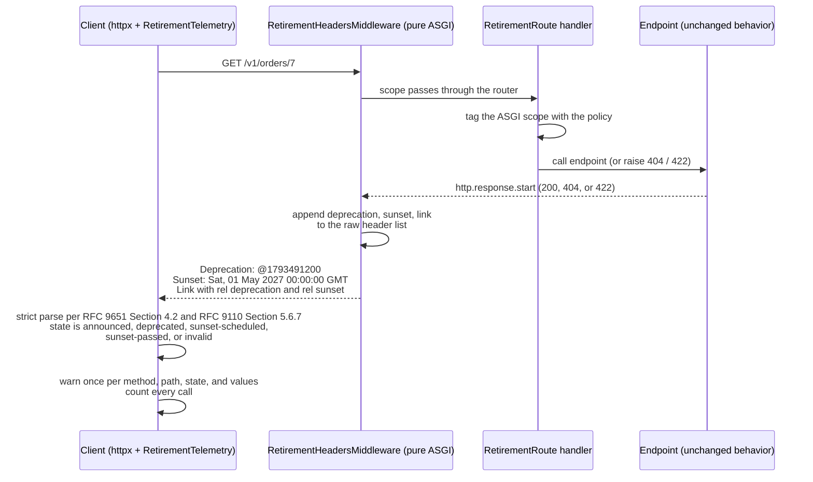

# Standardized API Retirement: The Deprecation Header (@timestamp, RFC 9745) and Sunset Header (HTTP-date, RFC 8594)

> [!summary] Claim
> `Deprecation: @<epoch-seconds>` (an RFC 9651 Structured Field Date) says when a resource stopped being recommended, `Sunset: <IMF-fixdate>` says when it is expected to stop answering, and both are hints that must be emitted on every response of the endpoint, parsed strictly by clients, and never treated as a behavior change or a guarantee.

Part of [Versioning Evolution and API Guidelines](README.md) in [API Engineering](../README.md).

## TL;DR

Mechanism: the server adds `Deprecation: @1793491200` (`(RFC 9745 Section 2.1)`), optionally `Sunset: Sat, 01 May 2027 00:00:00 GMT` (`(RFC 8594 Section 3)`), and `Link` entries with `rel="deprecation"` and `rel="sunset"` pointing at human documentation (`(RFC 9745 Section 3)`, `(RFC 8594 Section 6)`).
Contract rule: the `Sunset` instant MUST NOT be earlier than the `Deprecation` instant (`(RFC 9745 Section 4)`), and deprecation does not change any behavior of the resource (`(RFC 9745 Section 5)`).
Trap: the two fields use two different date grammars, so the classic bugs are a lenient date parser (CPython `email.utils.parsedate_to_datetime` accepts `UTC`, lowercase, offsets, and two concatenated dates), a comma-splitting header reader that cuts an HTTP-date in half, and a FastAPI dependency that sets the headers but loses them whenever the endpoint returns a `Response` or raises.
Portability: the lab passes unchanged on CPython 3.12.16, 3.13.18, 3.14.6, 3.14.10, and 3.15.2 on macOS 27.2 arm64 and on 3.12.16, 3.13.18, 3.14.10, and 3.15.2 in Debian Trixie (glibc) and Alpine (musl) containers, a pinned subset of the lock passes on free-threaded 3.15.2t with the GIL off, the values cross HTTP/1.1 (`h11 0.16.0`), HTTP/2 (`h2 4.4.1`, names lowercased for you), and HTTP/3 (`aioquic 1.7.2`, capitalized names rejected) byte for byte, and Uvicorn 0.54.0, Hypercorn 0.18.0, and Granian 2.8.7 each put them on the wire for `200`, `404`, and `422` responses in the lab's loopback socket tests.
When not to use it: the headers only reach clients that read them, so they never replace direct outreach, per-client usage telemetry, and brownouts ([[Brownout-Schedules-Per-Client-Usage-Telemetry-and-Safe-Sunsetting]]), and they are the wrong tool for a resource that is merely temporary unless you also want caches and crawlers to see a retirement date.

## Mental model



The route class only tags the ASGI scope with the endpoint's retirement policy, and a pure ASGI middleware outside the router appends the three fields to the raw header list of whatever `http.response.start` message comes back, so a model response, a directly returned `JSONResponse`, an `HTTPException` `404`, and a validation `422` all carry identical retirement metadata.
The endpoint itself is untouched, which is the normative point of `(RFC 9745 Section 5)`: the response body of the deprecated `/v1` route is byte-identical to the `/v2` replacement in the lab.
On the client, an `httpx` response event hook parses both fields with the strict algorithms, treats any field that fails as absent (`(RFC 9651 Section 4.2)`), classifies the endpoint against an injected clock, and emits one `FutureWarning` subclass per distinct signal while counting every call for usage telemetry.

## How it works

### The `Deprecation` field: an sf-date Item

`Deprecation` is an Item Structured Header Field whose value MUST be a Date as per `(RFC 9651 Section 3.3.7)` (`(RFC 9745 Section 2.1)`).
The RFC's own example is `Deprecation: @1688169599`, which is Friday, 30 June 2023 23:59:59 `UTC` (`(RFC 9745 Section 2.1)`).
The date may be in the past (the resource was deprecated then) or in the future (it will be deprecated then) (`(RFC 9745 Section 2.1)`).
The field is registered as `permanent` with Structured Type `Item` in the IANA HTTP Field Name Registry (IANA `field-names.csv`, fetched 2026-11-11).

On the wire an sf-date is `@` followed by a serialized Integer (`(RFC 9651 Section 4.1.10)`), and Integers are limited to fifteen decimal digits, `-999,999,999,999,999` to `999,999,999,999,999` (`(RFC 9651 Section 3.3.1)`).
Dates are seconds from `1970-01-01T00:00:00Z` excluding leap seconds, and parsers MUST support every day in years 1 to 9999, that is `-62,135,596,800` to `253,402,214,400` (`(RFC 9651 Section 3.3.7)`).
Parsing runs the generic algorithm of `(RFC 9651 Section 4.2)`: convert to ASCII or fail, discard leading `SP`, parse an Item, discard `SP`, and fail if anything is left.
An Item is a bare item plus Parameters (`(RFC 9651 Section 4.2.3)`), so `@1793491200;grease=?1` is a valid `Deprecation` value: field specifications are discouraged from making an unrecognized parameter an error (`(RFC 9651 Section 2.3)`), RFC 9745 defines no parameters, and the lab client ignores them.
The bare item dispatches on its first character, `@` selects Parsing a Date (`(RFC 9651 Section 4.2.3.1)`), and a Date whose number parses as a Decimal fails (`(RFC 9651 Section 4.2.9)`).
A syntactically valid Item of the wrong type (a bare `1688169599` Integer, a `?1` Boolean) violates the field-specific constraint, so the whole field is ignored, because RFC 9745 defines no other handling (`(RFC 9651 Section 2.2)`).

The strictness has a precise operational consequence for duplicates.
Recipients MUST combine all field lines with the same name into one comma-separated value before parsing (`(RFC 9651 Section 4.2)`, `(RFC 9110 Section 5.2)`), and Integers cannot be split across lines because the inserted comma makes parsing fail (`(RFC 9651 Section 4.2)`).
Two `Deprecation` lines therefore become `@1793491200, @1793491201`, which fails with trailing characters, and the recipient MUST either ignore the entire field as if it were absent or treat the complete message as malformed (`(RFC 9651 Section 4.2)`); the lab client ignores the field.
The lab asserts exactly that message: `Deprecation ignored: trailing characters: ', @1793491201'`.

### The `Sunset` field: one HTTP-date

`Sunset = HTTP-date` (`(RFC 8594 Section 3)`), registered as `permanent` without a Structured Type (IANA `field-names.csv`, fetched 2026-11-11).
`HTTP-date = IMF-fixdate / obs-date`, senders MUST generate `IMF-fixdate`, recipients MUST accept all three formats (`IMF-fixdate`, `rfc850-date`, `asctime-date`), the grammar is case-sensitive, and the zone token is the literal `%s"GMT"` (`(RFC 9110 Section 5.6.7)`).
`IMF-fixdate` is fixed length, so `Sat, 01 May 2027 00:00:00 GMT` and every other value is 29 characters.
An `rfc850-date` carries a two-digit year, and a recipient MUST interpret a value that appears to be more than 50 years in the future as the most recent past year with those digits (`(RFC 9110 Section 5.6.7)`).
The lab compares instants, not calendar years: with the clock at `2026-11-11T12:00:00Z`, `01-Jan-76` resolves to 2076, `01-Jan-77` to 1977, `11-Nov-76 12:00:00` (exactly 50 years ahead) to 2076, and `11-Nov-76 12:00:01` to 1976.
`time-of-day` admits `23:59:60` for a leap second (`(RFC 9110 Section 5.6.7)`); Python `datetime` cannot hold second 60, so the lab rolls it into the next minute.
A `Sunset` timestamp SHOULD be in the future, and it is safest to read a past timestamp as the present: the resource may become unavailable at any time (`(RFC 8594 Section 3)`).
RFC 8594 defines `Sunset` without any reference to `Deprecation`, so a response may carry it alone; the lab client reports a lone future `Sunset` as `sunset-scheduled` and keeps `invalid` for a response whose retirement fields were present but none parsed.
After the sunset, the RFC expects `4xx`, `3xx`, or no response at all, and the header does not say which (`(RFC 8594 Section 3)`); its archive example suggests `410 Gone` when the server still remembers the URI, `404 Not Found` otherwise (`(RFC 8594 Section 9)`).

Because an HTTP-date contains a comma and `Sunset` is not list-valued, a sender MUST NOT generate two `Sunset` lines (`(RFC 9110 Section 5.3)`), and any reader that splits on commas destroys the value.
`httpx 0.28.1` shows both halves of the hazard: `Headers.__getitem__` joins duplicate lines with `", "`, and `Headers.get_list(key, split_commas=True)` splits `Sat, 01 May 2027 00:00:00 GMT` into `["Sat", "01 May 2027 00:00:00 GMT"]` (`(httpx 0.28.1 httpx/_models.py, Headers.get_list)`, asserted in the lab).

RFC 9745 adds the cross-field rule: the `Sunset` timestamp MUST NOT be earlier than the `Deprecation` timestamp, and a client that sees the inversion SHOULD ask the provider (`(RFC 9745 Section 4)`).
The same section's example, `Sunset: Sun, 30 Jun 2024 23:59:59 UTC`, is not a valid `IMF-fixdate`, because the grammar admits only `GMT` (`(RFC 9110 Section 5.6.7)`); the RFC Editor errata search returned "No matching errata found" for RFC 9745 when fetched on 2026-11-11.
The lab's strict parser rejects that example, while `email.utils.parsedate_to_datetime` accepts it.

### The link relations

`deprecation` "Refers to documentation (intended for human consumption) about the deprecation of the link's context" (`(RFC 9745 Section 6.2)`), and `sunset` "Identifies a resource that provides information about the context's retirement policy" (`(RFC 8594 Section 7.2)`).
A `Link` with `rel="deprecation"` can appear before any `Deprecation` field to make the policy discoverable (`(RFC 9745 Section 3.1)`).
`Link = #link-value` is list-valued (`(RFC 8288 Section 3)`), so a retirement link can share the field with pagination links, the `rel` parameter MUST appear exactly once per link-value, and it may hold several space-separated relation types (`(RFC 8288 Section 3.3)`).
`httpx.Response.links` keys its dict by the raw `rel` string (`(httpx 0.28.1 httpx/_models.py, Response.links)`), so `rel="deprecation sunset"` arrives as the single key `"deprecation sunset"`; the lab client splits it.

### Scope, caching, and the 304 path

`Deprecation` describes the resource identified with the response it occurs in (`(RFC 9745 Section 2.1)`), with that identification defined by `(RFC 9110 Section 6.4.2)`, and `Sunset` applies to the resource that returns it (`(RFC 8594 Section 5)`).
A provider may document a wider scope, for example a `Sunset` on the API home document meaning the whole API, but clients unaware of that documentation will apply the standard per-resource meaning (`(RFC 9745 Section 2.2)`, `(RFC 8594 Section 5)`).
`Sunset` is not a caching directive (`(RFC 8594 Section 4)`), yet caches do store it as part of the response.
When a cache freshens a stored response with a `304 Not Modified`, it MUST update the stored header fields with those in the `304` (`(RFC 9111 Section 4.3.4)`), so an origin that adds `Deprecation` only to `200` responses leaves cache-served clients on the old headers; the lab middleware decorates every status code.

### Emitting the fields from FastAPI 0.162.0

`deprecated=True` on a FastAPI route only sets `operation["deprecated"]` in the OpenAPI document (`(fastapi 0.162.0 fastapi/openapi/utils.py, get_openapi_operation_metadata)`); it emits no header, which the lab asserts.
The obvious alternative, a dependency that writes to the injected `Response`, works only on the model-return path: when the endpoint returns a `Response` object, `get_request_handler` uses it as is and skips `response.headers.raw.extend(solved_result.response.headers.raw)` (`(fastapi 0.162.0 fastapi/routing.py, get_request_handler)`), and an `HTTPException` becomes a fresh response built from `exc.headers` (`(fastapi 0.162.0 fastapi/exception_handlers.py, http_exception_handler)`), so the sub-response headers never reach it.
The lab proves both losses and therefore splits the job in two.
`RetirementRoute.get_route_handler` wraps FastAPI's handler and tags `request.scope`; it hooks `get_route_handler` rather than wrapping `self.app` because, for a route included through `include_router`, FastAPI 0.162.0 builds the effective route's app as `request_response(original_route.get_route_handler())` (`(fastapi 0.162.0 fastapi/routing.py, _EffectiveRouteContext.from_api_route)`), so a wrapper installed on `self.app` is never called; mutation M02 confirms it.
The handler runs inside `wrap_app_handling_exceptions` (`(fastapi 0.162.0 fastapi/routing.py, request_response)`), so `404` and `422` responses are produced inside the route, and the tag is already in the scope when the outer middleware sees `http.response.start`.
`RetirementHeadersMiddleware` appends rather than replaces, which preserves an existing pagination `Link`; Starlette's `MutableHeaders.__setitem__` would instead delete every duplicate (`(starlette 1.10.0 starlette/datastructures.py, MutableHeaders.__setitem__)`).
The ASGI headers then reach the wire unchanged in Uvicorn, which prepends its default headers to `message.get("headers", [])` (`(uvicorn 0.54.0 uvicorn/protocols/http/h11_impl.py, RequestResponseCycle.send)`).
The lab's socket-tier tests start Uvicorn 0.54.0 (both the `h11` and the `httptools` parser), Hypercorn 0.18.0, and Granian 2.8.7 (through `granian.server.embed.Server`) on a loopback port and read the raw response bytes: every server writes `deprecation: @1793491200` and `sunset: Sat, 01 May 2027 00:00:00 GMT` with the lowercase names the ASGI message carries, on `200`, `404`, and `422` alike.
Granian is the one server that reorders: it groups field lines that share a name, so on the paginated list the policy `link` line moves up next to the pagination `link` line and ahead of `deprecation`, with the two `link` lines still in their original order.

### Wire bytes

The lab serializes the two date fields through `h11 0.16.0` as a server response and asserts these exact bytes:

```text
HTTP/1.1 200 \r\n
Deprecation: @1793491200\r\n
Sunset: Sat, 01 May 2027 00:00:00 GMT\r\n
Content-Length: 0\r\n
\r\n
```

`@1793491200` is `2026-11-01T00:00:00Z`.
On HTTP/2, field names MUST be converted to lowercase when a message is constructed (`(RFC 9113 Section 8.2)`) and an uppercase name makes the message malformed (`(RFC 9113 Section 8.2.1)`); HTTP/3 has the same rule (`(RFC 9114 Section 4.2)`).
`h2 4.4.1` lowercases outbound names by default, because `normalize_outbound_headers` defaults to `True` (`(h2 4.4.1 h2/config.py, H2Configuration)`) and calls `_lowercase_header_names` (`(h2 4.4.1 h2/utilities.py, normalize_outbound_headers)`), so the lab's in-process HTTP/2 exchange delivers `(b"deprecation", b"@1793491200")` and `(b"sunset", b"Sat, 01 May 2027 00:00:00 GMT")` to the client unchanged.
`aioquic 1.7.2` does not do that favor on HTTP/3: `send_headers` encodes the names it is given (`(aioquic 1.7.2 aioquic/h3/connection.py, H3Connection.send_headers)`), and the receiving side rejects any name containing a byte in `0x41` to `0x5A` (`(aioquic 1.7.2 aioquic/h3/connection.py, validate_header_name)`).
The lab runs both cases over an in-memory QUIC connection: the middleware's lowercase ASGI pairs arrive byte for byte, while the capitalized names from `RetirementPolicy.header_items()` make the client drop the response and close the connection with `H3_MESSAGE_ERROR` (`0x010e`, `(RFC 9114 Section 8.1)`) and the reason `Header b'Deprecation' contains invalid characters`.
That is why `RetirementHeadersMiddleware` lowercases the names itself instead of relying on the server or the protocol library.

## Numbers and limits

| Quantity | Value | Source or measurement |
|---|---|---|
| sf-integer range behind every sf-date | `-999,999,999,999,999` to `999,999,999,999,999` (15 digits) | `(RFC 9651 Section 3.3.1)` |
| Date range a parser MUST support | `-62,135,596,800` to `253,402,214,400` s (years 1 to 9999) | `(RFC 9651 Section 3.3.7)` |
| Largest legal sf-date vs Python `datetime` | `@999999999999999` parses but exceeds `datetime`; lab maps it to `FieldParseError` via `OverflowError` from `timedelta` arithmetic | lab test, CPython 3.12.16 to 3.15.2, macOS 27.2 arm64 |
| `datetime.fromtimestamp(999999999999999, UTC)` | raises `ValueError: year must be in 1..9999, not 31690708` (a different exception type than the `timedelta` path) | probe on CPython 3.14.6, macOS 27.2 arm64; mutation M15 |
| Decimal limits enforced by the number parser before the Date check | 12 integer digits, 3 fractional digits; `@1.5` is inside them and fails only at the Date step, which rejects every Decimal | `(RFC 9651 Section 4.2.4)`, `(RFC 9651 Section 4.2.9)` |
| `IMF-fixdate` length | 29 characters | lab (`Sat, 01 May 2027 00:00:00 GMT`), grammar in `(RFC 9110 Section 5.6.7)` |
| `rfc850-date` century window | values more than 50 years ahead of the clock, compared as instants, roll back 100 years | `(RFC 9110 Section 5.6.7)`; lab test at the exact 50-year boundary |
| HTTP/1.1 bytes added per response (lab policy) | `Deprecation` 26, `Sunset` 39, `Link` 177; total 242 | lab test, field line including `": "` and `CRLF` |
| HPACK bytes, first response on a connection | 181 total (20, 29, 132 when each field is encoded alone) | lab test, `hpack 4.2.0` |
| HPACK bytes, repeat response on the same connection | 3 for the three fields | lab test, `hpack 4.2.0` |
| CORS-safelisted response-header names readable by cross-origin browser JS | 7 (`Cache-Control`, `Content-Language`, `Content-Length`, `Content-Type`, `Expires`, `Last-Modified`, `Pragma`); `Deprecation`, `Sunset`, `Link` are not among them | Fetch Standard, "CORS-safelisted response-header name" (as of 2026-11) |
| CVE-2025-25290 pattern `<([^>]+)>; rel="deprecation"` on a value of N `<` then `>` | 0.013 s, 0.050 s, 0.223 s, and 0.903 s of CPU for N = 2,000, 4,000, 8,000, and 16,000: four times per doubling | `re.search` timed with `time.process_time`, best of 3, CPython 3.14.6, macOS 27.2 arm64, measured 2026-11-11 |
| Same payload at N = 100,000 (the advisory's size) | fixed pattern `<([^<>]+)>; rel="deprecation"` 0.0009 s; lab client `RetirementTelemetry.observe` 0.0004 s to 0.0012 s over five runs | same probe; the lab test bounds the client at 2 s of CPU |
| Lab suite | 43 test functions, 104 cases (98 `unit`, 6 `socket`); `104 passed in 2.26s`, and 1.55 s to 2.40 s over nine further runs on a machine shared with other jobs, so wall time is noise-dominated | `uv run --frozen pytest ... -q`, CPython 3.14.6, macOS 27.2 arm64, measured 2026-11-11 |

## Portability

Unless a cell says otherwise, every leg ran `uv run --frozen --python <interpreter> pytest <test> -q -p no:cacheprovider` from `labs/` with its own `UV_PROJECT_ENVIRONMENT` on 2026-11-11, where `<test>` is the path on the `- Lab:` line.

| Leg | Result | Evidence |
|---|---|---|
| CPython 3.12.16, macOS 27.2 arm64 | 104 passed | full lock; interpreter fetched with `uv 0.13.7` (`uv python install 3.12.16`), because `uv 0.11.26` does not list it |
| CPython 3.13.18, macOS 27.2 arm64 | 104 passed | full lock; Homebrew interpreter |
| CPython 3.14.6 (workspace `.python-version`), macOS 27.2 arm64 | 104 passed | full lock; `uv run --frozen pytest <test> -q`, the gate command |
| CPython 3.14.10, macOS 27.2 arm64 | 104 passed | full lock; Homebrew interpreter |
| CPython 3.15.2, macOS 27.2 arm64 | 104 passed | full lock; Homebrew interpreter |
| CPython 3.15.2t free-threaded, macOS 27.2 arm64 | 103 passed, 1 skipped (the HTTP/3 test), `sys._is_gil_enabled()` still `False` after the run | not the full lock: `uv run --frozen` stops because `psycopg-binary==3.3.8` has no free-threaded wheel, so the run used a venv on the `uv 0.13.7`-fetched `3.15.2+freethreaded` build with the locked releases of `fastapi`, `starlette`, `httpx`, `h2`, `h11`, `hpack`, `uvicorn`, `httptools`, `hypercorn`, `granian`, `cryptography`, `pytest`, and `pytest-asyncio` (`uv export --frozen` as the constraint file for `uv pip install -c`), `PYTHONPATH=src`, then `python -m pytest <test> -q`; `aioquic 1.7.2` is absent because `pylsqpack 1.0.0` fails to build there |
| Debian Trixie (Debian 13, glibc 2.41, aarch64) | 104 passed on each of CPython 3.12.16, 3.13.18, 3.14.10, and 3.15.2 | `docker run python:<version>-trixie` with `labs/` mounted read-only, `uv 0.11.26` from PyPI, full lock, Docker 29.8.2 linux/arm64 |
| Alpine 3.24 (musl, aarch64) | 104 passed on each of CPython 3.12.16, 3.13.18, 3.14.10, and 3.15.2 | `docker run python:<version>-alpine`, same mount, `uv`, and lock |
| CPython 3.15.2t free-threaded, Debian Trixie and Alpine 3.24 containers | 103 passed, 1 skipped (the HTTP/3 test) in each, GIL still off after the run | same pinned subset and command as the macOS free-threaded leg, on the `3.15.2+freethreaded` builds that `uv 0.13.7` installs inside `python:3.15.2-trixie` and `python:3.15.2-alpine` |
| `datetime` mapping of sf-dates | epoch plus `timedelta` raises `OverflowError` for out-of-range dates on every leg above; `fromtimestamp` is avoided because it raised `ValueError` instead on CPython 3.14.6 | lab test; mutation M15 |
| HTTP/1.1 via `h11 0.16.0` | names and values sent as given | lab wire-bytes test |
| HTTP/2 via `h2 4.4.1` | names lowercased on send, values byte-identical | lab in-process exchange; rule in `(RFC 9113 Section 8.2)` |
| HTTP/3 via `aioquic 1.7.2` | lowercase names and values byte-identical; capitalized names end the connection with `H3_MESSAGE_ERROR` | lab exchange over an in-memory QUIC connection (no UDP socket); rule in `(RFC 9114 Section 4.2)` |
| Uvicorn 0.54.0 (`http="h11"` and `http="httptools"`) | `deprecation`, `sunset`, and `link` lines on `200`, `404`, `422`, and the direct-`JSONResponse` list over HTTP/1.1, in ASGI order; none on `/v2` | lab socket test reading raw bytes from a loopback port; `(uvicorn 0.54.0 uvicorn/protocols/http/h11_impl.py, RequestResponseCycle.send)` |
| Hypercorn 0.18.0 | same five results over HTTP/1.1, and all three fields on a `404` over cleartext HTTP/2 with prior knowledge | lab socket tests (`hypercorn.asyncio.serve`), HTTP/2 client built on `h2 4.4.1` |
| Granian 2.8.7 | same five results over HTTP/1.1 and on a `404` over cleartext HTTP/2; on the list response the two `link` lines are adjacent and precede `deprecation`, their relative order kept | lab socket tests (`granian.server.embed.Server`, `Interfaces.ASGINL`) |
| FastAPI 0.162.0 included routers | headers present only because the tag is set in `get_route_handler` | lab test; mutation M02 |

## Worked example

The [implementation](../labs/src/api_labs/f07_versioning_evolution_and_api_guidelines/retirement_headers.py) holds the strict sf-date and HTTP-date codecs, the validated `RetirementPolicy`, the `@deprecated` route decorator with `RetirementRoute` and `RetirementHeadersMiddleware`, and the client-side `RetirementTelemetry` hook; the [test](../labs/tests/f07_versioning_evolution_and_api_guidelines/test_deprecation_header_rfc_9745_and_sunset_header_rfc_8594.py) drives all of it in-process, then repeats the server half over loopback sockets against Uvicorn, Hypercorn, and Granian.

Full source of the implementation, byte-identical to the lab file:

```python
"""RFC 9745 Deprecation and RFC 8594 Sunset: strict codecs, a FastAPI route class, telemetry."""

from __future__ import annotations

import base64
import re
import threading
import warnings
from collections import Counter
from dataclasses import dataclass
from datetime import UTC, datetime, timedelta
from decimal import Decimal
from typing import TYPE_CHECKING, Any, Literal

from fastapi.routing import APIRoute

if TYPE_CHECKING:
    from collections.abc import Callable, Coroutine

    import httpx
    from fastapi import Request, Response
    from starlette.types import ASGIApp, Message, Receive, Scope, Send

SF_INTEGER_MAX = 999_999_999_999_999  # RFC 9651 Section 3.3.1
EPOCH = datetime(1970, 1, 1, tzinfo=UTC)
SCOPE_KEY = "api_labs.retirement_policy"
POLICY_ATTR = "__api_retirement_policy__"
RETIREMENT_HEADERS = ("Deprecation", "Sunset", "Link")

_DIGITS = frozenset("0123456789")
_ALPHA = frozenset("abcdefghijklmnopqrstuvwxyzABCDEFGHIJKLMNOPQRSTUVWXYZ")
_TOKEN_REST = _ALPHA | _DIGITS | frozenset("!#$%&'*+-.^_`|~:/")  # tchar, ":" and "/"
_KEY_FIRST = frozenset("abcdefghijklmnopqrstuvwxyz*")
_KEY_REST = _KEY_FIRST | frozenset("0123456789_-.")
_B64 = _ALPHA | frozenset("0123456789+/=")
_MONTHS = ("Jan", "Feb", "Mar", "Apr", "May", "Jun", "Jul", "Aug", "Sep", "Oct", "Nov", "Dec")
_DAY = "Mon|Tue|Wed|Thu|Fri|Sat|Sun"
_DAY_L = "Monday|Tuesday|Wednesday|Thursday|Friday|Saturday|Sunday"
_MON = "|".join(_MONTHS)
_TIME = r"(?P<H>[0-9]{2}):(?P<M>[0-9]{2}):(?P<S>[0-9]{2})"
_IMF_FIXDATE = re.compile(
    rf"(?:{_DAY}), (?P<d>[0-9]{{2}}) (?P<mon>{_MON}) (?P<y>[0-9]{{4}}) {_TIME} GMT"
)
_RFC850_DATE = re.compile(
    rf"(?:{_DAY_L}), (?P<d>[0-9]{{2}})-(?P<mon>{_MON})-(?P<y>[0-9]{{2}}) {_TIME} GMT"
)
_ASCTIME_DATE = re.compile(
    rf"(?:{_DAY}) (?P<mon>{_MON}) (?P<d>[0-9]{{2}}| [0-9]) {_TIME} (?P<y>[0-9]{{4}})"
)


class FieldParseError(ValueError):
    """A field value failed strict parsing; the recipient ignores the whole field."""


@dataclass(frozen=True, slots=True)
class Token:
    value: str


@dataclass(frozen=True, slots=True)
class SfDate:
    seconds: int


type BareItem = int | Decimal | str | Token | bytes | bool | SfDate


@dataclass(frozen=True, slots=True)
class SfItem:
    value: BareItem
    params: dict[str, BareItem]


class _Reader:
    """Cursor over an ASCII field value, mirroring the RFC 9651 Section 4.2 algorithms."""

    def __init__(self, text: str) -> None:
        self.text = text
        self.pos = 0

    def peek(self) -> str:
        return self.text[self.pos] if self.pos < len(self.text) else ""

    def take(self) -> str:
        char = self.peek()
        self.pos += 1
        return char

    def skip_sp(self) -> None:
        while self.peek() == " ":
            self.pos += 1

    def number(self) -> int | Decimal:  # RFC 9651 Section 4.2.4
        sign = 1
        if self.peek() == "-":
            self.take()
            sign = -1
        if self.peek() not in _DIGITS:
            raise FieldParseError("expected a DIGIT")
        digits, is_decimal = "", False
        while (char := self.peek()) in _DIGITS or (char == "." and not is_decimal):
            if char == ".":
                if len(digits) > 12:
                    raise FieldParseError("decimal integer part longer than 12 digits")
                is_decimal = True
            digits += self.take()
            if not is_decimal and len(digits) > 15:
                raise FieldParseError("integer longer than 15 digits")
            if is_decimal and len(digits) > 16:
                raise FieldParseError("decimal longer than 16 characters")
        if not is_decimal:
            return sign * int(digits)
        if digits.endswith(".") or len(digits.split(".")[1]) > 3:
            raise FieldParseError("malformed decimal fraction")
        return sign * Decimal(digits)

    def bare_item(self) -> BareItem:  # RFC 9651 Section 4.2.3.1
        char = self.peek()
        if char == "-" or char in _DIGITS:
            return self.number()
        if char == '"':
            return self.string()
        if char in _ALPHA or char == "*":
            start = self.pos
            while self.peek() in _TOKEN_REST:
                self.pos += 1
            return Token(self.text[start : self.pos])
        if char == ":":
            return self.byte_sequence()
        if char == "?":
            self.take()
            flag = self.take()
            if flag not in ("0", "1"):
                raise FieldParseError("malformed boolean")
            return flag == "1"
        if char == "@":  # RFC 9651 Section 4.2.9
            self.take()
            value = self.number()
            if isinstance(value, Decimal):
                raise FieldParseError("a Date must be an integer")
            return SfDate(value)
        if char == "%":
            return self.display_string()
        raise FieldParseError(f"unrecognized item type at {char!r}")

    def string(self) -> str:  # RFC 9651 Section 4.2.5
        self.take()
        out: list[str] = []
        while self.peek():
            char = self.take()
            if char == "\\":
                escaped = self.take()
                if escaped not in ('"', "\\"):
                    raise FieldParseError("bad escape in string")
                out.append(escaped)
            elif char == '"':
                return "".join(out)
            elif not " " <= char <= "~":
                raise FieldParseError("control character in string")
            else:
                out.append(char)
        raise FieldParseError("unterminated string")

    def byte_sequence(self) -> bytes:  # RFC 9651 Section 4.2.7
        self.take()
        end = self.text.find(":", self.pos)
        if end == -1:
            raise FieldParseError("unterminated byte sequence")
        content = self.text[self.pos : end]
        self.pos = end + 1
        if any(char not in _B64 for char in content):
            raise FieldParseError("character outside the base64 alphabet")
        try:
            return base64.b64decode(content + "=" * (-len(content) % 4))
        except ValueError as exc:
            raise FieldParseError("invalid base64") from exc

    def display_string(self) -> str:  # RFC 9651 Section 4.2.10
        if self.text[self.pos : self.pos + 2] != '%"':
            raise FieldParseError("malformed display string")
        self.pos += 2
        out = bytearray()
        while self.peek():
            char = self.take()
            if not " " <= char <= "~":
                raise FieldParseError("control character in display string")
            if char == "%":
                octet = self.text[self.pos : self.pos + 2]
                self.pos += 2
                if len(octet) != 2 or any(c not in "0123456789abcdef" for c in octet):
                    raise FieldParseError("bad percent-encoding in display string")
                out.append(int(octet, 16))
            elif char == '"':
                try:
                    return out.decode("utf-8")
                except UnicodeDecodeError as exc:
                    raise FieldParseError("display string is not UTF-8") from exc
            else:
                out.append(ord(char))
        raise FieldParseError("unterminated display string")

    def params(self) -> dict[str, BareItem]:  # RFC 9651 Section 4.2.3.2
        params: dict[str, BareItem] = {}
        while self.peek() == ";":
            self.take()
            self.skip_sp()
            if self.peek() not in _KEY_FIRST:
                raise FieldParseError("malformed parameter key")
            start = self.pos
            while self.peek() in _KEY_REST:
                self.pos += 1
            key = self.text[start : self.pos]
            value: BareItem = True
            if self.peek() == "=":
                self.take()
                value = self.bare_item()
            params[key] = value  # duplicate keys: the last one wins
        return params


def parse_sf_item(field_value: str) -> SfItem:
    """Parse a combined field value as an RFC 9651 Item (Section 4.2), failing strictly."""
    if not field_value.isascii():
        raise FieldParseError("field value is not ASCII")
    reader = _Reader(field_value)
    reader.skip_sp()
    item = SfItem(reader.bare_item(), reader.params())
    reader.skip_sp()
    if reader.pos != len(field_value):
        raise FieldParseError(f"trailing characters: {field_value[reader.pos :]!r}")
    return item


def parse_deprecation(field_value: str) -> SfDate:
    """RFC 9745 Section 2.1: the value MUST be an sf-date; any other Item type is ignored."""
    item = parse_sf_item(field_value)
    if not isinstance(item.value, SfDate):
        raise FieldParseError(f"Deprecation must be a Date, got {type(item.value).__name__}")
    return item.value


def serialize_sf_date(seconds: int) -> str:
    """RFC 9651 Section 4.1.10: "@" followed by a serialized Integer (Section 4.1.4)."""
    if isinstance(seconds, bool) or not -SF_INTEGER_MAX <= seconds <= SF_INTEGER_MAX:
        raise ValueError(f"Date out of the sf-integer range: {seconds!r}")
    return f"@{seconds}"


def sf_date_to_datetime(date: SfDate) -> datetime:
    """Map epoch seconds to an aware UTC datetime with portable integer arithmetic."""
    try:
        return EPOCH + timedelta(seconds=date.seconds)
    except OverflowError as exc:
        raise FieldParseError(f"Date {date.seconds} is outside datetime's year 1..9999") from exc


def format_http_date(moment: datetime) -> str:
    """RFC 9110 Section 5.6.7: senders MUST generate IMF-fixdate."""
    utc = _as_utc_whole_seconds(moment)
    return f"{utc:%a}, {utc.day:02d} {_MONTHS[utc.month - 1]} {utc.year:04d} {utc:%H:%M:%S} GMT"


def parse_http_date(field_value: str, *, now: datetime) -> datetime:
    """Parse all three RFC 9110 Section 5.6.7 formats, case-sensitively, into UTC."""
    if match := _IMF_FIXDATE.fullmatch(field_value) or _ASCTIME_DATE.fullmatch(field_value):
        year, two_digit_year = int(match["y"]), False
    elif match := _RFC850_DATE.fullmatch(field_value):
        year, two_digit_year = now.year // 100 * 100 + int(match["y"]), True
    else:
        raise FieldParseError(f"not an HTTP-date: {field_value!r}")
    month, day = _MONTHS.index(match["mon"]) + 1, int(match["d"])
    hour, minute, second = int(match["H"]), int(match["M"]), int(match["S"])
    if hour > 23 or minute > 59 or second > 60:
        raise FieldParseError("time-of-day out of range")
    # A two-digit year more than 50 years ahead of the clock, compared as instants, is the
    # most recent past year with those digits.
    fifty_years_back = (year - 50, month, day, hour, minute, second)
    if two_digit_year and fifty_years_back > now.utctimetuple()[:6]:
        year -= 100
    try:
        moment = datetime(year, month, day, hour, minute, min(second, 59), tzinfo=UTC)
    except ValueError as exc:
        raise FieldParseError(f"impossible calendar date: {field_value!r}") from exc
    return moment + timedelta(seconds=second - 59) if second == 60 else moment


def _as_utc_whole_seconds(moment: datetime) -> datetime:
    offset = moment.utcoffset()
    if offset is None:
        raise ValueError("naive datetime: HTTP dates are UTC instants, attach a timezone")
    if offset:
        raise ValueError(f"datetime must be UTC, got offset {offset}")
    if moment.microsecond:
        raise ValueError("sf-date and HTTP-date carry whole seconds only")
    return moment.astimezone(UTC)


def _link_target(uri: str) -> str:
    if any(char in uri for char in '<>" ,;') or not uri.isascii() or not uri.isprintable():
        raise ValueError(f"unsafe link target for a Link header: {uri!r}")
    return uri


@dataclass(frozen=True, slots=True)
class RetirementPolicy:
    """One endpoint's retirement schedule, validated against RFC 9745 Section 4."""

    deprecated_at: datetime
    sunset_at: datetime | None = None
    deprecation_doc: str | None = None
    sunset_doc: str | None = None

    def __post_init__(self) -> None:
        object.__setattr__(self, "deprecated_at", _as_utc_whole_seconds(self.deprecated_at))
        if self.sunset_at is not None:
            sunset = _as_utc_whole_seconds(self.sunset_at)
            if sunset < self.deprecated_at:
                raise ValueError("Sunset MUST NOT be earlier than Deprecation (RFC 9745 Section 4)")
            object.__setattr__(self, "sunset_at", sunset)
        for uri in (self.deprecation_doc, self.sunset_doc):
            if uri is not None:
                _link_target(uri)

    def header_items(self) -> list[tuple[str, str]]:
        epoch_seconds = (self.deprecated_at - EPOCH) // timedelta(seconds=1)
        items = [("Deprecation", serialize_sf_date(epoch_seconds))]
        if self.sunset_at is not None:
            items.append(("Sunset", format_http_date(self.sunset_at)))
        links: list[str] = []
        if self.deprecation_doc is not None:
            links.append(f'<{self.deprecation_doc}>; rel="deprecation"; type="text/html"')
        if self.sunset_doc is not None:
            links.append(f'<{self.sunset_doc}>; rel="sunset"; type="text/html"')
        if links:
            items.append(("Link", ", ".join(links)))
        return items


def deprecated[F: Callable[..., Any]](policy: RetirementPolicy) -> Callable[[F], F]:
    """Route decorator: attach *policy* to an endpoint served by a ``RetirementRoute``."""

    def mark(endpoint: F) -> F:
        setattr(endpoint, POLICY_ATTR, policy)
        return endpoint

    return mark


def policy_of(endpoint: Callable[..., Any]) -> RetirementPolicy | None:
    policy: object = getattr(endpoint, POLICY_ATTR, None)
    return policy if isinstance(policy, RetirementPolicy) else None


class RetirementRoute(APIRoute):
    """Marks OpenAPI ``deprecated`` and tags the ASGI scope; the middleware writes the headers.

    The tag is set in ``get_route_handler`` because FastAPI 0.162 rebuilds the ASGI app of
    an included route from ``get_route_handler()``, so wrapping ``self.app`` would be lost.
    """

    def __init__(self, path: str, endpoint: Callable[..., Any], **kwargs: Any) -> None:
        if policy_of(endpoint) is not None:
            kwargs["deprecated"] = True
        super().__init__(path, endpoint, **kwargs)

    def get_route_handler(self) -> Callable[[Request], Coroutine[Any, Any, Response]]:
        handler = super().get_route_handler()
        policy = policy_of(self.endpoint)
        if policy is None:
            return handler

        async def tag_then_handle(request: Request) -> Response:
            request.scope[SCOPE_KEY] = policy
            return await handler(request)

        return tag_then_handle


class RetirementHeadersMiddleware:
    """Append the policy headers to every response of a tagged request, errors included."""

    def __init__(self, app: ASGIApp) -> None:
        self.app = app

    async def __call__(self, scope: Scope, receive: Receive, send: Send) -> None:
        if scope["type"] != "http":
            await self.app(scope, receive, send)
            return

        async def send_with_headers(message: Message) -> None:
            policy: object = scope.get(SCOPE_KEY)
            if message["type"] == "http.response.start" and isinstance(policy, RetirementPolicy):
                extra = [(k.lower().encode(), v.encode()) for k, v in policy.header_items()]
                message = {**message, "headers": [*message.get("headers", []), *extra]}
            await send(message)

        await self.app(scope, receive, send_with_headers)


class ApiRetirementWarning(FutureWarning):
    """Shown by default: FutureWarning targets end users, DeprecationWarning is hidden."""


type SignalState = Literal[
    "announced", "deprecated", "sunset-scheduled", "sunset-passed", "invalid"
]


@dataclass(frozen=True, slots=True)
class RetirementSignal:
    method: str
    path: str
    state: SignalState
    deprecated_at: datetime | None
    sunset_at: datetime | None
    docs: dict[str, str]
    problems: tuple[str, ...]


class RetirementTelemetry:
    """Client-side httpx hook: parse strictly, warn once per signal, count every call."""

    def __init__(self, clock: Callable[[], datetime]) -> None:
        self._clock = clock
        self._lock = threading.Lock()
        self._seen: set[tuple[str | None, ...]] = set()
        self.signals: list[RetirementSignal] = []
        self.calls: Counter[tuple[str, str]] = Counter()

    def observe(self, response: httpx.Response) -> RetirementSignal | None:
        raw_deprecation = response.headers.get("deprecation")
        raw_sunset = response.headers.get("sunset")
        if raw_deprecation is None and raw_sunset is None:
            return None
        now = self._clock()
        problems: list[str] = []
        deprecated_at = sunset_at = None
        if raw_deprecation is not None:
            try:
                deprecated_at = sf_date_to_datetime(parse_deprecation(raw_deprecation))
            except FieldParseError as exc:
                problems.append(f"Deprecation ignored: {exc}")
        if raw_sunset is not None:
            try:
                sunset_at = parse_http_date(raw_sunset, now=now)
            except FieldParseError as exc:
                problems.append(f"Sunset ignored: {exc}")
        if deprecated_at is not None and sunset_at is not None and sunset_at < deprecated_at:
            problems.append("Sunset earlier than Deprecation (RFC 9745 Section 4)")
        state: SignalState = "invalid"  # fields were present and none of them parsed
        if sunset_at is not None and sunset_at <= now:
            state = "sunset-passed"  # RFC 8594 Section 3: a past Sunset means "now"
        elif deprecated_at is not None:
            state = "deprecated" if deprecated_at <= now else "announced"
        elif sunset_at is not None:
            state = "sunset-scheduled"  # RFC 8594 alone: retiring without being deprecated
        docs = {
            rel: link["url"]
            for rels, link in response.links.items()
            if rels is not None
            for rel in rels.split()
            if rel in ("deprecation", "sunset")
        }
        key = (response.request.method, response.request.url.path)
        signal = RetirementSignal(
            key[0], key[1], state, deprecated_at, sunset_at, docs, tuple(problems)
        )
        dedup_key = (*key, state, raw_deprecation, raw_sunset)
        with self._lock:
            self.calls[key] += 1
            first = dedup_key not in self._seen
            if first:
                self._seen.add(dedup_key)
                self.signals.append(signal)
        if first:
            warnings.warn(
                f"{key[0]} {key[1]} is {state}; sunset={sunset_at}; docs={docs or None}",
                ApiRetirementWarning,
                stacklevel=2,
            )
        return signal

    async def async_hook(self, response: httpx.Response) -> None:
        self.observe(response)
```

A simplified excerpt of the test module, showing the app under test and two of its 43 test functions, which expand to 104 test cases (the functions are copied unchanged; imports and fixtures are omitted):

```python
# simplified excerpt from tests/f07_versioning_evolution_and_api_guidelines/test_deprecation_header_rfc_9745_and_sunset_header_rfc_8594.py
def build_app(*, cors: bool = False) -> FastAPI:
    app = FastAPI()
    v1 = APIRouter(prefix="/v1", route_class=RetirementRoute)
    v2 = APIRouter(prefix="/v2", route_class=RetirementRoute)

    @v1.get("/orders/{order_id}")
    @deprecated(POLICY)
    async def get_order_v1(order_id: int) -> dict[str, int | str]:
        if order_id == 404:
            raise HTTPException(status_code=404, detail="no such order")
        return {"id": order_id, "state": "open"}

    @v1.get("/orders")
    @deprecated(POLICY)
    async def list_orders_v1() -> JSONResponse:
        return JSONResponse([], headers={"Link": '</v1/orders?page=2>; rel="next"'})

    @v2.get("/orders/{order_id}")
    async def get_order_v2(order_id: int) -> dict[str, int | str]:
        return {"id": order_id, "state": "open"}

    app.include_router(v1)
    app.include_router(v2)
    app.add_middleware(RetirementHeadersMiddleware)
    if cors:
        app.add_middleware(
            CORSMiddleware,
            allow_origins=["https://dashboard.example.com"],
            expose_headers=RETIREMENT_HEADERS,
        )
    return app


@pytest.mark.unit
@pytest.mark.asyncio
async def test_headers_on_success_error_validation_and_direct_response_paths() -> None:
    async with client_for(build_app()) as client:
        ok = await client.get("/v1/orders/7")
        not_found = await client.get("/v1/orders/404")
        invalid = await client.get("/v1/orders/not-an-int")
        listed = await client.get("/v1/orders")
    assert [ok.status_code, not_found.status_code, invalid.status_code] == [200, 404, 422]
    for response in (ok, not_found, invalid, listed):
        assert retirement_lines(response) == EXPECTED_LINES
    assert listed.headers.get_list("link") == [
        '</v1/orders?page=2>; rel="next"',
        POLICY.header_items()[2][1],
    ]
    assert set(listed.links) == {"next", "deprecation", "sunset"}


@pytest.mark.unit
@pytest.mark.asyncio
async def test_client_telemetry_warns_once_and_counts_every_call() -> None:
    telemetry = RetirementTelemetry(clock=lambda: NOW)
    async with telemetry_client(build_app(), telemetry) as client:
        with warnings.catch_warnings(record=True) as caught:
            warnings.simplefilter("always")
            for _ in range(3):
                await client.get("/v1/orders/7")
            await client.get("/v2/orders/7")
    assert [(w.category, str(w.message)[:31]) for w in caught] == [
        (ApiRetirementWarning, "GET /v1/orders/7 is deprecated;")
    ]
    assert telemetry.calls == {("GET", "/v1/orders/7"): 3}
    (signal,) = telemetry.signals
    assert signal.state == "deprecated"
    assert signal.deprecated_at == datetime(2026, 11, 1, tzinfo=UTC)
    assert signal.sunset_at == datetime(2027, 5, 1, tzinfo=UTC)
    assert signal.docs == {
        "deprecation": "https://developer.example.com/deprecation/orders-v1",
        "sunset": "https://developer.example.com/sunset-policy",
    }
    assert signal.problems == ()
```

Captured output of the gate command from `labs/` on CPython 3.14.6, macOS 27.2 arm64 (Darwin 27.2.0):

```text
$ uv run --frozen pytest tests/f07_versioning_evolution_and_api_guidelines/test_deprecation_header_rfc_9745_and_sunset_header_rfc_8594.py -q
........................................................................ [ 69%]
................................                                         [100%]
104 passed in 2.26s
```

## Pitfalls

One CVE concerns a client reading these fields, CVE-2025-25290 in `@octokit/request`, and it is the first pitfall below.
No public postmortem of a retirement that went wrong because of these two headers was found (three web searches and the GitHub Advisory Database, as of 2026-11), and the NVD exact-match keyword searches `Sunset header`, `Deprecation header`, `RFC 8594`, and `RFC 9745` each return 0 records because the CVE description contains none of those phrases; the remaining failure modes are reproduced in the lab instead.

> [!warning] A backtracking regex on `Link` turns a deprecation signal into a denial of service (CVE-2025-25290)
> - **Trigger**: a client pulls the documentation URL out of `Link` with a regular expression whenever a `deprecation` field is present; `@octokit/request` from 1.0.0 before 8.4.1, and from 9.0.0-beta.1 before 9.2.1, ran `/<([^>]+)>; rel="deprecation"/` on the `link` field (GitHub advisory GHSA-rmvr-2pp2-xj38, CWE-1333, CVSS 3.1 base score 5.3).
> - **Symptom**: a response with a `deprecation` field and a `link` of 100,000 `<` characters followed by `>` pins a CPU core, because every `<` starts a new attempt in which `[^>]+` runs to the end of the value and then backtracks; the advisory's proof of concept "will stuck forever with high CPU usage".
> - **Fix**: releases 8.4.1 and 9.2.1 changed the class to `[^<>]+` (octokit/request.js commit `34ff07e`), which ends an attempt at the next `<`.
>   Do not match `Link` with an unanchored pattern at all: the lab client reads `httpx.Response.links`, which splits the value with `re.split(", *<", value)` and `str.split` (`(httpx 0.28.1 httpx/_models.py, _parse_header_links)`), and a lab test feeds it the advisory's payload under a 2 s CPU bound (mutation M44 swaps in the vulnerable pattern and fails it).

> [!warning] Lenient date parsing turns a malformed `Sunset` into a wrong date
> - **Trigger**: a client parses `Sunset` with `email.utils.parsedate_to_datetime`, which implements RFC 2822-era leniency through `_parsedate_tz` and a `_timezones` table that maps `UT`, `UTC`, `GMT`, and `Z` to offset zero (`(CPython 3.14.6 Lib/email/_parseaddr.py, _parsedate_tz)`).
> - **Symptom**: the lab shows it accepts `UTC` (the RFC 9745 Section 4 example), lowercase `sun, 30 jun 2024 23:59:59 gmt`, a `+0200` offset, and a missing zone, and that for two concatenated dates it returns the first one as a naive `datetime`, which then raises `TypeError` the first time it is compared with an aware clock.
> - **Fix**: parse with the three-format, case-sensitive grammar of `(RFC 9110 Section 5.6.7)`, treat failure as "field absent", and report it.

> [!warning] Retirement headers vanish on the paths clients hit most
> - **Trigger**: headers are set from a FastAPI dependency through the injected `Response`, or from `route.deprecated`.
> - **Symptom**: the lab shows `[]` retirement headers on an endpoint that returns `JSONResponse` directly and on a raised `404`, because `get_request_handler` merges the sub-response headers only when it builds the response itself (`(fastapi 0.162.0 fastapi/routing.py, get_request_handler)`); `deprecated=True` changes only OpenAPI.
> - **Fix**: tag the request in the route class and append the headers in an outer ASGI middleware, so every status code produced by the route is decorated.

> [!warning] Clobbering the `Link` field
> - **Trigger**: writing `response.headers["Link"] = ...` on a paginated endpoint.
> - **Symptom**: `MutableHeaders.__setitem__` removes every other `link` line (`(starlette 1.10.0 starlette/datastructures.py, MutableHeaders.__setitem__)`), so `rel="next"` disappears and clients stop paginating.
> - **Fix**: append a new field line (`MutableHeaders.append` or the raw ASGI list); `Link` is list-valued (`(RFC 8288 Section 3)`), so both lines combine correctly.
>   The lab asserts both lines survive, and mutation M03 (replace instead of append) fails it.

> [!warning] Splitting `Sunset` on commas
> - **Trigger**: a generic header reader that splits every value on `,` (for example `httpx.Headers.get_list(..., split_commas=True)`), or a proxy that emits a second `Sunset` line.
> - **Symptom**: `Sat` and `01 May 2027 00:00:00 GMT` become two bogus values, or two dates merge into one unparseable string.
> - **Fix**: read `Sunset` as one value, never split it, and emit it once per response (`(RFC 9110 Section 5.3)`).

> [!warning] Browser clients never see the warning
> - **Trigger**: a browser SPA on another origin calls the deprecated API.
> - **Symptom**: `response.headers.get("Deprecation")` returns `null` in JavaScript, because only the seven CORS-safelisted names and names listed in `Access-Control-Expose-Headers` are exposed (Fetch Standard, "CORS-safelisted response-header name").
> - **Fix**: add `Deprecation`, `Sunset`, and `Link` to `expose_headers` (Starlette `CORSMiddleware` joins them into `Access-Control-Expose-Headers`; the lab asserts `Deprecation, Sunset, Link`).

> [!warning] A past `Sunset` read as "still months away"
> - **Trigger**: a client computes days remaining as `sunset - now` and alerts only when it is positive.
> - **Symptom**: once the date passes, the alert stops, exactly when the resource may disappear at any time.
> - **Fix**: treat a past `Sunset` as the present (`(RFC 8594 Section 3)`); the lab state machine reports `sunset-passed` at and after the instant (mutation M13 moves the boundary and fails).

## Security and robustness

- **Hint, not contract**: `Sunset` SHOULD be treated as a hint (`(RFC 8594 Section 8)`) and `Deprecation` should be treated as a hint, in lowercase (`(RFC 9745 Section 7)`); the definitive test of availability is to call the resource (`(RFC 8594 Section 8)`), and an intermediary may have inserted the field (`(RFC 8594 Section 8)`).
  Never let a received `Sunset` disable a client feature automatically.
- **Untrusted links**: the `Link` field is not secure, private, or integrity-guaranteed without TLS (`(RFC 8288 Section 5)`, `(RFC 9745 Section 7)`), and machine-readable sunset policies SHOULD be verified as authentic and tested to apply only to resources in their scope so they cannot "hijack" resources with migration rules (`(RFC 8594 Section 8)`).
  Clients should record documentation URLs, not follow them, and must parse the field in linear time: CVE-2025-25290 is a denial of service through the `rel="deprecation"` link of a hostile response.
- **Header injection on the server**: the lab policy rejects link targets containing `<`, `>`, `"`, space, `,`, `;`, or any non-ASCII or non-printable character, so a configuration value such as `https://x.test/>; rel="successor-version"` cannot forge an extra relation; a lab test rejects each of those characters in both link targets (mutations M17 and M45 to M52).
- **Information leakage**: a `Sunset` that encodes an expiry can reveal another date, such as a creation date for one-year resources, and should be treated the same way as that data in the body (`(RFC 8594 Section 8)`).
- **Strict parsing as defense**: Structured Fields fail the whole field rather than guessing (`(RFC 9651 Section 1.1)`), and the size of most SF types is unbounded, so rely on the server's field-size limits (`(RFC 9651 Section 6)`); the lab caps integers at 15 digits before converting.
- **Display strings**: an `sf-displaystring` parameter can carry any code point including controls (`(RFC 9651 Section 6)`), so never interpolate parameter values into logs or UIs unescaped.
- **OWASP API9:2023 Improper Inventory Management**: the risk text states that "Lack of assets inventory and retirement strategies leads to running unpatched systems"; machine-readable retirement fields plus client telemetry are the inventory signal for which old versions still have traffic, see [[Improper-Inventory-Management-API9-2023-and-Unsafe-Consumption-of-APIs-API10-2023]].
- **Concurrent callers**: `RetirementTelemetry` checks and records a signal under one lock, so two threads sharing a client still produce one warning; a lab test parks two threads between the check and the record and fails when the lock is removed (mutation M65), on CPython 3.14.6 and on free-threaded 3.15.2t.
- **Telemetry hygiene**: the lab keys telemetry on method and URL path without the query string, so tokens in query parameters never enter the warning text (a lab test sends `?access_token=s3cret` and asserts it is absent); raw paths with identifiers are still high-cardinality and should be mapped to route templates before export.

## The principal's view

The decision is not whether to send these headers, which is cheap (242 bytes on HTTP/1.1 and 3 bytes on a warm HPACK connection for the lab policy), but where the source of truth for a retirement lives and who is accountable for reading it.
The robust shape is one policy record per operation, owned by the API's governance process, from which four artifacts are generated: the `Deprecation`, `Sunset`, and `Link` fields, the OpenAPI `deprecated: true` flag, the human deprecation page, and the brownout and cutover schedule in [[Brownout-Schedules-Per-Client-Usage-Telemetry-and-Safe-Sunsetting]].
Generating them from one record is what keeps the `Sunset >= Deprecation` rule (`(RFC 9745 Section 4)`) and the documentation consistent; hand-written headers drift, as the `UTC` example inside RFC 9745 itself shows.
The organizational trade-off is that standardized headers help only clients that implement them, so the platform team should ship the reader too: an SDK hook like `RetirementTelemetry` that warns once, counts calls, and reports parse failures, because the server-side per-client usage telemetry is what actually decides when a sunset is safe.
Choose a different mechanism when the audience is not an HTTP client that reads headers: event streams and gRPC need the deprecation in schema options and release notes, date-pinned APIs such as [[Stripe-Date-Based-Versioning-and-Version-Change-Gates]] retire versions per account rather than per URI, and a URI that simply moves needs a `3xx` redirect (`(RFC 8594 Section 1.2)` notes redirects may not yet be appropriate before the move, which is where `Sunset` fits).
Finally, decide the post-sunset response before announcing the date (`410 Gone` vs `404 Not Found`, `(RFC 8594 Section 9)`), because the header itself promises nothing about it (`(RFC 8594 Section 3)`).

## Interview questions

> [!question] L5: What are the two date formats used by `Deprecation` and `Sunset`, and why are they different?
>
> > [!success]- Answer
> > `Deprecation` is an RFC 9651 Structured Field Date, `@` followed by integer seconds since the Unix epoch, for example `@1793491200` (`(RFC 9745 Section 2.1)`).
> > `Sunset` is an `HTTP-date`, generated as `IMF-fixdate` such as `Sat, 01 May 2027 00:00:00 GMT` (`(RFC 8594 Section 3)`, `(RFC 9110 Section 5.6.7)`).
> > RFC 8594 (May 2019) predates RFC 9651 (September 2024), which defines the Date type, and RFC 9745 calls the difference historical (`(RFC 9745 Section 4)`).
> >
> > Follow-up: Which of the two can be split across two field lines without changing its meaning, and why can neither in practice?

> [!question] L5: Does adding `Deprecation` to a response change how the endpoint behaves?
>
> > [!success]- Answer
> > No: the act of deprecation does not change any behavior of the resource, and consumers can keep using it as before (`(RFC 9745 Section 5)`).
> > The lab asserts the `/v1` deprecated body is byte-identical to the `/v2` body.
> > Non-functional details may still degrade, and once the date is in the past clients MUST no longer assume behavior stays the same (`(RFC 9745 Section 7)`).
> >
> > Follow-up: Which header tells the client when the resource will stop answering, and what status codes might it see afterwards?

> [!question] L5: A server sends `Deprecation: @1793491200` and `Sunset: Sat, 31 Dec 2016 23:59:59 GMT`; what should a client do?
>
> > [!success]- Answer
> > The `Sunset` is earlier than the `Deprecation`, which violates `(RFC 9745 Section 4)`, and the client SHOULD consult the provider.
> > The `Sunset` is also in the past, so the safest reading is "now": the resource may become unavailable at any time (`(RFC 8594 Section 3)`).
> > The lab client reports state `sunset-passed` and the problem `Sunset earlier than Deprecation (RFC 9745 Section 4)`.
> >
> > Follow-up: Where in your organization would you route that problem report?

> [!question] L6: Predict the output: when a proxy appends a second line, so the response carries `Deprecation: @1793491200` and `Deprecation: @1793491201`, what does a strict RFC 9651 parser return and what does `httpx` show you?
>
> > [!success]- Answer
> > `httpx 0.28.1` `Headers.__getitem__` joins the lines into `@1793491200, @1793491201` (`(httpx 0.28.1 httpx/_models.py, Headers.__getitem__)`).
> > The Item parser consumes `@1793491200`, discards spaces, finds `, @1793491201` left over, and fails (`(RFC 9651 Section 4.2)`).
> > On failure a recipient MUST ignore the entire field as if absent, or treat the whole message as malformed (`(RFC 9651 Section 4.2)`); the lab client ignores it, so its state is `invalid` with `Deprecation ignored: trailing characters: ', @1793491201'`.
> >
> > Follow-up: Why does RFC 9651 forbid a field definition from loosening this rule?

> [!question] L6: Debug this API: the deprecated `GET /v1/orders` returns `Deprecation` in staging tests, yet customers' SDKs never warn and their logs show the endpoint returning a `JSONResponse` with a pagination `Link`, so what is wrong?
>
> > [!success]- Answer
> > If the header comes from a dependency writing to the injected `Response`, FastAPI 0.162.0 discards it whenever the endpoint returns a `Response` object, because `get_request_handler` merges sub-response headers only on the model-return path (`(fastapi 0.162.0 fastapi/routing.py, get_request_handler)`).
> > The staging test probably hit a model-returning endpoint or the `200` path, while `404` from `HTTPException` loses the header too.
> > If someone "fixed" it with `response.headers["Link"] = ...`, `MutableHeaders.__setitem__` also deleted the pagination link (`(starlette 1.10.0 starlette/datastructures.py, MutableHeaders.__setitem__)`).
> > Fix: tag the route and append the fields in an outer ASGI middleware, which the lab proves on `200`, `404`, `422`, and direct-`JSONResponse` paths.
> >
> > Follow-up: Why does wrapping `route.app` in the route constructor still fail for routers mounted with `include_router` in FastAPI 0.162.0?

> [!question] L6: Why is `email.utils.parsedate_to_datetime` the wrong parser for `Sunset`?
>
> > [!success]- Answer
> > It accepts what `HTTP-date` forbids: `UTC` instead of `GMT`, lowercase names, numeric offsets, and a missing zone (lab-asserted on CPython 3.12.16 to 3.15.2).
> > It returns a naive `datetime` for a missing zone, an `asctime` date, or two concatenated dates (where it silently takes the first), which then raises `TypeError` when compared with an aware clock (all three lab-asserted).
> > `HTTP-date` is case-sensitive with a literal `GMT` (`(RFC 9110 Section 5.6.7)`), and the `UTC` example in RFC 9745 Section 4 shows that hand-written values do drift.
> >
> > Follow-up: RFC 9110 also encourages recipients to be robust in parsing timestamps; how do you reconcile that with strictness for a retirement signal?

> [!question] L7+: How do you design a retirement program so `Deprecation` and `Sunset` actually prevent outages, given that most clients ignore headers?
>
> > [!success]- Answer
> > Make one policy record per operation the source of truth and generate the headers, the OpenAPI `deprecated` flag, the documentation page, and the brownout schedule from it.
> > Ship the reader in your SDKs (warn once, count calls, report parse failures) and measure per-client traffic on the server, because the headers are hints (`(RFC 8594 Section 8)`) and only telemetry tells you who is still calling.
> > Decide the post-sunset behavior (`410` vs `404`, `(RFC 8594 Section 9)`) before announcing, and keep the scope rule explicit, because an API-wide scope declared on a home document is invisible to clients that do not read your documentation (`(RFC 9745 Section 2.2)`).
> > Then run brownouts before the cutover ([[Brownout-Schedules-Per-Client-Usage-Telemetry-and-Safe-Sunsetting]]).
> >
> > Follow-up: What exit criteria on the usage telemetry let you move the `Sunset` date earlier, and who signs off?

> [!question] L7+: Your CDN serves `GET /v1/catalog` with `Cache-Control: max-age=86400` and `ETag` validators, and you deploy `Deprecation` today: when do cache-served clients see it, and what do you change?
>
> > [!success]- Answer
> > Fresh stored responses are served with their stored headers until they expire, so clients may see nothing for up to a day.
> > On revalidation, a cache that gets `304 Not Modified` MUST update the stored header fields with those in the `304` (`(RFC 9111 Section 4.3.4)`), so the origin must put `Deprecation` and `Sunset` on `304` responses too, not only on `200`.
> > Plan the announcement lead time to be at least the longest freshness lifetime plus the client polling interval, or purge the cached objects when the policy record changes.
> >
> > Follow-up: Would you put `Deprecation` on `HEAD` responses, and what does `(RFC 9110 Section 6.4.2)` say about the content those responses identify?

> [!question] L7+: Would you emit `Deprecation` on every resource of a deprecated API or only on its home document?
>
> > [!success]- Answer
> > RFC 9745 allows a provider to define an increased scope, for example only on the home document, but warns that clients unaware of the scoping rule will read the field as applying to that one resource (`(RFC 9745 Section 2.2)`); RFC 8594 says the same for `Sunset` (`(RFC 8594 Section 5)`).
> > Emitting on every response of every affected operation costs a few bytes (3 bytes per response on a warm HPACK connection in the lab) and works for generic clients without documentation.
> > Use home-document-only signaling as an addition for discovery tooling, together with the API catalog ([[API-Discovery-and-Well-Known-API-Catalog-RFC-9727]]), not as the only signal.
> >
> > Follow-up: How do you avoid cardinality blowups in usage telemetry when every resource path carries the header?

## Related

Prerequisites: [[Stripe-Date-Based-Versioning-and-Version-Change-Gates]], [[Structured-Field-Values-for-HTTP-RFC-9651]]

Next: [[Brownout-Schedules-Per-Client-Usage-Telemetry-and-Safe-Sunsetting]]

See also: [[API-Fundamentals]], [[02-Programming-Languages/Python/Python-Backend-Interview-Prep/05-REST-API-Design]], [[Richardson-Maturity-Model-HATEOAS-and-Web-Linking-RFC-8288]], [[API-Versioning-Strategies-URI-Header-Media-Type-and-Channel-AIP-185]], [[API-Discovery-and-Well-Known-API-Catalog-RFC-9727]], [[Monetary-Quantities-Timestamps-Timezones-and-Locale-Contracts]], [[Conditional-GET-Revalidation-and-304-Not-Modified]], [[CORS-Protocol-Internals-Preflight-Caching-and-Origin-Reflection-Exploits]], [[HPACK-Header-Compression-and-Dynamic-Table-Security]], [[Improper-Inventory-Management-API9-2023-and-Unsafe-Consumption-of-APIs-API10-2023]]

- Lab: `labs/tests/f07_versioning_evolution_and_api_guidelines/test_deprecation_header_rfc_9745_and_sunset_header_rfc_8594.py`

## Further reading

- [RFC 9745: The Deprecation HTTP Response Header Field](https://www.rfc-editor.org/rfc/rfc9745.html) - the normative definition of `Deprecation` as an sf-date Item, the `deprecation` link relation, and the `Sunset` ordering rule.
- [RFC 8594: The Sunset HTTP Header Field](https://www.rfc-editor.org/rfc/rfc8594.html) - defines `Sunset` as an HTTP-date hint, its scope, its relation to caching, and the `sunset` link relation.
- [RFC 9651: Structured Field Values for HTTP](https://www.rfc-editor.org/rfc/rfc9651.html) - the Date type and the strict parsing algorithms the `Deprecation` field inherits.
- [RFC 9110: HTTP Semantics](https://www.rfc-editor.org/rfc/rfc9110.html) - Section 5.6.7 for the three HTTP-date formats and Sections 5.2 and 5.3 for how repeated field lines combine.
- [RFC 8288: Web Linking](https://www.rfc-editor.org/rfc/rfc8288.html) - the `Link` field grammar, multi-valued `rel`, and its security considerations.
- [RFC 9111: HTTP Caching](https://www.rfc-editor.org/rfc/rfc9111.html) - Section 4.3.4 explains why retirement fields must also ride on `304` responses.
- [Fetch Standard](https://fetch.spec.whatwg.org/) - the CORS-safelisted response-header list that hides these fields from cross-origin browser code unless exposed.
- [FastAPI 0.162.0 `fastapi/routing.py`](https://github.com/fastapi/fastapi/blob/0.162.0/fastapi/routing.py) - `get_request_handler` and the included-route app construction that shape where the headers must be added.
- [GHSA-rmvr-2pp2-xj38 (CVE-2025-25290)](https://github.com/advisories/GHSA-rmvr-2pp2-xj38) - the upstream advisory for the `rel="deprecation"` regular expression in `@octokit/request`, with the payload and the one-character-class fix.
