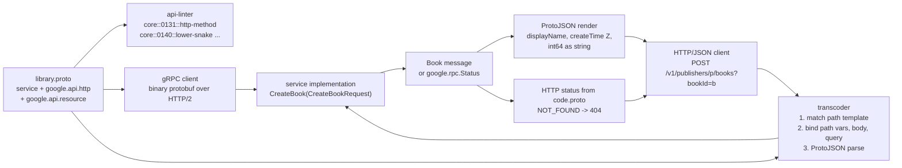

# Google API Improvement Proposals (AIPs) in Depth: Resource Orientation, Standard Methods, and Protobuf-HTTP Parity

> [!summary] Claim
> The AIPs make one protobuf definition the single contract for both gRPC and HTTP/JSON by constraining nouns (resources addressed by a `name` string shaped like a URI path), verbs (five standard methods with fixed HTTP bindings plus `:verb` custom methods), and spelling (`lower_snake_case` fields that map losslessly onto lowerCamelCase ProtoJSON), so that a mechanical transcoder can serve REST and a mechanical linter can enforce the design.

Part of [Versioning Evolution and API Guidelines](README.md) in [API Engineering](../README.md).

## TL;DR

Mechanism: an RPC carries a `google.api.http` rule whose path template binds request fields to URL segments, one top-level field (or `*`) to the body, and everything else to query parameters `(googleapis 547f8fd google/api/http.proto, HttpRule)`.
Contract rule: `Get`, `List`, `Create`, and `Delete` must use `GET`, `GET`, `POST`, and `DELETE`, `Update` should use `PATCH` (`PUT` is allowed only for full replacement and is strongly discouraged), and a resource must support at least `Get` and (unless it is a singleton) `List` (AIP-131 to AIP-135, AIP-121).
Trap: the HTTP surface is derived, not designed, so a field name like `foo_1bar`, a `PUT` binding, or the query text `true` handed to ProtoJSON as the string `"true"` breaks parity in ways the gRPC side never sees.
Portability: the lab's template matcher, transcoder, and linter pass 129 tests on the workspace CPython 3.14.6 with the protobuf 7.36.2 `upb` backend, and an earlier 93-test revision of the same file passed on 3.12.13, 3.13.18, 3.14.6, 3.14.10, and 3.15.2 (the 129-test file was not rerun on the other legs); 3.15.0b3 and the free-threaded 3.15.0b3t and 3.14.6t builds could not run the workspace.
When not to use it: an OpenAPI-first public REST estate with no protobuf toolchain, or a contract built around bidirectional streaming, which AIP-127 exempts from HTTP mapping because HTTP/1.1 cannot carry it.

## Mental model



The `.proto` file is the only artifact humans author; everything to its right is derived.
The linter reads the same descriptors the compiler produces and rejects designs that would make the derived HTTP surface inconsistent.
A gRPC client sends the request message directly to the implementation.
An HTTP/JSON client goes through a transcoder, which matches the URL against each RPC's path template, assembles a request message from three sources (path variables, the body field, the query string), and parses it with the canonical ProtoJSON mapping.
The implementation never knows which protocol called it.
On the way back the same message is rendered as ProtoJSON, and an error's `google.rpc.Code` is mapped to the HTTP status that `code.proto` documents for it.

## How it works

### The AIP corpus is a governance mechanism, not a style tip sheet

AIP-1 defines an AIP as "a design document providing high-level, concise documentation for API development" and states that AIPs "serve as the source of truth for API-related documentation at Google and the means by which API teams discuss and come to consensus on API guidance" (AIP-1, "What is an AIP?").
AIPs use the RFC 2119 requirement keywords, written lower-case and bold (`must`, `should`, `may`), which is what lets a linter turn them into pass or fail checks (AIP-8, Requirement keywords).
The AIPs cited here were read at `googleapis/aip` commit `2ccc61a4` (2026-10-15) and on `google.aip.dev` (as of 2026-11).

### Resource orientation (AIP-121)

AIP-121 lists the design order: the resources, their relationships and hierarchy, each resource's schema, and then the methods, "relying as much as possible on the standard verbs" (AIP-121, Guidance).
A collection holds resources of one type (AIP-121, Resources).
References between resources must be representable as a directed acyclic graph, the parent-child relationship must be acyclic, and a resource instance has one canonical parent (AIP-121, Cyclic References).
AIP-121 calls an API that mirrors its database schema "actually an anti-pattern, as it tightly couples the surface to the underlying system" (AIP-121, Resources).
If a request or response is or contains the resource, "the resource schema for that resource across all methods **must** be the same" (AIP-121, Methods).
A resource must support `Get`, so a client can confirm state after a mutation, and must support `List` unless it is a singleton (AIP-121, Methods).
Management-plane methods are strongly consistent: once a create, update, or delete completes, a subsequent `Get` must reflect it (AIP-121, Strong Consistency).

### Resource names are the identity, and the URL is built from them (AIP-122)

A resource name is a path without a leading slash, alternating collection identifiers and IDs: `publishers/123/books/les-miserables` (AIP-122, Guidance).
Collection identifiers must be plural, camelCase, and match `/[a-z][a-zA-Z0-9]*/` (AIP-122, Collection identifiers).
User-specified IDs should follow RFC 1034, restricted to lowercase as `^[a-z]([a-z0-9-]{0,61}[a-z0-9])?$`, which caps them at 63 characters (AIP-122, Resource ID segments).
Every resource exposes a `string name` field, and AIP-122 forbids "tuples, self-links, or other forms of resource identification".
Cross-API references use the full resource name, a schemeless URI such as `//library.googleapis.com/publishers/123/books/les-miserables`, while the callable URL adds scheme, host, and version: `https://library.googleapis.com/v1/publishers/123/books/les-miserables` (AIP-122, Full resource names and Resource URIs).
The version stays out of the name on purpose: "the full resource name is expected to persist from version to version" (AIP-122, Resource URIs), which is the hook [[API-Versioning-Strategies-URI-Header-Media-Type-and-Channel-AIP-185]] builds on.

### Standard methods fix the verb, the URI variable, and the body (AIP-131 to AIP-135)

| Method | RPC prefix | HTTP verb | URI variable | `body` | Response | AIP |
|---|---|---|---|---|---|---|
| Get | `Get` | `GET` (must) | `{name=publishers/*/books/*}` | must be absent | the resource | AIP-131 |
| List | `List` | `GET` (must) | `{parent=publishers/*}/books` | must be omitted | `ListBooksResponse` with `next_page_token` | AIP-132 |
| Create | `Create` | `POST` (must) | `{parent=publishers/*}/books` | must be the resource field, `book` | the resource (or an LRO) | AIP-133 |
| Update | `Update` | `PATCH` (should) | `{book.name=publishers/*/books/*}` | must be the resource field, `book` | the resource (or an LRO) | AIP-134 |
| Delete | `Delete` | `DELETE` (must) | `{name=publishers/*/books/*}` | must be absent | `google.protobuf.Empty` (should) | AIP-135 |

Three details carry most of the weight.
`Create` takes the user-chosen ID as a separate `{resource}_id` request field, which travels in the query string over REST (`?bookId=...`) and must produce `ALREADY_EXISTS` on a duplicate (AIP-133, User-specified IDs).
`Update` takes a `google.protobuf.FieldMask update_mask`; an omitted mask means "all populated fields", and the special value `*` means full replacement (AIP-134, Request message).
AIP-134 notes that `*` "is an API-level convention" that standard protobuf field-mask helpers do not recognize, and the lab confirms that `FieldMask(paths=["*"]).IsValidForDescriptor(...)` returns `False`, because the check is a plain `fields_by_name` lookup `(protobuf 7.36.2 google/protobuf/internal/field_mask.py, _IsValidPath)`.
AIP-134 prefers `PATCH` because adding a field to a stable resource in place would make every old `PUT` client wipe it: "a `PUT` request unintentionally wiped out data because the previous version did not know about it" (AIP-134, PATCH and PUT).
That is the RFC semantics working as designed: `PUT` asks for the target's state to be "created or replaced" (RFC 9110 Section 9.3.4), while `PATCH` applies "a set of changes" (RFC 5789 Section 2).
Field mask mechanics are covered in [[Field-Masks-and-Update-Masks-AIP-134-and-AIP-161]].

### Lists and retries: pagination (AIP-158) and request IDs (AIP-155)

Collection-returning RPCs "**must** provide pagination _at the outset_", because adding pagination to an existing method is a backwards-incompatible change (AIP-158, Guidance).
The request should carry an optional `int32 page_size` and `string page_token`, and the response a `string next_page_token` (AIP-158, Guidance).
A `page_size` of `0` or an omitted one means a documented default and must not be an error, a value above the maximum is coerced down, and a negative value must produce `INVALID_ARGUMENT`.
The API may return fewer results than requested, even zero, without being at the end, so the only end-of-collection signal is an empty `next_page_token` (AIP-158, Guidance).
Changing any argument other than `page_size` between pages should produce `INVALID_ARGUMENT`.
Page tokens must be opaque and URL-safe; base-64 encoding a transparent token "is **not** a sufficient obfuscation mechanism", and a token may indicate where to continue but "**must not** provide any form of authorization", so every page request is authorized like a fresh one (AIP-158, Opacity).
Tokens stored server-side may expire, with three days as a rule of thumb (AIP-158, Expiring page tokens).
AIP-155 lets a mutating request message carry an optional `string request_id`, annotated `(google.api.field_info).format = UUID4` when it is a UUID; providing one "**must** guarantee idempotency", and on a duplicate the server should return the response of the previously successful request (AIP-155, Guidance).
The field belongs on the request message, never on the resource.
Neither mechanism is exercised by the lab; the page-token authorization rule is the one that matters for [[Defeating-BOLA-API1-2023-Tenant-Scoped-Queries-and-PostgreSQL-RLS]].

### Custom methods are `POST` (or `GET`) plus a `:verb` suffix (AIP-136)

A custom method keeps a standard HTTP verb and moves the action into the URI: `post: "/v1/{name=publishers/*/books/*}:archive"` with `body: "*"` (AIP-136, Guidance).
`GET` must be used for retrieval (`POST` may be used when the request could exceed URL size limits) and `POST` for anything with side effects, the RPC name is verb then noun with no prepositions and no `Async`, and the URI verb must match the RPC verb in camelCase (AIP-136, Guidance).
api-linter encodes the suffix rule in `uriSuffix` `(api-linter v2.4.1 rules/aip0136/http_uri_suffix.go, uriSuffix)`: if the URI binds `name`, `parent`, or `*.name`, the suffix is the verb alone (`:archive`); otherwise, if the last URI segment before the verb matches the end of the RPC name, it is `nouns:verb` (`books:sort`); otherwise it is `:verbNoun` (`:translateText`).
The same rule also special-cases `:batch` URIs and the AIP-162 revision methods, which the lab leaves out.
The lab's `lint_method` reproduces those three branches, and the mutation that drops the collection branch is caught by two tests.
Design depth lives in [[Custom-Methods-and-State-Machine-Transitions-AIP-136]].

### The transcoding contract (AIP-127 and `google/api/http.proto`)

AIP-127 requires an HTTP definition for every RPC except bidirectional streaming, says RPCs "**should not** use `put` or `custom`", requires a `{foo=bar/*}` variable to capture "the entire resource name, not just the ID component", forbids a `body` on `GET` and `DELETE`, and forbids a nested, repeated, or URI-bound `body` field (AIP-127, Guidance).
The grammar lives in `http.proto` at googleapis commit `547f8fd`:

```text
Template = "/" Segments [ Verb ] ;
Segments = Segment { "/" Segment } ;
Segment  = "*" | "**" | LITERAL | Variable ;
Variable = "{" FieldPath [ "=" Segments ] "}" ;
FieldPath = IDENT { "." IDENT } ;
Verb     = ":" LITERAL ;
```

`*` matches one segment, `**` matches zero or more and must come last apart from the verb, a variable must not contain another variable, and `{var}` is shorthand for `{var=*}` (http.proto, "Path template syntax").
The field mapping has three rules: path-template fields come from the URL, the `body` field comes from the HTTP body, and "All other fields are passed via the URL query parameters"; with `body: "*"` "there is no URL query parameter", and with no `body` "there is no HTTP request body" (http.proto, "Rules for HTTP mapping").
Percent decoding depends on the variable's shape.
A single-segment variable (`{var}` or `{var=*}`) is fully decoded on the server, while a multi-segment variable (`{var=foo/*}` or `{var=**}`) is decoded "except "%2F" and "%2f" are left unchanged" (http.proto, "Path template syntax").
That rule gives AIP-127's whole-name requirement a security payoff: `GET /v1/publishers/a%2Fb/books/c%20d` binds `publisher = "a/b"` and `book = "c d"` under `/v1/publishers/{publisher}/books/{book}` but `name = "publishers/a%2Fb/books/c d"` under `/v1/{name=publishers/*/books/*}`, and only the second keeps the hierarchy intact (lab test `test_single_segment_variable_decodes_slash_but_multi_segment_keeps_it`, which also covers lowercase `%2f`).
AIP-127 does not state this as its reason; the link is this note's reading of AIP-127 and http.proto together.
`additional_bindings` attach further URLs to the same RPC, one level deep only, with an identical `body` clause (AIP-127, Multiple URI bindings).
AIP-159 lets a `List` (and, for globally unique IDs, a `Get`) accept `-` as a parent wildcard, as in `GET /v1/publishers/-/books`; the URI template must still be written with `*` and "**must not** hard-code the `-` character", and the response must carry canonical names with the real parent IDs (AIP-159, Guidance).
The matcher treats `-` as an ordinary segment value, so the wildcard needs no special case in the transcoder (lab test `test_hyphen_wildcard_parent_is_an_ordinary_id_to_the_matcher`), and the lab lints a hard-coded `-` template segment as `core::0159::hardcoded-hyphen`.
The transcoder deep dive is [[HTTP-JSON-to-gRPC-Transcoding-and-Google-API-HTTP-Annotations-AIP-127]]; this note covers how the AIPs constrain what that transcoder sees.

### ProtoJSON parity is why field naming is strict (AIP-140, AIP-142, AIP-148)

ProtoJSON maps "Message field names ... to lowerCamelCase to be used as JSON object keys", and parsers must accept "both the lowerCamelCase name (or the one specified by the `json_name` option)" and "the original proto field name" (protobuf.dev ProtoJSON guide, as of 2026-11).
protobuf 7.36.2 implements that fallback literally: `_Parser._ConvertFieldValuePair` looks the key up in a `json_name` map and then in `fields_by_name` `(protobuf 7.36.2 google/protobuf/json_format.py, _Parser._ConvertFieldValuePair)`, and the lab's `_field` mirrors that order for query keys, so `?bookId=` and `?book_id=` both bind `book_id`, while body keys such as `displayName` go through protobuf's own lookup.
The serializer emits `field.json_name` unless `preserving_proto_field_name` is set `(protobuf 7.36.2 google/protobuf/json_format.py, _Printer._RegularMessageToJsonObject)`.
AIP-140 requires `lower_snake_case`, and adds that "each word in the field **must not** begin with a number, because it creates ambiguity when converting between snake case and camel case", and that fields "**must not** contain leading, trailing, or adjacent underscores" (AIP-140, Case).
The lab shows the failures directly.
`foo_1bar` gets the `json_name` `foo1bar`, `FieldMask(paths=["foo_1bar"]).ToJsonString()` raises `The character after a "_" must be a lowercase letter`, and parsing `"foo1bar"` back gives the path `foo1bar`, not `foo_1bar` `(protobuf 7.36.2 google/protobuf/internal/field_mask.py, _SnakeCaseToCamelCase and _CamelCaseToSnakeCase)`.
`a_b` and `a__b` both map to `aB`, and the `upb` descriptor pool refuses to build the file with `duplicate json_name (aB)`.
The lab test `test_colliding_json_names_fail_on_upb_and_lose_data_on_the_pure_python_backend` branches on the backend: on `upb` it asserts that error, and its pure-Python branch (parsing `{"aB": "x"}` sets only `a__b`, and serializing keeps one `aB` key) did not run here because the workspace uses `upb`.
AIP-142 says absolute times should use `google.protobuf.Timestamp`, named `{imperative}_time` (`create_time`, never `created_time`), and spans should use `google.protobuf.Duration` (AIP-142, Timestamps and Durations).
AIP-142 itself never mentions RFC 3339; the RFC 3339 wire form comes from ProtoJSON, where `Timestamp.ToJsonString` returns a "Z-normalized" string with 0, 3, 6, or 9 fractional digits `(protobuf 7.36.2 google/protobuf/internal/well_known_types.py, Timestamp.ToJsonString)`.
RFC 3339 requires an offset, `full-time = partial-time time-offset` with `time-offset = "Z" / time-numoffset` (RFC 3339 Section 5.6).
Presence matters here too: AIP-149 says services defined in protocol buffers "**should** use the `optional` keyword" for fields where "unset" and the default must differ, and adding or removing `optional` later is backwards incompatible (AIP-149).
In the lab, `Book.rating` is a proto3 `optional` field, which `build_messages` encodes as a one-member synthetic oneof; `Book(page_count=0)` renders as `{}`, `Book(rating=0)` renders as `{"rating": 0}`, and only `rating` has `HasField` (lab test `test_protojson_omits_default_values_unless_the_field_has_presence`).
JSON `null` is "a legal value for any field" and "the field should remain unset, as though it was not present" (ProtoJSON guide, Null values, as of 2026-11), so a `PATCH` body of `{"rating": null}` cannot clear a field and is the same request as `{}`; `null` inside a repeated field is an error (lab test `test_json_null_in_a_body_means_absent_so_it_cannot_clear_a_field`).
To clear a field, name it in `update_mask`.
AIP-148 reserves the names `name`, `parent`, `display_name` (at most 63 characters), `title`, `given_name` and `family_name` (never `first_name` and `last_name`), the output-only timestamps `create_time`, `update_time`, and `delete_time`, plus `expire_time`, `purge_time`, `annotations`, `uid` (UUID4), and `ip_address` (AIP-148).

### Errors: one status model, two encodings (AIP-193)

Services must return `google.rpc.Status` with the canonical codes from `google.rpc.Code` (AIP-193, Guidance).
Over HTTP/1.1+JSON the `code` field carries the HTTP status and `status` carries the enum name, for example `{"error": {"code": 404, "status": "NOT_FOUND"}}` (AIP-193, HTTP/1.1+JSON representation).
The HTTP status comes from the comments in `code.proto`: `INVALID_ARGUMENT`, `FAILED_PRECONDITION`, and `OUT_OF_RANGE` -> `400`, `UNAUTHENTICATED` -> `401`, `PERMISSION_DENIED` -> `403`, `NOT_FOUND` -> `404`, `ALREADY_EXISTS` and `ABORTED` -> `409`, `RESOURCE_EXHAUSTED` -> `429`, `CANCELLED` -> `499` (googleapis 547f8fd google/rpc/code.proto, Code).
Permission must be checked before existence, so a caller without access gets `PERMISSION_DENIED` whether or not the resource exists (AIP-193, Permission Denied).
The full error model is in [[Google-AIP-193-Error-Model-and-Rich-Error-Details]].

### Enforcement: api-linter

The AIPs are enforced by `googleapis/api-linter`, whose rule names come from `lint.NewRuleName(aip, name)`: a group (`core` for AIPs 1 to 999), the zero-padded AIP number, and a slug, joined by `::` `(api-linter v2.4.1 lint/rule_name.go, NewRuleName)`.
The group comes from `aipCoreGroup`, which returns `core` when `aip > 0 && aip < 1000` `(api-linter v2.4.1 lint/rule_groups.go, aipCoreGroup)`.
Method kinds are recognized by name: `getMethodRegexp = regexp.MustCompile("^Get(?:[A-Z]|$)")` and its siblings, with `IsGetMethod` also exempting `GetIamPolicy`, which the lab does not model `(api-linter v2.4.1 rules/internal/utils/method.go, IsGetMethod)`.
The lab's `lint_method` and `lint_message` use the same rule names for the subset it implements: `core::0127::http-template-syntax`, `core::0131..0135::http-method` and `::http-body`, `core::0134::http-uri-name`, `core::0136::http-method`, `::http-body`, and `::http-uri-suffix`, `core::0140::lower-snake`, `::numbers`, and `::underscores`, `core::0142::time-field-names` and `::time-field-type`, `core::0148::human-names`, and `core::0123::resource-name-field`, plus `core::0159::hardcoded-hyphen` and the resource and service rules described below.
Beyond the HTTP-binding and message rules, the lab also lints resources and services: `lint_resource` implements the AIP-123 pattern checks `core::0123::resource-pattern` (a declared pattern, camelCase constants, no spaces) and `core::0123::resource-variables` (lowercase variables without an `_id` suffix) `(api-linter v2.4.1 rules/aip0123/resource_pattern.go and resource_variables.go)`, `lint_method` adds `core::0127::http-template-pattern` (a `name` variable's template, with `*` as one segment and `**` as any, must match one of the resource's patterns) `(api-linter v2.4.1 rules/aip0127/http_template_pattern.go, checkHTTPPatternMatchesResource)`, and `lint_service` implements `core::0121::resource-must-support-get` and `core::0121::resource-must-support-list` `(api-linter v2.4.1 rules/aip0121/resource_must_support_get.go and resource_must_support_list.go)`.
The real rules are narrower or broader in places: they find the resource through `google.api.resource_reference` and the response type instead of a `resource` field on a spec, skip streaming methods, and report only the first violation per resource for the pattern and variable rules, while the lab appends every violation.
The `Get` rule fires when a `Create`, `Update`, or `List` exists for a resource without one, and the `List` rule fires when `Create`, `Update`, or `Get` exists without a `List` unless the resource is a singleton, which AIP-156 describes as a name made of the parent's name plus one static segment, such as `users/1234/config`.
It is a teaching subset over plain dataclasses, not a replacement for api-linter, which reads compiled descriptors and implements far more rules.
Rolling it out across repositories is the subject of [[Rolling-Out-Automated-API-Linting-Across-Hundreds-of-Repositories]].

## Numbers and limits

| Quantity | Value | Source |
|---|---|---|
| User-specified resource ID | `^[a-z]([a-z0-9-]{0,61}[a-z0-9])?$`, at most 63 characters | AIP-122, Resource ID segments (as of 2026-11) |
| `display_name` length | should be <= 63 characters | AIP-148, display_name (as of 2026-11) |
| `additional_bindings` nesting | one level deep | http.proto `HttpRule.additional_bindings`; AIP-127 |
| `Timestamp.seconds` range | `[-62135596800, 253402300799]` (0001-01-01 to 9999-12-31 UTC) | `(protobuf 7.36.2 google/protobuf/internal/well_known_types.py, _CheckTimestampValid)` |
| Timestamp JSON fractional digits | output 0, 3, 6, or 9; input up to 9 | `(protobuf 7.36.2 google/protobuf/internal/well_known_types.py, Timestamp.ToJsonString and Timestamp.FromJsonString)`; lab test `test_timestamp_json_takes_at_most_nine_fraction_digits_and_emits_0_3_6_or_9` rejects 12 digits with `more than 9 fractional digits` |
| `Duration` max seconds | `315576000000` | `(protobuf 7.36.2 google/protobuf/internal/well_known_types.py, _DURATION_SECONDS_MAX)` |
| ProtoJSON parse nesting | `max_recursion_depth=100` by default in `Parse` and `ParseDict`; 100 nested messages parse and 101 raise `Message too deep. Max recursion depth is 100` | `(protobuf 7.36.2 google/protobuf/json_format.py, ParseDict)`; lab test `test_parse_dict_accepts_100_nested_messages_and_rejects_101` |
| Interoperable JSON integers | `[-(2**53)+1, (2**53)-1]`, hence int64 as a decimal string | RFC 8259 Section 6; ProtoJSON guide |
| `2**60` rendered by ProtoJSON | `"1152921504606846976"` (a string) | lab, `test_response_uses_lower_camel_keys_int64_strings_and_z_timestamps` |
| `transcode()` of one `CreateBook` request (template parse + bind + `ParseDict`) | 17.1 us CPU time, best of 40 x 5000 calls; the best-of-40 figure ranged from 17.1 to 21.3 us over 5 runs | measured with `python -m timeit -p` (commands below), CPython 3.14.6, protobuf 7.36.2 `upb`, Apple M3 Pro (12 cores), macOS 27.2 arm64, load average 42 to 54 from unrelated jobs |
| `match_path()` on `/v1/publishers/p1/books/b1` | 1.49 us CPU time, best of 40 x 50000 calls; the best-of-40 figure ranged from 1.49 to 1.98 us over 5 runs | same command form, interpreter, machine, and load |

The timing rows measure the lab's pure-Python transcoder, which re-parses the template on every call; they are not a statement about Envoy, ESF, or grpc-gateway, which were not measured.
Both rows were measured from `labs/` with `M=tests.f07_versioning_evolution_and_api_guidelines.test_google_aip_system_architecture_and_core_tenets` set in the shell.
The `transcode()` command was `uv run --frozen python -m timeit -p -r 40 -n 5000 -s "import $M as m; c = m.build_messages('library.v1', [m.BOOK, m.CREATE])['CreateBookRequest']" "m.transcode(m.CREATE_RULE, c, 'POST', '/v1/publishers/lacroix/books', [('bookId', 'les-miserables')], b'{\"displayName\": \"Les Miserables\", \"pageCount\": \"1463\"}')"`.
The `match_path()` command was `uv run --frozen python -m timeit -p -r 40 -n 50000 -s "import $M as m; t = m.parse_template('/v1/{name=publishers/*/books/*}')" "m.match_path(t, '/v1/publishers/p1/books/b1')"`.
The machine was busy during the measurement, so read the minimum as the estimate and the spread as scheduling noise, not as a property of the code.

## Portability

| Leg | Result | Evidence |
|---|---|---|
| CPython 3.12.13 (3.12.16 not installed here) | 93 passed (earlier 93-test revision), protobuf backend `upb` | `UV_PROJECT_ENVIRONMENT=<scratch> uv run --frozen --python 3.12 pytest ...`, macOS 27.2 arm64 |
| CPython 3.13.18 | 93 passed (earlier revision), `upb` | `uv run --frozen --python 3.13.18 pytest ...` |
| CPython 3.14.6 (workspace `.venv`), current 129-test file | 129 passed, `upb` | `uv run --frozen pytest ...`, macOS 27.2 arm64, 2026-11-12 |
| CPython 3.14.6 (workspace `.venv`) and 3.14.10 | 93 passed on both (earlier revision), `upb` | `uv run --frozen pytest ...` and `--python 3.14.10` |
| CPython 3.15.2 | 93 passed (earlier revision), `upb` | `uv run --frozen --python 3.15.2 pytest ...` |
| CPython 3.15.0b3 (uv-managed build, `--python 3.15.0b3`) | not run: pytest plugin load fails with `ModuleNotFoundError: No module named 'hypothesis._native'` | workspace dependency issue, not this lab |
| CPython 3.15.0b3t and 3.14.6t free-threaded (3.15.2t not installed) | not run: `uv` cannot build the environment because `psycopg-binary==3.3.8` has no wheel for the platform | `uv run --frozen --python 3.15t` and `--python 3.14t` |
| Debian Trixie and Alpine musl containers | not run: the lab workspace has no container definitions yet | `labs/README.md`, Workspace layout |
| protobuf runtime | `json_name` derivation, the `json_name` / proto-name fallback, and int64-as-string are ProtoJSON spec requirements; the exact error strings in the tests are protobuf 7.36.2 Python wording | ProtoJSON guide; the lab pins the wording on purpose so an upgrade that changes it fails loudly |
| Transcoder implementations | http.proto names Google APIs, Cloud Endpoints, grpc-gateway, and Envoy as supporting gRPC transcoding; Envoy v1.40.2 makes path unescaping configurable, and its default `ALL_CHARACTERS_EXCEPT_RESERVED` does not decode RFC 6570 reserved characters in multi-segment variables | http.proto comment; `(envoy v1.40.2 api/envoy/extensions/filters/http/grpc_json_transcoder/v3/transcoder.proto, GrpcJsonTranscoder.UrlUnescapeSpec)`; none of them was run here |
| Uvicorn, Hypercorn, Granian | not applicable: transcoding sits in front of the RPC implementation and the lab runs in-process with no ASGI server | n/a |
| HTTP/1.1 | the REST mapping targets it; bidirectional streaming has no mapping "which can not be natively supported using HTTP/1.1" | AIP-127, Guidance |
| HTTP/2 | native gRPC transport, see [[gRPC-Over-HTTP-2-Framing-Length-Prefixed-Messages-and-Trailers]] | sibling note |
| HTTP/3 over QUIC | no lab leg: neither AIP-127 nor http.proto mentions HTTP/3 or QUIC, and the mapping needs only a method, a path, a query, and content, which are version-independent HTTP semantics that HTTP/3 carries unchanged | RFC 9110 Section 6 (a message abstraction "independent of the HTTP version"); RFC 9114 Section 1 ("HTTP/3 supports the same semantics over a new transport protocol: QUIC"); no transcoder was run over HTTP/3 here |

## Worked example

The lab compiles a small library API into real protobuf descriptors with `build_messages`, transcodes HTTP requests onto them, renders responses with ProtoJSON, and lints method and message specs.
[implementation](../labs/src/api_labs/f07_versioning_evolution_and_api_guidelines/aip_conformance.py) and [test](../labs/tests/f07_versioning_evolution_and_api_guidelines/test_google_aip_system_architecture_and_core_tenets.py).

Path matching and the `%2F` rule, verbatim from the implementation:

```python
def _decode(raw: str, *, keep_slash: bool) -> str:
    """http.proto: multi-segment variables decode everything except ``%2F`` / ``%2f``."""
    if not keep_slash:
        return unquote(raw)
    return "".join(
        piece if piece.lower() == "%2f" else unquote(piece) for piece in re.split(r"(%2[fF])", raw)
    )


def match_path(template: PathTemplate, path: str) -> dict[str, str] | None:
    """Return field-path bindings when ``path`` matches, else ``None``."""
    if not path.startswith("/"):
        return None
    raw = path[1:]
    if template.verb is not None:
        suffix = ":" + template.verb
        if not raw.endswith(suffix):
            return None
        raw = raw[: -len(suffix)]
    parts = raw.split("/")
    captured: dict[str, list[str]] = {}
    i = 0
    for seg in template.segments:
        patterns = seg.segments if isinstance(seg, Variable) else (seg,)
        taken: list[str] = []
        for pattern in patterns:
            if pattern == "**":
                taken.extend(parts[i:])
                i = len(parts)
                continue
            if i >= len(parts) or not parts[i] or (pattern != "*" and parts[i] != pattern):
                return None
            taken.append(parts[i])
            i += 1
        if isinstance(seg, Variable):
            captured[seg.field_path] = taken
    if i != len(parts):
        return None
    by_name = {v.field_path: v for v in template.variables()}
    return {
        name: _decode("/".join(segs), keep_slash=by_name[name].multi_segment)
        for name, segs in captured.items()
    }
```

Transcoding, verbatim from the implementation; the path is bound last and a disagreeing body value is rejected rather than silently overwritten, whichever of the proto name or the `json_name` the body used (`_set_path` and `_canonical_key`):

```python
def transcode(
    rule: HttpRule,
    request_class: Any,
    method: str,
    path: str,
    query: Sequence[tuple[str, str]] = (),
    body: bytes = b"",
) -> Any:
    """Map one HTTP request onto ``request_class`` following the http.proto mapping rules."""
    template = parse_template(rule.path)
    bindings = match_path(template, path) if method == rule.method else None
    if bindings is None:
        raise TranscodeError(f"{method} {path} does not match {rule.method} {rule.path}")
    descriptor: Any = request_class.DESCRIPTOR
    doc: dict[str, Any] = {}
    if rule.body is None:
        if body:
            raise TranscodeError(f"{rule.method} {rule.path} defines no HTTP body")
    else:
        parsed: object = json.loads(body) if body else {}
        if rule.body == "*":
            if query:
                raise TranscodeError("body '*' leaves no fields for URL query parameters")
            if not isinstance(parsed, dict):
                raise TranscodeError("body '*' must be a JSON object")
            doc = cast("dict[str, Any]", parsed)
        else:
            doc[_field(descriptor, rule.body).name] = parsed
    grouped: dict[str, list[str]] = {}
    for key, value in query:
        grouped.setdefault(key, []).append(value)
    for key, values in grouped.items():
        _set_path(doc, descriptor, key, _query_value(descriptor, key, values))
    for field_path, value in bindings.items():
        _set_path(doc, descriptor, field_path, value)
    try:
        return _json_format.ParseDict(doc, request_class())
    except _json_format.ParseError as exc:
        raise TranscodeError(str(exc)) from exc
```

Two tests, verbatim: the confused-deputy guard and the ProtoJSON rendering:

```python
@pytest.mark.unit
def test_update_rejects_body_name_that_disagrees_with_url(classes: dict[str, Any]) -> None:
    with pytest.raises(TranscodeError, match="URL path says"):
        transcode(
            UPDATE_RULE,
            classes["UpdateBookRequest"],
            "PATCH",
            "/v1/publishers/p1/books/b1",
            body=b'{"name": "publishers/victim/books/b9"}',
        )
```

```python
@pytest.mark.unit
def test_response_uses_lower_camel_keys_int64_strings_and_z_timestamps(
    classes: dict[str, Any],
) -> None:
    book = classes["Book"](name="publishers/p/books/b", display_name="X", page_count=2**60)
    book.create_time.FromJsonString("2026-11-11T09:30:00+05:30")
    assert to_json(book) == {
        "name": "publishers/p/books/b",
        "displayName": "X",
        "createTime": "2026-11-11T04:00:00Z",
        "pageCount": "1152921504606846976",
    }
```

Captured on CPython 3.14.6, macOS 27.2 arm64, from `labs/`, with `uv run --frozen pytest tests/f07_versioning_evolution_and_api_guidelines/test_google_aip_system_architecture_and_core_tenets.py -q`:

```text
........................................................................ [ 55%]
.........................................................                [100%]
129 passed in 0.15s
```

A focused verbose run of the transcoding and timestamp tests (`-v -p no:cacheprovider -k "create_binds or update_rejects or z_timestamps or stricter_than or colon_in"`, same interpreter and machine; the session header is omitted):

```text
collecting ... collected 129 items / 121 deselected / 8 selected

tests/f07_versioning_evolution_and_api_guidelines/test_google_aip_system_architecture_and_core_tenets.py::test_colon_in_last_segment_is_part_of_the_id_unless_template_declares_a_verb PASSED [ 12%]
tests/f07_versioning_evolution_and_api_guidelines/test_google_aip_system_architecture_and_core_tenets.py::test_create_binds_path_body_and_query[camelCase] PASSED [ 25%]
tests/f07_versioning_evolution_and_api_guidelines/test_google_aip_system_architecture_and_core_tenets.py::test_create_binds_path_body_and_query[proto-name] PASSED [ 37%]
tests/f07_versioning_evolution_and_api_guidelines/test_google_aip_system_architecture_and_core_tenets.py::test_update_rejects_body_name_that_disagrees_with_url PASSED [ 50%]
tests/f07_versioning_evolution_and_api_guidelines/test_google_aip_system_architecture_and_core_tenets.py::test_response_uses_lower_camel_keys_int64_strings_and_z_timestamps PASSED [ 62%]
tests/f07_versioning_evolution_and_api_guidelines/test_google_aip_system_architecture_and_core_tenets.py::test_timestamp_parser_is_stricter_than_rfc_3339[no-offset] PASSED [ 75%]
tests/f07_versioning_evolution_and_api_guidelines/test_google_aip_system_architecture_and_core_tenets.py::test_timestamp_parser_is_stricter_than_rfc_3339[lowercase-z] PASSED [ 87%]
tests/f07_versioning_evolution_and_api_guidelines/test_google_aip_system_architecture_and_core_tenets.py::test_timestamp_parser_is_stricter_than_rfc_3339[lowercase-t] PASSED [100%]

======================= 8 passed, 121 deselected in 0.13s =======================
```

## Pitfalls

> [!warning] `PUT` bindings erase fields that old clients do not know about
> Trigger: an `Update` RPC bound to `put:` and a resource that gains a field in place, for example `rating`.
> Symptom: an older client's full-body `PUT` resets `rating` to its default, with no error on either side.
> Fix: bind `patch:` with an `update_mask` (AIP-134 says the verb should be `PATCH` and strongly discourages `PUT`), and treat `update_mask: "*"` as an explicit opt-in to replacement; AIP-134, PATCH and PUT, works through this exact `Book.rating` example, and `core::0134::http-method` flags the binding.

> [!warning] A single-segment variable lets `%2F` become a real `/`
> Trigger: a template such as `/v1/publishers/{publisher}/books/{book}`, with the implementation joining the IDs back into a resource name.
> Symptom: `GET /v1/publishers/a%2fb/books/c` decodes `publisher` to `a/b`, and the joined name `publishers/a/b/books/c` no longer has the shape the authorization check assumed.
> Fix: bind the whole name as a multi-segment variable, `{name=publishers/*/books/*}`, which keeps `%2F` encoded per http.proto, and validate IDs against the AIP-122 RFC 1034 pattern; the lab test `test_single_segment_variable_decodes_slash_but_multi_segment_keeps_it` pins both behaviors for `%2F` and `%2f`.
> Check the deployed transcoder as well: Envoy v1.40.2 exposes the policy as `url_unescape_spec`, and its default keeps reserved characters encoded in multi-segment variables `(envoy v1.40.2 api/envoy/extensions/filters/http/grpc_json_transcoder/v3/transcoder.proto, GrpcJsonTranscoder.url_unescape_spec)`.

> [!warning] A colon in an ID is ambiguous with a custom verb
> Trigger: resource IDs that allow `:` together with custom methods such as `:archive`.
> Symptom: in the lab's matcher the path `/v1/publishers/p1/books/b1:archive` matches the `Get` template with `name = "publishers/p1/books/b1:archive"` and the `:archive` template with `name = "publishers/p1/books/b1"`, so two rules that share an HTTP method (a `Get` and a `GET` custom method, for example) are told apart only by rule order.
> Envoy v1.40.2 resolves it differently: a trailing `:suffix` is treated as a custom verb only when some template registers that verb, unless `match_unregistered_custom_verb` is set `(envoy v1.40.2 api/envoy/extensions/filters/http/grpc_json_transcoder/v3/transcoder.proto, GrpcJsonTranscoder.match_unregistered_custom_verb)`.
> Fix: keep user-specified IDs inside the AIP-122 pattern, which has no `:`; the lab test `test_colon_in_last_segment_is_part_of_the_id_unless_template_declares_a_verb` shows both bindings.

> [!warning] int64 fields arrive as JSON strings
> Trigger: a JavaScript client reading a `page_count` declared `int64`.
> Symptom: `"pageCount": "1152921504606846976"` is a string, so `+` concatenates instead of adding; switching the producer to bare numbers would lose precision above `2**53 - 1`, the limit of RFC 8259 Section 6.
> Fix: document int64 as string-typed in every generated SDK, or use `int32` where the range allows; ProtoJSON parsers accept both numbers and strings on input.

> [!warning] Timestamps without an offset, or with lowercase `z` or `t`, are rejected
> Trigger: a client sends `2026-11-11T00:00:00` or `2026-11-11T00:00:00z`.
> Symptom: protobuf 7.36.2 raises `time data '2026-11' does not match format '%Y-%m-%dT%H:%M:%S'`, because `FromJsonString` falls back to `value.rfind('-')`, finds the hyphen in the date, and truncates the string there; RFC 3339 Section 5.6 rejects the missing offset too, but its NOTE explicitly permits lowercase `t` and `z`, which protobuf-python rejects.
> The lowercase rejection is deliberate: the ProtoJSON guide's RFC 3339 Clarifications section defines the timestamp format as the stricter "RFC 3339 as a profile of ISO-8601-2019", which does not allow lowercase letters (as of 2026-11).
> Fix: always serialize Z-normalized uppercase timestamps, and document that ProtoJSON parsers are stricter than the RFC 3339 NOTE.

> [!warning] Query-string booleans are text, but ProtoJSON booleans are not
> Trigger: a hand-written transcoder that hands `?force=true` straight to `ParseDict`.
> Symptom: `Failed to parse force field: Expected true or false without quotes at DeleteBookRequest.force.` (lab test `test_protojson_itself_rejects_a_quoted_bool`), because `_ConvertBool` accepts only a JSON `bool` outside map keys `(protobuf 7.36.2 google/protobuf/json_format.py, _ConvertBool)`.
> Fix: coerce URL text to the field's type before parsing, as the lab's `_coerce_text` does, and reject anything except `true` and `false`.

> [!warning] The transcoder is part of the attack surface
> Trigger: Envoy 1.16.4, 1.17.3, 1.18.3, or 1.19.0 with body-expanding extensions.
> Symptom: GHSA-5vhv-gp9v-42qv (CVE-2021-32781), a use-after-free leading to denial of service after a locally generated response on internal buffer overflow; the listed workaround is to "Disable Envoy's decompressor, json-transcoder or grpc-web extensions".
> Fix: patch to 1.16.5, 1.17.4, 1.18.4, or 1.19.1 or later, and budget transcoder versions as security dependencies.

## Security and robustness

Broken object level authorization (OWASP API1:2023, see [[Defeating-BOLA-API1-2023-Tenant-Scoped-Queries-and-PostgreSQL-RLS]]): an `Update` carries the target twice, in the URL (`{book.name=...}`) and in the body (`book.name`); if the gateway authorizes the URL and the service writes the body, a caller can update `publishers/victim/books/b9` while being authorized for `publishers/p1/books/b1`.
The lab fails closed with `TranscodeError` when the two disagree, whether the body spells the field by its proto name or its `json_name`, and it rejects a body that carries both spellings (lab test `test_body_star_cannot_dodge_the_conflict_check_with_either_spelling`).
The alias case matters because `ParseDict` accepts both spellings of one field in a single object and lets the later key win (lab test `test_protojson_lets_the_later_spelling_of_one_field_win`), so a guard that checks only one spelling is bypassed without an error.
This is a lab policy chosen for safety, and other transcoders' precedence rules were not verified here.
Enumeration: AIP-193 and AIP-135 require `PERMISSION_DENIED` before existence checks, so `403` versus `404` reveals nothing to an unauthorized caller.
Mass assignment (OWASP API3:2023, see [[Defeating-BOPLA-and-Mass-Assignment-API3-2023-Strict-Input-Output-Schemas]]): `body: "*"` maps every unbound field from JSON, and a resource `body` maps every field of the resource, so the server must clear output-only fields such as `create_time` on input without raising an error (AIP-203, Output only), as [[Field-Behavior-Semantics-Input-Only-Output-Only-and-Immutable-AIP-203]] covers.
Unknown fields: ProtoJSON parsers "should reject unknown fields by default" (ProtoJSON guide), and the lab rejects `?etag=x` on a request without an `etag` field; turning on `ignore_unknown_fields` trades that protection for leniency.
Resource consumption (OWASP API4:2023, see [[Unrestricted-Resource-Consumption-API4-2023-Payload-Depth-and-Limit-Guards]]): GHSA-8qvm-5x2c-j2w7 (CVE-2025-4565) is unbounded recursion when the pure-Python protobuf backend parses binary data with recursive groups or messages, fixed in 4.25.8, 5.29.5, and 6.31.1; this workspace pins 7.36.2 on `upb`, and on the JSON path `ParseDict` enforces `max_recursion_depth=100`, which the lab test `test_parse_dict_accepts_100_nested_messages_and_rejects_101` pins.
Path normalization: decode only once, at the transcoder, and validate decoded IDs against the AIP-122 pattern before they reach storage keys or authorization lookups.

## The principal's view

The decision is whether the organization's contract is protobuf-first with AIP semantics, or HTTP-first with OpenAPI.
Choosing AIPs buys three things: one schema for gRPC, REST, and generated SDKs; design arguments settled by reference ("AIP-134 says `PATCH`") instead of by seniority; and a linter that enforces it in CI, which is how a few reviewers can cover hundreds of APIs.
The cost is idioms that surprise REST-native consumers: camelCase collection IDs in URLs, `:verb` suffixes, int64 as strings, no `PUT`, and a `body` restricted to one top-level field.
It also requires a protobuf toolchain and a transcoder in every serving path, and the transcoder becomes a security-critical component with its own CVEs.
Choose differently when the consumers are external REST developers in an OpenAPI ecosystem (the [[Microsoft-Azure-REST-API-Guidelines-in-Depth]] and [[Zalando-RESTful-API-and-Event-Guidelines-in-Depth]] notes compare those guides), when clients need to aggregate many resources per screen (GraphQL), or when the core interaction is bidirectional streaming, which AIP-127 leaves without an HTTP mapping.
Most organizations end up writing their own guide that borrows the AIP resource model and standard methods while rejecting some Google idioms; [[Synthesizing-an-Organizational-API-Style-Guide]] covers how to make those cuts on purpose.

## Interview questions

> [!question] L5: Why does AIP-127 require `{name=publishers/*/books/*}` rather than `/publishers/{publisher}/books/{book}`?
>
> > [!success]- Answer
> > The resource name is the identity, so the request field should hold the whole name, not fragments the server must reassemble.
> > Per http.proto, a multi-segment variable keeps `%2F` encoded while single-segment variables fully decode it, so the whole-name form cannot gain an extra `/` from an encoded ID.
> > It also lets every method share one `name` field, which logging, IAM, and long-running operations already understand (AIP-122, Rationale).
> >
> > Follow-up: What does the http.proto grammar let `**` match, and where may it appear?

> [!question] L5: Map each standard method to its HTTP verb and `body` clause.
>
> > [!success]- Answer
> > `Get` and `List` use `GET` with no body.
> > `Create` uses `POST` with `body` set to the resource field, for example `book`.
> > `Update` uses `PATCH` with `body` set to the resource field, plus an `update_mask`.
> > `Delete` uses `DELETE` with no body.
> >
> > Follow-up: Where does `CreateBookRequest.book_id` travel over REST, and under what JSON name?

> [!question] L5: Predict the output: `Timestamp().FromJsonString("2026-11-11T00:00:00")` in protobuf 7.36.2 Python.
>
> > [!success]- Answer
> > It raises `ValueError: time data '2026-11' does not match format '%Y-%m-%dT%H:%M:%S'`.
> > The parser searches for `Z`, then `+`, then the last `-` to find the offset, and here the last `-` is the one inside the date.
> > It cuts the string there and hands `2026-11` to `strptime`.
> > A string without an offset is invalid RFC 3339 anyway (RFC 3339 Section 5.6), but the error message misleads.
> >
> > Follow-up: Which RFC 3339 strings does this parser reject that the RFC allows?

> [!question] L6: Why does AIP-140 forbid a word that starts with a digit, such as `foo_1bar`?
>
> > [!success]- Answer
> > ProtoJSON derives `json_name` by removing each underscore and capitalizing the next letter, and a digit has no capital, so `foo_1bar` becomes `foo1bar`.
> > The reverse mapping, which FieldMask JSON parsing uses, turns `foo1bar` back into `foo1bar`, not `foo_1bar`, so the round trip loses information.
> > protobuf 7.36.2 refuses to serialize a FieldMask containing `foo_1bar` at all, and `a_b` with `a__b` collide on `aB`, which the descriptor pool rejects.
> >
> > Follow-up: How would you migrate a published field that already violates this rule?

> [!question] L6: Debug this API: clients report that after a server release adding `Book.rating`, every edit from the mobile app resets ratings to zero, with no errors.
>
> > [!success]- Answer
> > The `UpdateBook` RPC is bound to `put:` or treats a missing `update_mask` as full replacement, and the old app sends the whole `Book` without `rating`.
> > Full replacement sets the unknown field to its default, which is the failure AIP-134 describes in its PATCH and PUT section.
> > Fix: bind `patch:`, treat an omitted mask as "all populated fields" per AIP-134, and gate the binding with `core::0134::http-method`.
> > Repair the data from the audit trail, since nothing errored.
> >
> > Follow-up: What should `update_mask: "*"` mean, and why will the protobuf field-mask utilities not help you implement it?

> [!question] L6: An `UpdateBook` request arrives as `PATCH /v1/publishers/p1/books/b1` with body `{"name": "publishers/victim/books/b9"}`. What should the transcoder do?
>
> > [!success]- Answer
> > The URL and the body name different resources, and authorization was almost certainly evaluated against the URL.
> > Silently letting either value win invites a confused-deputy or BOLA bug.
> > The safe behavior is to reject, as the lab's `_set_path` does by raising `TranscodeError` (which a server would surface as `INVALID_ARGUMENT`), or to overwrite the body with the URL and then authorize against the final message.
> > Whatever the policy, authorize the request message the implementation will actually execute, not the raw URL.
> >
> > Follow-up: Which OWASP API Top 10 2023 entry is this, and where should the check live?

> [!question] L7+: Your company has 400 gRPC services and wants a public REST API. Do you adopt the AIPs wholesale?
>
> > [!success]- Answer
> > Adopt the resource model, standard methods, `update_mask` semantics, and the error model, because those make transcoding mechanical and lintable.
> > Decide deliberately on the idioms external REST consumers dislike: `:verb` URLs, camelCase collection IDs, int64 strings, no `PUT`.
> > Write the deviations into an organizational guide and encode them as linter configuration, so the exceptions are enforced too.
> > Budget for the transcoder as security-critical infrastructure, with CVE tracking.
> >
> > Follow-up: How would you roll the linter out without blocking every team on day one?

> [!question] L7+: What does the AIP model fundamentally not cover, and what would you choose instead?
>
> > [!success]- Answer
> > Bidirectional streaming has no HTTP mapping in AIP-127, so real-time duplex products need gRPC, WebSockets, or a separate event API.
> > Client-driven aggregation across many resource types fits GraphQL better than chained `Get` and `List` calls.
> > Hypermedia-driven clients get nothing from AIP resource names, which are identifiers, not links.
> > Each alternative brings its own governance, so the honest answer is a portfolio with an explicit owner for each paradigm.
> >
> > Follow-up: How would you keep resource names consistent between the gRPC API and an event stream?

> [!question] L6: How does a gRPC `NOT_FOUND` reach an HTTP client, and why is `PERMISSION_DENIED` checked first?
>
> > [!success]- Answer
> > The service returns `google.rpc.Status` with code 5, and the transcoder sends HTTP `404` with `{"error": {"code": 404, "status": "NOT_FOUND", ...}}` (AIP-193, code.proto).
> > Checking permission first means an unauthorized caller always gets `403`, so the difference between `403` and `404` cannot reveal whether a resource exists.
> >
> > Follow-up: Which HTTP status does `FAILED_PRECONDITION` map to, and why does that surprise people?

## Related

Prerequisites: [[API-Discovery-and-Well-Known-API-Catalog-RFC-9727]]

Next: [[Microsoft-Azure-REST-API-Guidelines-in-Depth]]

See also: [[02-Programming-Languages/Python/Python-Backend-Interview-Prep/05-REST-API-Design]], [[HTTP-JSON-to-gRPC-Transcoding-and-Google-API-HTTP-Annotations-AIP-127]], [[Resource-Oriented-Design-Collections-Resources-and-Subresources]], [[Custom-Methods-and-State-Machine-Transitions-AIP-136]], [[Field-Masks-and-Update-Masks-AIP-134-and-AIP-161]], [[Full-Replacement-PUT-and-Upsert-Semantics]], [[Field-Behavior-Semantics-Input-Only-Output-Only-and-Immutable-AIP-203]], [[Google-AIP-193-Error-Model-and-Rich-Error-Details]], [[Compatibility-Taxonomy-Wire-Source-and-Semantic-Compatibility-AIP-180]], [[API-Versioning-Strategies-URI-Header-Media-Type-and-Channel-AIP-185]], [[Zalando-RESTful-API-and-Event-Guidelines-in-Depth]], [[Synthesizing-an-Organizational-API-Style-Guide]], [[Rolling-Out-Automated-API-Linting-Across-Hundreds-of-Repositories]], [[Protobuf-Governance-Linting-and-Breaking-Change-Gates-with-Buf]]

- Lab: `labs/tests/f07_versioning_evolution_and_api_guidelines/test_google_aip_system_architecture_and_core_tenets.py`

## Further reading

- [AIP-1: AIP Purpose and Guidelines](https://google.aip.dev/1) - what an AIP is, the AIP types, and the governance process behind them.
- [AIP-8: AIP Style and Guidance](https://google.aip.dev/8) - the requirement keywords (`must`, `should`, `may`) that make the guidance lintable.
- [AIP-121: Resource-oriented design](https://google.aip.dev/121) - resources before methods, required `Get` and `List`, strong consistency, and acyclic references.
- [AIP-122: Resource names](https://google.aip.dev/122) - name syntax, collection identifiers, the RFC 1034 ID pattern, and full resource names.
- [AIP-127: HTTP and gRPC Transcoding](https://google.aip.dev/127) - the `google.api.http` rules every RPC must declare.
- [AIP-131](https://google.aip.dev/131), [AIP-132](https://google.aip.dev/132), [AIP-133](https://google.aip.dev/133), [AIP-134](https://google.aip.dev/134), [AIP-135](https://google.aip.dev/135) - the five standard methods, including the PATCH-versus-PUT rationale in AIP-134.
- [AIP-136: Custom methods](https://google.aip.dev/136) - `:verb` URIs, naming, and HTTP verb choice.
- [AIP-140](https://google.aip.dev/140), [AIP-142](https://google.aip.dev/142), [AIP-148](https://google.aip.dev/148) - field names, time types, and standard fields, the rules that keep ProtoJSON lossless.
- [AIP-123: Resource types](https://google.aip.dev/123) - `google.api.resource` patterns, snake_case variables, and no `_id` suffix.
- [AIP-149](https://google.aip.dev/149) and [AIP-159](https://google.aip.dev/159) - `optional` for field presence, and the `-` wildcard for reads across collections.
- [AIP-155](https://google.aip.dev/155) and [AIP-158](https://google.aip.dev/158) - request IDs for idempotent retries and opaque, non-authorizing page tokens.
- [AIP-193: Errors](https://google.aip.dev/193) - `google.rpc.Status`, the HTTP/1.1+JSON error envelope, and permission-before-existence.
- [google/api/http.proto at 547f8fd](https://github.com/googleapis/googleapis/blob/547f8fdb4b91dbac70d540b3757520f0608ae356/google/api/http.proto) - the normative path-template grammar, field mapping rules, and percent-decoding behavior.
- [google/rpc/code.proto at 547f8fd](https://github.com/googleapis/googleapis/blob/547f8fdb4b91dbac70d540b3757520f0608ae356/google/rpc/code.proto) - the canonical codes and their HTTP mapping.
- [ProtoJSON format](https://protobuf.dev/programming-guides/json/) - lowerCamelCase keys, int64 as strings, WKT encodings, and unknown-field handling.
- [api-linter v2.4.1 rules](https://github.com/googleapis/api-linter/tree/v2.4.1/rules) - executable AIP checks; read `aip0136/http_uri_suffix.go` for the custom-method suffix logic.
- [Envoy v1.40.2 grpc_json_transcoder transcoder.proto](https://github.com/envoyproxy/envoy/blob/v1.40.2/api/envoy/extensions/filters/http/grpc_json_transcoder/v3/transcoder.proto) - the `url_unescape_spec` and `match_unregistered_custom_verb` options that decide how one production transcoder resolves `%2F` and `:verb` ambiguity.
- [RFC 3339 Section 5.6](https://www.rfc-editor.org/rfc/rfc3339.html) - the Internet date-time grammar that ProtoJSON timestamps follow.
- [RFC 9110 Section 9.3.4](https://www.rfc-editor.org/rfc/rfc9110.html) and [RFC 5789 Section 2](https://www.rfc-editor.org/rfc/rfc5789.html) - `PUT` replacement versus `PATCH` change sets, the root of AIP-134's choice.
- [RFC 8259 Section 6](https://www.rfc-editor.org/rfc/rfc8259.html) - the `2**53` interoperability limit that makes ProtoJSON encode int64 as strings.
- [GHSA-5vhv-gp9v-42qv / CVE-2021-32781](https://github.com/envoyproxy/envoy/security/advisories/GHSA-5vhv-gp9v-42qv) - an Envoy advisory whose workaround names the json-transcoder.
- [GHSA-8qvm-5x2c-j2w7 / CVE-2025-4565](https://github.com/protocolbuffers/protobuf/security/advisories/GHSA-8qvm-5x2c-j2w7) - unbounded recursion in pure-Python protobuf parsing.
