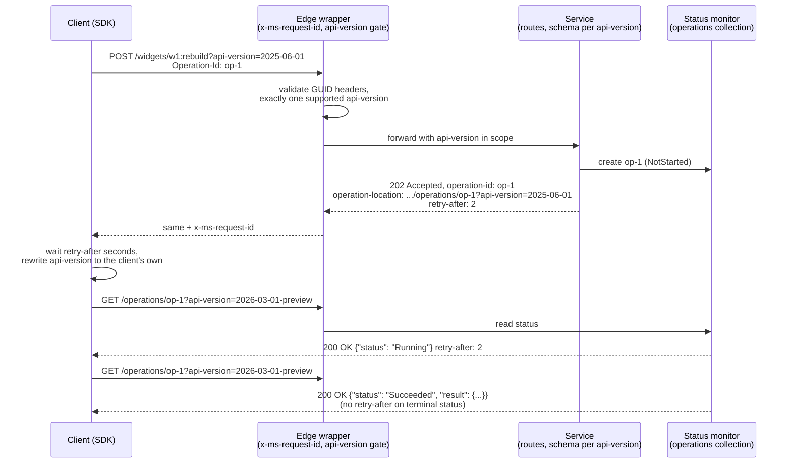

# The Microsoft and Azure REST API Guidelines: api-version Query Rules, Long-Running Operations, and Error Envelopes

> [!summary] Claim
> The Azure data-plane guidelines turn three wire conventions into hard contract: a required, date-valued `api-version` query parameter on every request (including `operation-location` and `nextLink` URLs), a status-monitor LRO that answers `202 Accepted` with `operation-location` and `retry-after`, and an `{"error": {"code", "message"}}` envelope whose top-level `code` must equal the `x-ms-error-code` header and can never change for a shipped `api-version`.

Part of [Versioning Evolution and API Guidelines](README.md) in [API Engineering](../README.md).

## TL;DR

- Mechanism: every Azure data-plane operation takes `?api-version=YYYY-MM-DD[-preview]`; the service routes behavior, request schema, and response shape on that value, and answers polling, paging, and errors with headers (`operation-location`, `retry-after`, `x-ms-request-id`, `x-ms-error-code`) that SDKs consume without parsing bodies.
- Contract rule: a missing `api-version` is `400` with code `MissingApiVersionParameter`, an unknown one is `400` with `UnsupportedApiVersionValue` listing stable versions plus only the latest preview, and the HTTP status plus top-level error `code` are the only error parts that are API contract.
- The trap: the request-id and error-envelope layer must sit outside every framework error path; in Starlette `1.10.0`, user middleware sits inside `ServerErrorMiddleware`, so an unhandled exception's `500` reaches the wire without `x-ms-request-id` (proven in the lab).
- Portability fact: the contract is pure HTTP and is server-independent; the lab's 28-item revision passed on CPython `3.12.13`, `3.12.16`, `3.13.18`, `3.14.6`, `3.14.10`, `3.15.2`, and free-threaded `3.14.6` and `3.15.0b3`, across macOS arm64, Debian Trixie, and Alpine musl, and the current 45-item revision passed on `3.14.6` only (the other legs were not re-run), while the Azure SDK poller (`azure-core 1.41.0`, executed) differs from the guideline in one edge (`Retry-After: 0` falls back to a 30-second wait).
- When not to use it: do not copy Azure's query-string versioning for a public API whose clients are hand-written `curl` and browsers with no generated SDK, and do not copy Microsoft Graph's `/v1.0` and `/beta` path versioning into an Azure-style service; pick one model per platform (see [[API-Versioning-Strategies-URI-Header-Media-Type-and-Channel-AIP-185]]).

## Mental model



A client sends an action with an optional `Operation-Id`, and the outermost wrapper stamps a fresh `x-ms-request-id` on whatever response comes back, then rejects malformed correlation headers and any request whose `api-version` is missing, repeated, or unknown before the router runs.
The service validates the action body synchronously, creates a status monitor in its `operations` collection, and answers `202 Accepted` with the monitor in the body, the monitor's id in `operation-id`, its absolute URL in `operation-location`, and a `retry-after` delay.
The client waits that delay, replaces the `api-version` in `operation-location` with the version it was built against (the guidelines allow this because the poller may not be the initiator), and polls with `GET` until `status` is one of `Succeeded`, `Failed`, or `Canceled`, at which point `retry-after` disappears and the monitor carries `result` or `error`.

## How it works

### The documents and their scope

The guidance lives in the `microsoft/api-guidelines` repository on the `vNext` branch (fetched 2026-11-10); its top-level `Guidelines.md` is now a deprecation notice that points Azure teams to `azure/Guidelines.md` plus `azure/ConsiderationsForServiceDesign.md`, and Graph teams to `graph/GuidelinesGraph.md`.
`azure/Guidelines.md` states that it applies to Azure *data plane* APIs and sends management-plane (ARM) authors to the Azure Resource Manager Resource Provider Contract (RPC), linked as `cloud-and-ai-microsoft/resource-provider-contract`, a repository that redirects to Microsoft enterprise sign-in (as of 2026-11).
Each rule carries an anchor and a strength: `DO` and `DO NOT` need a Stewardship Board exception before implementation, `YOU SHOULD` and `YOU SHOULD NOT` must be disclosed at review, and `YOU MAY` needs no notification.
The change history in the file runs from the first public release on 2020-03-31 to an entry dated 2026-10-22 that links the Azure Service Versioning Guideline (as of 2026-11).
The guidelines state two versioning requirements that drive everything below: customer workloads must never break due to a service change, and customers can adopt a version without requiring code changes.

### `api-version`: a required, date-valued query parameter

The rule set is short and absolute (azure/Guidelines.md, anchors `versioning-api-version-query-param` through `versioning-preview-goes-ga-within-one-year`):

- `DO` use a required query parameter named `api-version` on every operation.
- `DO` use `YYYY-MM-DD` values, with a `-preview` suffix for previews.
- `DO` return `400` with code `MissingApiVersionParameter` and message `The api-version query parameter (?api-version=) is required for all requests` when it is absent.
- `DO` return `400` with code `UnsupportedApiVersionValue` and message `Unsupported api-version '{0}'. The supported api-versions are '{1}'.` for an unrecognized value, listing all supported stable versions and only the latest public preview.
- `DO NOT` include a version number segment in any operation path.
- `DO NOT` reuse a preview's date for the GA version, and `DO NOT` keep a feature in preview for more than one year.

The guidelines also say clients specify the version on every request "even requests to an `Operation-Location` or `nextLink` URL returned by the service", and `nextLink` must already include every query parameter the service requires, `api-version` included (anchor `collections-nextlink-includes-all-query-params`).
`azure/VersioningGuidelines.md` adds the lifecycle: retire prior previews 90 days after a new GA or preview release, date a new preview strictly later than the latest GA, and make a retired version behave like an unknown version, which means it returns `UnsupportedApiVersionValue`.
The template does not say how to join the `{1}` list; the lab joins with `", "`, which is a lab choice.

The same rule shapes list operations.
A list response is an object with a top-level array, named `value` unless a better name exists, and a `nextLink` field holding an absolute URL for the next page; the field is omitted on the last page and is never `null` (anchors `collections-response-is-object`, `collections-response-array-name`, `collections-include-nextlink-for-more-results`, `collections-no-nextlink-on-last-page`, `collections-nextlink-value-never-null`).
ConsiderationsForServiceDesign.md, section Server-driven paging, calls `nextLink` an opaque URL, says the service should honor a URL derived from it by replacing only the `api-version` value with a different valid version, and lets the service reject the request if any other element was modified.
The optional query options are `filter`, `orderby`, `skip`, `top`, `maxpagesize`, `select`, and `expand`, applied in that order, with case-sensitive names and no OData `$` prefix, and a parameter the service does not support must produce an error (anchors `collections-query-options`, `collections-query-options-ordering`, `collections-parameter-names-case-sensitivity`, `collections-query-options-no-dollar-sign`, `collections-error-on-unknown-parameter`).
`maxpagesize` is an upper bound, because the operation "may choose to return fewer resources than the value specified" (anchor `collections-maxpagesize-might-return-fewer`); `top` has a minimum of 1 and `skip` a default and minimum of 0 (anchors `collections-top-param`, `collections-skip-param-definition`); and adding paging to a shipped operation is a breaking change (the note under anchor `collections-support-server-driven-paging`).
The lab implements server-driven paging only: `GET /widgets` returns pages ordered by name, and its `nextLink` carries `api-version`, `maxpagesize`, and a `continuationToken` whose name is a lab choice; [[Keyset-Seek-Pagination-and-Composite-Tie-Breaker-Cursors]] and [[Opaque-Cursor-Encoding-HMAC-Integrity-and-Filter-Binding]] own the cursor design itself.

Because the version is a query parameter, the version gate is a query-string parser, and parsers disagree about repeated keys.
Starlette builds `ImmutableMultiDict._dict` with `{k: v for k, v in _items}`, so `request.query_params["api-version"]` returns the *last* occurrence `(starlette 1.10.0 starlette/datastructures.py, ImmutableMultiDict.__init__)`.
A gate written as `request.query_params["api-version"] in SUPPORTED` therefore accepts `?api-version=1999-01-01&api-version=2025-06-01`, while a proxy or log pipeline that reads the first occurrence records a different version for the same request.
The guidelines require validating every query parameter and failing with `400` (anchor `http-parameter-validation`), so the lab rejects duplicates outright; the code `InvalidQueryParameterValue` is the lab's choice, not a documented Azure code.

The version also selects the request schema.
`DO` fail with `400` if any JSON field name or value "is not fully understood by the specific version of the service" (anchor `rest-fail-for-unknown-fields`), and a `PUT` from a v1 client must reset fields introduced in v2 or later to their defaults, which the guideline equates to a `DELETE` followed by a `PUT` (anchor `rest-put-for-create-or-replace`).
That second rule is what lets an old client keep doing whole-resource replaces without silently preserving state it cannot see.

### Methods, status codes, and idempotency

`DO` ensure that all HTTP methods are idempotent (anchor `http-all-methods-idempotent`), and one table fixes the status code of a synchronous success (anchor `http-success-status-codes`):

| Method | Meaning | Success status |
|---|---|---|
| `PATCH` | Create or modify the resource with JSON Merge Patch | `200 OK`, `201 Created` |
| `PUT` | Create or replace the whole resource | `200 OK`, `201 Created` |
| `POST` | Create a resource whose id the service sets | `201 Created` with the URL of the created resource |
| `POST` | Action | `200 OK` |
| `GET` | Read a resource or list a collection | `200 OK` |
| `DELETE` | Remove the resource | `204 No Content`, avoiding `404 Not Found` |

A `PUT`, `POST`, or `DELETE` that completes asynchronously returns `202 Accepted` instead (anchor `http-lro-status-code`).
`DELETE` returns `204` even when the URL identifies a resource that does not exist (anchor `http-delete-returns-204`); ConsiderationsForServiceDesign.md, section Errors, reframes the method as "ensure no resource at this location exists", which is what makes a retried `DELETE` safe.
`PATCH` takes a JSON Merge Patch body (anchor `rest-patch-use-merge-patch`), and the headers table gives `application/merge-patch+json` as its `content-type` example.
Both `PUT` and `PATCH` answer `400` for a field name or value unknown to the `api-version` and for a read-only field, `201` when they create, and `200` when they update or replace (anchor `rest-put-patch-status-codes`).

`POST` is the one method that is not naturally idempotent, so `YOU SHOULD` support OASIS Repeatable Requests Version 1.0 on it: the client sends `Repeatability-Request-ID` and `Repeatability-First-Sent`, the service tracks the pair for at least 5 minutes, and an operation without that support should answer `501 Not Implemented` to a request that carries valid repeatability headers (anchor `repeatability-headers`).
The OASIS text defines the response side: a server aware of repeatability "MUST return the Repeatability-Result response header" with the value `accepted` or `rejected` (OASIS Repeatable Requests Version 1.0, Section 3.2.1), and it answers `412 Precondition Failed` with `rejected` when `Repeatability-First-Sent` is earlier than the oldest request id it remembers (Section 5).
The LRO `Operation-Id` header described below is the second idempotency mechanism, scoped to the operations collection; see [[Idempotent-Request-Identification-and-Request-ID-Correlation-AIP-155]].

Preconditions may not be ignored.
`DO` honor any precondition header received, because "The HTTP Standard does not allow precondition headers to be ignored, as it can be unsafe to do so" (anchor `condreq-support`).
A `GET` whose `If-None-Match` value equals the current `ETag` returns `304 Not Modified`; a `PUT` or `PATCH` with `If-None-Match: *` creates only when nothing exists and otherwise fails with `412 Precondition Failed`; and a `PUT`, `PATCH`, or `DELETE` whose `If-Match` value is stale fails with `412` (anchors `condreq-for-read-behavior`, `condreq-behavior`).
The lab does not implement entity tags; [[Optimistic-Concurrency-Control-If-Match-and-412-Precondition-Failed]] owns that mechanism.

### Headers: request identity, correlation, and errors

The headers table in azure/Guidelines.md marks `x-ms-request-id` and `x-ms-error-code` as response headers every service must support, and the tracing section defines the pair precisely:

- `x-ms-request-id` (response, required): service-generated, a GUID without braces, and the service "must ensure that this value is globally unique".
- `x-ms-client-request-id` (both, optional): caller-specified GUID without braces; if present the service must log it, and because the client generates it the service should not assume it is unique.

`x-ms-correlation-request-id` is not in the data-plane guidelines.
It is an ARM header, and its rule changed between public revisions of the RPC.
The 2017 text lists it under "Proxy Request Header Modifications" as "Always added", a reserved header that clients cannot set (RPC v1.0 common-api-details.md in the fork `enihcam/azure-resource-manager-rpc`, last pushed 2017-05-01).
The last public revision moves it to the "Client Request Headers" table as optional and caller-specified: "If the caller does not specify this header, ARM will randomly generate a unique GUID", the resource provider "**must** log this so that end-to-end requests can be correlated across Azure", and because it "can be client-generated or re-used for multiple requests, it should not be assumed to be unique by the RP implementation" (RPC v1.0 common-api-details.md at commit `8231d7df`, 2023-11-15, Client Request Headers).
The same table lists `x-ms-return-client-request-id`, described as "True or false and indicates if a client-request-id should be included in the response. Default is false."
That revision also defines an optional `x-ms-failurecause` response header of the form `<responsibleParty>:<failureCategory>`, where the responsible party is `client` or `service`, so a provider can keep customer-caused `5xx` responses out of its own error rate.
Provenance matters here: `Azure/azure-resource-manager-rpc` now returns `404`, and commit `8231d7df` is the last content commit on the `ant/migrate` branch of `anthony-c-martin/azure-resource-manager-rpc`, where the next commit (2025-01-29) replaces every file with a notice that the content moved to `cloud-and-ai-microsoft/resource-provider-contract`, a repository behind Microsoft enterprise sign-in (as of 2026-11).
Every RPC statement in this note is therefore a statement about a dated public revision, not about the gated contract.

Two header rules protect the edge: `DO NOT` fail a request that contains an unrecognized header, because gateways and middleware add them, and `DO NOT` reject distributed tracing headers you do not understand (anchors `http-allow-unrecognized-headers` and `telemetry-allow-unrecognized-headers`).
The guidelines also say `DO NOT` use an `x-` prefix for new custom headers unless the header already exists in production, citing RFC 6648, whose Section 3 says creators of new parameters "SHOULD NOT prefix their parameter names with "X-" or similar constructs" (RFC 6648 Section 3).
Consistent with that rule, the LRO headers are `operation-location` and `operation-id` and the deprecation header is `azure-deprecating`, while `x-ms-request-id` and `x-ms-error-code` keep the prefix they already had in production.
Header names are case-insensitive in HTTP (RFC 9110 Section 5.1) and HTTP/2 forbids uppercase characters in field names on the wire (RFC 9113 Section 8.2.1), so `operation-location` and `Operation-Location` are one header.

The deprecation header is a message for humans, not machine contract.
`azure-deprecating` carries a semicolon-delimited list of entries shaped `<description> will retire on <date> (<url>)`, is sent only if the operation will stop working and the client must act, and may not be introduced without approval from the Azure Breaking Change Reviewers (anchors `deprecation-header`, `deprecation-header-value`, `deprecation-header-review`).
The section says client code is not expected to parse the value: "it is purely informational to a human being", and only the semicolon delimiters are contract.
Compare the IETF `Deprecation` and `Sunset` fields in [[Deprecation-Header-RFC-9745-and-Sunset-Header-RFC-8594]].

### The error envelope

Every error carries two machine signals: the HTTP status code for generic handling, and a string `code` for specific handling.
azure/Guidelines.md requires an `x-ms-error-code` response header and a body of shape `ErrorResponse { error: ErrorDetail }`, where `ErrorDetail` has required `code` and `message`, optional `target`, `details` (an array of `ErrorDetail`), `innererror` (a recursive `InnerError` with its own optional `code`), and free-form additional properties (anchors `rest-error-code-header` and `rest-error-response-body-structure`).
The top-level `code` must be identical to the `x-ms-error-code` value (anchor `rest-error-code-header-and-body-match`), so SDKs can decide whether to retry without parsing JSON.
ConsiderationsForServiceDesign.md, section Errors, draws the contract boundary: "The HTTP status code and the top-level error code are the only part of your error that we consider part of your API contract", so changing either for an existing `api-version` is a breaking change, while the rest, such as `message` and `details`, may change to improve diagnosability (azure/Guidelines.md anchor `rest-error-non-api-contract-fields` says the same of every other field).
`YOU SHOULD NOT` add new top-level codes to an existing API without a version bump, and `YOU MAY` model the code set as an extensible enum (`"modelAsString": true`) because adding a code is only breaking if the same condition now yields a different top-level code (anchors `rest-add-codes-in-new-api-version`, `rest-error-code-enum`).

`details` is where a service reports several causes under one frozen top-level code, and additional properties are where it puts the values a message mentions: the guideline's example pairs `"message": "A maximum of 16 keys are allowed per account."` with `"maximumKeys": 16` so that customers do not parse messages (anchor `rest-error-additional-properties-allowed`).
The lab uses `details` for request validation: a body with two invalid fields returns one `InvalidRequestContent` error whose `details` array holds one `ErrorDetail` per field, while a body with one invalid field returns no `details` at all.
`YOU SHOULD NOT` document specific error status codes in OpenAPI unless the `default` response cannot describe them (anchor `rest-error-use-default-response`), because "Every unique status code turns into a separate code path in your client libraries" (ConsiderationsForServiceDesign.md, section Errors).
The envelope's lineage is OData: the ARM contract says the format "is inherited from OData v4.0 schema for error responses" and adds an `additionalInfo` array of objects with `type` and `info` members, which the data-plane guidelines do not define (RPC v1.0 common-api-details.md at commit `8231d7df`, 2023-11-15, Error Response Content).

The JSON rules close the remaining gaps: `DO NOT` send fields whose value is `null` (Azure treats missing and `null` as identical), accept `null` only in a JSON Merge Patch body where it means delete, and use camelCase field names (anchors `json-null-response-values`, `json-null-request-values`, `json-field-name-casing`).
The second anchor's `name` attribute is misspelled `json-null-resquest-values` upstream, so only its `href` carries the cited spelling (as of 2026-11).
The merge-patch rule is RFC 7396 semantics: the patch document describes changes "by example" and a `null` member removes the target member (RFC 7396 Section 2).

Microsoft Graph uses the same `{"error": {"code", "message", "target", "innererror"}}` shape but a different code rule: the top-level code "MUST match the HTTP response status code description, converted to camelCase", such as `badRequest`, with service-specific codes pushed into `innererror` (graph/GuidelinesGraph.md, Error handling).
Azure instead wants unique, descriptive top-level codes such as `ContainerBeingDeleted` for recoverable errors and reused generic codes such as `InvalidHeaderValue` for usage errors (ConsiderationsForServiceDesign.md, Errors).
Neither uses RFC 9457 Problem Details, whose object carries `type`, `title`, `status`, `detail`, and `instance` under the `application/problem+json` media type (RFC 9457 Section 3); see [[Problem-Details-for-HTTP-APIs-RFC-9457]].

### Long-running operations: four patterns and one status monitor

`DO` implement an operation as an LRO when its 99th-percentile latency exceeds one second, and `DO NOT` implement `PATCH` as an LRO (anchors `lro-response-time`, `lro-no-patch-lro`).
ConsiderationsForServiceDesign.md, section Long-Running Operations, allows exactly four LRO shapes:

| Pattern | Initial request | Initial response | Status monitor in body |
|---|---|---|---|
| Create or replace with extra processing | `PUT /resource?api-version=` | `201 Created` or `200 OK`, the resource, `operation-id`, `operation-location` | No, the resource |
| Delete | `DELETE /resource?api-version=` | `202 Accepted`, `operation-id`, `operation-location` | Yes |
| Action on a resource | `POST /resource:<action>?api-version=` | `202 Accepted`, `operation-id`, `operation-location` | Yes |
| Action with no related resource | `PUT <operation-endpoint>/<operation-id>?api-version=` | `201 Created`, `operation-location` | Yes |

The action syntax `<resource-id>:<action>` is why the guidelines say `YOU SHOULD` restrict user-specified path segments to `0-9 A-Z a-z - . _ ~` and not allow `:` (anchors `http-url-allowed-characters-2`, `actions-url-pattern-for-resource-action`), and a long-running `POST` must never create a resource (anchor `lro-no-post-create`).
For the `DELETE` and action patterns, `YOU SHOULD NOT` return any `2xx` other than `202`, even if the work finished before the response; return `202` with a terminal `status` instead (anchors `lro-delete-returns-only-202`, `lro-returns-only-202`).
This is RFC 9110's own description of `202`: "The representation sent with this response ought to describe the request's current status and point to (or embed) a status monitor" (RFC 9110 Section 15.3.3).

The client may send `Operation-Id`; otherwise the service generates one, typically a GUID.
A reused `Operation-Id` must fail with `409 Conflict` "unless the request is identical to the prior request (a retry scenario)" (anchors `lro-operation-id-request-header`, `lro-operation-id-unique-except-retries`), which makes the header an idempotency key scoped to the operations collection; compare [[Idempotency-Key-Header-Specification-and-State-Machine-Draft-08]].
The status monitor has required `id` and `status`, a `kind` discriminator that becomes required when one endpoint serves several operation kinds, `error` (an `ErrorDetail`) when `Failed`, and `result` only for action LROs when `Succeeded`; `status` takes `NotStarted`, `Running`, `Succeeded`, `Failed`, or `Canceled` (anchor `lro-status-monitor-structure`).
Polling is `GET <operation-endpoint>/<operation-id>?api-version=` returning `200 OK`, with `retry-after` as an integer number of seconds while not terminal, and the service should accept any valid `api-version` on that `GET` because the poller may be a different client (anchors `lro-poll`, `lro-status-monitor-retry-after`, `lro-status-monitor-accepts-any-api-version`).
`DO` retain the monitor for a publicly documented period of at least 24 hours after completion (anchor `lro-status-monitor-retention`).
The start of an LRO has three rules of its own: validate as much as practical before answering, so that errors arrive early; return `operation-location` as an absolute URL; and include the same `api-version` in it that the initial request used, while expecting a client to change it (anchors `lro-valid-inputs-synchronously`, `lro-returns-operation-location`, `lro-operation-location-includes-api-version`).
Cancellation and other controls are `POST /<status-monitor-endpoint>:cancel` returning `200 OK` with the monitor (ConsiderationsForServiceDesign.md, Controlling a long-running operation).
The guidance does not say what a cancel does to an operation that has already finished; the lab moves only a non-terminal monitor to `Canceled`, returns a terminal monitor unchanged, and counts retention from the cancel time, which keeps a retried `POST` safe under the all-methods-idempotent rule (lab choices, proven by `test_cancel_is_idempotent_and_never_rewrites_a_terminal_monitor`).
`YOU MAY` expose a list operation on a status monitor collection, should do so when it holds monitors for action LROs with no related resource, and should support `filter` on `kind` when the collection is polymorphic (anchors `lro-list-status-monitors`, `lro-put-action-list-status-monitors`, `lro-list-status-monitors-filter`); see [[Asynchronous-Job-Result-Expiration-Cancellation-and-Wait-Semantics]].
RFC 9110 defines `Retry-After` as `HTTP-date / delay-seconds` with `delay-seconds = 1*DIGIT` (RFC 9110 Section 10.2.3); the Azure rule narrows it to the integer form.

### ARM is a different protocol

Azure Resource Manager predates these LRO rules and still uses its own headers.
Its documentation says an async operation returns `201` or `202`, then the client polls `Azure-AsyncOperation` if present, else `Location`, honoring `Retry-After`; an `Azure-AsyncOperation` monitor returns a body with `status` (`Succeeded`, `Failed`, `Canceled`, or provider values such as `InProgress`), while a `Location` URL returns `202` until done and then `200` with the resource (Microsoft Learn, Status of asynchronous operations, `ms.date` 2026-02-27).
The SDKs encode both protocols as ordered strategies: `azure-core 1.41.0` tries `OperationResourcePolling` (header `operation-location`), then `LocationPolling`, then `StatusCheckPolling` `(azure-core 1.41.0 azure/core/polling/base_polling.py, _SansIOLROBasePolling.__init__)`, and `azure-mgmt-core 1.6.0` swaps in `AzureAsyncOperationPolling` (header `azure-asyncoperation`) and adds `BodyContentPolling` for ARM `(azure-mgmt-core 1.6.0 azure/mgmt/core/polling/arm_polling.py, ARMPolling.__init__)`.
Terminal status is case-insensitive in that client: `_FINISHED = frozenset(["succeeded", "canceled", "failed"])` compared against `str(status).lower()` `(azure-core 1.41.0 azure/core/polling/base_polling.py, _finished)`.
The initial response must be `200`, `201`, `202`, or `204`, or the poller raises `BadStatus` `(azure-core 1.41.0 azure/core/polling/base_polling.py, _raise_if_bad_http_status_and_method)`.
ARM also bounds what a provider may do synchronously: the proxy waits 60 seconds before the client gets `504`, rejects a request body over 4 MB with `413 Payload Too Large` before it reaches the provider, and accepts a response of at most 8 MB after compression (RPC v1.0 common-api-details.md at commit `8231d7df`, 2023-11-15, sections Client Request Timeout, Max Request Body Size, and Max Response Size).
The same text tells providers whose requests take more than 60 seconds to consider the asynchronous pattern, so the timeout, not the data-plane p99 rule, is what forces an ARM operation to become long-running.

### The lab's edge wrapper and why it is outermost

Starlette builds its stack as `[ServerErrorMiddleware, (RequestBodyLimitMiddleware), *user_middleware, ExceptionMiddleware]` around the router `(starlette 1.10.0 starlette/applications.py, Starlette.build_middleware_stack)`.
When an endpoint raises, `ServerErrorMiddleware` builds the `500` (with the handler registered for `Exception` or `500`), sends it if nothing was sent, and then re-raises so the server can log it `(starlette 1.10.0 starlette/middleware/errors.py, ServerErrorMiddleware.__call__)`.
A request-id middleware registered with `Starlette(middleware=[...])` sits *inside* that layer, so it never sees the `500` it is supposed to stamp; the support ticket for the one request that most needs an id arrives without one.
The lab therefore wraps the whole application in `AzureEdge`, whose `send` wrapper appends `x-ms-request-id` to every `http.response.start` message, including the `500` that `ServerErrorMiddleware` produces underneath it.

Routing has its own trap.
Starlette's router gives a request whose path matches but whose method does not to the *first* partially matching route `(starlette 1.10.0 starlette/routing.py, Router.app)`, and that route builds `Allow` from its own method set alone `(starlette 1.10.0 starlette/routing.py, Route.handle)`.
Registering `GET`, `PUT`, and `DELETE` for one path as three routes therefore produces a `405` whose `allow` header names only the first route's methods, while RFC 9110 requires "a list of the target resource's currently supported methods" (RFC 9110 Section 15.5.6).
The lab registers one route per URL and dispatches on the method inside it, and the framework's `404` and `405` pass through the same envelope builder with the lab codes `NotFound` and `MethodNotAllowed`.

## Numbers and limits

| Quantity | Value | Source |
|---|---|---|
| URL length that must yield `414 URI Too Long` | > 2083 characters | azure/Guidelines.md, anchor `http-url-length` (as of 2026-11) |
| Integer range in query strings and JSON | -2^53+1 to 2^53-1 | azure/Guidelines.md, anchors `http-parameter-serialization`, JSON section |
| Latency threshold for making an operation an LRO | p99 > 1 second | azure/Guidelines.md, anchor `lro-response-time` |
| Status monitor retention after completion | >= 24 hours, publicly documented | azure/Guidelines.md, anchor `lro-status-monitor-retention` |
| Repeatability tracking window (`Repeatability-First-Sent`) | >= 5 minutes | azure/Guidelines.md, anchor `repeatability-headers` |
| `top` minimum; `skip` default and minimum | 1; 0 | azure/Guidelines.md, anchors `collections-top-param`, `collections-skip-param-definition` |
| Retirement of superseded previews | 90 days after a new GA or preview | azure/VersioningGuidelines.md (as of 2026-11) |
| Maximum time a feature stays in preview | 1 year | azure/Guidelines.md, anchor `versioning-preview-goes-ga-within-one-year` |
| Previews before first GA | >= 2 (`YOU SHOULD`) | ConsiderationsForServiceDesign.md, anchor `previews-at-least-two` |
| Graph support for a deprecated GA element | >= 36 months, or 24 months with demonstrated non-usage | graph/GuidelinesGraph.md, Versioning and deprecation |
| ARM proxy timeout to a resource provider | 60 seconds, then `504` to the client (unchanged from the 2017 revision to the last public one) | RPC v1.0 common-api-details.md at commit `8231d7df` (2023-11-15), Client Request Timeout |
| ARM request body cap | 4 MB, then `413 Payload Too Large` without reaching the provider | RPC v1.0 common-api-details.md at commit `8231d7df` (2023-11-15), Max Request Body Size; Microsoft Learn limits page lists "Azure Resource Manager API request size" as 4,194,304 bytes (`ms.date` 2026-08-04) |
| ARM response size cap | 8 MB after compression (paginate above that); 20 MB hard limit for a single resource, then `502 Bad Gateway` | RPC v1.0 common-api-details.md at commit `8231d7df` (2023-11-15), Max Response Size |
| ARM response size cap, earlier revisions | 4 MB then `500` (2017); 8 MB then `500` (2020-04) | RPC v1.0 common-api-details.md in `enihcam/azure-resource-manager-rpc` (pushed 2017-05-01) and at `master` of `anthony-c-martin/azure-resource-manager-rpc` (file last changed 2020-04-01) |
| Minimum URL size clients must accept for `Azure-AsyncOperation` and `Location` | 4 KB | Microsoft Learn, Status of asynchronous operations (`ms.date` 2026-02-27) |
| `azure-core` LRO poll interval when no usable `retry-after` | 30 seconds (`timeout: float = 30`) | `(azure-core 1.41.0 azure/core/polling/base_polling.py, _SansIOLROBasePolling.__init__)` |
| `azure-core` delay for `Retry-After: 0`, `Retry-After: 2`, and no header | `30`, `2.0`, `30` | measured, `LROBasePolling()._extract_delay()` under `uv run --no-project --python 3.14 --with azure-core==1.41.0`, CPython 3.14.6, macOS 27.2 arm64 |
| Lab: polls for a 6-second action with `retry-after: 2` | 3 `GET`s at t=2, 4, 6 s (waits `[2, 2, 2]`) | measured, `test_poller_honors_retry_after_and_may_switch_api_version`, CPython 3.14.6, macOS 27.3 arm64 |
| Lab: full module run | `45 passed in 0.21s` | measured, `uv run --frozen pytest ... -v -p no:cacheprovider`, CPython 3.14.6, macOS 27.3 arm64 (2026-11-12) |

The lab's poll count is a logical count on a manual clock, not a wall-clock benchmark.

## Portability

Every row except the `3.14.6` workspace row and the dependency rows was measured on the earlier 28-item revision of the module, before the list paging, cancel, `details`, `405 Allow`, and `HEAD` tests and the code behind them were added, and its `28 passed` counts say so.
The current 45-item revision has been run once, on the workspace interpreter (the matrix and the five lint, type, and test gates were not re-run on it).
The added code paths use only the same ASGI, Starlette, and `httpx` calls as the earlier ones, but that is an argument, not a measurement.

| Leg | Version | Result and evidence |
|---|---|---|
| CPython | `3.12.13` | Proven: `28 passed in 0.40s` on macOS 27.2 arm64 (`UV_PROJECT_ENVIRONMENT=<dir>/py3.12 uv run --frozen --python 3.12 pytest ...`, full workspace lock) |
| CPython | `3.12.16` | Proven in containers only: `28 passed in 0.26s` on `python:3.12.16-trixie` and `28 passed in 0.46s` on `python:3.12.16-alpine`; `3.12.16` is not installed on the macOS host |
| CPython | `3.13.18` | Proven: `28 passed in 0.45s` (same command, `--python /opt/homebrew/bin/python3.13`) |
| CPython | `3.14.6` (workspace `.venv`) | Proven: `45 passed in 0.21s` on the current 45-item revision (`uv run --frozen pytest ... -v -p no:cacheprovider`, macOS 27.3 arm64); `28 passed in 0.36s` and all five gates on the earlier 28-item revision |
| CPython | `3.14.10` | Proven: `28 passed in 0.42s` (`--python /opt/homebrew/bin/python3.14`) |
| CPython | `3.15.2` | Proven: `28 passed in 0.48s` (`--python /opt/homebrew/bin/python3.15`, full workspace lock) |
| CPython free-threaded | `3.14.6+freethreaded` | Proven: `28 passed in 0.61s`, `sys._is_gil_enabled()` is `False`, same `--no-project` command as the next row with `--python 3.14t` |
| CPython free-threaded | `3.15.0b3+freethreaded` (not `3.15.2t`) | Proven: `28 passed in 0.34s`, `sys._is_gil_enabled()` is `False`, via `PYTHONPATH=src uv run --no-project --python 3.15t --with starlette==1.10.0 --with pydantic==2.14.3 ...`; the full lock cannot install because `psycopg-binary==3.3.8` has no wheel for it |
| `3.15.2t` | not available | Not run: `uv python list` offers no `3.15.2` free-threaded build on this machine |
| Debian Trixie (glibc `2.41`), linux/aarch64 | CPython `3.12.16`, `3.13.18`, `3.14.10`, `3.15.2` | Proven: `28 passed` in `0.26s`, `0.20s`, `0.27s`, `0.22s` in `python:<version>-trixie`, `docker run --rm` with `labs/` mounted read-only and the eight pinned packages (`starlette`, `pydantic`, `pydantic-core`, `httpx`, `httpcore`, `anyio`, `pytest`, `pytest-asyncio`) installed by `pip --only-binary=:all:`, not the full lock |
| Alpine `3.24` (musl), linux/aarch64 | CPython `3.12.16`, `3.13.18`, `3.14.10`, `3.15.2` | Proven: `28 passed` in `0.46s`, `0.35s`, `0.68s`, `0.47s` in `python:<version>-alpine`, same command and packages as the Debian leg |
| Starlette | `1.10.0` | Middleware order and last-value-wins query parsing read from source and proven by `test_request_id_middleware_inside_starlette_misses_server_error_500` and `test_duplicate_api_version_is_rejected_instead_of_last_value_wins` |
| FastAPI | `0.162.0` | Proven by execution on CPython 3.14.6: with `app.add_middleware(AzureEdge, ...)` the built stack is `ServerErrorMiddleware`, `ExceptionTelemetryMiddleware`, `AzureEdge`, `ExceptionMiddleware`, `AsyncExitStackMiddleware`, and a raising route returns `500` without `x-ms-request-id` `(fastapi 0.162.0 fastapi/applications.py, FastAPI.build_middleware_stack)`; this check is a one-off script, not a lab test |
| httpx | `0.28.1` | `ASGITransport(raise_app_exceptions=False)` is required to observe the `500` because `ServerErrorMiddleware` re-raises `(starlette 1.10.0 starlette/middleware/errors.py, ServerErrorMiddleware.__call__)` and the transport re-raises unless the flag is off `(httpx 0.28.1 httpx/_transports/asgi.py, ASGITransport.handle_async_request)` |
| Azure SDK pollers | `azure-core 1.41.0`, `azure-mgmt-core 1.6.0` | `azure-core 1.41.0` read at the release tag and executed in a throwaway environment (`uv run --no-project --python 3.14 --with azure-core==1.41.0`, CPython 3.14.6): `Retry-After: 0` yields a 30-second delay, `_finished("SUCCEEDED")` is `True`, and `OperationResourcePolling.can_poll` is `False` without `operation-location`; `azure-mgmt-core 1.6.0` read from source at the release tag only; neither is pinned in `labs/pyproject.toml` |
| Servers (Uvicorn, Hypercorn, Granian) | `0.54.0`, `0.18.0`, `2.8.7` | Not run: the lab is in-process ASGI only; the contract uses only status, header, and query semantics defined in RFC 9110, so no server-specific behavior is claimed |
| HTTP/1.1, HTTP/2, HTTP/3 | - | Header names are case-insensitive (RFC 9110 Section 5.1) and HTTP/2 requires lowercase names on the wire (RFC 9113 Section 8.2.1), so the lowercase `operation-location` and `x-ms-*` names are version-neutral; no per-version lab was run |

## Worked example

The lab is [implementation](../labs/src/api_labs/f07_versioning_evolution_and_api_guidelines/azure_guidelines.py) plus [test](../labs/tests/f07_versioning_evolution_and_api_guidelines/test_microsoft_azure_rest_api_guidelines_in_depth.py): a Starlette app with `PUT`, `GET`, and `DELETE` on `/widgets/{name}`, an LRO action `POST /widgets/{name}:rebuild`, a status monitor at `/operations/{operation_id}`, and a client poller, all driven by a `ManualClock` so no test sleeps.

The edge gate validates correlation headers and enforces exactly one supported `api-version` (verbatim excerpt, `azure_guidelines.py` lines 195-222):

```python
def _check_edge(scope: Scope, headers: Headers) -> Response | None:
    for name in ("x-ms-client-request-id", "x-ms-correlation-request-id"):
        value = headers.get(name)
        if value is not None and _GUID.fullmatch(value) is None:
            return error_response(
                400, "InvalidHeaderValue", f"Header '{name}' must be a GUID.", target=name
            )
    query: bytes = scope["query_string"]
    versions = [
        value
        for key, value in parse_qsl(query.decode("latin-1"), keep_blank_values=True)
        if key == "api-version"
    ]
    if not versions:
        return error_response(400, "MissingApiVersionParameter", MISSING_API_VERSION_MESSAGE)
    if len(versions) > 1:
        return error_response(
            400,
            "InvalidQueryParameterValue",
            "The api-version query parameter must appear exactly once.",
            target="api-version",
        )
    if versions[0] not in SUPPORTED_VERSIONS:
        return error_response(
            400, "UnsupportedApiVersionValue", unsupported_api_version_message(versions[0])
        )
    scope[_API_VERSION_SCOPE_KEY] = versions[0]
    return None
```

One function builds every error, so the header and the body cannot drift (verbatim excerpt, lines 82-96):

```python
def error_response(
    status_code: int,
    code: str,
    message: str,
    *,
    target: str | None = None,
    details: Sequence[Mapping[str, str]] = (),
    headers: Mapping[str, str] | None = None,
) -> JSONResponse:
    """Build the Azure error envelope; header and body ``code`` share one source value."""
    detail: dict[str, Any] = {"code": code, "message": message}
    if target is not None:
        detail["target"] = target
    if details:
        detail["details"] = [dict(item) for item in details]
```

The `send` wrapper inside `AzureEdge.__call__` stamps every response start, including the `500` produced by `ServerErrorMiddleware` below it (verbatim excerpt, lines 162-192):

```python
        async def send_with_ids(message: Message) -> None:
            nonlocal status
            if message["type"] == "http.response.start":
                status = message["status"]
                raw: list[tuple[bytes, bytes]] = list(message.get("headers", []))
                raw.append((b"x-ms-request-id", request_id.encode("ascii")))
                if echo_client_id and client_id is not None:
                    raw.append((b"x-ms-client-request-id", client_id.encode("ascii")))
                message = {**message, "headers": raw}
            elif message["type"] == "http.response.body" and scope["method"] == "HEAD":
                # HEAD is GET without content (RFC 9110 Section 9.3.2); not every server strips it.
                message = {**message, "body": b""}
            await send(message)

        try:
            rejection = _check_edge(scope, headers)
            if rejection is not None:
                await rejection(scope, receive, send_with_ids)
            else:
                await self.app(scope, receive, send_with_ids)
        finally:
            self._log.append(
                RequestLogRecord(
                    request_id=request_id,
                    client_request_id=client_id,
                    correlation_request_id=correlation_id,
                    method=scope["method"],
                    path=scope["path"],
                    status=status,
                )
            )
```

The LRO action validates synchronously, treats `Operation-Id` as an idempotency key, and returns the monitor with `operation-location` carrying the caller's `api-version` (verbatim excerpt, lines 434-466):

```python
    async def rebuild_widget(request: Request) -> Response:
        name = _resource_id(request.path_params["name"], "widget name")
        version = _api_version(request)
        raw_body = await _json_body(request)
        try:
            body = RebuildRequest.model_validate(raw_body)
        except ValidationError as exc:
            raise _validation_error(exc) from exc
        if name not in store.widgets:
            raise AzureError(404, "WidgetNotFound", f"Widget '{name}' does not exist.")
        requested_id = request.headers.get("operation-id")
        op_id = (
            _resource_id(requested_id, "Operation-Id")
            if requested_id is not None
            else str(uuid.uuid4())
        )
        fingerprint = json.dumps(["rebuild", name, raw_body], sort_keys=True)
        operation = store.operations.get(op_id)
        if operation is None:
            operation = Operation(op_id, name, body.mode, fingerprint, lab_clock())
            store.operations[op_id] = operation
        elif operation.fingerprint != fingerprint:
            raise AzureError(
                409, "OperationIdConflict", f"Operation-Id '{op_id}' is already in use."
            )
        monitor = operation.monitor(lab_clock(), store.deletions.get(name, []))
        location = request.url.replace(
            path=f"/operations/{op_id}", query=urlencode({"api-version": version})
        )
        headers = {"operation-id": op_id, "operation-location": str(location)}
        if monitor["status"] not in TERMINAL_STATUSES:
            headers["retry-after"] = str(POLL_INTERVAL_SECONDS)
        return JSONResponse(monitor, status_code=202, headers=headers)
```

The client poller waits `retry-after` before every `GET`, including the first, and substitutes its own `api-version` (verbatim excerpt, lines 555-581):

```python
async def poll_lro(
    client: httpx.AsyncClient,
    initial: httpx.Response,
    *,
    api_version: str,
    sleep: Callable[[float], Awaitable[None]],
    default_interval: int = POLL_INTERVAL_SECONDS,
    max_polls: int = 50,
) -> tuple[dict[str, Any], list[int]]:
    """Poll ``operation-location`` with the caller's api-version until a terminal status.

    Waits ``retry-after`` before every GET, including the first, and compares status
    case-insensitively. Returns the terminal status monitor and the waits it performed.
    """
    url = with_api_version(initial.headers["operation-location"], api_version)
    waits: list[int] = []
    response = initial
    for _ in range(max_polls):
        delay = retry_after_seconds(response.headers.get("retry-after"), default_interval)
        waits.append(delay)
        await sleep(delay)
        response = await client.get(url)
        response.raise_for_status()
        monitor: dict[str, Any] = response.json()
        if str(monitor["status"]).lower() in {s.lower() for s in TERMINAL_STATUSES}:
            return monitor, waits
    raise TimeoutError(f"operation still running after {max_polls} polls")
```

Two tests carry the non-obvious results: Starlette's last-value-wins parsing, and a request-id middleware placed inside Starlette losing the `500` (verbatim excerpts, test lines 99-109 and 176-195):

```python
@pytest.mark.unit
@pytest.mark.asyncio
async def test_duplicate_api_version_is_rejected_instead_of_last_value_wins() -> None:
    query = b"api-version=1999-01-01&api-version=2025-06-01"
    scope: dict[str, Any] = {"type": "http", "query_string": query, "headers": []}
    # Starlette's MultiDict keeps the last value, so a naive gate would accept this request.
    assert Request(scope).query_params["api-version"] == GA
    async with client_for(create_app()) as client:
        response = await client.get(f"/widgets/w1?{query.decode()}")
    error = assert_azure_error(response, 400, "InvalidQueryParameterValue")
    assert error["target"] == "api-version"
```

```python
@pytest.mark.unit
@pytest.mark.asyncio
async def test_request_id_middleware_inside_starlette_misses_server_error_500() -> None:
    log: list[RequestLogRecord] = []

    async def on_unhandled(request: Request, exc: Exception) -> Response:
        return error_response(500, "InternalServerError", "The service failed unexpectedly.")

    inner = Starlette(
        routes=[Route("/boom", boom)],
        middleware=[Middleware(AzureEdge, log=log, new_id=lambda: "fixed-id")],
        exception_handlers={Exception: on_unhandled},
    )
    transport = httpx.ASGITransport(app=inner, raise_app_exceptions=False)
    async with httpx.AsyncClient(transport=transport, base_url="http://test") as client:
        response = await client.get("/boom", params={"api-version": GA})
    assert response.status_code == 500
    # ServerErrorMiddleware sits outside user middleware, so the id never reaches the wire.
    assert "x-ms-request-id" not in response.headers
    assert log[-1].status == 0
```

The poller test proves the timing contract on the manual clock (verbatim excerpt, test lines 299-329):

```python
@pytest.mark.unit
@pytest.mark.asyncio
async def test_poller_honors_retry_after_and_may_switch_api_version() -> None:
    lab = create_app(ManualClock())
    polled: list[tuple[float, str, str | None]] = []
    poll_versions: list[str] = []

    async def sleep(seconds: float) -> None:
        lab.clock.advance(seconds)

    async def record(response: httpx.Response) -> None:
        await response.aread()
        if response.request.url.path.startswith("/operations/"):
            status = response.json()["status"]
            polled.append((lab.clock.now, status, response.headers.get("retry-after")))
            poll_versions.append(response.request.url.params["api-version"])

    async with client_for(lab) as client:
        client.event_hooks["response"] = [record]
        await client.put("/widgets/w1", params={"api-version": GA}, json={"color": "red"})
        initial = await client.post(
            "/widgets/w1:rebuild", params={"api-version": GA}, json={"mode": "full"}
        )
        monitor, waits = await poll_lro(client, initial, api_version=LATEST_PREVIEW, sleep=sleep)
    assert waits == [2, 2, 2]
    assert polled == [(2.0, "Running", "2"), (4.0, "Running", "2"), (6.0, "Succeeded", None)]
    assert monitor["result"] == {"widgetName": "w1", "mode": "full"}
    # The operation started under GA; every poll used the poller's own version instead.
    assert initial.headers["operation-location"].endswith(f"?api-version={GA}")
    assert poll_versions == [LATEST_PREVIEW] * 3
    assert [record.path for record in lab.log].count(f"/operations/{monitor['id']}") == 3
```

Captured run, from `labs/`, CPython `3.14.6`, macOS `27.3` on `arm64` (the session header lines that print local paths and plugins are omitted):

```text
$ uv run --frozen pytest tests/f07_versioning_evolution_and_api_guidelines/test_microsoft_azure_rest_api_guidelines_in_depth.py -v -p no:cacheprovider
collecting ... collected 45 items

tests/f07_versioning_evolution_and_api_guidelines/test_microsoft_azure_rest_api_guidelines_in_depth.py::test_missing_api_version_is_400_missing_api_version_parameter PASSED [  2%]
tests/f07_versioning_evolution_and_api_guidelines/test_microsoft_azure_rest_api_guidelines_in_depth.py::test_unsupported_api_version_lists_stable_versions_and_only_latest_preview PASSED [  4%]
tests/f07_versioning_evolution_and_api_guidelines/test_microsoft_azure_rest_api_guidelines_in_depth.py::test_duplicate_api_version_is_rejected_instead_of_last_value_wins PASSED [  6%]
tests/f07_versioning_evolution_and_api_guidelines/test_microsoft_azure_rest_api_guidelines_in_depth.py::test_api_version_gates_request_schema_and_representation PASSED [  8%]
tests/f07_versioning_evolution_and_api_guidelines/test_microsoft_azure_rest_api_guidelines_in_depth.py::test_every_response_has_a_unique_service_generated_request_id PASSED [ 11%]
tests/f07_versioning_evolution_and_api_guidelines/test_microsoft_azure_rest_api_guidelines_in_depth.py::test_unhandled_exception_500_still_carries_request_id_and_envelope PASSED [ 13%]
tests/f07_versioning_evolution_and_api_guidelines/test_microsoft_azure_rest_api_guidelines_in_depth.py::test_request_id_middleware_inside_starlette_misses_server_error_500 PASSED [ 15%]
tests/f07_versioning_evolution_and_api_guidelines/test_microsoft_azure_rest_api_guidelines_in_depth.py::test_client_and_correlation_ids_are_validated_logged_and_echoed_on_opt_in PASSED [ 17%]
tests/f07_versioning_evolution_and_api_guidelines/test_microsoft_azure_rest_api_guidelines_in_depth.py::test_unrecognized_and_tracing_headers_never_fail_a_request PASSED [ 20%]
tests/f07_versioning_evolution_and_api_guidelines/test_microsoft_azure_rest_api_guidelines_in_depth.py::test_delete_is_204_whether_or_not_the_resource_exists PASSED [ 22%]
tests/f07_versioning_evolution_and_api_guidelines/test_microsoft_azure_rest_api_guidelines_in_depth.py::test_colon_is_reserved_for_actions_and_rejected_in_resource_ids PASSED [ 24%]
tests/f07_versioning_evolution_and_api_guidelines/test_microsoft_azure_rest_api_guidelines_in_depth.py::test_lro_action_returns_202_status_monitor_and_operation_location PASSED [ 26%]
tests/f07_versioning_evolution_and_api_guidelines/test_microsoft_azure_rest_api_guidelines_in_depth.py::test_poller_honors_retry_after_and_may_switch_api_version PASSED [ 28%]
tests/f07_versioning_evolution_and_api_guidelines/test_microsoft_azure_rest_api_guidelines_in_depth.py::test_operation_id_retry_is_idempotent_and_reuse_with_new_body_conflicts PASSED [ 31%]
tests/f07_versioning_evolution_and_api_guidelines/test_microsoft_azure_rest_api_guidelines_in_depth.py::test_failed_operation_reports_error_detail_without_result PASSED [ 33%]
tests/f07_versioning_evolution_and_api_guidelines/test_microsoft_azure_rest_api_guidelines_in_depth.py::test_status_monitor_is_retained_24_hours_after_completion PASSED [ 35%]
tests/f07_versioning_evolution_and_api_guidelines/test_microsoft_azure_rest_api_guidelines_in_depth.py::test_retry_after_parses_only_delay_seconds[seconds] PASSED [ 37%]
tests/f07_versioning_evolution_and_api_guidelines/test_microsoft_azure_rest_api_guidelines_in_depth.py::test_retry_after_parses_only_delay_seconds[zero] PASSED [ 40%]
tests/f07_versioning_evolution_and_api_guidelines/test_microsoft_azure_rest_api_guidelines_in_depth.py::test_retry_after_parses_only_delay_seconds[absent] PASSED [ 42%]
tests/f07_versioning_evolution_and_api_guidelines/test_microsoft_azure_rest_api_guidelines_in_depth.py::test_retry_after_parses_only_delay_seconds[fraction] PASSED [ 44%]
tests/f07_versioning_evolution_and_api_guidelines/test_microsoft_azure_rest_api_guidelines_in_depth.py::test_retry_after_parses_only_delay_seconds[negative] PASSED [ 46%]
tests/f07_versioning_evolution_and_api_guidelines/test_microsoft_azure_rest_api_guidelines_in_depth.py::test_retry_after_parses_only_delay_seconds[http-date] PASSED [ 48%]
tests/f07_versioning_evolution_and_api_guidelines/test_microsoft_azure_rest_api_guidelines_in_depth.py::test_with_api_version_replaces_only_the_version_parameter PASSED [ 51%]
tests/f07_versioning_evolution_and_api_guidelines/test_microsoft_azure_rest_api_guidelines_in_depth.py::test_malformed_ids_are_rejected_and_never_reflected PASSED [ 53%]
tests/f07_versioning_evolution_and_api_guidelines/test_microsoft_azure_rest_api_guidelines_in_depth.py::test_blank_version_framework_errors_and_bad_json_use_the_envelope PASSED [ 55%]
tests/f07_versioning_evolution_and_api_guidelines/test_microsoft_azure_rest_api_guidelines_in_depth.py::test_operation_id_is_length_capped_and_bound_to_its_target_resource PASSED [ 57%]
tests/f07_versioning_evolution_and_api_guidelines/test_microsoft_azure_rest_api_guidelines_in_depth.py::test_poller_reads_each_retry_after_falls_back_and_ignores_status_case PASSED [ 60%]
tests/f07_versioning_evolution_and_api_guidelines/test_microsoft_azure_rest_api_guidelines_in_depth.py::test_poller_gives_up_after_max_polls PASSED [ 62%]
tests/f07_versioning_evolution_and_api_guidelines/test_microsoft_azure_rest_api_guidelines_in_depth.py::test_list_pages_carry_api_version_in_next_link_and_omit_it_on_the_last_page PASSED [ 64%]
tests/f07_versioning_evolution_and_api_guidelines/test_microsoft_azure_rest_api_guidelines_in_depth.py::test_next_link_survives_an_api_version_swap_but_not_a_stripped_query PASSED [ 66%]
tests/f07_versioning_evolution_and_api_guidelines/test_microsoft_azure_rest_api_guidelines_in_depth.py::test_maxpagesize_is_an_upper_bound_that_the_service_may_undercut PASSED [ 68%]
tests/f07_versioning_evolution_and_api_guidelines/test_microsoft_azure_rest_api_guidelines_in_depth.py::test_list_rejects_unknown_repeated_and_malformed_query_options[unsupported] PASSED [ 71%]
tests/f07_versioning_evolution_and_api_guidelines/test_microsoft_azure_rest_api_guidelines_in_depth.py::test_list_rejects_unknown_repeated_and_malformed_query_options[wrong-case] PASSED [ 73%]
tests/f07_versioning_evolution_and_api_guidelines/test_microsoft_azure_rest_api_guidelines_in_depth.py::test_list_rejects_unknown_repeated_and_malformed_query_options[repeated] PASSED [ 75%]
tests/f07_versioning_evolution_and_api_guidelines/test_microsoft_azure_rest_api_guidelines_in_depth.py::test_list_rejects_unknown_repeated_and_malformed_query_options[zero] PASSED [ 77%]
tests/f07_versioning_evolution_and_api_guidelines/test_microsoft_azure_rest_api_guidelines_in_depth.py::test_list_rejects_unknown_repeated_and_malformed_query_options[negative] PASSED [ 80%]
tests/f07_versioning_evolution_and_api_guidelines/test_microsoft_azure_rest_api_guidelines_in_depth.py::test_list_rejects_unknown_repeated_and_malformed_query_options[fraction] PASSED [ 82%]
tests/f07_versioning_evolution_and_api_guidelines/test_microsoft_azure_rest_api_guidelines_in_depth.py::test_list_rejects_unknown_repeated_and_malformed_query_options[blank] PASSED [ 84%]
tests/f07_versioning_evolution_and_api_guidelines/test_microsoft_azure_rest_api_guidelines_in_depth.py::test_list_rejects_unknown_repeated_and_malformed_query_options[bad-token] PASSED [ 86%]
tests/f07_versioning_evolution_and_api_guidelines/test_microsoft_azure_rest_api_guidelines_in_depth.py::test_cancel_is_a_post_on_the_status_monitor_that_returns_200_and_canceled PASSED [ 88%]
tests/f07_versioning_evolution_and_api_guidelines/test_microsoft_azure_rest_api_guidelines_in_depth.py::test_cancel_is_idempotent_and_never_rewrites_a_terminal_monitor PASSED [ 91%]
tests/f07_versioning_evolution_and_api_guidelines/test_microsoft_azure_rest_api_guidelines_in_depth.py::test_poller_stops_when_another_client_cancels_the_operation PASSED [ 93%]
tests/f07_versioning_evolution_and_api_guidelines/test_microsoft_azure_rest_api_guidelines_in_depth.py::test_every_validation_failure_is_listed_in_details_under_one_top_level_code PASSED [ 95%]
tests/f07_versioning_evolution_and_api_guidelines/test_microsoft_azure_rest_api_guidelines_in_depth.py::test_405_allow_lists_every_method_of_the_target_resource PASSED [ 97%]
tests/f07_versioning_evolution_and_api_guidelines/test_microsoft_azure_rest_api_guidelines_in_depth.py::test_head_has_the_headers_of_get_and_no_content_at_the_asgi_layer PASSED [100%]

============================== 45 passed in 0.21s ==============================
```

The independent verification ran 35 deliberate breaks of the mechanism (18 from the drafter's list, such as moving `AzureEdge` into `Starlette(middleware=...)`, last-value-wins parsing, advertising every preview, drifting `x-ms-error-code`, sending `null`, `retry-after` on terminal monitors, and skipping the first wait, plus 17 new ones) and each now makes at least one named test fail.
The original 23 tests killed 24 of them; 11 survived (a retention constant of zero, echoing an unvalidated client id, an unvalidated correlation id, a case-sensitive terminal-status comparison, no id length cap, lost framework `404` and `405` codes, a poller that ignores `retry-after`, a blank `api-version` treated as missing, no poll limit, unmapped invalid JSON, and `Operation-Id` reuse across resources), so five tests were added and two assertions tightened; the list is in the verification report.
The tests added after that pass (list paging, `nextLink`, `maxpagesize`, query-option rejection, cancel, the `details` array, the `405 Allow` list, and `HEAD`) were not mutation-checked, because lab checks were paused for this job on 2026-11-11.

## Pitfalls

> [!warning] `nextLink` without `api-version` breaks every second page
> Trigger: a paging URL that omits `api-version`, or a client that strips query parameters from it.
> Symptom: page one succeeds and every later call fails with `MissingApiVersionParameter`; in `@azure/arm-synapse` `2.0.0`, every `listNext` call failed this way while the non-paged calls worked (Azure/azure-sdk-for-js issue #11913, opened 2020-10-19).
> Fix: the service puts every required parameter, `api-version` included, into `nextLink` (anchor `collections-nextlink-includes-all-query-params`), and the client follows it verbatim or replaces only the `api-version` value; the SDK shipped regenerated code in `2.1.0` (PR #12075, merged 2020-10-27).
> The lab reproduces both halves in `test_next_link_survives_an_api_version_swap_but_not_a_stripped_query`: the swapped link returns the next page in the other version's shape, and the link with its query removed returns `400 MissingApiVersionParameter`.
> The service message quoted in that issue ends with a period, while the guideline's template does not, so clients must match on `code`, never on `message`.

> [!warning] Request-id middleware inside the framework loses the `500`
> Trigger: registering the `x-ms-request-id` middleware in `Starlette(middleware=[...])` or `FastAPI().add_middleware(...)`.
> Symptom: every response has an id except unhandled-exception `500`s, because `ServerErrorMiddleware` is always the outermost layer `(starlette 1.10.0 starlette/applications.py, Starlette.build_middleware_stack)` and `(fastapi 0.162.0 fastapi/applications.py, FastAPI.build_middleware_stack)`; the lab's `test_request_id_middleware_inside_starlette_misses_server_error_500` shows the header absent and the middleware observing no status at all.
> Fix: wrap the finished ASGI app (`AzureEdge(Starlette(...))`) or set the id at the proxy, and assert in a test that a raising endpoint still returns `x-ms-request-id`.

> [!warning] Duplicate `api-version` resolves differently in each layer
> Trigger: `?api-version=old&api-version=new`, produced by a client that appends rather than replaces, or by an attacker probing a gateway.
> Symptom: Starlette's `query_params` returns the last value `(starlette 1.10.0 starlette/datastructures.py, ImmutableMultiDict.__init__)` while another layer reads the first, so the gateway's version policy and the backend's behavior disagree.
> Fix: parse with `parse_qsl` or `getlist` and reject more than one value with `400`; on the client side, replace the parameter as `with_api_version` does.

> [!warning] `Retry-After: 0` means a 30-second wait in `azure-core`
> Trigger: a service that returns `retry-after: 0` to say "poll again now".
> Symptom: `_extract_delay` does `delay = get_retry_after(...)` then `if delay: return delay`, so the parsed `0` is falsy and the poller sleeps the default `timeout` of 30 seconds `(azure-core 1.41.0 azure/core/polling/base_polling.py, _SansIOLROBasePolling._extract_delay)`; executing `azure-core 1.41.0` confirms `_extract_delay()` returns `30` for `Retry-After: 0` and `2.0` for `Retry-After: 2`.
> Fix: return a positive integer; the guideline asks for "an integer number of seconds that the client should wait", and the lab's own poller treats `0` literally, which is the RFC 9110 `delay-seconds` reading.

> [!warning] Changing a top-level error code is a breaking change
> Trigger: renaming `WidgetNotFound` to `ResourceNotFound`, or moving a condition from `409` to `400`, in the same `api-version`.
> Symptom: customer retry and recovery code keyed on the old code stops working with no schema change visible in OpenAPI.
> Fix: freeze status plus top-level code per `api-version`, put new detail in `innererror` or `details`, and add new codes only with a new version (ConsiderationsForServiceDesign.md, Errors).

> [!warning] Returning `200` or `204` from an LRO that finished early
> Trigger: an optimization that skips the status monitor when the work completes inside the request.
> Symptom: SDK pollers choose their algorithm from the initial response headers, and `OperationResourcePolling.can_poll` returns `False` without `operation-location` `(azure-core 1.41.0 azure/core/polling/base_polling.py, OperationResourcePolling.can_poll)`, so the client takes a different code path for the same operation depending on timing.
> Fix: always return `202` with the monitor and a terminal `status` (anchors `lro-delete-returns-only-202`, `lro-returns-only-202`).

> [!warning] One route per method makes the `405` lie about `Allow`
> Trigger: registering `Route("/widgets/{name}", ..., methods=["GET"])`, then a second route for `PUT` and a third for `DELETE` on the same path in Starlette `1.10.0`.
> Symptom: `POST /widgets/w1` returns `405` with `allow: GET, HEAD` although `PUT` and `DELETE` work, because the router dispatches the first partial match `(starlette 1.10.0 starlette/routing.py, Router.app)` and that route lists only its own methods `(starlette 1.10.0 starlette/routing.py, Route.handle)`; a client or gateway that trusts `Allow` then hides working methods.
> Fix: one route per URL with every method, dispatching inside the endpoint, and a test that compares the `allow` set with the full method set (`test_405_allow_lists_every_method_of_the_target_resource`); RFC 9110 Section 15.5.6 makes the complete list a `MUST`.

> [!warning] A `nextLink` of `null`, or one on the last page, loops or crashes the pager
> Trigger: serializing the page model with a nullable `nextLink` field, or emitting a link whenever the page is full.
> Symptom: a client that tests `"nextLink" in page` follows `null`, and a client that pages until the link disappears makes one extra request that returns an empty page; the guidelines forbid both (anchors `collections-nextlink-value-never-null`, `collections-no-nextlink-on-last-page`).
> Fix: omit the field unless more items exist beyond the page, which the lab decides by looking one item past the page boundary, and assert the last page's exact body as `test_list_pages_carry_api_version_in_next_link_and_omit_it_on_the_last_page` does.

> [!warning] Cancel that rewrites a finished operation
> Trigger: a `:cancel` handler that sets `status` to `Canceled` unconditionally, raced against a worker that has already committed.
> Symptom: the monitor says `Canceled` while the side effect exists and the `result` is gone, so a client that retries the original action repeats the work.
> Fix: transition only a non-terminal monitor, return a terminal monitor unchanged with `200 OK`, and make the handler idempotent; the lab proves the three cases (`Running` to `Canceled`, a second cancel, and a cancel after `Succeeded`) on its manual clock.

## Security and robustness

- Log injection (CWE-117, "Improper Output Neutralization for Logs"): `x-ms-client-request-id` and `x-ms-correlation-request-id` are caller-controlled strings that the guidelines require you to log; the lab accepts only an undecorated GUID and rejects anything else with `400 InvalidHeaderValue`, so a value can never carry CR, LF, or log-format metacharacters.
- Identifier trust: `x-ms-client-request-id` is not unique by the guideline's own definition, so never key caches, idempotency, or authorization on it; the lab's `x-ms-request-id` is always service-generated and is asserted distinct from the client id.
- Header echo: reflecting client ids only behind `x-ms-return-client-request-id: true` and only after validation keeps the response from becoming a reflection channel for arbitrary bytes (`test_malformed_ids_are_rejected_and_never_reflected`); RFC 9113 Section 8.2.1 notes that unvalidated fields enable request smuggling when HTTP/2 messages are forwarded as HTTP/1.1.
- Error content (OWASP API8:2023 Security Misconfiguration): the `500` envelope says "The service failed unexpectedly." and the lab asserts the exception text (`database connection reset`) never reaches the body; ConsiderationsForServiceDesign.md, section Errors, warns that customers write error messages to logs with weaker access control.
- Version inventory (OWASP API9:2023 Improper Inventory Management): every supported `api-version` is a live API surface, and the versioning guideline requires retired versions to behave like unknown ones, so an old version with an old bug must stop answering, not linger unadvertised.
- Status monitor authorization (OWASP API1:2023 Broken Object Level Authorization): ARM documents that tracking async status needs resource-group-level permission because the status URL "isn't scoped to the resource" (Microsoft Learn, Status of asynchronous operations); a data-plane `operations` collection needs its own per-operation authorization, which this lab does not model.
- Resource consumption (OWASP API4:2023 Unrestricted Resource Consumption): status monitors are stored state with a 24-hour minimum lifetime, so `Operation-Id` values need a length cap (the lab uses 63 characters, a lab choice, proven by `test_operation_id_is_length_capped_and_bound_to_its_target_resource`) and per-tenant quotas, and `retry-after` is the server's lever to keep pollers from hammering it.
- Strict request schemas per version (`extra="forbid"`, anchor `rest-fail-for-unknown-fields`) turn mass-assignment and typo bugs into `400`s instead of silently ignored fields.
- Paging inputs are caller input even when the service minted them: the lab rejects an unknown, repeated, or wrong-case list parameter, a `maxpagesize` that is not an integer of at least 1, and a `continuationToken` outside the resource-id alphabet, and it caps the page at a service maximum so one request cannot ask for the whole collection (`test_list_rejects_unknown_repeated_and_malformed_query_options`, `test_maxpagesize_is_an_upper_bound_that_the_service_may_undercut`); the lab's token is a plain resource name, so a real service must also bind the cursor to the caller and filter as [[Opaque-Cursor-Encoding-HMAC-Integrity-and-Filter-Binding]] describes.
- Existence leaks: the guidelines want `403 Forbidden` for a caller without access unless that would reveal that the resource exists, in which case the answer is `404 Not Found` (anchor `http-return-403-vs-404`); the lab has no authorization layer, so it does not model this.
- Secrets: `DO NOT` return secret fields via `GET`, and return them from `POST` only "if absolutely necessary" (anchors `rest-no-secrets-in-get-response`, `rest-secrets-allowed-in-post-response`).

## The principal's view

The decision Azure made is to version the whole service surface by date in the query string and push all evolution through review boards, generated SDKs, and linters, rather than through per-resource versioning or path segments.
The payoff is that one `api-version` string pins request schema, response shape, error codes, and behavior for a customer, and an SDK release maps one-to-one onto a service version.
The cost is organizational: someone must own a date-ordered version catalog per service, keep every supported version's behavior frozen, run the 90-day preview retirement clock, and staff an API Stewardship Board and a Breaking Change Review board; without that machinery, date versions become a list of strings nobody can retire.
Query-string versioning is also invisible to path-based routing, caching keys, and many gateways unless they are configured to read it, which is why it suits a platform whose clients are generated SDKs more than one whose clients are browsers and hand-written scripts.
Microsoft itself runs a second model for Graph: `/v1.0` and `/beta` path endpoints with element-level versioning (`_v2` suffixes) and 36-month deprecation windows, which fits one huge, shared graph of entities better than per-service dates.
Choose the Azure model when you have many independently shipped services behind generated multi-language SDKs; choose Stripe-style account-pinned dates ([[Stripe-Date-Based-Versioning-and-Version-Change-Gates]]) when the server must transform responses for long-lived pinned integrations; choose Google AIP major versions in the path ([[Google-AIP-System-Architecture-and-Core-Tenets]]) when gRPC and protobuf packages must carry the version; and write your own synthesis with [[Synthesizing-an-Organizational-API-Style-Guide]].
For LROs, the status-monitor pattern is the right default for any operation with p99 above a second, but for streaming results or sub-second interactive progress, prefer server-sent events or a push channel and keep the monitor only as the durable record.

## Interview questions

> [!question] L5: A client calls an Azure data-plane endpoint without `api-version`. What exactly comes back?
>
> > [!success]- Answer
> > `400 Bad Request` with an `x-ms-error-code: MissingApiVersionParameter` header.
> > The body is `{"error": {"code": "MissingApiVersionParameter", "message": "The api-version query parameter (?api-version=) is required for all requests"}}`.
> > The response also carries a service-generated `x-ms-request-id`.
> >
> > Follow-up: What changes if the value is present but unknown, and which versions does the message list?

> [!question] L5: Why does a status-monitor `GET` return `retry-after` only while the operation is running?
>
> > [!success]- Answer
> > `retry-after` tells the poller the minimum wait before the next `GET`, and a terminal monitor needs no next `GET`.
> > Its absence plus a terminal `status` (`Succeeded`, `Failed`, `Canceled`) is the stop signal.
> > The guideline requires an integer number of seconds while not complete.
> >
> > Follow-up: What should a poller do if `retry-after` is absent on a `Running` monitor?

> [!question] L5: A list response from an Azure data-plane service has no `nextLink` field; what does that mean, and what is a client allowed to change in a `nextLink` it does receive?
>
> > [!success]- Answer
> > The absence of the field means this was the last page; the guidelines forbid sending it as `null` or sending it on the last page.
> > A `nextLink` is an opaque absolute URL that already contains `api-version` and every other parameter the service needs.
> > The client follows it verbatim, and the only edit the guidance sanctions is replacing the `api-version` value with another valid version.
> > Stripping or rebuilding the query is the bug that made every second page fail with `MissingApiVersionParameter` in a shipped SDK.
> >
> > Follow-up: Why is adding paging to an existing list operation a breaking change?

> [!question] L6: Predict the output: a Starlette `1.10.0` gate runs `v = request.query_params["api-version"]; if v not in {"2025-06-01"}: return 400` on `GET /widgets/w1?api-version=1999-01-01&api-version=2025-06-01`, so what happens, and what does an access log that records the first value show?
>
> > [!success]- Answer
> > The gate accepts the request, because `ImmutableMultiDict` builds its lookup dict with a comprehension and keeps the last value, `2025-06-01`.
> > A log or gateway that reads the first occurrence records `1999-01-01`, so the version in telemetry and the version that served the request differ.
> > The fix is to read all values (`getlist` or `parse_qsl`) and reject more than one with `400`.
> >
> > Follow-up: Which other query parameters in an Azure API have the same exposure, and does `nextLink` construction make it worse?

> [!question] L6: Debug this API: support tickets for `500` errors never include an `x-ms-request-id` while every other response has one, and the service is FastAPI with `app.add_middleware(RequestIdMiddleware)`; what is wrong?
>
> > [!success]- Answer
> > Starlette always places `ServerErrorMiddleware` outside user middleware, so the `500` built for an unhandled exception is sent by a layer the request-id middleware never sees.
> > FastAPI `0.162.0` keeps that order: its `build_middleware_stack` lists `ServerErrorMiddleware`, `ExceptionTelemetryMiddleware`, then `self.user_middleware`, then `ExceptionMiddleware` and `AsyncExitStackMiddleware`, so the middleware's `send` wrapper never sees the `500`.
> > Wrap the final ASGI app (`app = RequestIdWrapper(app)`) or stamp the id at the proxy, and add a test with a raising endpoint and `ASGITransport(raise_app_exceptions=False)`.
> >
> > Follow-up: Where should the same id be written so the support engineer can find the server log line, and what must the `500` body omit?

> [!question] L6: A client retries `POST /widgets/w1:rebuild` with the same `Operation-Id` but a different body; what should the service do and why?
>
> > [!success]- Answer
> > Return `409 Conflict`, because the guideline allows reuse of an `Operation-Id` only when the request is identical to the earlier one.
> > An identical retry returns the same `202` and the current monitor without starting new work.
> > This makes `Operation-Id` an idempotency key scoped to the operations collection, so the service must store a fingerprint of the original request.
> >
> > Follow-up: How long must that fingerprint live relative to the 24-hour monitor retention?

> [!question] L6: A client sends `POST /operations/op-1:cancel` at the moment the worker finishes; specify the response for each outcome of the race.
>
> > [!success]- Answer
> > The response is `200 OK` with the status monitor in both outcomes, because a control action on a monitor is a `POST` action and returns the monitor.
> > If the cancel wins, the monitor becomes `Canceled`, carries no `result` and no `retry-after`, and stays `Canceled` forever.
> > If the worker wins, the monitor is already `Succeeded` and the cancel must return it unchanged, with its `result`, instead of rewriting a terminal state.
> > A second cancel returns the same body, so a retry after a lost response is safe.
> > The guidelines define the URL and the `200`; the terminal-state rule is a design decision the service must document.
> >
> > Follow-up: How does the client learn which outcome happened if its cancel response was lost?

> [!question] L6: Why does the Azure guidance say a v1 client's `PUT` resets fields added in v2 to their defaults?
>
> > [!success]- Answer
> > `PUT` means replace the whole resource, and a v1 client cannot send fields it does not know.
> > Preserving the v2 fields would make the result depend on hidden state the client cannot see or reason about.
> > Treating it as delete-then-put keeps `PUT` semantics identical across versions; partial updates belong to `PATCH` with JSON Merge Patch.
> >
> > Follow-up: What does a v1 `GET` return for the same resource, and why must it not include the v2 field?

> [!question] L7+: For a platform of 40 services, would you adopt Azure's query-string date versioning, Graph's path versioning, or Stripe's account pinning, and what organization does each require?
>
> > [!success]- Answer
> > Azure-style dates fit many independently shipped services with generated SDKs, but need a per-service version catalog, a review board, frozen behavior per version, and a retirement clock.
> > Graph-style `/v1.0` and `/beta` fits one shared entity graph, with element-level `_v2` versioning and long deprecation windows instead of per-service dates.
> > Stripe-style pinning fits long-lived integrations where the server must transform responses, and needs a transformation pipeline owned centrally.
> > The deciding factors are who the clients are (SDKs or hand-written), how independent the services are, and who can staff governance.
> >
> > Follow-up: How would your gateway, cache keys, and telemetry change under each choice?

> [!question] L7+: Design the status monitor store for an LRO API that must keep monitors for 24 hours after completion, accept any `api-version` on polls, and survive region failover.
>
> > [!success]- Answer
> > Store monitors as versioned records keyed by tenant and operation id, with the original request fingerprint, kind, status, timestamps, result, and error, and expire them by completion time plus the documented retention.
> > Render the monitor per requested `api-version` at read time, so a poller built against a newer version gets its shape without migrating stored data.
> > Replicate the store with the resource data, and make the operation's worker idempotent so a failover can resume it without duplicating side effects.
> > Authorize each `GET` against the tenant and resource that started the operation, because the monitor URL is not under the resource path.
> >
> > Follow-up: How do you implement `:cancel` so it is safe when the worker has already committed?

> [!question] L7+: Microsoft Graph's top-level error codes mirror HTTP status names while Azure wants unique top-level codes; which would you choose for a new platform, and how do you keep it from breaking clients?
>
> > [!success]- Answer
> > Graph's rule makes the top-level code redundant with the status and puts specific codes in `innererror`, which keeps the contract small but forces clients to dig for actionable codes.
> > Azure's rule makes the top-level code the actionable, contract-frozen value and lets SDKs branch on `x-ms-error-code` without parsing JSON.
> > Either works if the contract-frozen part is explicit, documented, linted in OpenAPI, and changed only with a new version.
> >
> > Follow-up: How would you migrate an existing API from one convention to the other without a breaking change?

## Related

Prerequisites: [[Google-AIP-System-Architecture-and-Core-Tenets]]

Next: [[Zalando-RESTful-API-and-Event-Guidelines-in-Depth]]

See also: [[API-Versioning-Strategies-URI-Header-Media-Type-and-Channel-AIP-185]], [[Stripe-Date-Based-Versioning-and-Version-Change-Gates]], [[Synthesizing-an-Organizational-API-Style-Guide]], [[Anatomy-of-Breaking-Changes-in-HTTP-and-JSON-APIs]], [[Additive-Schema-Evolution-and-Tolerant-Reader-Patterns]], [[Deprecation-Header-RFC-9745-and-Sunset-Header-RFC-8594]], [[Brownout-Schedules-Per-Client-Usage-Telemetry-and-Safe-Sunsetting]], [[Long-Running-Operations-202-Accepted-and-Operation-Resources-AIP-151]], [[Idempotent-Request-Identification-and-Request-ID-Correlation-AIP-155]], [[Problem-Details-for-HTTP-APIs-RFC-9457]], [[Google-AIP-193-Error-Model-and-Rich-Error-Details]], [[Error-Taxonomy-Retryability-and-Client-Contract-Design]], [[Idempotency-Key-Header-Specification-and-State-Machine-Draft-08]], [[Standard-RateLimit-Headers-IETF-Draft-and-429-Retry-After-Semantics]], [[Distributed-Tracing-W3C-Trace-Context-and-Baggage-Propagation]], [[Optimistic-Concurrency-Control-If-Match-and-412-Precondition-Failed]], [[Running-an-API-Design-Review-Board-Lightweight-AIPs-and-Review-Checklists]], [[Keyset-Seek-Pagination-and-Composite-Tie-Breaker-Cursors]], [[Opaque-Cursor-Encoding-HMAC-Integrity-and-Filter-Binding]], [[Asynchronous-Job-Result-Expiration-Cancellation-and-Wait-Semantics]]

- Lab: `labs/tests/f07_versioning_evolution_and_api_guidelines/test_microsoft_azure_rest_api_guidelines_in_depth.py`

## Further reading

- [Microsoft Azure REST API Guidelines (vNext)](https://github.com/microsoft/api-guidelines/blob/vNext/azure/Guidelines.md) - The normative data-plane rules with stable anchors for `api-version`, headers, errors, and LROs.
- [Considerations for Service Design](https://github.com/microsoft/api-guidelines/blob/vNext/azure/ConsiderationsForServiceDesign.md) - The rationale: which error parts are contract, the four LRO patterns with sequence diagrams, and preview strategy.
- [Azure Versioning Guidelines](https://github.com/microsoft/api-guidelines/blob/vNext/azure/VersioningGuidelines.md) - The retirement and preview lifecycle rules (90 days, one year, retired equals unknown).
- [Microsoft Graph REST API Guidelines](https://github.com/microsoft/api-guidelines/blob/vNext/graph/GuidelinesGraph.md) - The contrasting path-versioned model and status-derived error codes.
- [Status of asynchronous operations - Azure Resource Manager](https://learn.microsoft.com/en-us/azure/azure-resource-manager/management/async-operations) - The ARM `Azure-AsyncOperation` and `Location` polling protocol that predates the data-plane LRO rules.
- [azure-core 1.41.0 base_polling.py](https://github.com/Azure/azure-sdk-for-python/blob/azure-core_1.41.0/sdk/core/azure-core/azure/core/polling/base_polling.py) - How the official Python SDK picks a polling strategy, detects terminal states, and computes delays.
- [RFC 9110: HTTP Semantics](https://www.rfc-editor.org/rfc/rfc9110.html#section-15.3.3) - Section 15.3.3 defines `202 Accepted` and the status monitor it points to, and Section 10.2.3 defines `Retry-After`.
- [RFC 6648: Deprecating the "X-" Prefix](https://www.rfc-editor.org/rfc/rfc6648.html) - Why new Azure headers drop `x-ms-` while legacy ones keep it.
- [RFC 7396: JSON Merge Patch](https://www.rfc-editor.org/rfc/rfc7396.html) - The `PATCH` body format the guidelines require, and the only request body in which they accept `null`.
- [OASIS Repeatable Requests Version 1.0](https://docs.oasis-open.org/odata/repeatable-requests/v1.0/repeatable-requests-v1.0.html) - The `Repeatability-Request-ID`, `Repeatability-First-Sent`, and `Repeatability-Result` protocol that makes `POST` retriable.
- [ARM Resource Provider Contract, common API details, commit 8231d7df (2023-11-15)](https://github.com/anthony-c-martin/azure-resource-manager-rpc/blob/8231d7df51aec87e6ccb5bcc04478136758b0a4c/v1.0/common-api-details.md) - The last public revision of the management-plane contract: correlation headers, the 60-second proxy timeout, and the size limits.
- [Azure/azure-sdk-for-js issue #11913](https://github.com/Azure/azure-sdk-for-js/issues/11913) - A primary record of the `nextLink` and `MissingApiVersionParameter` failure mode in a shipped SDK.
