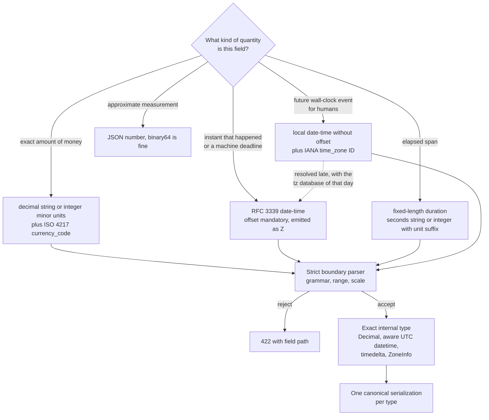

# Representing Money, Decimals, Timestamps (RFC 3339 / ISO 8601), Durations, and IANA Timezones in JSON APIs (AIP-142)

> [!summary] Claim
> A JSON API keeps money and time exact only when the contract takes the number type away from the parser: amounts travel as decimal strings or bounded integer minor units with an ISO 4217 code, instants as RFC 3339 strings normalized to `Z`, spans as fixed-length durations, and future civil events as a wall-clock time plus an IANA zone ID, because JSON numbers are IEEE 754 binary64 in practice `(RFC 8259 Section 6)` and a UTC offset is not a time zone.

Part of [Versioning Evolution and API Guidelines](README.md) in [API Engineering](../README.md).

## TL;DR

JSON has one number production and no decimal, integer, or time type, so every parser picks its own, and the only range all of them agree on is integers in `[-(2**53)+1, (2**53)-1]` `(RFC 8259 Section 6)`.
The contract rule is: money is `{"currency_code": "USD", "amount": "19.99"}` or an integer count of minor units, an instant is an RFC 3339 `date-time` with a mandatory offset that the server re-emits as `Z` `(RFC 3339 Section 5.6)`, a span is a fixed-length duration such as `"3.5s"`, and a future civil event is a local time plus a `time_zone` field holding an IANA ID `(AIP-143)`.
The trap is that permissive libraries hide the ambiguity instead of rejecting it: `pydantic 2.14.3` turns the JSON number `1.000000000000000000001` into `Decimal("1")`, reads the integer `20000000001` as milliseconds but `20000000000` as seconds, and parses `"P1M"` as exactly 30 days (all three asserted by the lab).
The portability fact is that the lab's strict parsers passed unchanged on CPython 3.12.13, 3.13.18, 3.14.6, 3.14.10, and 3.15.2 on macOS and on 3.12.16, 3.13.18, 3.14.10, and 3.15.2 in Debian Trixie and Alpine containers for the 89-case revision of the suite (the 128-case revision has so far run only on 3.14.6, see Portability), while the standard library underneath them does not: `datetime.fromisoformat("2026-11-11T24:00:00+00:00")` raises on 3.12 and 3.13 and returns the next day on 3.14 and 3.15.
Do not use string-encoded decimals for measurements that are approximate by nature (latitude, a sensor reading, a probability), and do not use an IANA zone for a past event that already happened at a known instant; a binary64 number and a plain `Z` timestamp are the right tools there.

## Mental model



The first decision is semantic, not syntactic: the same digits mean different things depending on whether the field is an exact amount, an instant, a span, a civil time, or a measurement.
Each exact kind gets a wire form that no JSON parser can reinterpret, which in practice means a string with a published grammar or an integer inside the binary64-safe range.
All four forms pass through one strict boundary parser that enforces grammar, range, and scale and answers `422 Unprocessable Content` with the field path on violation.
What survives is converted to an exact in-memory type, and each type has exactly one serialization, so a value that round-trips through the API comes back byte-identical.
The dotted arrow is the one conversion that must not happen at write time: a future civil event becomes an instant only when it is about to occur, using the time zone rules in force then, because governments change those rules after the event was stored.

## How it works

### JSON numbers are binary64 unless the contract says otherwise

The JSON grammar gives a number an optional minus, an integer part, an optional fraction, and an optional exponent, and says nothing about precision `(RFC 8259 Section 6)`:

```text
number = [ minus ] int [ frac ] [ exp ]
exp    = e [ minus / plus ] 1*DIGIT
frac   = decimal-point 1*DIGIT
int    = zero / ( digit1-9 *DIGIT )
```

The same section lets implementations set limits on range and precision, observes that IEEE 754 binary64 is what is widely available, and names the only safe harbor: integers in `[-(2**53)+1, (2**53)-1]` are interoperable because every implementation agrees on their exact value `(RFC 8259 Section 6)`.
It also excludes `Infinity` and `NaN` from the grammar entirely `(RFC 8259 Section 6)`.
I-JSON turns that observation into a rule: a sender cannot expect a receiver to treat an integer whose absolute value exceeds `9007199254740991` as exact, and values that need more magnitude or precision are recommended to travel as JSON strings `(RFC 7493 Section 2.2)`.

The lab measures what binary64 does to money (CPython 3.14.6, macOS 27.2 arm64):

| Expression | Result | Why it matters |
|---|---|---|
| `19.99 * 100` | `1998.9999999999998` | `int()` truncates it to `1998`, one cent short |
| `json.dumps(0.1 + 0.2)` | `0.30000000000000004` | a sum computed in floats leaks 17 digits onto the wire |
| `json.loads("9007199254740993", parse_int=float)` | `9007199254740992.0` | `2**53 + 1` does not exist in binary64 |
| `float("90071992547409.93")` | `90071992547409.94` | a 16-digit amount gains a cent on parse |

A binary64 value has 53 bits of significand, so decimal fractions such as `0.01` have no exact representation and integers above `2**53` lose their low bits.
None of these rows is a bug in a library; they are the defined behavior of the number type most JSON parsers choose.

### Three money shapes and what each one costs

Published guidelines disagree on the wire shape (as of 2026-11).

| Shape | Example | Exactness mechanism | Residual risk | Source |
|---|---|---|---|---|
| Integer minor units | `{"amount": 1999, "currency": "usd"}` | integer inside the binary64-safe range | client must know the currency's exponent; providers override ISO 4217 | Stripe currencies documentation |
| JSON number, `format: decimal` | `{"amount": 99.95, "currency": "EUR"}` | relies on every party parsing numbers as decimals | any binary64 parser silently rounds | Zalando rule 173 |
| Whole units plus nanos | `units = -1`, `nanos = -750000000`, `currency_code = "USD"` | two integers, 9 fractional digits | sign rule between the two fields; `int64` is a JSON string | `google/type/money.proto` |
| Decimal string | `{"currency_code": "USD", "amount": "19.99"}` | string with a published grammar | consumers must not `parseFloat` it | `google/type/decimal.proto`, `(RFC 7493 Section 2.2)` |

Stripe expects amounts in the currency's minor unit, so `1000` charges 10 USD and `10` charges 10 JPY (Stripe currencies documentation, as of 2026-11).
Zalando's common money object uses a JSON number with `format: decimal`, warns implementers not to convert it to float or double, and notes that some JSON parsers convert numbers to floats by default (Zalando rule 173, as of 2026-11).
The OpenAPI format registry lists `decimal` for both `string` and `number` and remarks that the format is used in a variety of conflicting ways and is not interoperable (OpenAPI format registry, `decimal`, as of 2026-11).
`google.type.Money` carries `currency_code`, `int64 units`, and `int32 nanos` bounded to `-999,999,999` through `+999,999,999`, and requires `nanos` to have the same sign as `units` unless `units` is zero, so `-1.75` is `units = -1`, `nanos = -750,000,000` `(googleapis google/type/money.proto, Money)`.
The protobuf JSON mapping serializes `int64` as a decimal string while accepting either numbers or strings on input, which is the same 53-bit defense applied to integers (ProtoJSON mapping table, `int64` row).
`google.type.Decimal` is the string form: an optional sign, digits, an optional fraction, and an optional exponent, with the instruction that `,` should not be supported regardless of locale and that thousand separators should not be supported `(googleapis google/type/decimal.proto, Decimal)`.
AIP-143 fixes the code field: currency fields must use ISO 4217 codes and must be named `currency_code`, and its note sends an amount of money, as opposed to the bare code, to `google.type.Money` `(AIP-143)`.

The currency code is not decoration, because it determines the scale.
ISO 4217 List One as published by SIX on 2026-09-17 assigns an exponent to each code: counting distinct codes in that file gives 139 with exponent 2, 17 with exponent 0 (`JPY`, `KRW`, `ISK`, and others), 7 with exponent 3 (`BHD`, `IQD`, `JOD`, `KWD`, `LYD`, `OMR`, `TND`), 2 with exponent 4 (`CLF`, `UYW`), and 13 marked `N.A.` (as of 2026-11).
An integer amount is therefore meaningless without the table, and tables differ: Stripe represents `ISK` as a two-decimal value for backward compatibility although ISO 4217 gives it exponent 0, and lists `MGA` among its zero-decimal currencies although ISO 4217 gives it exponent 2 (Stripe currencies documentation and SIX List One, as of 2026-11).

The lab's `Money` model takes the decimal-string shape and makes the scale a validated property of the pair.
The amount grammar is `^-?(0|[1-9][0-9]{0,17})(\.[0-9]{1,4})?$`, the number of fractional digits may not exceed the exponent of `currency_code`, the value in minor units may not exceed `2**53 - 1`, and serialization always prints exactly the exponent's digits.
The canonical bytes of 19.99 USD, captured from `Money.from_minor_units(1999, "USD").model_dump_json()`, are 40 octets:

```text
Offset  Hexadecimal octets                               ASCII
------  -----------------------------------------------  ----------------
0x0000  7b 22 63 75 72 72 65 6e 63 79 5f 63 6f 64 65 22  {"currency_code"
0x0010  3a 22 55 53 44 22 2c 22 61 6d 6f 75 6e 74 22 3a  :"USD","amount":
0x0020  22 31 39 2e 39 39 22 7d                          "19.99"}
```

The quote octets `0x22` at offsets `0x20` and `0x26` are the entire mechanism: they move the value out of the `number` production and into `string`, where no parser may reinterpret it.

### What pydantic does with a decimal field

Declaring `amount: Decimal` is not sufficient, because `pydantic-core` accepts JSON numbers for it and routes them through binary64.
The JSON input path matches `JsonValue::Float(f)` and builds the `Decimal` from `f.to_string()`, and it returns that as `ValidationMatch::strict`, so `strict=True` does not reject it `(pydantic-core 2.50.4 src/input/input_json.rs, validate_decimal)`.
The lab asserts the consequence: `TypeAdapter(Decimal).validate_json("1.000000000000000000001")` returns `Decimal("1")`, the same call with `strict=True` still accepts `0.1`, and only the quoted form `"1.000000000000000000001"` survives intact.
The string path hands the text to Python's `Decimal` constructor `(pydantic-core 2.50.4 src/validators/decimal.rs, create_decimal)`, and that constructor strips leading and trailing whitespace and underscores and accepts decimal digits from other alphabets, for example Arabic-Indic and fullwidth digits (Python 3.14 `decimal` documentation, `Decimal` constructor).
The lab asserts that `pydantic` therefore accepts `"\u0661\u0662.\u0663\u0664"` as `Decimal("12.34")`, `"1_000"` as `Decimal("1000")`, `" 1.5 "` as `Decimal("1.5")`, and `"1E+1000000000"` as a value whose exponent is one billion.
Under FastAPI the number is already a Python `float` before validation starts, because the request handler calls `request.json()` `(fastapi 0.162.0 fastapi/routing.py, get_request_handler)` and Starlette implements it with `json.loads(body)` `(starlette 1.10.0 starlette/requests.py, Request.json)`.
The generated schema repeats the ambiguity: `TypeAdapter(Decimal).json_schema()` is `{"anyOf": [{"type": "number"}, {"type": "string"}]}` (asserted by the lab).
The lab closes all of these with one `BeforeValidator` that refuses any non-string and matches an ASCII-only grammar with `fullmatch`, plus a `WithJsonSchema` override so the published schema says `string` in both validation and serialization modes.

### Rounding, allocation, and arithmetic on exact amounts

An exact amount stays exact only until a computation produces more digits than the currency has, and then the contract must name the rounding rule, because the defaults disagree.
Built-in `round()` rounds a tie to the even choice but works on the stored binary value, so `round(2.675, 2)` is `2.67` and not `2.68` (Python 3.14 built-in functions documentation, `round`).
The `decimal` default context uses `ROUND_HALF_EVEN` (Python 3.14 `decimal` documentation, quick-start tutorial), so `round(Decimal("2.675"), 2)` is `Decimal("2.68")` and `round(Decimal("0.125"), 2)` is `Decimal("0.12")`; the lab asserts all of these, and also `round(0.5)`, `round(1.5)`, and `round(2.5)` as `0`, `2`, and `2`.
`quantize_to_currency(amount, currency_code, *, rounding=...)` takes the mode as a required keyword, rounds to the exponent of the currency, and refuses non-finite values and results beyond the `2**53 - 1` minor-unit bound.
With it the lab asserts that `0.125 USD` is `0.12` under `ROUND_HALF_EVEN` and `0.13` under `ROUND_HALF_UP`, that `-0.125` under `ROUND_HALF_UP` is `-0.13`, that `100.5 JPY` under `ROUND_HALF_EVEN` is `100`, that `1.0005 KWD` under `ROUND_HALF_UP` is `1.001`, and that a tax of `19.99 USD` at `0.0825` is exactly `1.649175` and rounds to `165` minor units.
Which mode is correct is a legal or contractual decision that a tax authority or a payment scheme sometimes prescribes; the API's job is to make the choice explicit in the code and never inherit it from a default.

Rounding every share independently also breaks conservation: `Decimal("100.00") / 3` rounds to `33.33`, and three of them total `99.99`, one cent short (asserted by the lab).
`allocate_minor_units(total, weights)` works on integers: it floors each proportional share, then hands the leftover units one each to the largest remainders, earliest index first on a tie, so the parts always sum to the total, for example `[3334, 3333, 3333]` for `10000` split by `[1, 1, 1]` and `[0, 7]` for `7` split by `[0, 1]`.
It refuses a `bool` or negative total and empty, all-zero, negative, or `bool` weights.
The largest-remainder rule is the lab's design choice, not a standard; a ledger that must reproduce another system's split has to document that system's tie rule.
`Money.__add__` refuses two currencies (`cannot add EUR to USD`) and re-runs the `2**53 - 1` bound, so `Money.from_minor_units(MAX_SAFE_INTEGER, "USD") + 0.01 USD` fails validation instead of producing an amount that the next client cannot read.

### Instants: RFC 3339, not ISO 8601

RFC 3339 is a deliberately small profile of ISO 8601, and the whole grammar fits on a screen `(RFC 3339 Section 5.6)`:

```text
date-fullyear   = 4DIGIT
date-month      = 2DIGIT  ; 01-12
date-mday       = 2DIGIT  ; 01-28, 01-29, 01-30, 01-31 based on
                          ; month/year
time-hour       = 2DIGIT  ; 00-23
time-minute     = 2DIGIT  ; 00-59
time-second     = 2DIGIT  ; 00-58, 00-59, 00-60 based on leap second
                          ; rules
time-secfrac    = "." 1*DIGIT
time-numoffset  = ("+" / "-") time-hour ":" time-minute
time-offset     = "Z" / time-numoffset
partial-time    = time-hour ":" time-minute ":" time-second
                  [time-secfrac]
full-date       = date-fullyear "-" date-month "-" date-mday
full-time       = partial-time time-offset
date-time       = full-date "T" full-time
```

Four properties of this grammar are contract decisions that ISO 8601 leaves open.
The offset is mandatory, because the RFC deems the interoperability problems of unqualified local time unacceptable for the Internet `(RFC 3339 Section 4.4)`.
The hour stops at `23` even though ISO 8601 permits `24` `(RFC 3339 Section 5.7)`.
The second may be `60` at the end of a month in which a leap second occurs, and `1990-12-31T23:59:60Z` is one of the RFC's own examples `(RFC 3339 Section 5.7)` `(RFC 3339 Section 5.8)`.
The letters `T` and `Z` may be lowercase, an option that a specification using the format may remove, and an application may choose to separate the date and the time with a space instead of `T` `(RFC 3339 Section 5.6)`.
I-JSON narrows the first option with a recommendation, not a prohibition: timestamps are recommended to be RFC 3339 strings with uppercase letters, the time zone included rather than defaulted, and seconds present even when they are `00` `(RFC 7493 Section 4.3)`.

RFC 9557 changes the meaning of one token.
Since April 2024 the offset `Z` means that the time in UTC is known but the offset to local time is unknown, which is what `-00:00` used to mean, and `+00:00` keeps the meaning that UTC is the preferred reference point `(RFC 9557 Section 2.2)`.
For an API that normalizes every instant to `Z`, this is exactly the right statement: the server is asserting the instant and declining to assert anybody's wall clock.

The protobuf mapping that AIP-142 points to makes the same choice.
AIP-142 says fields for an absolute point in time should use `google.protobuf.Timestamp` and should be named with a `_time` suffix in the imperative form, such as `create_time` and `publish_time`, not `created_time` `(AIP-142)`.
A ProtoJSON serializer always emits `Z` with 0, 3, 6, or 9 fractional digits, and a parser accepts other offsets (ProtoJSON mapping table, `Timestamp` row).
The type's range is `0001-01-01T00:00:00Z` through `9999-12-31T23:59:59.999999999Z`, and it declares all minutes 60 seconds long with leap seconds smeared `(protobuf src/google/protobuf/timestamp.proto, Timestamp)`.

`pydantic` is again more permissive than the contract.
In lax mode a JSON integer or float is accepted as a Unix timestamp `(pydantic-core 2.50.4 src/input/input_json.rs, validate_datetime)`, and `speedate` decides the unit by magnitude: an absolute value above `20_000_000_000` is milliseconds, at or below it is seconds `(speedate 0.18.0 src/date.rs, MS_WATERSHED)`, a comparison applied in `(speedate 0.18.0 src/util.rs, timestamp_watershed)`.
The lab asserts both sides of that watershed: `20000000000` becomes `2603-10-11T11:33:20Z` and `20000000001` becomes `1970-08-20T11:33:20.001Z`.
The same adapter accepts an offset-free string as a naive `datetime`, serializes a naive `datetime` back without any offset, and truncates `.123456789` to `.123456` (asserted by the lab).
The lab's `parse_rfc3339_utc` refuses numbers, requires the grammar above with uppercase `T`, refuses hour `24`, refuses more than six fractional digits instead of truncating, converts to UTC, and maps a result outside years 0001 to 9999 to a validation error instead of an `OverflowError`.
It refuses second `60` with an explicit message, because `datetime` cannot represent it; that is a documented limit of the lab, not of RFC 3339.

Instant strings sort as time only under conditions that the serializer can silently violate.
RFC 3339 says date-time strings may be sorted as strings when they share one time zone, are written with the same string for it, and carry the same number of fractional digits `(RFC 3339 Section 5.1)`.
The canonical output of the lab prints the shortest of 0, 3, or 6 digits, so `2026-11-11T10:00:00Z` and `2026-11-11T10:00:00.500Z` sort in the wrong order, because `.` (`0x2E`) sorts before `Z` (`0x5A`); two instants written with different offsets, `2026-11-11T09:59:00Z` and `2026-11-11T05:00:00-05:00`, sort in the wrong order too (all asserted by the lab).
`format_rfc3339_utc(value, fraction_digits=6)` prints a fixed width that sorts correctly and raises when the instant needs more digits than requested instead of truncating.
Any API that offers string-ordered sorting, range filters, or cursors over timestamps should therefore fix both the offset (`Z`) and the width, and say so in the contract.

Timestamps inside HTTP fields are a different contract and must not be unified with the body format.
`HTTP-date` uses the fixed-length `IMF-fixdate` form such as `Sun, 06 Nov 1994 08:49:37 GMT` `(RFC 9110 Section 5.6.7)`, and Structured Field Dates are integers with a leading `@`, such as `@1659578233` `(RFC 9651 Section 3.3.7)`; see [[Deprecation-Header-RFC-9745-and-Sunset-Header-RFC-8594]] for the two formats side by side.

### Durations: fixed spans only

There are three published conventions for a span, and they are not interchangeable.

| Convention | Example | Fractions | Calendar units | Source |
|---|---|---|---|---|
| Seconds string | `"3.5s"`, `"3.000000001s"` | up to 9 digits | none | `google/protobuf/duration.proto`, ProtoJSON mapping |
| ISO 8601 duration | `"PT1H30M"`, `"P1M"` | none in the RFC 3339 ABNF | `Y`, `M`, `W`, `D` | `(RFC 3339 Appendix A)` |
| Integer with unit in the name | `"ttlSeconds": 90` | no | none | Azure guideline `json-durations-use-fixed-time-intervals`, AIP-142 compatibility rule |

AIP-142 says spans should use `google.protobuf.Duration`, whose JSON form is a string of seconds ending in `s`, and that integer fallbacks are named with the meaning and the unit as a final suffix, such as `send_time_millis` `(AIP-142)` `(protobuf src/google/protobuf/duration.proto, Duration)`.
The seconds field is bounded to `-315,576,000,000` through `+315,576,000,000`, computed as 10,000 years of 365.25 days `(protobuf src/google/protobuf/duration.proto, Duration)`.
JSON Schema's `duration` format and I-JSON both point at the `duration` rule in RFC 3339 Appendix A `(JSON Schema Validation 2020-12 Section 7.3.1)` `(RFC 7493 Section 4.3)`.
That ABNF describes itself as informational only, has no fraction production (`dur-second = 1*DIGIT "S"`), and includes `dur-month` and `dur-year` `(RFC 3339 Appendix A)`.
So the string `PT3.5S` that `pydantic 2.14.3` emits for `timedelta(seconds=3.5)` is outside the grammar that `format: duration` names, and `P1M` is inside it (the emission is asserted by the lab; the grammar comparison is a reading of the ABNF).

A month is not a span of time.
`speedate` scales calendar units to fixed day counts, `Y` to 365 days and `M` to 30 days `(speedate 0.18.0 src/duration.rs, Duration::parse_iso_duration)`, and the lab asserts that `pydantic` therefore reads `"P1M"` as `timedelta(days=30)` and `"P1Y"` as `timedelta(days=365)`, so `2024-02-01` plus `P1M` lands on `2024-03-02`.
Azure's guidelines draw the same line from the other side: use a fixed interval with the unit in the property name, and allow `P3M`-style values only when the interval must vary from month to month (Azure REST API Guidelines, `json-rfc3339-time-intervals-allowed`, as of 2026-11).
The lab accepts only the seconds string with at most six fractional digits, parses the fraction as digits and never through a float, and prints 0, 3, or 6 digits.

### Civil dates, month arithmetic, and intervals

A date with no time is a different type from an instant: AIP-142 sends civil dates to `google.type.Date` `(AIP-142)`, and the RFC 3339 production for it is `full-date`, `YYYY-MM-DD` `(RFC 3339 Section 5.6)`.
`pydantic 2.14.3` in lax mode accepts far more for a `date` field, and the lab asserts it: the date-times `"2026-11-11T00:00:00"` and `"2026-11-11T00:00:00+05:30"` both become `2026-11-11` with the offset dropped (the second is `2026-11-10` in UTC), and the number `1762819200` and the string `"1762819200"` both become `2025-11-11`.
The lab's `parse_full_date` accepts exactly one ASCII `YYYY-MM-DD` and refuses a date-time even at midnight, an epoch number or string, the basic form `20261111`, a week date, an ordinal date, `11/12/2026`, `12.11.2026`, a trailing newline, Arabic-Indic digits, a `datetime` instance, and impossible days, months, and years.
The two slash and dot forms are the locale problem again: `11/12/2026` and `12.11.2026` are different days in different countries, which is the interoperability failure that RFC 3339 gives as its reason for a fixed format `(RFC 3339 Section 5.2)`.

Calendar arithmetic belongs on civil dates, not on durations.
`add_months(anchor, months)` clamps the day to the end of a shorter month, so `2024-01-31` plus one month is `2024-02-29` and, in 2023, `2023-02-28`; adding one month twice gives `2024-03-29` while adding two months to the anchor gives `2024-03-31`, so a recurring monthly boundary must always be computed from the original anchor and never from the previous result.
`2024-02-01` plus one month is 29 days later, while `pydantic` reads `"P1M"` as 30 days (asserted by the lab), which is why a month never belongs in a duration field.
Clamping is the lab's policy; other systems roll into the next month or reject the date, so the contract has to state which one it uses.

A range of time needs two instants and a rule for the ends.
`google.type.Interval` is a start timestamp that is inclusive and an end timestamp that is exclusive, requires the start to be less than or equal to the end, and calls an interval whose ends are equal empty `(googleapis google/type/interval.proto, Interval)`.
The lab's `Interval` follows that half-open rule: `contains` is true at the start and false at the end, so two adjacent intervals share no instant and `12:00:00Z` belongs to exactly one of the morning and the afternoon, an interval whose start equals its end contains nothing, and a start after the end, an extra field, and a field assignment are all refused.
The proto also lets both ends be unspecified, meaning any time; the lab requires both ends, which is a documented lab limit.
`contains` raises `TypeError` for a naive `datetime`, so the comparison cannot silently assume a zone.

### Civil time and IANA zones: an offset is not a zone

An instant answers "when did this happen"; a civil time answers "what will the clock on the wall say".
AIP-142 separates the two: civil dates and wall-clock times use `google.type.Date` and `google.type.TimeOfDay`, and a civil timestamp that needs zone awareness uses `google.type.DateTime` `(AIP-142)`.
`google.type.DateTime` carries either a `utc_offset` or a `TimeZone` and tells the author to choose carefully because time zone data may change in the future; `TimeZone` has an `id` such as `America/New_York` and an optional database `version` such as `2019a` `(googleapis google/type/datetime.proto, DateTime)`.
AIP-143 names the fields: a zone should use IANA TZ codes in a field that must be called `time_zone`, and a field holding an offset must be called `utc_offset`, with the remark that the two are subtly different `(AIP-143)`.
Zalando's `date-time-local` is the same shape: an offset-free local time that must be supplemented by a zone field to define an exact point in time (Zalando rule 255, as of 2026-11).

An offset such as `-05:00` describes one instant; a zone such as `America/New_York` is a function from instants to offsets, and that function has discontinuities and is edited several times a year.
The lab shows both discontinuities with the 2024 United States transitions:

| Local time in `America/New_York` | What exists | Standard library result | Lab result |
|---|---|---|---|
| `2024-03-09T09:00:00` | once | `2024-03-09T14:00:00Z` | same |
| `2024-03-11T09:00:00` | once | `2024-03-11T13:00:00Z` | same |
| `2024-03-10T02:30:00` | never (spring gap) | silently `2024-03-10T07:30:00Z`, which is 03:30 local | `ValueError`, does not exist |
| `2024-11-03T01:30:00` | twice (autumn fold) | `05:30Z` for `fold=0`, `06:30Z` for `fold=1` | `ValueError` unless `fold` is given |

The first two rows are why a recurring 09:00 meeting cannot be stored as an instant plus a fixed offset: the same wall time is 47 hours apart in UTC, not 48.
The `fold` attribute that disambiguates the last row was added to `datetime` by PEP 495, and `zoneinfo` (PEP 615) reads the system time zone data if available and otherwise falls back to the first-party `tzdata` package (Python 3.14 `zoneinfo` documentation).

RFC 9557 defines a single-string form for a zoned timestamp, `1996-12-19T16:39:57-08:00[America/Los_Angeles]`, and specifies what happens when the offset and the zone disagree: with the critical flag `!` an application must act on the inconsistency, without it the application may `(RFC 9557 Section 4.2)` `(RFC 9557 Section 3.4)`.
The RFC's own motivating case is a far-future meeting stored in a zone whose rules are later changed to abolish daylight saving time `(RFC 9557 Section 3.4)`.
`pydantic 2.14.3` rejects the bracket suffix (probe on CPython 3.14.6), so the lab keeps the two-field shape, which every JSON consumer can already parse.

Not every key in the database is a city, and not every offset fits RFC 3339 (asserted by the lab on this host's zone data, CPython 3.14.6):
`Etc/GMT+5` is accepted and has the offset `-05:00`, the opposite sign to its name; `America/New_York` in 1880 has the offset `-04:56:02`, which `isoformat()` prints as `1880-01-01T12:00:00-04:56:02`, a form the lab's RFC 3339 parser refuses because `time-numoffset` has only hours and minutes `(RFC 3339 Section 5.6)`, although `format_rfc3339_utc` converts it to `1880-01-01T16:56:02Z`.
`Europe/Kiev` and `Europe/Kyiv` resolve to the same instant, and `EDT`, `PST`, `UTC+5`, `-05:00`, `GMT+5`, and `Etc/Unknown` are not zone IDs and are refused with `unknown IANA time zone`.

### Locale stays out of machine fields

Every form above is locale-neutral by construction: `.` is the only decimal separator, digits are ASCII, and month names never appear.
Presentation is negotiated separately through `Accept-Language` `(RFC 9110 Section 12.5.4)`, and when the API must name a language, region, or currency it uses codes: `language_code` with BCP 47 tags, `region_code` with Unicode CLDR region codes, and `currency_code` with ISO 4217 `(AIP-143)`.
The lab's amount grammar rejects both `"1,234.56"` and `"1.234,56"`, so a client that formatted a number with its user's locale gets a `422` instead of an amount that is wrong by a factor of a thousand.

Four HTTP and language-tag rules decide where locale may enter an API (the first three are read from the RFC text, none is asserted by the lab):

- `Accept-Language` is a request preference list of language ranges with optional weights, such as `da, en-gb;q=0.8, en;q=0.7`, and some recipients treat list order as priority, a behavior the RFC says "cannot be relied upon" `(RFC 9110 Section 12.5.4)`.
  It may select prose such as error messages and labels; it must not select the representation of an amount or an instant, because a body whose numbers change with the reader's locale cannot be signed, fingerprinted, or compared byte for byte.
- A response whose prose was chosen from `Accept-Language` should carry `Vary: Accept-Language`, which expands the cache key so a shared cache does not hand a Danish message to an English reader `(RFC 9110 Section 12.5.5)`, and should say which language it chose with `Content-Language` `(RFC 9110 Section 8.5)`.
  A `Content-Language` value names the intended audience, which may differ from every language that appears in the body `(RFC 9110 Section 8.5)`.
- A language tag is a sequence of case-insensitive, hyphen-separated subtags, with no whitespace, in the order `language`, optional `script`, optional `region`, then variants and extensions `(RFC 9110 Section 8.5.1)` `(RFC 5646 Section 2.1)`.
  The examples in the HTTP text are `fr`, `en-US`, `es-419`, and `az-Arab`; a processor can recognize each subtag's type from its length and position without a copy of the IANA Language Subtag Registry `(RFC 5646 Section 2.1)`.
  So a JSON field named `language_code` should be validated by that grammar, compared case-insensitively, and stored in one canonical casing, while a currency or a time zone is validated against a closed list.
- Locale never travels inside the quantity: an amount field has no formatting hint, an instant has no display zone, and a user's preferred zone or currency is a separate profile field with its own code (`time_zone`, `currency_code`), not something inferred from `Accept-Language`, since a language range such as `en` says nothing about where the reader is.

The same separation fixes the `Vary` cost: the exact-quantity fields in a response are identical for every reader, so only the human-readable strings fragment the cache.

## Numbers and limits

| Quantity | Value | Source |
|---|---|---|
| Largest integer all binary64 parsers agree on | `9007199254740991` (`2**53 - 1`) | `(RFC 8259 Section 6)`, `(RFC 7493 Section 2.2)` |
| Largest USD amount whose minor units fit that bound | `"90071992547409.91"` accepted, `"90071992547409.92"` rejected | lab test (`uv run --frozen pytest <test file> -q` from `labs/`), CPython 3.14.6, macOS 27.2 arm64 |
| `19.99 * 100` in binary64 | `1998.9999999999998` | lab test, same command and host |
| ISO 4217 minor unit exponents in use | 0, 2, 3, and 4 (17, 139, 7, and 2 codes; 13 are `N.A.`) | SIX List One published 2026-09-17, counted by script (as of 2026-11) |
| `google.type.Money.nanos` range | `-999,999,999` to `+999,999,999` | `google/type/money.proto` (as of 2026-11) |
| `google.protobuf.Timestamp` range | `0001-01-01T00:00:00Z` to `9999-12-31T23:59:59.999999999Z` | `google/protobuf/timestamp.proto` (as of 2026-11) |
| `google.protobuf.Duration.seconds` range | `-315,576,000,000` to `+315,576,000,000` | `google/protobuf/duration.proto` (as of 2026-11) |
| ProtoJSON fractional digits | 0, 3, 6, or 9 | ProtoJSON mapping table (as of 2026-11) |
| Structured Field Date range parsers must support | `-62,135,596,800` to `253,402,214,400` seconds | `(RFC 9651 Section 3.3.7)` |
| `datetime` and `timedelta` resolution | 1 microsecond; `.123456789` is cut to `.123456` by `pydantic 2.14.3` | lab test, same command and host |
| Seconds versus milliseconds watershed | `20_000_000_000`, compared against the absolute value | `(speedate 0.18.0 src/date.rs, MS_WATERSHED)`; both sides asserted by the lab |
| Calendar unit scaling in `pydantic` durations | `Y` = 365 days, `M` = 30 days, `W` = 7 days | `(speedate 0.18.0 src/duration.rs, Duration::parse_iso_duration)` |
| CPython `int` to and from `str` digit limit | 4300 digits by default, 640 minimum | Python 3.14 `stdtypes` documentation |
| `decimal` default context | `prec=28`, `Emax=999999` | Python 3.14 `decimal` documentation |
| tz database releases in 2026 | six, `2026a` (2026-03-01) through `2026f` (2026-10-27) | `eggert/tz` `NEWS` (as of 2026-11) |
| Lab suite | 128 test cases in 40 functions on the current revision; 71 source mutations all detected on the earlier 89-case revision | this note's lab, `uv run --frozen pytest <test file> -q` from `labs/`, CPython 3.14.6, macOS 27.3 arm64 |
| `decimal` default rounding | `ROUND_HALF_EVEN`; `round(2.675, 2)` on a float is `2.67`, on `Decimal("2.675")` it is `2.68` | Python 3.14 `decimal` and built-in functions documentation; lab test |
| `google.type.Interval` ends | start inclusive, end exclusive, start <= end, equal ends are empty | `google/type/interval.proto` (as of 2026-11) |

## Portability

| Leg | Result | Evidence |
|---|---|---|
| CPython 3.12.13, 3.13.18, 3.14.6, 3.14.10, 3.15.2 with `pydantic 2.14.3`, `pydantic-core 2.50.4`, `fastapi 0.162.0` | lab contract behaved identically on the 89-case revision | `89 passed` on each interpreter with `uv run --frozen --python <v> pytest`, macOS 27.2 arm64; the 128-case revision passed on 3.14.6 only (`128 passed`, macOS 27.3) and has not been run on the other interpreters |
| CPython 3.15.0b3 (uv-managed build) | not run | pytest fails at startup with `ModuleNotFoundError: No module named 'hypothesis._native'` in the frozen environment |
| CPython 3.15.0b3 free-threaded (`3.15t`) | not run | the frozen environment cannot install (`psycopg-binary==3.3.8` has no wheel) and `orjson 3.13.0` fails to build from source; a probe with only `pydantic 2.14.3` and `fastapi 0.162.0` installed imported the lab module with the GIL disabled on 3.15.0b3t and on 3.14.6t and returned `1999` for 19.99 USD; 3.15.2t is not installed on this host |
| `datetime.fromisoformat` with hour `24` | raises `ValueError` on 3.12.13 and 3.13.18; returns `2026-11-12T00:00:00+00:00` on 3.14.6, 3.14.10, and 3.15.2 | `test_stdlib_fromisoformat_hour_24_depends_on_the_cpython_version`, run on each interpreter |
| `datetime.fromisoformat` in general | accepts basic format and week dates since 3.11, and any single character, including a space, in place of `T`; it is an ISO 8601 parser, not an RFC 3339 validator | Python 3.14 `datetime` documentation ("Changed in version 3.11"); probe on CPython 3.10.20, which rejects the basic and week forms and accepts the space; lab rejects all three forms on every interpreter |
| `pydantic 2.14.3` default `Decimal` | accepts JSON numbers through binary64, serializes as a string | lab tests; `(pydantic-core 2.50.4 src/input/input_json.rs, validate_decimal)` |
| `orjson 3.13.0` | `Decimal` raises `TypeError`; UTC `datetime` prints `+00:00` unless `OPT_UTC_Z` | `test_serializers_disagree_on_utc_suffix_and_decimal_support` |
| `msgspec 0.22.0` | `Decimal` encodes as a string and decodes a JSON number without precision loss; UTC `datetime` prints `Z` | same test |
| Standard library `json` | `Decimal` raises `TypeError`; `datetime.isoformat()` prints `+00:00` | same test |
| Time zone data source | macOS, Debian Trixie, and Alpine 3.24 images read `/usr/share/zoneinfo` (598, 486 or 485, and 598 keys); `uv.lock` installs `tzdata 2026.6` only where `sys_platform == 'win32'`; with no source `ZoneInfo` raises `ZoneInfoNotFoundError` and 6 of the 89 tests fail, and installing `tzdata 2026.6` restores `89 passed` | probe of `zoneinfo.TZPATH` and `uv.lock` markers; `python:3.14.10-trixie` run with `PYTHONTZPATH=` set to empty, without and with `tzdata==2026.6`; Python 3.14 `zoneinfo` documentation |
| Zone key case sensitivity | `ZoneInfo("america/new_york")` loads on this macOS host and raises `ZoneInfoNotFoundError` in the Debian Trixie and Alpine containers; the lab rejects it everywhere by exact membership in `available_timezones()` | probe on macOS 27.2 and in six of the container images of the next row (3.13.18, 3.14.10, and 3.15.2 on both distributions), plus mutation `M55` (validating by constructing `ZoneInfo`), which fails 2 tests on macOS |
| Debian Trixie (glibc 2.41) and Alpine 3.24 (musl) containers, CPython 3.12.16, 3.13.18, 3.14.10, 3.15.2, linux aarch64 | lab contract behaved identically on the 89-case revision; 128-case revision not run | `89 passed` in each of `python:<v>-trixie` and `python:<v>-alpine` with the pinned wheels installed by `pip --only-binary=:all:` and `python -m pytest <test file> -q -p no:cacheprovider`; Docker 29.8.2 |
| `uvicorn 0.54.0`, `hypercorn 0.18.0`, `granian 2.8.7` | byte-identical `200` body and the same three `422` field paths as the in-process test | probe, not a lab test: each server started on a loopback port on CPython 3.14.6, macOS 27.2 arm64, and sent the two request bodies of the endpoint tests; servers deliver the request `body` to the application as a byte string (ASGI HTTP specification, `http.request`), so the contract is enforced above the server |
| HTTP/1.1, HTTP/2, HTTP/3 | HTTP/1.1 on all three servers and cleartext HTTP/2 on `hypercorn 0.18.0` return the same bytes; HTTP/3 not run | same probe with `httpx 0.28.1`; HTTP/3 "supports the same semantics" as HTTP/1.1 and HTTP/2 over QUIC `(RFC 9114 Section 1)`, so the JSON content is version-independent, and the date formats HTTP itself defines for fields are `HTTP-date` `(RFC 9110 Section 5.6.7)` and Structured Field Dates `(RFC 9651 Section 3.3.7)` on every version, not RFC 3339 |

## Worked example

The [implementation](../labs/src/api_labs/f07_versioning_evolution_and_api_guidelines/money_time_contracts.py) defines four strict boundary types (`DecimalString`, `UtcInstant`, `SecondsDuration`, `CivilDateTime`), a `Money` model whose scale is checked against a pinned ISO 4217 exponent table, a civil-time resolver that refuses gaps and silent folds, and a small FastAPI application that echoes every quantity in canonical form.
The [test](../labs/tests/f07_versioning_evolution_and_api_guidelines/test_monetary_quantities_timestamps_timezones_and_locale_contracts.py) pairs each permissive library behavior with the lab rule that closes it, so a test fails either if the library changes or if the guard is removed.
The JSON Schema `pattern` published for the decimal string, the seconds duration, and the local date-time is compared in a test with the parser on a corpus of accepted and rejected strings, so the documentation cannot drift from the code; the one known difference is that `999999999999s` matches the duration pattern but lies outside the protobuf `Duration` range, which only the parser enforces.

Full byte-identical source of [implementation](../labs/src/api_labs/f07_versioning_evolution_and_api_guidelines/money_time_contracts.py):

```python
"""Exact money, UTC instants, civil dates, fixed durations, and IANA zones on a JSON wire."""

from __future__ import annotations

import calendar
import json
import re
from datetime import UTC, date, datetime, timedelta
from decimal import Decimal, InvalidOperation
from functools import cache
from typing import TYPE_CHECKING, Annotated, Literal, Self
from zoneinfo import ZoneInfo, available_timezones

from fastapi import FastAPI, HTTPException
from pydantic import (
    BaseModel,
    BeforeValidator,
    ConfigDict,
    PlainSerializer,
    WithJsonSchema,
    field_serializer,
    model_validator,
)

if TYPE_CHECKING:
    from collections.abc import Sequence

# Largest integer every IEEE 754 binary64 parser agrees on (RFC 7493 Section 2.2).
MAX_SAFE_INTEGER = 2**53 - 1
# Bound of google.protobuf.Duration.seconds (duration.proto), about 10,000 years.
MAX_DURATION_SECONDS = 315_576_000_000
# Minor unit exponents copied from ISO 4217 List One as published by SIX on 2026-09-17.
MINOR_UNIT_EXPONENTS: dict[str, int] = {
    "BHD": 3,
    "CHF": 2,
    "CLF": 4,
    "EUR": 2,
    "GBP": 2,
    "INR": 2,
    "ISK": 0,
    "JPY": 0,
    "KRW": 0,
    "KWD": 3,
    "USD": 2,
    "UYW": 4,
}

# Patterns published in the JSON Schema; each mirrors the compiled grammar enforced below.
DECIMAL_STRING_PATTERN = r"^-?(0|[1-9][0-9]{0,17})(\.[0-9]{1,4})?$"
SECONDS_DURATION_PATTERN = r"^-?(0|[1-9][0-9]{0,11})(\.[0-9]{1,6})?s$"
LOCAL_DATE_TIME_PATTERN = r"^[0-9]{4}-[0-9]{2}-[0-9]{2}T([01][0-9]|2[0-3]):[0-5][0-9]:[0-5][0-9]$"
_DECIMAL_STRING = re.compile(r"-?(?:0|[1-9][0-9]{0,17})(?:\.[0-9]{1,4})?")
_RFC3339_DATE_TIME = re.compile(
    r"[0-9]{4}-[0-9]{2}-[0-9]{2}T(?:[01][0-9]|2[0-3]):[0-5][0-9]:(?P<second>[0-5][0-9]|60)"
    r"(?P<fraction>\.[0-9]+)?(?:Z|[+-](?:[01][0-9]|2[0-3]):[0-5][0-9])"
)
_FULL_DATE = re.compile(r"[0-9]{4}-[0-9]{2}-[0-9]{2}")
_LOCAL_DATE_TIME = re.compile(
    r"[0-9]{4}-[0-9]{2}-[0-9]{2}T(?:[01][0-9]|2[0-3]):[0-5][0-9]:[0-5][0-9]"
)
_SECONDS_DURATION = re.compile(
    r"(?P<sign>-?)(?P<whole>0|[1-9][0-9]{0,11})(?:\.(?P<fraction>[0-9]{1,6}))?s"
)


def naive_minor_units(wire: bytes) -> int:
    """Convert a JSON number amount to cents the way binary64 code does: truncate value * 100."""
    return int(json.loads(wire)["amount"] * 100)


def parse_as_binary64(wire: bytes) -> object:
    """Decode JSON as a parser whose only number type is IEEE 754 binary64 would."""
    return json.loads(wire, parse_int=float)


def parse_decimal_string(value: object) -> Decimal:
    """Parse the wire form of an exact decimal: an ASCII digit string, never a JSON number."""
    if isinstance(value, Decimal):
        return value.copy_abs() if value.is_zero() else value
    if not isinstance(value, str):
        raise ValueError('amount must be a JSON string such as "19.99", not a JSON number')
    if _DECIMAL_STRING.fullmatch(value) is None:
        raise ValueError(f"amount does not match {DECIMAL_STRING_PATTERN}")
    amount = Decimal(value)
    return amount.copy_abs() if amount.is_zero() else amount


def _to_utc(value: datetime) -> datetime:
    try:
        return value.astimezone(UTC)
    except OverflowError as exc:
        raise ValueError("instant is outside years 0001 to 9999 in UTC") from exc


def parse_rfc3339_utc(value: object) -> datetime:
    """Parse one RFC 3339 date-time (uppercase T, mandatory offset) into an aware UTC datetime."""
    if isinstance(value, datetime):
        if value.utcoffset() is None:
            raise ValueError("timestamp must carry a UTC offset")
        return _to_utc(value)
    if not isinstance(value, str):
        raise ValueError("timestamp must be an RFC 3339 string, not a number")
    match = _RFC3339_DATE_TIME.fullmatch(value)
    if match is None:
        raise ValueError("timestamp must match RFC 3339 date-time with T and Z or a numeric offset")
    if match["second"] == "60":
        raise ValueError("leap second 60 is valid RFC 3339 but not representable here")
    fraction = match["fraction"]
    if fraction is not None and len(fraction) > 7:
        raise ValueError("timestamp has more than 6 fractional digits; refusing to truncate")
    return _to_utc(datetime.fromisoformat(value))


def format_rfc3339_utc(value: datetime, *, fraction_digits: Literal[0, 3, 6] | None = None) -> str:
    """Serialize an aware datetime as Z-normalized RFC 3339 with 0, 3, or 6 fractional digits.

    The default prints the shortest of the three widths, which is canonical but does not sort
    as a string; pass fraction_digits for a fixed width that does (RFC 3339 Section 5.1).
    """
    if value.utcoffset() is None:
        raise ValueError("cannot serialize a naive datetime as an instant")
    utc = _to_utc(value)
    micro = utc.microsecond
    if fraction_digits is None:
        fraction_digits = 0 if micro == 0 else 3 if micro % 1000 == 0 else 6
    elif micro % 10 ** (6 - fraction_digits):
        raise ValueError(f"instant needs more than {fraction_digits} fractional digits")
    fraction = (
        f".{micro // 10 ** (6 - fraction_digits):0{fraction_digits}d}" if fraction_digits else ""
    )
    day = f"{utc.year:04d}-{utc.month:02d}-{utc.day:02d}"
    return f"{day}T{utc.hour:02d}:{utc.minute:02d}:{utc.second:02d}{fraction}Z"


def parse_seconds_duration(value: object) -> timedelta:
    """Parse the protobuf JSON duration form: decimal seconds with a mandatory "s" suffix."""
    if isinstance(value, timedelta):
        if abs(value) > timedelta(seconds=MAX_DURATION_SECONDS):
            raise ValueError("duration is outside +-315,576,000,000 seconds")
        return value
    if not isinstance(value, str):
        raise ValueError('duration must be a string such as "3.5s", not a number')
    match = _SECONDS_DURATION.fullmatch(value)
    if match is None:
        raise ValueError("duration must be decimal seconds ending in s; calendar units are refused")
    whole = int(match["whole"])
    micros = int((match["fraction"] or "").ljust(6, "0"))
    if whole > MAX_DURATION_SECONDS or (whole == MAX_DURATION_SECONDS and micros):
        raise ValueError("duration is outside +-315,576,000,000 seconds")
    magnitude = timedelta(seconds=whole, microseconds=micros)
    return -magnitude if match["sign"] else magnitude


def format_seconds_duration(value: timedelta) -> str:
    """Serialize a timedelta as exact decimal seconds with 0, 3, or 6 fractional digits."""
    total_micros = (value.days * 86_400 + value.seconds) * 1_000_000 + value.microseconds
    sign = "-" if total_micros < 0 else ""
    whole, micro = divmod(abs(total_micros), 1_000_000)
    if micro == 0:
        fraction = ""
    elif micro % 1000 == 0:
        fraction = f".{micro // 1000:03d}"
    else:
        fraction = f".{micro:06d}"
    return f"{sign}{whole}{fraction}s"


@cache
def _iana_zone_keys() -> frozenset[str]:
    return frozenset(available_timezones())


def validate_zone_id(value: object) -> str:
    """Accept only an exact, case-sensitive key of the installed IANA time zone database."""
    if not isinstance(value, str) or value not in _iana_zone_keys():
        raise ValueError(f"unknown IANA time zone: {value!r}")
    return value


def resolve_civil_time(
    local: datetime, zone_id: str, *, fold: Literal[0, 1] | None = None
) -> datetime:
    """Map a wall-clock time in an IANA zone to a UTC instant, refusing gaps and silent folds."""
    if local.tzinfo is not None:
        raise ValueError("civil time must be naive; the zone travels in its own field")
    zone = ZoneInfo(validate_zone_id(zone_id))
    earlier = local.replace(tzinfo=zone, fold=0)
    later = local.replace(tzinfo=zone, fold=1)
    if _to_utc(earlier).astimezone(zone).replace(tzinfo=None) != local:
        raise ValueError(f"{local.isoformat()} does not exist in {zone_id} (DST gap)")
    if earlier.utcoffset() != later.utcoffset() and fold is None:
        raise ValueError(f"{local.isoformat()} occurs twice in {zone_id}; pass fold=0 or fold=1")
    return _to_utc(later if fold == 1 else earlier)


def parse_local_date_time(value: object) -> datetime:
    """Parse an offset-free civil date-time (the Zalando date-time-local shape)."""
    if isinstance(value, datetime) and value.tzinfo is None and value.microsecond == 0:
        return value
    if not isinstance(value, str) or _LOCAL_DATE_TIME.fullmatch(value) is None:
        raise ValueError("civil time must look like 2024-11-03T01:30:00 with no offset")
    return datetime.fromisoformat(value)


def parse_full_date(value: object) -> date:
    """Parse one RFC 3339 full-date; a date-time, even one at midnight, is not a civil date."""
    if isinstance(value, date) and not isinstance(value, datetime):
        return value
    if not isinstance(value, str) or _FULL_DATE.fullmatch(value) is None:
        raise ValueError("civil date must look like 2026-11-11 with no time and no offset")
    return date.fromisoformat(value)


def add_months(anchor: date, months: int) -> date:
    """Add calendar months to an anchor date, clamping the day to the end of a shorter month."""
    year, month_index = divmod(anchor.year * 12 + anchor.month - 1 + months, 12)
    if not 1 <= year <= 9999:
        raise ValueError("date is outside years 0001 to 9999")
    last_day = calendar.monthrange(year, month_index + 1)[1]
    return date(year, month_index + 1, min(anchor.day, last_day))


def allocate_minor_units(total: int, weights: Sequence[int]) -> list[int]:
    """Split a minor-unit amount by integer weights; the parts always sum to the total."""
    if isinstance(total, bool) or total < 0:
        raise ValueError("total must be a non-negative integer count of minor units")
    weight_sum = sum(weights)
    if weight_sum <= 0 or any(isinstance(weight, bool) or weight < 0 for weight in weights):
        raise ValueError("weights must be non-negative integers with a positive sum")
    shares = [total * weight // weight_sum for weight in weights]
    remainders = [total * weight % weight_sum for weight in weights]
    by_largest_remainder = sorted(range(len(shares)), key=lambda index: (-remainders[index], index))
    for index in by_largest_remainder[: total - sum(shares)]:
        shares[index] += 1
    return shares


DecimalString = Annotated[
    Decimal,
    BeforeValidator(parse_decimal_string),
    WithJsonSchema({"type": "string", "pattern": DECIMAL_STRING_PATTERN}),
]
UtcInstant = Annotated[
    datetime,
    BeforeValidator(parse_rfc3339_utc),
    PlainSerializer(format_rfc3339_utc, return_type=str),
    WithJsonSchema({"type": "string", "format": "date-time"}),
]
SecondsDuration = Annotated[
    timedelta,
    BeforeValidator(parse_seconds_duration),
    PlainSerializer(format_seconds_duration, return_type=str),
    WithJsonSchema({"type": "string", "pattern": SECONDS_DURATION_PATTERN}),
]
CivilDateTime = Annotated[
    datetime,
    BeforeValidator(parse_local_date_time),
    WithJsonSchema({"type": "string", "pattern": LOCAL_DATE_TIME_PATTERN}),
]
CivilDate = Annotated[date, BeforeValidator(parse_full_date)]


class Money(BaseModel):
    """An exact amount in one ISO 4217 currency: decimal string plus alpha-3 code."""

    model_config = ConfigDict(frozen=True, extra="forbid", strict=True)

    currency_code: str
    amount: DecimalString

    @model_validator(mode="after")
    def _check_currency_and_scale(self) -> Self:
        exponent = MINOR_UNIT_EXPONENTS.get(self.currency_code)
        if exponent is None:
            raise ValueError(f"unsupported ISO 4217 currency_code: {self.currency_code!r}")
        scale = self.amount.as_tuple().exponent
        if not isinstance(scale, int) or scale > 0 or -scale > exponent:
            raise ValueError(f"{self.currency_code} allows at most {exponent} fractional digits")
        if abs(self.amount.scaleb(exponent)) > MAX_SAFE_INTEGER:
            raise ValueError("amount exceeds 2**53 - 1 minor units")
        return self

    @field_serializer("amount")
    def _serialize_amount(self, amount: Decimal) -> str:
        return f"{amount:.{MINOR_UNIT_EXPONENTS[self.currency_code]}f}"

    def to_minor_units(self) -> int:
        """Return the amount as an integer count of the currency's minor unit."""
        return int(self.amount.scaleb(MINOR_UNIT_EXPONENTS[self.currency_code]))

    @classmethod
    def from_minor_units(cls, minor_units: int, currency_code: str) -> Self:
        """Build Money from an integer minor-unit amount (the Stripe wire shape)."""
        if isinstance(minor_units, bool) or abs(minor_units) > MAX_SAFE_INTEGER:
            raise ValueError("minor_units is outside the interoperable range +-(2**53 - 1)")
        exponent = MINOR_UNIT_EXPONENTS.get(currency_code, 0)
        return cls(currency_code=currency_code, amount=Decimal(minor_units).scaleb(-exponent))

    def to_units_nanos(self) -> tuple[int, int]:
        """Split into google.type.Money units and nanos, which always share a sign."""
        units = int(self.amount)
        nanos = int((self.amount - units).scaleb(9))
        return units, nanos

    def __add__(self, other: Money) -> Money:
        """Add two amounts of one currency; a second currency needs an explicit conversion."""
        if other.currency_code != self.currency_code:
            raise ValueError(f"cannot add {other.currency_code} to {self.currency_code}")
        return Money(currency_code=self.currency_code, amount=self.amount + other.amount)


def quantize_to_currency(amount: Decimal, currency_code: str, *, rounding: str) -> Money:
    """Round an exact intermediate result to a currency's minor unit with a named rounding mode."""
    exponent = MINOR_UNIT_EXPONENTS.get(currency_code)
    if exponent is None:
        raise ValueError(f"unsupported ISO 4217 currency_code: {currency_code!r}")
    if not amount.is_finite():
        raise ValueError("amount cannot be rounded to a finite minor-unit value")
    try:
        rounded = amount.quantize(Decimal(1).scaleb(-exponent), rounding=rounding)
    except InvalidOperation as exc:
        raise ValueError("amount cannot be rounded to a finite minor-unit value") from exc
    return Money(currency_code=currency_code, amount=rounded)


class LocalEvent(BaseModel):
    """A future civil event: wall-clock time plus the IANA zone whose rules give it meaning."""

    model_config = ConfigDict(frozen=True, extra="forbid")

    local_time: CivilDateTime
    time_zone: Annotated[str, BeforeValidator(validate_zone_id)]

    def instant(self, *, fold: Literal[0, 1] | None = None) -> datetime:
        """Resolve to UTC under the zone rules installed on this host."""
        return resolve_civil_time(self.local_time, self.time_zone, fold=fold)


class Interval(BaseModel):
    """A half-open span of instants, [start_time, end_time), the google.type.Interval shape."""

    model_config = ConfigDict(frozen=True, extra="forbid")

    start_time: UtcInstant
    end_time: UtcInstant

    @model_validator(mode="after")
    def _check_order(self) -> Self:
        if self.start_time > self.end_time:
            raise ValueError("start_time must not be after end_time")
        return self

    def contains(self, instant: datetime) -> bool:
        """Report whether an aware instant is at or after the start and before the end."""
        return self.start_time <= instant < self.end_time


class PaymentRequest(BaseModel):
    """Request body of POST /payments."""

    model_config = ConfigDict(extra="forbid")

    amount: Money
    capture_time: UtcInstant
    hold_duration: SecondsDuration


class PaymentResponse(BaseModel):
    """Response body of POST /payments, echoing every quantity in canonical wire form."""

    amount: Money
    amount_minor_units: int
    capture_time: UtcInstant
    expire_time: UtcInstant
    hold_duration: SecondsDuration


def build_payments_app() -> FastAPI:
    """Build an in-process FastAPI app that enforces the money and time wire contract."""
    app = FastAPI()

    @app.post("/payments")
    async def create_payment(body: PaymentRequest) -> PaymentResponse:
        try:
            expire_time = body.capture_time + body.hold_duration
        except OverflowError as exc:
            detail = "capture_time + hold_duration is outside years 0001 to 9999"
            raise HTTPException(status_code=422, detail=detail) from exc
        return PaymentResponse(
            amount=body.amount,
            amount_minor_units=body.amount.to_minor_units(),
            capture_time=body.capture_time,
            expire_time=expire_time,
            hold_duration=body.hold_duration,
        )

    return app
```

Simplified excerpt of the [test](../labs/tests/f07_versioning_evolution_and_api_guidelines/test_monetary_quantities_timestamps_timezones_and_locale_contracts.py): five of the 40 test functions, bodies verbatim, imports and the other tests omitted:

```python
@pytest.mark.unit
def test_binary64_truncation_loses_a_cent_and_decimal_string_does_not() -> None:
    assert 19.99 * 100 == 1998.9999999999998
    assert naive_minor_units(b'{"amount": 19.99}') == 1998
    assert json.dumps(0.1 + 0.2) == "0.30000000000000004"
    assert usd("19.99").to_minor_units() == 1999
    assert (usd("0.10").amount + usd("0.20").amount) == Decimal("0.30")


@pytest.mark.unit
def test_json_number_amount_is_rejected_because_pydantic_decimal_routes_it_through_f64() -> None:
    plain = TypeAdapter(Decimal)
    assert plain.validate_json("1.000000000000000000001") == Decimal("1")
    assert plain.validate_json("0.1", strict=True) == Decimal("0.1")
    assert plain.validate_json('"1.000000000000000000001"') == Decimal("1.000000000000000000001")
    with pytest.raises(ValidationError, match="not a JSON number"):
        Money.model_validate_json('{"currency_code": "USD", "amount": 19.99}')
    with pytest.raises(ValidationError, match="not a JSON number"):
        Money.model_validate_json('{"currency_code": "USD", "amount": 1999}')


@pytest.mark.unit
def test_pydantic_lax_datetime_guesses_units_at_2e10_and_truncates_fractions() -> None:
    lax = TypeAdapter(datetime)
    assert lax.validate_json("20000000000") == datetime(2603, 10, 11, 11, 33, 20, tzinfo=UTC)
    assert lax.validate_json("20000000001") == datetime(1970, 8, 20, 11, 33, 20, 1000, tzinfo=UTC)
    assert lax.validate_json('"2026-11-11T10:00:00"').tzinfo is None
    assert lax.validate_json('"2026-11-11T10:00:00.123456789Z"').microsecond == 123456
    assert lax.dump_json(datetime(2026, 11, 11, 10, 0)) == b'"2026-11-11T10:00:00"'
    with pytest.raises(ValueError, match="not a number"):
        parse_rfc3339_utc(20000000001)


@pytest.mark.unit
def test_pydantic_timedelta_scales_calendar_units_to_fixed_days() -> None:
    lax = TypeAdapter(timedelta)
    assert lax.validate_json('"P1M"') == timedelta(days=30)
    assert lax.validate_json('"P1Y"') == timedelta(days=365)
    assert lax.validate_json('"PT1M"') == timedelta(seconds=60)
    assert lax.dump_json(timedelta(seconds=3.5)) == b'"PT3.5S"'
    february = datetime(2024, 2, 1, tzinfo=UTC)
    assert february + lax.validate_json('"P1M"') == datetime(2024, 3, 2, tzinfo=UTC)
    with pytest.raises(ValueError, match="calendar units are refused"):
        parse_seconds_duration("P1M")


@pytest.mark.unit
def test_ambiguous_wall_time_in_the_autumn_fold_needs_an_explicit_choice() -> None:
    event = LocalEvent.model_validate_json(
        '{"local_time": "2024-11-03T01:30:00", "time_zone": "America/New_York"}'
    )
    with pytest.raises(ValueError, match="occurs twice in America/New_York"):
        event.instant()
    assert event.instant(fold=0) == datetime(2024, 11, 3, 5, 30, tzinfo=UTC)
    assert event.instant(fold=1) == datetime(2024, 11, 3, 6, 30, tzinfo=UTC)
    with pytest.raises(ValidationError, match="no offset"):
        LocalEvent.model_validate_json(
            '{"local_time": "2024-11-03T01:30:00-04:00", "time_zone": "America/New_York"}'
        )
    with pytest.raises(ValidationError, match="no offset"):
        LocalEvent(local_time=datetime(2024, 11, 3, 1, 30, tzinfo=UTC), time_zone=NEW_YORK)
    with pytest.raises(ValueError, match="outside years 0001 to 9999"):
        resolve_civil_time(datetime(1, 1, 1), "Asia/Kolkata")
```

Gate output, captured from `labs/` on CPython 3.14.6, macOS 27.3 (build 26C5035r) arm64, `uv 0.11.26`, on 2026-11-12 (the last lines of each command, which is all the pass or fail verdict needs):

```text
$ uv run --frozen ruff format --check src tests
234 files already formatted
[exit 0]
$ uv run --frozen ruff check src tests
All checks passed!
[exit 0]
$ uv run --frozen mypy src tests
Success: no issues found in 234 source files
[exit 0]
$ uv run --frozen pyright src tests
0 errors, 0 warnings, 0 informations
[exit 0]
$ uv run --frozen pytest tests/f07_versioning_evolution_and_api_guidelines/test_monetary_quantities_timestamps_timezones_and_locale_contracts.py -q
........................................................................ [ 56%]
........................................................                 [100%]
128 passed in 0.37s
[exit 0]
```

The next two blocks were captured earlier on the 89-case revision of the suite (before the rounding, allocation, civil date, interval, sorting, and zone-key tests were added) and have not been rerun on the 128-case revision; the same pytest command under the other interpreters, each in its own environment (`UV_PROJECT_ENVIRONMENT=<dir> uv run --frozen --python <v> pytest <test file> -q -p no:cacheprovider`):

```text
CPython 3.12.13: 89 passed in 1.01s
CPython 3.13.18: 89 passed in 0.42s
CPython 3.14.10: 89 passed in 0.41s
CPython 3.15.2: 89 passed in 0.42s
```

The 89-case revision of the same test file in containers (`docker run --rm --pull never -v <labs>:/labs:ro python:<tag>`, then `pip install --only-binary=:all:` of the pinned `fastapi`, `starlette`, `pydantic`, `pydantic-core`, `httpx`, `httpcore`, `anyio`, `pytest`, `pytest-asyncio`, `msgspec`, and `orjson` releases, then `PYTHONPATH=src python -m pytest <test file> -q -p no:cacheprovider`), Docker 29.8.2, linux aarch64:

```text
python:3.12.16-trixie: 89 passed in 0.50s
python:3.13.18-trixie: 89 passed in 1.05s
python:3.14.10-trixie: 89 passed in 0.45s
python:3.15.2-trixie: 89 passed in 0.48s
python:3.12.16-alpine: 89 passed in 0.80s
python:3.13.18-alpine: 89 passed in 0.34s
python:3.14.10-alpine: 89 passed in 1.54s
python:3.15.2-alpine: 89 passed in 0.32s
```

Mutation check, on the 89-case revision: 71 mutations of the implementation, `M01` through `M71`, were applied one at a time by a script, and every one made at least one test fail, after which the original file passed again with `89 passed`.
The code added since (`quantize_to_currency`, `allocate_minor_units`, `Money.__add__`, `Interval`, `parse_full_date`, `add_months`, `fraction_digits`) has not been mutation-checked, because lab checks were paused on 2026-11-11; the first run of the 128-case suite did fail once, on a real hole, since `allocate_minor_units` accepted `True` as a weight, and the implementation now rejects `bool` weights.
Examples are computing minor units through `float`, widening the bound to `2**53`, replacing `fullmatch` with `match` in each of the three grammars, upper-casing `currency_code` before lookup, serializing with `isoformat()`, accepting epoch numbers, clamping second `60` to `59`, delegating `P...` strings to `pydantic`, validating a zone by constructing `ZoneInfo`, and removing the gap or fold check.
Eight of the first 70 survived the 83-case suite this note was drafted with (extra fields allowed on each of the three models, `Money` not frozen, a naive `datetime` instance accepted as an instant, `match` instead of `fullmatch` in the duration grammar, the duration schema override removed, and a civil `datetime` instance with microseconds accepted); six added cases, three new test functions and three new parameters, now detect all of them.

## Pitfalls

> [!warning] Converting a decimal amount to minor units with float arithmetic
> Trigger: a handler or client computes `int(amount * 100)` on a parsed JSON number.
> Symptom: `19.99` becomes `1998` because `19.99 * 100` is `1998.9999999999998` in binary64 (asserted by the lab), and totals drift by a cent on some prices only.
> Fix: never let the amount be a float; parse a decimal string into `Decimal` and scale with `scaleb`, or accept integer minor units, and state the rule in the schema as Zalando's money object does when it warns against float and double (Zalando rule 173).

> [!warning] Integers above `2**53` in JSON
> Trigger: a 64-bit identifier or a large minor-unit amount is emitted as a JSON number.
> Symptom: clients whose number type is binary64 read a neighboring value; X documents that JavaScript integers are limited to 53 bits and shows `10765432100123456789` printing as `10765432100123458000`, and tells API users to always use string IDs (X developer documentation, X IDs, as of 2026-11).
> Fix: bound every integer field to `2**53 - 1` or send it as a string, as ProtoJSON does for `int64` (ProtoJSON mapping table) and as `(RFC 7493 Section 2.2)` recommends.

> [!warning] Assuming one minor-unit table
> Trigger: a service multiplies by `10 ** exponent` using ISO 4217 while its payment provider uses its own table.
> Symptom: amounts are wrong by a factor of 100 for specific currencies; Stripe requires `ISK` amounts as two-decimal values although ISO 4217 lists exponent 0, and treats `MGA` as zero-decimal although ISO 4217 lists exponent 2 (Stripe currencies documentation and SIX List One, as of 2026-11).
> Fix: keep the exponent table as versioned data owned by one team, convert at the provider boundary with that provider's table, and test every enabled currency against both.

> [!warning] Rounding with a default instead of a named mode
> Trigger: a price, tax, or fee is computed with `round()`, `float`, or an unconfigured `Decimal` and stored at the currency's scale.
> Symptom: `round(2.675, 2)` is `2.67` for the float and `2.68` for the `Decimal`, and `0.125` rounds to `0.12` under the `decimal` default `ROUND_HALF_EVEN` but to `0.13` under `ROUND_HALF_UP`, so two services disagree by a cent on exact ties (asserted by the lab; Python 3.14 built-in functions and `decimal` documentation).
> Fix: pass the rounding mode as a required argument at one conversion function, test the ties in both signs, and publish the mode in the API's money contract.

> [!warning] Rounding every share of a split independently
> Trigger: a bill, fee, or refund is divided among parties by rounding each share to the minor unit.
> Symptom: `100.00 USD` split three ways is `33.33` three times and totals `99.99`, so a cent is created or lost per split and ledgers stop reconciling (asserted by the lab).
> Fix: allocate integer minor units so the parts sum to the total, as `allocate_minor_units` does, and document the tie rule.

> [!warning] Numeric timestamps with an inferred unit
> Trigger: a field typed `datetime` receives a Unix timestamp as a JSON number.
> Symptom: `pydantic 2.14.3` reads `20000000000` as seconds (year 2603) and `20000000001` as milliseconds (year 1970) because of the `2e10` watershed `(speedate 0.18.0 src/date.rs, MS_WATERSHED)`; Zalando discourages numeric timestamps for the same precision ambiguity between `1460062925`, `1460062925000`, and `1460062925.000` (Zalando rule 169).
> Fix: accept only RFC 3339 strings at the boundary, or if an integer is unavoidable put the unit in the field name as the AIP-142 compatibility convention does (`send_time_millis`) and set the unit explicitly instead of inferring it.

> [!warning] Calendar durations parsed as fixed spans
> Trigger: a `timedelta` field receives `"P1M"` or `"P1Y"`.
> Symptom: `pydantic 2.14.3` returns 30 and 365 days `(speedate 0.18.0 src/duration.rs, Duration::parse_iso_duration)`, so a monthly period started on `2024-02-01` ends on `2024-03-02` (asserted by the lab).
> Fix: accept only fixed-length durations in duration fields, and model a billing or subscription period as an explicit calendar unit and count that is applied to a civil date in a named zone.

> [!warning] Storing a future civil event as a UTC instant
> Trigger: a meeting, store opening, or scheduled charge at a local wall time is converted to UTC when it is created.
> Symptom: when the zone's rules change, the stored instant no longer matches the wall time people agreed on; tz database release `2023b` (2023-03-23) moved Lebanon's spring transition and release `2023c` (2023-03-28) reverted it, and release `2022b` recorded that Iran would stop observing daylight saving time after 2022 (`eggert/tz` `NEWS`).
> Fix: store the local time, the IANA zone ID, and optionally the database version used for the last resolution `(googleapis google/type/datetime.proto, TimeZone)`, resolve to an instant late, and treat a mismatch between a stored offset and the zone as an inconsistency to act on `(RFC 9557 Section 3.4)`.

> [!warning] Durations computed by subtracting wall-clock timestamps
> Trigger: elapsed time is derived from two readings of a non-monotonic clock and exposed or used as a duration.
> Symptom: the difference can be negative; at midnight UTC on 2017-01-01 the leap second made a value in Cloudflare's RRDNS go negative, Go's `rand.Int63n` panicked on it, and at peak about 0.2% of DNS queries to Cloudflare were affected (Cloudflare postmortem, 2017-01-01).
> Fix: measure spans with a monotonic clock, validate that a duration computed from two timestamps is not negative before using it, and never accept a client-supplied pair of timestamps in place of a duration.

> [!warning] Unbounded temporal input as a denial of service (`CVE-2021-29510`)
> Trigger: `pydantic` before `1.8.2`, `1.7.4`, or `1.6.2` receives `'infinity'`, `'inf'`, or `float('inf')` for a `date` or `datetime` field.
> Symptom: validation runs forever at 100% of one CPU (GitHub advisory `GHSA-5jqp-qgf6-3pvh`; under CVSS 3.1 NVD scores it 7.5 and the GitHub advisory 3.3).
> Fix: upgrade, and independently reject non-string temporal input at the boundary so that numeric edge cases never reach the date parser.

> [!warning] Zone identifiers are renamed
> Trigger: a server emits a zone ID that the client's older tz database does not contain, or matches IDs by string equality across systems.
> Symptom: tz database release `2022b` renamed `Europe/Kiev` to `Europe/Kyiv` (`eggert/tz` `NEWS`), and RFC 9557 notes that generator and recipient may be using different revisions of the database so a recipient may not know a name `(RFC 9557 Section 4.1)`.
> Fix: validate against the installed database, keep old names resolvable, compare zones by resolving them and not by spelling, and ship tz data updates on a schedule.

## Security and robustness

The threat model is a client, an intermediary, or an upstream API that sends a value two components will interpret differently, or a value that is cheap to send and expensive to process.

- Parser differential on amounts: if a gateway, a fraud service, and a ledger each parse a JSON number with a different numeric type, they can disagree on the amount they authorized; a string with one grammar removes the disagreement, and any signature or idempotency fingerprint should be computed over the canonical serialization.
- Unicode and formatting confusables: Python's `Decimal` accepts Arabic-Indic and fullwidth digits, underscores, and surrounding whitespace (Python 3.14 `decimal` documentation), so validating with `Decimal(value)` alone lets `"\u0661\u0662.\u0663\u0664"` through as `12.34`; the lab's grammar uses explicit `[0-9]` classes and `fullmatch`, which also closes the classic trailing-newline bypass of `$`.
- Resource exhaustion through numeric text, OWASP `API4:2023 Unrestricted Resource Consumption`: `pydantic 2.14.3` accepts `"1E+1000000000"` for an unconstrained `Decimal` (asserted by the lab), and a later conversion to fixed-point text scales with the exponent (probe on CPython 3.14.6: formatting `Decimal("1E+1000000")` with `f` yields a 1,000,001-character string); the lab bounds the grammar to 18 integer and 4 fractional digits with no exponent.
- Integer text is bounded by the interpreter: CPython limits `int` and `str` conversion to 4300 digits by default (Python 3.14 `stdtypes` documentation), and the quadratic parsing cost that such a limit bounds is described in `CVE-2020-10735` (NVD), but the limit is a backstop and not a contract, so declare `maximum` and `minimum` in the schema.
- `NaN` and `Infinity` are not JSON `(RFC 8259 Section 6)`, yet Python's `json` module understands `NaN`, `Infinity`, and `-Infinity` on input, which its documentation describes as outside the JSON spec, and its encoder prints `NaN`, `Infinity`, and `-Infinity` for non-finite floats unless `allow_nan=False` makes it raise `ValueError` (Python 3.14 `json` documentation); the lab asserts that `json.dumps(1e400)` is `Infinity`, that `allow_nan=False` raises, and that `pydantic` serializes `nan` as `null`; no exact quantity should be declared as `float`, so these never reach business logic.
- Out-of-range instants must be a client error: `0001-01-01T00:00:00+01:00` and a `capture_time + hold_duration` past year 9999 raise `OverflowError` inside `datetime`, which would surface as a `500` if it escaped (mutations `M35` and `M66` remove the two guards and fail 3 tests and 1 test); the lab maps the first to a `ValueError` and the second to a `422`, and both are covered by tests.
- Zone IDs are untrusted strings that become file lookups: `ZoneInfo` raises `ValueError` for absolute paths and for keys that leave `TZPATH` (probe on CPython 3.14.6), and the lab never constructs a `ZoneInfo` from unvalidated input, because it checks exact membership in a cached copy of `available_timezones()`, a call the documentation warns may open a large number of files (Python 3.14 `zoneinfo` documentation).
- Trust in upstream formats, OWASP `API10:2023 Unsafe Consumption of APIs`: apply the same grammar to amounts and timestamps received from third-party APIs, because a provider's minor-unit convention or timestamp unit can differ from yours.
- Privacy: a zone ID is location information, and RFC 9557 warns that ancillary information attached to a timestamp can lead to excessive disclosure `(RFC 9557 Section 7.1)`; return `Z` instants by default and expose a user's zone only where the use case needs it.
- Authorization of money fields is a separate control: see [[OWASP-API-Security-Top-10-2023-Complete-Threat-Model]] and [[Unrestricted-Resource-Consumption-API4-2023-Payload-Depth-and-Limit-Guards]].

## The principal's view

The decision is not which format is best; it is that there is exactly one per quantity kind across the organization, enforced by shared types and a lint rule, because the cost is paid at every boundary where two conventions meet.
A staff-plus engineer writes four rules into the style guide (see [[Synthesizing-an-Organizational-API-Style-Guide]]): one money shape, RFC 3339 with `Z` on output, fixed-length durations only, and civil time as local time plus `time_zone`.

The money shape is the expensive choice.
Integer minor units are compact, safe in every parser, and match what payment providers expect, but they push the exponent table onto every client and make sub-minor-unit prices (per-request pricing, fuel, FX rates) impossible without a second field.
Decimal strings are self-describing and handle any precision, but they depend on consumers not converting to float, which no schema can enforce on the other side of the wire.
Units plus nanos is the right choice only when the API is protobuf-first and JSON is a transcoding (see [[HTTP-JSON-to-gRPC-Transcoding-and-Google-API-HTTP-Annotations-AIP-127]]).
The organizational trade-off is that whichever shape wins, the other conventions still exist at provider and partner boundaries, so the investment that pays off is a single conversion library with a versioned currency table, not the argument about the shape.

Time zone data is a dependency with a release train of its own, six releases in 2026 so far (`eggert/tz` `NEWS`, as of 2026-11), and it is deployed by operating system images, language runtimes, and client devices on independent schedules.
A principal engineer assigns an owner for tz data freshness, records the database version next to resolved civil events, and decides in advance what the product does when a stored offset and the current rules disagree: recompute, notify, or ask.
The database's governance points the same way: its maintainers state that changes to existing entries "SHALL reflect the consensus on the ground in the region" `(RFC 6557 Section 3)`, so a rule change follows a government decision and arrives with whatever notice that government gave, and RFC 6557 recorded roughly twenty releases a year in 2012 `(RFC 6557 Section 1)` against six in 2026.

Changing the representation of an existing field is a breaking change in every taxonomy (see [[Anatomy-of-Breaking-Changes-in-HTTP-and-JSON-APIs]]), so a float `amount` is migrated by adding a new exact field, dual-writing, measuring readers, and retiring the old one on a published schedule (see [[Additive-Schema-Evolution-and-Tolerant-Reader-Patterns]]).

Choose a different paradigm when exactness must be structural instead of conventional: protobuf gives `int64`, `Timestamp`, and `Duration` real types on the wire, and a strongly typed client generated from the schema removes the "do not `parseFloat` this string" convention that JSON can only document.

## Interview questions

> [!question] L5: Why is a JSON number the wrong type for a monetary amount even though `19.99` looks exact in the payload?
>
> > [!success]- Answer
> > The JSON grammar does not define precision, and most parsers map numbers to IEEE 754 binary64 `(RFC 8259 Section 6)`.
> > Binary64 cannot represent most decimal fractions, so `19.99 * 100` is `1998.9999999999998` and truncation yields `1998`.
> > Integers are exact only inside `[-(2**53)+1, (2**53)-1]`.
> > The fix is a decimal string or an integer count of minor units, each with an ISO 4217 code.
> >
> > Follow-up: Which of the two fixes still fails for a per-token price of 0.0004 USD, and why?

> [!question] L5: What is the difference between a UTC offset and an IANA time zone, and which field does each belong in?
>
> > [!success]- Answer
> > An offset such as `-05:00` is a fixed distance from UTC that is true for one instant.
> > A zone such as `America/New_York` is a set of rules mapping every instant to an offset, including transitions, and those rules are revised.
> > AIP-143 puts the zone in a field named `time_zone` and an offset in a field named `utc_offset`.
> > Use the zone for future civil events and the offset, or simply `Z`, for instants.
> >
> > Follow-up: Which local time in `America/New_York` on 2024-03-10 does not exist, and what should an API do with it?

> [!question] L5: Predict the output: with `pydantic 2.14.3`, what do `TypeAdapter(datetime).validate_json("20000000000")`, `TypeAdapter(datetime).validate_json("20000000001")`, and `TypeAdapter(Decimal).validate_json("1.000000000000000000001")` return?
>
> > [!success]- Answer
> > The first returns `2603-10-11T11:33:20` in UTC, because values at or below `20_000_000_000` are read as seconds.
> > The second returns `1970-08-20T11:33:20.001` in UTC, because values above the watershed are read as milliseconds.
> > The third returns `Decimal("1")`, because a JSON float is converted through binary64 before `Decimal` is constructed.
> > All three are asserted by this note's lab.
> >
> > Follow-up: Which of the three does `strict=True` fix, and which does it not?

> [!question] L6: Compare integer minor units, decimal strings, and `units` plus `nanos` for a public payments API, and pick one.
>
> > [!success]- Answer
> > Integer minor units are exact in every parser and match payment providers, but the client must know each currency's exponent and providers override ISO 4217 for some currencies.
> > Decimal strings are self-describing and support any scale, but consumers can still convert them to float.
> > Units plus nanos is exact to nine places and natural in protobuf, but it needs a sign rule across two fields and `int64` becomes a string in JSON.
> > For a JSON-first public API I would choose decimal strings with a published grammar and scale rule, and offer minor units only where a provider integration demands it.
> >
> > Follow-up: How do you prevent the two shapes from drifting apart if you expose both?

> [!question] L6: Debug this API: a scheduling service stores each weekly 09:00 New York meeting as `start_time` in UTC plus `utc_offset: "-05:00"`, and after 2024-03-10 users see their meetings at 10:00; what is wrong and how do you fix it?
>
> > [!success]- Answer
> > The service converted a civil time to an instant when the meeting was created and then repeated the instant every 168 hours.
> > On 2024-03-09 09:00 local is `14:00Z`, and on 2024-03-11 it is `13:00Z`, so a fixed offset is one hour late after the transition.
> > The contract should store `local_time` without an offset plus `time_zone: "America/New_York"` and resolve each occurrence with the zone rules.
> > Occurrences that fall into a gap or a fold need an explicit policy instead of a silent shift.
> >
> > Follow-up: How do you migrate the existing rows when you do not know which zone each user meant?

> [!question] L6: Why should a duration field reject `"P1M"`, and how do you model a monthly subscription instead?
>
> > [!success]- Answer
> > A month is not a fixed number of seconds, so any parser must invent a length; `pydantic 2.14.3` uses 30 days and a year becomes 365 days.
> > A duration field should carry a fixed span, for example a seconds string or an integer with the unit in the name.
> > A subscription period is calendar arithmetic: a unit, a count, an anchor date, and a zone.
> > The server computes the next boundary on the civil calendar and returns the resulting instants.
> >
> > Follow-up: What should the next period end be for a monthly plan anchored on January 31?

> [!question] L6: RFC 3339 allows `23:59:60`; what should an API do when it receives one?
>
> > [!success]- Answer
> > The grammar permits second `60` at the end of a month with a leap second `(RFC 3339 Section 5.7)`.
> > Most runtimes, including Python's `datetime`, cannot represent it.
> > The honest options are to reject it with a clear error, as this note's lab does, or to adopt a documented smear as `google.protobuf.Timestamp` does.
> > Silently clamping to `59` is the wrong option because it changes the instant without telling the client.
> >
> > Follow-up: Why is a smear acceptable for event timestamps but not for computing a duration between two readings?

> [!question] L6: A refund of `100.00 USD` is split across three order lines of equal weight; what do you return, and why not three equal `33.33` shares?
>
> > [!success]- Answer
> > Three `33.33` shares total `99.99`, so a cent disappears, and rounding is a policy that must be named, because `ROUND_HALF_EVEN` and `ROUND_HALF_UP` differ on ties.
> > Work in integer minor units, give each line its floored proportional share, and distribute the leftover units to the largest remainders with a documented tie rule, which yields `[3334, 3333, 3333]`.
> > The parts then sum to the total by construction, and a test can assert that for random totals and weights.
> >
> > Follow-up: Which line should get the extra cent when the lines are in different tax jurisdictions?

> [!question] L7+: You inherit a public API whose `amount` field is a JSON float used by thousands of clients; how do you move it to an exact representation?
>
> > [!success]- Answer
> > Changing the type in place is a breaking change, so the migration is additive.
> > Add an exact field next to the float, populate both from the same exact internal value, and document the float as deprecated.
> > Accept either on input for a transition period, reject requests where both are present and disagree, and measure which clients still read or write the float.
> > Retire the float on a published schedule with deprecation signals, and keep the internal ledger exact from day one so the float is only a rendering.
> >
> > Follow-up: What do you return in the float field for an amount above `2**53` minor units?

> [!question] L7+: How do you run time zone data as a dependency across services, mobile clients, and a database fleet?
>
> > [!success]- Answer
> > Treat the tz database as versioned data with an owner and a rollout process, because it changes several times a year and each platform updates on its own schedule.
> > Resolve civil times in one place where possible, and record the database version used alongside the resolved instant.
> > Define the product behavior for inconsistency in advance: recompute silently, notify, or require confirmation.
> > Monitor for unknown zone IDs and for skew between components, and keep renamed IDs resolvable.
> >
> > Follow-up: A government announces a rule change four days before it takes effect; what is your timeline?

> [!question] L7+: Your ledger uses ISO 4217 exponents, and a payment provider's table differs for a few currencies; where does the conversion live, and how do you prove it is right?
>
> > [!success]- Answer
> > The ledger keeps exact decimal amounts in the currency's legal scale and never stores a provider's integer.
> > Each provider adapter owns a conversion table that is versioned data, reviewed like code, and applied only at that boundary.
> > A contract test enumerates every enabled currency and asserts a round trip against the provider's documented examples.
> > Reconciliation compares provider-reported amounts with ledger amounts per currency so a table drift is detected within a day, not a quarter.
> >
> > Follow-up: What happens to in-flight refunds when a currency's exponent changes?

## Related

Prerequisites: [[Synthesizing-an-Organizational-API-Style-Guide]]

Next: [[Multi-Tenancy-and-Region-Routing-in-API-Contracts]]

See also: [[02-Programming-Languages/Python/Python-Backend-Interview-Prep/05-REST-API-Design]], [[Google-AIP-System-Architecture-and-Core-Tenets]], [[Zalando-RESTful-API-and-Event-Guidelines-in-Depth]], [[Microsoft-Azure-REST-API-Guidelines-in-Depth]], [[Stripe-Date-Based-Versioning-and-Version-Change-Gates]], [[Deprecation-Header-RFC-9745-and-Sunset-Header-RFC-8594]], [[Anatomy-of-Breaking-Changes-in-HTTP-and-JSON-APIs]], [[Additive-Schema-Evolution-and-Tolerant-Reader-Patterns]], [[Lax-vs-Strict-Validation-Modes-and-Coercion-Tables]], [[JSON-Schema-2020-12-Core-and-Validation-Vocabularies]]

- Lab: `labs/tests/f07_versioning_evolution_and_api_guidelines/test_monetary_quantities_timestamps_timezones_and_locale_contracts.py`

## Further reading

- [RFC 8259: The JSON Data Interchange Format](https://www.rfc-editor.org/rfc/rfc8259.html) - Section 6 is the entire specification of JSON numbers and the origin of the `2**53 - 1` interoperability range.
- [RFC 7493: The I-JSON Message Format](https://www.rfc-editor.org/rfc/rfc7493.html) - Section 2.2 recommends strings for exact numbers and Section 4.3 recommends uppercase RFC 3339 timestamps with the time zone included.
- [RFC 3339: Date and Time on the Internet: Timestamps](https://www.rfc-editor.org/rfc/rfc3339.html) - Section 5.6 is the `date-time` grammar, Section 5.7 the hour and leap-second restrictions, and Appendix A the informative ISO 8601 duration ABNF.
- [RFC 9557: Timestamps with Additional Information](https://www.rfc-editor.org/rfc/rfc9557.html) - Section 2 redefines `Z`, Section 4 adds the bracketed zone suffix, and Section 3.4 specifies how to treat an offset that disagrees with its zone.
- [RFC 9110: HTTP Semantics](https://www.rfc-editor.org/rfc/rfc9110.html) - Section 12.5.4 defines `Accept-Language`, Section 12.5.5 `Vary`, Section 8.5 `Content-Language`, and Section 5.6.7 the `HTTP-date` that HTTP fields use instead of RFC 3339.
- [RFC 5646: Tags for Identifying Languages](https://www.rfc-editor.org/rfc/rfc5646.html) - Section 2.1 is the ABNF for the language tags that `Accept-Language`, `Content-Language`, and a `language_code` field carry.
- [RFC 6557: Procedures for Maintaining the Time Zone Database](https://www.rfc-editor.org/rfc/rfc6557.html) - Section 3 states the update criteria that make zone rules follow decisions on the ground.
- [RFC 9114: HTTP/3](https://www.rfc-editor.org/rfc/rfc9114.html) - Section 1 states that HTTP/3 carries the same HTTP semantics over QUIC, which is why the body contract does not change with the HTTP version.
- [AIP-142: Time and duration](https://google.aip.dev/142) - The naming and type rules for timestamps, durations, offsets within a stream, and civil dates and times.
- [AIP-143: Standardized codes](https://google.aip.dev/143) - The field names and standards for currency, language, region, and time zone codes.
- [google/type/money.proto](https://raw.githubusercontent.com/googleapis/googleapis/master/google/type/money.proto) - The `units` and `nanos` representation and its sign rule, in the message comments.
- [google/type/decimal.proto](https://raw.githubusercontent.com/googleapis/googleapis/master/google/type/decimal.proto) - A complete grammar and normalization policy for decimal strings, including the rule against locale separators.
- [ProtoJSON format](https://protobuf.dev/programming-guides/json/) - The mapping table that turns `int64` into a string, `Timestamp` into Z-normalized RFC 3339, and `Duration` into a seconds string.
- [ISO 4217 List One (SIX)](https://www.six-group.com/dam/download/financial-information/data-center/iso-currrency/lists/list-one.xml) - The machine-readable currency table with the minor unit exponent of every code.
- [pydantic-core `input_json.rs` at v2.14.3](https://raw.githubusercontent.com/pydantic/pydantic/v2.14.3/pydantic-core/src/input/input_json.rs) - `validate_decimal` and `validate_datetime` show exactly which JSON types are accepted for decimal and temporal fields.
- [speedate `date.rs` at v0.18.0](https://raw.githubusercontent.com/pydantic/speedate/v0.18.0/src/date.rs) - Defines `MS_WATERSHED`, the constant that decides whether a number is seconds or milliseconds.
- [google/type/interval.proto](https://raw.githubusercontent.com/googleapis/googleapis/master/google/type/interval.proto) - The half-open `[start_time, end_time)` rule and the empty-interval case that the lab's `Interval` copies.
- [PEP 495: Local Time Disambiguation](https://peps.python.org/pep-0495/) - Introduces `fold` and explains gaps and folds in local time.
- [PEP 615: Support for the IANA Time Zone Database in the Standard Library](https://peps.python.org/pep-0615/) - Specifies `zoneinfo`, its data sources, and the `tzdata` fallback.
- [tz database NEWS](https://raw.githubusercontent.com/eggert/tz/main/NEWS) - The release-by-release record of rule changes and zone renames that makes stored offsets go stale.
