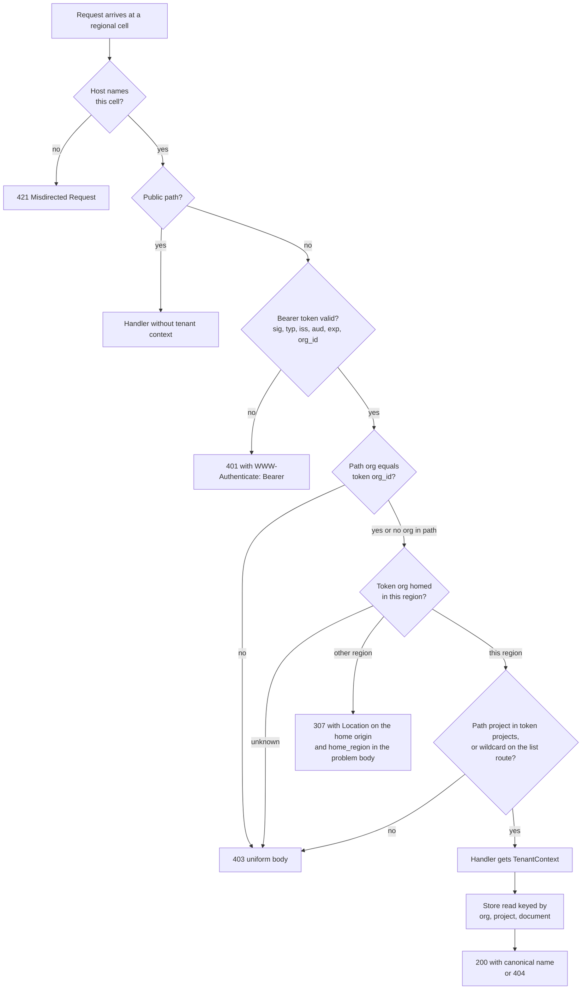

# Modeling Multi-Tenancy, Organizations, Projects, and Data Residency Regions in Resource Hierarchy and Headers

> [!summary] Claim
> Name the tenant in the canonical resource name (`orgs/{org}/projects/{project}/...`), take authority only from the verified credential, deny any request whose named tenant and credential tenant disagree with one uniform `403` before the body is read, and treat the region as a property of the verified tenant that selects an origin, never as a caller-chosen parameter.

Part of [Versioning Evolution and API Guidelines](README.md) in [API Engineering](../README.md).

## TL;DR

Mechanism: a request carries a tenant in up to five places (path, host, header, credential, body), and exactly one of them, the credential, is unforgeable, so the server builds a `TenantContext` from the validated token and compares every other carrier against it.
Contract rule: the decision order is fixed and public: wrong origin `421`, no or bad credential `401`, named tenant differs from the credential's tenant `403` with one byte-identical body, tenant homed in another region `307` to that region's origin, unlisted project `403`, and only then the handler, which may answer `404`.
Trap: a FastAPI dependency runs after the framework has read and parsed the body, so a dependency guard consumed all `1,048,607` bytes of a cross-tenant upload and answered a malformed one with `422` in the lab, while a pure ASGI middleware consumed `0` bytes and answered `403`; and a client that follows the `307` loses its `Authorization` header and ends in `401`.
Portability: the lab's 111 tests passed on CPython 3.12.13, 3.13.18, 3.14.6, 3.14.10, and 3.15.2 on macOS 27.2 arm64 in the drafter's 2026-11-11 run and again on CPython 3.14.6, macOS 27.3 arm64, in the fact-check, and the guard matches the percent-decoded `scope["path"]` that Uvicorn 0.54.0 and Hypercorn 0.18.0 produce with `urllib.parse.unquote` and Granian 2.8.7 produces with Rust `percent_decode_str`.
When not to use it: a single-tenant deployment (one stack per customer) needs no tenant in the contract, a credential that can only ever act for one tenant can leave the tenant out of the path, and a share-nothing regional product should not offer cross-region redirects at all, because the wrong region cannot verify the credential.

## Mental model



The first arrow is about the origin, not the tenant: a cell that receives a request whose `Host` names another cell answers `421` before it looks at credentials, because nothing about the request can be trusted to be meant for it.
The second and third diamonds establish who is calling; every later decision uses only the `TenantContext` built there.
The fourth diamond is the lab plan's core: the org named in the path must equal the org in the token, and every failure from here on that is about tenancy collapses into one `403` body so that the response is not an oracle for which orgs or projects exist.
The region diamond is keyed on the token's org, never on the path's org, so only a verified member is ever told where an org lives.
The project diamond narrows within the org, and the `-` wildcard passes it only for `GET` on the one list route that documents it.
The handler receives the context through a dependency that re-checks the router's own `org` and `project` parameters against it, and the store read names the org again, so a disagreement between the guard and the router, or a missed check upstream, still cannot cross tenants.

## How it works

### Five carriers, one authority

A tenant identifier can ride in five places, and real APIs use all of them.

| Carrier | Example | What it buys | What it costs |
|---|---|---|---|
| Path | `/api/v1/namespaces/my-namespace/pods` (Kubernetes), `/orgs/{org}/repos` (GitHub), `https://api.atlassian.com/ex/jira/{cloudid}/{api}` (Atlassian), `projects/{project}/locations/{location}` (Google) | the tenant is part of the resource's name, so links, logs, caches, and policies all see it | every URL is longer, and adding a level later changes every name |
| Host | `https://<tenant>.<region>.<service>.<cloud>/...` (Azure guidelines), a dedicated subdomain of `GHE.com` (GitHub data residency), `us.sentry.io` and `de.sentry.io` (Sentry), `europe-west4-aiplatform.googleapis.com` (Vertex AI) | DNS, TLS, and the load balancer route before any application code runs | certificates, CORS origins, and SDK configuration multiply per tenant or region |
| Header | `Stripe-Account`, `Stripe-Context`, `OpenAI-Organization`, `OpenAI-Project`, `X-Goog-User-Project` | one URL shape for every tenant, and a credential that spans tenants can pick one per call | invisible in URLs and access logs, absent from the default cache key, easy to omit |
| Credential | `tid` (Microsoft Entra), `org_id` (Auth0), the SigV4 credential scope `YYYYMMDD/region/service/aws4_request` (AWS) | the only carrier the caller cannot choose freely | stale until the credential expires, and opaque to intermediaries |
| Body or query | a `parent` field in a create request, a `?org=` filter | nothing a path segment does not do better | read only after parsing, logged in URIs `(RFC 9110 Section 17.9)` |

The examples are taken from each vendor's own documentation or source: the Kubernetes API concepts page, the GitHub REST reference, Atlassian's OAuth 2.0 (3LO) guide, the Azure REST API guidelines' URL pattern, GitHub's and Sentry's data residency pages, the Vertex AI locations page, Stripe's Connect authentication and `Stripe-Context` pages, `(openai-python main src/openai/_client.py, OpenAI.default_headers)`, Google's system parameters page, the Entra access token claims reference, Auth0's Organizations token page, and the AWS SigV4 signing reference (all as of 2026-11).

The contract rule that survives every style is the one the OWASP Multi-Tenant Security Cheat Sheet states directly: "Treat client-supplied tenant identifiers as selectors only" and verify that the authenticated principal may act in the selected tenant.
A path segment, a host label, and a header are selectors.
The credential is the authority.
The API's job is to make the two agree or refuse, and the rest of this note is about the order and the wire shape of that refusal.

### Resource names carry the hierarchy

Google's AIP-122 defines a resource name as a relative URI path without the leading slash, with collection identifiers alternating with resource IDs, for example `publishers/123/books/les-miserables`.
User-specified IDs should match `^[a-z]([a-z0-9-]{0,61}[a-z0-9])?$`, the RFC 1034 label restricted to lower case with a 63 character maximum (AIP-122, "Resource ID segments"); the lab uses that expression verbatim as `RESOURCE_ID_PATTERN`.
The grammar is a security control as much as a style rule: it excludes `/`, `%`, upper case, and the single hyphen, so an ID can never be confused with a separator, an escape, a case variant, or the wildcard.

The hierarchy is a tree.
AIP-124 requires that a resource "must have at most one canonical parent", and the Google Cloud resource hierarchy states that every resource except the root has exactly one parent, with organization, optional folders, and projects in that order and policy inherited downward.
A single parent is what makes the path a tenancy proof: if `documents` could hang under both an org and a user, a check on one parent would say nothing about the other.

A resource name is forever, and a URL is not.
AIP-122 separates the full resource name `//library.googleapis.com/publishers/123/books/les-miserables` from the resource URI `https://library.googleapis.com/v1/publishers/123/books/les-miserables`, leaves the version out of the name "because the full resource name is expected to persist from version to version", and notes that one service may have multiple endpoints, with regionalization as a named use case, without the name changing.
That sentence is the design decision behind region routing: the region can select an endpoint without becoming part of the identity.
Google's own practice also puts a location in the name when the resource physically lives there: `google/cloud/location/locations.proto` binds `ListLocations` to `/v1/{name=projects/*}/locations`, and Vertex AI documents one locational endpoint per region, such as `europe-west4-aiplatform.googleapis.com`, alongside the location in the resource name.

Two more name rules matter for tenancy.
AIP-122 allows aliases such as `users/me` but requires that "all data returned from the API must use the canonical resource name", which is why the lab's header-selected route `/v1/documents/{document}` still returns `orgs/acme/projects/web/documents/readme`.
AIP-159 allows `-` as a wildcard collection ID (`GET /v1/publishers/-/books`) and requires canonical parent IDs in the response; when the parents are locations and one is unreachable, AIP-217 adds a repeated string field `unreachable` holding service-relative names of what could not be read.
A wildcard widens the read to "every parent", so the server has to intersect it with what the caller may see; the lab's wildcard route lists across the token's projects, not the org's.
The lab departs from AIP-159 in one respect, on purpose: AIP-159 says the URI pattern "must still be specified with `*`" and "must not hard-code the `-` character", while the lab registers `/v1/orgs/{org}/projects/-/documents` as its own route so that the guard's wildcard exception is one fixed path; an AIP-conformant API declares one `List` method on `orgs/*/projects/*/documents`, and its guard must then recognize `-` in the project position of that method only.

### The verified tenant

RFC 7519 registers seven claims (`iss`, `sub`, `aud`, `exp`, `nbf`, `iat`, `jti`) and none of them names a tenant `(RFC 7519 Section 4.1)`.
Identity providers therefore define their own: Microsoft Entra issues `tid`, "the tenant that the user is signing in to", and Auth0 issues `org_id` in tokens obtained for an Organization.
Both vendors put the check on the API: Entra's claims validation guidance says to always check that the `tid` in a token matches the tenant ID used to store data with the application, and Auth0 says that an API receiving an `org_id` claim should validate it against values it expects and otherwise deem the token invalid.

A tenant claim is only as good as the token around it.
The JWT access token profile requires a resource server to reject any `typ` other than `at+jwt` or `application/at+jwt`, to match `iss` exactly, to find its own identifier in `aud`, to verify the signature and reject `alg` of `none`, and to require the current time to be before `exp` `(RFC 9068 Section 4)`.
The JWT best current practice adds the two rules that matter most across tenants: the keys used must belong to the issuer in `iss` `(RFC 8725 Section 3.8)`, and tokens of one kind must be rejected where another kind is expected `(RFC 8725 Section 3.12)`.

The lab's `verify_access_token` delegates signature, `aud`, `iss`, and required-claim checks to PyJWT and adds the profile checks PyJWT does not make.
`jwt.decode_complete` returns the header alongside the payload, `_validate_required_claims` raises `MissingRequiredClaimError` when a required claim is absent or `null`, `_validate_iss` compares a string issuer with `!=`, and `_validate_aud` accepts a string or a list of strings `(PyJWT 2.15.1 jwt/api_jwt.py, PyJWT._validate_claims)`.
The lab then requires `typ` to be `at+jwt` or `application/at+jwt`, requires the seven claims of `(RFC 9068 Section 2.2)` plus `org_id`, and requires `org_id` and every entry of `projects` to match the resource ID grammar.
The grammar check on the claim is what makes the later comparison safe: a token whose `org_id` is a list, upper case, or `-` never becomes a `TenantContext`.
PyJWT judges `exp`, `nbf`, and `iat` against `datetime.now(tz=timezone.utc)` `(PyJWT 2.15.1 jwt/api_jwt.py, PyJWT._validate_claims)`, so the lab turns those three checks off and repeats them against an injected clock: `exp <= now` is expired, the same boundary as `PyJWT._validate_exp`, and an `nbf` or `iat` later than `now` is rejected.
An earlier draft left `nbf` and `iat` to PyJWT, and a token whose `iat` was the lab's fixed instant (1800000000, in January 2027) was rejected by the wall clock of 2026-11, which is the same bug a service has when its token verifier and its business logic read different clocks; `PyJWT._validate_iat` raises `ImmatureSignatureError` when `iat > now + leeway`, so restoring that behavior rejects every token the suite mints.
The lab signs with `HS256` and one fixed key for determinism; RFC 9068 Section 4 recommends asymmetric signatures, and a real resource server would verify against the issuer's published keys.

A token is a snapshot of membership.
A user removed from an org keeps access until `exp`, so the token lifetime (300 s in the lab) is the upper bound on that staleness unless the API also consults live membership.

### Decision order and the status codes

The order of the checks is part of the contract because it determines what an unauthorized caller can learn.

1. Origin: the `Host` header must name this cell, otherwise `421 Misdirected Request`, the status for a request "directed at a server that is unable or unwilling to produce an authoritative response for the target URI" `(RFC 9110 Section 15.5.20)`.
2. Authentication: no credentials get `401` with a bare `WWW-Authenticate: Bearer`, and a token that fails validation gets `WWW-Authenticate: Bearer error="invalid_token"` `(RFC 6750 Section 3.1)`.
3. Tenant match: the path org must equal the token's `org_id`, otherwise `403`.
4. Region: the token org's home region must be this cell, otherwise `307` to the same path on the home origin.
5. Project: a path project must be in the token's `projects`, or be the `-` wildcard on `GET /v1/orgs/{org}/projects/-/documents`, otherwise the same `403`.
6. Backstop: the dependency that hands the context to a handler compares the router's `org` and `project` path parameters with it and raises the same `403`.
7. Handler: a document that does not exist inside an authorized project is `404`.

Steps 3, 5, and 6 follow AIP-211: "Services must check authorization before validating any request", a failed check must return `PERMISSION_DENIED` with a message like `Permission '{p}' denied on resource '{r}' (or it might not exist).`, and `NOT_FOUND` is returned only after the caller has passed the check on the parent.
RFC 9110 permits the opposite choice, a `404` that hides a forbidden resource `(RFC 9110 Section 15.5.4)`, and GitHub documents that it returns `404 Not Found` instead of `403 Forbidden` "to avoid confirming the existence of private repositories".
Either choice works if it is uniform.
The lab takes the AIP-211 side and makes uniformity testable: an existing org, a missing org, a malformed org, an org root path, an unlisted project, and a missing project all produce the same 179 bytes.
AIP-211 gives the reasons to prefer `403`: `404` is often a normal answer that clients handle (get or create), and a `404` is heuristically cacheable `(RFC 9110 Section 15.5.5)` while a permission error is not.

Step 4 sits after step 3 on purpose.
The region lookup uses the org from the token, so the `307` and its `home_region` member reach only a caller who has already proven membership of that org.
A caller probing another org's path gets the uniform `403` from every cell, whichever region that org lives in.

### Where enforcement runs in an ASGI stack

"Before handler execution" is a weaker guarantee than it sounds in FastAPI.
For a route that declares a body parameter, the request handler built by `get_request_handler` reads the body with `await request.body()` and, for a JSON or `+json` content type, parses it with `await request.json()` first, raises a `RequestValidationError` for malformed JSON, and only then calls `solve_dependencies` `(fastapi 0.162.0 fastapi/routing.py, get_request_handler)`.
`solve_dependencies` resolves sub-dependencies before it validates the path, query, header, cookie, and body parameters of the dependant `(fastapi 0.162.0 fastapi/dependencies/utils.py, solve_dependencies)`.
A guard written as a router dependency therefore runs before the endpoint and before parameter validation, but after the whole body has been received, buffered, and parsed.

The lab measures the difference with one decision procedure wired two ways.
As a router dependency, a cross-tenant `POST` with a `1,048,607` byte body is denied with `403` after the application has pulled all `1,048,607` bytes from `receive`, and the same request with truncated JSON is answered `422`, which tells an outsider that validation ran before authorization.
As a pure ASGI middleware, the same requests are denied with `403` after `0` bytes, because the middleware sends its response without ever calling `receive`.
That is the AIP-211 order ("authorization before validating any request") and it also removes a cheap resource-exhaustion path, since an unauthorized caller can no longer make the service buffer a megabyte per request.

The middleware has to find the tenant in the path without the router, and it must read the same string the router will.
That string differs from `scope["path"]` in two ways, and the lab got one of them wrong before an independent review caught it.

The first is the mount prefix.
Starlette matches routes against the path with `root_path` removed `(starlette 1.10.0 starlette/_utils.py, get_route_path)`, while `scope["path"]` still contains it.
The first version of the guard matched its expression against `scope["path"]`, so behind `root_path="/api"` the path `/api/v1/orgs/acme/projects/ml/documents/weights` did not match `^/v1/orgs/`, the org and project checks were skipped, and a token limited to project `web` read project `ml` with `200`.
The guard now calls `route_path(scope)`, which strips the prefix the same way, and the backstop in `current_tenant` would deny the request even if the two disagreed again.

The second is percent-decoding.
The ASGI specification defines `path` as the request target "with percent-encoded sequences and UTF-8 byte sequences decoded into characters" and `raw_path` as the original bytes, optional and `None` when the server cannot provide it.
Uvicorn computes `path = unquote(raw_path.decode("ascii"))` and then prefixes its configured `root_path` `(uvicorn 0.54.0 uvicorn/protocols/http/h11_impl.py, H11Protocol.handle_events)`, Hypercorn sets `"path": unquote(path.decode("ascii"))` without a prefix `(hypercorn 0.18.0 hypercorn/protocol/http_stream.py, HTTPStream.handle)`, Granian decodes with `percent_encoding::percent_decode_str(raw_path).decode_utf8_lossy()` `(granian 2.8.7 src/asgi/utils.rs, build_scope_common)`, and Starlette matches routes against that decoded path with `[^/]+` for a string parameter `(starlette 1.10.0 starlette/convertors.py, StringConvertor)`.
So `/v1/orgs/acme%2Fprojects%2Fweb/documents/readme` reaches the router as `/v1/orgs/acme/projects/web/documents/readme` and matches the four-level route.
RFC 3986 says components must be separated before percent-encoded octets are decoded `(RFC 3986 Section 2.4)`; the ASGI servers decode first, so in this stack an encoded slash is a slash.
A proxy that authorizes on raw segments sees one org named `acme%2Fprojects%2Fweb`, the application sees org `acme` and project `web`, and the two disagree about which policy applies.
The lab's guard matches the decoded route path, and `test_percent_encoded_slash_is_decoded_before_the_guard_and_the_router_see_it` pins the encoded-slash case.

### Region as an origin, a name segment, or a credential scope

Data residency adds one fact per tenant: where its data is stored.
Sentry's documentation shows the usual shape of that fact: the location is chosen when the organization is created, "can't be changed" afterwards, and API requests are processed in the selected location only when the client uses the region-specific domain.
Three contract styles expose it.

| Style | Example | Wrong-region behavior |
|---|---|---|
| Region in the origin only | `us.sentry.io` and `de.sentry.io`; a dedicated subdomain of `GHE.com` with data stored in the EU, Australia, the US, or Japan; Azure's `<tenant>.<region>.<service>.<cloud>` | the other region holds neither the data nor, in a share-nothing design, the credentials, so the request simply fails authentication or lookup |
| Region in the resource name | `projects/{project}/locations/{location}/...` | the name itself says where the resource is, lists across regions use `locations/-`, and partial failures use `unreachable` (AIP-159, AIP-217) |
| Region in the credential | SigV4 credential scope `YYYYMMDD/region/service/aws4_request`, which "restricts the resulting signature to the specified Region and service" | a signature made for one region does not verify in another |

The lab models the first style with a global identity plane: both cells can validate the token, and a directory maps each org to a home region.
That design has to choose a wrong-cell answer, and there are two different wrong-cell situations.

The first is a request for another origin arriving at this cell, for example a reused HTTP/2 connection or a misconfigured load balancer delivering `Host: eu.api.lab.test` to the `us` cell.
An origin server sends `421` "to reject a target URI that does not match an origin for which the server has been configured" `(RFC 9110 Section 15.5.20)`, and Section 7.4 describes the decision to reject a misdirected request, a `Host` that differs from the connection's host being its example `(RFC 9110 Section 7.4)`.
HTTP/2 and HTTP/3 allow a client to reuse one connection for several authorities when the certificate covers them, and name `421` as the server's way to refuse `(RFC 9113 Section 9.1.1)`, `(RFC 9114 Section 3.3)`.
A client that receives `421` may retry over a different connection, and a proxy must not generate it `(RFC 9110 Section 15.5.20)`.
[[HTTP-2-Connection-Coalescing-and-421-Misdirected-Request]] covers the coalescing mechanics; the point here is that regional hostnames behind one wildcard certificate and one address are exactly the deployment that triggers it.

The second is the right origin, a valid member, and an org that lives elsewhere.
`421` is the wrong status for it: the origin is authoritative for its own URI, and a retry on a fresh connection to the same origin would fail the same way.
A redirect is the HTTP answer for "the resource is at a different URI".
`307 Temporary Redirect` keeps the method and body and tells the client to keep using the original URI for future requests `(RFC 9110 Section 15.4.8)`; `308` is heuristically cacheable and invites clients to rewrite stored links `(RFC 9110 Section 15.4.9)`, which is the wrong durability for a routing fact that a migration can change.
Amazon S3 documents the same idea with a header: the `HeadBucket` reference shows a `301 Moved Permanently` sample response that carries `x-amz-bucket-region`, the region the bucket is located in.

The redirect has two costs that the contract must state.
The first is credentials: the Fetch standard deletes `Authorization` when a redirect crosses origins ("the moment another origin is seen after the initial request, the `Authorization` header is removed"), and httpx pops it unless the target is the same origin or an `http` port 80 to `https` port 443 upgrade of the same host `(httpx 0.28.1 httpx/_client.py, BaseClient._redirect_headers)`.
A client that follows the `307` automatically therefore arrives at the home region unauthenticated.
The second is residency itself: by the time a server can answer `307` to a `POST`, the request has already been sent toward the wrong region, and because `307` does not rewrite the request, the client then sends the same body again; `(RFC 9700 Section 4.12)` describes the same property of `307` as a credential leak in OAuth flows.
The lab's middleware answers without reading the body, which keeps the payload out of the application but not off the wire.
The durable fix is for clients to learn the home origin once (at login, from an org resource, or from the first `307`) and call it directly, and the `307` exists to teach them, not to proxy for them.

The redirect `Location` is built from `raw_path` plus the query string, not from the decoded path, so the client's percent-encoding survives; when a server omits `raw_path` the lab falls back to `urllib.parse.quote(path)`, which is lossy for `%2F` and is covered by a test.
The raw path and the query string are passed through `urllib.parse.quote_from_bytes` with `%`, the RFC 3986 sub-delimiters, `:`, `@`, and `/` kept (and `?` in the query), so bytes a lenient server let through (a raw space, raw UTF-8) are encoded instead of raising `UnicodeDecodeError`, and existing escapes are not doubled.
A target that does not begin with `/` is answered `400`, because concatenating `https://eu.api.lab.test` with `@evil.test/x` yields a URL whose authority is `evil.test` and whose userinfo is the regional host.

AWS's guidance on cell routing is the operational counterpart: the router maps a partition key to a cell and "must remain as simple and horizontally scalable as possible", without complex business logic in it.
The org ID is that partition key, which is one more reason to put it where a router can read it without parsing a body.

### Headers as selectors

A header carries the tenant when the URL shape is shared by all tenants and the credential may act for more than one.
Stripe's `Stripe-Account` header names a connected account for a platform's key, Stripe documents that the header "is implied in any API request that includes the Account ID in the URL", and `Stripe-Context` supersedes it with a path-like value such as `acct_111/acct_111a` for nested relationships.
The OpenAI Python client sends `OpenAI-Organization` and `OpenAI-Project` only when they are configured.
Google's `X-Goog-User-Project` names a "caller-specified project for quota and billing purposes" and requires the caller to hold `serviceusage.services.use` on it, which shows the general rule: the header selects, and a permission check on the selected thing grants.
For gRPC, where the routing values sit inside a request payload that "can not be reasonably deconstructed on the wire", AIP-4222 has generated clients copy fields such as `parent` into the `x-goog-request-params` routing header.

Three rules keep a selector header safe.
It selects among what the credential already grants and is denied with the uniform `403` otherwise.
Its absence is an error when the credential spans more than one candidate, because a silent default sends a write to the wrong project; the lab answers `400` with the problem type `ambiguous-project`.
It needs a name without an `X-` prefix, since new parameters "SHOULD NOT" use one and may incorporate the organization's name instead `(RFC 6648 Section 3)`.

A selector header also changes the cache key.
A shared cache must not reuse a response to a request with `Authorization` unless the response carries `public`, `s-maxage`, or `must-revalidate` `(RFC 9111 Section 3.5)`, so tenant responses are safe by default and unsafe the moment someone adds `public` without `Vary` on the selector; [[Caching-Authenticated-and-Multi-Tenant-API-Responses]] and [[Vary-Header-Mechanics-and-Cache-Hit-Collapse]] own that topic.

### Evolving the hierarchy

This note sits in the versioning folder because the tenant model is the hardest part of an API to change.
A name such as `orgs/acme/projects/web/documents/readme` is stored by clients, written into audit logs, and embedded in other resources, and AIP-122 tells clients to store it as the canonical name.
Adding a level (workspaces under orgs, folders above projects) changes every name beneath it, which is a breaking change in the sense of [[Anatomy-of-Breaking-Changes-in-HTTP-and-JSON-APIs]].
AIP-123 gives the compatible path for a resource that gains a second parent: a resource may declare multiple patterns, new patterns must be added at the end of the list, and existing patterns must not be removed or reordered.
The same care applies to carriers: moving the tenant from an implicit credential to an explicit path segment, or adding a selector header, is additive only if the old form keeps resolving and every response still returns the one canonical name.

## Numbers and limits

| Quantity | Value | Source or measurement |
|---|---|---|
| User-specified resource ID | `^[a-z]([a-z0-9-]{0,61}[a-z0-9])?$`, at most 63 characters | AIP-122, "Resource ID segments" (as of 2026-11); lab grammar test |
| Registered JWT claims that name a tenant | 0 of 7 | `(RFC 7519 Section 4.1)` |
| Claims RFC 9068 requires in a JWT access token | 7: `iss`, `exp`, `aud`, `sub`, `client_id`, `iat`, `jti` | `(RFC 9068 Section 2.2)` |
| Lab access token | 348 bytes; `Authorization` field value 355 bytes | `uv run --frozen python` probe, CPython 3.14.6, macOS 27.3 arm64 (2026-11-13) |
| Lab token lifetime, the bound on stale membership | 300 s | lab default `ttl` |
| Uniform denial body | 179 bytes, identical for 6 denial causes | lab test `test_every_tenant_denial_is_the_same_403_bytes_so_nothing_is_an_oracle` |
| Request body pulled from `receive` before a cross-tenant `403` | middleware 0 bytes; router dependency 1,048,607 of 1,048,607 bytes | lab test, FastAPI 0.162.0, CPython 3.14.6, macOS 27.3 arm64 |
| Status for malformed JSON sent to another tenant's collection | middleware `403`; router dependency `422` | lab test, FastAPI 0.162.0 |
| Heuristically cacheable statuses relevant here | `404` and `308` are; `307`, `403`, and `421` are not | `(RFC 9110 Section 15.1)` |
| Azure maximum URL length | `414` beyond 2083 characters | Azure REST API guidelines, URL rules (as of 2026-11) |
| `x-amz-bucket-region` value length | 0 to 20 characters | Amazon S3 `HeadBucket` reference (as of 2026-11) |
| GitHub Enterprise Cloud data residency regions | 4: EU, Australia, US, Japan | GitHub documentation (as of 2026-11) |
| Sentry data storage locations | 2: US (`us.sentry.io`), EU (`de.sentry.io`) | Sentry documentation (as of 2026-11) |
| Multi-tenant Entra applications found vulnerable to missing tenant checks | "about 25%" of those scanned | Wiz Research, BingBang, 2023-03 |
| Organizations whose mail was accessed with forged tokens | "approximately 25" | Microsoft, Storm-0558 analysis, 2023-07-14 |
| Lab suite | 111 tests, `111 passed in 2.28s` | `uv run --frozen pytest ... -q -p no:cacheprovider`, CPython 3.14.6, macOS 27.3 arm64 (Darwin 27.3.0), 2026-11-13 |

## Portability

The interpreter legs other than the workspace interpreter are from the drafter's run on 2026-11-11; the fact-check reran only the workspace leg, because lab matrix checks were paused on 2026-11-11.

| Leg | Result | Evidence |
|---|---|---|
| CPython 3.12.13 | 111 passed | `uv run --frozen --python 3.12 pytest` on macOS 27.2 arm64 |
| CPython 3.13.18 | 111 passed | `uv run --frozen --python /opt/homebrew/bin/python3.13 pytest` on macOS 27.2 arm64 |
| CPython 3.14.6 (workspace) | 111 passed | `uv run --frozen pytest` on macOS 27.2 arm64, and again on macOS 27.3 arm64 in the fact-check |
| CPython 3.14.10 | 111 passed | `uv run --frozen --python /opt/homebrew/bin/python3.14 pytest` on macOS 27.2 arm64 |
| CPython 3.15.2 | 111 passed | `uv run --frozen --python /opt/homebrew/bin/python3.15 pytest` on macOS 27.2 arm64 |
| CPython 3.15.0b3 (what `--python 3.15` resolves to) | not run: pytest startup fails with `ModuleNotFoundError: No module named 'hypothesis._native'` | `uv run --frozen --python 3.15 pytest` |
| CPython 3.15t free-threaded | not run: `uv` cannot install `psycopg-binary==3.3.8` (no wheel for the platform); the matrix versions 3.12.16 and 3.15.2t are not installed | `uv run --frozen --python 3.15t pytest` |
| Debian Trixie, Alpine musl | not run | no container definitions in the workspace yet |
| FastAPI 0.162.0 | the body is read and parsed before dependencies are solved | `(fastapi 0.162.0 fastapi/routing.py, get_request_handler)`; lab tests |
| Starlette 1.10.0 | routes match the decoded path with `root_path` removed; `request.state` is backed by `scope["state"]`, which is how the middleware hands the context to handlers | `(starlette 1.10.0 starlette/convertors.py, StringConvertor)`, `(starlette 1.10.0 starlette/_utils.py, get_route_path)`, `(starlette 1.10.0 starlette/requests.py, HTTPConnection.state)`; lab tests |
| httpx 0.28.1 | `Authorization` is dropped on a cross-origin redirect; `ASGITransport` sets both `path` and `raw_path` | `(httpx 0.28.1 httpx/_client.py, BaseClient._redirect_headers)`, `(httpx 0.28.1 httpx/_transports/asgi.py, ASGITransport.handle_async_request)`; lab tests |
| PyJWT 2.15.1 | a required claim that is `null` counts as missing; `exp <= now` is expired | `(PyJWT 2.15.1 jwt/api_jwt.py, PyJWT._validate_required_claims)`, `(PyJWT 2.15.1 jwt/api_jwt.py, PyJWT._validate_exp)`; lab tests |
| Uvicorn 0.54.0 | `scope["path"]` is `unquote(raw_path)` prefixed with the configured `root_path`, in both the h11 and httptools protocols (httptools decodes only when the path contains `%`) | `(uvicorn 0.54.0 uvicorn/protocols/http/h11_impl.py, H11Protocol.handle_events)`, `(uvicorn 0.54.0 uvicorn/protocols/http/httptools_impl.py, HttpToolsProtocol.on_headers_complete)`; source read, not run over a socket |
| Hypercorn 0.18.0 | `scope["path"]` is `unquote(path)` | `(hypercorn 0.18.0 hypercorn/protocol/http_stream.py, HTTPStream.handle)`; source read, not run |
| Granian 2.8.7 | `scope["path"]` is `percent_decode_str(raw_path).decode_utf8_lossy()`, so `%2F` is a `/` here too, and `raw_path` is the undecoded URI path | `(granian 2.8.7 src/asgi/utils.rs, build_scope_common)`; source read at the `v2.8.7` tag, not run |
| HTTP/1.1 | the origin is named by `Host` | `(RFC 9110 Section 7.2)`; lab `421` tests use the ASGI `host` header |
| HTTP/2 | the origin is named by `:authority`, which an ASGI server must present as `host`; connections may be reused across authorities | `(RFC 9113 Section 8.3.1)`, `(RFC 9113 Section 9.1.1)`, ASGI HTTP specification; not exercised in the lab |
| HTTP/3 | connections may be reused across authorities after certificate validation | `(RFC 9114 Section 3.3)`; not exercised in the lab |

## Worked example

The [implementation](../labs/src/api_labs/f07_versioning_evolution_and_api_guidelines/tenant_scope.py) holds the token verifier, the `TenantGuard` decision procedure, its two wirings (`TenantGuardMiddleware` and a router dependency), the `current_tenant` backstop, a four-route FastAPI cell, and the region-aware client helper.
The [test](../labs/tests/f07_versioning_evolution_and_api_guidelines/test_multi_tenancy_and_region_routing_in_api_contracts.py) builds two cells, `us` and `eu`, over one in-memory store, with org `acme` homed in `us` and org `globex` homed in `eu`, and drives them through `httpx.ASGITransport`.

Full source of the implementation, byte-identical to the lab file:

```python
"""Tenant scoping for /v1/orgs/{org}/projects/{project}: path vs token claims and region cells."""

import json
import re
from collections.abc import Callable, Mapping
from dataclasses import dataclass, field
from typing import Annotated, Any, Literal, cast
from urllib.parse import quote, quote_from_bytes

import httpx
import jwt
from fastapi import APIRouter, Depends, FastAPI, Header, Request
from pydantic import BaseModel, ConfigDict, Field
from starlette.responses import JSONResponse, Response
from starlette.types import ASGIApp, Receive, Scope, Send

ISSUER = "https://issuer.lab.test"
AUDIENCE = "https://api.lab.test"
LAB_HS256_KEY = b"lab-only-hs256-key-EXAMPLE-NOT-A-REAL-KEY"
ACCESS_TOKEN_TYP = "at+jwt"  # noqa: S105 - a JOSE "typ" value (RFC 9068 Section 2.1)
ACCESS_TOKEN_TYPES = frozenset({ACCESS_TOKEN_TYP, "application/at+jwt"})  # RFC 9068 Section 4
REQUIRED_CLAIMS = ["iss", "exp", "aud", "sub", "client_id", "iat", "jti", "org_id"]
PROBLEM_BASE = "https://api.lab.test/problems/"
REGION_HOSTS: Mapping[str, str] = {"us": "us.api.lab.test", "eu": "eu.api.lab.test"}
PUBLIC_PATHS = frozenset({"/healthz"})

# AIP-122 user-specified resource ID: RFC 1034 label, lower case, at most 63 characters.
RESOURCE_ID_PATTERN = r"^[a-z]([a-z0-9-]{0,61}[a-z0-9])?$"
RESOURCE_ID = re.compile(RESOURCE_ID_PATTERN)
WILDCARD = "-"  # AIP-159 "any parent" collection ID, valid only where a route documents it.

# Matched against route_path(scope): percent-decoded and without the mount prefix, which is
# the string the router matches.
ORG_PATH = re.compile(r"^/v1/orgs/(?P<org>[^/]+)(?:/projects/(?P<project>[^/]+))?(?:/|$)")
WILDCARD_LIST = re.compile(r"^/v1/orgs/[^/]+/projects/-/documents$")

# Bytes left as they are when a raw request target is copied into a Location: RFC 3986
# unreserved characters are always kept by quote_from_bytes, these are sub-delims, ":", "@",
# "/", and "%" (so existing percent-escapes survive); "?" is added for the query.
PATH_SAFE = "/%!$&'()*+,;=:@"
QUERY_SAFE = PATH_SAFE + "?"

PERMISSION_DENIED_DETAIL = "Permission denied on the requested resource (or it might not exist)."


class TokenError(Exception):
    """The bearer token failed validation; the reason is logged, never returned."""


class UntrustedRedirectError(Exception):
    """A region redirect pointed outside the configured regional origins."""


@dataclass(frozen=True, slots=True)
class TenantContext:
    """Server-verified tenant identity; built only from a validated token."""

    subject: str
    org: str
    projects: frozenset[str]


@dataclass
class Recorder:
    """What ran: handler invocations and tenant-scoped store reads."""

    handler_calls: list[str] = field(default_factory=list[str])
    store_reads: list[tuple[str, str, str]] = field(default_factory=list[tuple[str, str, str]])


@dataclass
class DocumentStore:
    """In-memory documents keyed by (org, project, document); every read names its tenant."""

    recorder: Recorder
    rows: dict[tuple[str, str, str], str] = field(default_factory=dict[tuple[str, str, str], str])

    def get(self, ctx: TenantContext, project: str, document: str) -> str | None:
        self.recorder.store_reads.append((ctx.org, project, document))
        return self.rows.get((ctx.org, project, document))

    def list_names(self, ctx: TenantContext, projects: frozenset[str]) -> list[str]:
        return sorted(
            resource_name(org, project, document)
            for (org, project, document) in self.rows
            if org == ctx.org and project in projects
        )

    def create(self, ctx: TenantContext, project: str, document: str, body: str) -> bool:
        key = (ctx.org, project, document)
        if key in self.rows:
            return False
        self.rows[key] = body
        return True


def resource_name(org: str, project: str, document: str) -> str:
    """Canonical AIP-122 relative resource name; the only name a response ever returns."""
    return f"orgs/{org}/projects/{project}/documents/{document}"


def mint_token(
    *,
    org: object,
    projects: object,
    now: int,
    subject: str = "user-1",
    ttl: int = 300,
    issuer: str = ISSUER,
    audience: str = AUDIENCE,
    key: bytes = LAB_HS256_KEY,
    typ: str = ACCESS_TOKEN_TYP,
    issued_at: object | None = None,
    not_before: object | None = None,
) -> str:
    """Mint an HS256 access token; claim values are untyped so tests can forge shapes."""
    claims: dict[str, object] = {
        "iss": issuer,
        "aud": audience,
        "sub": subject,
        "client_id": "lab-client",
        "iat": now if issued_at is None else issued_at,
        "jti": f"{subject}-{now}",
        "exp": now + ttl,
        "org_id": org,
        "projects": projects,
    }
    if not_before is not None:
        claims["nbf"] = not_before
    return jwt.encode(claims, key, algorithm="HS256", headers={"typ": typ})


def verify_access_token(token: str, *, now: int) -> TenantContext:
    """Validate signature, typ, iss, aud, time claims, and tenant claims, or raise TokenError."""
    try:
        decoded = jwt.decode_complete(
            token,
            LAB_HS256_KEY,
            algorithms=["HS256"],
            audience=AUDIENCE,
            issuer=ISSUER,
            # PyJWT judges exp, nbf, and iat by the wall clock; this verifier owns the clock.
            options={
                "require": REQUIRED_CLAIMS,
                "verify_exp": False,
                "verify_nbf": False,
                "verify_iat": False,
            },
        )
    except jwt.InvalidTokenError as exc:
        raise TokenError(str(exc)) from exc
    header: dict[str, Any] = decoded["header"]
    payload: dict[str, Any] = decoded["payload"]
    if header.get("typ") not in ACCESS_TOKEN_TYPES:
        raise TokenError("typ is not at+jwt")
    exp: object = payload["exp"]
    if type(exp) is not int or exp <= now:
        raise TokenError("expired or malformed exp")
    for claim in ("iat", "nbf"):
        instant: object = payload.get(claim)
        if instant is not None and (type(instant) is not int or instant > now):
            raise TokenError(f"{claim} is malformed or in the future")
    subject: object = payload["sub"]
    org: object = payload["org_id"]
    projects: object = payload.get("projects", [])
    if not isinstance(subject, str) or not isinstance(org, str) or not RESOURCE_ID.fullmatch(org):
        raise TokenError("malformed sub or org_id")
    if not isinstance(projects, list):
        raise TokenError("malformed projects")
    names: list[str] = []
    for item in cast("list[object]", projects):
        if not isinstance(item, str) or not RESOURCE_ID.fullmatch(item):
            raise TokenError("malformed projects")
        names.append(item)
    return TenantContext(subject=subject, org=org, projects=frozenset(names))


def problem(
    status: int,
    slug: str,
    title: str,
    *,
    detail: str | None = None,
    headers: Mapping[str, str] | None = None,
    **extensions: str,
) -> JSONResponse:
    """RFC 9457 problem details; `extensions` become extension members (Section 3.2)."""
    body: dict[str, object] = {"type": PROBLEM_BASE + slug, "title": title, "status": status}
    if detail is not None:
        body["detail"] = detail
    body.update(extensions)
    return JSONResponse(
        body, status_code=status, headers=headers, media_type="application/problem+json"
    )


def permission_denied() -> JSONResponse:
    """One byte-identical 403 for every tenant denial, so the body is not an existence oracle."""
    return problem(403, "permission-denied", "Permission denied", detail=PERMISSION_DENIED_DETAIL)


def _header_values(scope: Scope, name: bytes) -> list[str]:
    headers: list[tuple[bytes, bytes]] = scope["headers"]
    return [value.decode("latin-1") for key, value in headers if key == name]


def route_path(scope: Scope) -> str:
    """The path the router matches: scope["path"] without the root_path mount prefix."""
    path: str = scope["path"]
    root_path: str = scope.get("root_path", "")
    if root_path and (path == root_path or path.startswith(root_path + "/")):
        return path[len(root_path) :]
    return path


def _bearer_token(scope: Scope) -> str | None:
    values = _header_values(scope, b"authorization")
    if len(values) != 1:
        return None
    scheme, _, credentials = values[0].partition(" ")
    if scheme.lower() != "bearer" or not credentials or " " in credentials:
        return None
    return credentials


@dataclass(frozen=True)
class TenantGuard:
    """The single decision procedure both enforcement points share."""

    region: str
    directory: Mapping[str, str]
    clock: Callable[[], int]

    def evaluate(self, scope: Scope) -> TenantContext | Response | None:
        """Return a context to proceed, a Response to reject, or None for a public path."""
        hosts = _header_values(scope, b"host")
        if len(hosts) != 1 or hosts[0].lower().removesuffix(":443") != REGION_HOSTS[self.region]:
            # RFC 9110 Section 7.4: this origin is not the one the request names.
            return problem(421, "misdirected-request", "Misdirected request")
        path = route_path(scope)
        if path in PUBLIC_PATHS:
            return None
        token = _bearer_token(scope)
        if token is None:
            # RFC 6750 Section 3.1: no error code when no credentials were presented.
            return problem(
                401, "unauthenticated", "Unauthenticated", headers={"WWW-Authenticate": "Bearer"}
            )
        try:
            ctx = verify_access_token(token, now=self.clock())
        except TokenError:
            return problem(
                401,
                "unauthenticated",
                "Unauthenticated",
                headers={"WWW-Authenticate": 'Bearer error="invalid_token"'},
            )
        match = ORG_PATH.match(path)
        if match is not None and match["org"] != ctx.org:
            return permission_denied()
        home = self.directory.get(ctx.org)
        if home is None or home not in REGION_HOSTS:
            return permission_denied()
        if home != self.region:
            # Only a verified member of the org reaches this line, so naming its region is safe.
            # raw_path keeps the client's percent-encoding; ASGI servers may omit it.
            raw_path: bytes | None = scope.get("raw_path")
            full_path: str = scope["path"]
            target = quote_from_bytes(raw_path, safe=PATH_SAFE) if raw_path else quote(full_path)
            if not target.startswith("/"):
                # "https://host" + "@evil.test/x" would name another authority.
                return problem(400, "bad-request-target", "Bad request target")
            location = f"https://{REGION_HOSTS[home]}{target}"
            query: bytes = scope["query_string"]
            if query:
                location += "?" + quote_from_bytes(query, safe=QUERY_SAFE)
            return problem(
                307,
                "wrong-region",
                "Organization is homed in another region",
                headers={"Location": location, "Cache-Control": "no-store"},
                home_region=home,
            )
        if match is not None and match["project"] is not None:
            project = match["project"]
            listing = scope["method"] == "GET" and WILDCARD_LIST.fullmatch(path) is not None
            if project not in ctx.projects and not (project == WILDCARD and listing):
                return permission_denied()
        return ctx


class TenantGuardMiddleware:
    """Pure ASGI enforcement: rejects before routing, body read, and validation."""

    def __init__(self, app: ASGIApp, guard: TenantGuard) -> None:
        self.app = app
        self.guard = guard

    async def __call__(self, scope: Scope, receive: Receive, send: Send) -> None:
        if scope["type"] != "http":
            await self.app(scope, receive, send)
            return
        decision = self.guard.evaluate(scope)
        if isinstance(decision, Response):
            await decision(scope, receive, send)
            return
        if decision is not None:
            scope.setdefault("state", {})["tenant"] = decision
        await self.app(scope, receive, send)


class GuardRejectedError(Exception):
    """Carries the guard's response out of a FastAPI dependency."""

    def __init__(self, response: Response) -> None:
        super().__init__("tenant guard rejected the request")
        self.response = response


def current_tenant(request: Request) -> TenantContext:
    """Hand the verified context to a handler; fail closed if the guard and router disagree."""
    ctx: object = getattr(request.state, "tenant", None)
    if not isinstance(ctx, TenantContext):
        raise RuntimeError("tenant guard did not run for this route")
    # Backstop: the guard parsed the path with a regex, the router with its own; re-check the
    # router's parameters so a mismatch between the two denies instead of crossing tenants.
    org: object = request.path_params.get("org", ctx.org)
    project: object = request.path_params.get("project")
    if org != ctx.org or (project is not None and project not in ctx.projects):
        raise GuardRejectedError(permission_denied())
    return ctx


Tenant = Annotated[TenantContext, Depends(current_tenant)]


class DocumentIn(BaseModel):
    """Create request; the caller picks the ID (AIP-122 user-specified resource ID)."""

    model_config = ConfigDict(extra="forbid")

    document_id: str = Field(pattern=RESOURCE_ID_PATTERN)
    body: str = Field(max_length=4096)


def build_cell_app(
    *,
    region: str,
    directory: Mapping[str, str],
    store: DocumentStore,
    clock: Callable[[], int],
    enforcement: Literal["middleware", "dependency"] = "middleware",
) -> FastAPI:
    """One regional cell of the API, guarded at the ASGI edge or by a router dependency."""
    guard = TenantGuard(region=region, directory=directory, clock=clock)
    recorder = store.recorder
    app = FastAPI()

    def dependency_guard(request: Request) -> None:
        decision = guard.evaluate(request.scope)
        if isinstance(decision, Response):
            raise GuardRejectedError(decision)
        request.state.tenant = decision

    if enforcement == "middleware":
        app.add_middleware(TenantGuardMiddleware, guard=guard)
        router = APIRouter(prefix="/v1")
    else:
        router = APIRouter(prefix="/v1", dependencies=[Depends(dependency_guard)])

    @app.exception_handler(GuardRejectedError)
    async def guard_rejected(_request: Request, exc: GuardRejectedError) -> Response:
        return exc.response

    @router.get("/orgs/{org}/projects/-/documents")
    async def list_across_projects(org: str, ctx: Tenant) -> dict[str, list[str]]:
        recorder.handler_calls.append("list_across_projects")
        # AIP-159: the wildcard spans the caller's projects, never the org's.
        return {"documents": store.list_names(ctx, ctx.projects)}

    @router.get("/orgs/{org}/projects/{project}/documents/{document}")
    async def get_document(org: str, project: str, document: str, ctx: Tenant) -> Response:
        recorder.handler_calls.append("get_document")
        body = store.get(ctx, project, document)
        if body is None:
            return problem(404, "not-found", "Document not found")
        return JSONResponse({"name": resource_name(ctx.org, project, document), "body": body})

    @router.post("/orgs/{org}/projects/{project}/documents", status_code=201)
    async def create_document(org: str, project: str, payload: DocumentIn, ctx: Tenant) -> Response:
        recorder.handler_calls.append("create_document")
        if not store.create(ctx, project, payload.document_id, payload.body):
            return problem(409, "already-exists", "Document already exists")
        name = resource_name(ctx.org, project, payload.document_id)
        return JSONResponse({"name": name}, status_code=201)

    @router.get("/documents/{document}")
    async def get_document_by_selector(
        document: str, ctx: Tenant, lab_project: Annotated[str | None, Header()] = None
    ) -> Response:
        recorder.handler_calls.append("get_document_by_selector")
        # The header selects among the token's projects; it never grants one.
        if lab_project is None:
            if len(ctx.projects) != 1:
                return problem(400, "ambiguous-project", "Lab-Project header is required")
            (project,) = ctx.projects
        elif lab_project in ctx.projects:
            project = lab_project
        else:
            return permission_denied()
        body = store.get(ctx, project, document)
        if body is None:
            return problem(404, "not-found", "Document not found")
        return JSONResponse({"name": resource_name(ctx.org, project, document), "body": body})

    @app.get("/healthz")
    async def healthz() -> dict[str, str]:
        return {"region": region}

    app.include_router(router)
    return app


async def send_region_aware(
    client: httpx.AsyncClient,
    method: str,
    url: str,
    *,
    token: str,
    payload: object | None = None,
) -> httpx.Response:
    """Send once, and re-send once with credentials if a known regional origin redirects us."""
    headers = {"Authorization": f"Bearer {token}"}
    content = None if payload is None else json.dumps(payload).encode()
    if content is not None:
        headers["Content-Type"] = "application/json"
    response = await client.request(
        method, url, headers=headers, content=content, follow_redirects=False
    )
    if response.status_code != 307:
        return response
    location = response.headers.get("Location")
    if location is None:
        raise UntrustedRedirectError("307 without Location")
    target = httpx.URL(location)
    # An origin is scheme, host, and port: httpx reports port None for the scheme default.
    trusted_origin = (
        target.scheme == "https"
        and target.host in REGION_HOSTS.values()
        and target.port is None
        and not target.userinfo
    )
    if not trusted_origin:
        raise UntrustedRedirectError(location)
    return await client.request(
        method, target, headers=headers, content=content, follow_redirects=False
    )
```

The test that proves the lab plan's claim, for both wirings (excerpt, byte-identical to the lab file):

```python
@pytest.mark.unit
@pytest.mark.asyncio
@pytest.mark.parametrize("enforcement", ["middleware", "dependency"])
async def test_path_org_that_differs_from_token_org_is_rejected_before_the_handler(
    enforcement: Enforcement,
) -> None:
    world = make_world(enforcement)

    async with client_for(world.us) as client:
        response = await client.get(GLOBEX_README, headers=bearer(token(org="acme")))

    assert response.status_code == 403
    assert response.headers["content-type"] == "application/problem+json"
    assert response.json() == {
        "type": "https://api.lab.test/problems/permission-denied",
        "title": "Permission denied",
        "status": 403,
        "detail": "Permission denied on the requested resource (or it might not exist).",
    }
    assert world.recorder.handler_calls == []
    assert world.recorder.store_reads == []
```

The two tests that separate "before the handler" from "before the body and validation" (excerpt, byte-identical to the lab file):

```python
@pytest.mark.unit
@pytest.mark.asyncio
@pytest.mark.parametrize(
    ("enforcement", "expected_body_bytes"),
    [("middleware", 0), ("dependency", 1_048_607)],
)
@pytest.mark.parametrize(
    "collection",
    ["/v1/orgs/globex/projects/web/documents", "/v1/orgs/acme/projects/ml/documents"],
    ids=["other-org", "unlisted-project"],
)
async def test_middleware_denies_before_the_body_is_read_and_a_dependency_reads_all_of_it(
    enforcement: Enforcement, expected_body_bytes: int, collection: str
) -> None:
    world = make_world(enforcement)
    spy = Spy(world.us)
    content = b'{"document_id":"big","body":"' + b"x" * 1_048_576 + b'"}'

    async with client_for(spy) as client:
        response = await client.post(
            collection,
            headers={**bearer(token(org="acme")), "Content-Type": "application/json"},
            content=content,
        )

    assert len(content) == 1_048_607
    assert response.status_code == 403
    assert response.content == DENIED
    assert spy.body_bytes == expected_body_bytes
    assert world.recorder.handler_calls == []


@pytest.mark.unit
@pytest.mark.asyncio
@pytest.mark.parametrize(
    ("enforcement", "expected_status"), [("middleware", 403), ("dependency", 422)]
)
async def test_dependency_guard_validates_json_before_it_authorizes_and_answers_422(
    enforcement: Enforcement, expected_status: int
) -> None:
    world = make_world(enforcement)

    async with client_for(world.us) as client:
        response = await client.post(
            "/v1/orgs/globex/projects/web/documents",
            headers={**bearer(token(org="acme")), "Content-Type": "application/json"},
            content=b'{"document_id": ',
        )

    assert response.status_code == expected_status
    assert world.recorder.handler_calls == []
```

The test that shows what automatic redirect following does to a region `307` (excerpt, byte-identical to the lab file; `two_cell_client` mounts one `ASGITransport` per regional host):

```python
@pytest.mark.unit
@pytest.mark.asyncio
async def test_naive_redirect_following_drops_the_bearer_token_and_ends_in_401() -> None:
    world = make_world()
    client, elsewhere = two_cell_client(world, follow_redirects=True)

    async with client:
        response = await client.get(
            f"https://us.api.lab.test{GLOBEX_README}", headers=bearer(token(org="globex"))
        )

    assert [hop.status_code for hop in response.history] == [307]
    assert "authorization" in response.history[0].request.headers
    assert response.request.url.host == "eu.api.lab.test"
    assert "authorization" not in response.request.headers
    assert response.status_code == 401
    assert response.headers["www-authenticate"] == "Bearer"
    assert world.recorder.handler_calls == []
    assert elsewhere.hosts == []
```

Captured output of the test command from `labs/` on CPython 3.14.6, macOS 27.3 arm64 (Darwin 27.3.0), 2026-11-13:

```text
$ uv run --frozen pytest tests/f07_versioning_evolution_and_api_guidelines/test_multi_tenancy_and_region_routing_in_api_contracts.py -q -p no:cacheprovider
........................................................................ [ 64%]
.......................................                                  [100%]
111 passed in 2.28s
```

Captured output of a probe that mints the lab token and prints its decoded parts and the uniform denial body, same interpreter and machine:

```text
token_bytes 348
authorization_header_value_bytes 355
denied_body_bytes 179
denied_body {"type":"https://api.lab.test/problems/permission-denied","title":"Permission denied","status":403,"detail":"Permission denied on the requested resource (or it might not exist)."}
header {"alg":"HS256","typ":"at+jwt"}
payload {"iss":"https://issuer.lab.test","aud":"https://api.lab.test","sub":"user-1","client_id":"lab-client","iat":1800000000,"jti":"user-1-1800000000","exp":1800000300,"org_id":"acme","projects":["web"]}
```

The drafter also broke each behavior on purpose and reran the suite on 2026-11-11; the fact-check did not repeat that sweep, because mutation testing was paused that day.
In that sweep each of these mutations failed at least one test: removing the path org comparison in the guard, moving the region lookup ahead of it, matching the unstripped `scope["path"]`, letting the wildcard through on every route, making the middleware call `receive` before deciding, matching `raw_path` instead of the decoded path, letting the client follow any `Location`, and dropping `Authorization` from the client's second request.
With the unstripped path the `current_tenant` backstop still denies the cross-project read, and the assertion that fails is the public path under the prefix, which shows that the two layers fail independently.
Three mutants are equivalent and survive: keying the region lookup on the path org after the equality check, building the response name from the path org after the equality check, and dropping the `isinstance(org, str)` test while keeping the grammar match.

## Pitfalls

> [!warning] A valid token from the right issuer family is not a token for this tenant
> Trigger: an application registered as multi-tenant accepts any correctly signed token and never compares the tenant claim with the tenant that owns the data.
> Symptom: Wiz Research logged in to Microsoft's own "Bing Trivia" application with an account from an unrelated tenant, because multi-tenant applications "allow any Azure tenant to issue an OAuth token for them", and reported that about 25% of the multi-tenant applications it scanned were vulnerable (Wiz, "BingBang", 2023-03).
> Fix: validate `iss` and the tenant claim on every request, and key stored data by the tenant claim plus the subject, which Entra's guidance spells out as the combined key of `tid` and `oid`.

> [!warning] A signing key trusted outside its issuer's scope erases the tenant boundary
> Trigger: token validation accepts a key for a class of tenants it was not issued for.
> Symptom: Microsoft reported that the actor Storm-0558 used an acquired Microsoft account consumer signing key to forge Azure AD tokens and read mail at approximately 25 organizations, and that "though the key was intended only for MSA accounts, a validation issue allowed this key to be trusted for signing Azure AD tokens" (Microsoft Security blog, 2023-07-14).
> Fix: bind keys to issuers and reject a token whose key does not belong to its `iss` `(RFC 8725 Section 3.8)`, and give each kind of token mutually exclusive validation rules `(RFC 8725 Section 3.12)`.

> [!warning] A dependency guard authorizes after the body is parsed
> Trigger: the tenant check is a FastAPI dependency and the route has a body.
> Symptom: in the lab a cross-tenant `POST` with truncated JSON returned `422` instead of `403`, and a cross-tenant `POST` of 1,048,607 bytes was fully read before the `403`.
> Fix: enforce the coarse tenant match in a pure ASGI middleware or at the gateway, and keep fine-grained checks in dependencies; see [[Pure-ASGI-Middleware-Onion-Architecture-and-Send-Receive-Wrapping]] and [[Where-Authorization-Lives-Gateway-Middleware-vs-Domain-and-Query-Layer]].

> [!warning] Following a region redirect drops the credential
> Trigger: the wrong cell answers `307` to another origin and the client has `follow_redirects=True`.
> Symptom: the second request arrives without `Authorization` and the home region answers `401`, which looks like an expired token; the lab reproduces it with httpx 0.28.1, and the Fetch standard specifies the same removal for browsers.
> Fix: clients handle the `307` explicitly, re-send credentials only to an allowlisted regional origin, and remember the home origin; the lab's `send_region_aware` compares scheme, host, and port, and refuses an unknown host, a scheme downgrade, a lookalike suffix, another port, userinfo, and a `307` without `Location`.

> [!warning] An encoded slash is a slash by the time the application routes
> Trigger: a gateway applies per-tenant policy to raw path segments while the ASGI server decodes the path before routing.
> Symptom: `/v1/orgs/acme%2Fprojects%2Fweb/documents/readme` is one odd org to the gateway and org `acme`, project `web` to the application, which served the document with `200` in the lab.
> Fix: authorize on the same decoded path the router uses, restrict IDs to a grammar without `/` and `%`, and reject or normalize encoded separators at the edge; [[HTTP-Desync-and-Header-Normalization-Across-Multi-Tier-Proxies]] covers the general class.

> [!warning] A wildcard parent returns the parent's whole subtree, or accepts a write
> Trigger: a `-` collection ID (AIP-159) is implemented as "no filter on this level", or the guard lets `-` through on every route instead of the one list route that documents it.
> Symptom: a caller entitled to one project lists documents from every project in the org (the drafter's mutation that drops the entitlement filter, which `test_wildcard_project_lists_only_the_projects_in_the_token` catches), and in the first version of the lab a token with no projects at all could `POST /v1/orgs/acme/projects/-/documents` and get `201` with a row stored under project `-`.
> Fix: allow the wildcard only for the documented method and path, expand it to the set the caller is entitled to, return canonical parent IDs (AIP-159), and reserve `-` in the ID grammar so no real project or token claim can be named with it.

> [!warning] The guard and the router parse different paths
> Trigger: an edge check matches `scope["path"]` while the application is mounted under a `root_path`, or any other case where two components split the same URL differently.
> Symptom: the guard's pattern does not match, the tenant checks are skipped rather than failed, and the router still dispatches; in the first version of the lab this returned another project's document with `200` behind `root_path="/api"`.
> Fix: derive the guard's path exactly as the router does, deny rather than skip when a tenant path is expected, and re-check the router's own path parameters against the verified context before the handler runs.

> [!warning] A region hint keyed on the URL is a tenant placement oracle
> Trigger: the wrong-region response is computed from the org in the path before the caller's membership is checked.
> Symptom: any authenticated caller learns which region each customer's data lives in by reading `Location` or `home_region`.
> Fix: key the lookup on the verified org and run it after the tenant match, as the lab does; reordering the two checks fails `test_org_denial_precedes_region_routing_for_a_token_from_another_region`.

> [!warning] Row-level security is a backstop with documented holes
> Trigger: the API relies on PostgreSQL row-level security alone for tenant isolation.
> Symptom: superusers, roles with `BYPASSRLS`, and by default table owners bypass policies, and referential integrity checks always bypass them, which the PostgreSQL documentation flags as a possible covert channel.
> Fix: use `FORCE ROW LEVEL SECURITY` and a non-owner role for request paths, and keep the tenant in every query key as well; [[Defeating-BOLA-API1-2023-Tenant-Scoped-Queries-and-PostgreSQL-RLS]] owns the database side.

## Security and robustness

The threat model has four actors: an unauthenticated caller, an authenticated member of another tenant, a member of the right tenant without access to the project, and an intermediary that routes or caches.

- **Broken object level authorization, API1:2023**: OWASP notes that object IDs are easy to find "in the request target (path or query string parameters), request headers, or even as part of the request payload" and that every endpoint that receives an ID must check it.
  The path org check covers the first hop and the store's `(org, project, document)` key covers the last; `test_same_project_and_document_ids_in_two_orgs_never_collide` is the test that a store lookup ignoring the org would fail.
- **Tenant context injection**: the OWASP Multi-Tenant Security Cheat Sheet lists manipulating tenant identifiers in requests, tokens, or headers as a threat.
  The lab accepts a tenant only from a validated token, validates the claim's type and grammar, and treats the `Lab-Project` header as a selector.
- **Existence and placement oracles**: status, body, headers, and timing can each leak.
  The lab makes status and bytes uniform and asserts that no denial carries `Location`; it does not attempt to equalize timing, and a real directory lookup should not sit on the denial path for that reason.
- **Token substitution**: a token presented at one recipient can be replayed at another `(RFC 8725 Section 2.7)`, so an access token minted for one audience or one kind of use must be rejected at another `(RFC 8725 Section 3.9)`, `(RFC 8725 Section 3.12)`.
  Audience restriction limits the damage of a leaked token `(RFC 9700 Section 4.10.2)`, and a resource indicator lets a client ask for a token scoped to one resource `(RFC 8707 Section 2)`.
  With regional origins, a per-region audience makes a token captured in one region useless in another, which the single-audience lab does not model.
- **Credential forwarding**: the client helper is the only code in the lab that sends a credential to a URL taken from a response, so it allowlists the whole origin (scheme, exact host, default port) and rejects userinfo.
  Without that check a hostile or compromised cell turns every client into a credential courier, the same failure class as [[Preventing-SSRF-API7-2023-DNS-Pinning-and-Private-CIDR-Socket-Guards]].
- **Open redirect from the server side**: the `Location` is assembled from request bytes, so the lab percent-encodes them and refuses a target without a leading `/`, which would otherwise move the regional host into the userinfo of an attacker's URL.
- **Confused deputy**: when the API acts for a tenant against another service, the tenant must be bound into that call too.
  AWS describes the problem as an entity without permission that "can coerce a more-privileged entity to perform the action" and binds cross-account role assumption to a per-customer `sts:ExternalId`.
- **Host and routing**: the host and port information "acts as an application-level routing mechanism" and is a frequent target for cache poisoning and misrouting `(RFC 9110 Section 7.2)`.
  The lab compares it with the cell's configured name, case-insensitively and allowing only the default port, before anything else.
- **Input edge cases the lab pins**: a duplicated `Authorization` field, a non-`Bearer` scheme, and trailing fields after the token are treated as no credentials.
  The claims `exp`, `nbf`, and `iat` must be `int` and not `bool`, a missing `sub`, `exp`, `client_id`, `iat`, or `jti` is `401`, and `org_id` as a list, upper case, or `null` is `401`.
  A `projects` claim that is a string, holds a non-string, or holds `-` is `401`, and extra body members are rejected so a caller cannot smuggle an `org` field into a create request.
- **Sensitive names in URIs**: URIs are logged and shared `(RFC 9110 Section 17.9)`, so a tenant segment should be an assigned ID or slug the customer agreed to expose, not a legal name or an email address.
- **Failing closed**: an org missing from the directory or mapped to an unknown region is denied, and `current_tenant` denies when the router's path parameters disagree with the context.
  It raises `RuntimeError` if a handler runs without a guard, so a route added outside the guarded router fails loudly (an unhandled exception, which a served Starlette app turns into a `500`) instead of being an open endpoint; [[Defeating-BFLA-API5-2023-Function-Level-Guards-and-Deny-By-Default-Routers]] generalizes that default.

## The principal's view

The decision a staff-plus engineer owns is which carrier is canonical, because every other team will build on it for a decade.
Put the tenant in the path when one credential can legitimately span tenants (platform operators, partners, support tooling) or when the resources are long-lived names that other systems store; the cost is longer URLs and a hierarchy that is expensive to change.
Leave it implicit in the credential when a key can only ever belong to one tenant, and add a selector header for delegation, which is Stripe's shape; the cost is that logs, caches, and gateways cannot see the tenant without decoding credentials.
Put it in the host when isolation or residency is the product; the cost is per-tenant or per-region DNS, certificates, and SDK configuration.
Whichever is chosen, publish the decision order and the denial shape as part of the style guide, because consistency across services is what makes the boundary auditable; [[Synthesizing-an-Organizational-API-Style-Guide]] is where that rule belongs.

The second decision is how much is global.
A global identity plane and a global org directory make region redirects and one login possible, and they also make the directory a shared dependency of every cell and a place where org names and membership leave their home region.
A share-nothing design keeps every byte in the region and gives up cross-region redirects, global search, and a single credential.
The contract follows from that choice, so decide it before the first SDK ships: either the home origin is discovered once and used directly, or the client is configured with it and a wrong region is simply a `401` or `404`.

The third decision is organizational: one guard, owned by a platform team, in front of every service, with a conformance suite like the lab's that every service runs, or a library that each team wires in.
The central guard is uniform and is also a single point whose bug is everyone's incident; the library is flexible and drifts.
The lab's split is the usual compromise: a coarse, body-free tenant match at the edge, and fine-grained checks plus tenant-keyed queries in the service.

Choose a different shape when the protocol removes the path.
gRPC routes on metadata, so the tenant travels in a routing header derived from the request (AIP-4222); a GraphQL endpoint has one URL, so the tenant is in the credential or a header and object-level checks move into resolvers; and for single-tenant deployments the tenant is the deployment, and adding it to the contract only creates a parameter that must always equal a constant.

## Interview questions

> [!question] L5: Why is the tenant ID in the URL path not sufficient to authorize a request?
>
> > [!success]- Answer
> > The path is chosen by the caller, so it is a selector, not evidence of membership.
> > Authority comes from the validated credential, for example an `org_id` or `tid` claim in a token whose signature, `iss`, `aud`, `typ`, and `exp` have been checked `(RFC 9068 Section 4)`.
> > The server compares the path tenant with the credential tenant and denies on any mismatch before running the handler.
> > The lab proves it with a token for `acme` requesting `/v1/orgs/globex/...`: the response is `403`, `handler_calls` is empty, and `store_reads` is empty.
> >
> > Follow-up: What must the storage layer do so that a missed check upstream still cannot cross tenants?

> [!question] L5: When a caller asks for a document in an org they do not belong to, should the API answer `403` or `404`?
>
> > [!success]- Answer
> > Either is defensible, and the requirement is that the answer is uniform across "exists", "does not exist", and "malformed".
> > RFC 9110 allows `404` to hide a forbidden resource `(RFC 9110 Section 15.5.4)`, and GitHub documents that choice for private repositories.
> > AIP-211 prefers `403` with a message that says the resource might not exist, because `404` is often a normal, handled answer and is heuristically cacheable.
> > The lab returns the same 179 bytes for six different denial causes.
> >
> > Follow-up: Where does `404` still appear in an AIP-211 design?

> [!question] L5: Predict the output: with httpx 0.28.1, `follow_redirects=True`, and a valid `globex` token, what are `response.history`, the final status, and the final `WWW-Authenticate` for `GET https://us.api.lab.test/v1/orgs/globex/projects/web/documents/readme` when `globex` is homed in `eu`?
>
> > [!success]- Answer
> > `response.history` holds one response with status `307` from the `us` cell.
> > The final status is `401` from `eu.api.lab.test`, and `WWW-Authenticate` is the bare `Bearer` challenge used when no credentials were presented.
> > httpx removed `Authorization` because the redirect crossed origins `(httpx 0.28.1 httpx/_client.py, BaseClient._redirect_headers)`.
> > The handler never ran in either cell.
> >
> > Follow-up: How should the client be written so that it reaches `200` without sending the token to an arbitrary host?

> [!question] L6: Debug this API: a FastAPI service checks the tenant in a router dependency, and security reports that `POST /v1/orgs/{other_org}/projects/p/documents` returns `422` for a truncated JSON body but `403` for a well-formed one, so why does that happen and what do you change?
>
> > [!success]- Answer
> > FastAPI reads and parses the body before it solves dependencies, and a JSON decode error raises `RequestValidationError` at that point `(fastapi 0.162.0 fastapi/routing.py, get_request_handler)`.
> > The dependency never runs for the malformed request, so validation precedes authorization and the status difference tells an outsider the route exists and parses bodies.
> > The same ordering means the service buffers the whole body of every unauthorized upload.
> > Move the tenant match into a pure ASGI middleware or the gateway so it runs before `receive` is called, and keep the dependency for fine-grained checks.
> > The lab shows both wirings: `422` and 1,048,607 bytes read for the dependency, `403` and 0 bytes for the middleware.
> >
> > Follow-up: How does the middleware learn the org without the router's path parameters, and what must it match against?

> [!question] L6: Why does the lab key the region lookup on the token's org and run it after the path check?
>
> > [!success]- Answer
> > A wrong-region response names the home region in `Location` and `home_region`.
> > If it were computed from the path org before membership was established, any authenticated caller could map every customer to a region by probing paths.
> > Keyed on the verified org and placed after the tenant match, the hint is only ever about the caller's own org.
> > A token for `acme` asking the `eu` cell for `globex` gets the uniform `403`, and asking it for `acme` gets `307` to `us.api.lab.test`.
> >
> > Follow-up: Which other response properties could still leak placement, and how would you measure them?

> [!question] L6: When is `421 Misdirected Request` the right answer in a multi-region API, and when is it not?
>
> > [!success]- Answer
> > It is right when the request names an origin this server is not configured for, for example `Host: eu.api.lab.test` arriving at the `us` cell over a reused or misrouted connection `(RFC 9110 Section 15.5.20)`.
> > A client may retry it over a different connection, and a proxy must not generate it `(RFC 9110 Section 15.5.20)`.
> > It is wrong when the origin is correct and the tenant lives elsewhere, because a new connection to the same origin fails the same way.
> > That case is a redirect to a different URI, `307` in the lab, or an ordinary `401` or `404` in a share-nothing design.
> >
> > Follow-up: Why does the lab check `Host` before authentication?

> [!question] L6: What can go wrong when an API supports `GET /v1/orgs/{org}/projects/-/documents`, and how do you test it?
>
> > [!success]- Answer
> > The `-` wildcard means "any parent" (AIP-159), and the naive implementation drops the project filter, which returns documents from projects the caller cannot see.
> > The server must expand the wildcard to the caller's entitled set and return canonical names with real project IDs.
> > The guard must admit `-` only for the documented method and path, the ID grammar must make `-` impossible as a real ID, and a token claim listing `-` must be rejected.
> > The lab test uses tokens with one, two, and zero projects and asserts the exact list each time; removing the entitlement filter fails it.
> >
> > Follow-up: What does AIP-217 add when the parents are regions and one of them is down?

> [!question] L7+: How do you ship a new `workspaces` level between `orgs` and `projects` in a public API whose clients store resource names?
>
> > [!success]- Answer
> > Treat the name as a stored identifier that cannot change underneath clients, since AIP-122 tells clients to store it and leaves the version out of the full resource name.
> > Add the new pattern alongside the old one, appended and never reordered, as AIP-123 requires for multi-pattern resources.
> > Keep the old path resolving, decide which pattern is canonical in responses per API version, and never return two names for one resource within a version.
> > Give every existing project a default workspace so the tree stays single-parent (AIP-124), extend tokens and the guard with the new level before any route uses it, and track old-pattern usage per client before deprecating it.
> > The trade-off is years of dual patterns against a flag-day break of every stored name.
> >
> > Follow-up: Which parts of the guard, the cache key, and the rate limiter have to learn the new level, and in what order?

> [!question] L7+: What do you decide first when designing the data residency contract for an API that today has one global endpoint?
>
> > [!success]- Answer
> > Decide what is global: identity, the org directory, and billing can be global or per region, and each global piece is both a shared dependency and data that leaves the region.
> > Decide whether the home region is immutable; Sentry documents that it cannot be changed after creation, and immutability removes a whole class of redirect and cache staleness problems.
> > Decide the discovery path: regional origins that clients learn once and call directly, with a `307` from the wrong cell only as a teaching signal, because a redirect has already put the request on the wire toward the wrong region and drops credentials across origins.
> > Decide what a wrong-region caller who is not a member learns, which should be nothing beyond the uniform denial.
> > Then pick the name policy: region only in the origin, or also as a `locations/{location}` segment when resources of one tenant can live in several regions.
> >
> > Follow-up: How do you list resources across regions without making one slow region fail the whole call?

> [!question] L7+: Where does it break when your gateway enforces tenant policy and your services trust it, and what do you require of each service?
>
> > [!success]- Answer
> > It breaks wherever the gateway and the service parse the request differently: the gateway sees raw path segments and the ASGI server decodes `%2F` before routing, or the two disagree about which `Host` or duplicated header wins.
> > It breaks on every path that does not go through the gateway, such as internal calls, queues, and batch jobs.
> > It breaks when the token is valid but for another audience or issuer class, as in the Storm-0558 validation failure.
> > Require each service to rebuild the tenant context from a verified credential or a signed internal context, to key every query by tenant, and to run a conformance suite that includes encoded separators, wildcards, and uniform denials.
> > The organizational cost is duplicated checks; the benefit is that one parsing bug is not a cross-tenant breach.
> >
> > Follow-up: How would you propagate the verified tenant to an asynchronous worker without trusting the message producer?

## Related

Prerequisites: [[Monetary-Quantities-Timestamps-Timezones-and-Locale-Contracts]]

Next: [[JSON-Schema-2020-12-Core-and-Validation-Vocabularies]]

See also: [[02-Programming-Languages/Python/Python-Backend-Interview-Prep/07-Auth-and-Security]], [[Google-AIP-System-Architecture-and-Core-Tenets]], [[Microsoft-Azure-REST-API-Guidelines-in-Depth]], [[Synthesizing-an-Organizational-API-Style-Guide]], [[Anatomy-of-Breaking-Changes-in-HTTP-and-JSON-APIs]], [[Resource-Oriented-Design-Collections-Resources-and-Subresources]], [[Resource-Associations-Many-to-Many-Links-and-Polymorphism-AIP-124]], [[HTTP-Status-Code-Taxonomy-and-Selection-Decision-Trees]], [[HTTP-2-Connection-Coalescing-and-421-Misdirected-Request]], [[Caching-Authenticated-and-Multi-Tenant-API-Responses]], [[Vary-Header-Mechanics-and-Cache-Hit-Collapse]], [[Problem-Details-for-HTTP-APIs-RFC-9457]], [[JWT-JWS-JWK-Structure-and-RFC-9068-Access-Token-Profile]], [[JWT-Cryptographic-Pitfalls-and-RFC-8725-Best-Current-Practices]], [[Enterprise-SSO-Integration-Multi-Tenant-OIDC-and-SCIM-Provisioning]], [[Defeating-BOLA-API1-2023-Tenant-Scoped-Queries-and-PostgreSQL-RLS]], [[Defeating-BFLA-API5-2023-Function-Level-Guards-and-Deny-By-Default-Routers]], [[Where-Authorization-Lives-Gateway-Middleware-vs-Domain-and-Query-Layer]], [[Preventing-SSRF-API7-2023-DNS-Pinning-and-Private-CIDR-Socket-Guards]], [[Pure-ASGI-Middleware-Onion-Architecture-and-Send-Receive-Wrapping]], [[HTTP-Desync-and-Header-Normalization-Across-Multi-Tier-Proxies]], [[Zero-Downtime-Blue-Green-Canary-and-Cell-Based-API-Deployments]], [[Multi-Tier-Rate-Limiting-Quotas-Concurrency-Limits-and-Cost-Budgets]]

- Lab: `labs/tests/f07_versioning_evolution_and_api_guidelines/test_multi_tenancy_and_region_routing_in_api_contracts.py`

## Further reading

- [AIP-122: Resource names](https://google.aip.dev/122) - the name grammar, the ID expression, canonical names for aliases, and the split between a full resource name and a resource URI.
- [AIP-124: Resource association](https://google.aip.dev/124) - the single canonical parent rule that makes a path a tenancy statement.
- [AIP-159: Reading across collections](https://google.aip.dev/159) and [AIP-217: Unreachable resources](https://google.aip.dev/217) - the `-` wildcard and the `unreachable` field for cross-parent and cross-location reads.
- [AIP-211: Authorization checks](https://google.aip.dev/211) - authorization before validation, and `403` over `404` with its rationale.
- [RFC 9110: HTTP Semantics](https://www.rfc-editor.org/rfc/rfc9110.html) - Sections 7.2 and 7.4 for `Host` and misdirected requests, 15.4.8 and 15.4.9 for `307` and `308`, and 15.5.4, 15.5.5, and 15.5.20 for `403`, `404`, and `421`.
- [RFC 9068: JWT Profile for OAuth 2.0 Access Tokens](https://www.rfc-editor.org/rfc/rfc9068.html) - the required claims and the validation steps a resource server must perform.
- [RFC 8725: JSON Web Token Best Current Practices](https://www.rfc-editor.org/rfc/rfc8725.html) - issuer to key binding, audience validation, and mutually exclusive validation rules.
- [RFC 6750: Bearer Token Usage](https://www.rfc-editor.org/rfc/rfc6750.html) - the `WWW-Authenticate` challenges for missing and invalid tokens.
- [RFC 9457: Problem Details for HTTP APIs](https://www.rfc-editor.org/rfc/rfc9457.html) - the error body and its extension members, used here for `home_region`.
- [RFC 3986: URI Generic Syntax](https://www.rfc-editor.org/rfc/rfc3986.html) - Section 2.4 on when percent-encoded octets may be decoded.
- [Fetch Standard](https://fetch.spec.whatwg.org/) - the HTTP-redirect fetch step that removes `Authorization` across origins.
- [ASGI HTTP and WebSocket specification](https://github.com/django/asgiref/blob/main/specs/www.rst) - the definitions of `path`, `raw_path`, and the `host` header for HTTP/2 and HTTP/3.
- [Azure REST API guidelines](https://github.com/microsoft/api-guidelines/blob/vNext/azure/Guidelines.md) - the `<tenant>.<region>.<service>.<cloud>` URL pattern and path character rules.
- [Microsoft Entra claims validation](https://learn.microsoft.com/en-us/entra/identity-platform/claims-validation) - the vendor statement that the API must check `tid` against the tenant that owns the data.
- [OWASP API1:2023 Broken Object Level Authorization](https://owasp.org/API-Security/editions/2023/en/0xa1-broken-object-level-authorization/) - the risk this pattern exists to prevent.
- [Microsoft: Analysis of Storm-0558 techniques](https://www.microsoft.com/en-us/security/blog/2023/07/14/analysis-of-storm-0558-techniques-for-unauthorized-email-access/) - the primary account of a key accepted outside its issuer scope.
- [Wiz Research: BingBang](https://www.wiz.io/blog/azure-active-directory-bing-misconfiguration) - the primary account of multi-tenant applications that did not check the tenant.
- [FastAPI 0.162.0 `fastapi/routing.py`](https://github.com/fastapi/fastapi/blob/0.162.0/fastapi/routing.py) - `get_request_handler`, where the body is read before dependencies are solved.
