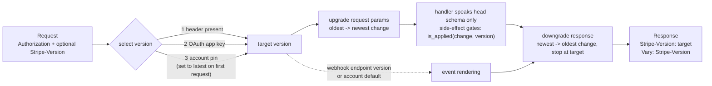

# Stripe's Date-Based API Versioning Engine: Account Pinning, Stripe-Version Overrides, and Bidirectional Transformers

> [!summary] Claim
> Stripe keeps every API version alive by writing handlers against only the newest schema and encapsulating each breaking change in a dated version change module that rewrites the head-shaped response backwards, newest first, until it reaches the version selected from the `Stripe-Version` header, the OAuth app's version, or the account pin set on the first request.

Part of [Versioning Evolution and API Guidelines](README.md) in [API Engineering](../README.md).

## TL;DR

- Mechanism: core code renders the current (head) representation once, then a version walker applies each dated change module's transform from the newest version back to the caller's version; changes that cannot be expressed as a transform are flagged `has_side_effects` and gated in handler code.
- Contract rule: an account is pinned to the newest version on its first request, every later unversioned call inherits that pin, and one request can override it with `Stripe-Version: 2019-10-17` without moving the pin.
- Trap: the pin is mutable account state, so code that does not send its own version changes behavior when someone upgrades the account in Workbench, and webhook endpoints without an explicit version follow the account default rather than the SDK's version.
- Portability: the lab engine is pure Python over Starlette `1.10.0` and passed on the pinned CPython `3.12.16`, `3.13.18`, `3.14.10`, and `3.15.2` with the locked environment and on `3.15.2t` free-threaded with a lock-pinned minimal environment, each in Debian Trixie (glibc) and Alpine (musl) containers, and on macOS; the one server-dependent detail is header-name case, which the ASGI spec only says "should" be lowercased and which Hypercorn `0.18.0` preserves when `h11_pass_raw_headers` is set.
- When not to use it: if you have few clients you can coordinate, a single evolving version with additive changes ([[Additive-Schema-Evolution-and-Tolerant-Reader-Patterns]]) is cheaper; the engine's cost grows with every change you keep, and side-effect changes leak into core code.

## Mental model



A request first resolves one target version: an explicit `Stripe-Version` header wins, then the version of the OAuth application acting for the account, then the account's pin, which the engine sets to the newest release the first time the account calls the API.
Request parameters written for that old version are lifted to the head shape by walking the dated changes from oldest to newest, so the handler never sees a legacy field name.
The handler builds the head representation, consulting `is_applied` only for changes that could not be expressed as a pure data transform.
The response walker then applies each change's downgrade from the newest version backwards and stops as soon as it reaches the target, and the response echoes the version it rendered and declares `Vary: Stripe-Version`.
Webhook events use the same walker, but their target is the endpoint's own version or, if it has none, the account default.

## How it works

### Dated versions and the pin

Stripe names each backwards-incompatible release by its date (the 2017 post's example is `2017-05-24`) and pins an account to "the most recent version available" on its first API request; from then on "every API call they make is assigned that version implicitly" (Stripe blog, "APIs as infrastructure: future-proofing Stripe with versioning", Brandur Leach, 2017-08-05).
A user can override one request with the `Stripe-Version` header or move the pin from the dashboard (same post).
The `/v1` path prefix is a reserved major version that Stripe says is "not likely to change for some time"; dated versions carry all the incompatible change (same post).
The post's resolution order is: the `Stripe-Version` header, then "The version of an authorized OAuth application if the request is made on the user's behalf", then the pinned version.
The current documentation lists the order as the `Stripe-Version` header, the version pinned by a server-side SDK, then the account default (Stripe Docs, "How API versioning works", as of 2026-11).
These agree on the wire: an SDK pins a version by sending the header itself, as stripe-python `16.1.0` does in `stripe/_api_requestor.py`, `_APIRequestor.request_headers` (`headers["Stripe-Version"] = stripe_version`), with the default coming from `stripe/_stripe_client.py`, `StripeClient.__init__` (`stripe_version or _ApiVersion.CURRENT`) and `stripe/_api_version.py`, `_ApiVersion.CURRENT = "2026-10-28.endive"`.
`Stripe-Version` is an application-prefixed field name of the kind RFC 9110 recommends for limited-use fields, without the `X-` prefix that RFC 9110 Section 16.3.2.1 and RFC 6648 Section 3 advise against.

### Release lines since 2024

Starting with `2024-09-30.acacia`, Stripe releases a version every month with no breaking changes, and twice a year starts a new named major release whose first version may contain breaking changes (Stripe Docs, API reference "Versioning", as of 2026-11).
Identifiers became `YYYY-MM-DD.<line>`, for example `2024-09-30.acacia`; the changelog index lists the lines Acacia, Basil, Clover, Dahlia, and Endive, and the current version is `2026-10-28.endive` (Stripe Docs changelog, as of 2026-11).
Preview channels use a distinct suffix such as `2025-04-30.preview` (Stripe Docs, "How SDK versioning works", as of 2026-11).
The engine below is unchanged by the naming: ordering is by date, and under the lab's strict policy the line suffix is part of the identifier and must match exactly.
The lab's waterfall policy compares dates only, so `2024-09-30.basil` resolves to a registered `2024-09-30.acacia`; a public API that waterfalls should reject a wrong line instead.

### Version change modules

Every response is described by an "API resource" class written for the current version, and each incompatible change lives in a version change module with a description, a transform, and the resource types it may touch (Stripe blog 2017).
The post's example, `CollapseEventRequest`, turns an Event's `request` object back into the bare request ID string for older versions with `data.merge(:request => data[:request][:id])`, and a master `VERSIONS` hash maps each date to its change modules (same post).
"Version changes are written so that they expect to be automatically applied backwards from the current API version and in order", and each module assumes its input "will look the same as when they were originally written" (same post).
That sentence is the core invariant: change N's downgrade is only correct if every change newer than N has already run, so the walk order is part of the contract.
A change that "leaks out of the module" is annotated `has_side_effects`, its transform becomes a no-op, and core code asks `VersionChanges.active?(LegacyTransfers)` instead (same post).
Because modules are declarative, Stripe generates its changelog from them and annotates reference docs with warnings for the logged-in user's pinned version (same post).

### Requests: the other direction

The 2017 post shows only response transforms: every code sample in it rewrites response data, it says "Most of our backwards-incompatible API changes will modify a response, but that's not always the case", and its one sentence about the other direction is a figure caption, "Requests are processed by version change modules before returning a response" (Stripe blog 2017).
The current documentation confirms only the contract, that a version "determines the request parameters you can send and the objects you receive" (Stripe Docs, "How API versioning works", as of 2026-11).
Neither source gives request-side code, so the request walk described here comes from Cadwyn and from the lab, not from Stripe.
The open-source FastAPI port Cadwyn makes the request direction explicit, and its loops show both walks.
`_migrate_request` starts after the client's version in `versions.reversed_versions` and moves towards head (cadwyn 9.0.0 `cadwyn/structure/versions/_requests.py`, `_migrate_request`).
`_migrate_response` iterates `versions.versions[:end]`, newest first, stopping before the client's version, and skips a migration when `status_code >= 300` unless that instruction sets `migrate_http_errors`, which defaults to `False` (cadwyn 9.0.0 `cadwyn/structure/versions/_responses.py`, `_migrate_response`; `cadwyn/structure/data.py`, `convert_response_to_previous_version_for`).
Cadwyn's side-effect gate is true when the change's version is `<=` the request's version, and also when no request version is set (cadwyn 9.0.0 `cadwyn/structure/versions/_changes.py`, `VersionChangeWithSideEffects.is_applied`).
For a date between releases, Cadwyn "waterfalls" down to the closest older release with `bisect.bisect_left`, and returns no routes for dates before the first version (cadwyn 9.0.0 `cadwyn/routing.py`, `_RootCadwynAPIRouter._get_routes_from_closest_suitable_version`), and its middleware echoes the matched version in the response header (cadwyn 9.0.0 `cadwyn/middleware.py`, `VersionPickingMiddleware.dispatch`).

### Webhooks and stored events

Webhook endpoints "can also pin their own API version", and an endpoint with an explicit version always receives events in that version; otherwise events use the account default (Stripe Docs, "How API versioning works", as of 2026-11).
An event fetched through the API is rendered with "the account's default API version at the time the event occurred" (Stripe Docs, "How API versioning works" and "Set a Stripe API version", as of 2026-11).
For event destinations, `snapshot_api_version` can be set only at creation, and thin event payloads are unversioned (Stripe Docs, "Upgrade your integration", as of 2026-11).

### Caching and the wire

A versioned representation depends on a request field, so a shared cache must key on it: RFC 9110 Section 12.5.5 says a `Vary` list tells caches they "MUST NOT use this response to satisfy a later request unless the later request has the same values for the listed header fields".
`Vary: Stripe-Version` does not cover the pin, because an unversioned request's representation depends on the account behind `Authorization`; RFC 9110 Section 12.5.5 notes there is no need to send the `Authorization` field name in `Vary`, so those responses need the authenticated-caching rules in [[Caching-Authenticated-and-Multi-Tenant-API-Responses]] instead.
A recipient may combine repeated field lines into one comma-separated value (RFC 9110 Section 5.3), so two `Stripe-Version` lines can arrive as `2017-02-14, 2019-10-17`; the lab rejects both forms.
Field names are case-insensitive in HTTP (RFC 9110 Section 5.1), HTTP/2 and HTTP/3 require lowercase names on the wire and treat uppercase names as malformed (RFC 9113 Section 8.2 and Section 8.2.1, RFC 9114 Section 4.2), and the ASGI HTTP scope says request header names "should be lowercased, but it is not required" (ASGI spec `specs/www.rst`, HTTP Connection Scope).
Starlette `1.10.0` `Headers.getlist` lowercases the key you ask for but compares it to the raw scope bytes as given (`starlette/datastructures.py`, `Headers.getlist`), so a scope carrying `b"Stripe-Version"` is invisible to `request.headers.getlist("Stripe-Version")`, and one carrying `b"Authorization"` is invisible to `request.headers.get("authorization")`.
Uvicorn `0.54.0` lowercases names in both HTTP/1.1 protocols (`uvicorn/protocols/http/h11_impl.py`, `H11Protocol.handle_events`; `uvicorn/protocols/http/httptools_impl.py`, `HttpToolsProtocol.on_header`).
Hypercorn `0.18.0` forwards h11's lowercased names by default, but with `h11_pass_raw_headers` set it forwards `request.headers.raw_items()` in the case the client sent (`hypercorn/protocol/h11.py`, `H11Protocol._create_stream`; `hypercorn/config.py`, `Config.h11_pass_raw_headers = False`), so this bites Hypercorn with that option, custom servers, test harnesses, and hand-built scopes.
Granian `2.8.7` builds the scope from `key.as_str()` of each `http::HeaderName` (`src/asgi/utils.rs`, `build_scope_common`), and the `http` crate documents that the string returned by `HeaderName::as_str` "will always be lower case" (docs.rs `http` `1.5.0`, `HeaderName::as_str`, as of 2026-11).
Over HTTP/2 a mixed-case name never reaches the application: h2 `4.4.1` raises `ProtocolError` for an inbound field name containing a byte in `0x41` to `0x5a` (`h2/utilities.py`, `_reject_illegal_characters`), Hypercorn `0.18.0` catches it, flushes, and closes the connection (`hypercorn/protocol/h2.py`, `H2Protocol.handle`), and the lab's HTTP/2 test observes `GOAWAY` with `PROTOCOL_ERROR` and no application call.
The lab therefore reads both `Authorization` and `Stripe-Version` through its own case-folding helper.

## Numbers and limits

| Quantity | Value | Source |
|---|---|---|
| Incompatible versions shipped by 2017 | "almost a hundred backwards-incompatible upgrades over the past six years" | Stripe blog, 2017-08-05 |
| Versions kept compatible | "every version of our API since the company's inception in 2011" | Stripe blog, 2017-08-05 |
| Release cadence | monthly non-breaking versions, a breaking major release twice a year, since `2024-09-30.acacia` | Stripe Docs API reference "Versioning" (as of 2026-11) |
| Current version | `2026-10-28.endive`; preview `2026-10-28.preview` | Stripe Docs "How API versioning works" and "How SDK versioning works"; stripe-python `16.1.0` `stripe/_api_version.py`, `_ApiVersion.CURRENT` (as of 2026-11) |
| Rollback window after a Workbench upgrade | 72 hours | Stripe changelog entry pages, e.g. `2019-10-17` `account_balance` rename (as of 2026-11) |
| Version usage visibility | requests from the last week, in Workbench Overview | Stripe Docs "How API versioning works" (as of 2026-11) |
| Object ID length to accept | up to 255 characters | Stripe Docs "How API versioning works" (as of 2026-11) |
| Lab: downgrade `evt_1` from head to `2017-02-14` (3 dated changes, nested customer) | 4.33 us per call | measured, see below |
| Lab: synthetic chain, 22-field object to base, 3 changes | 8.98 us per call | measured, see below |
| Lab: same, 30 changes | 101 us per call | measured, see below |
| Lab: same, 100 changes | 315 us per call | measured, see below |

Measured with `uv run --frozen python -m timeit -r 60 -s "from api_labs.f07_versioning_evolution_and_api_guidelines.date_versioning import synthetic_chain; r, b = synthetic_chain(100); t = r.versions[0]" "r.downgrade(b, t)"` (and `3` and `30`) from `labs/`, CPython `3.14.6`, macOS `27.2` (arm64), Apple M3 Pro, on 2026-11-10; each value is the lowest best-of-60 result across five runs of the command.
The `evt_1` row uses the same command with `-s "from api_labs.f07_versioning_evolution_and_api_guidelines.date_versioning import build_registry, seeded_state; r = build_registry(); b = seeded_state().events['evt_1']; t = r.versions[0]"`.
The machine was running other jobs during the measurement (load average 27 to 49 on 12 cores), and the five runs ranged from 4.33 to 8.55 us, 8.98 to 16.6 us, 101 to 199 us, and 315 to 662 us for the four rows, so treat these as upper bounds on an idle machine and rely on the ratio between rows.
The cost grows with changes x object size because the lab's walker rebuilds the whole tree once per change; about 3.0 to 3.4 us per change for a 22-field object here.
A production engine indexes changes by resource type and skips subtrees that no change touches; Stripe's 2017 count was almost a hundred versions, each carrying at least one change, so the naive walk alone would add at least roughly 0.3 ms per response on this machine.

## Portability

| Runtime or component | Version | Behavior and verification |
|---|---|---|
| CPython `3.12` | `3.12.16` (Trixie, Alpine), `3.12.13` (macOS) | Lab passed with the locked environment: in each container `uv sync --frozen --python <python>` then `uv run --frozen --python <python> pytest <lab> -q -p no:cacheprovider` -> `28 passed`; on macOS `UV_PROJECT_ENVIRONMENT=<tmp>/venv-3.12 uv run --frozen --python <python3.12> pytest <lab> -q -p no:cacheprovider` -> `28 passed` |
| CPython `3.13` | `3.13.18` (Trixie, Alpine, macOS) | Lab passed with the locked environment, same commands -> `28 passed` on each |
| CPython `3.14` | `3.14.10` (Trixie, Alpine, macOS), `3.14.6` (macOS, workspace `.python-version` `3.14`) | Lab passed with the locked environment, same commands -> `28 passed` on each |
| CPython `3.15` | `3.15.2` (Trixie, Alpine, macOS) | Lab passed with the locked environment, same commands -> `28 passed` on each |
| CPython `3.15t` | `3.15.2` free-threaded (Trixie, Alpine), `3.15.0b3` free-threaded (macOS); `sys._is_gil_enabled()` -> `False` on each | Locked environment cannot install: uv reports that `psycopg-binary==3.3.8` "doesn't have a source distribution or wheel for the current platform"; lab passed in a minimal leg, the lock-pinned closure of starlette, httpx, hypercorn, pytest, and pytest-asyncio (19 packages, `uv pip install --no-deps`), with `PYTHONPATH=src python -m pytest <lab> -q -p no:cacheprovider` -> `28 passed` on each; the lab mutates `LabState` and `Account` without locks, which is safe only because each test drives one event loop; a threaded server would need a lock around the first-request pin |
| Debian Trixie | Debian 13, glibc `2.41`, linux `aarch64` | Images `ghcr.io/astral-sh/uv:python3.12-trixie`, `python3.14-trixie`, and `python3.15-trixie` with uv `0.13.7`, run with `docker run --rm` (Docker `29.8.2`, OrbStack VM) with `labs/` mounted read-only and copied inside the container; `3.12.16`, `3.14.10`, and `3.15.2` are the images' interpreters, `3.13.18` and `3.15.2t` are uv-managed builds; every CPython row above passed here, including both socket tests |
| Alpine | Alpine `3.23`, musl `1.2.5`, linux `aarch64` | Image `ghcr.io/astral-sh/uv:python3.14-alpine` with uv `0.13.7`, same procedure; `3.14.10` is the image's interpreter, `3.12.16`, `3.13.18`, `3.15.2`, and `3.15.2t` are uv-managed musl builds; every CPython row above passed here, including both socket tests |
| Starlette | `1.10.0` | `Headers.getlist` and `Headers.__getitem__` are case-sensitive against raw scope keys (`starlette/datastructures.py`); the lab's `header_values` folds case itself for both `Authorization` and `Stripe-Version`, proven by `test_mixed_case_header_name_in_raw_scope_still_overrides` |
| httpx `ASGITransport` | `0.28.1` | Lowercases request header names when building the scope (`httpx/_transports/asgi.py`, `ASGITransport.handle_async_request`, `[(k.lower(), v) for (k, v) in request.headers.raw]`), so in-process tests never exercise the mixed-case path; the lab test drives the ASGI callable directly |
| Uvicorn | `0.54.0` | Lowercases names in `h11_impl.py` (`H11Protocol.handle_events`) and `httptools_impl.py` (`HttpToolsProtocol.on_header`); a raw HTTP/1.1 request with `Authorization` and `Stripe-Version: 2017-02-14` over a loopback socket reached the lab app with lowercase names and returned `200` at `2017-02-14` under both `--http h11` and `--http httptools` |
| Hypercorn | `0.18.0` | Lowercase names by default; with `h11_pass_raw_headers = True` the scope carries `Authorization` and `Stripe-Version` as sent; both cases return `200` at `2017-02-14` over HTTP/1.1, proven by the socket test `test_hypercorn_header_case_reaches_the_scope_and_the_app_still_resolves` |
| Granian | `2.8.7` | Same raw request over a loopback socket to `granian --interface asgi` reached the lab app with lowercase names and returned `200` at `2017-02-14`; names are lowercase by construction, since the scope is built from `http::HeaderName::as_str` (`src/asgi/utils.rs`, `build_scope_common`) |
| HTTP/1.1 | RFC 9112 | Field names case-insensitive (RFC 9110 Section 5.1); duplicate lines may be combined with commas (RFC 9110 Section 5.3), both rejected by the lab in `test_unknown_malformed_or_duplicate_versions_are_rejected` |
| HTTP/2 | RFC 9113 | Field names must be lowercase on the wire (RFC 9113 Section 8.2) and uppercase ones are malformed (RFC 9113 Section 8.2.1); over Hypercorn `0.18.0` with h2 `4.4.1` and prior knowledge, the request reached the lab app with `http_version` `2` and lowercase names and returned `200` at `2017-02-14`, and the same request with `Authorization` and `Stripe-Version` left in mixed case on the wire got `GOAWAY` with `PROTOCOL_ERROR` and never reached the app, proven by the socket test `test_http2_delivers_lowercase_names_and_refuses_uppercase_ones_as_malformed` |
| HTTP/3 | RFC 9114 | Field names must be lowercase and uppercase ones are malformed (RFC 9114 Section 4.2); the engine reads only the ASGI scope, so it is independent of framing; not run over QUIC here |

## Worked example

The lab builds the engine and a three-route Starlette app whose handlers speak only the head schema: [implementation](../labs/src/api_labs/f07_versioning_evolution_and_api_guidelines/date_versioning.py), [test](../labs/tests/f07_versioning_evolution_and_api_guidelines/test_stripe_date_based_versioning_and_version_change_gates.py).
Three dated changes sit on a base version `2017-02-14`, each modeled on a documented Stripe change: `2017-05-25` collapses Event `request` (the 2017 post's `CollapseEventRequest`), `2019-10-17` renames Customer `account_balance` to `balance` (Stripe changelog `2019-10-17`), and `2022-11-15` stops auto-expanding Charge `refunds` (Stripe changelog `2022-11-15`), a side-effect change because expansion is a loading decision, not a field rewrite.
The lab simplifies Stripe: JSON request bodies instead of form encoding, bearer tokens that map directly to accounts, and an in-memory store.

The change modules and the registry:

```python
COLLAPSE_EVENT_REQUEST: Final = VersionChange(
    name="collapse_event_request",
    description="Event `request` is an object with `id` and `idempotency_key`, not a string.",
    resource="event",
    downgrade_response=_collapse_event_request,
)
RENAME_CUSTOMER_ACCOUNT_BALANCE: Final = VersionChange(
    name="rename_customer_account_balance",
    description="Customer `account_balance` is renamed to `balance`.",
    resource="customer",
    downgrade_response=lambda obj: _rename(obj, "balance", "account_balance"),
    upgrade_request=lambda params: _rename(params, "account_balance", "balance"),
)
CHARGE_REFUNDS_NOT_EXPANDED: Final = VersionChange(
    name="charge_refunds_not_expanded",
    description="Charge objects no longer auto-expand `refunds`.",
    resource="charge",
    has_side_effects=True,
)


def build_registry() -> VersionRegistry:
    """Three dated changes on top of a base version, modeled on documented Stripe changes."""
    return VersionRegistry(
        [
            ("2017-02-14", []),
            ("2017-05-25", [COLLAPSE_EVENT_REQUEST]),
            ("2019-10-17", [RENAME_CUSTOMER_ACCOUNT_BALANCE]),
            ("2022-11-15", [CHARGE_REFUNDS_NOT_EXPANDED]),
        ]
    )
```

The two walks and the side-effect gate:

```python
    def is_applied(self, change_name: str, version: ApiVersion) -> bool:
        """True when `version` already includes the change (the new behavior applies)."""
        try:
            return self._changed_at[change_name] <= version
        except KeyError:
            raise RegistryError(f"change {change_name} was never registered") from None

    def downgrade(self, body: JSONObject, target: ApiVersion) -> JSONObject:
        """Render a head-shaped body at `target`: newest version first, stop at target."""
        out: Any = body  # _walk rebuilds every dict and list, so `body` is never mutated
        for entry in reversed(self._dated):
            if entry.version <= target:
                break
            for change in entry.changes:
                if change.downgrade_response is not None:
                    out = _walk(out, change.resource, change.downgrade_response)
        result: JSONObject = out
        return result

    def upgrade_request(self, resource: str, params: JSONObject, source: ApiVersion) -> JSONObject:
        """Lift request params sent at `source` to head: oldest newer version first."""
        out = params  # transforms return new dicts (see _rename); none mutate in place
        for entry in self._dated:
            if entry.version <= source:
                continue
            for change in entry.changes:
                if change.resource == resource and change.upgrade_request is not None:
                    out = change.upgrade_request(out)
        return out
```

Version selection and the request pipeline:

```python
def header_values(raw: Sequence[tuple[bytes, bytes]], name: str) -> list[str]:
    """Case-insensitive lookup: ASGI says request header names *should* be lowercased."""
    key = name.lower().encode("latin-1")
    return [value.decode("latin-1") for item, value in raw if item.lower() == key]


def select_version(
    registry: VersionRegistry,
    account: Account,
    header_values: Sequence[str],
    credential: Credential,
    policy: ResolutionPolicy = "strict",
) -> tuple[ApiVersion, VersionSource]:
    """Header, then OAuth app version, then the account pin (set on first request)."""
    if len(header_values) > 1:
        raise UnknownVersionError(f"{VERSION_HEADER} must appear at most once")
    if header_values:
        return registry.resolve(header_values[0].strip(), policy), "header"
    if credential.oauth_app_version is not None:
        return registry.resolve(credential.oauth_app_version), "oauth_app"
    if account.pinned is None:
        account.pinned = registry.latest
        return account.pinned, "account_first_request"
    return account.pinned, "account_pin"
```

```python
        async def endpoint(request: Request) -> JSONResponse:
            # Both lookups fold case themselves: Starlette compares raw scope names as given.
            authorization = header_values(request.headers.raw, "Authorization")
            token = authorization[0].removeprefix("Bearer ") if authorization else ""
            credential = state.credentials.get(token)
            if credential is None:
                return _error(401, "invalid API key")
            account = state.accounts.setdefault(
                credential.account_id, Account(credential.account_id)
            )
            try:
                version, _source = select_version(
                    state.registry,
                    account,
                    header_values(request.headers.raw, VERSION_HEADER),
                    credential,
                    state.policy,
                )
            except VersioningError as exc:
                return _error(400, str(exc))
            params: JSONObject = {}
            if request.method == "POST":
                try:
                    raw: Any = await request.json()
                except ValueError:
                    return _error(400, "request body must be JSON")
                if not isinstance(raw, dict):
                    return _error(400, "request body must be a JSON object")
                params = cast("JSONObject", raw)
            if resource is not None:
                params = state.registry.upgrade_request(resource, params, version)
            status, body = handler(request, version, params)
            # Error bodies are downgraded too: an embedded resource must match the caller.
            response = JSONResponse(state.registry.downgrade(body, version), status_code=status)
            response.headers[VERSION_HEADER] = str(version)
            response.headers["Vary"] = VERSION_HEADER
            return response
```

The order test, which fails if the walk runs oldest first or applies the target's own change:

```python
@pytest.mark.unit
def test_downgrade_walks_newest_to_oldest_and_stops_at_target() -> None:
    def rename(old: str, new: str) -> VersionChange:
        def downgrade(obj: dict[str, Any]) -> dict[str, Any]:
            return {(old if k == new else k): v for k, v in obj.items()}

        return VersionChange(f"{old}_to_{new}", "test", "widget", downgrade)

    registry = VersionRegistry(
        [("2020-01-01", []), ("2021-01-01", [rename("a", "b")]), ("2022-01-01", [rename("b", "c")])]
    )
    head = {"object": "widget", "c": 1}
    assert registry.downgrade(head, ApiVersion.parse("2020-01-01")) == {"object": "widget", "a": 1}
    assert registry.downgrade(head, ApiVersion.parse("2021-01-01")) == {"object": "widget", "b": 1}
    assert registry.downgrade(head, ApiVersion.parse("2022-01-01")) == head
```

The request-direction test: an old client's `account_balance` reaches the handler as `balance`, while a client already on `2019-10-17` that sends the old name gets a `400`, not a silent rename:

```python
@pytest.mark.unit
@pytest.mark.asyncio
async def test_request_upgrade_means_head_handler_sees_only_head_fields() -> None:
    state = seeded_state()
    async with client_for(state) as client:
        old = await client.post(
            "/v1/customers", json={"account_balance": 700}, headers=at("2017-02-14")
        )
        head = await client.post("/v1/customers", json={"balance": 700}, headers=at("2022-11-15"))
        stale = await client.post(
            "/v1/customers", json={"account_balance": 700}, headers=at("2019-10-17")
        )
    assert state.handler_inputs == [{"balance": 700}, {"balance": 700}, {"account_balance": 700}]
    assert stale.status_code == 400
    assert stale.json() == {"error": {"message": "unknown parameter: account_balance"}}
    assert old.json()["account_balance"] == 700
    assert "balance" not in old.json()
    assert head.json()["balance"] == 700
```

Captured on CPython `3.14.6`, macOS `27.2` (arm64), from `labs/`:

```text
$ uv run --frozen pytest tests/f07_versioning_evolution_and_api_guidelines/test_stripe_date_based_versioning_and_version_change_gates.py -q
............................                                             [100%]
28 passed in 0.47s
```

## Pitfalls

> [!warning] Relying on the account default instead of sending a version
> Trigger: server code calls the API without `Stripe-Version` and without an SDK that pins one.
> Symptom: someone upgrades the account in Workbench and every unpinned call changes shape at once, including fields renamed in a major release.
> Fix: Stripe's upgrade guide says to "specify the API version that you're integrating against in your code instead of relying on your account's default API version" (Stripe Docs, "Upgrade your integration", as of 2026-11); keep the 72-hour rollback in mind as the only undo.

> [!warning] Webhook payloads follow a different version than API calls
> Trigger: the SDK pins `2026-10-28.endive` but the webhook endpoint was created without `api_version`.
> Symptom: API responses and event payloads for the same object have different shapes, and an account upgrade changes only the events.
> Fix: create endpoints with an explicit version and migrate with a second endpoint, a distinguishing query parameter, and dual delivery, returning `400` on the old endpoint during cutover so Stripe retries there if you revert (Stripe Docs, "Upgrade your integration", as of 2026-11).

> [!warning] A strongly typed SDK cannot target another version
> Trigger: a Java, Go, or .NET integration sets a different `Stripe-Version` than the SDK release was generated for.
> Symptom: deserialization drift between the generated types and the payload; Stripe states "You can't target a different API version when using a strongly typed language, such as Java, Go, or .NET" (Stripe Docs, "Upgrade your integration", as of 2026-11).
> Fix: upgrade the SDK major version to move API versions.

> [!warning] Side-effect changes accumulate in core code
> Trigger: a change cannot be written as a transform (expansion defaults, legacy transfers), so handlers branch on `is_applied`.
> Symptom: the Stripe post warns that "dozens of checks on version changes that can't be encapsulated cleanly will be littered throughout the project, making it slower, less readable, and more brittle" (Stripe blog 2017).
> Fix: treat every `has_side_effects` change as debt with an owner, and prefer designing the change so it is a pure rewrite.

> [!warning] Writing a downgrade that assumes the head schema
> Trigger: an old change's transform is edited to read a field that a newer change renamed.
> Symptom: old versions get `KeyError` or silently empty fields, but only for clients older than the edited change; the lab's `test_downgrade_walks_newest_to_oldest_and_stops_at_target` pins the walk order that the original assumption depends on.
> Fix: never edit an old module's input assumptions; add a new change instead.

> [!warning] Depending on the format of an ID or URL that Stripe returns
> Trigger: integration code depends on the format of a value outside the versioned schema, such as the length or prefix of an object ID or the path of a URL that Stripe returns.
> Symptom: the dependency breaks without a new API version or a changelog entry to warn you; Buffer's write-up of its 2026-08-19 billing incident says "Stripe changed the format of the web addresses it generates for its Customer Portal", "Stripe didn't publish a changelog entry for the change", and Buffer's own code had "added extra path segments onto the end of it", so customers got Stripe's page-not-found error while "no error rate, log, or alert on our side moved at all" (Buffer status page, incident write-up, 2026-08-19).
> Fix: Stripe lists "Changing the length or format of opaque strings, such as object IDs, error messages, and other human-readable strings" among its backward-compatible changes (Stripe Docs, "How API versioning works", as of 2026-11), so store and forward such values unmodified, use the documented parameter instead of editing a returned URL, and add a synthetic check that follows the returned link, which is the remediation Buffer describes.

Stripe's published root cause analysis for 2019-07-10 attributes that outage to "two different database bugs and a configuration change" and does not mention API versions (Stripe RCA, 2019-07-10), so the incident evidence in this section is Buffer's write-up and the failure modes Stripe documents in its upgrade guide.

## Security and robustness

- Input validation on the version: reject malformed identifiers (`2017-13-01`, `v1`) and, under the strict policy, unreleased dates with `400`; the lab does this before any handler runs and before the account is pinned, so a bad header cannot set state.
- Duplicate or comma-combined `Stripe-Version` values are ambiguous (RFC 9110 Section 5.3); an intermediary and the origin could pick different ones, so reject rather than take the first, which is what Starlette's `Headers.__getitem__` would do.
- Header lookups must fold case in the application: under Hypercorn `0.18.0` with `h11_pass_raw_headers`, Starlette's `request.headers.get("authorization")` finds nothing for a client that sends `Authorization`, so a handler that relied on it would answer `401` to every request; that failure is closed, but the same miss on an optional override such as `Stripe-Version` silently serves the account pin instead.
- Unknown parameters must fail: if the head handler silently ignored unknown fields, a client on `2019-10-17` sending `account_balance` would lose data without an error; the lab returns `unknown parameter: account_balance`.
- Request upgrades are a binding step, so they inherit OWASP API3:2023 Broken Object Property Level Authorization: "Allow changes only to the object's properties that should be updated by the client", which means an upgrade transform must never map an old parameter onto a field the caller may not write.
- Downgrades are a rendering step: run them after the handler has filtered what the caller may see, never let a downgrade re-add a field the head schema removed for security reasons, and apply OWASP API3:2023's "schema-based response validation" per version, not only at head.
- Error bodies that embed resources are rendered at the caller's version in the lab, unlike Cadwyn's default; either choice is defensible, but it must be one choice, applied everywhere.
- The pin is written on the first authenticated request; under concurrency two first requests could race across a release boundary, so the write must be a compare-and-set on the account row.
- Cache safety: echo the rendered version and send `Vary: Stripe-Version`; responses that depend on the account pin are already private to the credential and must not be stored in a shared cache.

## The principal's view

The decision is not "date versions or `/v2`", it is where compatibility cost lives.
Stripe chose to pay it inside the provider: a permanent, growing registry of change modules, review of every outgoing change on a mailing list, and generated changelogs and docs, in exchange for not having forced a customer migration in its first six years, although the same post says "we expect to eventually start retiring our older API versions" (Stripe blog 2017).
That is the right trade when integrations are long-lived, money moves through them, and the provider can afford a platform team that owns the walker, the changelog generator, and the per-version contract tests.
The organizational trade-off is that every product team now writes two artifacts per breaking change, the new head behavior and its inverse, and the oldest supported version silently constrains what the head schema can ever become: a change with no computable inverse becomes a side-effect gate forever.
Stripe's 2024 move to monthly non-breaking releases plus twice-yearly breaking majors keeps the engine but batches breaking changes, which reduces how many distinct shapes customers must reason about without changing the mechanism.
Choose a different design when clients are few and controllable (one evolving version, [[Additive-Schema-Evolution-and-Tolerant-Reader-Patterns]]), when the API is a protobuf contract where wire compatibility rules already do the work ([[Compatibility-Taxonomy-Wire-Source-and-Semantic-Compatibility-AIP-180]]), or when you must eventually retire versions, in which case pair the engine with telemetry and sunset signaling ([[Brownout-Schedules-Per-Client-Usage-Telemetry-and-Safe-Sunsetting]], [[Deprecation-Header-RFC-9745-and-Sunset-Header-RFC-8594]]).

## Interview questions

> [!question] L5: How does Stripe decide which API version a request is served at when no `Stripe-Version` header is sent?
>
> > [!success]- Answer
> > The account has a default version that was set to the newest release on its first API request.
> > Every later unversioned request inherits it; an OAuth app acting for the account uses the app's version, per the 2017 post.
> > SDKs avoid the default by sending the header themselves, as stripe-python `16.1.0` does with `_ApiVersion.CURRENT`.
> >
> > Follow-up: What changes for that account when someone upgrades it in Workbench, and how long can they undo it?

> [!question] L5: Why does a version change module downgrade responses rather than upgrade old data to new?
>
> > [!success]- Answer
> > Core code is written once against the current schema, so the only representation that exists at runtime is the newest one.
> > Each module knows how its change looked just before and just after, so applying modules backwards from head reconstructs any older shape.
> > This keeps old versions out of core code paths, which is the post's "fixed-cost" principle.
> >
> > Follow-up: Which direction do request parameters travel, and why?

> [!question] L6: Predict the output: when the lab app runs with `policy="waterfall"` and receives `GET /v1/events/evt_1` with `Stripe-Version: 2019-12-31`, what `Stripe-Version` response header comes back, and is the nested customer's field `balance` or `account_balance`?
>
> > [!success]- Answer
> > `2019-12-31` is not a release, so waterfall rounds down to the closest older release, `2019-10-17`.
> > The response header says `Stripe-Version: 2019-10-17`, and because the rename shipped at `2019-10-17` the customer keeps `balance`.
> > With `Stripe-Version: 2019-10-16` the target becomes `2017-05-25` and the field is `account_balance`; `2016-01-01` predates the base and returns `400`.
> >
> > Follow-up: Why might a strict policy be safer for a public API even though waterfall is convenient across microservices?

> [!question] L6: Debug this API: after an account upgrade in Workbench, a team's webhook handler fails on missing fields although their SDK pins the API version and their API calls still work, so what happened and how do they fix it?
>
> > [!success]- Answer
> > The webhook endpoint was created without its own `api_version`, so events render at the account default, which the upgrade moved.
> > The SDK pin affects only the requests the SDK sends; it never touched event rendering.
> > Fix: create a second endpoint with an explicit version and a distinguishing query parameter, run dual delivery, return `400` from the old one during cutover so retries land there if they revert, then disable the old endpoint, which is Stripe's documented procedure.
> >
> > Follow-up: Why must the event handler be idempotent during that migration?

> [!question] L6: What is a side-effect version change, and why does it cost more than a transform?
>
> > [!success]- Answer
> > It is a change that cannot be expressed as a rewrite of the head representation, such as whether `refunds` is auto-expanded, so its transform is a no-op and handler code checks whether the change applies to the request's version.
> > Every such check lives in core code forever, defeating the encapsulation that makes old versions cheap.
> > The lab's `charge_refunds_not_expanded` is the example: the charge handler loads refunds only when `is_applied` is false.
> >
> > Follow-up: How would you design the refunds change so it could have been a pure transform?

> [!question] L6: If a downgrade for an old change reads a field name that a newer change later renamed, which clients break, and what invariant was violated?
>
> > [!success]- Answer
> > Only clients older than the old change break, because the newer change's downgrade runs first and restores the old name before the old change sees the data.
> > Editing the old module to read the head name violates the post's rule that each change expects input that "will look the same as when they were originally written".
> > The lab's order test pins the newest-first walk that this rule depends on.
> >
> > Follow-up: How would you test every version pair without writing N squared fixtures?

> [!question] L7+: For a gateway in front of an origin that renders by `Stripe-Version` and by account pin, how do you design the cache key, and where is `Vary` not enough?
>
> > [!success]- Answer
> > For explicit-version requests, `Vary: Stripe-Version` expands the cache key to the header value (RFC 9110 Section 12.5.5).
> > For unversioned requests the representation depends on the account pin behind `Authorization`, which `Vary` cannot express, so those responses must be private or keyed by tenant.
> > The safe default is to treat every authenticated versioned response as non-shareable unless the key includes tenant and resolved version, and to echo the resolved version so caches and clients can audit what was rendered.
> >
> > Follow-up: What breaks if an intermediary combines two `Stripe-Version` lines into one comma-separated value?

> [!question] L7+: With a hundred changes in the registry and a p99 regression, where does the version walk spend time, and how would you make it cheaper without changing semantics?
>
> > [!success]- Answer
> > A naive walker visits the whole response tree once per change, so cost is changes x nodes; the lab measured 315 us for 100 changes on a 22-field object on a loaded Apple M3 Pro.
> > Index changes by resource type, skip versions with no change for any resource present in the response, and precompute a per-(resource, target-version) list of transforms.
> > Prove semantics did not change with golden tests that render every fixture at every version before and after the optimization.
> >
> > Follow-up: How does Stripe's 2024 release model change the number of versions most traffic hits?

> [!question] L7+: Would you adopt this engine for a new internal platform API with forty consuming teams, arguing both sides before you decide?
>
> > [!success]- Answer
> > For: teams upgrade on their own schedule, breaking changes stop requiring coordinated cutovers, and the changelog and docs come for free from the modules.
> > Against: every breaking change needs an inverse, the oldest version constrains the head forever, and a platform team must own the walker and per-version tests.
> > With forty internal teams you can measure usage and coordinate, so prefer additive evolution plus deprecation telemetry, and reserve a date-versioned engine for externally consumed, long-lived APIs.
> >
> > Follow-up: What usage telemetry would tell you it is safe to delete the oldest version?

## Related

Prerequisites: [[API-Versioning-Strategies-URI-Header-Media-Type-and-Channel-AIP-185]]

Next: [[Deprecation-Header-RFC-9745-and-Sunset-Header-RFC-8594]]

See also: [[API-Fundamentals]], [[Anatomy-of-Breaking-Changes-in-HTTP-and-JSON-APIs]], [[Additive-Schema-Evolution-and-Tolerant-Reader-Patterns]], [[Compatibility-Taxonomy-Wire-Source-and-Semantic-Compatibility-AIP-180]], [[Brownout-Schedules-Per-Client-Usage-Telemetry-and-Safe-Sunsetting]], [[Synthesizing-an-Organizational-API-Style-Guide]], [[Vary-Header-Mechanics-and-Cache-Hit-Collapse]], [[Caching-Authenticated-and-Multi-Tenant-API-Responses]], [[Breaking-Change-Detection-and-Semantic-OpenAPI-Diffing]], [[Webhook-Sender-Architecture-Standard-Webhooks-Signatures-and-Fan-Out]], [[Webhook-Consumer-Engineering-Signature-Verification-Replay-Windows-and-Idempotency]]

- Lab: `labs/tests/f07_versioning_evolution_and_api_guidelines/test_stripe_date_based_versioning_and_version_change_gates.py`

## Further reading

- [Stripe blog: APIs as infrastructure: future-proofing Stripe with versioning (Brandur Leach, 2017)](https://stripe.com/blog/api-versioning) - the primary description of pinning, version change modules, side-effect changes, and the generated changelog.
- [Stripe Docs: How API versioning works](https://docs.stripe.com/api-versions) - current resolution order, webhook endpoint versions, the backward-compatible change list, and identifier format (as of 2026-11).
- [Stripe API reference: Versioning](https://docs.stripe.com/api/versioning) - the 2024 monthly and twice-yearly release model starting at `2024-09-30.acacia`.
- [Stripe Docs: Upgrade your integration](https://docs.stripe.com/upgrades) - per-request override, SDK version limits, and the dual-endpoint webhook migration.
- [Stripe changelog](https://docs.stripe.com/changelog) - every breaking change by version, the record the change modules generate.
- [stripe-python v16.1.0 `stripe/_api_requestor.py`](https://github.com/stripe/stripe-python/blob/v16.1.0/stripe/_api_requestor.py) - how an SDK pins a version by sending `Stripe-Version`.
- [Cadwyn 9.0.0 source](https://github.com/zmievsa/cadwyn/tree/9.0.0) - an open-source Stripe-style engine for FastAPI with explicit request and response migrations, side-effect gates, and version waterfalling.
- [RFC 9110 Section 12.5.5: Vary](https://www.rfc-editor.org/rfc/rfc9110.html#section-12.5.5) - why a version-selected representation must expand the cache key.
- [RFC 9110 Section 5.3: Field Order](https://www.rfc-editor.org/rfc/rfc9110.html#section-5.3) - why repeated version headers can be combined and must be rejected.
- [RFC 6648: Deprecating the "X-" Prefix](https://www.rfc-editor.org/rfc/rfc6648.html) - the naming rule a custom version header should follow.
- [ASGI HTTP and WebSocket spec](https://github.com/django/asgiref/blob/main/specs/www.rst) - header-name case in the scope is only a "should".
