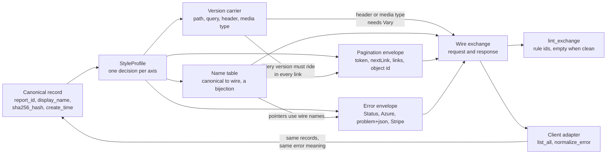

# Where Google, Microsoft, Zalando, and Stripe Disagree: Choosing Coherent Conventions for Your Organization

> [!summary] Claim
> The four most-copied API style guides disagree on every wire-visible axis (field names, version carrier, pagination envelope, error envelope, timestamps, request encoding), and the axes are coupled, so an organization gets a coherent API only by choosing one option per axis, recording the choice as machine-checkable data, and linting real exchanges against it.

Part of [Versioning Evolution and API Guidelines](README.md) in [API Engineering](../README.md).

## TL;DR

- Mechanism: a style guide is one decision per wire axis; the lab writes each guide as a `StyleProfile` with 13 decisions, serves the same five records in four dialects from one interpreter, and one client adapter recovers identical records from all four in 3 requests each.
- Contract rule: choose exactly one option per axis and write down the cross-axis rules, because a query-carried version must ride in every pagination link (Azure anchor `collections-nextlink-includes-all-query-params`), a header-carried or media-type-carried version needs `Vary` naming the selecting request header (RFC 9110 Section 12.5.5), and field names that travel as values (error pointers, sort keys, field masks) must come from an explicit name table.
- The trap: rules copied one axis at a time compose into a broken API; Azure's `api-version` query parameter plus Zalando-style `next` links returns `200` on page one and `400` on page two in the lab, and runtime case conversion is not a bijection (pydantic `2.14.3` turns `sha256Hash` back into `sha_256_hash`).
- Portability fact: the conventions live in URLs, header fields, and JSON, so they are independent of server and HTTP version; the lab's 88 tests pass unchanged on CPython `3.12.13`, `3.13.18`, `3.14.6`, `3.14.10`, `3.15.2`, and free-threaded `3.15.0b3`.
- When not to use it: do not synthesize your own guide when one published guide fits your toolchain (adopt it whole and list your deviations), and never re-case, re-envelope, or re-version a shipped API to match a new guide, because each of those is a breaking change (see [[Anatomy-of-Breaking-Changes-in-HTTP-and-JSON-APIs]]).

## Mental model



One canonical record enters a profile, which fixes a name table, a version carrier, a pagination envelope, and an error envelope.
Three arrows cross between axes, and they are the part a table of conventions hides: the version carrier constrains what a pagination link must contain, the version carrier decides whether a response needs `Vary`, and the name table decides how an error envelope points at a field.
Every decision lands in one wire exchange, which two consumers read: the linter, which returns rule ids when the exchange deviates from the profile, and the client adapter, which has to undo each decision to get back the same record and the same error meaning.

## How it works

### Four documents of three different kinds

The four sources are not the same kind of document, and that changes how much weight a cell in the comparison below can bear (all as of 2026-11).

- Google's API Improvement Proposals are numbered normative documents with `must`, `should`, and `may`; this note read them at commit `2ccc61a4` (2026-10-15) of `aip-dev/google.aip.dev`, the repository that `googleapis/aip` URLs now redirect to.
- Microsoft's Azure REST API Guidelines are anchored rules with `DO`, `YOU SHOULD`, and `YOU MAY`; read at `microsoft/api-guidelines` branch `vNext`, commit `1c58ca7f` (2026-10-30), next to the separate Microsoft Graph guidelines in the same repository.
- Zalando's RESTful API Guidelines are numbered rules with `MUST`, `SHOULD`, and `MAY`; read at `zalando/restful-api-guidelines` commit `19a1905a` (2026-09-29).
- Stripe publishes no normative style guide; its column is read from the public API reference, so it describes observed behavior of one API and not a rule set written for other teams.

Depth on each guide belongs to [[Google-AIP-System-Architecture-and-Core-Tenets]], [[Microsoft-Azure-REST-API-Guidelines-in-Depth]], [[Zalando-RESTful-API-and-Event-Guidelines-in-Depth]], and [[Stripe-Date-Based-Versioning-and-Version-Change-Gates]]; this note only sets them side by side.

### The disagreement, axis by axis

| Axis | Google AIP | Azure | Zalando | Stripe |
|---|---|---|---|---|
| JSON member names | `lower_snake_case` in proto, mapped to `lowerCamelCase` JSON keys (AIP-140; ProtoJSON, Field names as JSON keys) | camelCase, acronyms not upper-cased (anchor `json-field-name-casing`) | snake_case matching `^[a-z_][a-z_0-9]*$`, "never camelCase" (rule 118) | snake_case (`has_more`, `starting_after`, `decline_code` in the API reference) |
| Query parameter names | `pageSize`, `pageToken` in a published REST reference (Pub/Sub `projects.topics.list`) | camelCase (anchor `http-query-names-casing`), with legacy kebab-case such as `api-version` and all-lowercase `maxpagesize`, `orderby` | snake_case (rule 130) | snake_case, arrays as `include[0]=...` in `/v2` |
| Path segments | collection identifiers in camelCase (AIP-122) | kebab-case preferred, or camelCase (anchor `http-url-casing`) | kebab-case (rule 129) | snake_case (`/v2/core/event_destinations`) |
| Enum values | `UPPER_SNAKE_CASE` (AIP-126) | extensible string enums (anchor `json-use-extensible-enums`); long-running operation status values are `NotStarted`, `Running`, `Succeeded` | `UPPER_SNAKE_CASE` (rule 240) | lower snake_case (`invalid_request_error`) |
| Timestamps | `google.protobuf.Timestamp`, names end in `_time` in the imperative (`create_time`), RFC 3339 text in JSON (AIP-142; ProtoJSON) | RFC 3339 (anchor `json-date-time-is-rfc3339`) | RFC 3339 `date-time` with upper-case `T` and `Z`, names contain `date`, `time`, or a similar indicator or end in `_at`, numeric timestamps discouraged (rules 169, 235) | `created`, "seconds since the Unix epoch" |
| Version carrier | major version as the first URI path segment, no minor version (AIP-185) | required `api-version` query parameter, `YYYY-MM-DD`, no version in the path (anchors `versioning-api-version-query-param`, `versioning-date-based-versioning`, `versioning-no-version-in-path`) | avoid versioning (rule 113), media type versioning when unavoidable (rule 114), never the URL (rule 115) | `/v1` and `/v2` namespaces in the path plus a dated `Stripe-Version` header |
| Absent version | cannot happen, the path carries it | `400` with code `MissingApiVersionParameter` (anchor `versioning-api-version-missing`) | plain `application/json` until an incompatible change exists (rule 114) | `/v1` uses the account's default version; `/v2` requires the header |
| Page request | `page_size`, `page_token`, optional `skip` (AIP-158) | `top`, `skip`, `maxpagesize` (anchor `collections-query-options`) | `limit`, `cursor`, `offset` (rule 137) | `limit`, `starting_after`, `ending_before` |
| Page response | resource-named array plus `next_page_token` (AIP-158) | `value` plus absolute `nextLink` (anchors `collections-response-array-name`, `collections-include-nextlink-for-more-results`) | `items` plus `self`, `first`, `prev`, `next`, `last` links in the body; the `Link` header of RFC 8288 Section 3 is forbidden with JSON (rules 248, 161, 166) | `object: "list"`, `url`, `has_more`, `data` |
| End of collection | `next_page_token` empty, "the only way" to signal it (AIP-158) | `nextLink` absent, never `null` (anchors `collections-no-nextlink-on-last-page`, `collections-nextlink-value-never-null`) | `next` "not provided" (rule 248) | `has_more: false` in `/v1`; `next_page_url: null` in `/v2` |
| Total count | optional `total_size`, may be an estimate (AIP-158) | should not return `count` (anchor `collections-avoid-count-property`) | should avoid (rule 254) | not part of the list format |
| Error body | `{"error": {"code", "message", "status", "details"}}` where `code` is the HTTP status and `details` must contain an `ErrorInfo` (AIP-193) | `{"error": {"code", "message", "target", "details", "innererror"}}` plus an `x-ms-error-code` header equal to `code` (anchors `rest-error-code-header`, `rest-error-code-header-and-body-match`) | RFC 9457 `application/problem+json`, with `type` as a relative reference such as `/problems/out-of-stock` (rule 176) | `{"error": {"type", "code", "message", "param", ...}}` |
| Pointer to the bad field | `BadRequest.FieldViolation.field`, written `fullName` in JSON (`error_details.proto`) | `target` | none in the base format; the RFC's own example adds an `errors` extension with a JSON Pointer (RFC 9457 Section 3) | `param` |
| Unknown request member | ProtoJSON "does not support unknown fields" | `400` (anchor `rest-fail-for-unknown-fields`) | should be `400` (rule 109) | error code `parameter_unknown` |
| `null` in responses | serializers "should not emit null values" (ProtoJSON, Null values) | do not send (anchor `json-null-response-values`) | `null` and absent mean the same (rule 123) | sent routinely (`"application": null` in the charge object example) |
| Request encoding | JSON | JSON | JSON (rule 167) | form encoding in `/v1`, JSON in `/v2` |

Two cells deserve their exact wording, because a paraphrase would hide the disagreement.
AIP-140 says field definitions "must use `lower_snake_case` names" and that "each word in the field must not begin with a number, because it creates ambiguity when converting between snake case and camel case".
Zalando rule 118 gives its rationale as "No established industry standard exists", which is an honest statement that the choice is arbitrary and that only consistency has value.

The same casing does not make two guides compatible.
Google and Azure both emit camelCase, yet the lab's record is `name` plus `createTime` in one and `id` plus `createdAt` in the other, and Zalando and Stripe both emit snake_case, yet one sends `created_at` as an RFC 3339 string and the other sends `created` as an integer.
The Azure guidelines contain no naming rule for creation timestamps, so `createdAt` is the lab's choice.
Precision is a hidden axis inside the timestamp row: Stripe's form is whole seconds, RFC 3339 text may carry fractions, and Zalando's rule 169 warns about exactly this ambiguity between `1460062925`, `1460062925000`, and `1460062925.000`, so the lab's wire carries whole seconds in every dialect.

### Each guide also disagrees with itself

A guide that has lived for years carries its own history, and copying a rule without its exceptions copies the wrong thing.

- Google uses three casings on one request: camelCase collection identifiers in the path (AIP-122), snake_case field names inside `filter` expressions (AIP-160, which lets implementations "choose to support automatic conversion"), and `lowerCamelCase` keys in the JSON body.
- AIP-193 requires `ErrorInfo.reason` to match `[A-Z][A-Z0-9_]+[A-Z0-9]`, and its own example puts camelCase keys such as `vmType` and `zonesWithCapacity` in `metadata` right beside it.
- AIP-185 mandates the major version in the path and now also describes interface-based versioning, in which a request carries a `YYYY-MM-DD` version in an `X-Goog-Api-Version` header or a `$apiVersion` query parameter.
- Azure says "DO use camel case for query parameter names" and immediately notes that legacy names use kebab-case, and its own standard parameters are `api-version`, `maxpagesize`, and `orderby`.
- Microsoft runs a second guide for Graph with the opposite choices: `/v1.0` and `/beta` in the path, `$top` and `$skip` for client-driven paging, and a top-level error code that must equal the HTTP status description in camelCase, while Azure forbids the `$` prefix (anchor `collections-query-options-no-dollar-sign`).
- Zalando says to avoid versioning (rule 113) and that media type versioning is a `MUST` (rule 114), which only reads coherently as "when you cannot avoid it".
- Stripe changed conventions between its own namespaces: `/v1` takes form-encoded requests and pages with `starting_after` and `has_more`, while `/v2` takes JSON and pages with a `page` token and `next_page_url`; `/v1` removes a metadata key with an empty string and `/v2` with `null`; `/v1` idempotency keys can be pruned after 24 hours and `/v2` replays are recognized for 30 days.

### The axes are coupled

A comparison table suggests the rows are independent, so that any column value can be combined with any other.
Four couplings break that.

Version carrier and pagination links.
Azure states it as a rule: "DO include any query parameters required by the service in `nextLink`, including `api-version`", and clients specify the version "even requests to an `Operation-Location` or `nextLink` URL returned by the service".
Zalando's link rule says nothing about versions, correctly for Zalando, because its version travels in a media type and not in the URL.
A link is self-describing only when the version is in the path or the query; under a header or media type carrier the client must re-send the header on every followed link, which Stripe spells out for `/v2`, where `next_page_url` is returned and "All API requests to the API `/v2` namespace must include the `Stripe-Version` header".

Version carrier and caches.
`Vary` "describes what parts of a request message, aside from the method and target URI, might have influenced the origin server's process for selecting the content of this response" (RFC 9110 Section 12.5.5), and a cache "MUST NOT use that stored response without revalidation unless all the presented request header fields nominated by that Vary field value match" (RFC 9111 Section 4.1).
A version in the path or query is already part of the target URI, so it needs nothing; a version in a request header selects the representation and must be named in `Vary`.
The mechanics belong to [[API-Versioning-Strategies-URI-Header-Media-Type-and-Channel-AIP-185]] and [[Vary-Header-Mechanics-and-Cache-Hit-Collapse]].

Field names in value position.
Body keys are renamed by a serializer, but field names also travel as values: Azure's `orderby=hireDate`, Zalando's `sort=+id`, AIP-160 filter paths, field masks, and every error pointer in the table above.
Those values cross the casing boundary without passing through the serializer's alias table, so a service that converts them with a case function at runtime depends on that function being a bijection.
It is not: the ProtoJSON specification has a section named "Non-Round Trippable FieldMasks" whose example is `x_0`, which becomes `x0` and cannot be restored.
Pydantic's converter fails on a different input: `to_snake` applies a rule commented "Insert an underscore between a lowercase letter and a digit" `(pydantic 2.14.3 pydantic/alias_generators.py, to_snake)`, so `to_camel("sha256_hash")` is `sha256Hash` and `to_snake("sha256Hash")` is `sha_256_hash`.
Two converters, two different sets of names that do not survive, which is why the lab's `WireNames` is an explicit table that refuses to be constructed unless it is a bijection in the right case.

Error envelope and everything that is not your handler.
A framework produces errors on its own: inside a Starlette application the router raises `HTTPException(status_code=404)` for an unmatched path `(starlette 1.10.0 starlette/routing.py, Router.not_found)`, a route raises `HTTPException(status_code=405)` with an `Allow` header for a method it does not serve `(starlette 1.10.0 starlette/routing.py, Route.handle)`, and the default handler answers both with `PlainTextResponse` `(starlette 1.10.0 starlette/middleware/exceptions.py, ExceptionMiddleware.http_exception)`.
Zalando rule 176 concedes the general case, telling clients not to rely on Problem JSON "since (a) failure responses may be created by infrastructure components not aware of this guideline".
An error convention is therefore only as wide as the set of layers that implement it, so the lab registers handlers for `404` and `405` that answer in the profile's envelope and keep the `Allow` header that RFC 9110 Section 15.5.6 requires, and its client and linter treat any other body as "not ours" instead of crashing on it.

### What the lab builds

`StyleProfile` holds the 13 decisions; `GOOGLE`, `AZURE`, `ZALANDO`, and `STRIPE` are four values of it, modelling the guides as this note reads them and not the vendors' servers.
`create_app` interprets any profile over one in-memory list of reports, so a profile that is incoherent produces an API that is broken in exactly the way the profile says.
`list_all`, `create`, `parse_report`, and `normalize_error` are the adapter a consumer of more than one dialect has to write.
`lint_exchange` takes a profile and an `httpx.Response` and returns the sorted ids of the rules that exchange breaks: `field-case`, `version-carrier`, `request-encoding`, `page-envelope`, `error-envelope`, `link-carries-version`, and `vary`.
Member names, time format, and default order are not linted; the tests' expected values pin them.
The server enforces the request encoding with `415` (RFC 9110 Section 15.5.16), reads `Accept` so that a range with a weight of `0` does not count and a wildcard or the bare media type selects the default (RFC 9110 Section 12.4.2), and writes the problem details pointer as an escaped JSON Pointer in fragment form (RFC 6901 Sections 3 and 6).
Machine-readable error codes in the lab are lab-defined, except Azure's `MissingApiVersionParameter` and `UnsupportedApiVersionValue` and Stripe's `parameter_missing` and `parameter_unknown`; the lab's rejection of an unknown `Stripe-Version` with `400`, its uniform page-size policy (`0` means default, larger than 100 is capped, negative is `400`, taken from AIP-158), and its page tokens (bare base64url, which AIP-158 calls insufficient obfuscation) are lab policy too.

## Numbers and limits

| Quantity | Value | Source |
|---|---|---|
| Guide revisions compared | AIP `2ccc61a4` (2026-10-15), Azure and Graph `1c58ca7f` (2026-10-30), Zalando `19a1905a` (2026-09-29), Stripe reference fetched 2026-11-11 | repository commit metadata and fetch date (as of 2026-11) |
| Stripe current API version and cadence | `2026-10-28.endive`; monthly releases without breaking changes, a major release twice a year | Stripe API reference, Versioning (as of 2026-11) |
| Stripe `/v1` page size | `limit` from 1 to 100, default 10 | Stripe API reference, Pagination (as of 2026-11) |
| AIP-158 page size in its example | default 50, maximum 1000, larger values coerced down | AIP-158 example comment, an illustration and not a mandate |
| Page token lifetime rule of thumb | three days | AIP-158, Expiring page tokens |
| `ErrorInfo.reason` length and `metadata` key length | at most 63 and at most 64 characters | AIP-193, ErrorInfo |
| Beta deprecation period before removal | 180 days recommended | AIP-185 |
| Azure maximum time in preview | 1 year | azure/Guidelines.md, anchor `versioning-preview-goes-ga-within-one-year` |
| Stripe idempotency key | up to 255 characters; `/v1` keys prunable after 24 hours; `/v2` replay window 30 days | Stripe API reference, Idempotent requests; API v2 overview (as of 2026-11) |
| Size of list that must paginate | "larger than just a few hundred entries" | Zalando rule 159 |
| Integers every JSON parser agrees on | `[-(2**53)+1, (2**53)-1]` | RFC 8259 Section 6 |
| Lab: decisions in a `StyleProfile` | 13 (14 fields, one of which is the profile's `name`) | `style_guide_synthesis.py`, `StyleProfile` |
| Lab: rules broken when dialect A is judged by profile B | 3 to 6 of 7 for every one of the 12 pairs, 0 on the diagonal (table below) | `test_each_dialect_is_clean_under_its_own_profile_and_fails_the_other_three`, CPython 3.14.6, macOS 27.2 arm64 |
| Lab: requests to read 5 records at page size 2 | 3 in every dialect; 1 at page size 5 | `test_one_client_recovers_the_same_records_from_every_dialect`, same machine |
| Lab: requests to read 101 records asking for 1000 per page | 2 in every dialect (cap of 100) | `test_page_size_zero_defaults_oversize_is_capped_and_bad_positions_are_400`, same machine |
| Lab: names that do not survive `to_snake(to_camel(name))` | 3 of 5 sampled (`sha256_hash`, `ipv4_address`, `oauth2_token`) | `test_case_conversion_is_not_a_bijection_but_the_registry_is`, pydantic 2.14.3 |
| Lab: full module run | `88 passed in 0.16s` (0.16s to 0.68s over repeated runs) | `uv run --frozen pytest ... -q -p no:cacheprovider`, CPython 3.14.6, macOS 27.2 arm64, Apple M3 Pro, 2026-11-11 |

Number of lint rules broken, with the dialect that produced the exchange in the row and the profile that judged it in the column (one page request and one failed create per cell):

| Served by \ judged by | `google-aip` | `azure` | `zalando` | `stripe-v1` |
|---|---|---|---|---|
| `google-aip` | 0 | 3 | 5 | 5 |
| `azure` | 3 | 0 | 5 | 6 |
| `zalando` | 4 | 5 | 0 | 5 |
| `stripe-v1` | 4 | 5 | 5 | 0 |

The smallest cells are the instructive ones: Google against Azure breaks only `version-carrier`, `page-envelope`, and `error-envelope`, with `field-case` clean, because both are camelCase.
Every pair that involves Stripe also breaks `request-encoding`, because `/v1` requests are form-encoded.
These are counts of rule ids on a deterministic in-process run, not a benchmark.

## Portability

| Leg | Version | Result and evidence |
|---|---|---|
| CPython | `3.12.13` (matrix asks for `3.12.16`, not installed here) | Proven: `88 passed in 0.31s` (`UV_PROJECT_ENVIRONMENT=<scratch>/3.12 uv run --frozen --python 3.12 pytest ...`, full workspace lock) |
| CPython | `3.13.18` | Proven: `88 passed in 0.29s` (same command, `--python /opt/homebrew/bin/python3.13`) |
| CPython | `3.14.6` (workspace `.venv`) | Proven: all five gates and `88 passed in 0.16s` (`uv run --frozen pytest ...`) |
| CPython | `3.14.10` | Proven: `88 passed in 0.32s` (`--python /opt/homebrew/bin/python3.14`) |
| CPython | `3.15.2` | Proven: `88 passed in 0.31s` (`--python /opt/homebrew/bin/python3.15`, full workspace lock) |
| CPython free-threaded | `3.15.0b3` free-threading build (not `3.15.2t`) | Proven: `88 passed in 0.20s` with `python -X gil=0 -m pytest` and `sys._is_gil_enabled()` `False` before and after the run, via `PYTHONPATH=src uv run --no-project --python 3.15t --with starlette==1.10.0 --with pydantic==2.14.3 --with pydantic-core==2.50.4 --with httpx==0.28.1 ...`; the full lock cannot install there because `psycopg-binary==3.3.8` has no wheel |
| CPython | `3.15.2t` | Not run: `uv python list` offers no such build on this machine |
| Containers (Debian Trixie, Alpine musl) | - | Not run: neither the draft nor the fact-check ran a container leg; the only compiled dependency the lab imports is `pydantic-core` |
| pydantic | `2.14.3` | `to_camel` and `to_snake` results are pinned by `test_case_conversion_is_not_a_bijection_but_the_registry_is`; the behavior has changed between releases (`2.8.0` returned `something_v_2` for `SomethingV2`, pydantic issue #9811), so the assertion is release-specific |
| Starlette | `1.10.0` | Router `404` and route `405` become `HTTPException` and the default handler is plain text (source cited above); the lab's handlers are proven by `test_google_version_is_a_path_segment_and_nothing_else` and `test_wrong_method_is_405_with_allow_in_the_profile_envelope` |
| httpx | `0.28.1` | Client side of every test, through `httpx.ASGITransport` |
| Servers (Uvicorn, Hypercorn, Granian) | `0.54.0`, `0.18.0`, `2.8.7` | Not run: the lab is in-process ASGI; nothing in it depends on a server, since it uses only the request target, header fields, status codes, and content |
| HTTP/1.1, HTTP/2, HTTP/3 | - | Not run per version: field names are case-insensitive (RFC 9110 Section 5.1) and media type parameter names are case-insensitive (RFC 9110 Section 5.6.6), so `Stripe-Version`, `stripe-version`, and `;Version=1` are version-neutral, and the lab tests those three spellings |
| Other languages | - | The profile is data; Google's linter reads protobuf, Zally reads OpenAPI, and Azure's Spectral ruleset is archived in favor of TypeSpec linting (as of 2026-11), so the enforcement tool follows the description language, not the convention |

## Worked example

The lab is [implementation](../labs/src/api_labs/f07_versioning_evolution_and_api_guidelines/style_guide_synthesis.py) plus [test](../labs/tests/f07_versioning_evolution_and_api_guidelines/test_synthesizing_an_organizational_api_style_guide.py): one Starlette application factory, four profile constants, a client adapter, and a linter.

The profile is the style guide as data (verbatim excerpt, `style_guide_synthesis.py` lines 149-170):

```python
@dataclass(frozen=True)
class StyleProfile:
    """One decision per wire-visible axis; the app, the client, and the linter all read it."""

    name: str
    names: WireNames
    id_prefix: str
    path_prefix: str
    version_carrier: VersionCarrier
    version_name: str
    version: str
    absent_version: AbsentVersion
    page_style: PageStyle
    links_carry_version: bool
    error_style: ErrorStyle
    time_format: TimeFormat
    request_encoding: Encoding
    newest_first: bool

    @property
    def collection_path(self) -> str:
        return f"{self.path_prefix}/reports"
```

Azure as a value of it (verbatim excerpt, lines 198-221):

```python
AZURE = StyleProfile(
    name="azure",
    names=WireNames(
        Case.CAMEL,
        {
            "report_id": "id",
            "display_name": "displayName",
            "sha256_hash": "sha256Hash",
            "create_time": "createdAt",
        },
    ),
    id_prefix="",
    path_prefix="",
    version_carrier=VersionCarrier.QUERY,
    version_name="api-version",
    version="2026-06-01",
    absent_version=AbsentVersion.REJECT,
    page_style=PageStyle.NEXT_LINK,
    links_carry_version=True,
    error_style=ErrorStyle.AZURE_ENVELOPE,
    time_format=TimeFormat.RFC3339,
    request_encoding=Encoding.JSON,
    newest_first=False,
)
```

The name table refuses to exist unless it is a bijection in the declared case (verbatim excerpt, lines 128-146):

```python
@dataclass(frozen=True)
class WireNames:
    """One guide's field names: an explicit bijection, never a runtime case conversion."""

    case: Case
    by_canonical: Mapping[str, str]
    by_wire: Mapping[str, str] = field(init=False)

    def __post_init__(self) -> None:
        if tuple(self.by_canonical) != CANONICAL_FIELDS:
            raise ValueError(f"wire names must cover exactly {CANONICAL_FIELDS}")
        pattern = CASE_PATTERNS[self.case]
        wrong = [wire for wire in self.by_canonical.values() if not pattern.fullmatch(wire)]
        if wrong:
            raise ValueError(f"{wrong} is not {self.case.value}")
        by_wire = {wire: canonical for canonical, wire in self.by_canonical.items()}
        if len(by_wire) != len(self.by_canonical):
            raise ValueError("two canonical fields share one wire name")
        object.__setattr__(self, "by_wire", by_wire)
```

The version gate reads the version from whichever carrier the profile names, and treats absence as policy (verbatim excerpt, lines 491-512):

```python
def version_problem(profile: StyleProfile, request: Request) -> Problem | None:
    """Read the version from the profile's carrier; absent and unknown versions are policy."""
    if profile.version_carrier is VersionCarrier.PATH:
        return None  # the router only knows the versioned path
    if profile.version_carrier is VersionCarrier.QUERY:
        stated = request.query_params.getlist(profile.version_name)
    elif profile.version_carrier is VersionCarrier.HEADER:
        stated = request.headers.getlist(profile.version_name)
    else:
        stated = _requested_media_versions(request.headers.getlist("accept"))
    if not stated:
        if profile.absent_version is AbsentVersion.DEFAULT:
            return None
        message = f"{profile.version_name} is required on every request."
        return Problem(ProblemKind.MISSING_VERSION, 400, message)
    negotiated = profile.version_carrier is VersionCarrier.MEDIA_TYPE
    supported = profile.version in stated if negotiated else stated == [profile.version]
    if not supported:
        status = 406 if negotiated else 400
        message = f"Unsupported version {stated}; supported: {profile.version}."
        return Problem(ProblemKind.UNSUPPORTED_VERSION, status, message)
    return None
```

The link builder is where two axes meet: it adds the version only for a query carrier, and only if the profile says links carry it (verbatim excerpt, lines 548-553):

```python
def _link(profile: StyleProfile, request: Request, size: int, token: str) -> str:
    size_name, position_name = PAGE_PARAMS[profile.page_style]
    query = {size_name: str(size), position_name: token}
    if profile.version_carrier is VersionCarrier.QUERY and profile.links_carry_version:
        query[profile.version_name] = profile.version
    return str(request.url.replace(query=urlencode(query)))
```

The client walks all four pagination contracts with one loop; only the continuation step differs (verbatim excerpt, lines 692-720):

```python
async def list_all(
    client: httpx.AsyncClient, profile: StyleProfile, *, page_size: int
) -> tuple[list[Report], int]:
    """Walk a collection in the profile's pagination dialect; returns records and request count."""
    size_name, position_name = PAGE_PARAMS[profile.page_style]
    items_key, continuation_key = PAGE_MEMBERS[profile.page_style]
    version_query, headers = version_parts(profile)
    first = {size_name: str(page_size), **version_query}
    url = profile.collection_path
    params: dict[str, str] | None = first
    reports: list[Report] = []
    requests = 0
    while True:
        response = await client.get(url, params=params, headers=headers)
        requests += 1
        response.raise_for_status()
        body = response.json()
        items = body[items_key]
        reports.extend(parse_report(profile, item) for item in items)
        continuation = body.get(continuation_key)
        if not continuation:
            return reports, requests
        if profile.page_style is PageStyle.PAGE_TOKEN:
            params = {**first, position_name: continuation}
        elif profile.page_style is PageStyle.OBJECT_ID:
            last_id = items[-1][profile.names.by_canonical["report_id"]]
            params = {**first, position_name: last_id}
        else:
            url, params = continuation, None  # follow the link verbatim
```

The same record, as the test's expected values for each dialect (verbatim excerpt, test lines 81-106):

```python
WIRE_SHAPES: dict[str, dict[str, object]] = {
    "google-aip": {
        "name": "reports/rpt_001",
        "displayName": "Report 1",
        "sha256Hash": HASH_1,
        "createTime": "2026-01-01T00:00:00Z",
    },
    "azure": {
        "id": "rpt_001",
        "displayName": "Report 1",
        "sha256Hash": HASH_1,
        "createdAt": "2026-01-01T00:00:00Z",
    },
    "zalando": {
        "id": "rpt_001",
        "display_name": "Report 1",
        "sha256_hash": HASH_1,
        "created_at": "2026-01-01T00:00:00Z",
    },
    "stripe-v1": {
        "id": "rpt_001",
        "display_name": "Report 1",
        "sha256_hash": HASH_1,
        "created": 1767225600,
    },
}
```

The same failure, a create request without the hash, in four envelopes that `normalize_error` reduces to one `(400, MISSING_FIELD, "sha256_hash")` (verbatim excerpt, test lines 334-378):

```python
ERROR_SHAPES: dict[str, dict[str, Any]] = {
    "google-aip": {
        "error": {
            "code": 400,
            "message": "'sha256Hash' is required.",
            "status": "INVALID_ARGUMENT",
            "details": [
                {
                    "@type": "type.googleapis.com/google.rpc.ErrorInfo",
                    "reason": "FIELD_REQUIRED",
                    "domain": "reports.lab.example",
                    "metadata": {"field": "sha256Hash"},
                },
                {
                    "@type": "type.googleapis.com/google.rpc.BadRequest",
                    "fieldViolations": [
                        {"field": "sha256Hash", "description": "'sha256Hash' is required."}
                    ],
                },
            ],
        }
    },
    "azure": {
        "error": {
            "code": "MissingRequiredField",
            "message": "'sha256Hash' is required.",
            "target": "sha256Hash",
        }
    },
    "zalando": {
        "type": "/problems/missing-field",
        "title": "Missing required field",
        "status": 400,
        "detail": "'sha256_hash' is required.",
        "errors": [{"detail": "'sha256_hash' is required.", "pointer": "#/sha256_hash"}],
    },
    "stripe-v1": {
        "error": {
            "type": "invalid_request_error",
            "message": "'sha256_hash' is required.",
            "code": "parameter_missing",
            "param": "sha256_hash",
        }
    },
}
```

The coupling test builds a profile the way a committee does, by taking Azure's version rule and leaving Zalando's link rule alone, and then repairs it (verbatim excerpt, test lines 54-62 and 968-990):

```python
# A deployment that takes Azure's query versioning and keeps Zalando's link rule unchanged.
HYBRID = replace(
    ZALANDO,
    name="hybrid",
    version_carrier=VersionCarrier.QUERY,
    version_name="api-version",
    version="2026-06-01",
    absent_version=AbsentVersion.REJECT,
)
```

```python
@pytest.mark.unit
@pytest.mark.asyncio
async def test_query_versioning_with_links_that_omit_the_version_breaks_on_page_two() -> None:
    async with client_for(HYBRID) as client:
        page = await client.get("/reports", params={"limit": "2", "api-version": "2026-06-01"})
        with pytest.raises(httpx.HTTPStatusError) as caught:
            await list_all(client, HYBRID, page_size=2)
    # Page one is fine and every single axis is a copy of a published rule...
    assert page.status_code == 200
    assert page.json()["next"] == "http://test/reports?limit=2&cursor=cnB0XzAwMg"
    # ...but the link rule and the version rule do not compose, and only the linter says so.
    assert lint_exchange(HYBRID, page) == ["link-carries-version"]
    failed = caught.value.response
    assert failed.request.url == "http://test/reports?limit=2&cursor=cnB0XzAwMg"
    assert normalize_error(HYBRID, failed).kind is ProblemKind.MISSING_VERSION
    assert failed.headers["content-type"] == "application/problem+json"

    coherent = replace(HYBRID, links_carry_version=True)
    async with client_for(coherent) as client:
        page = await client.get("/reports", params={"limit": "2", "api-version": "2026-06-01"})
        reports, requests = await list_all(client, coherent, page_size=2)
    assert lint_exchange(coherent, page) == []
    assert (reports, requests) == (REPORTS, 3)
```

The casing test pins the converter's behavior and the table's (verbatim excerpt, test lines 427-449):

```python
@pytest.mark.unit
def test_case_conversion_is_not_a_bijection_but_the_registry_is() -> None:
    # pydantic 2.14.3: forward conversion is fine, the reverse splits before the digit run.
    assert to_camel("sha256_hash") == "sha256Hash"
    assert to_snake("sha256Hash") == "sha_256_hash"
    lossy = [
        name
        for name in ("sha256_hash", "ipv4_address", "oauth2_token", "display_name", "create_time")
        if to_snake(to_camel(name)) != name
    ]
    assert lossy == ["sha256_hash", "ipv4_address", "oauth2_token"]
    # camelCase with an acronym does not survive the other direction either.
    assert to_camel(to_snake("userID")) == "userId"
    for profile in (GOOGLE, AZURE):
        # The registry agrees with the generator going out and disagrees with it coming back.
        wire = profile.names.by_canonical["sha256_hash"]
        assert wire == to_camel("sha256_hash")
        assert profile.names.by_wire[wire] == "sha256_hash" != to_snake(wire)
    for profile in GUIDES:
        names = profile.names
        assert [names.by_wire[names.by_canonical[field]] for field in names.by_canonical] == list(
            names.by_canonical
        )
```

Captured run, from `labs/`, CPython `3.14.6`, macOS `27.2` on `arm64`:

```text
$ uv run --frozen pytest tests/f07_versioning_evolution_and_api_guidelines/test_synthesizing_an_organizational_api_style_guide.py -q -p no:cacheprovider
........................................................................ [ 81%]
................                                                         [100%]
88 passed in 0.16s
```

A focused verbose run of the adapter, casing, matrix, and coupling tests (`-v -p no:cacheprovider -k "one_client_recovers or clean_under_its_own or not_a_bijection or alternate_spellings or breaks_on_page_two"`, same interpreter and machine):

```text
collecting ... collected 88 items / 77 deselected / 11 selected

tests/f07_versioning_evolution_and_api_guidelines/test_synthesizing_an_organizational_api_style_guide.py::test_one_client_recovers_the_same_records_from_every_dialect[google-aip] PASSED [  9%]
tests/f07_versioning_evolution_and_api_guidelines/test_synthesizing_an_organizational_api_style_guide.py::test_one_client_recovers_the_same_records_from_every_dialect[azure] PASSED [ 18%]
tests/f07_versioning_evolution_and_api_guidelines/test_synthesizing_an_organizational_api_style_guide.py::test_one_client_recovers_the_same_records_from_every_dialect[zalando] PASSED [ 27%]
tests/f07_versioning_evolution_and_api_guidelines/test_synthesizing_an_organizational_api_style_guide.py::test_one_client_recovers_the_same_records_from_every_dialect[stripe-v1] PASSED [ 36%]
tests/f07_versioning_evolution_and_api_guidelines/test_synthesizing_an_organizational_api_style_guide.py::test_case_conversion_is_not_a_bijection_but_the_registry_is PASSED [ 45%]
tests/f07_versioning_evolution_and_api_guidelines/test_synthesizing_an_organizational_api_style_guide.py::test_alternate_spellings_and_duplicate_members_are_rejected PASSED [ 54%]
tests/f07_versioning_evolution_and_api_guidelines/test_synthesizing_an_organizational_api_style_guide.py::test_each_dialect_is_clean_under_its_own_profile_and_fails_the_other_three[google-aip] PASSED [ 63%]
tests/f07_versioning_evolution_and_api_guidelines/test_synthesizing_an_organizational_api_style_guide.py::test_each_dialect_is_clean_under_its_own_profile_and_fails_the_other_three[azure] PASSED [ 72%]
tests/f07_versioning_evolution_and_api_guidelines/test_synthesizing_an_organizational_api_style_guide.py::test_each_dialect_is_clean_under_its_own_profile_and_fails_the_other_three[zalando] PASSED [ 81%]
tests/f07_versioning_evolution_and_api_guidelines/test_synthesizing_an_organizational_api_style_guide.py::test_each_dialect_is_clean_under_its_own_profile_and_fails_the_other_three[stripe-v1] PASSED [ 90%]
tests/f07_versioning_evolution_and_api_guidelines/test_synthesizing_an_organizational_api_style_guide.py::test_query_versioning_with_links_that_omit_the_version_breaks_on_page_two PASSED [100%]

====================== 11 passed, 77 deselected in 0.09s =======================
```

Every test was mutation-checked by the independent fact-check on 2026-11-11 (CPython `3.14.6`, one change at a time, module restored and its SHA-256 compared after each).
102 single changes to the lab module each made at least one test fail: dropping `api-version` from `nextLink` or always adding it, dropping or misnaming `Vary`, changing either absent-version policy, accepting unknown or repeated versions, `400` instead of `406`, counting a zero-weight range, ignoring either wildcard or the bare media type, last-wins duplicate members, accepting the canonical spelling beside the wire name, each profile's order, time format, id form and request encoding, each envelope member, the page-size default, cap, and bounds, the token alphabet, the `415`, `405`, and deep-nesting paths, pointer escaping, id uniqueness, the client's link following and version headers, the `WireNames` checks, and the clauses of each of the seven lint rules.
One change to the pydantic test model (`validate_by_name=False`) fails its test, and each of the 29 test functions failed under at least one change.
16 of the 102 changes survived the drafted 74 tests, so the test file grew to 88 cases: `application/*`, a quoted `version` parameter, an upper-case media type name, `Content-Type` with a parameter and mixed case, blank form values, ids whose page token needs `-` or `_`, a required header or media type version re-sent on every page, the Azure error code read from the header, and six more single-axis lint cases.

## Pitfalls

> [!warning] Copying one axis at a time
> Trigger: a guide assembled by vote, taking `api-version` in the query from Azure and body links from Zalando, each rule copied verbatim.
> Symptom: page one returns `200` and the `next` link returns `400`, because the link was built by a rule written for a guide whose version is not in the URL; the lab's hybrid profile shows exactly this, and `lint_exchange` reports `link-carries-version` on the first page.
> A shipped SDK failed the same way from the client side: in `@azure/arm-synapse` `2.0.0` the paged calls that take a `nextPageLink` (reported for `Workspaces` and `BigDataPools`) returned `MissingApiVersionParameter` while the non-paged versions of the same calls worked (Azure/azure-sdk-for-js issue #11913, opened 2020-10-19).
> Fix: for every pair of axes, write the rule that connects them, and test a second page, a cached response, and an error pointer, not just a first request.

> [!warning] Deriving wire names with a case function at runtime
> Trigger: `alias_generator=to_camel` on the way out and `to_snake` on the way in, for sort keys, field masks, or error pointers.
> Symptom: `sha256Hash` comes back as `sha_256_hash`, so a valid sort key is rejected as unknown or an error points at a field the client never sent.
> The function's behavior is also a moving part: pydantic `2.8.0` changed `to_snake("SomethingV2")` from `something_v2` to `something_v_2`, reported and fixed the same day as a "breaking change in `to_snake` from v2.7 -> v2.8" (pydantic issue #9811 and pull request #9812, 2024-07-01), and the maintainers declined to change `r4s` becoming `r_4s` because "changing this at this point would be breaking for some users" (pydantic issue #11149, 2024-12-27).
> Fix: keep an explicit canonical-to-wire table, assert it is a bijection at import time, and pin the wire names in a golden test so a library upgrade cannot rename a field.

> [!warning] A transcoder upgrade that flips the casing
> Trigger: upgrading a gateway whose default JSON naming changed.
> Symptom: every multi-word field is renamed on the wire with no change to the API definition; the grpc-gateway v2 migration guide has a section titled "We now use the camelCase JSON names by default" and the option to restore the old behavior is `UseProtoNames: true`.
> Fix: set the naming option explicitly rather than inheriting a default, and treat the serialized form, not the schema, as the contract under test.

> [!warning] `Vary` that names the wrong header
> Trigger: media type versioning implemented from Zalando rule 114, whose text says to "Include `Content-Type` in the `Vary` header" and shows `Vary: Content-Type`.
> Symptom: `Vary` lists request header fields (RFC 9110 Section 12.5.5), and a `GET` that negotiates by `Accept` normally sends no `Content-Type`, so two requests for different versions match under RFC 9111 Section 4.1 and a shared cache may answer one with the other's representation; this is this note's reading of the rule against the RFCs, not a reported incident.
> Fix: send `Vary: Accept` for responses selected by `Accept`; the lab does, and mutating it to `Content-Type` fails `test_zalando_negotiates_the_version_by_media_type_and_defaults_when_absent`.

> [!warning] Accepting two spellings of one field
> Trigger: a camelCase API that also accepts snake_case "for convenience", which ProtoJSON parsers do by specification ("Parsers accept both the `lowerCamelCase` name ... and the original proto field name") and pydantic does with `validate_by_name=True`.
> Symptom: one field now has two names, so a payload can carry both; ProtoJSON lists "Alternate spellings of the same field name" among the sources of duplicate keys and asks for last-wins where the parser can do it and a parse failure where it cannot, while pydantic `2.14.3` takes the alias whatever the order (lab test), so a gateway and a service behind it can read different values from the same body.
> Fix: accept exactly the wire name, reject the other spelling as an unknown field, and reject duplicate member names outright.

> [!warning] Errors that never pass through your envelope
> Trigger: a wrong URL, an oversized body, or a proxy timeout, answered by the framework or an intermediary.
> Symptom: clients that parse the house error format crash on `text/plain` `Not Found`; Starlette's default handler returns exactly that `(starlette 1.10.0 starlette/middleware/exceptions.py, ExceptionMiddleware.http_exception)`.
> Fix: register handlers for framework errors, configure the gateway's error templates, and still write clients that survive a non-conforming error, as Zalando rule 176 advises; the lab's `normalize_error` returns a status with no kind for six such bodies and `lint_exchange` reports `error-envelope` for each (`test_errors_from_other_layers_are_findings_and_normalize_without_a_kind`).

> [!warning] Assuming a vendor has one convention
> Trigger: writing one client for "the Stripe style" or "the Microsoft style".
> Symptom: Stripe `/v2` pages with `next_page_url` and JSON bodies where `/v1` uses `has_more` and form encoding, and Microsoft Graph uses `/v1.0` and `$top` where Azure forbids both.
> Fix: bind an adapter to a named, versioned profile, not to a company.

## Security and robustness

- Mass assignment through naming (OWASP API3:2023 Broken Object Property Level Authorization, whose description covers what was previously named "Mass Assignment"): every extra accepted spelling is an extra way to set a property past a filter that checks only one of them; the lab accepts only the profile's wire names and returns `400` for `sha256_hash` on a camelCase API and for output-only `id`.
- Duplicate member names: RFC 8259 Section 4 says names "SHOULD be unique" and that otherwise "the behavior of software that receives such an object is unpredictable"; the lab's `decode_body` rejects duplicates in JSON and in form bodies instead of choosing a winner, because the validator and the handler must see the same value.
- Unknown members: all four sources lean toward rejecting them (see the table), which is also a safety property, since a typo in an optional field becomes a `400` instead of a silently ignored instruction; see [[Additive-Schema-Evolution-and-Tolerant-Reader-Patterns]] for why the client side takes the opposite stance.
- Resource consumption (OWASP API4:2023 Unrestricted Resource Consumption): every guide bounds the page size differently, and a synthesized guide that forgets the bound inherits none of them; the lab caps at 100 and proves it with 101 records.
- Hostile nesting: a body of 100,000 `[` characters makes `json.loads` raise `RecursionError`, which is not a `ValueError`, so a handler that catches only decode errors answers `500` in the framework's format; the lab maps it to `400` in the profile's envelope (`test_invalid_bodies_are_400_in_the_profile_envelope[nested-too-deeply]`).
- Pointer escaping: an unknown member name is client-chosen text, so a problem details pointer built by concatenation turns `a/b` into a path to a different member; the lab escapes `~` and `/` and percent-encodes the fragment (RFC 6901 Sections 3 and 6).
- Page positions are not credentials: AIP-158 requires that tokens "must not provide any form of authorization", and the lab's tokens are forgeable by design, so authorization has to run on every page; integrity belongs to [[Opaque-Cursor-Encoding-HMAC-Integrity-and-Filter-Binding]].
- Error content (OWASP API8:2023 Security Misconfiguration): Zalando rule 177 forbids stack traces, and an error pointer echoes a client-chosen member name, so a consumer that renders `param`, `target`, or `pointer` into HTML must escape it.
- Version inventory (OWASP API9:2023 Improper Inventory Management): a default version makes an unversioned request succeed, which is convenient and also means old behavior stays reachable by callers who never named it; decide the absent-version policy on purpose, as Azure (`400`) and Stripe `/v2` (header required) did.
- Cache separation: a header-versioned response without `Vary` is a correctness bug that becomes a confidentiality bug as soon as representations differ in what they expose; the `vary` lint rule exists for that reason.

## The principal's view

The decision is not which casing to prefer, since Zalando's own rationale admits there is no standard; the decision is whether to adopt one guide whole or to synthesize.
Adopt whole when the guide's toolchain is yours: protobuf-first teams get AIPs plus a linter that reads protobuf, and OpenAPI-first teams get Zalando plus Zally, and in both cases the coupling rules were worked out by someone else over years.
Synthesize only when you have a reason a published guide cannot satisfy, and then own what follows: the profile, the linter rules, the SDK generator settings, the error handling in every gateway, and the review that decides exceptions.
The organizational trade-off is local preference against estate-wide predictability: each team gives up its favorite casing so that one client adapter, one pagination helper, and one error handler work everywhere, which is the property the lab's adapter shows the absence of when it needs four branches.
Tooling is a moving dependency too: Azure's Spectral ruleset repository is archived because Azure specifications moved to TypeSpec (as of 2026-11), so write the guide as data that outlives the linter of the day.
Sequence matters more than content: fix the name table and the error envelope first, because they are the most expensive to change later, then the version carrier with its link and cache rules, then pagination.
Apply a new guide to new APIs and new major versions only; Stripe's `/v2` namespace is the pattern, a second convention introduced beside the first rather than over it, with the cost that clients now carry two adapters.
Choose a different paradigm instead of a REST guide when the convention would fight the technology: gRPC and GraphQL bring their own naming, error, and pagination idioms, and layering a JSON-over-HTTP guide on top of them produces two conventions per API.
Rollout and review are their own subjects in [[Rolling-Out-Automated-API-Linting-Across-Hundreds-of-Repositories]] and [[Running-an-API-Design-Review-Board-Lightweight-AIPs-and-Review-Checklists]].

## Interview questions

> [!question] L5: How do Google AIP-158, the Azure guidelines, Zalando, and Stripe `/v1` each tell a client that a collection has no more pages?
>
> > [!success]- Answer
> > AIP-158 leaves `next_page_token` empty and calls that the only way to signal the end.
> > Azure omits `nextLink` on the last page and forbids sending it as `null`.
> > Zalando omits the `next` link from the page object.
> > Stripe `/v1` sends `has_more: false`, and `/v2` sends `next_page_url: null`.
> > A generic client therefore needs a per-dialect end test, which is one branch of the lab's `list_all`.
> >
> > Follow-up: Which of these lets a client distinguish "no more pages" from "the server forgot the field", and does that matter?

> [!question] L5: Two APIs both use snake_case; why might one client model still not work for both?
>
> > [!success]- Answer
> > Case is only one axis of naming.
> > Zalando asks for `created_at` as an RFC 3339 string, and Stripe sends `created` as seconds since the Unix epoch.
> > The envelopes differ as well: `items` with a `next` link against `data` with `has_more`.
> > In the lab, a Zalando exchange judged by the Stripe profile breaks five rules and `field-case` is not one of them.
> >
> > Follow-up: Which of those differences can a generated SDK hide, and which leak into application code?

> [!question] L6: Predict the output: with pydantic `2.14.3`, what are `to_camel("sha256_hash")`, `to_snake("sha256Hash")`, and `to_camel(to_snake("userID"))`, and what does a camelCase API that maps inbound sort keys with `to_snake` do with `orderby=sha256Hash`?
>
> > [!success]- Answer
> > They are `sha256Hash`, `sha_256_hash`, and `userId`.
> > `to_snake` inserts an underscore between a lowercase letter and a digit, so the forward and reverse conversions are not inverses for names with digits, and acronyms are lost in the other direction.
> > The API looks up `sha_256_hash`, finds no such field, and rejects a valid sort key or silently ignores it.
> > The fix is an explicit canonical-to-wire table checked to be a bijection, used for body keys and for every field name that travels as a value.
> >
> > Follow-up: Which names break under the ProtoJSON conversion instead, and why is that a different set?

> [!question] L6: Debug this API: `GET /reports?limit=2&api-version=2026-06-01` returns `200` with `"next": "http://test/reports?limit=2&cursor=cnB0XzAwMg"`, and following `next` returns `400` with problem type `/problems/missing-version`; what is wrong and where is the fix?
>
> > [!success]- Answer
> > The version is carried in the query string and is required, but the pagination link was built from only the paging parameters.
> > The service combined a version rule from one guide with a link rule from a guide whose version is not in the URL.
> > The fix is on the server: every link must include every query parameter the service requires, the version included, which is Azure's `nextLink` rule.
> > A client-side patch that appends the parameter hides the defect and breaks the rule that links are followed verbatim.
> > A lint rule on the response (`link-carries-version` in the lab) catches it on page one.
> >
> > Follow-up: How does the answer change if the version is carried in a request header instead?

> [!question] L6: A response is selected by a `Stripe-Version` style request header and is cacheable; what must the response carry, and what goes wrong with `Vary: Content-Type` on a `GET` negotiated by `Accept`?
>
> > [!success]- Answer
> > It must carry `Vary` naming the request header that selected the representation, because a cache may reuse a stored response only if the nominated request fields match.
> > `Vary: Content-Type` nominates a request field that a `GET` normally does not send, so two requests that differ only in `Accept` match and can share one stored representation.
> > The correct value for `Accept`-driven selection is `Vary: Accept`.
> > A version in the path or query needs no `Vary`, because it is part of the cache key already.
> >
> > Follow-up: What does that do to the cache hit rate, and how would you normalize the header at the edge?

> [!question] L6: Your camelCase API accepts `is_admin` as well as `isAdmin` to be friendly; what is the risk?
>
> > [!success]- Answer
> > One property now has two names, so any filter, schema check, or audit rule that inspects one spelling can be bypassed with the other.
> > A body can also contain both, and layers disagree about which wins: ProtoJSON asks for last-wins for alternate spellings, or a parse failure where the parser cannot keep order, and pydantic `2.14.3` with `validate_by_name=True` takes the alias regardless of order.
> > That disagreement lets a gateway approve one value while the service applies another.
> > Accept exactly one spelling, reject the other as an unknown field, and reject duplicate member names.
> >
> > Follow-up: How would you find existing clients that depend on the lenient spelling before you turn it off?

> [!question] L7+: You inherit 40 services, half snake_case and half camelCase, with three error formats; how do you write and roll out one style guide?
>
> > [!success]- Answer
> > Do not rename anything that has shipped, because casing and envelope changes are breaking changes.
> > Write the guide as a profile with one decision per axis plus the coupling rules, and pick the options that match the majority of traffic and the SDK toolchain you already run.
> > Enforce it by linter on new APIs and new major versions only, and record every existing API's deviations as an explicit, reviewed exception list.
> > Converge the cheap axes first where it can be additive, for example by adding a problem details body alongside an existing error shape under content negotiation.
> > Measure adoption per axis, and retire old shapes only through the normal deprecation path with usage telemetry.
> >
> > Follow-up: Which axis would you standardize first if you could pick only one, and why?

> [!question] L7+: Adopt Google AIPs wholesale, adopt Zalando wholesale, or synthesize; what decides it?
>
> > [!success]- Answer
> > The description language and toolchain decide most of it: AIPs assume protobuf and come with a linter that reads protobuf, and Zalando assumes OpenAPI and comes with Zally.
> > A wholesale adoption inherits coupling rules that were debugged over years, which a synthesis must rediscover.
> > Synthesis is justified when clients or regulation require something no guide offers, and it costs a profile, lint rules, generator settings, gateway error handling, and a review body, all owned in house.
> > Either way the guide should be stored as data so that it survives a change of linter, as Azure's move from a Spectral ruleset to TypeSpec shows.
> >
> > Follow-up: How would you handle a team with a legitimate reason to deviate, without the exception becoming the rule?

> [!question] L7+: Stripe added a `/v2` namespace with JSON requests and `next_page_url` beside a `/v1` with form encoding and `has_more`; when is a second convention inside one company the right call?
>
> > [!success]- Answer
> > When the first convention has a cost that additive change cannot remove, and when the first surface cannot be re-shaped without breaking pinned integrations.
> > A parallel namespace lets new APIs use the new convention while old integrations keep working, which a rename in place cannot do.
> > The price is permanent: two adapters in every client, two sets of documentation, and two lint profiles.
> > It is the wrong call when the motivation is taste, or when the two surfaces will be used together so often that the inconsistency costs more than the old convention did.
> >
> > Follow-up: What would you require before approving a third?

> [!question] L7+: What can a style-guide linter check on an API description, and what can only be checked on real exchanges?
>
> > [!success]- Answer
> > A description linter checks names, casing, parameter names, declared envelopes, and declared error schemas before code exists.
> > It cannot see what an intermediary or framework adds or drops: a `404` in plain text, a missing `Vary`, a `nextLink` built without the version, or a header whose value disagrees with the body.
> > Those need checks on live request and response pairs, in contract tests or sampled from traffic, which is what the lab's `lint_exchange` models with seven rules.
> > Run both, and treat a disagreement between them as a defect in the description.
> >
> > Follow-up: How would you sample production traffic for this without logging payload data?

## Related

Prerequisites: [[Zalando-RESTful-API-and-Event-Guidelines-in-Depth]]

Next: [[Monetary-Quantities-Timestamps-Timezones-and-Locale-Contracts]]

See also: [[API-Fundamentals]], [[02-Programming-Languages/Python/Python-Backend-Interview-Prep/05-REST-API-Design]], [[Google-AIP-System-Architecture-and-Core-Tenets]], [[Microsoft-Azure-REST-API-Guidelines-in-Depth]], [[Stripe-Date-Based-Versioning-and-Version-Change-Gates]], [[API-Versioning-Strategies-URI-Header-Media-Type-and-Channel-AIP-185]], [[Anatomy-of-Breaking-Changes-in-HTTP-and-JSON-APIs]], [[Additive-Schema-Evolution-and-Tolerant-Reader-Patterns]], [[Problem-Details-for-HTTP-APIs-RFC-9457]], [[Google-AIP-193-Error-Model-and-Rich-Error-Details]], [[Error-Taxonomy-Retryability-and-Client-Contract-Design]], [[Keyset-Seek-Pagination-and-Composite-Tie-Breaker-Cursors]], [[Opaque-Cursor-Encoding-HMAC-Integrity-and-Filter-Binding]], [[Vary-Header-Mechanics-and-Cache-Hit-Collapse]], [[Content-Negotiation-Media-Types-and-Charsets]], [[Field-Masks-and-Update-Masks-AIP-134-and-AIP-161]], [[Aliases-AliasPath-AliasChoices-and-Bidirectional-Field-Mapping]], [[OpenAPI-Linting-and-Automated-Style-Governance-with-Vacuum-and-Spectral]], [[Rolling-Out-Automated-API-Linting-Across-Hundreds-of-Repositories]], [[Running-an-API-Design-Review-Board-Lightweight-AIPs-and-Review-Checklists]], [[Multi-Language-SDK-Engineering-Idiomatic-Generators-Retries-and-Pagination-Iterators]]

- Lab: `labs/tests/f07_versioning_evolution_and_api_guidelines/test_synthesizing_an_organizational_api_style_guide.py`

## Further reading

- [AIP-140: Field names](https://google.aip.dev/140) - The snake_case-in-proto rule and the warning that digits make case conversion ambiguous.
- [AIP-158: Pagination](https://google.aip.dev/158) - `page_size`, `page_token`, the empty-token end signal, and why adding pagination later is a breaking change.
- [AIP-185: API Versioning](https://google.aip.dev/185) - Path major versions, stability channels, and the newer interface-based versioning with a dated version in a header or query parameter.
- [AIP-193: Errors](https://google.aip.dev/193) - The JSON form of `google.rpc.Status`, mandatory `ErrorInfo`, and the `reason` and `metadata` naming rules.
- [ProtoJSON Format](https://protobuf.dev/programming-guides/json/) - `lowerCamelCase` keys, acceptance of both spellings, the duplicate-key rules, and the field masks that do not round-trip.
- [google/rpc/error_details.proto](https://github.com/googleapis/googleapis/blob/master/google/rpc/error_details.proto) - `BadRequest.FieldViolation.field` and how the same path is written in proto and in JSON.
- [Microsoft Azure REST API Guidelines](https://github.com/microsoft/api-guidelines/blob/vNext/azure/Guidelines.md) - camelCase members, `api-version`, `value` and `nextLink`, and the rule that `nextLink` carries every required query parameter.
- [Microsoft Graph REST API Guidelines](https://github.com/microsoft/api-guidelines/blob/vNext/graph/GuidelinesGraph.md) - The same company's contrasting choices: path versions, `$top` and `$skip`, status-derived error codes.
- [Zalando RESTful API Guidelines, JSON chapter](https://github.com/zalando/restful-api-guidelines/blob/main/chapters/json-guidelines.adoc) - Rule 118 with its regex and the admission that no industry standard exists.
- [Zalando RESTful API Guidelines, compatibility chapter](https://github.com/zalando/restful-api-guidelines/blob/main/chapters/compatibility.adoc) - Rules 109 and 113 to 115: reject unknown input, avoid versioning, media type versioning, no URL versioning.
- [Zalando RESTful API Guidelines, pagination chapter](https://github.com/zalando/restful-api-guidelines/blob/main/chapters/pagination.adoc) - The response page object and link rules that the lab's Zalando profile implements.
- [Stripe API reference: Pagination](https://docs.stripe.com/api/pagination) - `limit`, `starting_after`, `ending_before`, and the list object with `has_more`.
- [Stripe API v2 overview](https://docs.stripe.com/api-v2-overview) - Stripe's own table of how `/v2` differs from `/v1` in encoding, pagination, idempotency, and metadata.
- [RFC 9457: Problem Details for HTTP APIs](https://www.rfc-editor.org/rfc/rfc9457.html) - The error format Zalando mandates, including the `errors` extension example with JSON Pointers in Section 3.
- [RFC 9110: HTTP Semantics](https://www.rfc-editor.org/rfc/rfc9110.html#section-12.5.5) - Section 12.5.5 defines `Vary` as a list of request fields, which decides what a header-carried version owes a cache.
- [RFC 9111: HTTP Caching](https://www.rfc-editor.org/rfc/rfc9111.html#section-4.1) - Section 4.1, the matching rule that makes a wrong `Vary` value a correctness bug.
- [RFC 8259: The JavaScript Object Notation (JSON) Data Interchange Format](https://www.rfc-editor.org/rfc/rfc8259.html) - Section 4 on duplicate names and Section 6 on the integer range every parser agrees on.
- [RFC 6901: JSON Pointer](https://www.rfc-editor.org/rfc/rfc6901.html) - Sections 3 and 6, the escaping an error pointer needs before a client-chosen member name goes into it.
- [pydantic 2.14.3 alias_generators.py](https://github.com/pydantic/pydantic/blob/v2.14.3/pydantic/alias_generators.py) - The regular expressions that make `to_snake` and `to_camel` non-inverse, including the lowercase-letter-to-digit rule in `to_snake`.
- [pydantic issue #9811](https://github.com/pydantic/pydantic/issues/9811) - A primary record of a case function changing its output between two minor releases.
- [grpc-gateway v2 migration guide](https://github.com/grpc-ecosystem/grpc-gateway/blob/main/docs/docs/development/grpc-gateway_v2_migration_guide.md) - A transcoder whose default JSON casing changed in a major release.
- [Azure/azure-sdk-for-js issue #11913](https://github.com/Azure/azure-sdk-for-js/issues/11913) - The version-and-pagination coupling failing in a shipped SDK.
