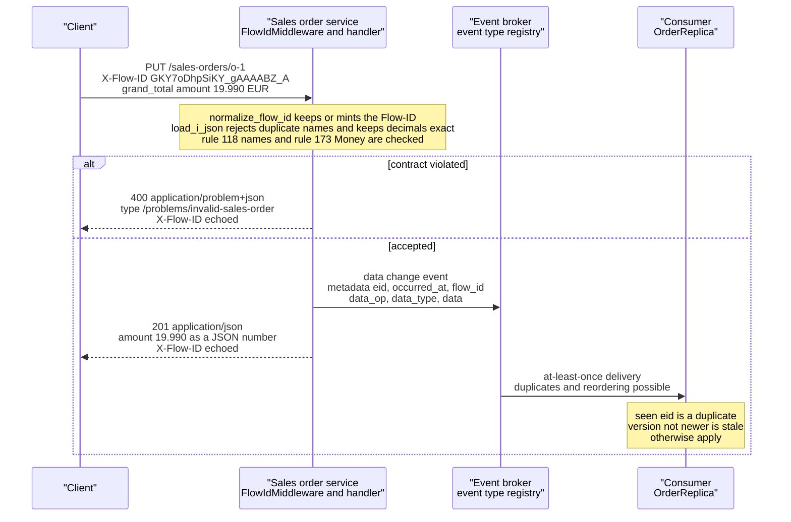

# The Zalando RESTful API and Event Guidelines: snake_case JSON, Problem Details, Money Objects, and Event Envelopes

> [!summary] Claim
> The Zalando guidelines are 146 numbered, RFC 2119 leveled rules that pin one wire shape for every team - `snake_case` JSON objects, `application/problem+json` errors with relative `type` identifiers, a closed `Money` object whose `amount` is an exact JSON number, an end-to-end `X-Flow-ID`, and event envelopes with a retry-stable `eid` - and the Python stack honors none of the hard ones by default, so each has to be implemented and tested on purpose.

Part of [Versioning Evolution and API Guidelines](README.md) in [API Engineering](../README.md).

## TL;DR

- Mechanism: every rule has a stable number and a level (`MUST`, `SHOULD`, `MAY`), so a review comment or a linter finding is a rule number, and the wire contract is the union of the `MUST` rules: JSON object at the top level, member names matching `^[a-z_][a-z_0-9]*$`, `Money` as `{"amount": <number>, "currency": "<ISO 4217>"}`, Problem JSON on `4xx` and `5xx`, and `X-Flow-ID` copied into every downstream request and every event's `metadata.flow_id`.
- Contract rule: evolve by compatible extension and never by URL version; clients must ignore unknown output members, servers should reject unknown input members with `400`, and events must carry a producer-set `eid` that stays the same across publish retries.
- The trap: rule 173 defines `amount` as a JSON `number` with `format: decimal`, while a default pydantic `Decimal` field parses a JSON number through binary64 and serializes it as a JSON string, so a stock FastAPI model breaks the contract in both directions without one failing test.
- Portability fact: the first revision of the lab (37 cases) passed on six macOS builds from CPython `3.12.13` to free-threaded `3.15.0b3` and in Debian Trixie and Alpine containers on `3.12.16`, `3.13.18`, `3.14.10`, and `3.15.2`, the extended revision (54 cases) was run only on `3.14.6`, and `json.loads("[" * 100000)` raises `RecursionError` on twelve of those fourteen builds and `JSONDecodeError` on the two Homebrew builds whose stack is twice as large, so a request path that catches only `ValueError` returns `500` or `400` depending on how the interpreter was built.
- When not to use it: do not adopt the Zalando conventions for a protobuf-first or `camelCase` estate, for public APIs whose consumers parse JSON numbers as binary64 (the guideline itself names NodeJS), or as an event standard outside a registry that validates the envelope; pick the conventions your tooling can enforce.

## Mental model



A client sends a `PUT` with an `X-Flow-ID` header and a `snake_case` JSON object whose `grand_total` is a `Money` object.
The service keeps the caller's Flow-ID (or mints one when none is usable), parses the body without losing decimal digits, and checks names and the `Money` shape before any state changes.
A violation takes the upper branch: a `400` with `Content-Type: application/problem+json`, a relative `type` identifier, and the same `X-Flow-ID`.
An accepted request takes the lower branch: the service publishes a data change event whose `metadata` carries the retry-stable `eid`, the UTC `occurred_at`, and the same Flow-ID, then answers with the amount rendered as an exact JSON number.
The broker delivers at least once, so the consumer drops an `eid` it has seen and refuses a version that is not newer than the one it holds.

## How it works

All rule citations refer to commit `19a1905a` of `zalando/restful-api-guidelines` (committed 2026-09-29), whose `models/money-1.0.0.yaml` and `models/problem-1.0.1.yaml` are byte-identical to the files served from `opensource.zalando.com` `(as of 2026-11)`.

### A rule system, not a document

Each guideline is a heading of the form `{MUST} use the common money object` preceded by an anchor such as `[#173]`, so the anchor `#173` on the rendered guideline page is a citable address for one obligation.
The levels are the RFC 2119 keywords `(Zalando RESTful API Guidelines, Conventions used in these guidelines)`, and a level can move: rule 173 went from `SHOULD` to `MUST` on 2019-07-30 and rule 242 on 2021-03-15 `(Zalando RESTful API Guidelines, Changelog)`.
A changed rule does not force existing APIs to change, but new APIs must follow the current text and an API that becomes externally public must be re-reviewed `(Zalando RESTful API Guidelines, Zalando specific information)`.
That grandfathering clause is what makes a 146-rule guideline survivable: the rule set can tighten without creating a migration backlog on day one.

### JSON payload shape

A payload is a JSON object at the top level, never an array and never a map, so that members can be added later `(Zalando RESTful API Guidelines rule 110)`.
It must also satisfy two I-JSON constraints: `UTF-8` text without surrogates or noncharacters, and unique member names `(Zalando RESTful API Guidelines rule 167)`, `(RFC 7493 Section 2.1)`, `(RFC 7493 Section 2.3)`.
Section 2.1 applies to member names and string values, escaped or not, so `"\uDEAD"` is invalid because it is an unpaired surrogate while `"\uD800\uDEAD"` would be legal `(RFC 7493 Section 2.1)`.
`json.loads` accepts the unpaired surrogate, so the lab's `load_i_json` walks the parsed document with an explicit stack and rejects any string or name holding a surrogate or one of the 66 noncharacters (`U+FDD0` to `U+FDEF` and the last two code points of each of the 17 planes).
The lab's handler decodes the body with strict `utf-8`, so invalid bytes are a `400`, and a leading byte order mark is also a `400`: JSON parsers may ignore it, but senders must not add one `(RFC 8259 Section 8.1)`.
Plain JSON only says names `SHOULD` be unique and warns that behavior on duplicates is unpredictable `(RFC 8259 Section 4)`; CPython's `json.loads` keeps the last value, which the lab proves and then replaces with a rejecting `object_pairs_hook`.
Member names match `^[a-z_][a-z_0-9]*$` `(Zalando RESTful API Guidelines rule 118)`, query parameters use the same style `(Zalando RESTful API Guidelines rule 130)`, path segments match `^[a-z][a-z\-0-9]*$` `(Zalando RESTful API Guidelines rule 129)`, and enum values are `UPPER_SNAKE_CASE` `(Zalando RESTful API Guidelines rule 240)`.
Map keys declared through `additionalProperties` are data, not property names, so a locale key such as `en-US` is legal `(Zalando RESTful API Guidelines rule 216)`; the lab's name checker cannot see the schema, so it would flag such a key, which is the price of linting payloads instead of specifications.
The checker reports each offending name as a JSON Pointer with `~` written as `~0` and `/` as `~1` `(RFC 6901 Section 3)`, so the name `a/b` is reported as `/a~1b` and cannot be confused with member `b` of member `a`.
A member that is absent and a member that is `null` must mean the same thing, with JSON Merge Patch as the single exception `(Zalando RESTful API Guidelines rule 123)`.
Every `number` and `integer` must declare a format (`int32`, `int64`, `bigint`, `float`, `double`, or `decimal`) so that no client guesses the precision `(Zalando RESTful API Guidelines rule 171)`.

### The Money object

Rule 173 is the schema below, reproduced from `models/money-1.0.0.yaml` (simplified excerpt: descriptions omitted).

```yaml
Money:
  type: object
  properties:
    amount:
      type: number
      format: decimal
      example: 99.95
    currency:
      type: string
      format: iso-4217
      example: EUR
  required:
    - amount
    - currency
```

The integer part of `amount` is the major unit and the fractional part is the minor unit, so `42.20`, `42.2`, `0.23`, `42`, and `1024.4225` are all valid euro amounts, the last one being 1024 euros and 42.25 cents `(Zalando RESTful API Guidelines rule 173)`.
`Money` is a closed type: an object that adds `discounted_amount` next to `amount` is the guideline's own forbidden example, and the fix is composition (`price` and `discounted_price` as two `Money` objects).
The guideline chose a JSON number on purpose, admits that `decimal` is not a standard OpenAPI format, and tells implementers never to convert the value to `float` or `double`.
That choice sits in tension with the JSON specifications: a number such as `3.141592653589793238462643383279` "may indicate potential interoperability problems" `(RFC 8259 Section 6)`, and I-JSON recommends encoding values that need more than binary64 precision as strings `(RFC 7493 Section 2.2)`.
Rule 167 imports I-JSON Sections 2.1 and 2.3 by name and stays silent on Section 2.2, and rule 173 says applications must accept "values with unlimited precision, unless explicitly stated otherwise in the API specification".
The practical reading is that every `Money`-bearing API should state its precision limit, because an unbounded decimal is also an unbounded allocation (see Security and robustness).

In the Python stack the number-typed amount is the hard part.
`json.loads(text, parse_float=Decimal)` hands the literal digits to `Decimal`, which is exact, and the lab's `load_i_json` does that through a wrapper.
The wrapper exists because `Decimal("1E+9999999999999999999999")` raises `decimal.InvalidOperation`, an `ArithmeticError` that is not a `ValueError`, and a handler that catches only `ValueError` would turn that client error into a `500`.
It also bounds the adjusted exponent at `999_999_999_999_999_999`, which equals `decimal.MAX_EMAX` on this 64-bit build (measured), so that the rejection does not depend on the decimal implementation: on CPython `3.14.6` here `Decimal("1E-1500000000000000000")` parses without error, and the bound is what turns it into a `ValueError`.
pydantic's JSON path does not: for a `Decimal` field it receives a value already parsed to `f64` and builds the decimal from the float's shortest string, `create_decimal(&PyString::new(py, &f.to_string()), self)` `(pydantic-core 2.50.4 src/input/input_json.rs, validate_decimal)`.
On output pydantic infers a JSON string for `Decimal`, `value.to_string().serialize(serializer)` `(pydantic-core 2.50.4 src/serializers/infer.rs, infer_serialize_known_unguarded)`, and its serialization JSON Schema says `"type": "string"` `(pydantic 2.14.3 pydantic/json_schema.py, GenerateJsonSchema.decimal_schema)`.
The standard library cannot emit a `Decimal` at all (`TypeError: Object of type Decimal is not JSON serializable`), so the lab's `dump_json` writes the digits itself with `format(value, "f")`, which also turns `1E+3` into `1000`.
`msgspec` exposes the same choice as `Encoder(decimal_format="number")`, whose default is `"string"` `(msgspec 0.22.0 msgspec/json.pyi, Encoder.__init__)`.

### Problem JSON, profiled

Every endpoint must be able to return a problem details object on `4xx` and `5xx` `(Zalando RESTful API Guidelines rule 176)`, using the format of RFC 9457, which obsoletes RFC 7807.
The Zalando profile differs from the RFC in four ways that matter on the wire.

| Aspect | RFC 9457 | Zalando rule 176 and `problem-1.0.1.yaml` |
|---|---|---|
| `type` value | absolute URI recommended, and a locator `SHOULD` resolve to documentation `(RFC 9457 Section 3.1.1)` | relative URI reference such as `/problems/out-of-stock`, deliberately not resolvable; absolute URIs are "strongly discouraged" |
| `type` scope | primary identifier of the problem type `(RFC 9457 Section 3.1.1)` | unique "only in the context of the provided API" |
| `status` | JSON number, advisory, must equal the real status code `(RFC 9457 Section 3.1.2)` | `integer`, `format: int32`, `minimum: 100`, `maximum: 599` |
| Reliance | consumers ignore unknown extensions `(RFC 9457 Section 3.2)` | clients must "not rely" on a problem object at all, because infrastructure may answer instead |

Both documents agree on the default: a missing `type` means `about:blank` `(RFC 9457 Section 3.1.1)`, which `problem-1.0.1.yaml` declares as `default: 'about:blank'`, and with `about:blank` the RFC says the `title` should be the status phrase `(RFC 9457 Section 4.2.1)`.
A member whose JSON type is wrong must be ignored rather than treated as an error `(RFC 9457 Section 3.1)`, which the lab's `read_problem` implements.
The guideline adds that `application/problem+json` is often not served to a client that only accepts `application/json`, so clients should list it in `Accept` `(Zalando RESTful API Guidelines rule 176)`, and that stack traces must never be exposed `(Zalando RESTful API Guidelines rule 177)`.
Standard errors such as `401`, `404`, `500`, and `503` need no per-endpoint definition; one OpenAPI `default` response that references the shared Problem schema covers them `(Zalando RESTful API Guidelines rule 151)`.
Replacing the framework's error body must not drop the framework's error headers: a `405` must carry `Allow` `(RFC 9110 Section 15.5.6)`, so the lab's handler forwards `exc.headers` from the `HTTPException` into the problem response.

Neither Starlette nor FastAPI produces this format by default.
Starlette answers an `HTTPException` with `PlainTextResponse(exc.detail, ...)` `(starlette 1.10.0 starlette/middleware/exceptions.py, ExceptionMiddleware.http_exception)` and an unhandled exception with `PlainTextResponse("Internal Server Error", status_code=500)` `(starlette 1.10.0 starlette/middleware/errors.py, ServerErrorMiddleware.error_response)`.
FastAPI answers with `JSONResponse({"detail": exc.detail}, ...)` `(fastapi 0.162.0 fastapi/exception_handlers.py, http_exception_handler)` and a `422` `{"detail": [...]}` for validation errors `(fastapi 0.162.0 fastapi/exception_handlers.py, request_validation_exception_handler)`.
Rule 150 goes one step further than the body format: `400` "should also be delivered in case of input payload fails business logic / semantic validation (instead of using 422)", and `422 Unprocessable Content` is listed as not recommended because `400` already covers most use cases `(Zalando RESTful API Guidelines rule 150)`.
A stock FastAPI model therefore misses the rule on three counts, which the lab test shows: the validation failure is a `422`, its content type is `application/json`, and no `X-Flow-ID` header is added because nothing in the stock app sets one; an unknown route answers `{"detail": "Not Found"}` as `application/json`.
The generic format is covered in [[Problem-Details-for-HTTP-APIs-RFC-9457]] and the pydantic mapping in [[Mapping-Pydantic-Validation-Errors-to-RFC-9457-Problem-Details]].

This is the exchange the lab app produces for a `camelCase` body, captured in-process through `httpx.ASGITransport` on CPython `3.14.6` (request line and status line rendered by the capture script, request headers reduced to the two the lab reads, response headers and both bodies verbatim).

```text
PUT /sales-orders/o-1 HTTP/1.1
content-type: application/json
x-flow-id: GKY7oDhpSiKY_gAAAABZ_A

{"grandTotal": {"amount": "19.99", "currency": "EUR"}}

HTTP/1.1 400 Bad Request
x-flow-id: GKY7oDhpSiKY_gAAAABZ_A
content-length: 141
content-type: application/problem+json

{"detail":"property names must be snake_case: /grandTotal","status":400,"title":"Invalid sales order","type":"/problems/invalid-sales-order"}
```

### X-Flow-ID end to end

The Flow-ID is one of seven proprietary end-to-end headers (`X-Flow-ID`, `X-Tenant-ID`, `X-Sales-Channel`, `X-Frontend-Type`, `X-Device-Type`, `X-Device-OS`, `X-Mobile-Advertising-ID`) `(Zalando RESTful API Guidelines rule 183)`.
All of them must be forwarded unchanged to every service down the call chain `(Zalando RESTful API Guidelines rule 184)`, and they keep the `X-` prefix for backward compatibility even though new parameters `SHOULD NOT` be prefixed that way `(RFC 6648 Section 3)`.
A service must accept `X-Flow-ID` on requests, create a new Flow-ID when none is provided, write it to logs and traces, and pass it to every API it calls and every event it publishes, where it lives in `metadata.flow_id` `(Zalando RESTful API Guidelines rule 233)`.
Allowed values are a UUID, `base64`, `base64url`, or a random string over the character set printed as `[a-zA-Z0-9/+_-=]` with at most 128 characters.
That printed class is not a valid regular expression, because `_-=` is a descending range; the lab test shows `re.compile` rejecting it and uses `[^a-zA-Z0-9/+_\-=]` as the forbidden set instead.
The rule text also says event listeners must support the metadata `flow-id` while the metadata schema names the field `flow_id` and describes it as corresponding to the `X-Flow-Id` header, so the schema, not the prose, is the contract.
For a legacy subsystem that can only process Flow-IDs of a specific format or length, the guideline's instruction is to document the restriction and "be generous and remove invalid characters or cut the length", which is the policy `normalize_flow_id` applies to every caller.
Field names are case-insensitive `(RFC 9110 Section 5.1)` and must be lowercase in HTTP/2 and HTTP/3 `(RFC 9113 Section 8.2)`, `(RFC 9114 Section 4.2)`, so `X-Flow-ID` in a specification is `x-flow-id` on those connections and in ASGI response headers.

One Starlette detail decides whether a `500` still carries the header.
`ServerErrorMiddleware` is the outermost layer and user middleware sits inside it `(starlette 1.10.0 starlette/applications.py, Starlette.build_middleware_stack)`, so the response built by the `Exception` handler never passes through `FlowIdMiddleware`'s `send` wrapper.
The lab therefore sets the header inside `problem_response` as well, and removing that line failed only the `500` assertion of the lab test in a mutation run against the first revision of the lab (verification mutation V06; not repeated on the extended revision).
`ServerErrorMiddleware` also re-raises the exception after sending the response so the server can log it `(starlette 1.10.0 starlette/middleware/errors.py, ServerErrorMiddleware.__call__)`, which is why the test client is built with `raise_app_exceptions=False` for that case.
`X-Flow-ID` overlaps in purpose with the `traceparent` header of W3C Trace Context; see [[Distributed-Tracing-W3C-Trace-Context-and-Baggage-Propagation]].

### Event types, categories, and the metadata envelope

Events are part of the service interface with the same standing as the REST API `(Zalando RESTful API Guidelines rule 194)`.
An event is registered as an event type with a `name`, a `category`, an `owning_application`, a `schema`, and a `compatibility_mode` that defaults to `forward` `(Zalando RESTful API Guidelines rule 197)`.
Names follow `<functional-name>.<event-name>` and match `[a-z][a-z0-9-]*\.[a-z][a-z0-9-]*(\.[Vv][0-9.]+)?`, for example `transactions-order.order-cancelled`.
Rule 213 states the naming convention as a grammar with an optional major `<version>` of the form `[Vv][0-9.]*`, whereas the schema pattern in rule 197 requires at least one character after the `V`; the lab follows the schema pattern, applies it with `fullmatch`, and rejects the legacy `application-event-name` form that rule 213 allows only for internal event types `(Zalando RESTful API Guidelines rule 213)`.
`data_change_event` raises on `order-changed` (no functional name) and on `sales-order.order-changed` followed by a newline, which `re.match` with a `$` anchor would accept, as the Pitfalls section shows for rule 118.
There are two categories `(Zalando RESTful API Guidelines rule 198)`.
A general event puts its custom payload at the top level next to a reserved `metadata` member and signals a step in a business process.
A data change event requires `metadata`, `data_type`, `data_op` (one of `C`, `U`, `D`, `S` for create, update, delete, snapshot), and `data`, and it must be used for every mutation of a stored entity `(Zalando RESTful API Guidelines rule 202)`.

The `metadata` object is the envelope `(Zalando RESTful API Guidelines rule 247)`.

| Member | Set by | Rule |
|---|---|---|
| `eid` | producer, required, `format: uuid` | unique per event, and identical on every publish retry of the same event `(Zalando RESTful API Guidelines rule 211)` |
| `occurred_at` | producer, required, `format: date-time` | technical creation time of the event object, not the business time |
| `event_type` | producer | name of the registered event type |
| `flow_id` | producer | the Flow-ID of the triggering request `(Zalando RESTful API Guidelines rule 233)` |
| `parent_eids` | producer | causal predecessors when no monotonic ordering value exists |
| `received_at` | broker, `readOnly` | events are rejected if the producer sets it |
| `version`, `partition` | intermediary (`version` is `readOnly`) | schema version used for validation and the assigned partition |

Rule 211 offers two ways to keep `eid` stable across retries: persist the event before publishing, or compute the UUID from the event fields without a random salt.
The lab uses the second with a name-based UUID, which is the SHA-1 construction of `(RFC 9562 Section 5.5)`, over the event type and the canonical JSON of `data_type`, `data_op`, and `data`.
`occurred_at` is deliberately not hashed, because a retry happens later, and the entity `version` inside `data` is what keeps two identical-looking changes distinct.
The hash covers serialized bytes, not values: the lab test shows that an order whose amount is `20.0` gets a different `eid` from the equal amount `20.00`, so a producer must build the retry from the same stored representation and never from a re-parsed copy.
That version is also the ordering information a data change event must carry `(Zalando RESTful API Guidelines rule 242)`, declared through `ordering_key_fields` and `ordering_instance_ids` as described in the rule written for general events, to which rule 242 refers `(Zalando RESTful API Guidelines rule 203)`; that rule also warns that timestamps are often a bad ordering key.
Consumers must be robust against duplicates `(Zalando RESTful API Guidelines rule 214)` and should be designed for idempotent out-of-order processing `(Zalando RESTful API Guidelines rule 212)`.
Timestamps use upper case `T` and `Z` `(Zalando RESTful API Guidelines rule 169)`, which RFC 3339 already recommends for generators `(RFC 3339 Section 5.6)`.

This is the event the lab publishes for the first accepted `PUT`, serialized by `dump_json` on CPython `3.14.6`.

```json
{"data":{"grand_total":{"amount":19.990,"currency":"EUR"},"id":"o-1","version":1},"data_op":"C","data_type":"sales_order.order","metadata":{"eid":"b9507f3f-0835-5cd4-aaaa-ebeaa15a4259","event_type":"sales-order.order-changed","flow_id":"GKY7oDhpSiKY_gAAAABZ_A","occurred_at":"2026-11-11T09:30:00.000Z"}}
```

Event schemas evolve under tighter rules than REST schemas because producers and consumers cannot negotiate content `(Zalando RESTful API Guidelines rule 209)`.
`compatible` mode allows only new optional properties, `forward` mode lets the previous schema read new events, and `none` allows anything `(Zalando RESTful API Guidelines rule 245)`; schema versions follow semantic versioning where a new optional field is a `MINOR` change `(Zalando RESTful API Guidelines rule 246)`.
Event schemas should not declare `additionalProperties: true`; a producer must register a new field before publishing it, which prevents a field from being redefined with a different type `(Zalando RESTful API Guidelines rule 210)`.

### Compatibility and versioning stance

The guideline's position on evolution is short: do not break compatibility `(Zalando RESTful API Guidelines rule 106)`, avoid versioning `(Zalando RESTful API Guidelines rule 113)`, never put a version in the URL `(Zalando RESTful API Guidelines rule 115)`, and when a version is unavoidable use a media type such as `application/x.zalando.cart+json;version=2` `(Zalando RESTful API Guidelines rule 114)`.
Servers are asked to be strict on input, rejecting unknown members with `400`, which the guideline calls "a specific deviation from Postel's Law" `(Zalando RESTful API Guidelines rule 109)`, while clients must tolerate unknown output members and unknown extensible enum values `(Zalando RESTful API Guidelines rule 108)`.
OpenAPI objects are open for extension by default and must not declare `additionalProperties: false` `(Zalando RESTful API Guidelines rule 111)`.
The mechanics of these positions belong to [[Additive-Schema-Evolution-and-Tolerant-Reader-Patterns]], [[API-Versioning-Strategies-URI-Header-Media-Type-and-Channel-AIP-185]], and [[Deprecation-Header-RFC-9745-and-Sunset-Header-RFC-8594]].

### Pagination, idempotency, deprecation, and URL rules

The lab exercises two small parts of these families, rule 149 (a repeated `PUT` changes nothing) and rule 228 (URL-friendly identifiers), which are described at the end of this subsection; every other claim below is sourced to the guideline text at commit `19a1905a` and to the cited RFC section, not to a lab assertion.

Pagination protects the service from overload and must be supported by every list that may exceed a few hundred entries `(Zalando RESTful API Guidelines rule 159)`.
Cursor-based pagination is preferred, with the guideline's own trade-offs: offset pagination "may create duplicates or lead to missing entries" when rows change between requests, while a cursor can fail if its entry was deleted before the next fetch `(Zalando RESTful API Guidelines rule 160)`.
The cursor is an opaque pointer that clients must never inspect or construct, usually encoding the position, direction, and a hash of the filters `(Zalando RESTful API Guidelines rule 160)`.
A page is an object with `self`, `first`, `prev`, `next`, `last`, `query`, and an `items` array, where `prev` is absent on the first page and `next` on the last `(Zalando RESTful API Guidelines rule 248)`; the links are preferably absolute URLs that behave like hypertext controls `(Zalando RESTful API Guidelines rule 161)`.
A total result count should be avoided because it costs a full index scan that grows with the data set and is hard to remove once clients depend on it; a consumer that needs it asks through `Prefer: return=total-count` `(Zalando RESTful API Guidelines rule 254)`.

Idempotency is a design choice for `POST` and `PATCH`, because HTTP only makes `PUT`, `DELETE`, and safe methods idempotent and forbids automatic retry of other methods unless the semantics are known to be idempotent `(RFC 9110 Section 9.2.2)`.
Rule 229 offers three patterns, and the guideline suggests the first two before the third when the goal is safe retries.

| Pattern | Key lives in | Prevents lost updates | Prevents duplicate resources | Same response on retry |
|---|---|---|---|---|
| Conditional key: `ETag` with `If-Match` or `If-None-Match: *` `(Zalando RESTful API Guidelines rule 182)` | resource metadata such as a version or hash | yes | yes | no |
| Secondary key: a unique property in the body `(Zalando RESTful API Guidelines rule 231)` | the stored resource, under a uniqueness constraint | no | yes | no, later retries should answer `409` |
| `Idempotency-Key` header `(Zalando RESTful API Guidelines rule 230)` | a temporary key cache, for example 24 hours | no | no | yes |

The table is the guideline's own comparison `(Zalando RESTful API Guidelines rule 229)`.
A failed precondition answers `412` `(RFC 9110 Section 15.5.13)`, and `If-Match` uses the strong entity-tag comparison `(RFC 9110 Section 13.1.1)`.
The guideline admits that `Idempotency-Key` is not standardized in an RFC, cites the Stripe API as its only reference, recommends rejecting a retry whose request hash differs with `400`, and warns that the resource and the key cache must be updated with hard transaction semantics, which makes a correct implementation hard `(Zalando RESTful API Guidelines rule 230)`.

Deprecation is a contract with consumers, not a header.
The element is marked `deprecated: true` in the specification, with a sunset date and a migration description when a shutdown is planned `(Zalando RESTful API Guidelines rule 187)`.
Every client must consent to the sunset date before shutdown, and external partners must consent to the minimum time span between deprecation and first possible sunset before they are allowed to use the API `(Zalando RESTful API Guidelines rule 185)`, `(Zalando RESTful API Guidelines rule 186)`.
Responses should carry `Deprecation: @1758095283` and, if a shutdown is planned, `Sunset: Wed, 31 Dec 2025 23:59:59 GMT`; the two use different time formats because `Deprecation` is a Structured Field Date `(RFC 9745 Section 2.1)` and `Sunset` is an HTTP-date `(RFC 8594 Section 3)`.
The guideline discourages the matching `Link` relations and states that the headers alone do not gain the consent needed to shut an API down `(Zalando RESTful API Guidelines rule 189)`.
Clients should alert on both headers `(Zalando RESTful API Guidelines rule 190)` and must not start using a deprecated API `(Zalando RESTful API Guidelines rule 191)`.
The header mechanics are in [[Deprecation-Header-RFC-9745-and-Sunset-Header-RFC-8594]].

URL rules complement the payload rules: resource names are plural `(Zalando RESTful API Guidelines rule 134)`, paths contain no empty segments or trailing slash, and a service must support at least the normalized path while rejecting alternatives that do not deliver the same resource `(Zalando RESTful API Guidelines rule 136)`, and nesting should not exceed three sub-resource levels `(Zalando RESTful API Guidelines rule 147)`.

Two of the rules have a lab counterpart in the sales order service.
Rule 149 defines idempotence by the intended effect on the server, explicitly not by returning the same response, and lists `PUT` and `DELETE` as idempotent `(Zalando RESTful API Guidelines rule 149)`, `(RFC 9110 Section 9.2.2)`.
The lab answers the first `PUT` of an order with `201`, answers a repeat of the same `Money` value with `200` and the stored representation, and publishes no second event, so the repeat leaves the stored version and the event stream unchanged; the comparison is by value, so `20.0` after `20.00` is a repeat, while a changed amount or currency is an update with the next `version` and `data_op` `U`.
Rule 228 requires resource identifiers to match `[a-zA-Z0-9:._\-/]*`, allows the slash only inside compound keys, and forbids empty identifiers `(Zalando RESTful API Guidelines rule 228)`.
The lab's pattern `[a-zA-Z0-9:._\-]+` omits the slash because the route parameter `{order_id}` matches a single path segment, requires at least one character, and is applied with `fullmatch` before the identifier is copied into an event, so `o%201` and `o-1%0A` (decoded to a trailing newline) answer `400` while `de:1681e6b88ec1` is accepted.

## Numbers and limits

Measurements were taken on an Apple M3 Pro (`Darwin 27.2.0 arm64`, macOS `27.2`) with CPython `3.14.6` through `uv run --frozen python`, except where a row names `Darwin 27.3.0`, the host after an operating system update, which is where the final test run and the `decimal` probe were made.

| Quantity | Value | Source or measurement |
|---|---:|---|
| Rule headings carrying a requirement keyword | `146` (`85` `MUST`, `50` `SHOULD`, `10` `MAY`, `1` `MUST/SHOULD/MAY`) | counted with `grep -hE '^=+ \{'` over the chapter files at commit `19a1905a`, excluding 4 status code legend headings; the rendered page carries the same `146` keyword headings with the same split `(as of 2026-11)` |
| Rule number range | `100` to `257` | same commit; numbers are anchors, not a dense sequence |
| Property name pattern | `^[a-z_][a-z_0-9]*$` | `(Zalando RESTful API Guidelines rule 118)` |
| `X-Flow-ID` maximum length | `128` characters | `(Zalando RESTful API Guidelines rule 233)` |
| Problem `status` range | `100` to `599`, `int32` | `models/problem-1.0.1.yaml` |
| Proprietary end-to-end headers | `7` | `(Zalando RESTful API Guidelines rule 183)` |
| `data_op` values | `4` (`C`, `U`, `D`, `S`) | `(Zalando RESTful API Guidelines rule 198)` |
| Producer-required metadata members | `2` (`eid`, `occurred_at`) | `(Zalando RESTful API Guidelines rule 247)` |
| Compatibility modes | `3` (`compatible`, `forward`, `none`), default `forward` | `(Zalando RESTful API Guidelines rule 197)` |
| Observed daily duplicate rate, high volume events | below `0.2` per mille at the 95th percentile, November 2022 | `(Zalando RESTful API Guidelines rule 214)` |
| Readable UUID length | `36` characters | `(Zalando RESTful API Guidelines rule 144)` |
| Integers that every binary64 parser agrees on | `-(2**53)+1` to `(2**53)-1` | `(RFC 8259 Section 6)`, `(RFC 7493 Section 2.2)` |
| Digits surviving a binary64 parse of `1024.42250000000000000001` | `8` of `24` (`1024.4225`) | lab test `test_money_amount_survives_as_an_exact_json_number_where_binary64_rounds_it` |
| `Money` amount bound in the lab | `64` printed digits | lab constant `MONEY_MAX_DIGITS`; a choice of this lab, not of the guideline; `64` digits accepted and `65` rejected in the test |
| Request body bound in the lab | `4096` bytes, then `413` | lab constant `MAX_BODY_BYTES`; `4096` bytes accepted and `4097` rejected in the test |
| Offending names listed in a problem `detail` | first `5`, then a count | lab constant `MAX_REPORTED_NAMES` |
| Exponent literal that `Decimal` refuses | `1E+9999999999999999999999` raises `decimal.InvalidOperation` | measured; `1E+999999999` still parses |
| Adjusted exponent bound in the lab | `999_999_999_999_999_999` | lab constant `NUMBER_MAX_EXPONENT`, equal to `decimal.MAX_EMAX` (`999999999999999999`) here; measured on `Darwin 27.3.0` with CPython `3.14.6`, libmpdec `4.0.0`: `Decimal("1E+999999999999999999")` and `Decimal("1E-1500000000000000000")` parse, `Decimal("1E+1000000000000000000")` raises `InvalidOperation`; the test rejects `1E-1500000000000000000` through the lab bound |
| I-JSON forbidden code points | `66` noncharacters plus the surrogate block `U+D800` to `U+DFFF` | `U+FDD0` to `U+FDEF` (32) and `U+FFFE` and `U+FFFF` of each of the 17 planes (34) `(RFC 7493 Section 2.1)`; lab constant `_NOT_I_JSON` |
| Largest integer literal `json.loads` accepts by default | `4300` digits, then `ValueError` | measured: `json.loads("1" * 4300)` parses, `"1" * 4301` and `"1" * 5000` raise; `sys.get_int_max_str_digits()` returned `4300` |
| Output size of an unbounded exponent | `10,000,001` characters for `format(Decimal("1E+10000000"), "f")` | measured at `0.0036` to `0.0079 s` (best of `7`, four runs on a machine shared with other jobs); the exponent `999999999` parses from a 24 byte body |
| Exact parse cost on an 84 byte document | `load_i_json` `1.7` to `5.2 us` versus `json.loads` `0.7` to `2.0 us` | `timeit`, best of `7 x 200,000`, four runs of `uv run --frozen python` on `{"id": "o-1", "grand_total": {"amount": 1024.4225, "currency": "EUR"}, "version": 1}`; the machine was shared with other jobs and the runs disagree by up to `3x`, so only the ordering (`load_i_json` slower in every run) is reliable |
| Mutations killed by the test module | `27` of `27` on the first lab revision | one mutation at a time against the 37 case revision on CPython `3.14.6`, source restored and hash compared after each; `23` were killed by the drafted tests and `4` boundary mutants (inclusive 64 digit bound, equal-version stale guard, naive `occurred_at`, filter before cap) only after the tests were tightened during verification; the extended revision (54 cases) was not mutation tested |

## Portability

The lab grew from 37 to 54 cases after the interpreter and container legs below were run.
Every row that reports `37 passed` therefore describes the first revision of the lab; the extended revision, which adds the I-JSON string checks, the exponent bound, the event name rule, the idempotent `PUT`, the identifier rule, the stock FastAPI contrast, and the Starlette body limit tests, was run once, on `Darwin 27.3.0` with CPython `3.14.6` (`54 passed`), and not on the other interpreters or in the containers.
The `re`, `json`, `decimal`, and Starlette behavior it relies on is documented to be stable across these releases, but that is an expectation and not a proof, so the added cases are unrun on the other legs.

| Runtime or component | Version | Behavior and evidence |
|---|---|---|
| CPython `3.12` | `3.12.13` and `3.12.16` | `37 passed` with `uv run --frozen --python 3.12 pytest ...` (uv-managed `3.12.13`) and on the matrix pin `3.12.16` in both containers below; `re.compile("[a-zA-Z0-9/+_-=]")` raises an exception printed as `error bad character range _-= at position 12` |
| CPython `3.13` | `3.13.18` | `37 passed` with `uv run --frozen --python 3.13 pytest ...`, which resolves to the Homebrew build here, and in both containers below; the same exception prints as `PatternError`, and `re.error` still catches it |
| CPython `3.14` | `3.14.6` and `3.14.10` | `37 passed` on both (`3.14.6` is the uv-managed workspace interpreter, `3.14.10` via `--python /opt/homebrew/bin/python3.14`) and on `3.14.10` in both containers below |
| CPython `3.15` | `3.15.2` | `37 passed` in the full project environment via `--python /opt/homebrew/bin/python3.15` and in both containers below; `--python 3.15` selects `3.15.0b3` here, where pytest stops before collection with `ModuleNotFoundError: No module named 'hypothesis._native'` |
| CPython `3.15t` free-threaded | `3.15.0b3`, GIL disabled at run time | `37 passed` with `PYTHONPATH=src uv run --no-project --python 3.15t --with <7 pinned packages> pytest ...`; the project environment cannot be built because `psycopg-binary==3.3.8` has no wheel for it |
| Debian Trixie and Alpine musl containers | `3.12.16`, `3.13.18`, `3.14.10`, `3.15.2` | `37 passed` in all eight official images `python:<version>-trixie` (Debian 13) and `python:<version>-alpine` (Alpine 3.24) on `aarch64`, run with `docker run --rm --pull=never`, the lab mounted read-only, and `PYTHONPATH=src python -m pytest ...` after `pip install` of the 7 pinned packages of the free-threaded row; transitive dependencies were resolved by `pip`, not from `uv.lock` |
| Matrix pin `3.15.2t` | not installed on this machine, no local image | not run; the nearest available build is the free-threaded `3.15.0b3` row above |
| `json.loads("[" * 100000)` | all fourteen builds | `RecursionError` on uv-managed `3.12.13`, `3.14.6`, and free-threaded `3.15.0b3`, on Homebrew `3.13.18`, and in all eight containers; `JSONDecodeError` (`Expecting value`) on Homebrew `3.14.10` and `3.15.2`, which overflow only at a deeper nesting (`RecursionError` at `200000` levels); the `3.14` and `3.15` messages report the stack used at the overflow as `8144 kB` (uv-managed), `16352 kB` (Homebrew), `8160 kB` (Debian), and `992 kB` (Alpine), so the same `3.14.10` runs with three different stack budgets; measured per build, and `load_i_json` raises `ValueError` on all fourteen |
| pydantic | `2.14.3` with pydantic-core `2.50.4` | default `Decimal` field rounds a JSON number through `f64` and emits a JSON string; lab test on every interpreter above, source `(pydantic-core 2.50.4 src/input/input_json.rs, validate_decimal)` |
| msgspec | `0.22.0` | `Encoder(decimal_format="number")` exists and defaults to `"string"` `(msgspec 0.22.0 msgspec/json.pyi, Encoder.__init__)`; not part of the lab test |
| Starlette | `1.10.0` | `ServerErrorMiddleware` outermost, plain text defaults for `404` and `500`; mutation runs against the first lab revision on CPython `3.14.6`: V25 (no `HTTPException` handler) and V06 (no Flow-ID in `problem_response`); the `max_body_size` behavior is covered by the extended lab on `3.14.6` only |
| Uvicorn, Hypercorn, Granian | `0.54.0`, `0.18.0`, `2.8.7` | not exercised: the lab drives the ASGI app in-process; the ASGI specification says request header names "should be lowercased, but it is not required" and response header names must be lowercased, so read `X-Flow-ID` case-insensitively |
| HTTP/1.1 | - | field names are case-insensitive `(RFC 9110 Section 5.1)`; `CR`, `LF`, and `NUL` in a field value must be rejected or replaced `(RFC 9110 Section 5.5)` |
| HTTP/2 | - | field names must be converted to lowercase `(RFC 9113 Section 8.2)` |
| HTTP/3 over QUIC | - | field names must be lowercase and uppercase names make the message malformed `(RFC 9114 Section 4.2)` |

## Worked example

The lab is one module and one test module: the [implementation](../labs/src/api_labs/f07_versioning_evolution_and_api_guidelines/zalando_guidelines.py) and its [test](../labs/tests/f07_versioning_evolution_and_api_guidelines/test_zalando_restful_api_and_event_guidelines_in_depth.py).

### Implementation (`labs/src/api_labs/f07_versioning_evolution_and_api_guidelines/zalando_guidelines.py`)

```python
"""Executable subset of the Zalando RESTful API and Event Guidelines.

Rules 118 (snake_case), 167 (I-JSON), 173 (Money), 176 and 177 (Problem JSON),
233 (X-Flow-ID), 149 and 228 (idempotent PUT, URL-friendly identifiers), and
211, 213, 214, 242, 247 (event names, metadata, eid, ordering).
"""

from __future__ import annotations

import json
import re
import uuid
from dataclasses import dataclass, field
from datetime import UTC, datetime
from decimal import Decimal, InvalidOperation
from http import HTTPStatus
from typing import TYPE_CHECKING, Final, Literal

from starlette.applications import Starlette
from starlette.datastructures import Headers, MutableHeaders
from starlette.exceptions import HTTPException
from starlette.middleware import Middleware
from starlette.responses import Response
from starlette.routing import Route

if TYPE_CHECKING:
    from collections.abc import Callable, Mapping

    from starlette.requests import Request
    from starlette.types import ASGIApp, Message, Receive, Scope, Send

type Json = dict[str, Json] | list[Json] | str | int | Decimal | bool | None

SNAKE_CASE: Final = re.compile(r"[a-z_][a-z_0-9]*")
PROBLEM_MEDIA_TYPE: Final = "application/problem+json"
FLOW_ID_HEADER: Final = "X-Flow-ID"
FLOW_ID_MAX_LENGTH: Final = 128
MONEY_MAX_DIGITS: Final = 64
NUMBER_MAX_EXPONENT: Final = 999_999_999_999_999_999
MAX_BODY_BYTES: Final = 4096
MAX_REPORTED_NAMES: Final = 5
EID_NAMESPACE: Final = uuid.uuid5(uuid.NAMESPACE_DNS, "sales-order.example")
EVENT_TYPE_NAME: Final = re.compile(r"[a-z][a-z0-9-]*\.[a-z][a-z0-9-]*(\.[Vv][0-9.]+)?")
RESOURCE_ID: Final = re.compile(r"[a-zA-Z0-9:._\-]+")
_FLOW_ID_FORBIDDEN: Final = re.compile(r"[^a-zA-Z0-9/+_\-=]")
_CURRENCY: Final = re.compile(r"[A-Z]{3}")
_PLANE_END_NONCHARACTERS: Final = "".join(
    chr(plane << 16 | last) for plane in range(17) for last in (0xFFFE, 0xFFFF)
)
_NOT_I_JSON: Final = re.compile(f"[\ud800-\udfff\ufdd0-\ufdef{_PLANE_END_NONCHARACTERS}]")


def _unique_members(pairs: list[tuple[str, Json]]) -> dict[str, Json]:
    members = dict(pairs)
    if len(members) != len(pairs):
        raise ValueError("duplicate member name (RFC 7493 Section 2.3)")
    return members


def _reject_constant(token: str) -> Json:
    raise ValueError(f"{token} is not a JSON number (RFC 8259 Section 6)")


def _exact_decimal(token: str) -> Decimal:
    """Exact parse with one exponent bound, whichever decimal implementation the build has."""
    try:
        value = Decimal(token)
    except InvalidOperation:
        value = None
    if value is None or abs(value.adjusted()) > NUMBER_MAX_EXPONENT:
        raise ValueError("number exponent is out of range")
    return value


def _require_i_json_strings(document: Json) -> None:
    stack: list[Json] = [document]
    while stack:
        value = stack.pop()
        if isinstance(value, str):
            if _NOT_I_JSON.search(value) is not None:
                raise ValueError("surrogate or noncharacter in a string (RFC 7493 Section 2.1)")
        elif isinstance(value, dict):
            stack.extend(value)
            stack.extend(value.values())
        elif isinstance(value, list):
            stack.extend(value)


def load_i_json(text: str) -> Json:
    """Parse I-JSON keeping fractional numbers exact; every rejection is a ValueError."""
    try:
        document: Json = json.loads(
            text,
            parse_float=_exact_decimal,
            parse_constant=_reject_constant,
            object_pairs_hook=_unique_members,
        )
    except RecursionError:
        raise ValueError("JSON document is nested too deeply") from None
    _require_i_json_strings(document)
    return document


def dump_json(value: Json) -> str:
    """Serialize with sorted names and every Decimal as an exact JSON number."""
    if isinstance(value, Decimal):
        if not value.is_finite():
            raise ValueError("NaN and Infinity are not JSON numbers (RFC 8259 Section 6)")
        return format(value, "f")
    if isinstance(value, dict):
        members = (f"{json.dumps(name)}:{dump_json(item)}" for name, item in sorted(value.items()))
        return "{" + ",".join(members) + "}"
    if isinstance(value, list):
        return "[" + ",".join(dump_json(item) for item in value) + "]"
    return json.dumps(value)


def non_snake_case_properties(document: Json) -> list[str]:
    """Return an RFC 6901 JSON Pointer, in document order, for every name violating rule 118."""
    found: list[str] = []
    stack: list[tuple[str, str | None, Json]] = [("", None, document)]
    while stack:
        pointer, name, value = stack.pop()
        if name is not None and SNAKE_CASE.fullmatch(name) is None:
            found.append(pointer)
        if isinstance(value, dict):
            for key, item in reversed(value.items()):
                token = key.replace("~", "~0").replace("/", "~1")
                stack.append((f"{pointer}/{token}", key, item))
        elif isinstance(value, list):
            for index in range(len(value) - 1, -1, -1):
                stack.append((f"{pointer}/{index}", None, value[index]))
    return found


@dataclass(frozen=True, slots=True)
class Money:
    """Rule 173: a closed object of an exact, size-bounded amount and an ISO 4217 code."""

    amount: Decimal
    currency: str

    def __post_init__(self) -> None:
        digits, exponent = self.amount.as_tuple()[1:]
        if not isinstance(exponent, int):
            raise ValueError("amount must be finite")
        if max(len(digits), len(digits) + exponent, -exponent) > MONEY_MAX_DIGITS:
            raise ValueError(f"amount must have at most {MONEY_MAX_DIGITS} digits")
        if _CURRENCY.fullmatch(self.currency) is None:
            raise ValueError("currency must be a three letter upper case ISO 4217 code")

    @classmethod
    def from_json(cls, value: Json) -> Money:
        if not isinstance(value, dict) or value.keys() != {"amount", "currency"}:
            raise ValueError("Money must have exactly the members amount and currency")
        amount, currency = value["amount"], value["currency"]
        if isinstance(amount, bool) or not isinstance(amount, int | Decimal):
            raise ValueError("amount must be a JSON number, not a string or boolean")
        if not isinstance(currency, str):
            raise ValueError("currency must be a JSON string")
        return cls(Decimal(amount), currency)

    def to_json(self) -> dict[str, Json]:
        return {"amount": self.amount, "currency": self.currency}


def normalize_flow_id(received: str | None, mint: Callable[[], str]) -> str:
    """Rule 233: keep the sanitized caller Flow-ID, or mint one when nothing survives."""
    cleaned = _FLOW_ID_FORBIDDEN.sub("", received or "")[:FLOW_ID_MAX_LENGTH]
    return cleaned or mint()


def _phrase(status_code: int) -> str:
    try:
        return HTTPStatus(status_code).phrase
    except ValueError:
        return "Unknown Status"


def _text(document: dict[str, Json], name: str) -> str | None:
    value = document.get(name)
    return value if isinstance(value, str) else None


@dataclass(frozen=True, slots=True)
class Problem:
    """RFC 9457 problem details as profiled by rule 176 (relative type identifiers)."""

    status: int
    title: str
    type: str = "about:blank"
    detail: str | None = None
    instance: str | None = None

    def to_json(self) -> dict[str, Json]:
        members: dict[str, Json] = {"type": self.type, "title": self.title, "status": self.status}
        if self.detail is not None:
            members["detail"] = self.detail
        if self.instance is not None:
            members["instance"] = self.instance
        return members


def read_problem(status_code: int, content_type: str | None, body: bytes) -> Problem:
    """Client side: trust the status line, ignore mistyped members, survive non-problem bodies."""
    fallback = Problem(status_code, _phrase(status_code))
    if (content_type or "").split(";")[0].strip().lower() != PROBLEM_MEDIA_TYPE:
        return fallback
    try:
        document = load_i_json(body.decode("utf-8"))
    except ValueError:
        return fallback
    if not isinstance(document, dict):
        return fallback
    return Problem(
        status=status_code,
        title=_text(document, "title") or fallback.title,
        type=_text(document, "type") or "about:blank",
        detail=_text(document, "detail"),
        instance=_text(document, "instance"),
    )


def problem_response(
    request: Request, problem: Problem, headers: Mapping[str, str] | None = None
) -> Response:
    return Response(
        dump_json(problem.to_json()),
        status_code=problem.status,
        media_type=PROBLEM_MEDIA_TYPE,
        headers={**(headers or {}), FLOW_ID_HEADER: request.state.flow_id},
    )


def utc_timestamp(moment: datetime) -> str:
    """Rule 169: RFC 3339 date-time in UTC with upper case T and Z."""
    if moment.tzinfo is None:
        raise ValueError("occurred_at needs an aware datetime")
    return moment.astimezone(UTC).isoformat(timespec="milliseconds").replace("+00:00", "Z")


def data_change_event(
    *,
    event_type: str,
    data_type: str,
    data_op: Literal["C", "U", "D", "S"],
    data: dict[str, Json],
    occurred_at: datetime,
    flow_id: str,
) -> dict[str, Json]:
    """Rules 198, 211, 213, 247: the eid hashes the serialized change, so a retry reuses it."""
    if EVENT_TYPE_NAME.fullmatch(event_type) is None:
        raise ValueError("event type name must be <functional-name>.<event-name> (rule 213)")
    body: dict[str, Json] = {"data_type": data_type, "data_op": data_op, "data": data}
    eid = uuid.uuid5(EID_NAMESPACE, f"{event_type}\n{dump_json(body)}")
    metadata: dict[str, Json] = {
        "eid": str(eid),
        "event_type": event_type,
        "occurred_at": utc_timestamp(occurred_at),
        "flow_id": flow_id,
    }
    return {"metadata": metadata, **body}


@dataclass(slots=True)
class OrderReplica:
    """Rules 212, 214, 242: deduplicate on eid and never let an older version win."""

    orders: dict[str, dict[str, Json]] = field(default_factory=dict[str, dict[str, Json]])
    versions: dict[str, int] = field(default_factory=dict[str, int])
    seen_eids: set[str] = field(default_factory=set[str])

    def apply(self, event: Mapping[str, Json]) -> Literal["applied", "duplicate", "stale"]:
        metadata, data = event.get("metadata"), event.get("data")
        if not isinstance(metadata, dict) or not isinstance(data, dict):
            raise ValueError("not a data change event")
        eid, order_id, version = metadata.get("eid"), data.get("id"), data.get("version")
        if not (isinstance(eid, str) and isinstance(order_id, str) and isinstance(version, int)):
            raise ValueError("event lacks metadata.eid, data.id, or data.version")
        if eid in self.seen_eids:
            return "duplicate"
        self.seen_eids.add(eid)
        if version <= self.versions.get(order_id, 0):
            return "stale"
        self.versions[order_id] = version
        self.orders[order_id] = data
        return "applied"


class FlowIdMiddleware:
    """Rule 233: accept or mint the Flow-ID once and echo it on every response."""

    def __init__(self, app: ASGIApp, mint: Callable[[], str]) -> None:
        self.app = app
        self.mint = mint

    async def __call__(self, scope: Scope, receive: Receive, send: Send) -> None:
        if scope["type"] != "http":
            await self.app(scope, receive, send)
            return
        flow_id = normalize_flow_id(Headers(scope=scope).get(FLOW_ID_HEADER), self.mint)
        scope.setdefault("state", {})["flow_id"] = flow_id

        async def send_with_flow_id(message: Message) -> None:
            if message["type"] == "http.response.start":
                MutableHeaders(scope=message)[FLOW_ID_HEADER] = flow_id
            await send(message)

        await self.app(scope, receive, send_with_flow_id)


def create_app(
    *,
    mint_flow_id: Callable[[], str],
    now: Callable[[], datetime],
    publish: Callable[[dict[str, Json]], None],
    max_body_size: int | None = None,
) -> Starlette:
    """Sales order service: Money in, Money out, one data change event per state change.

    max_body_size is handed to Starlette unchanged, to show how its limit meets the handlers.
    """
    stored: dict[str, tuple[int, Money]] = {}

    async def put_sales_order(request: Request) -> Response:
        order_id: str = request.path_params["order_id"]
        body = bytearray()
        async for chunk in request.stream():
            body += chunk
            if len(body) > MAX_BODY_BYTES:
                return problem_response(request, Problem(413, "Content Too Large"))
        try:
            if RESOURCE_ID.fullmatch(order_id) is None:
                raise ValueError("resource identifier must match [a-zA-Z0-9:._-]+ (rule 228)")
            document = load_i_json(body.decode("utf-8"))
            if violations := non_snake_case_properties(document):
                listed = ", ".join(violations[:MAX_REPORTED_NAMES])
                more = len(violations) - MAX_REPORTED_NAMES
                suffix = f" and {more} more" if more > 0 else ""
                raise ValueError(f"property names must be snake_case: {listed}{suffix}")
            if not isinstance(document, dict) or document.keys() != {"grand_total"}:
                raise ValueError("expected exactly one member: grand_total")
            grand_total = Money.from_json(document["grand_total"])
        except ValueError as exc:
            problem = Problem(400, "Invalid sales order", "/problems/invalid-sales-order", str(exc))
            return problem_response(request, problem)
        version, current = stored.get(order_id, (0, None))
        if current is not None and grand_total == current:
            # Rule 149: repeating a PUT changes nothing, so it publishes nothing.
            data: dict[str, Json] = {
                "id": order_id,
                "grand_total": current.to_json(),
                "version": version,
            }
            return Response(dump_json(data), media_type="application/json")
        version += 1
        data = {"id": order_id, "grand_total": grand_total.to_json(), "version": version}
        publish(
            data_change_event(
                event_type="sales-order.order-changed",
                data_type="sales_order.order",
                data_op="C" if version == 1 else "U",
                data=data,
                occurred_at=now(),
                flow_id=request.state.flow_id,
            )
        )
        stored[order_id] = (version, grand_total)
        status_code = 201 if version == 1 else 200
        return Response(dump_json(data), status_code=status_code, media_type="application/json")

    async def any_error(request: Request, exc: Exception) -> Response:
        if isinstance(exc, HTTPException):
            problem = Problem(exc.status_code, _phrase(exc.status_code))
            return problem_response(request, problem, exc.headers)
        return problem_response(request, Problem(500, _phrase(500)))

    return Starlette(
        routes=[Route("/sales-orders/{order_id}", put_sales_order, methods=["PUT"])],
        middleware=[Middleware(FlowIdMiddleware, mint=mint_flow_id)],
        exception_handlers={HTTPException: any_error, Exception: any_error},
        max_body_size=max_body_size,
    )
```

### Test suite (`labs/tests/f07_versioning_evolution_and_api_guidelines/test_zalando_restful_api_and_event_guidelines_in_depth.py`)

```python
"""Unit tests for the Zalando guideline rules on JSON names, Money, Problem JSON, and events."""

import itertools
import json
import re
from collections.abc import AsyncIterator
from datetime import datetime, timedelta, timezone
from decimal import Decimal
from http import HTTPStatus

import httpx
import pytest
from fastapi import FastAPI
from pydantic import BaseModel
from starlette.types import Message, Receive, Scope, Send

from api_labs.f07_versioning_evolution_and_api_guidelines.zalando_guidelines import (
    FLOW_ID_MAX_LENGTH,
    MAX_BODY_BYTES,
    FlowIdMiddleware,
    Json,
    Money,
    OrderReplica,
    Problem,
    create_app,
    data_change_event,
    dump_json,
    load_i_json,
    non_snake_case_properties,
    normalize_flow_id,
    read_problem,
    utc_timestamp,
)

PRECISE_MONEY = '{"amount": 1024.42250000000000000001, "currency": "EUR"}'
BERLIN_WINTER = timezone(timedelta(hours=1))
FIXED_NOW = datetime(2026, 11, 11, 10, 30, tzinfo=BERLIN_WINTER)


class Harness:
    """A sales order app with a counting Flow-ID minter and an in-memory event sink."""

    def __init__(
        self, *, broker_error: Exception | None = None, max_body_size: int | None = None
    ) -> None:
        self.minted = 0
        self.events: list[dict[str, Json]] = []
        self.broker_error = broker_error
        self.app = create_app(
            mint_flow_id=self.mint,
            now=lambda: FIXED_NOW,
            publish=self.publish,
            max_body_size=max_body_size,
        )

    def mint(self) -> str:
        self.minted += 1
        return f"minted-{self.minted}"

    def publish(self, event: dict[str, Json]) -> None:
        if self.broker_error is not None:
            raise self.broker_error
        self.events.append(event)

    def client(self, *, raise_app_exceptions: bool = True) -> httpx.AsyncClient:
        transport = httpx.ASGITransport(app=self.app, raise_app_exceptions=raise_app_exceptions)
        return httpx.AsyncClient(transport=transport, base_url="http://test")


@pytest.mark.unit
def test_property_names_must_fully_match_the_rule_118_snake_case_pattern() -> None:
    document: Json = {
        "customer_number": "c-1",
        "billingAddress": {"zip": "10115", "countryCode": "DE"},
        "items": [{"sku": "s-1"}, {"SKU": "s-2"}],
        "_links": {},
        "9lives": True,
    }

    assert non_snake_case_properties(document) == [
        "/billingAddress",
        "/billingAddress/countryCode",
        "/items/1/SKU",
        "/9lives",
    ]
    # The guideline regex with re.match accepts a trailing newline; fullmatch does not.
    assert re.match(r"^[a-z_][a-z_0-9]*$", "customer_number\n") is not None
    assert non_snake_case_properties({"customer_number\n": 1}) == ["/customer_number\n"]
    # RFC 6901 escaping keeps a bad name apart from a valid nested member with the same path.
    assert non_snake_case_properties({"a/b": 1, "a": {"b": 1}, "x~y": 2}) == ["/a~1b", "/x~0y"]


@pytest.mark.unit
def test_money_amount_survives_as_an_exact_json_number_where_binary64_rounds_it() -> None:
    money = Money.from_json(load_i_json(PRECISE_MONEY))

    assert money == Money(Decimal("1024.42250000000000000001"), "EUR")
    assert json.loads(PRECISE_MONEY)["amount"] == 1024.4225
    assert dump_json(money.to_json()) == '{"amount":1024.42250000000000000001,"currency":"EUR"}'
    assert dump_json({"amount": Decimal("1E+3")}) == '{"amount":1000}'


@pytest.mark.unit
@pytest.mark.parametrize("amount", ["42.20", "42.2", "42.0", "42", "0.23", "1024.4225"])
def test_money_accepts_the_number_spellings_listed_in_rule_173(amount: str) -> None:
    money = Money.from_json(load_i_json(f'{{"amount": {amount}, "currency": "EUR"}}'))

    assert money.amount == Decimal(amount)
    assert Money(Decimal("42.20"), "EUR") == Money(Decimal("42.2"), "EUR")
    # The bound is inclusive: 64 printed digits pass on either side of the decimal point.
    assert Money(Decimal("0." + "1" * 64), "EUR").amount.as_tuple().exponent == -64
    assert format(Money(Decimal("1E+63"), "EUR").amount, "f") == "1" + "0" * 63
    with pytest.raises(ValueError, match="at most 64 digits"):
        Money(Decimal("1E+64"), "EUR")
    with pytest.raises(ValueError, match="amount must be finite"):
        Money(Decimal("Infinity"), "EUR")


@pytest.mark.unit
@pytest.mark.parametrize(
    ("text", "message"),
    [
        ('{"amount": "19.99", "currency": "EUR"}', "not a string or boolean"),
        ('{"amount": true, "currency": "EUR"}', "not a string or boolean"),
        ('{"amount": 19.99, "currency": "EUR", "discounted_amount": 9.99}', "exactly the members"),
        ('{"amount": 19.99}', "exactly the members"),
        ('{"amount": 19.99, "currency": "eur"}', "ISO 4217"),
        ('{"amount": 19.99, "currency": "EURO"}', "ISO 4217"),
        ('{"amount": 19.99, "currency": "EUR\\n"}', "ISO 4217"),
        ('{"amount": 19.99, "currency": 978}', "JSON string"),
        ('{"amount": NaN, "currency": "EUR"}', "not a JSON number"),
        ('{"amount": 1E+999999999, "currency": "EUR"}', "at most 64 digits"),
        ('{"amount": 1E+9999999999999999999999, "currency": "EUR"}', "exponent is out of range"),
        ('{"amount": 1E-1500000000000000000, "currency": "EUR"}', "exponent is out of range"),
        (f'{{"amount": 0.{"1" * 65}, "currency": "EUR"}}', "at most 64 digits"),
        ('{"amount": 1, "amount": 2, "currency": "EUR"}', "duplicate member name"),
    ],
    ids=[
        "string-amount",
        "boolean-amount",
        "inherited-member",
        "missing-currency",
        "lower-case-currency",
        "four-letter-currency",
        "trailing-newline-currency",
        "numeric-currency",
        "nan-amount",
        "gigabyte-exponent",
        "unrepresentable-exponent",
        "exponent-libmpdec-accepts",
        "sixty-five-digit-fraction",
        "duplicate-amount",
    ],
)
def test_money_rejects_documents_outside_the_closed_money_object(text: str, message: str) -> None:
    with pytest.raises(ValueError, match=message):
        Money.from_json(load_i_json(text))


@pytest.mark.unit
def test_duplicate_member_names_fail_instead_of_last_one_wins() -> None:
    text = '{"currency": "EUR", "currency": "USD"}'

    assert json.loads(text) == {"currency": "USD"}
    with pytest.raises(ValueError, match=r"RFC 7493 Section 2\.3"):
        load_i_json(text)
    with pytest.raises(ValueError, match="RFC 8259 Section 6"):
        dump_json({"amount": Decimal("Infinity")})


@pytest.mark.unit
@pytest.mark.parametrize(
    "text",
    [
        '"\\ud800"',
        '{"\\udfff": 1}',
        '[["\\ufdd0"]]',
        '{"a": {"b": "\\ufdef"}}',
        '{"a": "\\ufffe"}',
        '{"a": "\\ud83f\\udfff"}',
        '{"a": "\\udbff\\udffe"}',
        '"' + chr(0xFFFF) + '"',
    ],
    ids=[
        "lone-high-surrogate",
        "lone-low-surrogate-in-a-name",
        "noncharacter-in-a-nested-array",
        "last-noncharacter-of-the-block",
        "bmp-plane-end",
        "plane-1-end-as-escaped-pair",
        "plane-16-end-as-escaped-pair",
        "unescaped-noncharacter",
    ],
)
def test_i_json_strings_reject_surrogates_and_noncharacters_that_plain_json_accepts(
    text: str,
) -> None:
    json.loads(text)

    with pytest.raises(ValueError, match=r"RFC 7493 Section 2\.1"):
        load_i_json(text)
    # A well-formed escaped pair is one code point, and the neighbours of each range are legal.
    assert load_i_json('"\\ud83d\\ude00"') == chr(0x1F600)
    neighbours = "\\ud7ff\\ue000\\ufdcf\\ufdf0\\ufffd\\ud83f\\udffd"
    assert load_i_json(f'{{"a": ["{neighbours}"]}}') == {
        "a": ["".join(map(chr, (0xD7FF, 0xE000, 0xFDCF, 0xFDF0, 0xFFFD, 0x1FFFD)))]
    }


@pytest.mark.unit
def test_hostile_nesting_is_a_value_error_for_the_parser_and_harmless_for_the_walker(
    monkeypatch: pytest.MonkeyPatch,
) -> None:
    # Build dependent: some CPython builds raise RecursionError here, others JSONDecodeError.
    with pytest.raises(ValueError, match=r"nested too deeply|Expecting value"):
        load_i_json("[" * 100_000)

    def overflow(*_args: object, **_kwargs: object) -> object:
        raise RecursionError

    with monkeypatch.context() as patched:
        patched.setattr(json, "loads", overflow)
        with pytest.raises(ValueError, match="nested too deeply"):
            load_i_json("[]")

    deep: Json = {"badName": 1}
    for _ in range(5_000):
        deep = {"ok": [deep]}

    assert non_snake_case_properties(deep) == ["/ok/0" * 5_000 + "/badName"]
    for body in (b"[" * 100_000, b'{"status": 1E+9999999999999999999999}'):
        assert read_problem(500, "application/problem+json", body) == Problem(
            500, "Internal Server Error"
        )


@pytest.mark.unit
def test_pydantic_default_decimal_field_rounds_json_numbers_and_emits_a_string() -> None:
    class NaiveMoney(BaseModel):
        amount: Decimal
        currency: str

    naive = NaiveMoney.model_validate_json(PRECISE_MONEY)

    assert naive.amount == Decimal("1024.4225")
    assert naive.model_dump_json() == '{"amount":"1024.4225","currency":"EUR"}'
    assert NaiveMoney.model_json_schema(mode="serialization")["properties"]["amount"] == {
        "title": "Amount",
        "type": "string",
    }
    # The same model is exact when pydantic never sees JSON text: parse and serialize outside it.
    exact = NaiveMoney.model_validate(load_i_json(PRECISE_MONEY))
    assert exact.amount == Decimal("1024.42250000000000000001")
    assert dump_json(exact.model_dump()) == '{"amount":1024.42250000000000000001,"currency":"EUR"}'


@pytest.mark.unit
@pytest.mark.asyncio
async def test_fastapi_default_is_422_application_json_where_rule_150_wants_a_400() -> None:
    class SalesOrder(BaseModel):
        grand_total: int

    app = FastAPI()

    @app.put("/sales-orders/{order_id}")
    async def put_sales_order(order_id: str, order: SalesOrder) -> SalesOrder:
        return order

    transport = httpx.ASGITransport(app=app)
    async with httpx.AsyncClient(transport=transport, base_url="http://test") as client:
        invalid = await client.put(
            "/sales-orders/o-1", json={"grandTotal": 1}, headers={"X-Flow-ID": "flow-422"}
        )
        missing = await client.get("/nowhere")

    assert invalid.status_code == 422
    assert invalid.headers["content-type"] == "application/json"
    assert "x-flow-id" not in invalid.headers
    assert [(error["type"], error["loc"]) for error in invalid.json()["detail"]] == [
        ("missing", ["body", "grand_total"])
    ]
    assert missing.status_code == 404
    assert missing.headers["content-type"] == "application/json"
    assert missing.json() == {"detail": "Not Found"}


@pytest.mark.unit
def test_rule_233_character_set_is_not_a_valid_regex_until_the_dash_is_escaped() -> None:
    with pytest.raises(re.error, match="bad character range _-="):
        re.compile("[a-zA-Z0-9/+_-=]")

    def unused_mint() -> str:
        raise AssertionError("a valid Flow-ID must not be replaced")

    for flow_id in ("GKY7oDhpSiKY_gAAAABZ_A", "105a76d8-db49-4144-ace7-e683e8f4ba46", "a/b+c=="):
        assert normalize_flow_id(flow_id, unused_mint) == flow_id


@pytest.mark.unit
def test_flow_id_is_stripped_of_forbidden_characters_capped_and_minted_when_empty() -> None:
    minted = itertools.count(1)

    def mint() -> str:
        return f"minted-{next(minted)}"

    assert normalize_flow_id("abc\r\nX-Admin: 1", mint) == "abcX-Admin1"
    assert normalize_flow_id("f" * 200, mint) == "f" * FLOW_ID_MAX_LENGTH
    # Filter first, then cap: stripped characters must not eat into the 128 allowed ones.
    assert normalize_flow_id("\r\n" + "f" * 200, mint) == "f" * FLOW_ID_MAX_LENGTH
    assert normalize_flow_id(None, mint) == "minted-1"
    assert normalize_flow_id(" \r\n\t", mint) == "minted-2"


@pytest.mark.unit
@pytest.mark.asyncio
async def test_flow_id_middleware_hands_non_http_scopes_through_untouched() -> None:
    seen: list[Scope] = []

    async def inner(scope: Scope, receive: Receive, send: Send) -> None:
        seen.append(scope)

    def unused_mint() -> str:
        raise AssertionError("a lifespan scope has no headers and needs no Flow-ID")

    async def receive() -> Message:
        return {"type": "lifespan.startup"}

    async def send(message: Message) -> None:
        raise AssertionError(f"unexpected message {message}")

    await FlowIdMiddleware(inner, unused_mint)({"type": "lifespan"}, receive, send)

    assert seen == [{"type": "lifespan"}]


@pytest.mark.unit
@pytest.mark.asyncio
async def test_put_sales_order_echoes_flow_id_and_stamps_it_on_the_data_change_event() -> None:
    harness = Harness()

    async with harness.client() as client:
        created = await client.put(
            "/sales-orders/o-1",
            content='{"grand_total": {"amount": 19.990, "currency": "EUR"}}',
            headers={"X-Flow-ID": "GKY7oDhpSiKY_gAAAABZ_A"},
        )
        updated = await client.put(
            "/sales-orders/o-1",
            content='{"grand_total": {"amount": 21, "currency": "EUR"}}',
            headers={"X-Flow-ID": "second-flow"},
        )

    assert created.status_code == 201
    assert created.headers["content-type"] == "application/json"
    assert created.headers.get_list("x-flow-id") == ["GKY7oDhpSiKY_gAAAABZ_A"]
    expected_body = '{"grand_total":{"amount":19.990,"currency":"EUR"},"id":"o-1","version":1}'
    assert created.text == expected_body
    assert updated.status_code == 200
    assert harness.minted == 0
    assert harness.events == [
        {
            "metadata": {
                "eid": "b9507f3f-0835-5cd4-aaaa-ebeaa15a4259",
                "event_type": "sales-order.order-changed",
                "occurred_at": "2026-11-11T09:30:00.000Z",
                "flow_id": "GKY7oDhpSiKY_gAAAABZ_A",
            },
            "data_type": "sales_order.order",
            "data_op": "C",
            "data": {
                "id": "o-1",
                "grand_total": {"amount": Decimal("19.990"), "currency": "EUR"},
                "version": 1,
            },
        },
        {
            "metadata": {
                "eid": "5d82e14a-15a7-5642-a39b-c66b941884e6",
                "event_type": "sales-order.order-changed",
                "occurred_at": "2026-11-11T09:30:00.000Z",
                "flow_id": "second-flow",
            },
            "data_type": "sales_order.order",
            "data_op": "U",
            "data": {
                "id": "o-1",
                "grand_total": {"amount": Decimal(21), "currency": "EUR"},
                "version": 2,
            },
        },
    ]


@pytest.mark.unit
@pytest.mark.asyncio
async def test_missing_flow_id_is_minted_once_and_shared_by_response_and_event() -> None:
    harness = Harness()

    async with harness.client() as client:
        response = await client.put(
            "/sales-orders/o-7",
            content='{"grand_total": {"amount": 5, "currency": "CHF"}}',
        )

    assert response.status_code == 201
    assert harness.minted == 1
    assert response.headers.get_list("x-flow-id") == ["minted-1"]
    metadata = harness.events[0]["metadata"]
    assert isinstance(metadata, dict)
    assert metadata["flow_id"] == "minted-1"


@pytest.mark.unit
@pytest.mark.asyncio
@pytest.mark.parametrize(
    ("content", "detail"),
    [
        (
            '{"grandTotal": {"amount": 19.99, "currency": "EUR"}}',
            "property names must be snake_case: /grandTotal",
        ),
        (
            '{"grand_total": {"amount": "19.99", "currency": "EUR"}}',
            "amount must be a JSON number, not a string or boolean",
        ),
        (
            '{"grand_total": {"amount": 1, "currency": "EUR"}, "note": "x"}',
            "expected exactly one member: grand_total",
        ),
        (
            '{"grand_total": {"amount": 1E+9999999999999999999999, "currency": "EUR"}}',
            "number exponent is out of range",
        ),
        (
            '{"aA": 1, "bB": 2, "cC": 3, "dD": 4, "eE": 5, "fF": 6, "gG": 7}',
            "property names must be snake_case: /aA, /bB, /cC, /dD, /eE and 2 more",
        ),
        (
            b"\xff",
            "'utf-8' codec can't decode byte 0xff in position 0: invalid start byte",
        ),
        (
            b'\xef\xbb\xbf{"grand_total": {"amount": 1, "currency": "EUR"}}',
            "Unexpected UTF-8 BOM (decode using utf-8-sig): line 1 column 1 (char 0)",
        ),
        (
            '{"grand_total": {"amount": 1, "currency": "\\ud800"}}',
            "surrogate or noncharacter in a string (RFC 7493 Section 2.1)",
        ),
    ],
    ids=[
        "camel-case",
        "string-amount",
        "unknown-member",
        "huge-exponent",
        "capped-name-list",
        "invalid-utf-8",
        "byte-order-mark",
        "lone-surrogate",
    ],
)
async def test_invalid_request_returns_problem_json_with_relative_type_and_no_event(
    content: str | bytes, detail: str
) -> None:
    harness = Harness()

    async with harness.client() as client:
        response = await client.put(
            "/sales-orders/o-1", content=content, headers={"X-Flow-ID": "flow-400"}
        )

    assert response.status_code == 400
    assert response.headers["content-type"] == "application/problem+json"
    assert response.headers.get_list("x-flow-id") == ["flow-400"]
    assert response.json() == {
        "type": "/problems/invalid-sales-order",
        "title": "Invalid sales order",
        "status": 400,
        "detail": detail,
    }
    assert harness.events == []


@pytest.mark.unit
@pytest.mark.asyncio
async def test_unhandled_error_and_router_errors_become_problem_json_without_internals() -> None:
    harness = Harness(broker_error=RuntimeError("broker auth failed: password=hunter2"))

    async with harness.client(raise_app_exceptions=False) as client:
        failed = await client.put(
            "/sales-orders/o-1",
            content='{"grand_total": {"amount": 1, "currency": "EUR"}}',
            headers={"X-Flow-ID": "flow-500"},
        )
        missing = await client.get("/nowhere", headers={"X-Flow-ID": "flow-404"})
        wrong_method = await client.delete("/sales-orders/o-1")

    assert failed.status_code == 500
    assert failed.headers["content-type"] == "application/problem+json"
    assert failed.headers.get_list("x-flow-id") == ["flow-500"]
    assert failed.json() == {"type": "about:blank", "title": "Internal Server Error", "status": 500}
    assert "hunter2" not in failed.text
    assert "Traceback" not in failed.text
    assert missing.status_code == 404
    assert missing.headers["content-type"] == "application/problem+json"
    assert missing.json() == {"type": "about:blank", "title": "Not Found", "status": 404}
    assert wrong_method.status_code == 405
    assert wrong_method.headers["allow"] == "PUT"
    assert wrong_method.json()["title"] == "Method Not Allowed"

    # The failed publish must not consume a version: the retry is still the creation.
    harness.broker_error = None
    async with harness.client() as client:
        retried = await client.put(
            "/sales-orders/o-1",
            content='{"grand_total": {"amount": 1, "currency": "EUR"}}',
        )
    assert retried.status_code == 201
    assert harness.events[0]["data_op"] == "C"


@pytest.mark.unit
@pytest.mark.asyncio
async def test_body_is_capped_at_the_documented_size_and_deep_nesting_is_a_400() -> None:
    harness = Harness()
    valid = '{"grand_total": {"amount": 1, "currency": "EUR"}}'

    async with harness.client() as client:
        at_limit = await client.put(
            "/sales-orders/o-1", content=valid + " " * (MAX_BODY_BYTES - len(valid))
        )
        over_limit = await client.put(
            "/sales-orders/o-2",
            content=valid + " " * (MAX_BODY_BYTES - len(valid) + 1),
            headers={"X-Flow-ID": "flow-413"},
        )
        nested = await client.put("/sales-orders/o-3", content="[" * MAX_BODY_BYTES)

    assert at_limit.status_code == 201
    assert over_limit.status_code == 413
    assert over_limit.headers["content-type"] == "application/problem+json"
    assert over_limit.headers.get_list("x-flow-id") == ["flow-413"]
    assert over_limit.json() == {"type": "about:blank", "title": "Content Too Large", "status": 413}
    assert nested.status_code == 400
    assert nested.json()["type"] == "/problems/invalid-sales-order"
    assert len(harness.events) == 1


@pytest.mark.unit
@pytest.mark.asyncio
async def test_starlette_max_body_size_is_plain_text_once_content_length_is_declared() -> None:
    harness = Harness(max_body_size=64)
    valid = '{"grand_total": {"amount": 1, "currency": "EUR"}}'

    async def two_chunks() -> AsyncIterator[bytes]:
        yield b" " * 40
        yield b" " * 40

    async with harness.client() as client:
        declared = await client.put(
            "/sales-orders/o-1", content=b" " * 65, headers={"X-Flow-ID": "flow-declared"}
        )
        streamed = await client.put(
            "/sales-orders/o-1", content=two_chunks(), headers={"X-Flow-ID": "flow-streamed"}
        )
        within = await client.put("/sales-orders/o-1", content=valid)

    # Declared length: the limit middleware sits outside the app and replaces its response.
    assert declared.request.headers["content-length"] == "65"
    assert declared.status_code == 413
    assert declared.headers["content-type"] == "text/plain; charset=utf-8"
    assert declared.text == "Content Too Large"
    assert "x-flow-id" not in declared.headers
    # No declared length: the limit surfaces as an HTTPException inside the handler's read.
    assert "content-length" not in streamed.request.headers
    assert streamed.status_code == 413
    assert streamed.headers["content-type"] == "application/problem+json"
    assert streamed.headers.get_list("x-flow-id") == ["flow-streamed"]
    assert streamed.json() == {
        "type": "about:blank",
        "title": HTTPStatus(413).phrase,
        "status": 413,
    }
    assert within.status_code == 201
    assert len(harness.events) == 1


@pytest.mark.unit
@pytest.mark.asyncio
async def test_repeating_a_put_is_idempotent_and_publishes_no_second_event() -> None:
    harness = Harness()

    async def put(amount: str, currency: str = "EUR") -> httpx.Response:
        content = f'{{"grand_total": {{"amount": {amount}, "currency": "{currency}"}}}}'
        async with harness.client() as client:
            return await client.put("/sales-orders/o-1", content=content)

    created = await put("20.00")
    replayed = await put("20.00")
    respelled = await put("20.0")
    changed = await put("20.01")
    other_currency = await put("20.01", "CHF")

    assert [response.status_code for response in (created, replayed, respelled)] == [201, 200, 200]
    stored = '{"grand_total":{"amount":20.00,"currency":"EUR"},"id":"o-1","version":1}'
    assert created.text == replayed.text == respelled.text == stored
    assert changed.status_code == 200
    assert (
        changed.text == '{"grand_total":{"amount":20.01,"currency":"EUR"},"id":"o-1","version":2}'
    )
    assert other_currency.json()["version"] == 3
    assert [event["data_op"] for event in harness.events] == ["C", "U", "U"]


@pytest.mark.unit
@pytest.mark.asyncio
async def test_resource_identifier_must_be_url_friendly_before_it_reaches_an_event() -> None:
    harness = Harness()
    valid = '{"grand_total": {"amount": 1, "currency": "EUR"}}'

    async with harness.client() as client:
        compound = await client.put("/sales-orders/de:1681e6b88ec1", content=valid)
        spaced = await client.put("/sales-orders/o%201", content=valid)
        newline = await client.put("/sales-orders/o-1%0A", content=valid)

    assert compound.status_code == 201
    assert compound.json()["id"] == "de:1681e6b88ec1"
    for rejected in (spaced, newline):
        assert rejected.status_code == 400
        assert rejected.json() == {
            "type": "/problems/invalid-sales-order",
            "title": "Invalid sales order",
            "status": 400,
            "detail": "resource identifier must match [a-zA-Z0-9:._-]+ (rule 228)",
        }
    assert len(harness.events) == 1


@pytest.mark.unit
def test_read_problem_ignores_mistyped_members_and_survives_non_problem_bodies() -> None:
    mistyped = b'{"type": 7, "title": ["x"], "status": "200", "detail": "d", "balance": 30}'
    relative = b'{"type": "/problems/out-of-stock", "title": "Out of stock", "status": 409}'

    assert read_problem(409, "application/problem+json", mistyped) == Problem(
        status=409, title="Conflict", type="about:blank", detail="d"
    )
    assert read_problem(409, "Application/Problem+JSON; charset=utf-8", relative) == Problem(
        status=409, title="Out of stock", type="/problems/out-of-stock"
    )
    # An intermediary rewrote the status line: the status line wins over the member.
    assert read_problem(502, "application/problem+json", relative).status == 502
    assert read_problem(502, "text/html", b"<html>Bad Gateway</html>") == Problem(
        502, "Bad Gateway"
    )
    assert read_problem(503, None, b"") == Problem(503, "Service Unavailable")
    assert read_problem(500, "application/problem+json", b"[1, 2") == Problem(
        500, "Internal Server Error"
    )
    not_a_problem = b'{"type": "/problems/teapot", "title": "Teapot"}'
    assert read_problem(599, "application/json", not_a_problem) == Problem(599, "Unknown Status")
    # Valid JSON that is not an object is not a problem document either.
    assert read_problem(500, "application/problem+json", b'["type", "title"]') == Problem(
        500, "Internal Server Error"
    )
    # instance survives the round trip, and an absent detail is not serialized as null.
    located = Problem(409, "Out of stock", "/problems/out-of-stock", instance="/sales-orders/o-9")
    wire = dump_json(located.to_json())
    assert wire == (
        '{"instance":"/sales-orders/o-9","status":409,'
        '"title":"Out of stock","type":"/problems/out-of-stock"}'
    )
    assert read_problem(409, "application/problem+json", wire.encode()) == located


@pytest.mark.unit
def test_publish_retry_reuses_eid_and_consumer_drops_duplicates_and_stale_versions() -> None:
    def order_changed(
        version: int,
        occurred_at: datetime,
        amount: str,
        event_type: str = "sales-order.order-changed",
    ) -> dict[str, Json]:
        return data_change_event(
            event_type=event_type,
            data_type="sales_order.order",
            data_op="U",
            data={
                "id": "o-1",
                "grand_total": Money(Decimal(amount), "EUR").to_json(),
                "version": version,
            },
            occurred_at=occurred_at,
            flow_id="flow-1",
        )

    first_attempt = order_changed(2, FIXED_NOW, "20.00")
    retry = order_changed(2, FIXED_NOW + timedelta(seconds=30), "20.00")
    newer = order_changed(3, FIXED_NOW, "25.00")
    same_data_new_version = order_changed(4, FIXED_NOW, "25.00")
    respelled = order_changed(2, FIXED_NOW, "20.0")

    first_metadata, retry_metadata = first_attempt["metadata"], retry["metadata"]
    assert isinstance(first_metadata, dict)
    assert isinstance(retry_metadata, dict)
    assert first_metadata["eid"] == retry_metadata["eid"]
    assert first_metadata["occurred_at"] != retry_metadata["occurred_at"]
    # The eid hashes serialized bytes: an equal amount spelled differently is a different name.
    assert respelled["data"] == first_attempt["data"]
    assert respelled["metadata"] != first_attempt["metadata"]
    eids = {
        dump_json(event["metadata"]).split('"eid":"')[1][:36]
        for event in (first_attempt, newer, same_data_new_version)
    }
    assert len(eids) == 3

    replica = OrderReplica()
    assert replica.apply(newer) == "applied"
    assert replica.apply(first_attempt) == "stale"
    assert replica.apply(retry) == "duplicate"
    assert replica.apply(newer) == "duplicate"
    assert replica.apply(same_data_new_version) == "applied"
    # An equal version under a new eid is not newer, so it must not overwrite the replica.
    assert replica.apply(order_changed(4, FIXED_NOW, "26.00")) == "stale"
    assert replica.versions == {"o-1": 4}
    assert replica.orders["o-1"]["grand_total"] == {"amount": Decimal("25.00"), "currency": "EUR"}
    with pytest.raises(ValueError, match="not a data change event"):
        replica.apply({"metadata": {"eid": "x"}})
    # Mistyped members are refused before any state changes, so the eid is not burned.
    with pytest.raises(ValueError, match="event lacks"):
        replica.apply({"metadata": {"eid": "x"}, "data": {"id": "o-1", "version": "5"}})
    assert "x" not in replica.seen_eids
    assert replica.versions == {"o-1": 4}
    # A naive datetime would be read as local time and shift occurred_at silently.
    with pytest.raises(ValueError, match="aware datetime"):
        utc_timestamp(FIXED_NOW.replace(tzinfo=None))
    # Rule 213: the registered name, optionally with a major version, and nothing after it.
    versioned = order_changed(2, FIXED_NOW, "20.00", "transactions-order.order-cancelled.v2")
    assert versioned["metadata"] != first_attempt["metadata"]
    for bad_name in ("OrderChanged", "order-changed", "sales-order.order-changed\n"):
        with pytest.raises(ValueError, match="rule 213"):
            order_changed(2, FIXED_NOW, "20.00", bad_name)
```

### Captured execution output

Executed from `labs/` with `uv run --frozen pytest tests/f07_versioning_evolution_and_api_guidelines/test_zalando_restful_api_and_event_guidelines_in_depth.py -q` on `Darwin 27.3.0 arm64` (Apple M3 Pro, CPython `3.14.6` from `uv run --frozen python -VV`), on 2026-11-12:

```text
......................................................                   [100%]
54 passed in 0.32s
```

The 22 test functions expand to 54 cases through parametrization.
`test_pydantic_default_decimal_field_rounds_json_numbers_and_emits_a_string` and the `re.compile` assertion characterize pinned third-party and standard library behavior, so they have no lab code to mutate; they fail if that behavior changes.
The nesting test patches `json.loads` to raise `RecursionError` because the real overflow is build dependent, as the Portability table records.

## Pitfalls

> [!warning] A default pydantic `Decimal` field breaks rule 173 twice
> - Trigger: a model declares `amount: Decimal` and the service uses `model_validate_json` and `model_dump_json`, or a FastAPI `response_model`, unchanged.
> - Symptom: `1024.42250000000000000001` arrives as `Decimal('1024.4225')` because the JSON number was already an `f64` `(pydantic-core 2.50.4 src/input/input_json.rs, validate_decimal)`, and the response carries `"amount":"1024.4225"`, a string where the shared schema says `type: number`; typed clients generated from `money-1.0.0.yaml` reject it.
> - Fix: parse with `json.loads(..., parse_float=Decimal)` or accept the amount as a string internally and validate the wire type yourself, serialize the number explicitly, and pin the behavior with a test like the lab's so a library upgrade cannot change it silently.

> [!warning] Duplicate member names are resolved differently by different parsers
> - Trigger: a request such as `{"currency": "EUR", "currency": "USD"}` passes through two components that parse JSON independently, for example a gateway that authorizes and a service that executes.
> - Symptom: each parser picks a different value; in Apache CouchDB this exact differential let a user submit a `_users` document with two `roles` members, where one parser's value was used to authorize the write and the other's for later authorization, giving non-admin users admin rights (`CVE-2017-12635`, NVD).
> - Fix: reject duplicates at the first parser, as rule 167 and `(RFC 7493 Section 2.3)` require; `json.loads` keeps the last value silently, so install an `object_pairs_hook` that raises.

> [!warning] A router's `404` is read as the application's answer
> - Trigger: an ingress router has no route for a path and returns `404` with an HTML or empty body.
> - Symptom: the client treats the entity as nonexistent and acts on that, a risk the guideline describes as "incorrect client assumptions about the resource states and subsequent loss of data" `(Zalando RESTful API Guidelines rule 256)`; it names the Skipper ingress router as returning `404` by default when no route is configured `(Zalando RESTful API Guidelines rule 257)`.
> - Fix: middleware must answer missing routes with `502`, `503`, or `504` `(Zalando RESTful API Guidelines rule 256)`, and clients must not assume a problem object or an authoritative `404`; `read_problem` falls back to the status line for any non-problem body.

> [!warning] The `500` response is produced outside your middleware
> - Trigger: correlation, security, or content-type headers are added by a user middleware, and an endpoint raises an unhandled exception.
> - Symptom: the `500` has no `X-Flow-ID`, so the one request operators most need to trace is the one they cannot find; with `debug=True` Starlette goes further and returns a traceback response `(starlette 1.10.0 starlette/middleware/errors.py, ServerErrorMiddleware.__call__)`, violating rule 177.
> - Fix: set mandatory headers inside the `Exception` handler too, never enable `debug` outside a developer machine, and assert on the `500` path in a test with `raise_app_exceptions=False`.

> [!warning] Extending a closed `enum` in an event schema
> - Trigger: a producer adds a value to a JSON Schema `enum` used by an event type, or relies on `x-extensible-enum` to mark it open.
> - Symptom: adding a value to an `enum` is a backward-incompatible change for consumers `(Zalando RESTful API Guidelines rule 209)`, and the guideline records that the team behind its Nakadi event bus decided to reject `x-extensible-enum` in event type definitions, which is why rule 112 now recommends `examples` and dates its earlier advice as lasting "until October 2025".
> - Fix: declare open value sets with `examples` and the documented "Extensible enum" description prefix, and make consumers handle unknown values with a default branch `(Zalando RESTful API Guidelines rule 108)`.

> [!warning] Valid JSON that the datastore rejects
> - Trigger: a string value contains the escape `\u0000`, which is legal JSON, and the service stores the payload in PostgreSQL `jsonb`.
> - Symptom: the insert fails after the API accepted the request, because `jsonb` rejects `\u0000` (PostgreSQL documentation, JSON Types), turning a client-side oddity into a `500`.
> - Fix: reject or sanitize such characters at the API boundary and say so in the specification, since either action changes API behavior `(Zalando RESTful API Guidelines rule 250)`.

> [!warning] Parser failures that are not `ValueError`
> - Trigger: a handler wraps JSON parsing in `except ValueError` and a client sends `{"amount": 1E+9999999999999999999999}` or a body of 100000 `[` characters.
> - Symptom: `decimal.InvalidOperation` and, on some CPython builds, `RecursionError` escape the handler and the client error becomes a `500`; both reproduce in this lab when the conversions are removed (verification mutations V16 and V24, run against the first lab revision), and at 100000 levels the nesting case is a `RecursionError` on twelve of the fourteen builds tested here but an ordinary `JSONDecodeError` on the two Homebrew builds, which overflow only at 200000 levels.
> - Fix: convert both to `ValueError` inside the parser so every caller inherits the fix, walk parsed documents with an explicit stack instead of recursion, and test with a patched `json.loads` so the conversion is covered on every build.

> [!warning] Copying a guideline regex into `re.match`
> - Trigger: a linter implements rule 118 as `re.match(r"^[a-z_][a-z_0-9]*$", name)`, or compiles rule 233's character set as printed.
> - Symptom: `$` matches before a trailing newline, so `"customer_number\n"` passes (proved in the lab), and `[a-zA-Z0-9/+_-=]` does not compile at all.
> - Fix: use `fullmatch`, escape the dash, and keep one test per pattern with an input that only the wrong form accepts.

> [!warning] A fresh `eid` per publish attempt
> - Trigger: the producer calls `uuid4()` inside the publish function and retries after a broker timeout.
> - Symptom: the consumer sees two different `eid` values for one change and cannot deduplicate; the guideline tightened rule 211 on this point on 2021-12-09 `(Zalando RESTful API Guidelines, Changelog)`.
> - Fix: create the `eid` when the event object is created and persist it with the event (see [[Transactional-Outbox-Pattern-Solving-Dual-Writes-Between-DB-and-Events]]), or derive it from the event fields including the ordering key, as the lab does.

## Security and robustness

### Untrusted correlation headers

`X-Flow-ID` is caller-controlled text that the guideline tells every service to write into logs and to copy into outgoing requests and events.
An unfiltered value is a log-forging and header-injection vector, and HTTP itself calls field values with `CR`, `LF`, or `NUL` "invalid and dangerous" `(RFC 9110 Section 5.5)`.
`normalize_flow_id` removes every character outside the rule 233 set and caps the length at `128`, and the test shows `"abc\r\nX-Admin: 1"` reduced to `abcX-Admin1`.
A Flow-ID is a correlation handle, never an authorization input.
The same caution applies more strongly to `X-Tenant-ID`: the guideline says it "must be set according to the Business Partner ID extracted from the OAuth token" `(Zalando RESTful API Guidelines rule 183)`, so an edge that forwards a client-supplied value instead of overwriting it lets one tenant name another.

### Unbounded numbers

Rule 173 obliges applications to accept unlimited precision unless the specification says otherwise, and `Decimal` makes that cheap to exploit.
The 24 byte body `{"amount": 1E+999999999}` parses to a finite `Decimal`, and rendering it without exponent notation would allocate about one gigabyte, extrapolating from the measured `10,000,001` characters for exponent `10000000`.
A `Money` type without a bound has exactly that hole; `Money.__post_init__` rejects any amount that prints more than `MONEY_MAX_DIGITS` (`64`) digits, and removing the check failed the lab test in a mutation run against the first lab revision (verification mutation V12).
A larger exponent such as `1E+9999999999999999999999` never becomes a `Decimal` at all and is rejected inside the parser.
CPython already refuses integer literals longer than `4300` digits with a `ValueError`, which every caller of `load_i_json` sees as an ordinary rejection.
This is `OWASP API4:2023 Unrestricted Resource Consumption`, whose prevention list includes a maximum size for all incoming parameters and payloads.
The handler reads the body through `request.stream()` and answers `413` once more than `MAX_BODY_BYTES` (`4096`) have arrived, and it lists at most five offending names in `detail`, because a pointer repeats every ancestor and a small nested body could otherwise be echoed back many times larger.
Starlette `1.10.0` can enforce a size limit itself: `max_body_size` installs `RequestBodyLimitMiddleware` right inside `ServerErrorMiddleware` and outside user middleware `(starlette 1.10.0 starlette/applications.py, Starlette.build_middleware_stack)`, and its limited `receive` raises an `HTTPException` subclass with status `413` `(starlette 1.10.0 starlette/middleware/body_limit.py, RequestBodyLimitResponder.receive_with_limit)`.
The lab passes `max_body_size=64` through and the test shows that the two ways of exceeding it end differently.
When the client declares a `Content-Length` above the limit, the problem response that the handlers build is replaced: `send_with_limit` discards it and sends `text/plain` `Content Too Large` with no `X-Flow-ID`, because that response leaves from above `FlowIdMiddleware` `(starlette 1.10.0 starlette/middleware/body_limit.py, RequestBodyLimitResponder.send_with_limit)`.
When the body is streamed with no declared length, the same `413` surfaces inside the handler's read, passes through the `HTTPException` handler, and leaves as `application/problem+json` with the Flow-ID.
A service that wants rule 176 on every oversized request must therefore enforce its own bound, as the lab's `MAX_BODY_BYTES` does, or accept that the framework limit answers outside the contract; a gateway in front may add yet another answer, and rule 256 asks such middleware to preserve the end-to-end meaning of status codes `(Zalando RESTful API Guidelines rule 256)`.

### Error bodies as an information leak

Rule 177 forbids stack traces, RFC 9457 warns against exposing implementation internals through problem details `(RFC 9457 Section 5)`, and `OWASP API8:2023 Security Misconfiguration` lists "Error messages include stack traces, or expose other sensitive information" as a symptom.
The lab's `Exception` handler returns only `{"type": "about:blank", "title": "Internal Server Error", "status": 500}`, and the test injects an exception whose message contains a password to prove the body does not echo it.
The `400` path does echo `str(exc)`, which is safe only because every `ValueError` raised there is authored by the lab or by the JSON decoder; a handler that formats arbitrary exceptions into `detail` reopens the leak.
`status` in the body is advisory and may disagree with the status line after an intermediary rewrites it `(RFC 9457 Section 5)`, so `read_problem` reports the status line.

### Events as untrusted input

A consumer that applies events from another team is consuming a third-party API, and `OWASP API10:2023 Unsafe Consumption of APIs` names the failure: not validating and sanitizing data gathered from other APIs.
`OrderReplica.apply` checks the JSON types of `metadata.eid`, `data.id`, and `data.version` before touching state and raises on anything else.
Its `seen_eids` set grows without bound, which is acceptable in a lab and a memory leak in production; a real consumer bounds the window or relies on the version check, which already makes replay of data change events duplicate-safe `(Zalando RESTful API Guidelines rule 214)`.
The lab enforces the I-JSON rule against surrogates and noncharacters on every parsed string and member name `(RFC 7493 Section 2.1)`, but it validates only the shape of a currency code, not membership in the ISO 4217 list, and it does not enforce the binary64 range advice of RFC 7493 Section 2.2, which rule 173 knowingly departs from.
Sensitive data should stay out of events unless the business needs it there `(Zalando RESTful API Guidelines rule 200)`; see [[Structured-Log-Redaction-and-Preventing-PII-and-Token-Leaks]].

## The principal's view

The decision is not whether the Zalando rules are right; it is which published guideline to fork and how many deviations the organization can afford to maintain.
The three guideline systems covered in this folder disagree on exactly the points this note covers, and each position is internally coherent.

| Decision | Zalando | Azure REST API Guidelines | Google AIPs |
|---|---|---|---|
| JSON member names | `snake_case`, rule 118 | "use camel case for all JSON field names" | protobuf fields in `lower_snake_case`, mapped to another convention in JSON (AIP-140) |
| Error body | RFC 9457 problem object, rule 176 | an `ErrorResponse` object whose `error.code` matches the `x-ms-error-code` response header | `google.rpc.Status` (AIP-193) |
| Versioning | none, or media type; never URL, rules 113 to 115 | required `api-version` query parameter | major version such as `v1` (AIP-185) |

A style guide earns its cost when three things are true: every rule has an identifier, the mechanical rules are enforced by a linter in CI, and there is a written policy for APIs that predate a rule.
Zalando's document has all three in its own text: numbered rules, a linter that its rule 183 says allow-lists gateway headers, and a grandfathering clause for existing APIs.
Copy that structure before copying any single rule; see [[OpenAPI-Linting-and-Automated-Style-Governance-with-Vacuum-and-Spectral]] and [[Rolling-Out-Automated-API-Linting-Across-Hundreds-of-Repositories]].

The `Money` rule is the one to challenge hardest.
A JSON number with unlimited precision is exact only where every producer, intermediary, and consumer uses a decimal-aware parser, and the guideline writes for such an estate: it points implementers at Java's `BigDecimal` and at Zalando's Jackson money module, and warns that NodeJS converts numbers to floats by default.
An organization with JavaScript clients, a pydantic-heavy Python estate, or analytics tools that parse JSON as binary64 should prefer a decimal string or integer minor units and accept the loss of numeric validation in JSON Schema; [[Monetary-Quantities-Timestamps-Timezones-and-Locale-Contracts]] compares the encodings.
Whichever is chosen, state the precision bound in the contract, because "unlimited" is a denial of service surface.

The event rules assume a broker that validates the envelope and a registry that owns compatibility modes.
Without that, the envelope is a convention each producer reimplements, and a vendor-neutral envelope is the better investment: CloudEvents 1.0.2 requires `id`, `source`, `specversion`, and `type` and makes `time` optional, which maps onto `eid`, the owning application, and `event_type` closely enough to translate at the edge; see [[CloudEvents-1-0-2-Envelope-Structured-vs-Binary-Content-Modes-and-Schema-Registries]].
Likewise, a new estate should carry correlation in `traceparent` and treat `X-Flow-ID` as a legacy alias rather than mint a second proprietary header.

The organizational trade-off is strictness against adoption speed.
Rejecting unknown input members (rule 109) catches client typos and keeps the namespace free for future fields, at the price of breaking clients that send extra data today; it is cheap to adopt for new APIs and expensive to retrofit.
When the estate is gRPC-first, choose the AIP system and its protobuf tooling instead of bending a JSON guideline around it; [[Synthesizing-an-Organizational-API-Style-Guide]] works through that choice.

## Interview questions

> [!question] L5: How does the Zalando `Money` object represent 42 euros and 20 cents, and why does the guideline call it a closed type?
>
> > [!success]- Answer
> > It is an object with exactly two required members, `amount` and `currency`, for example `{"amount": 42.20, "currency": "EUR"}`.
> > `amount` is a JSON `number` with the non-standard format `decimal`, where the integer part is the major unit and the fraction is the minor unit, so `42.2` and `42.20` are the same value.
> > `currency` is a three letter ISO 4217 code.
> > Closed means it must not be extended or used in an inheritance hierarchy: adding `discounted_amount` beside `amount` couples two amounts to one currency and breaks library support, so the fix is two `Money` members.
> >
> > Follow-up: Which clause of rule 173 forces you to document a precision limit, and what happens if you do not?

> [!question] L5: What must a service do with `X-Flow-ID` according to rule 233?
>
> > [!success]- Answer
> > Accept it on every request, and create a new Flow-ID when the request has none.
> > Write it into logs and traces.
> > Send it unchanged on every outgoing API call and place it in `metadata.flow_id` of every event published while handling the request.
> > The value is a UUID, `base64`, `base64url`, or a random string of at most 128 characters over a small ASCII set.
> >
> > Follow-up: Why does the response to an unhandled exception in Starlette lose a header that a user middleware adds?

> [!question] L5: Which members must an event producer set in `metadata`, and which must it never set?
>
> > [!success]- Answer
> > The producer must set `eid`, a UUID that identifies the event, and `occurred_at`, the time the event object was created.
> > It may set `event_type`, `flow_id`, and `parent_eids`.
> > It must not set `received_at`, which the broker enriches and for which producer-supplied values cause rejection; `version` and `partition` are also broker-side.
> >
> > Follow-up: Why is `occurred_at` a poor ordering key for data change events?

> [!question] L6 (Predict-the-output): On CPython `3.14.6` with pydantic `2.14.3`, given `class Money(BaseModel)` with `amount: Decimal` and `currency: str` and `text = '{"amount": 1024.42250000000000000001, "currency": "EUR"}'`, what do four `print` calls output for `json.loads(text)["amount"]`, then `json.loads(text, parse_float=Decimal)["amount"]`, then `Money.model_validate_json(text).model_dump_json()`, then `bool(re.match(r"^[a-z_][a-z_0-9]*$", "customer_number\n"))`?
>
> > [!success]- Answer
> > The captured output is `1024.4225`, then `1024.42250000000000000001`, then `{"amount":"1024.4225","currency":"EUR"}`, then `True`.
> > Line one is binary64 rounding in the standard library.
> > Line two is exact because `parse_float` receives the literal digits.
> > Line three shows pydantic losing the digits on input, since its JSON parser produced an `f64` before the decimal validator ran, and emitting a string on output.
> > Line four is `True` because `$` matches before a trailing newline, so `re.match` with the guideline's pattern accepts a name that `fullmatch` rejects.
> >
> > Follow-up: How would you make the pydantic model emit a JSON number without passing through `float`?

> [!question] L6 (Debug-this-API): Partners report that failed checkouts cannot be traced, because their logs show the `X-Flow-ID` they sent and your access logs show a `500` for the request, yet the `500` response has no `X-Flow-ID` header and a `text/plain` body although a middleware adds the header to every response; what is wrong and how do you fix it?
>
> > [!success]- Answer
> > The `500` is not produced inside the middleware.
> > Starlette builds the stack with `ServerErrorMiddleware` outermost and user middleware inside it, so when an endpoint raises, the exception propagates out through the user middleware and the error response is sent from above it, never passing through the middleware's `send` wrapper.
> > The plain text body is Starlette's default `error_response`, used because no handler was registered for `Exception`.
> > Register an `Exception` handler that returns `application/problem+json` without internals and sets `X-Flow-ID` itself from request state, and add a test that forces an unhandled error with `raise_app_exceptions=False`.
> > In the lab, deleting the header from `problem_response` fails exactly that test.
> >
> > Follow-up: The gateway in front of the service also returns `502` pages with no Flow-ID; whose contract is that, and what should the client do?

> [!question] L6: A producer publishes a data change event, the broker call times out, and the producer retries; what must be true of the two published events, and how do you implement it without storing anything?
>
> > [!success]- Answer
> > Both must carry the same `eid`, because rule 211 requires the same identifier when the same event object is published multiple times.
> > Without storage, derive the `eid` deterministically from the event fields, for example a name-based UUID over the event type and the canonical JSON of `data_type`, `data_op`, and `data`.
> > Do not hash `occurred_at` or any value that differs between attempts.
> > Make sure the hashed content includes the entity's ordering key, otherwise two genuine changes that restore the same field values collide on one `eid` and the second is dropped as a duplicate.
> >
> > Follow-up: What breaks if the canonical JSON is not stable, for example unsorted member names or `19.99` versus `19.990`?

> [!question] L6: Rule 176 adopts RFC 9457 but tells you to use `type` values like `/problems/out-of-stock`; what does the RFC say about relative `type` URIs, and why did Zalando choose them anyway?
>
> > [!success]- Answer
> > The RFC allows relative references but warns that they are resolved against the document's base URI, so the same relative string can identify different problem types on different resources, and it recommends absolute URIs or at least a full path.
> > It also encourages resolvable type URIs that lead to documentation.
> > Zalando decided against resolution on purpose: everything important must already be documented in the OpenAPI specification, URLs are fragile across organizational changes, and documentation behind them drifts.
> > Its schema therefore scopes uniqueness of `type` to the API and uses `format: uri-reference`.
> > The cost is that a generic client cannot treat `type` as a global identifier.
> >
> > Follow-up: How should a client behave when the body's `status` member disagrees with the HTTP status code?

> [!question] L7+: You own API standards for a company with a Java core, a growing FastAPI estate, and JavaScript clients; would you adopt rule 173 as written?
>
> > [!success]- Answer
> > Not as written.
> > The rule is exact only when every parser on the path is decimal-aware, and two of the three client populations are not: JavaScript's JSON parser yields binary64 numbers, and pydantic's JSON path converts through `f64` before building a `Decimal` and serializes a string.
> > I would keep the object shape and the closed-type rule, because they are what give money a single look across teams, and change the amount encoding to a decimal string with a pattern, or integer minor units with an explicit exponent, depending on whether sub-minor-unit prices exist.
> > I would add a stated precision bound, a shared library per language, and a contract test in the linter pipeline that round-trips a 20 digit amount.
> > The trade-off is losing numeric range validation in JSON Schema and diverging from a published guideline, which I would record as a numbered deviation.
> >
> > Follow-up: The Java teams already ship rule 173 `Money` on 200 endpoints; how do you converge without a breaking change?

> [!question] L7+: Zalando forbids URL versioning and tells servers to reject unknown input members; argue for and against importing both rules into an organization that currently does neither.
>
> > [!success]- Answer
> > For: both rules push cost to design time, where it is cheapest.
> > Without `/v1` there is no cheap escape hatch, so teams learn additive evolution, and rejecting unknown input members catches client typos and keeps the namespace free for future optional fields.
> > Against: both are expensive to retrofit.
> > Existing clients may already send extra members, so strict rejection is itself a breaking change that needs telemetry and a brownout, and media type versioning needs gateway, cache, and SDK support that URL versions get for free.
> > I would apply strict input to new APIs only, measure unknown-member traffic on old ones before deciding, and choose the versioning rule by what the gateway and client generators can actually route on.
> >
> > Follow-up: Which telemetry would you need before turning on unknown-member rejection for an existing endpoint?

> [!question] L7+: Design the consumer side for data change events delivered at least once and possibly out of order: which guideline rules give you which guarantees, and where does the lab's consumer fall short of production?
>
> > [!success]- Answer
> > Rule 211 gives a retry-stable `eid`, so an identical event can be recognized.
> > Rules 242 and 203 give an explicit ordering key per entity instance, so an older state can be refused even when it arrives later, and rule 204's hash partitioning keeps one entity's events in one partition.
> > With complete entity data in each event (rule 202), keeping the highest version per entity is idempotent and order-insensitive, which rule 212 asks for.
> > The lab's `OrderReplica` does both checks but keeps every `eid` in memory forever, has no persistence or transactional coupling between the applied state and the dedupe record, and ignores deletes and snapshots.
> > In production the version check and the write belong in one database transaction, and the `eid` window is bounded or dropped in favor of the version check.
> >
> > Follow-up: When is deduplicating on `eid` still necessary even though the version check exists?

## Related

Prerequisites: [[Microsoft-Azure-REST-API-Guidelines-in-Depth]]

Next: [[Synthesizing-an-Organizational-API-Style-Guide]]

See also: [[Google-AIP-System-Architecture-and-Core-Tenets]], [[Problem-Details-for-HTTP-APIs-RFC-9457]], [[Mapping-Pydantic-Validation-Errors-to-RFC-9457-Problem-Details]], [[Monetary-Quantities-Timestamps-Timezones-and-Locale-Contracts]], [[Additive-Schema-Evolution-and-Tolerant-Reader-Patterns]], [[API-Versioning-Strategies-URI-Header-Media-Type-and-Channel-AIP-185]], [[Deprecation-Header-RFC-9745-and-Sunset-Header-RFC-8594]], [[Distributed-Tracing-W3C-Trace-Context-and-Baggage-Propagation]], [[Transactional-Outbox-Pattern-Solving-Dual-Writes-Between-DB-and-Events]], [[Idempotent-Event-Consumers-Inbox-Pattern-and-Poison-Message-DLQs]], [[CloudEvents-1-0-2-Envelope-Structured-vs-Binary-Content-Modes-and-Schema-Registries]], [[OpenAPI-Linting-and-Automated-Style-Governance-with-Vacuum-and-Spectral]], [[Rolling-Out-Automated-API-Linting-Across-Hundreds-of-Repositories]], [[Structured-Log-Redaction-and-Preventing-PII-and-Token-Leaks]]

- Lab: `labs/tests/f07_versioning_evolution_and_api_guidelines/test_zalando_restful_api_and_event_guidelines_in_depth.py`

## Further reading

- [Zalando RESTful API and Event Guidelines](https://opensource.zalando.com/restful-api-guidelines/) - the rendered rule set; every rule number in this note is an anchor on this page.
- [zalando/restful-api-guidelines at commit 19a1905a](https://github.com/zalando/restful-api-guidelines/tree/19a1905ad50ad71968c473009b157fd9245f5c66) - the AsciiDoc chapters and the `models/` schemas this note was checked against, including the changelog of rule level changes.
- [Money model 1.0.0](https://opensource.zalando.com/restful-api-guidelines/models/money-1.0.0.yaml) and [Problem model 1.0.1](https://opensource.zalando.com/restful-api-guidelines/models/problem-1.0.1.yaml) - the two shared schemas that APIs reference by URL.
- [RFC 9457: Problem Details for HTTP APIs](https://www.rfc-editor.org/rfc/rfc9457.html) - the format rule 176 profiles; Sections 3.1 and 5 define member handling and the `status` caveat.
- [RFC 7493: The I-JSON Message Format](https://www.rfc-editor.org/rfc/rfc7493.html) - the unique-name and encoding constraints rule 167 imports, and the number guidance rule 173 departs from.
- [RFC 8259: The JavaScript Object Notation (JSON) Data Interchange Format](https://www.rfc-editor.org/rfc/rfc8259.html) - Section 6 on number precision and Section 4 on duplicate names.
- [RFC 9110: HTTP Semantics](https://www.rfc-editor.org/rfc/rfc9110.html) - Sections 5.1 and 5.5 on field name case and forbidden field value characters.
- [RFC 9562: Universally Unique IDentifiers (UUIDs)](https://www.rfc-editor.org/rfc/rfc9562.html) - Section 5.5 defines the name-based UUID used for the deterministic `eid`.
- [RFC 6648: Deprecating the "X-" Prefix](https://www.rfc-editor.org/rfc/rfc6648.html) - the recommendation rule 183 knowingly does not follow.
- [pydantic-core 2.50.4 `src/input/input_json.rs`](https://raw.githubusercontent.com/pydantic/pydantic/v2.14.3/pydantic-core/src/input/input_json.rs) - `validate_decimal`, the source of the binary64 round trip for JSON numbers.
- [CVE-2017-12635 (NVD record)](https://services.nvd.nist.gov/rest/json/cves/2.0?cveId=CVE-2017-12635) - the CouchDB duplicate-key privilege escalation that shows why unique member names are a security rule.
