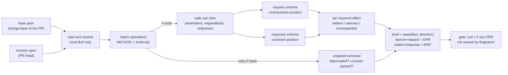

# Semantic OpenAPI Diffing in CI: Detecting Covariant Request Changes and Contravariant Response Changes

> [!summary] Claim
> A breaking change is a change whose direction violates the variance of its position: request schemas sit in contravariant position and may only widen, response schemas sit in covariant position and may only narrow, so a differ that computes "widens or narrows" per keyword and per side of the wire can derive every severity from one two-line law instead of hundreds of hand-picked rules.

Part of [OpenAPI JSON Schema and Contracts](README.md) in [API Engineering](../README.md).

## TL;DR

- Mechanism: match operations by method and normalized path template, resolve `$ref`, then walk each request and response schema and classify every keyword change by what it does to the set of accepted payloads: widens, narrows, incomparable, or none.
- Contract rule: narrowing a request (new required field, removed enum value, smaller `maxLength`) breaks old clients, and widening a response (new enum value, required field removed, `type` integer -> number, became nullable) breaks old clients; oasdiff v1.37.0 encodes exactly this in `DeriveLevel` (as of 2026-11).
- The trap: one component schema referenced from both a request and a response is invariant, so the same edit is `INFO` on one side and `ERR` on the other, and a differ that diffs `components` instead of use sites cannot see it.
- Portability fact: the diff runs over documents, not the wire, so it is independent of HTTP version and ASGI server, but it is only as complete as its JSON Schema reasoning, and JSON Schema satisfiability, to which inclusion reduces through `not`, is EXPTIME-complete for recursive schemas without `uniqueItems` (Bourhis et al., as summarized in Attouche et al. 2022 Section 2), so every real tool is a sound-for-what-it-checks, incomplete approximation.
- When not to use it: when consumers never see the document (a private backend with one generated client pinned in the same repository) or when the spec is not the real contract (code-first drift); fix the drift first with [[Design-First-vs-Code-First-OpenAPI-and-CI-Drift-Gates]], and use consumer-driven tests when only real usage matters.

## Mental model



The two documents enter the same loader, which resolves local references and refuses anything that would fetch a URL or read a file.
Operations are matched by method and by the path template with parameter names erased, so `/orders/{orderId}` and `/orders/{id}` are one endpoint.
An operation present only in the base becomes a removal, judged by its `deprecated` flag and `x-sunset` date; an operation present in both is walked use site by use site, so a component referenced from a request body is judged as a request and the same component referenced from a response is judged as a response.
Each keyword difference yields an effect on the set of accepted payloads, and the level is never chosen per rule: it is derived from the effect and the side of the wire, which is the variance law.
The gate turns levels into an exit status and lets reviewers waive a specific change by its stable fingerprint.

## How it works

### What "breaking" means: the contract, not the server

oasdiff states the definition it implements: "A change is breaking if a consumer that followed the old contract can stop working under the new one" (oasdiff v1.37.0 docs/BREAKING-CHANGES.md, "How oasdiff decides what is breaking").
The definition is deliberately about the document and not about a particular server, because the document has more consumers than the server: gateways and validators reject non-conforming requests, and generated SDKs turn the contract into typed code that stops compiling.
Two consequences follow, both stated in that section.
Adding a required request property is breaking even if the property has a `default`, because "A default is a server-side fallback value; it does not make an omitted required property valid."
The source carries the same reasoning as a comment where it emits `request-property-became-required-with-default` instead of the plain id (oasdiff v1.37.0 checker/check_request_property_required_updated.go, RequestPropertyRequiredUpdatedCheck).
`WARN` is reserved for changes where the document does not contain enough information to decide, not for changes that break only some setups.

### Variance: why requests and responses move in opposite directions

A request is a value the client produces and the server consumes; a response is a value the server produces and the client consumes.
Treat an operation as a function `handler: Request -> Response`.
PEP 483 states the rule for callables: "It is covariant in the return type, but contravariant in the arguments", and concludes "choose the most general type for every argument, and the most specific type for the return value" (PEP 483, "Covariance and Contravariance").
A revised API is a drop-in replacement for the old one exactly when the new handler type is a subtype of the old one, which means the new request schema must accept a superset of the old requests (contravariance) and the new response schema must admit a subset of the old responses (covariance).
The title's phrase names the two failure directions: a change that moves a request schema the covariant way (narrowing) or a response schema the contravariant way (widening) is the change that breaks someone.
PEP 483 also explains the third case: `List[T]` is invariant because a mutable container is both read and written; a schema used for both input and output is in the same position, so only changes that are safe in both directions are safe.
The Zalando guidelines spell out the three rule sets from the owning service's perspective: for input-only schemas "`enum` ranges can be extended", for output-only schemas "`enum` ranges *cannot* be extended", and for schemas used in both "you can only do changes which are allowed in both input and output" (Zalando RESTful API Guidelines, chapter compatibility, rule 107).
GraphQL encodes the same asymmetry in code: for output fields "moving from nullable to non-null of the same underlying type is safe", while for input fields and arguments "moving from non-null to nullable of the same underlying type is safe" (graphql-js 16.x.x src/utilities/findBreakingChanges.ts, isChangeSafeForObjectOrInterfaceField and isChangeSafeForInputObjectFieldOrFieldArg).

### The severity law in oasdiff v1.37.0

oasdiff v1.37.0 annotates every rule with a `Direction` (`DirectionRequest`, `DirectionResponse`, `DirectionNone`), an `Effect`, and optional `Guard`s, and derives the level from them (oasdiff v1.37.0 checker/rules/derive.go, DeriveLevel).
The `Effect` enum is the semantic axis: `EffectWidens` ("the accepted set provably grows"), `EffectNarrows` ("the accepted set provably shrinks"), `EffectIncomparable` (the change "both rejects payloads that were valid and accepts payloads that were not"), `EffectUnknown`, `EffectNone`, and `EffectViolation` for lifecycle governance such as removal before sunset (oasdiff v1.37.0 checker/rules/effect.go, Effect).
The mapping is `levelOf`; its two directional cases, quoted here as an excerpt (indentation converted from tabs), are the whole idea in eleven lines (oasdiff v1.37.0 checker/rules/derive.go, levelOf):

```go
case EffectNarrows:
    if direction == DirectionResponse {
        return INFO
    }
    return ERR
case EffectWidens:
    if direction == DirectionResponse {
        return ERR
    }
    return INFO
```

`EffectViolation` and `EffectIncomparable` map to `ERR`, `EffectUnknown` to `WARN`, and `EffectNone` to `INFO`.
The doc comment on `DeriveLevel` explains why the law is asymmetric on purpose: "Reporting a breaking change as safe ships it silently, so a milder verdict than the effect implies owes a proof that the change is safe for every consumer that conformed to the old contract, while a harsher one costs a reviewer a glance and needs only a reason."
Guards requalify the effect, or for `GuardNegotiated` the direction, before the law applies (oasdiff v1.37.0 checker/rules/derive.go, applyGuards; checker/rules/guard.go):

| Guard | Meaning in the source | Consequence |
|---|---|---|
| `GuardReadOnly` | "a readOnly property does not appear in requests" | request-side effect becomes none |
| `GuardWriteOnly` | "a writeOnly property does not appear in responses" | response-side effect becomes none |
| `GuardNegotiated` | the client "chooses or relies on" a status, media type, or header | judged as a request: removing an option breaks, adding one does not |
| `GuardNonSuccess` | "The responses map does not promise that the server returns only the statuses it lists" | effect becomes none |
| `GuardSanctioned` | "the deprecation contract was honored" | effect becomes none |
| `GuardRequiredInRequests` | the property was already required in requests | request-side effect becomes none |

The seventh guard, `GuardHasDefault` ("the changed element declares a default value"), has no case in `applyGuards`, so it selects the `-with-default` rule ids without changing the derived level (oasdiff v1.37.0 checker/rules/guard.go, GuardHasDefault; checker/rules/derive.go, applyGuards).

`GuardNegotiated` is the subtle one: a response status is server output, but the client's code chooses which statuses it handles, so removing `201` from a `POST` breaks a client that switches on `201`, while adding `202` harms nobody; the source calls this "the reverse of plain response polarity" (oasdiff v1.37.0 checker/rules/guard.go, GuardNegotiated).
That matches the OpenAPI text: "The documentation is not necessarily expected to cover all possible HTTP response codes because they may not be known in advance" (OpenAPI 3.1.2, Responses Object), which is why `GuardNonSuccess` nullifies changes to error statuses.

### Pipeline step 1: loading and reference resolution

A Schema Object `$ref` is a URI reference, and the OpenAPI 3.1 dialect inherits JSON Schema's definition of `$ref` (OpenAPI 3.1.2, Schema Object).
JSON Schema itself says "implementations SHOULD NOT assume they should perform a network operation when they encounter a network-addressable URI" (JSON Schema Core 2020-12 Section 8.2.3), but OpenAPI tooling that fully resolves documents does follow external references.
Resolving one can therefore mean an HTTP fetch or a file read, which is the root of the advisories in Pitfalls; oasdiff documents the attack `$ref: 'http://169.254.169.254/latest/meta-data/iam/security-credentials/'` and the mitigation `--allow-external-refs=false` (oasdiff v1.37.0 docs/EXTERNAL-REFS.md).
The lab accepts only `#/` JSON Pointer references, unescapes `~1` and `~0`, raises `ExternalRefError` for anything else, and raises `RefCycleError` for a chain of `$ref` objects that never reaches a schema (a schema whose properties recurse through `$ref` is fine and is handled by the walk).
In JSON Schema 2020-12, `$ref` "is an applicator" and "other keywords can appear alongside of" `$ref` "in the same schema object" (JSON Schema Core 2020-12 Section 8.2.3.1), so in OpenAPI 3.1 a sibling such as `maxLength` next to a `$ref` is a real constraint; the lab ignores siblings, which is a documented simplification and a source of false negatives.

### Pipeline step 2: matching endpoints

The Paths Object rule is "Templated paths with the same hierarchy but different templated names MUST NOT exist as they are identical" (OpenAPI 3.1.2, Paths Object).
A differ therefore keys operations by method plus the template with names erased; oasdiff "ignores path parameter names" by default and maps renamed parameters positionally (oasdiff v1.37.0 docs/MATCHING-ENDPOINTS.md; diff/path_params_map.go, NewPathParamsMap, whose comment is "person/{personName} -> /person/{name}").
If a spec nevertheless contains two matching templates, oasdiff fails with `duplicate endpoint` and offers two escapes: `--include-path-params`, or an `x-since-date` extension that picks the most recent definition (oasdiff v1.37.0 docs/MATCHING-ENDPOINTS.md).
The lab's `_template_key` erases names the same way and raises on duplicates; its test renames `{orderId}` to `{id}` and asserts that the endpoint still matches and that only the five response rule ids of the real changes (six changes, two of them `response-property-enum-value-added`) are reported there.
A rename that also moves a path segment (`/v1/orders` -> `/orders`) is, to every differ, a removal plus an addition; that is correct, because every old client URL now returns `404`.

### Pipeline step 3: walking use sites

Every operation present in both documents is walked three times: its non-path parameters (path-level parameters "can be overridden at the operation level, but cannot be removed there", and "A unique parameter is defined by a combination of a name and location", per OpenAPI 3.1.2 Path Item Object and Parameter Object), its `requestBody` `application/json` schema in request direction, and each response status's `application/json` schema in response direction.
The walk is per use site, not per component, because direction is a property of where a schema is used, not of the schema.
oasdiff reports a change in a schema shared by several properties once, names the shared schema, and counts the other sites; it gives the reason as scale: "In the Microsoft Graph API description (v1.0, from the APIs.guru directory), a single schema is reached from 164,769 properties of one request or response body" (oasdiff v1.37.0 docs/BREAKING-CHANGES.md, "Schemas Used in Several Places").
The lab does the same with a `seen` set of `(id(base), id(revision))` pairs per payload, which also guarantees termination on recursive schemas.

### Pipeline step 4: per-keyword effects

The table lists the checks the lab implements, the effect it computes, and the level the law derives on each side; every rule id and level matches `oasdiff checks changelog` output from a binary built at v1.37.0 (run here, see Worked example).

| Change | Effect on accepted set | Request level and id | Response level and id |
|---|---|---|---|
| `enum` value removed | narrows | `ERR` `request-property-enum-value-removed` | `INFO` `response-property-enum-value-removed` |
| `enum` value added | widens | `INFO` `request-property-enum-value-added` | `ERR` `response-property-enum-value-added` |
| `type` `integer` -> `number` | widens | `INFO` `request-property-type-generalized` | `ERR` `response-property-type-generalized` |
| `type` `number` -> `integer` | narrows | `ERR` `request-property-type-changed` | `INFO` `response-property-type-specialized` |
| `type` `string` -> `boolean` | incomparable | `ERR` `request-property-type-changed` | `ERR` `response-property-type-changed` |
| became nullable | widens | `INFO` `request-property-became-nullable` | `ERR` `response-property-became-nullable` |
| `maxLength` decreased | narrows | `ERR` `request-property-max-length-decreased` | `INFO` `response-property-max-length-decreased` |
| `maxLength` increased | widens | `INFO` `request-property-max-length-increased` | `ERR` `response-property-max-length-increased` |
| optional -> required | narrows | `ERR` `request-property-became-required` | `INFO` `response-property-became-required` |
| required -> optional | widens | `INFO` `request-property-became-optional` | `ERR` `response-property-became-optional` |
| new required property | narrows | `ERR` `new-required-request-property` | `INFO` `response-required-property-added` |
| required property removed | widens (response) | `WARN` `request-property-removed` (unknown) | `ERR` `response-required-property-removed` |
| optional property removed | none (response) | `WARN` `request-property-removed` (unknown) | `INFO` `response-optional-property-removed` |
| new required parameter | narrows | `ERR` `new-required-request-parameter` | n/a |
| success status removed | narrows, negotiated | n/a | `ERR` `response-success-status-removed` |
| non-success status removed | none | n/a | `INFO` `response-non-success-status-removed` |

Three rows deserve the mechanism spelled out.
Removing a required response property widens, which looks backwards until you think in sets: the old schema admitted only documents with `currency`, the new one admits documents without it, so the set grew, and a client that reads `order["currency"]` now raises `KeyError`.
Request property removal is `EffectUnknown` and `WARN` in oasdiff (oasdiff v1.37.0 checker/rules.go, RequestPropertyRemovedId), because the effect depends on `additionalProperties`: if the schema is open, an old client still sending the field sends an unknown property that the new schema accepts; if it is closed, the request is now rejected.
Zalando chooses the stricter policy and defines field removal "as non-compatible" because "removed fields allow later adding a same-named field with different type or semantic" (Zalando compatibility chapter, rule 107), which is a valid organizational choice expressed through `--severity-levels`, not a different law.
Type subsumption follows JSON Schema: an `integer` instance is a `number` instance, so `["integer", "number"]` and `"number"` admit the same instances and the lab reports no change between them; its `_subtypes` predicate encodes exactly that.

### Nullability: three spellings of one fact

A schema admits `null` through OpenAPI 3.0 `nullable: true`, through a 3.1 `type` array containing `"null"`, or through a `oneOf` with a `{type: "null"}` branch, and oasdiff treats all three as one nullability axis (oasdiff v1.37.0 docs/NULLABILITY.md).
Its direction table is the law again: became nullable is `info` in a request and `error` in a response, became not nullable is `error` in a request and `info` in a response.
The `oneOf` form is recognized only as a pure wrap, because "Under `oneOf`, a value must match exactly one branch; if the schema already allows `null`, a `null` value now matches two branches and is rejected", so wrapping an already-nullable schema is a real narrowing (oasdiff v1.37.0 docs/NULLABILITY.md, Limitations).
The lab normalizes the first two spellings and its test asserts that `nullable: true` -> `type: ["null", "string"]`, enum reordering, and `["integer", "number"]` -> `"number"` produce zero changes, which is the difference between a semantic and a textual diff.

### `readOnly` and `writeOnly`: invisible on the other side

JSON Schema Validation defines `readOnly: true` as "the value of the instance is managed exclusively by the owning authority, and attempts by an application to modify the value of this property are expected to be ignored or rejected by that owning authority" (JSON Schema Validation 2020-12 Section 9.4).
OpenAPI 3.1 makes both keywords annotations and notes that "the behavior of `readOnly` in particular differs from that specified by version 3.0" (OpenAPI 3.1.2, Schema Object, "Validating readOnly and writeOnly").
A differ therefore drops `readOnly` properties from request judgments and `writeOnly` properties from response judgments; oasdiff scopes the guard to object properties because the keyword is "Relevant only for Schema \"properties\" definitions" (oasdiff v1.37.0 checker/rules/guard.go, GuardReadOnly).
The lab test uses one schema with a `readOnly` `state` and a `writeOnly` `secret` in both a `PUT` body and its `200` response, and asserts that request findings mention only `secret` and response findings mention only `state`.

### Enums: the closed-world question

A JSON Schema `enum` is a closed set: an instance validates only if it equals one of the elements (JSON Schema Validation 2020-12 Section 6.1.2).
Adding a value to a response enum therefore widens the response, and oasdiff v1.37.0 rates `response-property-enum-value-added` as `ERR` with the comment "The server may now return a value the previous contract excluded, so a client written against it may not handle the response. If the value set is meant to grow, declare it with x-extensible-enum." (oasdiff v1.37.0 checker/localizations_src/en/messages.yaml, response-property-enum-value-added-comment).
Other authorities soften the verdict differently, and the difference is policy, not mechanism:
- Google AIP-180 says enum values "may be freely added to enums which are only used in request messages", and for response enums that "are expected to receive new values" says they "should document this" and values "still may be added" with caution (AIP-180, "Adding components").
- Zalando recommends `examples` plus an "Extensible enum" description prefix instead of `enum` whenever more values are imaginable, and requires clients to "implement a fallback / default behavior for unknown new values" (Zalando compatibility chapter, rule 112).
- graphql-js classifies `VALUE_ADDED_TO_ENUM` as a `DangerousChangeType`, not a `BreakingChangeType` (graphql-js 16.x.x src/utilities/findBreakingChanges.ts).
- openapi-diff 2.1.7 flags `RESPONSE_ENUM_INCREASED` as incompatible when enabled, and enables it by default (openapi-diff 2.1.7 core/src/main/java/org/openapitools/openapidiff/core/model/schema/ChangedEnum.java, isItemsChanged; BackwardIncompatibleProp.java).
The distinguishing question is whether consumers built a closed type from the `enum`: a client that maps the value onto a closed language enum fails on the new value, while a tolerant reader with a fallback does not.
Tolerance is not free either: RFC 9413 argues that tolerating unexpected input lets "errors in implementations or confusion about semantics" become entrenched (RFC 9413 Section 4.1) and recommends "Virtuous Intolerance" for unspecified conditions (RFC 9413 Section 5.1), which is the argument for declaring extensibility explicitly instead of hoping every client is lenient.

### Composition, patterns, and the decidability wall

`allOf`, `oneOf`, and `anyOf` make a structural walk wrong in both directions: adding an `allOf` branch identical to an existing one changes nothing, yet looks like added constraints, so oasdiff offers a beta `--flatten-allof` that merges branches before diffing (oasdiff v1.37.0 docs/ALLOF.md).
Flattening is lossy: `if`/`then`/`else`, `unevaluatedProperties`, `patternProperties`, and other keywords on an `allOf` subschema are not merged, and the doc warns that losing `unevaluatedProperties: false` "turns a closed schema into an open one"; merged `contains` becomes stricter than the original (oasdiff v1.37.0 docs/ALLOF.md).
The deep reason is that the question a semantic differ asks, "is the old request schema a subschema of the new one", is JSON Schema inclusion, and with `not` in the language, `A` is included in `B` exactly when `allOf: [A, {not: B}]` is unsatisfiable.
Attouche et al. summarize the known bounds: satisfiability is "PSPACE-complete for schemas without recursion and uniqueItems", "in EXPSPACE for non recursive schemas with uniqueItems", "EXPTIME-complete for recursive schemas without uniqueItems", and "in 2EXPTIME for recursive schemas with uniqueItems" (Attouche et al., "Witness Generation for JSON Schema", arXiv 2202.12849, Section 2, summarizing Bourhis et al.); the same paper states that "Schema satisfiability, inclusion, and equivalence" all reduce to witness generation (abstract).
Regular expressions make it worse: JSON Schema patterns are ECMA regular expressions, and "Universality of these REs is undecidable", so witness generation for any sublanguage that includes negated `pattern` is undecidable (same paper, Section 4.4.1).
That is why oasdiff rates `request-property-pattern-changed` as `warning` while `request-property-pattern-added` is `error`: adding a pattern provably narrows, but whether pattern A is contained in pattern B is not something a differ can always decide (`oasdiff checks changelog`, v1.37.0 build, run here).
Habib et al. built a canonicalizing subschema checker, ran it on 8,548 real schema pairs, and report that it "is always correct for schema pairs that it can decide"; on a 298-pair ground truth it was right on all pairs, while the prior tool they compared against gave "a wrong answer in 40% of the cases where the tool does not fail" (Habib et al., "Type Safety with JSON Subschema", arXiv 1911.12651, abstract, Section 6.2, and Section 6.3).
Modern JSON Schema adds cost even before diffing: with `$dynamicRef`, plain validation is PSPACE-complete in schema size (Attouche et al., "Validation of Modern JSON Schema", arXiv 2307.10034, abstract).
The practical design that follows is the one oasdiff and the lab use: decide the common keywords exactly, report the undecidable ones as `WARN` with `EffectUnknown`, and never claim `INFO` without a proof.

### Proof by witness

The lab adds one thing the CLI tools do not: each breaking body-schema verdict in the fixture (four request rules, four response rules) is backed by a concrete witness checked by an independent validator, `jsonschema` 4.26.0's `Draft202012Validator`; the parameter, status-code, and endpoint-removal verdicts have no payload witness.
For a request rule the witness is a payload the old server schema accepts and the new one rejects (for example `{"priority": "low", ...}` after `low` left the enum); for a response rule it is a payload the new server may send and the old client's schema rejects (for example `{"status": "cancelled", ...}`).
A witness turns a severity into a reproducible counterexample, which is what a reviewer actually needs in order to judge a waiver; Attouche et al. frame satisfiability, inclusion, and equivalence as all reducible to witness generation (arXiv 2202.12849, abstract).

### Deprecation and sunset: making removal legal

oasdiff turns removal into a lifecycle: an operation with `deprecated: true` can be removed as `api-removed-with-deprecation` (`info`), an `x-sunset` date in the future turns the removal into `api-removed-before-sunset` (`error`), and `--deprecation-days-stable=180` makes `x-sunset` mandatory and at least 180 days out (oasdiff v1.37.0 docs/DEPRECATION.md).
The same document notes that moving `x-sunset` earlier is reported as `api-sunset-date-changed-earlier`, and that endpoints marked `x-stability-level: draft` or `alpha` are excluded from breaking-change detection under the default `beta` threshold (oasdiff v1.37.0 docs/DEPRECATION.md; docs/STABILITY.md).
The runtime half of the same contract is HTTP: `Deprecation` is an Item Structured Header whose value "MUST be a Date", for example `Deprecation: @1688169599` (RFC 9745 Section 2.1), the `Sunset` header carries an HTTP-date such as `Sunset: Sat, 31 Dec 2018 23:59:59 GMT` (RFC 8594 Section 3), the Sunset timestamp "MUST NOT be earlier than the one given in the Deprecation header field" (RFC 9745 Section 4), and "The act of deprecation does not change any behavior of the resource" (RFC 9745 Section 5).
The lab implements the removal half with a deterministic `today` argument: the same deprecated operation with `x-sunset: 2026-12-31` is `ERR` `api-removed-before-sunset` on 2026-11-11 and `INFO` `api-removed-with-deprecation` on 2027-01-01.
See [[Deprecation-Header-RFC-9745-and-Sunset-Header-RFC-8594]] for the header mechanics and [[Brownout-Schedules-Per-Client-Usage-Telemetry-and-Safe-Sunsetting]] for proving nobody still calls the endpoint.

### Versions, fingerprints, and waivers

SemVer says the major version "MUST be incremented if any backward incompatible changes are introduced to the public API" (SemVer 2.0.0, item 8), and oasdiff checks `info.version` against its own verdict with `api-version-not-bumped`, `api-version-decreased`, and `api-major-version-not-bumped`, all `INFO` by default so they "never fail a build on their own" (oasdiff v1.37.0 docs/VERSIONING.md).
The cross-check in the Worked example shows that check firing on the lab fixture (`1.4.0` -> `1.5.0` with 17 errors).
The OpenAPI Specification is itself not semver: "Occasionally, non-backwards compatible changes may be made in `minor` versions of the OAS where impact is believed to be low relative to the benefit provided" (OpenAPI 3.1.2, Versions).
A waiver needs an identifier that survives rebases; oasdiff defines it as `SHA256("{id}:{operation}:{path}:{args}")[:12]`, computed from the message arguments rather than the rendered text (oasdiff v1.37.0 docs/FINGERPRINT.md).
The same document lists when a fingerprint changes anyway: arguments taken from the base, positional `oneOf[subschema #4]` names, renames, and shared-schema reporting sites; in each case "the change returns to unreviewed rather than keeping a decision that may no longer apply", which is the safe failure direction.
The lab's `Change.fingerprint` uses the same construction, and `gate(changes, ignore=...)` returns `1` until every `ERR` fingerprint is waived.

### The tool landscape (as of 2026-11)

| Tool | Version read | Model | Notable default |
|---|---|---|---|
| oasdiff | v1.37.0, released 2026-11-08 | Go; rules carry direction, effect, guards; level derived | 786 checks (359 error, 23 warning, 404 info) by `oasdiff checks changelog`, run here |
| openapi-diff (OpenAPITools) | 2.1.7, released 2026-01-26 | Java; per-property `BackwardIncompatibleProp` flags | `REQUEST_MIN_LENGTH_INCREASED` and `RESPONSE_NUMERIC_RANGE_INCREASED` are disabled by default (`enabledByDefault` `false`) |
| Azure openapi-diff (OAD) | `main`, docs README | rule pages 1000 and up, Swagger 2.0 examples | `1011 AddingResponseCode` and `1045 AddedOptionalProperty` are "considered a breaking change"; `1020 AddedEnumValue` is breaking "in the same api-version but not breaking in new api-version" |
| Optic | GitHub repository | diff, lint, test | repository `archived: true`, last push 2026-01-08 (GitHub API) |
| graphql-js | 16.x.x branch | GraphQL schema, not OpenAPI | splits `BreakingChangeType` from `DangerousChangeType` |

The openapi-diff disabled-by-default rows are a reminder that "breaking" is a configurable policy in every tool: `REQUEST_MIN_LENGTH_INCREASED` is a narrowing of a request and the law says `ERR`, yet it ships off (openapi-diff 2.1.7 BackwardIncompatibleProp.java).
Azure's stricter model ties compatibility to the `api-version`: its rule 1020 says an added enum value "is considered a breaking change in the same api-version but not breaking in new api-version", so the unit of compatibility is the version string, not the wire (Azure/openapi-diff docs/rules/1020.md).

## Numbers and limits

| Quantity | Value | Source |
|---|---|---|
| oasdiff v1.37.0 checks | 786 total: 359 `error`, 23 `warning`, 404 `info` | `oasdiff checks changelog` from `go install github.com/oasdiff/oasdiff@v1.37.0`, run here 2026-11-12, go1.27.4 darwin/arm64 |
| oasdiff 3.1-specific rule ids | 162 | oasdiff v1.37.0 docs/OPENAPI-31.md |
| Properties reaching one shared schema in Microsoft Graph v1.0 | 164,769 | oasdiff v1.37.0 docs/BREAKING-CHANGES.md |
| Fingerprint length | 12 hex chars of SHA-256 | oasdiff v1.37.0 docs/FINGERPRINT.md |
| Exit code when an external `$ref` is refused | `123` (since v1.18.1) | GHSA-2jcc-mxv7-p3f9 |
| Default stability threshold | `beta`: `draft` and `alpha` endpoints are not checked | oasdiff v1.37.0 docs/STABILITY.md |
| Azure OAD rule pages listed | 50 | Azure/openapi-diff docs/README.md on `main`, counted here |
| Lab differ, 200 operations, 6,000 findings | 43.8 ms best of 5 | a throwaway timing script, not in the lab: 100 paths, each a `GET` `200` payload, a `POST` body, and a `POST` `201` payload of 20 inline `enum` properties widened by one value; best of 5 `time.perf_counter` runs of `diff_specs`; run with `uv run --frozen python` from `labs/` on 2026-11-12, Apple M3 Pro, macOS 27.3 (Darwin 27.3.0, arm64), CPython 3.14.6 |
| Lab differ, 2,000 operations, 60,000 findings | 452.1 ms best of 5 | same script with 1,000 paths, same machine |
| oasdiff on the same 2,000-operation pair | 3.05 s wall, best of 3 runs (3.05 to 5.04 s); 60,000 findings with the same rule ids, plus one `api-version-not-bumped` because the timing spec keeps `info.version` | `/usr/bin/time -p oasdiff changelog big_base.json big_rev.json -f json > /dev/null`, oasdiff built from v1.37.0, same machine; includes JSON load and JSON output, so not comparable to the lab's in-memory timing |
| JSON Schema satisfiability, recursive, no `uniqueItems` | EXPTIME-complete | Bourhis et al., as summarized in arXiv 2202.12849 Section 2 |
| Modern JSON Schema validation with `$dynamicRef` | PSPACE-complete in schema size | arXiv 2307.10034 |
| jsonsubschema evaluation | 8,548 real pairs; 298/298 ground-truth pairs correct | arXiv 1911.12651 |

The lab timing is linear in operations (10x operations -> 10.3x time) because each operation is walked independently and shared components are compared once per payload; the benchmark spec has 20 enum properties per payload and three payloads per path.

## Portability

| Axis | Leg | Status | Evidence |
|---|---|---|---|
| CPython | 3.14 (workspace `.python-version`) | passes, 12 tests | run here on CPython 3.14.6 (the matrix pins 3.14.10; the local interpreter is 3.14.6) |
| CPython | 3.12.16, 3.13.18, 3.15.2, 3.15.2t | not run | lab checks paused by the user on 2026-11-11; the module uses only the PEP 695 `type` statement (3.12+), `dataclass(slots=True)`, and the standard library, and `pyproject.toml` declares `requires-python = ">=3.12,<3.16"`, but no run proves these legs |
| `jsonschema` | 4.26.0 (pinned) | used by the witness tests | run here; the only third-party dependency, and only in tests |
| OpenAPI 3.0 `nullable` vs 3.1 `type` arrays | both spellings | equivalent in the lab | `test_reordering_and_nullable_spelling_are_not_changes`, run here |
| OpenAPI 3.2 `QUERY` method | `query` key in Path Item | matched by the lab's `METHODS` tuple | not covered by a test; oasdiff states it "reads 3.2 specs" (oasdiff v1.37.0 docs/OPENAPI-31.md) |
| Uvicorn, Hypercorn, Granian | any | not applicable | the differ reads documents, never a socket; server choice cannot change a verdict |
| HTTP/1.1, HTTP/2, HTTP/3 | any | not applicable | same reason; status codes and headers are compared as document keys |
| oasdiff | v1.37.0 | rule ids and levels agree with the lab on all 24 fixture changes | cross-check run here; see Worked example |

## Worked example

The [implementation](../labs/src/api_labs/f08_openapi_json_schema_and_contracts/semantic_openapi_diff.py) is a 460-line typed differ with no network access, and the [test](../labs/tests/f08_openapi_json_schema_and_contracts/test_breaking_change_detection_and_semantic_openapi_diffing.py) builds an "Orders" API at `1.4.0` and a revision at `1.5.0` that makes 24 changes at once.
The whole severity policy is one function, shown byte-identical to the lab file:

```python
def derive_level(effect: Effect, direction: Direction) -> Level:
    """The variance law: narrowing breaks request consumers, widening breaks response consumers."""
    if effect in (Effect.VIOLATION, Effect.INCOMPARABLE):
        return Level.ERR
    if effect is Effect.UNKNOWN:
        return Level.WARN
    if effect is Effect.NONE:
        return Level.INFO
    breaks = (effect is Effect.NARROWS) != (direction is Direction.RESPONSE)
    return Level.ERR if breaks else Level.INFO
```

Type subsumption, also byte-identical, is the only place where JSON Schema semantics leak into the walker:

```python
def _subtypes(small: frozenset[str] | None, big: frozenset[str] | None) -> bool:
    """Every instance of ``small`` is an instance of ``big`` (``integer`` is a ``number``)."""
    if big is None:
        return True
    if small is None:
        return False
    return all(t in big or (t == "integer" and "number" in big) for t in small)
```

The property walk, as a simplified excerpt (keyword comparison and `items` recursion omitted), shows that the rule id depends on direction while the effect depends only on the set change:

```python
# simplified excerpt of _diff_schema
for name in sorted(old_props.keys() | new_props.keys()):
    child = f"{where}/{name}" if where else name
    if name not in new_props:
        if walk.invisible(walk.base.resolve(old_props[name])):
            continue
        if request:  # the server may still accept and ignore it: oasdiff calls this unknown
            walk.emit("removed", Effect.UNKNOWN, child)
        elif name in old_req:  # "always present" became "maybe absent": the set grew
            walk.emit_as("response-required-property-removed", Effect.WIDENS, child)
        else:
            walk.emit_as("response-optional-property-removed", Effect.NONE, child)
        continue
    ...
    if (name in old_req) != (name in new_req):
        became_required = name in new_req
        suffix = "became-required" if became_required else "became-optional"
        walk.emit(suffix, _effect_of(not became_required, became_required), child)
    _diff_schema(walk, old_props[name], new_props[name], child)
```

Run from `labs/` on macOS 27.3 (arm64, Apple M3 Pro) with CPython 3.14.6:

```text
$ uv run --frozen pytest tests/f08_openapi_json_schema_and_contracts/test_breaking_change_detection_and_semantic_openapi_diffing.py -q -rP
............                                                             [100%]
==================================== PASSES ====================================
_____________ test_full_revision_report_matches_expected_verdicts ______________
----------------------------- Captured stdout call -----------------------------

ERR  [new-required-request-parameter] GET /orders: query:region
INFO [response-optional-property-removed] GET /orders: []/tracking status=200
ERR  [response-property-became-nullable] GET /orders: []/shippedAt status=200
ERR  [response-property-enum-value-added] GET /orders: []/channel "marketplace" status=200
ERR  [response-property-enum-value-added] GET /orders: []/status "cancelled" status=200
ERR  [response-property-type-generalized] GET /orders: []/itemCount integer number status=200
ERR  [response-required-property-removed] GET /orders: []/currency status=200
INFO [new-optional-request-property] POST /orders: giftWrap
ERR  [new-required-request-property] POST /orders: couponCode
ERR  [request-property-became-required] POST /orders: customerRef
INFO [request-property-enum-value-added] POST /orders: channel "marketplace"
ERR  [request-property-enum-value-removed] POST /orders: priority "low"
ERR  [request-property-max-length-decreased] POST /orders: note 500->200
INFO [request-property-type-generalized] POST /orders: quantity integer number
INFO [response-success-status-added] POST /orders: 202
ERR  [response-success-status-removed] POST /orders: 201
INFO [response-optional-property-removed] GET /orders/{id}: tracking status=200
ERR  [response-property-became-nullable] GET /orders/{id}: shippedAt status=200
ERR  [response-property-enum-value-added] GET /orders/{id}: channel "marketplace" status=200
ERR  [response-property-enum-value-added] GET /orders/{id}: status "cancelled" status=200
ERR  [response-property-type-generalized] GET /orders/{id}: itemCount integer number status=200
ERR  [response-required-property-removed] GET /orders/{id}: currency status=200
INFO [api-removed-with-deprecation] DELETE /orders/{orderId}: 
ERR  [api-removed-without-deprecation] PATCH /orders/{orderId}: 
12 passed in 0.29s
```

Read the `channel` lines together: one edit, `marketplace` appended to the shared `Channel` component, appears as `INFO` on `POST /orders` (request) and as `ERR` on both `GET` endpoints (response), which is the invariance trap made visible; `test_shared_enum_widening_is_safe_in_request_and_breaking_in_response` pins it.
Read `quantity` and `itemCount` together: the same `integer` -> `number` edit is `INFO` in the request and `ERR` in the response.

The same fixture, dumped to JSON and run through real oasdiff v1.37.0 (`oasdiff changelog base.json revision.json -f singleline --color never`), printed `25 changes: 17 error, 0 warning, 8 info`.
Those are the lab's 24 changes with identical rule ids and levels, plus `api-major-version-not-bumped` (`info`), which the lab does not implement.
The only visible differences are naming: oasdiff prints the base path `/orders/{orderId}` and `items/status` where the lab prints the revision path `/orders/{id}` and `[]/status`.
`oasdiff breaking base.json revision.json --fail-on ERR` exited `1`.

The remaining tests each pin one mechanism: the variance law itself, request witnesses (old server accepts, new server rejects) and response witnesses (new server may send, old client rejects) validated by `jsonschema` 4.26.0, `readOnly` and `writeOnly` invisibility, path-parameter renames, sunset timing, recursive schemas terminating with exactly one finding, refusal of `http://169.254.169.254/latest/meta-data/` and of `$ref` cycles, and fingerprint waivers in the gate.

## Pitfalls

> [!warning] Running the differ on fork pull requests with external refs enabled
> Trigger: an oasdiff GitHub Action before `v0.0.51` running on a fork pull request, with `allow-external-refs` left at its old default of `true`.
> Symptom: the advisory describes SSRF via `$ref: "http://<internal-host>/..."` and disclosure of runner files via `$ref: "file:///..."`, whose content is rendered into the changelog and, for `pr-comment`, "posted back as a pull-request comment the attacker can read" (GHSA-fhj3-7267-7vv5, CVE-2026-53507, published 2026-06-01).
> Fix: upgrade to `v0.0.51` or later, where the default is `false`, and treat any spec from a pull request as untrusted input.

> [!warning] A mitigation that silently did not apply on one load path
> Trigger: oasdiff `v1.13.2` through `v1.18.0` loading a spec by git revision (`main:openapi.yaml`) with `--allow-external-refs=false`.
> Symptom: external `$ref`s were still resolved on that path, so callers who disabled them "specifically to safely process untrusted specs" remained exposed to SSRF and local file reads (GHSA-2jcc-mxv7-p3f9, CVE-2026-53508).
> Fix: `v1.18.1`, which enforces the policy and exits `123` when it refuses a reference; test your own security flags on every input path, not only the one in the README.

> [!warning] The review upload that bypassed the refusal
> Trigger: `oasdiff/oasdiff-action` `>= 0.1.7, <= 0.1.19` with its default `review: true`, which runs oasdiff with `--open`.
> Symptom: "a spec supplied through a pull request can make the action read any file on the CI runner, or issue an arbitrary HTTP request from it, and the content is uploaded with the review", because `allow-external-refs: false` "was not enforced on the review-upload path" (GHSA-6h8r-wgc5-q3xv, published 2026-10-28).
> Fix: `v0.1.20`; and when a tool uploads anything, review what it uploads, not only what it prints.

> [!warning] The boolean flag that does not parse
> Trigger: `oasdiff breaking base.yaml rev.yaml --allow-external-refs false`.
> Symptom: the documentation warns that "boolean flags require `=` when setting to `false` on the command line" and that the spaced form "will not work as expected" (oasdiff v1.37.0 docs/EXTERNAL-REFS.md).
> Fix: write `--allow-external-refs=false`, or put `allow-external-refs: false` in the config file.

> [!warning] Diffing components instead of use sites
> Trigger: a home-grown gate that compares `components.schemas` between commits and rates enum additions as safe.
> Symptom: a value appended to a component shared by a request and a response passes CI, and older clients with generated closed enums fail on the first response that carries it; the lab output shows the same edit as `INFO` on `POST /orders` and `ERR` on `GET /orders`.
> Fix: judge every change at each use site with its direction, or treat shared components as invariant, as Zalando's "used in both input and output" rule set does.

> [!warning] Endpoints that are silently not checked
> Trigger: an endpoint tagged `x-stability-level: alpha` that real customers already call.
> Symptom: under the default `beta` threshold, `draft` and `alpha` endpoints "are excluded from breaking-change detection", so any change to it is green (oasdiff v1.37.0 docs/STABILITY.md).
> Fix: audit stability tags against traffic, and note that oasdiff does report `api-stability-decreased` when an in-scope endpoint is demoted.

> [!warning] Flattening that opens a closed schema
> Trigger: `--flatten-allof` on 3.1 schemas whose `allOf` subschemas carry `unevaluatedProperties: false`, conditionals, or `patternProperties`.
> Symptom: those keywords are not merged, so "`unevaluatedProperties: false` turns a closed schema into an open one", and changes inside them become invisible (oasdiff v1.37.0 docs/ALLOF.md, issue #878 cited there).
> Fix: flatten only when false positives from duplicate branches are the actual problem, and keep an unflattened run in CI.

> [!warning] Comparing against the wrong base
> Trigger: the gate diffs the PR head against the tip of `main` instead of the merge-base, or the base moves while a waiver is pending.
> Symptom: unrelated changes from `main` appear as the PR's changes, or approved waivers stop matching because arguments taken from the base changed the fingerprint (oasdiff v1.37.0 docs/FINGERPRINT.md, "When the base changes").
> Fix: diff against `git merge-base`, store waivers by fingerprint, and accept that a moved base returns a change to unreviewed.

> [!warning] Trusting a `default` to make a new required field safe
> Trigger: making a request property required "because it has a default".
> Symptom: gateways and generated SDKs that enforce the contract reject requests that omit it, which oasdiff reports as `new-required-request-property-with-default` or `request-property-became-required-with-default`, both `error` (oasdiff v1.37.0 checker/rules.go, NewRequiredRequestPropertyWithDefaultId and RequestPropertyBecameRequiredWithDefaultId; the second is emitted in checker/check_request_property_required_updated.go, RequestPropertyRequiredUpdatedCheck).
> Fix: keep it optional with a server-side default; required-with-default is a contradiction on the wire.

## Security and robustness

The differ is a parser of attacker-controlled input whenever it runs on pull requests, which puts it squarely under OWASP `API7:2023 - Server Side Request Forgery` and `API10:2023 - Unsafe Consumption of APIs` (OWASP API Security Top 10 2023).
Defense in depth for a CI gate:
- Refuse external references by default and enforce it on every load path; the three oasdiff advisories above are one bug class found three times on three paths (CLI default, git-revision path, review upload).
- Run the job with no cloud credentials and no network egress to metadata endpoints, so that a missed refusal still reads nothing; the documented payload is `http://169.254.169.254/latest/meta-data/iam/security-credentials/` (oasdiff v1.37.0 docs/EXTERNAL-REFS.md).
- Bound input size and parsing cost: YAML anchors can expand a small file into a huge tree (see [[YAML-Media-Type-RFC-9512-and-OpenAPI-YAML-Parser-Hazards]]), shared-schema fan-out can reach six digits of property paths (164,769 in Microsoft Graph, per oasdiff), and `$dynamicRef` makes even validation PSPACE-complete; set a timeout and a byte limit on the job.
- Detect reference loops explicitly; the lab raises `RefCycleError` on a `$ref` chain that never reaches a schema, and terminates recursive schemas with a visited set instead of a depth limit.
- Never let the gate execute anything from the spec: no extension hooks, no remote rule packs fetched at run time.
Security changes in the spec are themselves contract changes: oasdiff rates `api-global-security-scope-added` as `error` (a client token without the new scope is now rejected) and `api-global-security-scope-removed` as `info` (oasdiff v1.37.0 checker/rules.go, handWrittenRules), which is the variance law applied to authorization, with the request side being the credential the client presents.
Removing an endpoint from the spec without removing it from the gateway is the opposite failure: the document says it is gone, the route still answers, and `API9:2023 - Improper Inventory Management` follows; pair the differ with route inventory (see [[API-Estate-Inventory-Cataloging-RFC-9727-and-Shadow-API-Discovery]]).

## The principal's view

The decision is not "which diff tool" but "what is the contract and who is allowed to break it".
A semantic differ is cheap, fast (half a second for 2,000 operations in the lab), and conservative, so the organizational cost is not compute but the waiver process: every `ERR` either blocks a merge or needs a named approver, and a gate with no waiver path gives teams a reason to switch it off.
Make the policy explicit and versioned: the law is fixed, but the levels of the policy-dependent rows (response enum additions, request field removal, response numeric ranges) belong in a reviewed `--severity-levels` file, the way Zalando, Google, and Azure each choose differently on the same mechanism.
Invest in the two things a differ cannot see: drift between spec and implementation, which needs a code-first snapshot gate ([[Design-First-vs-Code-First-OpenAPI-and-CI-Drift-Gates]]), and semantic changes with an unchanged schema (a field that keeps its type but changes its meaning, which AIP-180 calls out under "Semantic changes"), which needs review and consumer tests ([[Consumer-Driven-Contract-Testing-vs-Bi-Directional-Contract-Verification]]).
Choose a different tool when the format changes the compatibility model: Protobuf compatibility is about tag numbers and wire types, not JSON value sets, so use `buf breaking` ([[Protobuf-Governance-Linting-and-Breaking-Change-Gates-with-Buf]]); GraphQL has its own dangerous-versus-breaking split in `findBreakingChanges`; event schemas in a registry need compatibility modes per subject.
Choose not to gate at all when there is exactly one consumer built and deployed atomically with the server; the variance law still holds, but the compiler of the monorepo already enforces it.

## Interview questions

> [!question] L5: Why is adding an enum value to a request schema safe while adding the same value to a response schema is breaking?
>
> > [!success]- Answer
> > A request schema is the server's input, so the new schema must accept every request the old one did; adding a value only enlarges that set.
> > A response schema is the client's input, so every response the new server may send must have been valid under the old schema; a new value is a response the old client never agreed to handle.
> > This is contravariance in argument position and covariance in return position (PEP 483).
> > oasdiff v1.37.0 rates `request-property-enum-value-added` `info` and `response-property-enum-value-added` `error`.
> >
> > Follow-up: What changes when the enum is declared as `x-extensible-enum` or as Zalando-style `examples`?

> [!question] L5: Removing `201` from the responses of `POST /orders` and adding `202` is reported as `ERR` plus `INFO`; removing `404` is `INFO`. Why the difference?
>
> > [!success]- Answer
> > Status availability is negotiated: the client's code switches on the statuses it handles, so removing a success status rejects that branch the way narrowing a request does.
> > oasdiff encodes this as `GuardNegotiated`, which judges the change as if it were on the request side.
> > Non-success statuses carry `GuardNonSuccess`, because the Responses Object "is not necessarily expected to cover all possible HTTP response codes", so dropping one from the list changes nothing a conforming client can receive.
> >
> > Follow-up: Is changing an async creation endpoint from `201` to `202` safe if the body is unchanged?

> [!question] L6: Predict the output. A shared component `Count` is `{"type": "integer"}` and is used as `quantity` in the `POST /orders` request body and as `itemCount` in the `GET /orders/{id}` `200` response. The revision changes it to `{"type": "number"}`. What does the lab print for those two sites?
>
> > [!success]- Answer
> > Two lines, with the same effect and opposite levels:
> > `INFO [request-property-type-generalized] POST /orders: quantity integer number`
> > `ERR  [response-property-type-generalized] GET /orders/{id}: itemCount integer number status=200`
> > Every `integer` is a `number`, so the accepted set widens; widening is safe for the server's input and unsafe for the client's input.
> > The lab's captured output shows exactly these two lines for `quantity` and `itemCount`.
> >
> > Follow-up: What would it print if the change were `integer` -> `string`, and why does that need no direction at all?

> [!question] L6: Why does removing a required response property widen the response, and why does oasdiff rate removing a request property as `WARN` rather than `ERR`?
>
> > [!success]- Answer
> > Under the old schema every valid response contained the property; under the new one, responses without it are also valid, so the set of valid responses grew.
> > Old clients reading the field now hit missing keys, so `response-required-property-removed` is `error`.
> > For a request, the effect depends on whether the schema is closed: with open `additionalProperties`, old clients still sending the field are accepted; with `additionalProperties: false`, they are now rejected.
> > The document alone may not settle that, so oasdiff uses `EffectUnknown`, which the law maps to `WARN`.
> >
> > Follow-up: Zalando defines field removal as non-compatible anyway; what risk does that guard against?

> [!question] L6: Debug this API. A team's oasdiff gate has been green for months, yet the mobile team reports that a response enum gained a value last week and their generated Swift client crashed. The spec is in the repository and the gate runs `oasdiff breaking main:openapi.yaml HEAD:openapi.yaml --fail-on ERR`. Where do you look?
>
> > [!success]- Answer
> > First check the endpoint's `x-stability-level`: under the default `beta` threshold, `draft` and `alpha` endpoints are excluded from breaking-change detection, so a change there is green.
> > Then check whether the value was added in a schema the differ cannot see: an external `$ref` refused or not loaded, an `allOf` branch flattened away, or an `if`/`then` branch.
> > Then check `--severity-levels`: someone may have downgraded `response-property-enum-value-added`.
> > Finally confirm the spec matches the implementation; if the server emitted the value without a spec change, this is drift and the fix is a code-first snapshot gate, not a differ setting.
> >
> > Follow-up: How would you make the stability exclusion visible in the PR comment?

> [!question] L6: Why must a CI gate refuse external `$ref`s by default, and why was setting the flag not enough in three published oasdiff advisories?
>
> > [!success]- Answer
> > A `$ref` is a URI, so resolving one from a pull request lets the PR author make the runner fetch an internal URL (SSRF) or read a local file whose content may be echoed into the changelog.
> > GHSA-fhj3-7267-7vv5 flipped the action default to `false`; GHSA-2jcc-mxv7-p3f9 found that the git-revision load path ignored the flag in v1.13.2 to v1.18.0; GHSA-6h8r-wgc5-q3xv found the review-upload path ignored it in the action through v0.1.19.
> > A security setting is only as good as its enforcement on every path, so the defense is also environmental: no credentials and no metadata egress on the job.
> >
> > Follow-up: What exit code does oasdiff v1.18.1 and later return when it refuses a reference, and how should the gate treat it?

> [!question] L7: Why can no OpenAPI differ be both sound and complete, and how should a tool behave at that boundary?
>
> > [!success]- Answer
> > Deciding "old request schema is a subschema of the new one" is JSON Schema inclusion, which reduces through `not` to satisfiability, which is EXPTIME-complete for recursive schemas without `uniqueItems`, and once negated `pattern` is in the language witness generation is undecidable, because universality of ECMA regular expressions is undecidable (Attouche et al. 2022, Sections 2 and 4.4.1).
> > A practical tool decides the common keywords exactly, reports the undecidable ones as unknown, and never downgrades a change to safe without a proof; oasdiff's `DeriveLevel` comment states this asymmetry, and it rates `request-property-pattern-changed` as `warning`.
> > Witnesses strengthen the boundary: a concrete payload valid under one schema and invalid under the other converts a warning into a reproducible fact for the reviewer.
> >
> > Follow-up: Where would you spend a solver budget first in a 2,000-operation spec?

> [!question] L7: You own API governance for 400 services. Design the breaking-change policy and its waiver process.
>
> > [!success]- Answer
> > Fix the mechanism org-wide: a semantic differ run on every PR against the merge-base, with external refs refused and the job sandboxed.
> > Version the policy in one reviewed severity file, and decide the contested rows explicitly: response enum additions, request field removal, and response range widening.
> > Require deprecation with `x-sunset` and a grace period for removals, and emit `Deprecation` and `Sunset` headers at runtime (RFC 9745, RFC 8594), backed by per-client telemetry before the removal merges.
> > Waivers are per fingerprint, per PR, with a named approver, and expire when the base moves.
> > Measure the gate: false-positive rate from waiver volume, escapes from incident reviews, and drift from code-first snapshot failures.
> >
> > Follow-up: Which teams get an exemption, and how do you prevent the exemption list from becoming the default?

> [!question] L7: When would you not use an OpenAPI differ as the compatibility gate?
>
> > [!success]- Answer
> > When the document is not the contract: code-first services whose generated spec drifts, or behavior changes with identical schemas, which AIP-180 calls semantic changes.
> > When the wire format has a different compatibility model, such as Protobuf tags, where `buf breaking` checks the right invariant.
> > When there is one consumer deployed atomically with the server, so the compiler already enforces compatibility.
> > In those cases use snapshot gates, consumer-driven contract tests, or nothing, and say why in the design record.
> >
> > Follow-up: How do you detect that a spec has become a non-contract over time?

## Related

Prerequisites: [[OpenAPI-Linting-and-Automated-Style-Governance-with-Vacuum-and-Spectral]]

Next: [[Generating-Pydantic-v2-Models-from-OpenAPI-with-Datamodel-Code-Generator]]

See also: [[API-Fundamentals]], [[02-Programming-Languages/Python/Python-Backend-Interview-Prep/05-REST-API-Design]], [[JSON-Schema-2020-12-Core-and-Validation-Vocabularies]], [[JSON-Schema-Composition-AllOf-AnyOf-OneOf-and-UnevaluatedProperties]], [[OpenAPI-3-1-Architecture-and-JSON-Schema-Alignment]], [[Design-First-vs-Code-First-OpenAPI-and-CI-Drift-Gates]], [[Consumer-Driven-Contract-Testing-vs-Bi-Directional-Contract-Verification]], [[YAML-Media-Type-RFC-9512-and-OpenAPI-YAML-Parser-Hazards]], [[Anatomy-of-Breaking-Changes-in-HTTP-and-JSON-APIs]], [[Compatibility-Taxonomy-Wire-Source-and-Semantic-Compatibility-AIP-180]], [[Additive-Schema-Evolution-and-Tolerant-Reader-Patterns]], [[Deprecation-Header-RFC-9745-and-Sunset-Header-RFC-8594]], [[Brownout-Schedules-Per-Client-Usage-Telemetry-and-Safe-Sunsetting]], [[Zalando-RESTful-API-and-Event-Guidelines-in-Depth]], [[Protobuf-Governance-Linting-and-Breaking-Change-Gates-with-Buf]], [[API-Estate-Inventory-Cataloging-RFC-9727-and-Shadow-API-Discovery]]

- Lab: `labs/tests/f08_openapi_json_schema_and_contracts/test_breaking_change_detection_and_semantic_openapi_diffing.py`

## Further reading

- [oasdiff v1.37.0 checker/rules/derive.go](https://raw.githubusercontent.com/oasdiff/oasdiff/v1.37.0/checker/rules/derive.go): the variance law as eleven lines of Go, with the asymmetry argument in its doc comment.
- [oasdiff v1.37.0 docs/BREAKING-CHANGES.md](https://raw.githubusercontent.com/oasdiff/oasdiff/v1.37.0/docs/BREAKING-CHANGES.md): the contract-not-server definition of breaking, levels, and shared-schema reporting.
- [oasdiff v1.37.0 docs/NULLABILITY.md](https://raw.githubusercontent.com/oasdiff/oasdiff/v1.37.0/docs/NULLABILITY.md): three spellings of `null` and the request-versus-response table.
- [PEP 483](https://peps.python.org/pep-0483/): the clearest statement of argument contravariance and return covariance.
- [Zalando RESTful API Guidelines, compatibility chapter](https://raw.githubusercontent.com/zalando/restful-api-guidelines/main/chapters/compatibility.adoc): input-only, output-only, and both rule sets, and the extensible-enum recommendation.
- [Google AIP-180](https://raw.githubusercontent.com/aip-dev/google.aip.dev/master/aip/general/0180.md): backwards compatibility across wire, source, and semantic dimensions.
- [graphql-js findBreakingChanges.ts](https://raw.githubusercontent.com/graphql/graphql-js/16.x.x/src/utilities/findBreakingChanges.ts): the same variance in a different type system, with a breaking-versus-dangerous split.
- [OpenAPI Specification 3.1.2](https://raw.githubusercontent.com/OAI/OpenAPI-Specification/main/versions/3.1.2.md): Paths Object matching, Responses Object coverage, and `readOnly`/`writeOnly` semantics.
- [JSON Schema Validation 2020-12](https://json-schema.org/draft/2020-12/json-schema-validation): `enum` (Section 6.1.2), `required` (Section 6.5.3), `readOnly` and `writeOnly` (Section 9.4).
- [Habib et al., Type Safety with JSON Subschema](https://arxiv.org/abs/1911.12651): a canonicalizing subschema checker and its evaluation on real schema evolution.
- [Attouche et al., Witness Generation for JSON Schema](https://arxiv.org/abs/2202.12849): complexity bounds for satisfiability and inclusion, and why regular expressions make completeness impossible.
- [Attouche et al., Validation of Modern JSON Schema](https://arxiv.org/abs/2307.10034): `$dynamicRef` makes validation PSPACE-complete.
- [RFC 9745](https://www.rfc-editor.org/rfc/rfc9745.html): the `Deprecation` response header and its relation to `Sunset`.
- [RFC 8594](https://www.rfc-editor.org/rfc/rfc8594.html): the `Sunset` response header.
- [RFC 9413](https://www.rfc-editor.org/rfc/rfc9413.html): why tolerating the unexpected decays protocols, the counterweight to tolerant-reader advice.
- [GHSA-2jcc-mxv7-p3f9](https://github.com/advisories/GHSA-2jcc-mxv7-p3f9): the git-revision external-ref bypass and its fix in v1.18.1.
- [GHSA-6h8r-wgc5-q3xv](https://github.com/oasdiff/oasdiff-action/security/advisories/GHSA-6h8r-wgc5-q3xv): the review-upload bypass in oasdiff-action.
