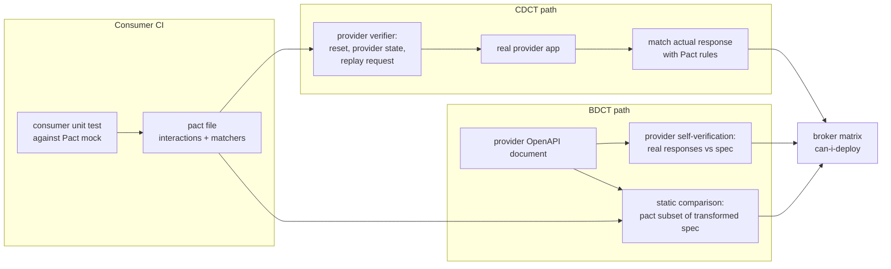

# Consumer-Driven Contract Testing (Pact) vs Bi-Directional OpenAPI Provider Verification

> [!summary] Claim
> Consumer-driven contract testing replays each consumer's recorded expectations against the running provider, so it catches every behavior change a consumer depends on; bi-directional contract testing only proves two documents are compatible (the consumer pact is a subset of the provider's OpenAPI) plus a separate provider self-test, so it is cheaper and decoupled but blind to anything the OpenAPI document allows, such as an optional field the provider silently stops sending.

Part of [OpenAPI JSON Schema and Contracts](README.md) in [API Engineering](../README.md).

## TL;DR

- Mechanism: CDCT (Pact) records consumer interactions in a mock server, publishes them as a pact file, and the provider verifier replays each one after a provider-state setup, matching the real response with Pact matching rules; BDCT never runs the provider against the pact, it validates every pact interaction against the provider's OpenAPI document after transforming the response schemas (`additionalProperties: false` forced on, `required` removed) (openapi-pact-comparator 2.5.0 `src/transform/responseSchema.ts`, `transformReceivedSchema`).
- Contract rule: Pact is strict on what the consumer sends and loose on what it accepts: unexpected request body keys fail, unexpected response keys pass, and you can never assert that a response field is absent (Pact Specification V2 README, "Request body" and "Response body"; V3 README, "Pact Specification Philosophy").
- Trap: BDCT is only as strong as the provider's self-verification against its own spec; the lab shows a release that keeps `email` in the OpenAPI document as optional but stops populating it passing self-verification and the BDCT comparison while CDCT replay fails the one consumer that reads `email`.
- Portability fact: matcher semantics are defined by the Pact Specification version, not the language binding; a pact written at V3 or V4 needs a verifier at the same level, and pact-python 4.2.0 delegates matching to the Rust core through `pact-python-ffi~=0.5.12` and requires Python `>=3.11` (pact-python 4.2.0 `pyproject.toml`).
- When not to use it: do not use CDCT for third-party or unknown consumers, for validation-rule exhaustiveness, or for side effects (that is functional testing); do not rely on BDCT alone when consumers depend on state-dependent semantics or on fields the spec marks optional.

## Mental model



Both paths start from the same artifact: a pact file produced by a consumer unit test that talked to a mock, so it contains only interactions the consumer code actually made.
On the CDCT path the provider team runs a verifier that, for each interaction, resets state, invokes the named provider state handler, replays the exact request against the real application, and matches the actual response with the pact's matching rules; the verification result is published per consumer version and provider version.
On the BDCT path the provider never sees the pact during its own build: it publishes its OpenAPI document together with a self-verification result that proves real responses conform to that document, and the broker compares each pact interaction against the document statically.
Both paths end in the same place: the broker's matrix of consumer and provider versions, queried by `can-i-deploy` before each deployment.
The two arrows into `CMP` are the whole BDCT guarantee, and the arrow from `APP` to `SV` is the weakest link: anything the spec permits, the comparison accepts.

## How it works

### The pattern: consumer contracts are open, provider contracts are closed

Ian Robinson's 2006 article distinguishes three contract kinds (martinfowler.com, "Consumer-Driven Contracts: A Service Evolution Pattern", "Summary of Contract Characteristics").
A provider contract is closed and complete, single, and authoritative.
A consumer contract is open and incomplete, multiple, and non-authoritative: each consumer expresses only "a subset of the system's business function capabilities".
A consumer-driven contract is the union of the consumer contracts: closed and complete "with respect to the entire set of functionality demanded of it by its existing consumers", singular, and non-authoritative because it is derived.
The practical consequence the article draws is the evolution rule this whole note rests on: if the provider knows the union of consumer expectations, it can remove anything outside that union, and "where a proposed change would in fact break one or more consumers, the provider will have immediate insight".
The article also names the receiving-side discipline that makes this work: consumers should do "just enough" validation and only process data that contributes to their business function, which the article presents as an augmentation of the Internet Protocol's robustness principle (quoted there via David Orchard), stated in RFC 1122 as "Be liberal in what you accept, and conservative in what you send" (RFC 1122 Section 1.2.2).
CDCT and BDCT are two ways of computing whether a provider change stays inside that union.

### The pact file

A pact is a JSON document with `consumer`, `provider`, `interactions`, and `metadata`; V4 requires `metadata.pactSpecification.version` to be `4.0` (Pact Specification V4 README, "Metadata").
Each V4 interaction carries a `type` (`Synchronous/HTTP`, `Asynchronous/Messages`, or `Synchronous/Messages`), a `description` that must be unique within the file, an optional `key`, optional `providerStates`, and an optional `pending` boolean (V4 README, "Interactions").
A `Synchronous/HTTP` request has `method`, `path`, `query` and `headers` as `Map[string, List[string]]`, `body`, `matchingRules`, and `generators`; the response has `status` (a number in `100-599`), `headers`, `body`, `matchingRules`, and `generators` (V4 README, "Request" and "Response").
The version history explains several verifier differences you meet in practice:

| Version | What changed (per the specification README) |
| --- | --- |
| V2 | Matching rules keyed by JSON path; explicit request and response matching semantics |
| V3 | Messages; `query` stored as a map of lists instead of a string; `providerStates` list with `params`; `matchers` arrays with `combine` `AND`/`OR`; `equality`, `include`, `integer`, `decimal`, `number`, `null`, date and time matchers; generators |
| V4 | Typed interactions with `key` and `pending`; plugins; `arrayContains`, `statusCode`, `notEmpty`, `semver`, `eachKey`, `eachValue` matchers; `ProviderState` and `MockServerURL` generators |

V4 also states that readers follow the robustness principle for the file itself: attributes that do not conform to the specification "should be ignored and not stop the file from being processed", ideally with a warning (V4 README, "File format").

### Pact matching semantics

The V2 specification fixes the asymmetry that defines Pact (V2 README, "Request matching" and "Response matching"):

- Request method: exact match, case insensitive; request path: exact and case sensitive, and trailing slashes are significant.
- Request query: same key-value pairs, keys in any order, repeated values in the same order.
- Request headers: unexpected headers are allowed, because frameworks add their own (`User-Agent`).
- Request body: unexpected keys are not allowed, and unexpected array items are not allowed, so the consumer cannot "leak" data it was not tested to send.
- Response status: exact integer match.
- Response body: unexpected keys are allowed, but unexpected array items are not, because "we might not have exercised the correct code to handle that second item".

The V3 philosophy section adds the corollary that shapes CDCT's blind spot: "you cannot verify, using pact, that a key or a header will _not_ be present in a response" (V3 README, "Pact Specification Philosophy").
The docs repeat it as a gotcha and add the reason: the provider "may have a pact with another consumer that requires those fields" (docs.pact.io, "Gotchas").
They also note that an empty object in a response expectation means "allow any hash", since every key is unexpected and therefore allowed.

Body semantics distinguish absence from emptiness: no `body` in the pact means the body is not important, an empty string means the body must be empty, and a JSON `null` body may be treated as either (V3 README, "Semantics around body values").

### Matching rules and the path-weighting algorithm

A matching rule maps a JSON path to a list of matchers, and rules cascade: "a rule can be specified on a value and will apply to all children of that value" (V3 README, "Matching Rules").
Because `*` can match any key or index, several rule paths can apply to one value, and the specification picks one by weighting: the root `$` scores 2, a matching property name or array index scores 2, a `*` scores 1, a non-matching element scores 0, and the weight is the product (V3 README, "Matcher selection algorithm").
The Rust reference implementation computes exactly that product with a `fold(1, |acc, (token, fragment)| acc * matches_token(fragment, token))` and returns `(weight, token_count)`, returning weight 0 when the rule path is longer than the value's path (pact_models 1.3.17 `rust/pact_models/src/path_exp.rs`, `DocPath::path_weight`).
For the value at `$.item1.level[1].id`, `$.item1.level[1].id` scores 32, `$.item1.level[*].id` scores 16, and `$.item1` scores 4, so the exact path wins and a parent rule is the fallback that implements cascading.
The specification's own example table prints 16 for `$.*.level[*].id`, but its listed factors `$(2).*(1).level(2)[*(1)].id(2)` multiply to 8; the lab asserts 8, which is what the product rule (and the Rust fold) yields.
The `equality` matcher exists to stop a cascade: a `type` rule on `$.user` would otherwise make `$.user.role` type-only, and an `equality` rule on `$.user.role` outranks it by weight (V3 README, "Add an equality matcher").

Matcher behaviors that matter for compatibility (V3 and V4 README, "Supported matchers"):

- `type` compares JSON types only; "The general type matcher will match 100 and 100.01", which is why `integer` and `decimal` exist for financial values.
- `type` with `min` or `max` on an array bounds the actual length, and actual items beyond the example's length are compared with the first example item instead of failing as unexpected (pact_matching 2.1.0 `rust/pact_matching/src/matchingrules.rs`, `compare_lists_with_matchingrule` and `match_list_contents`, which pads the expected list with `expected.first()`).
- `regex` runs against the string representation of the value, and the Rust core uses `Regex::is_match`, an unanchored search (pact_matching 2.1.0 `rust/pact_matching/src/matchingrules.rs`, `impl DoMatch<&str> for MatchingRule`, `match_value`), so `(OBJECT|INTEGER)` accepts `INTEGER_RESULT`; the docs' gotcha recommends `^(...)$` for exactly this reason.
- `include` is a substring test; `null`, `boolean`, `number`, and the V4 `notEmpty` and `semver` are type or format predicates.

### Provider states and verification

A provider state is the `Given` of the interaction: a named precondition, with optional `params` since V3, that the provider's verifier sets up "by injecting it straight into the data source before the interaction is run" (docs.pact.io, "Provider states").
Each interaction must be verified in isolation, "with no context maintained from the previous interactions", and states are the place to stub downstream systems or force hard-to-cause responses such as a `500`.
In pact-python 4.2.0 the verifier accepts a single callable for all states, a mapping of state names to callables, or a state-change URL, with a `teardown` flag (pact-python 4.2.0 `src/pact/verifier.py`, `Verifier.state_handler`); pacts come from `Verifier.add_source` or `Verifier.broker_source`, and `BrokerSelectorBuilder.include_pending` and `include_wip_since` enable the broker features below.
pact-python 4.0.0 removed the `pact.v2` compatibility module and the `pact-verifier` console script (pact-python 4.0.0 release notes), so the Ruby-era API is gone (as of 2026-11).

### The broker workflow: matrix, pending, WIP, and can-i-deploy

The broker stores pacts by content, deduplicated, so many consumer versions can share one "pact version", and verification results attach to that content (docs.pact.io, "Pending pacts", "How it is calculated").
The matrix is the table of consumer versions, provider versions, and verification outcomes; after each deploy a pipeline runs `pact-broker record-deployment --pacticipant P --version V --environment E`, and before each deploy `pact-broker can-i-deploy --pacticipant P --version V --to-environment E`, which exits `0` only if every integration with the versions already in that environment has a successful result (docs.pact.io, "Can I Deploy").
Pending pacts solve the provider-side blocking problem: a pact content is pending for a provider branch until that branch publishes its first successful verification, and while pending, mismatches do not fail the verification task, though the failed result is still published so the consumer's `can-i-deploy` stays blocked (docs.pact.io, "Pending pacts").
The provider build enables it with `enablePending`; the webhook-triggered build for the `contract_requiring_verification_published` event deliberately does not use it, because it is expected to fail when pacts change.
WIP pacts solve the consumer-side discovery problem: head pacts for each consumer branch that were not explicitly selected and are still pending for this provider branch, created after `includeWipPactsSince`, are added to the verification run with pending forced to true (docs.pact.io, "Work In Progress pacts"); the OSS broker needs version 2.60.0 or later for this.
The usual selectors are `{ mainBranch: true }` and `{ deployedOrReleased: true }`, so the provider verifies what consumers are building and what is actually running (docs.pact.io, "Consumer Version Selectors").

### BDCT: what is compared, mechanically

In BDCT the consumer side is unchanged: it still produces a pact, which "captures only the actual interactions generated by the consumer code", and the provider side uploads an OpenAPI document plus a self-verification result from any tool that tests the implementation against it (SmartBear Contract Testing docs, "Bi-Directional Contract Testing Guide").
The vendor's own comparison table rates BDCT better than CDCT on maintenance cost, learning curve, complexity, feedback time, stability, test data setup, team coupling, and unknown consumers, equal on flakiness and testing data semantics, and worse on guarantees, isolation, revealing unused interfaces and fields, and "well fittedness" (SmartBear docs, "Bi-Directional Contract Testing Guide", "Trade-offs", as of 2026-11); its summary is "Weaker guarantees than CDC but decouples teams and can be used with third parties/unknown consumers", and "The consumer contract is never replayed against the provider code base".
The compatibility check fails when the self-verification failed, when the consumer's own pact tests failed, or when the pact is not compatible with the spec, and it "can only decide based on the information it receives" (SmartBear docs, "Compatibility Checks").

The comparison engine is openapi-pact-comparator, a rewrite of swagger-mock-validator, which its README says is no longer used by the BDCT feature (swagger-mock-validator README, "UPDATE: new package"; openapi-pact-comparator 2.5.0, released 2026-11-11).
For one HTTP interaction, `compareHttpInteraction` routes the method and path through a `find-my-way` radix router, retries alternative routes if path-parameter schemas reject the first, then checks security, request headers, query, request body, response headers, and response body, skipping the body checks if the content type was already incompatible (openapi-pact-comparator 2.5.0 `src/compare/oas/index.ts`, `compareHttpInteraction`).
The response check picks `responses[status]`, then the range key `NXX` computed by `patternedStatus` as `` `${Math.floor(status / 100)}XX` ``, then `default`; no match is the error `response.status.unknown`, and a `default` match adds the warning `response.status.default` (`src/compare/oas/responseBody.ts`, `compareResBody`; `src/compare/oas/utils/statusCodes.ts`).
That lookup order mirrors OpenAPI, where an explicit code "takes precedence over the range definition", only `1XX` to `5XX` ranges are allowed, and `default` covers "responses other than the ones declared" (OpenAPI 3.1.2 Section 4.8.16).
The response body schema is first reduced by `minimumSchema` (strip `description` and `example` from the schema and from each referenced component, add a `oneOf` discriminator's `propertyName` to `required`, convert `nullable` to type arrays and boolean `exclusiveMinimum`/`exclusiveMaximum` to numbers, collect the referenced components, flatten `allOf`) (`src/transform/minimumSchema.ts`, `minimumSchema`) and then rewritten by `transformReceivedSchema`, and this rewrite is the heart of BDCT:

- Every subschema with `type: object`, no `oneOf`, `allOf`, or `anyOf`, and `additionalProperties` absent or `true` gets `additionalProperties: false`, so a consumer that expects a field the spec does not declare fails with `response.body.incompatible`.
- Every subschema loses `minProperties`, and loses `required` unless it has `oneOf` (where the discriminator must stay required), so a consumer that reads only two of ten required fields passes (`src/transform/responseSchema.ts`, `transformReceivedSchema` and `relaxSchema`).

The request side is the mirror image: the request body schema goes through `minimumSchema` only, so `required` is kept and extra request members are allowed unless the spec forbids them, and the request body is validated only when the interaction's response status is below `400`, because an interaction that expects a `422` is supposed to send an invalid body (`src/compare/oas/requestBody.ts`, `compareReqBody`; `src/utils/interaction.ts`, `isValidRequest`).
Only `application/json`, `application/x-www-form-urlencoded`, and `multipart/form-data` bodies are validated; any other content type with a body yields a `*.body.unvalidatable` warning (`src/utils/body.ts`, `VALIDATABLE_CONTENT_TYPES`).
The predecessor exposed the same two policy knobs as CLI flags, `--additionalPropertiesInResponse` and `--requiredPropertiesInResponse`, both defaulting to `false` (swagger-mock-validator README, "Usage").
A `QUIRKS` environment variable or `x-opc-config-<quirk>` extensions in `info` reproduce old swagger-mock-validator bugs, such as validating request bodies only when `application/json` was offered, and not closing nullable response schemas (`src/utils/config.ts`, `DEFAULT_CONFIG`).

### Why the two methods disagree: the optional-field gap

Put the transforms together and the BDCT guarantee is precise: every field the consumer reads is declared in the spec, with a compatible type, for a declared status.
Put the self-verification next to it and you have: every real response conforms to the spec, where "conforms" uses the untransformed schema with its own `required` list.
Neither statement says the provider populates a field the spec marks optional.
The lab's `v2-optional-unpopulated` release keeps `email: str | None = None` in its Pydantic model, so FastAPI's generated OpenAPI still declares `email` (as `anyOf` string or null, not required), and stops returning it; with `response_model_exclude_none=True` the key is simply absent (fastapi 0.162.0 `fastapi/routing.py`, `serialize_response`).
Self-verification passes, the comparison passes, and CDCT replay fails the billing consumer with `expected key 'email' but it was missing` while the dashboard consumer, which never read `email`, passes.
The same gap covers any semantics the schema cannot express: which user comes back for which state, ordering, side effects, and error bodies whose schema is a loose `default`.
Pydantic's serialization-mode JSON schema marks defaulted fields as not required unless `json_schema_serialization_defaults_required=True` (pydantic 2.14.3 `pydantic/config.py`, `ConfigDict.json_schema_serialization_defaults_required`), so code-first providers produce exactly this "optional in the spec, always present in practice" shape by default.

## Numbers and limits

| Quantity | Value | Source |
| --- | --- | --- |
| Matcher weights | root `$` 2, exact key or index 2, `*` 1, mismatch 0, product of all | Pact V3 README, "Matcher selection algorithm"; pact_models 1.3.17 `path_exp.rs` |
| Weight of `$.item1.level[1].id` for that value | 32 | V3 README table; lab test `test_matcher_weighting_follows_the_v3_product_rule` |
| Weight of `$.*.level[*].id` for that value | 8 by the product rule (the README table prints 16) | lab test above |
| Response `status` range in a V4 pact | `100-599` | Pact V4 README, "Response" |
| OpenAPI range keys | only `1XX`, `2XX`, `3XX`, `4XX`, `5XX` | OpenAPI 3.1.2 Section 4.8.16.2 |
| BDCT request body validated when | response status `< 400` | openapi-pact-comparator 2.5.0 `src/utils/interaction.ts` |
| Comparator speed-up over swagger-mock-validator | "exceeding 20x", up to 50x (vendor claim, not measured here) | openapi-pact-comparator README (as of 2026-11) |
| Exact integer limit for Avro and Protobuf payloads in the comparator | `2^53` (9,007,199,254,740,992) | openapi-pact-comparator README |
| WIP pacts on the OSS broker | version 2.60.0 or later | docs.pact.io, "Work In Progress pacts" |
| pact-python | 4.2.0 released 2026-10-23, `requires-python >=3.11`, depends on `pact-python-ffi~=0.5.12` | PyPI JSON API; pact-python 4.2.0 `pyproject.toml` (as of 2026-11) |
| Rust verifier | `pact_verifier_cli` 1.4.0 released 2026-10-22; `pact_matching` 2.1.0 | GitHub releases of pact-foundation/pact-reference (as of 2026-11) |
| openapi-pact-comparator | v2.5.0 released 2026-11-11 | GitHub releases (as of 2026-11) |
| Lab run | 12 tests passed in 0.54s (one run; wall time varies run to run) | `uv run --frozen pytest ... -q`, CPython 3.14.6, macOS 27.3 (Darwin 27.3.0), arm64 |

The cost of each method scales differently, and that is the real limit.
CDCT costs one provider state handler per distinct `Given` and one replayed request per interaction per consumer version selected; BDCT costs one schema compile per operation and response, reused across pacts in one invocation (openapi-pact-comparator README, "Multiple pacts can be compared in one invocation").
No primary source gives a measured per-interaction cost for either; any figure here would be invented.

## Portability

| Dimension | Behavior | Evidence |
| --- | --- | --- |
| CPython 3.14.6 | 12 lab tests pass | lab run, macOS 27.3 arm64 |
| CPython 3.12.16, 3.13.18, 3.14.10, 3.15.2, 3.15.2t | The lab ran on one interpreter only (3.14.6); this note makes no claim about the other legs, because the matrix and container runs were paused by the author on 2026-11-11 | Lab run on 3.14.6 only; no other interpreter was run |
| pact-python on the matrix | Declares `requires-python >=3.11` and classifiers for 3.11 to 3.15, and depends on `pact-python-ffi~=0.5.12`; `pact-python-ffi` 0.5.12.1 (uploaded 2026-10-23) ships `cp311-abi3` wheels and `cp315-abi3.abi3t` wheels (the free-threaded stable ABI) for macOS, manylinux 2.28, musllinux 1.2, and Windows; that proves a wheel exists for 3.15t, not that verification runs correctly there | pact-python 4.2.0 `pyproject.toml`; PyPI JSON for `pact-python` 4.2.0 (`requires_dist`) and `pact-python-ffi` 0.5.12.1 (file list), fetched 2026-11-12 |
| Pact Specification V2 vs V3 | V2 `query` is a string, V3 a map of lists; V2 has one `providerState` string, V3 a `providerStates` list with `params`; a verifier must support the pact's level | V3 README, "Query strings are stored as Map", "Allow multiple provider states" |
| Pact Specification V4 | Adds interaction `type`, `key`, `pending`, plugins, and new matchers; files declare `pactSpecification.version` `4.0` | V4 README |
| openapi-pact-comparator vs swagger-mock-validator | Same error codes, different defaults; `QUIRKS` restores the old behavior, including the nullable-schema bug | openapi-pact-comparator 2.5.0 `src/utils/config.ts` |
| FastAPI 0.162.0 OpenAPI output | `openapi_version` defaults to `3.1.0`, which the lab's spec shows | fastapi 0.162.0 `fastapi/openapi/utils.py`, `get_openapi`; lab probe |
| Uvicorn, Hypercorn, Granian | The lab is in-process through `httpx.ASGITransport` and ran under no real server; provider verification replays HTTP requests against whatever URL it is given, so the server is only the system under test | Lab design; pact-python 4.2.0 `src/pact/verifier.py`, `Verifier.add_transport("http", url=...)` |
| HTTP/1.1, HTTP/2, HTTP/3 | The V4 `Synchronous/HTTP` interaction is "mainly executed over HTTP" and records method, path, query, headers, and body, not the HTTP version; RFC 9110 defines messages "independent of the HTTP version", so a pact recorded over one version describes the same semantics over another; no lab run used HTTP/2 or HTTP/3 | V4 README, "Synchronous/HTTP"; RFC 9110 Section 6 (message abstraction) |

## Worked example

The lab is one provider, `user-service`, with three releases, and two consumers with Pact V3 files: `billing` reads `id`, `name`, and `email`; `dashboard` reads `id` and `name` and also expects a `404` for a missing user.
[implementation](../labs/src/api_labs/f08_openapi_json_schema_and_contracts/contract_verification.py) implements a Pact V3 body matcher with path weighting, a replaying verifier with provider states, a Python port of the comparator's response-schema transform and status lookup, and a self-verifier.
[test](../labs/tests/f08_openapi_json_schema_and_contracts/test_consumer_driven_contract_testing_vs_bi_directional_contract_verification.py) holds 12 unit tests.

The matcher weight is the specification's product rule:

```python
def path_weight(rule: Sequence[Segment], actual: Sequence[str | int]) -> int:
    """Pact V3 matcher selection weight: root 2, exact key or index 2, star 1, mismatch 0."""
    if len(rule) > len(actual):
        return 0
    weight = 2
    for wanted, seen in zip(rule, actual, strict=False):
        if wanted is Wildcard.STAR:
            continue
        if type(wanted) is not type(seen) or wanted != seen:
            return 0
        weight *= 2
    return weight
```

The CDCT verifier resets the store, runs the state handler, replays, and matches with `allow_unexpected_keys=True`, which is the response half of Pact's asymmetry:

```python
async def verify_pact(
    pact: Pact,
    app: FastAPI,
    state_handlers: Mapping[str, StateHandler],
    reset: Callable[[], None],
) -> VerificationResult:
    """Provider verification: reset, set the provider state, replay, match the response."""
    results: list[InteractionResult] = []
    transport = httpx.ASGITransport(app=app)
    async with httpx.AsyncClient(transport=transport, base_url="http://test") as client:
        for item in pact.interactions:
            reset()
            found: list[Mismatch] = []
            if item.provider_state is not None:
                handler = state_handlers.get(item.provider_state)
                if handler is None:
                    found.append(Mismatch("state", f"no handler for {item.provider_state!r}"))
                    results.append(InteractionResult(item.description, tuple(found)))
                    continue
                handler(item.state_params)
            response = await client.request(item.method, item.path, json=item.request_body)
            if response.status_code != item.status:
                found.append(
                    Mismatch("status", f"expected {item.status}, got {response.status_code}")
                )
            elif item.response_body is not None:
                found += match_body(
                    item.response_body,
                    response.json(),
                    item.body_rules,
                    allow_unexpected_keys=True,
                )
            results.append(InteractionResult(item.description, tuple(found)))
    return VerificationResult(pact.consumer, tuple(results))
```

The BDCT side ports the comparator's response transform; `_walk` visits only real subschemas (`properties` values, `items`, `anyOf` members, and so on), so a property literally named `required` is never deleted:

```python
def transform_received_schema(schema: Json) -> Json:
    """openapi-pact-comparator 2.5.0 src/transform/responseSchema.ts, transformReceivedSchema."""
    result = copy.deepcopy(schema)

    def close(node: dict[str, Any]) -> None:
        composed = any(k in node for k in ("oneOf", "allOf", "anyOf"))
        is_open = node.get("additionalProperties", True) is True
        if node.get("type") == "object" and is_open and not composed:
            node["additionalProperties"] = False

    def relax(node: dict[str, Any]) -> None:
        node.pop("minProperties", None)
        if "oneOf" not in node:
            node.pop("required", None)

    _walk(result, close)
    _walk(result, relax)
    return result
```

The test that pins the gap between the two methods:

```python
async def test_optional_field_drift_passes_self_verification_and_bdct_but_fails_replay() -> None:
    store = UserStore()
    app = build_provider("v2-optional-unpopulated", store)
    spec = app.openapi()
    store.users[1] = {"name": "Ada", "email": "ada@example.com"}
    assert await self_verify(app, spec, [("GET", "/users/1")]) == []
    assert _codes(BILLING_PACT, spec) == []
    replay = await _replay("v2-optional-unpopulated")
    assert replay["billing"] == {
        "get user 1 to address an invoice": ["$: expected key 'email' but it was missing"]
    }
    assert replay["dashboard"] == {}
```

What the 12 tests establish:

- `v2-removed` (field deleted from the model and therefore from the spec): CDCT replay blames only `billing`; BDCT reports `response.body.incompatible` with `Additional properties are not allowed ('email' was unexpected)` for `billing` only, so both methods agree when the spec changes.
- `v2-optional-unpopulated`: only CDCT notices.
- A `POST /users` interaction missing the required `email` and expecting `201` yields `request.body.incompatible`; the same body expecting `422` yields nothing.
- A `410` with only `404` declared is `response.status.unknown`; adding `4XX` clears it; replacing it with `default` gives the warning `response.status.default`.
- Running the dashboard pact without a reset turns the `404` interaction into `status: expected 404, got 200`, because the previous interaction's state leaked; running it without handlers yields `no handler for 'a user exists'`.
- Matcher behavior: extra response keys pass and extra request keys fail; arrays reject extra items unless a `type` rule with `min` applies; an unanchored `regex` accepts `INTEGER_RESULT`; an unknown matcher raises instead of passing.

Captured output, from `labs/`, on CPython 3.14.6, macOS 27.3, arm64:

```text
$ uv run --frozen pytest tests/f08_openapi_json_schema_and_contracts/test_consumer_driven_contract_testing_vs_bi_directional_contract_verification.py -q
............                                                             [100%]
12 passed in 0.54s
```

The lab simplifies on purpose: no headers or query matching, one provider state per interaction, a `type` rule with `min` or `max` compares every actual item with the first example item (the Rust core compares positionally up to the example's length), no path-parameter schema validation in routing, local `$ref` inlining without recursion, and jsonschema's Draft 2020-12 validator in place of Ajv's 2019-09 build.

## Pitfalls

> [!warning] Optional-field drift under BDCT
> Trigger: a provider stops populating a field the OpenAPI document marks optional, or a code-first refactor adds `response_model_exclude_none=True`.
> Symptom: self-verification and the BDCT comparison stay green, consumers that read the field break in production; the lab reproduces it with `email`.
> Fix: mark always-present response fields `required` (Pydantic `json_schema_serialization_defaults_required=True` for code-first), treat "stops sending an optional field" as breaking in [[Breaking-Change-Detection-and-Semantic-OpenAPI-Diffing]], or run CDCT for the consumers that matter.

> [!warning] Unanchored regex matchers
> Trigger: a `regex` matcher such as `(OBJECT|STRING|INTEGER)` for an enum.
> Symptom: the provider renames `INTEGER` to `INTEGER_RESULT` and verification still passes, because the regex is not anchored to the full string (docs.pact.io, "Gotchas") and Pact's Rust core uses the unanchored `Regex::is_match` (pact_matching 2.1.0 `rust/pact_matching/src/matchingrules.rs`, `impl DoMatch<&str> for MatchingRule`).
> Fix: anchor every regex with `^` and `$`; the lab test `test_unanchored_regex_matcher_lets_a_renamed_enum_value_through` shows both behaviors.

> [!warning] Provider state leakage
> Trigger: state handlers that only add data, with no reset between interactions.
> Symptom: an interaction that needs an empty store (`404`) passes alone and fails in the suite, or the reverse depending on order.
> Fix: reset before every interaction and keep each handler self-contained; the docs require verifying "in isolation, with no context maintained from the previous interactions".

> [!warning] Consumer pushes a new expectation to `main` without pending pacts
> Trigger: `enablePending` off and a consumer publishes a pact with a new interaction on its main branch.
> Symptom: the provider's release pipeline fails although it is compatible with every deployed consumer (docs.pact.io, "Pending pacts", "Without the pending pacts feature enabled").
> Fix: enable pending pacts and WIP pacts on the provider build, and develop new consumer expectations on feature branches.

> [!warning] Legacy comparator quirks
> Trigger: running BDCT with `QUIRKS` set, or comparing results from swagger-mock-validator and openapi-pact-comparator.
> Symptom: request bodies of non-JSON operations were not validated unless `application/json` was offered, nullable response schemas were left open, and the `Authorization` header was only checked for presence (openapi-pact-comparator 2.5.0 `src/utils/config.ts`, comments on `no-validate-request-body-unless-application-json`, `no-transform-non-nullable-response-schema`, `no-authorization-schema`).
> Fix: migrate off quirks mode; it "may be removed eventually" (openapi-pact-comparator README, "Quirks mode").

> [!warning] Contracts that encode validation rules
> Trigger: one pact interaction per validation rule (blank username, too long, non-letters).
> Symptom: the pact becomes a functional test suite, and every validation change on the provider "breaks" a consumer that only cared about getting a `400` (docs.pact.io, "Contract Tests vs Functional Tests").
> Fix: one interaction per distinct response shape the consumer handles; leave rule exhaustiveness to provider tests and to [[Property-Based-API-Testing-with-Schemathesis-and-Hypothesis]].

No CVE or public postmortem specific to Pact or BDCT was verified for this note.

## Security and robustness

- Contracts cannot detect over-exposure: Pact cannot assert that a response field is absent, and BDCT's comparison only checks fields the consumer names, so neither catches a provider that starts returning `password_hash`; that is OWASP API3:2023 Broken Object Property Level Authorization, and it needs response allowlists and conformance tests with `additionalProperties: false` on the provider side, see [[Response-Schema-Conformance-Enforcement-in-Test-Suites]].
- Provider state handlers are a backdoor if deployed: a state-change URL that seeds data directly into the store is a test-only endpoint; exposing it in a production build is OWASP API8:2023 Security Misconfiguration, so compile it out or mount it only in the verification harness, and run verification against a disposable database.
- Pact files are published data: they sit in a broker, are rendered in a UI, and are fetched by provider CI, so use synthetic values (`ada@example.com`), never real tokens or customer records, and keep broker credentials in CI secrets (`PACT_BROKER_TOKEN`, as the swagger-mock-validator CLI documents).
- Inventory is a security property: the broker's matrix plus recorded deployments is a live map of which consumer version depends on which operation and field, which is the kind of documentation OWASP API9:2023 Improper Inventory Management asks for; BDCT extends it to consumers whose code the provider cannot run.
- Contracts do not test authorization: an interaction that fetches `/users/1` under the state "a user exists" says nothing about whether user 2 may fetch it; object-level authorization needs its own negative tests.
- Fail closed in the tooling: the lab's matcher raises on an unknown matcher type instead of skipping it, and the comparator emits `*.unvalidatable` warnings for unsupported media types; a gate that treats warnings as passes has silently stopped checking that body.
- Request-side strictness is a privacy control: rejecting unexpected request keys keeps a consumer from leaking data it was never tested to send (V2 README, "Request body"), and BDCT does not reproduce that check unless the provider spec sets `additionalProperties: false` on request schemas.

## The principal's view

The decision is not "Pact or OpenAPI" but where you place the proof obligation.
CDCT places it on the provider's executable behavior: the provider team owns state handlers and a verification build, and in return gets per-consumer, per-field evidence of what is used, which is what makes deleting fields safe.
BDCT places it on the provider's specification plus whatever self-verification the provider runs: the provider team owns an accurate spec and a conformance suite, and consumers only need a mock-generated pact.
Choose CDCT when both sides are in-house, the consumer count is small enough that state handlers stay maintainable, and consumers depend on state-dependent semantics (which user, which status in which state).
Choose BDCT when the provider is design-first, consumers are external or unknown, you are retrofitting contracts onto a legacy estate, or the provider team cannot host other teams' preconditions.
If you choose BDCT, budget for the gap: make the self-verification strong (schema conformance on every test response, property-based fuzzing), mark every always-present field `required`, and add a semantic-diff rule that fails on removing or de-requiring a response field; otherwise "compatible" means "compatible with a document".
The organizational cost of CDCT is coupling of workflows, not code: consumers must publish with branch and version, providers must run pending and WIP builds and webhook-triggered verifications, and everyone must call `record-deployment`; skip any one and `can-i-deploy` answers from stale data.
The organizational cost of BDCT is trust: the broker's green check certifies a document, and a provider team with a weak self-test can certify anything.
For Protobuf and gRPC, wire-compatibility rules plus a breaking-change linter usually replace both, because field numbers carry the compatibility contract; for GraphQL, per-field usage from registered operations gives the consumer-driven union directly; for events, both pact messages and AsyncAPI comparison exist, and the comparator's Protobuf pass compares by field and enum number for exactly this reason (openapi-pact-comparator README, "Avro and Protobuf").

## Interview questions

> [!question] L5: Pact allows extra keys in a provider response but rejects extra keys in a consumer request; why the asymmetry?
>
> > [!success]- Answer
> > The specification's philosophy is to be strict about what the consumer sends and loose about what it accepts.
> > An extra request key means the consumer sends data its tests never covered, which can leak information or change provider behavior, so it fails.
> > An extra response key is something this consumer ignores, and another consumer may need it, so it passes.
> > The corollary is that Pact can never assert a response field is absent.
> >
> > Follow-up: Which part of a request is the exception, and why?

> [!question] L5: What is a provider state, and what goes wrong if the verifier does not reset between interactions?
>
> > [!success]- Answer
> > A provider state is the named precondition of an interaction, with optional parameters since V3, that the provider's verifier sets up directly in its data store before replaying the request.
> > Each interaction must be verified in isolation.
> > Without a reset, data seeded for one interaction is visible to the next, so an interaction that expects `404` for a missing user gets `200`, and results depend on order.
> >
> > Follow-up: Where should you stub a downstream dependency that has to return `500` for one interaction?

> [!question] L5: A matcher `{"match": "regex", "regex": "(ACTIVE|SUSPENDED)"}` guards a status enum; the provider renames `ACTIVE` to `ACTIVE_LEGACY`; what happens?
>
> > [!success]- Answer
> > Verification still passes, because the Rust core uses an unanchored `is_match`, so the regex finds `ACTIVE` inside `ACTIVE_LEGACY`.
> > The fix is `^(ACTIVE|SUSPENDED)$`.
> >
> > Follow-up: Why is a regex a weaker contract for an enum than an explicit list of examples?

> [!question] L6: Predict the output: for the value at `$.item1.level[1].id`, what weights do `$.item1.level[*].id` and `$.*.level[*].id` get, and which matcher applies?
>
> > [!success]- Answer
> > Weights multiply: root 2, exact key or index 2, star 1.
> > `$.item1.level[*].id` is 2 x 2 x 2 x 1 x 2 = 16.
> > `$.*.level[*].id` is 2 x 1 x 2 x 1 x 2 = 8, even though the V3 README's example table prints 16 for it.
> > The higher weight wins, so `$.item1.level[*].id` applies; an exact `$.item1.level[1].id` rule would score 32 and beat both.
> >
> > Follow-up: How do you stop a `type` rule on a parent from applying to one child?

> [!question] L6: Why does a BDCT comparator set `additionalProperties: false` and delete `required` on response schemas before validating a pact?
>
> > [!success]- Answer
> > Closing objects makes the consumer's example fail if it names a field the spec does not declare, which is the check that the consumer only depends on what the provider promises.
> > Dropping `required` lets the consumer's example omit fields it does not read, since a pact is an open, incomplete subset.
> > `required` stays under `oneOf`, because the discriminator must remain required for the alternatives to be distinguishable.
> > Request schemas keep `required`, because there the consumer is the sender and must send what the provider needs.
> >
> > Follow-up: What does this transform miss when the response schema uses `anyOf` at the object level?

> [!question] L6: A consumer pact contains `POST /users` with a body missing the required `email` and expects `422`; the BDCT check passes; is that a bug?
>
> > [!success]- Answer
> > No.
> > The comparator validates request bodies only when the interaction's response status is below `400`, because an interaction that expects a client error is supposed to send an invalid request.
> > It still checks that `422` is a declared response and that the expected error body fits its schema.
> >
> > Follow-up: What would you lose if the comparator validated every request body regardless of status?

> [!question] L6: Debug this API: provider verification passes locally per interaction but fails in CI with `get a missing user: status: expected 404, got 200`; the handler for `no users exist` is empty; what is wrong?
>
> > [!success]- Answer
> > The empty handler relies on an empty store, but nothing resets the store between interactions, so the user seeded by `a user exists` in the previous interaction is still there.
> > Locally the interaction runs alone and passes; in CI it runs after the seeding interaction.
> > Reset state before every interaction, or make `no users exist` delete explicitly.
> >
> > Follow-up: How would teardown handlers change the design?

> [!question] L7: Your organization moved to BDCT; a provider stopped returning an optional `email` field and a billing consumer broke in production while every gate was green; design the fix.
>
> > [!success]- Answer
> > The comparison proves only that `email` is declared, and self-verification proves only that responses fit the spec, so an optional field that disappears passes both.
> > First, make the spec say what is true: mark always-present fields `required`, which for Pydantic code-first means `json_schema_serialization_defaults_required=True`.
> > Second, make the semantic diff fail on removing a response field or turning a required response field optional.
> > Third, for high-value consumers, keep CDCT replay, since it is the only method that observes the running provider.
> > Fourth, use the broker's field-level usage from pacts to decide which removals are safe.
> >
> > Follow-up: Which of these four would you ship first, and what does it cost the provider team?

> [!question] L7: How do pending pacts, WIP pacts, and `can-i-deploy` together let a consumer add an expectation without blocking the provider?
>
> > [!success]- Answer
> > A new pact content is pending for a provider branch until that branch verifies it successfully, so its failures do not fail the provider build, but the failed result is still published.
> > WIP pacts pull new head pacts that were not explicitly selected into the provider build automatically, with pending forced on.
> > The consumer's `can-i-deploy` checks the matrix against what is recorded as deployed, so the consumer stays blocked until the provider supports the interaction.
> > The provider keeps shipping, and the consumer cannot ship early.
> >
> > Follow-up: Why does the webhook-triggered verification build not use pending?

> [!question] L7: When would you use neither Pact replay nor BDCT for an API?
>
> > [!success]- Answer
> > When the compatibility contract is carried by the wire format itself, for example Protobuf, where field numbers and types define compatibility and a breaking-change linter on the schema is cheaper and more complete.
> > When the platform already records per-field usage, as GraphQL operation registries do, which gives the consumer-driven union without pact files.
> > When consumers are anonymous public clients, where you publish a versioned spec, measure usage, and deprecate with notice instead.
> >
> > Follow-up: What does the comparator's Protobuf structural pass compare, and why by number?

## Related

Prerequisites: [[OpenAPI-Overlays-Extensions-and-Multi-Audience-Specs]]

Next: [[Property-Based-API-Testing-with-Schemathesis-and-Hypothesis]]

See also: [[02-Programming-Languages/Python/Python-Backend-Interview-Prep/08-Microservices-and-Messaging]], [[Breaking-Change-Detection-and-Semantic-OpenAPI-Diffing]], [[Response-Schema-Conformance-Enforcement-in-Test-Suites]], [[Design-First-vs-Code-First-OpenAPI-and-CI-Drift-Gates]], [[JSON-Schema-Composition-AllOf-AnyOf-OneOf-and-UnevaluatedProperties]], [[Polymorphism-and-Discriminators-in-OpenAPI-and-JSON-Schema]], [[Additive-Schema-Evolution-and-Tolerant-Reader-Patterns]], [[Anatomy-of-Breaking-Changes-in-HTTP-and-JSON-APIs]], [[Compatibility-Taxonomy-Wire-Source-and-Semantic-Compatibility-AIP-180]]

- Lab: `labs/tests/f08_openapi_json_schema_and_contracts/test_consumer_driven_contract_testing_vs_bi_directional_contract_verification.py`

## Further reading

- [Pact Specification V2](https://github.com/pact-foundation/pact-specification/tree/version-2) - the request and response matching rules that define Pact's asymmetry.
- [Pact Specification V3](https://github.com/pact-foundation/pact-specification/tree/version-3) - matcher selection by path weighting, provider states with params, body semantics.
- [Pact Specification V4](https://github.com/pact-foundation/pact-specification/tree/version-4) - typed interactions, `pending`, and the current matcher and generator catalogue.
- [Ian Robinson, Consumer-Driven Contracts: A Service Evolution Pattern (2006)](https://martinfowler.com/articles/consumerDrivenContracts.html) - the origin of provider, consumer, and consumer-driven contracts.
- [pact_models 1.3.17 `path_exp.rs`](https://github.com/pact-foundation/pact-reference/blob/pact_models-v1.3.17/rust/pact_models/src/path_exp.rs) - the reference implementation of path weighting.
- [pact_matching 2.1.0 `matchingrules.rs`](https://github.com/pact-foundation/pact-reference/blob/pact_matching-v2.1.0/rust/pact_matching/src/matchingrules.rs) - how each matcher is actually evaluated, including unanchored regex.
- [openapi-pact-comparator 2.5.0 source](https://github.com/pactflow/openapi-pact-comparator/tree/v2.5.0/src) - the BDCT comparison engine: transforms, status lookup, request and response checks.
- [docs.pact.io pending pacts](https://docs.pact.io/pact_broker/advanced_topics/pending_pacts) and [WIP pacts](https://docs.pact.io/pact_broker/advanced_topics/wip_pacts) - the exact calculation rules for the broker workflow.
- [docs.pact.io can-i-deploy](https://docs.pact.io/pact_broker/can_i_deploy) - the matrix and `record-deployment`.
- [pact-python 4.2.0 `verifier.py`](https://github.com/pact-foundation/pact-python/blob/pact-python/4.2.0/src/pact/verifier.py) - the Python verifier API over the Rust core.
- [OpenAPI Specification 3.1.2, Responses Object](https://spec.openapis.org/oas/v3.1.2.html#responses-object) - the precedence of exact codes, ranges, and `default`.
- [RFC 1122 Section 1.2.2](https://www.rfc-editor.org/rfc/rfc1122.html) - the robustness principle that both Robinson and Pact build on.
