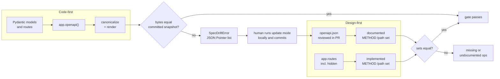

# Design-First vs Code-First OpenAPI Workflows: Preventing Spec-Implementation Drift with Snapshot Gates

> [!summary] Claim
> Whichever artifact you call the source of truth, drift is only prevented when CI regenerates the other side from it, compares a canonical, byte-stable rendering, and fails with a reviewable diff that a human must commit; everything else is documentation that happens to be correct today.

Part of [OpenAPI JSON Schema and Contracts](README.md) in [API Engineering](../README.md).

## TL;DR

- Mechanism: code-first exports `app.openapi()` and compares a canonicalized rendering against a committed `openapi.json`; design-first treats the committed document as truth and checks the served operation set against it in both directions.
- Contract rule: JSON object member order is not significant (RFC 8259 Sections 1 and 4), and `required` is a set (JSON Schema Validation 2020-12 Section 6.5.3), so canonicalize those before comparing, but keep every other array in order.
- Trap: in FastAPI 0.162.0 one added `Decimal` field renames a shared component from `LineItem` to `LineItem-Input` plus `LineItem-Output`, and a multi-method route's `operationId` depends on `PYTHONHASHSEED`; both break generated SDKs without any handler change.
- Portability: the gate operates on a JSON document, so it is independent of ASGI server and HTTP version; the lab ran on CPython 3.14.6 only, because the matrix run is paused.
- When not to use it: a snapshot gate proves the document did not change unreviewed, not that the change is compatible (use semantic diffing) and not that responses obey the document (use conformance testing).

## Mental model



Code-first runs left to right: the models and routes are the truth, `app.openapi()` derives a document, and the canonical renderer turns it into bytes that are compared with the committed snapshot.
A mismatch never rewrites the file in CI; it raises with RFC 6901 pointers, and the only way forward is a developer running update mode and committing the new snapshot, which puts the contract change into code review.
Design-first runs the other way: the reviewed document is the truth, so the gate extracts the operation set from it and from the router (including routes hidden with `include_in_schema=False`) and fails if either side has an operation the other lacks.
Both arrows end at the same merge-blocking check, which is what turns a document into a contract.

## How it works

### The two workflows and what each one can drift on

Design-first means the API description is written and reviewed before the code; code-first means the description is generated from code or annotations.
The OpenAPI Initiative's best-practices page states that "in the opinion of the OpenAPI Initiative (OAI), the importance of using Design-first cannot be stressed strongly enough", because "The number of APIs that can be created in code is far superior to what can be described in OpenAPI".
The same page says, for teams that generate the description and commit it, "you can use a Continuous Integration test to ensure that the two sources stay consistent", and that OpenAPI Descriptions "should be committed to source control" and "participate in Continuous Integration processes".
Zalando's guideline "MUST follow API first principle" requires teams to "define APIs first, before coding its implementation, using OpenAPI as specification language" and to get early peer review, while stating that API First "does not mean that you must have 100% domain and requirement understanding".
The drift surfaces differ:

| Workflow | Source of truth | What drifts | Gate that catches it |
| --- | --- | --- | --- |
| Code-first | Python types and route decorators | The committed `openapi.json` that SDKs, docs, and partners consume | Snapshot gate: regenerate, canonicalize, byte-compare |
| Design-first | The reviewed `openapi.json` | Routes added in code but never designed, or designed but never built | Surface gate: compare `METHOD /path` sets both ways |
| Design-first, deep | The reviewed `openapi.json` | Response bodies that violate the schema | Conformance tests ([[Response-Schema-Conformance-Enforcement-in-Test-Suites]]) |

A code-first snapshot gate cannot drift in the "routes exist that the document omits" direction for routes FastAPI documents, because the document is derived from the routes; it can still miss routes registered with `include_in_schema=False`, which is why the lab's surface gate also runs in code-first mode.

### How FastAPI 0.162.0 builds and caches the document

`FastAPI.openapi` calls `get_openapi` once and stores the result in `self.openapi_schema`; it regenerates only when `self.router._get_routes_version()` differs from the stored `_openapi_routes_version` (fastapi 0.162.0 fastapi/applications.py, FastAPI.openapi).
The routes version is a counter that `_mark_routes_changed` increments and that `_get_routes_version` sums across included routers (fastapi 0.162.0 fastapi/routing.py, APIRouter._get_routes_version).
The lab proves both halves: an in-place edit of the returned dict persists across calls, and adding a route discards it (`test_openapi_cache_rebuilds_on_new_route_but_keeps_mutations`).
The consequence for a gate is that a customization written as "mutate `app.openapi()` once at startup" silently disappears if any route is added later.
The extending-openapi guide replaces `app.openapi` with a custom function, but its example caches the result in `.openapi_schema` itself, so that override never regenerates when routes change (fastapi 0.162.0 docs/en/docs/how-to/extending-openapi.md); snapshot the output of whatever function production really calls.

`get_openapi` first generates every model definition with `get_definitions`, then fills `paths` by iterating `routing.iter_route_contexts(routes)` in registration order, then assembles `components.schemas` as `{k: definitions[k] for k in sorted(definitions)}`, and finally returns `jsonable_encoder(OpenAPI(**output), by_alias=True, exclude_none=True)` (fastapi 0.162.0 fastapi/openapi/utils.py, get_openapi).
The top-level member order therefore follows the field order of the `OpenAPI` model (`openapi`, `info`, `jsonSchemaDialect`, `servers`, `paths`, `webhooks`, `components`, ...), so the lab's export lists `openapi`, `info`, `paths`, `components` (fastapi 0.162.0 fastapi/openapi/models.py, OpenAPI).
So component names are already sorted but `paths` follows registration order, and properties and `required` follow Pydantic field declaration order.
The lab's `build_reordered_orders_app` registers the same two routes in reverse and declares `Order` fields in reverse: the two dicts compare equal in Python, but `json.dumps` of each differs, and `list(paths)` is `["/orders", "/orders/{order_id}"]` versus `["/orders/{order_id}", "/orders"]` (`test_render_ignores_registration_order_and_field_order`).
The default `openapi_version` argument is `"3.1.0"` in 0.162.0, and the exported document validates with `openapi-spec-validator` 0.9.0 (`test_export_validates_as_openapi_3_1`).

The served `/openapi.json` is a Starlette `Route` that `FastAPI.setup` registers with `self.add_route(self.openapi_url, openapi, include_in_schema=False)` and that returns `JSONResponse(self.openapi())`, except that when the request scope has a `root_path`, `root_path_in_servers` is true, and that `root_path` is not already a server URL, it copies the dict and prepends `{"url": root_path}` to `servers` (fastapi 0.162.0 fastapi/applications.py, FastAPI.setup).
A gate that scrapes the deployed document behind a path-prefixing proxy therefore sees a `servers` entry that `app.openapi()` in CI does not, and must export in-process rather than over the network.

### Canonicalization: what may be reordered and what may not

RFC 8259 Section 1 defines an object as "an unordered collection of zero or more name/value pairs", and Section 4 notes that "JSON parsing libraries have been observed to differ as to whether or not they make the ordering of object members visible", so a byte comparison must first impose one member order.
Arrays are different: JCS (RFC 8785 Section 3.2.3) sorts object properties recursively but says "array element order MUST NOT be changed", because array order is data in general.
The set-valued keyword FastAPI emits on every model is `required`, whose elements "MUST be strings, and MUST be unique" (JSON Schema Validation 2020-12 Section 6.5.3); its order has no validation meaning, yet Pydantic emits it in field declaration order.
`enum` (Section 6.1.2, whose elements "SHOULD be unique") also validates as a set, but `enum`, `allOf`, `oneOf`, `parameters`, `servers`, `tags`, and `security` keep their order, because generators, documentation renderers, and humans read meaning into it (for tags, "The order of the tags can be used to reflect on their order by the parsing tools", OpenAPI 3.1.2 Section 4.8.1.1).
The lab's `canonicalize` therefore sorts every object and only arrays under the key `required` whose elements are all strings (`test_only_set_valued_arrays_are_sorted`).
Known limit: the rule is keyed on the member name, not on schema position, so an all-string array under a key named `required` inside an `example`, `examples`, `default`, or `const` value is sorted too.

The rendering is not JCS, and that is deliberate: JCS forbids whitespace between tokens (RFC 8785 Section 3.2.1), which turns a 227-line reviewable diff into one line, and it serializes numbers by the ECMAScript algorithm (RFC 8785 Section 3.2.2.3) and sorts keys by UTF-16 code units (RFC 8785 Section 3.2.3), which Python's `sorted` (code point order) does not match for non-BMP characters.
The lab renders with `json.dumps(..., indent=2, ensure_ascii=True, allow_nan=False)` plus a trailing newline: two-space indent gives line-oriented Git diffs, `ensure_ascii` makes the bytes pure ASCII so file encoding cannot change them (it does not normalize Unicode: a precomposed U+00E9 renders as `\u00e9` and the decomposed U+0065 U+0301 as `e\u0301`, which at least makes the difference visible in review), and `allow_nan=False` raises `ValueError` instead of emitting `NaN` or `Infinity`, which RFC 8259 Section 6 does not permit as JSON numbers.
Use JCS only when the bytes feed a hash or signature, not a review.

### The snapshot gate state machine

`check_snapshot` has four outcomes, each tested:

1. Update mode outside CI writes the canonical rendering with `newline="\n"` and returns `"written"`.
2. Update mode with `ci=True` raises `UpdateRefusedError` before touching the file, because a CI job that rewrites its own baseline can never fail (`test_update_is_refused_in_ci`).
3. A missing snapshot raises `SnapshotMissingError` rather than creating one, so deleting `openapi.json` in a PR cannot turn the gate green (`test_missing_snapshot_fails_instead_of_creating_one`).
4. A byte mismatch parses the committed file, canonicalizes both sides, and raises `SpecDriftError` with JSON Pointers; if the contents are equal but the committed bytes are not canonical (someone hand-formatted the file), it still fails with `~ (snapshot is not in canonical form)` (`test_non_canonical_snapshot_with_equal_content_fails`).

Pointers follow RFC 6901: `~` becomes `~0` and `/` becomes `~1` when they appear in a reference token (RFC 6901 Section 3), which matters because every path key such as `/orders/{order_id}` contains slashes; the lab's `pointer_diff({}, {"a/b~c": 1})` returns `["+ /a~1b~0c"]` (`test_pointer_tokens_are_escaped_per_rfc_6901`).
The decoder must replace `~1` before `~0`, because the reverse order turns `~01` into `/` instead of `~1` (RFC 6901 Section 4).
The comparison also checks `type(old) is type(new)`, because in Python `1 == True` and `{"minimum": 1} == {"minimum": True}`, while in JSON Schema those are different keyword values (`test_pointer_diff_separates_true_from_one`).

### Non-local drift: the changes nobody thinks of as contract changes

The gate's value is catching changes whose author did not know they touched the contract.
The lab measured four such mechanisms in FastAPI 0.162.0 and Pydantic 2.14.3:

- Input/output split: `get_definitions` generates each model in `"validation"` and `"serialization"` mode, and Pydantic emits separate `Name-Input` and `Name-Output` components when the two JSON Schemas differ (fastapi 0.162.0 fastapi/_compat/v2.py, get_definitions; the suffixes come from `_MODE_TITLE_MAPPING = {'validation': 'Input', 'serialization': 'Output'}` in pydantic 2.14.3 pydantic/json_schema.py, GenerateJsonSchema.get_defs_ref).
  Adding `unit_price: Decimal` to `LineItem` makes validation accept `number | string` and serialization emit `string`, so the gate reports `- /components/schemas/LineItem`, `+ .../LineItem-Input`, `+ .../LineItem-Output`, and two changed `$ref`s in other schemas (`test_decimal_field_splits_the_shared_component`).
  Every generated SDK class named `LineItem` disappears.
- Computed fields: a `@computed_field` adds a `readOnly` property to the serialization schema, and FastAPI keeps the split even with `separate_input_output_schemas=False`, because `get_definitions` keeps `field.mode` instead of forcing `"validation"` when `_has_computed_fields(field)` is true (fastapi 0.162.0 fastapi/_compat/v2.py, get_definitions; a verifier probe with `separate_input_output_schemas=False` still emitted `WithComputed-Input` and `WithComputed-Output` with `readOnly: true` on the computed property; the release notes list the related fixes PR #13207 and PR #14453).
- Name collisions: Pydantic picks each component name from a prioritized list (short name, short name plus mode, module-qualified name, ...) and falls back to the module-qualified name, with `.` replaced by `__`, when short names collide (pydantic 2.14.3 pydantic/json_schema.py, GenerateJsonSchema.get_defs_ref and GenerateJsonSchema.normalize_name); with two models named `Thing` from different modules the exported components become `pkg_a__models__Thing` and `pkg_b__models__Thing`, so adding the second model renames the first model's existing component (`test_colliding_model_names_rename_the_existing_component`).
  FastAPI's own `get_model_name_map` keys models by `normalize_name(model.__name__)` alone, so the second `Thing` overwrites the first in that map (fastapi 0.162.0 fastapi/_compat/v2.py, get_model_name_map).
- Generated identifiers: `generate_unique_id` builds `operationId` from `route.name` and `route.path_format` with `re.sub(r"\W", "_", ...)`, then appends `list(route.methods)[0].lower()` (fastapi 0.162.0 fastapi/utils.py, generate_unique_id); `route.unique_id` is `route.operation_id or` that generated value (fastapi 0.162.0 fastapi/routing.py, _populate_api_route_state), and an embedded multi-field body model is named `"Body_" + route.unique_id`, such as `Body_add_to_cart_carts_post` (fastapi 0.162.0 fastapi/dependencies/utils.py, _get_body_field), so renaming a Python handler without an explicit `operation_id` renames both the operation and a component.

The `operationId` case hides a nondeterminism.
`route.methods` is a `set` of strings built as `{method.upper() for method in methods}` (fastapi 0.162.0 fastapi/routing.py, _populate_api_route_state), and `str` hashes are "salted" with an unpredictable random value per process unless `PYTHONHASHSEED` is fixed (Python documentation, command line and environment, `-R` and `PYTHONHASHSEED`), so `list(route.methods)[0]` varies between runs for a route registered with several methods.
Running one `@app.api_route("/multi", methods=["GET", "POST", "PUT", "DELETE"])` under seeds 0 to 7 produced `multi_multi_post` four times (seeds 2, 3, 4, 6), `multi_multi_get` twice (0, 1), and `multi_multi_delete` twice (5, 7) (re-measured by the verifier with a subprocess per seed, CPython 3.14.6, macOS 27.3 arm64), and every method of that route shares the one id, so FastAPI also warns "Duplicate Operation ID" three times in every run.
A snapshot gate built on such an app flakes, which is the correct outcome: the test `test_orders_export_is_byte_stable_across_hash_seeds` runs the export in four subprocesses with different seeds and requires identical bytes, so the nondeterminism is caught as a determinism failure rather than as random red builds.
Fix it by giving every route an explicit `operation_id` or a `generate_unique_id_function` that does not read the method set (fastapi 0.162.0 docs/en/docs/advanced/generate-clients.md).

### Uniqueness rules FastAPI does not enforce

OpenAPI 3.1.2 Section 4.8.10.1 says `operationId` "MUST be unique among all operations described in the API" and is case-sensitive.
FastAPI 0.162.0 only calls `warnings.warn` with "Duplicate Operation ID ..." and still emits the document (fastapi 0.162.0 fastapi/openapi/utils.py, get_openapi_operation_metadata); `openapi-spec-validator` 0.9.0 rejects the same document with `DuplicateOperationIDError`, a subclass of `OpenAPIValidationError` (openapi-spec-validator 0.9.0 openapi_spec_validator/validation/exceptions.py, DuplicateOperationIDError; re-run by the verifier as a probe; the lab asserts the warning and `duplicate_operation_ids` returns `["dup"]`).
OpenAPI 3.1.2 Section 4.8.8.1 says "Templated paths with the same hierarchy but different templated names MUST NOT exist as they are identical", so `/orders/{id}` and `/orders/{order_id}` are the same path; the lab's surface keys replace every template with `{}` so a design document and an implementation that only rename a template variable do not count as drift (`test_template_names_do_not_count_as_drift`).
Run a validator or linter in the same CI job as the snapshot gate, because the gate only proves "unchanged", not "valid".

### The design-first surface gate

`documented_surface` reads every Path Item for the fixed method fields `get`, `put`, `post`, `delete`, `options`, `head`, `patch`, `trace`, plus `query`, which OpenAPI 3.2 added (OpenAPI 3.2.0 Section 4.9.1).
`implemented_surface` walks `iter_route_contexts(app.routes)` and keeps every `APIRoute`, including those with `include_in_schema=False`, so a hidden admin route shows up as undocumented (`test_design_first_gate_finds_undocumented_and_missing_operations`).
The `/openapi.json`, `/docs`, `/docs/oauth2-redirect`, and `/redoc` routes that `FastAPI.setup` adds are Starlette `Route` objects, not `APIRoute`, and are excluded by the `isinstance` check (a verifier probe listed all four as `Route` with `include_in_schema` false).
Known limits: OpenAPI 3.2's `additionalOperations` map for other methods (OpenAPI 3.2.0 Section 4.9.1) and `webhooks` are not walked, and the gate compares operation sets, not parameters or bodies.

### Where this sits in a merge pipeline

The gate is a required status check.
With a GitHub merge queue, required checks run on temporary branches whose SHA differs from the pull request, and workflows must also trigger on `merge_group` or "The merge will fail as the required status check will not be reported" (GitHub Docs, managing a merge queue, as of 2026-11).
That matters for snapshots: two PRs that each regenerated `openapi.json` correctly can conflict or combine into a document neither committed, and only a check that runs on the merged result catches it.
Mark the snapshot `linguist-generated` in `.gitattributes` to collapse it by default in GitHub diffs (GitHub Docs, customizing how changed files appear, as of 2026-11), and pin its line endings with `text eol=lf` (gitattributes documentation) so a Windows checkout does not produce a byte mismatch; but keep reviewers looking at it, because hiding the contract diff defeats the gate.

## Numbers and limits

| Quantity | Value | Source |
| --- | --- | --- |
| Rendered snapshot of the lab's two-operation Orders API | 5127 bytes, 227 lines | Re-measured by the verifier with an ad-hoc `timeit` probe (not part of the lab) run as `uv run --frozen python probe.py` from `labs/`, CPython 3.14.6, macOS 27.3 arm64 (`uname -r` 27.3.0), 2026-11-12 |
| Same document as `json.dumps(doc, separators=(",", ":"))` | 2445 bytes (2660 with default separators) | Same run |
| Cold `build_orders_app().openapi()` | 2.59 ms (min of 5 repeats of 200; the draft's run measured 3.05 ms) | Same run |
| `render` of that document | 0.033 ms (min of 5 repeats of 200) | Same run |
| Cached `app.openapi()` call | 0.36 us (min of 5 repeats of 100000; the draft's run measured 0.41 us) | Same run |
| Cold `app.openapi()` with 10, 100, 400 `POST` operations, two distinct models each | 7.1 ms, 68.1 ms, 255.4 ms (cache cleared, min of 5 repeats) | Same machine, verifier probe `scale.py` |
| Distinct `operationId` values for one 4-method route over `PYTHONHASHSEED` 0..7 | 3 (`post` 4x, `get` 2x, `delete` 2x) | Re-measured by the verifier, one subprocess per seed, CPython 3.14.6 |
| Lab suite | 20 tests, 3.67 s (the draft's run took 2.64 s) | Verifier's pytest run below |
| Merge queue build concurrency | 1 to 100 `merge_group` webhooks | GitHub Docs, managing a merge queue (as of 2026-11) |
| JSON integer range that is interoperable | `[-(2**53)+1, (2**53)-1]` | RFC 8259 Section 6 |
| OpenAPI patch versions | "SHOULD NOT be considered by tooling" | OpenAPI 3.1.2 Section 4.1 |
| `openapi` emitted by FastAPI 0.162.0 | `"3.1.0"` | fastapi 0.162.0 fastapi/openapi/utils.py, get_openapi default |

The timing numbers bound the cost: a snapshot gate for an API of this size costs single-digit milliseconds per app build, so the gate's cost is test-process startup and imports, not document generation.
Generation grows roughly linearly at about 0.65 to 0.7 ms per operation in the scaling probe, so a 400-operation API still regenerates in about a quarter of a second; real models with deeper nesting cost more per operation, so measure your own app before relying on this.

## Portability

| Dimension | Status | Evidence |
| --- | --- | --- |
| CPython 3.14.6 (workspace interpreter) | 20 passed | Lab run below |
| CPython 3.12.16, 3.13.18, 3.14.10, 3.15.2, 3.15.2t | Not run | Lab matrix paused on 2026-11-11; the module uses the `type` statement, which needs Python 3.12 (PEP 695, Python-Version 3.12), matching `requires-python = ">=3.12,<3.16"` |
| `PYTHONHASHSEED` values | Orders export byte-identical across seeds 0..3; multi-method route `operationId` varies | `test_orders_export_is_byte_stable_across_hash_seeds`, `test_multi_method_operation_id_depends_on_hash_seed` on 3.14.6 |
| FastAPI 0.162.0 cache invalidation on new routes | Present | fastapi 0.162.0 fastapi/applications.py, FastAPI.openapi; lab test on 3.14.6 |
| FastAPI before `_openapi_routes_version` existed | 0.136.3 and earlier only check `if not self.openapi_schema:`, so the cached document is never invalidated; the routes-version check first appears in 0.137.0 (2026-06-14), whose headline breaking change is PR #15745, "Refactor internals to preserve `APIRouter` and `APIRoute` instances" | fastapi 0.136.3 and 0.137.0 fastapi/applications.py, FastAPI.openapi, read at each tag on GitHub; release notes 0.137.0 |
| Pydantic default-field split | 2.2.1 marked defaulted fields required in serialization mode (pydantic#7209); 2.14.3 does so only with `json_schema_serialization_defaults_required=True` | pydantic 2.14.3 pydantic/config.py docstring and pydantic/json_schema.py, GenerateJsonSchema.field_is_required; probe |
| Uvicorn, Hypercorn, Granian | Server-independent | The gate calls `app.openapi()` in-process; `/openapi.json` is a Starlette route returning `JSONResponse` (fastapi 0.162.0 fastapi/applications.py, FastAPI.setup); the served-document test uses `httpx.ASGITransport`, not a server |
| HTTP/1.1, HTTP/2, HTTP/3 | Independent | The compared artifact is a JSON document, not a wire exchange |
| OpenAPI 3.2 documents | Surface gate reads `query`; ignores `additionalOperations` | OpenAPI 3.2.0 Section 4.9.1; lab code |

## Worked example

The [implementation](../labs/src/api_labs/f08_openapi_json_schema_and_contracts/openapi_drift_gate.py) holds the canonicalizer, pointer diff, snapshot gate, surface gate, and five builds of one Orders API; the [test](../labs/tests/f08_openapi_json_schema_and_contracts/test_design_first_vs_code_first_openapi_and_ci_drift_gates.py) proves each mechanism above.

Excerpt, byte-identical to lines 61-123 of `openapi_drift_gate.py`:

```python
def canonicalize(node: JsonValue, parent_key: str | None = None) -> JsonValue:
    """Sort object members recursively and sort only the arrays that are sets by definition."""
    if isinstance(node, dict):
        return {key: canonicalize(node[key], key) for key in sorted(node)}
    if isinstance(node, list):
        items = [canonicalize(item) for item in node]
        if parent_key in SET_VALUED_KEYWORDS:
            names = [item for item in items if isinstance(item, str)]
            if len(names) == len(items):
                return [*sorted(names)]
        return items
    return node


def render(document: JsonValue) -> str:
    """Canonical text: sorted members, two-space indent, ASCII escapes, one trailing newline."""
    return json.dumps(canonicalize(document), indent=2, ensure_ascii=True, allow_nan=False) + "\n"


def _escape(token: str) -> str:
    return token.replace("~", "~0").replace("/", "~1")


def pointer_diff(old: JsonValue, new: JsonValue, pointer: str = "") -> list[str]:
    """List the JSON Pointers that were removed (-), added (+), or changed (~)."""
    if isinstance(old, dict) and isinstance(new, dict):
        changes: list[str] = []
        for key in sorted(old.keys() | new.keys()):
            child = f"{pointer}/{_escape(key)}"
            if key not in new:
                changes.append(f"- {child}")
            elif key not in old:
                changes.append(f"+ {child}")
            else:
                changes.extend(pointer_diff(old[key], new[key], child))
        return changes
    if isinstance(old, list) and isinstance(new, list) and len(old) == len(new):
        return [
            change
            for index, (before, after) in enumerate(zip(old, new, strict=True))
            for change in pointer_diff(before, after, f"{pointer}/{index}")
        ]
    return [] if old == new and type(old) is type(new) else [f"~ {pointer}"]


def check_snapshot(
    document: JsonValue, snapshot_path: Path, *, update: bool = False, ci: bool = False
) -> Literal["unchanged", "written"]:
    """Compare the document with the committed snapshot; rewrite it only on request, never in CI."""
    if update and ci:
        raise UpdateRefusedError("snapshot updates are disabled in CI; regenerate and commit")
    rendered = render(document)
    if update:
        snapshot_path.write_text(rendered, encoding="utf-8", newline="\n")
        return "written"
    if not snapshot_path.exists():
        raise SnapshotMissingError(f"{snapshot_path} is not committed; run the gate in update mode")
    committed = snapshot_path.read_text(encoding="utf-8")
    if committed == rendered:
        return "unchanged"
    old: JsonValue = json.loads(committed)
    changes = pointer_diff(canonicalize(old), canonicalize(document))
    raise SpecDriftError(snapshot_path, changes or ["~ (snapshot is not in canonical form)"])
```

The design-first surface gate, byte-identical to lines 169-172:

```python
def surface_drift(design: JsonObject, app: FastAPI) -> SurfaceDrift:
    """Compare a design-first document with the operations the application really serves."""
    documented, implemented = documented_surface(design), implemented_surface(app)
    return SurfaceDrift(missing=documented - implemented, undocumented=implemented - documented)
```

The decisive test, byte-identical to the test module, shows the non-local rename that one `Decimal` field causes:

```python
@pytest.mark.unit
def test_decimal_field_splits_the_shared_component(tmp_path: Path) -> None:
    snapshot = tmp_path / "openapi.json"
    check_snapshot(build_orders_app().openapi(), snapshot, update=True)
    with pytest.raises(SpecDriftError) as caught:
        check_snapshot(build_priced_orders_app().openapi(), snapshot)
    assert caught.value.changes == [
        "- /components/schemas/LineItem",
        "+ /components/schemas/LineItem-Input",
        "+ /components/schemas/LineItem-Output",
        "~ /components/schemas/Order/properties/items/items/$ref",
        "~ /components/schemas/OrderCreate/properties/items/items/$ref",
    ]
```

In a real repository the same call becomes the CI test, with `update` read from a developer-only environment variable and `ci` from the CI environment, so the update path cannot run in CI.

Captured run (the verifier's, 2026-11-12), from `labs/`, CPython 3.14.6 on macOS 27.3 arm64 (`macOS-27.3-arm64-arm-64bit-Mach-O`):

```text
$ uv run --frozen pytest tests/f08_openapi_json_schema_and_contracts/test_design_first_vs_code_first_openapi_and_ci_drift_gates.py -q
....................                                                     [100%]
20 passed in 3.67s
```

## Pitfalls

> [!warning] Response-mode schemas renamed every SDK model
> Trigger: FastAPI 0.101 started generating response models in serialization mode, and Pydantic emitted separate input and output definitions when the schemas differed.
> Symptom: pydantic issue #7209 reports that this "breaks all existing clients and invalidates every client code written due to changing the class name"; FastAPI then added `separate_input_output_schemas=False` (release notes, PR #10145; its docs say "added in FastAPI `0.102.0`").
> Fix: snapshot the document so the rename is a reviewed diff, and decide per release whether to accept the split or pin `separate_input_output_schemas=False`; note that the FastAPI 0.162.0 docs page still describes a split for a `str | None = None` field, which this lab did not reproduce with Pydantic 2.14.3 defaults.

> [!warning] A field type change renames a shared component
> Trigger: adding a `Decimal` (or any type whose validation and serialization schemas differ) to a model used in both a request and a response.
> Symptom: `LineItem` becomes `LineItem-Input` and `LineItem-Output`; generated SDK imports fail although no handler changed.
> Fix: the snapshot gate reports the five pointers in this lab; resolve by accepting the rename deliberately, by setting `separate_input_output_schemas=False`, or by splitting request and response models explicitly so names are chosen by you.

> [!warning] Flaky snapshot from a multi-method route
> Trigger: `api_route(..., methods=[...])` with more than one method and no `operation_id`.
> Symptom: the gate fails on some CI runs and not others; the `operationId` is `multi_multi_get`, `multi_multi_post`, or `multi_multi_delete` depending on the process hash seed, and FastAPI warns about duplicate ids.
> Fix: one method per route with an explicit `operation_id`; add the cross-seed determinism test so nondeterminism fails every time instead of sometimes.

> [!warning] Snapshot updated by the gate itself
> Trigger: a test that writes the new snapshot when it differs, or an `--update` flag that CI scripts pass to "fix" red builds.
> Symptom: the gate never fails; the contract changes in a commit nobody reviewed.
> Fix: refuse update mode in CI, fail on a missing snapshot, and require code-owner review on the snapshot path.

> [!warning] Startup-time `openapi_schema` customization vanishes
> Trigger: code that edits `app.openapi()` once, then a plugin or late `include_router` adds a route.
> Symptom: in FastAPI 0.137.0 and later (including 0.162.0) the cached document is regenerated without the edit, and the snapshot loses the customization only in some deployments.
> Fix: override `app.openapi` with a function that applies the customization on every regeneration (without the guide's unconditional `.openapi_schema` cache), and snapshot the result of that function.

> [!warning] Malicious OpenAPI documents compiled into code
> Trigger: generating a client from a document you did not review.
> Symptom: CVE-2020-15142 (GHSA-9x4c-63pf-525f, CVSS 8.0): "Clients generated with a maliciously crafted OpenAPI Document can generate arbitrary Python code"; CVE-2020-15141 (GHSA-7wgr-7666-7pwj, CVSS 3.0) allowed generated files outside the output directory; both affected `openapi-python-client` `< 0.5.3`.
> Fix: the reviewed snapshot is the only input to generators, and generator versions are pinned.

## Security and robustness

- Inventory (OWASP API9:2023 Improper Inventory Management): OWASP lists "There is no documentation or the existing documentation is not updated" as a documentation blindspot and recommends to "Generate documentation automatically by adopting open standards. Include the documentation build in your CI/CD pipeline"; the surface gate is that inventory check, and its undocumented set is exactly the routes an attacker finds but your gateway, WAF, and security review do not.
- OWASP's Scenario #1 is the failure mode in production: a beta host ran "the same API, including the reset password mechanism, but the rate-limiting mechanism was not in place"; a route hidden with `include_in_schema=False` is still served, so hiding it from the document hides it from controls that are generated from the document.
- Supply chain: the snapshot drives SDK generation, documentation, mock servers, and gateway configuration, so treat it as code: protect the path with code owners, and never generate from an unreviewed document (the two `openapi-python-client` CVEs above).
- Input validation edge cases in the gate itself: `allow_nan=False` rejects non-JSON floats, `ensure_ascii` keeps the bytes independent of file encoding (it does not normalize Unicode, so NFC and NFD spellings of a name still differ), and the type check in `pointer_diff` separates `1` from `true`.
- Parser hazards: committing JSON rather than YAML removes YAML 1.1 coercions from the comparison; OpenAPI 3.1.2 Section 4.2 recommends YAML 1.2 with the JSON schema ruleset when YAML is used; see [[YAML-Media-Type-RFC-9512-and-OpenAPI-YAML-Parser-Hazards]].
- Defense in depth: snapshot gate (unchanged), linter (valid and consistent, [[OpenAPI-Linting-and-Automated-Style-Governance-with-Vacuum-and-Spectral]]), semantic diff (compatible, [[Breaking-Change-Detection-and-Semantic-OpenAPI-Diffing]]), and conformance tests (true, [[Response-Schema-Conformance-Enforcement-in-Test-Suites]]) catch different failures; none subsumes another.
- Specification extensions: `x-oai-` and `x-oas-` prefixes are reserved (OpenAPI 3.1.2 Section 4.9); internal `x-` fields in the snapshot are visible to anyone who receives it, so strip them with an overlay before publishing ([[OpenAPI-Overlays-Extensions-and-Multi-Audience-Specs]]).

## The principal's view

The decision is not design-first versus code-first; it is which artifact is authoritative, and then making the other one mechanically derived and gated.
Code-first plus a snapshot gate is the right default for a single team shipping a FastAPI service: the types are already precise, generation is cheap, and the gate turns invisible contract changes (renames from `Decimal`, collisions, handler renames) into diffs that a reviewer sees.
Design-first is right when the consumers outnumber or outrank the provider: public APIs, partner integrations, and platform APIs where Zalando-style review happens before code; there the document is truth and the surface gate plus conformance tests keep code honest.
The organizational cost of design-first is a review step before implementation and a second artifact developers must learn; the cost of code-first is that the API shape is whatever the framework emits, including names you never chose, and the OAI's warning that code can express APIs OpenAPI cannot describe.
Many organizations run a hybrid: design the contract, generate server models from it ([[Generating-Pydantic-v2-Models-from-OpenAPI-with-Datamodel-Code-Generator]]), and still snapshot the exported document, so a framework upgrade that changes emitted names fails the same gate.
Choose something else when OpenAPI is the wrong contract language: gRPC with `buf breaking` on `.proto` files, GraphQL schema checks, or AsyncAPI for event streams have the same snapshot-and-review shape with a different artifact.
The gate's output must be read by someone empowered to say no; a snapshot that every PR updates without discussion is a changelog, not a contract.

## Interview questions

> [!question] L5: Why does a snapshot gate canonicalize the document before comparing, and why not sort every array?
>
> > [!success]- Answer
> > JSON object member order carries no meaning (RFC 8259 Sections 1 and 4), and FastAPI emits `paths` in route registration order, so equal contracts can produce different bytes.
> > Sorting objects removes that noise.
> > Arrays are ordered data in general, so JCS (RFC 8785 Section 3.2.3) forbids reordering them, and `servers`, `allOf`, `parameters`, and `enum` order is read by tools and humans.
> > Only `required` is a set by definition (JSON Schema Validation Section 6.5.3), so it alone is sorted.
> >
> > Follow-up: what breaks if you also sort `servers`?

> [!question] L5: What are the four outcomes of a correct snapshot check, and which one must never happen in CI?
>
> > [!success]- Answer
> > Unchanged, drift reported with pointers, missing snapshot reported as a failure, and written in update mode.
> > Update mode must never run in CI, because a gate that rewrites its own baseline cannot fail.
> > A missing snapshot must also fail rather than be created, or deleting the file passes the gate.
> >
> > Follow-up: how do you make the update path impossible to reach from CI rather than merely discouraged?

> [!question] L5: Predict the output: two FastAPI 0.162.0 apps register the same `POST /orders` and `GET /orders/{order_id}` routes in opposite order; what do `a.openapi() == b.openapi()`, `json.dumps(a.openapi()) == json.dumps(b.openapi())`, and `render(a.openapi()) == render(b.openapi())` print?
>
> > [!success]- Answer
> > `True`, `False`, `True`.
> > Python dict equality ignores insertion order, but `json.dumps` writes members in insertion order, and `get_openapi` fills `paths` in registration order.
> > The canonical renderer sorts members, so the bytes match.
> > The lab asserts the last two and the path order directly.
> >
> > Follow-up: which part of the document does FastAPI already sort, and where in its source?

> [!question] L6: Debug this API: the TypeScript SDK build fails with "LineItem is not exported" after a PR that only added `unit_price: Decimal` to `LineItem` and changed no route; what happened?
>
> > [!success]- Answer
> > `LineItem` is used in both a request and a response, so FastAPI generates it in validation and serialization modes.
> > With `Decimal`, validation accepts `number` or `string` and serialization emits `string`, so the schemas differ and the component splits into `LineItem-Input` and `LineItem-Output`.
> > The `$ref`s in `Order` and `OrderCreate` change, and `LineItem` disappears.
> > A snapshot gate would have shown `- /components/schemas/LineItem` and two `+` pointers in the PR.
> > Fix by accepting the rename deliberately, setting `separate_input_output_schemas=False`, or defining explicit request and response models.
> >
> > Follow-up: why does `separate_input_output_schemas=False` not help when the model has a `@computed_field`?

> [!question] L6: The OpenAPI snapshot test fails on roughly half of CI runs with an `operationId` change and passes locally; what do you look for?
>
> > [!success]- Answer
> > A process-dependent input to generation; the classic one in FastAPI is a route registered with several methods and no explicit `operation_id`.
> > `generate_unique_id` uses `list(route.methods)[0]`, `route.methods` is a set of strings, and string hashing is salted per process unless `PYTHONHASHSEED` is fixed.
> > The lab saw three different ids over eight seeds for one four-method route.
> > Fix with explicit `operation_id` per method and add a test that exports under several seeds and demands identical bytes.
> >
> > Follow-up: why is pinning `PYTHONHASHSEED` in CI the wrong fix?

> [!question] L6: FastAPI only warns on duplicate `operationId`; why does it matter, and where should it be caught?
>
> > [!success]- Answer
> > OpenAPI 3.1.2 Section 4.8.10.1 requires uniqueness, and generators use the id as a method name, so duplicates silently overwrite or fail to compile in SDKs.
> > `openapi-spec-validator` 0.9.0 raises `DuplicateOperationIDError` on the same document.
> > Catch it in the same CI job as the snapshot gate, either by validating the export or by turning warnings into errors for the export step.
> >
> > Follow-up: how would you enforce a naming convention for ids across fifty services?

> [!question] L7+: Your company has 200 services, half code-first FastAPI and half design-first; design the drift-prevention system.
>
> > [!success]- Answer
> > Each service commits its document as a reviewed artifact: code-first services snapshot `app.openapi()`, design-first services commit the authored document and run a surface gate plus conformance tests.
> > Every repository runs the same pipeline: canonical render, validator, shared lint ruleset, semantic breaking-change diff against the last released version, and code-owner review on the contract path.
> > Checks run on the merged result (merge queue `merge_group`) so two individually green PRs cannot combine into an unreviewed contract.
> > A central registry ingests released documents, which also gives OWASP API9 inventory and lets you diff what is deployed against what is documented.
> > The trade-off is pipeline ownership: a platform team must own the shared gate, or each team forks it and the guarantees diverge.
> >
> > Follow-up: what do you do when a framework upgrade changes the emitted document for 100 services at once?

> [!question] L7+: When would you argue against design-first even for a public API?
>
> > [!success]- Answer
> > When the provider team is small, the API changes weekly, and the framework's types are already the most precise description available, a hand-written document becomes a second source of truth that drifts from the code.
> > Code-first with a snapshot gate, a semantic diff, and mandatory API review on the snapshot diff gives the review benefits without a duplicated artifact.
> > I would still switch when the API needs shapes the framework cannot express cleanly, which is the OAI's stated reason for design-first, or when consumers must review before implementation starts.
> >
> > Follow-up: how do you keep "review the snapshot diff" from becoming a rubber stamp?

> [!question] L6: A design-first gate passes, but a penetration test finds `POST /internal/reindex`; how did it pass, and what would catch it?
>
> > [!success]- Answer
> > The route was registered with `include_in_schema=False`, so it is served but absent from `app.openapi()`, and a gate that compares the export with the design document sees nothing.
> > The surface gate must read the router, not the export: walking `iter_route_contexts(app.routes)` for every `APIRoute` finds it as undocumented.
> > This is OWASP API9:2023 inventory drift, and controls generated from the document (gateway routes, rate limits) do not cover it.
> >
> > Follow-up: how do you allowlist intentionally private routes without reopening the hole?

## Related

Prerequisites: [[Polymorphism-and-Discriminators-in-OpenAPI-and-JSON-Schema]], [[OpenAPI-3-1-Architecture-and-JSON-Schema-Alignment]], [[JSON-Schema-2020-12-Core-and-Validation-Vocabularies]]

Next: [[OpenAPI-Linting-and-Automated-Style-Governance-with-Vacuum-and-Spectral]]

See also: [[02-Programming-Languages/Python/Python-Backend-Interview-Prep/04-FastAPI]], [[02-Programming-Languages/Python/Python-Backend-Interview-Prep/05-REST-API-Design]], [[Breaking-Change-Detection-and-Semantic-OpenAPI-Diffing]], [[Response-Schema-Conformance-Enforcement-in-Test-Suites]], [[Generating-Pydantic-v2-Models-from-OpenAPI-with-Datamodel-Code-Generator]], [[Generating-Typed-Async-SDKs-with-OpenAPI-Python-Client-and-OpenAPI-Generator]], [[OpenAPI-Overlays-Extensions-and-Multi-Audience-Specs]], [[Consumer-Driven-Contract-Testing-vs-Bi-Directional-Contract-Verification]], [[OpenAPI-3-2-Additions-QUERY-Method-Streaming-and-Tag-Hierarchies]], [[YAML-Media-Type-RFC-9512-and-OpenAPI-YAML-Parser-Hazards]]

- Lab: `labs/tests/f08_openapi_json_schema_and_contracts/test_design_first_vs_code_first_openapi_and_ci_drift_gates.py`

## Further reading

- [OpenAPI Specification 3.1.2](https://spec.openapis.org/oas/v3.1.2.html): Sections 4.1 (versions), 4.8.8.1 (identical templated paths), 4.8.10.1 (`operationId` uniqueness), and 4.9 (extensions) define what a gate must enforce.
- [OpenAPI Specification 3.2.0](https://spec.openapis.org/oas/v3.2.0.html): Section 4.9.1 adds `query` and `additionalOperations`, which a surface gate must walk.
- [RFC 8259](https://www.rfc-editor.org/rfc/rfc8259.html): Sections 1 and 4 make object order insignificant and Section 6 bounds interoperable numbers.
- [RFC 8785 JSON Canonicalization Scheme](https://www.rfc-editor.org/rfc/rfc8785.html): the canonical form for hashing and signing, and why array order is preserved.
- [RFC 6901 JSON Pointer](https://www.rfc-editor.org/rfc/rfc6901.html): the `~0` and `~1` escaping used in drift reports.
- [JSON Schema Validation 2020-12](https://json-schema.org/draft/2020-12/json-schema-validation): Section 6.5.3 makes `required` a set of unique strings.
- [FastAPI 0.162.0 `fastapi/openapi/utils.py`](https://raw.githubusercontent.com/fastapi/fastapi/0.162.0/fastapi/openapi/utils.py): `get_openapi`, the ordering and duplicate-id behavior described here.
- [FastAPI 0.162.0 `fastapi/applications.py`](https://raw.githubusercontent.com/fastapi/fastapi/0.162.0/fastapi/applications.py): `FastAPI.openapi` caching and `FastAPI.setup` `servers` injection.
- [OpenAPI Initiative best practices](https://learn.openapis.org/best-practices.html): the OAI's case for design-first, a single source of truth, and CI consistency checks.
- [Zalando RESTful API Guidelines](https://opensource.zalando.com/restful-api-guidelines/): the API First rule as an organizational policy.
- [OWASP API9:2023 Improper Inventory Management](https://owasp.org/API-Security/editions/2023/en/0xa9-improper-inventory-management/): why undocumented routes are a security risk.
- [pydantic issue #7209](https://github.com/pydantic/pydantic/issues/7209): the primary report of input/output schema splits breaking generated clients.
- [GHSA-9x4c-63pf-525f](https://github.com/advisories/GHSA-9x4c-63pf-525f): code execution through a malicious OpenAPI document fed to a generator.
