# Schema-First Code Generation: Compiling OpenAPI 3.1 Schemas to Strict Pydantic v2 Models (datamodel-code-generator 0.89.0)

> [!summary] Claim
> `datamodel-code-generator` is a lossy compiler from JSON Schema 2020-12 to Pydantic v2: with `--use-annotated --strict-types --strict-nullable` its output passes `mypy --strict` and refuses coercions, but it still drops or bends `uniqueItems`, `multipleOf`, `int64`, and `integer`, so treat the generated models as a typed approximation of the contract and test the gaps against a real JSON Schema validator.

Part of [OpenAPI JSON Schema and Contracts](README.md) in [API Engineering](../README.md).

## TL;DR

- Mechanism: `generate()` parses `components/schemas` into a JSON Schema object model, maps each `type` and `format` through a `DataTypeManager` type map, renders `BaseModel` and `RootModel` classes from templates, and formats the text; Pydantic then compiles those classes into a `pydantic-core` validator at import time.
- Contract rule: pin `--use-annotated` (which implies `--field-constraints`), `--strict-types str bytes int float bool`, `--strict-nullable`, `--formatters builtin`, `--disable-timestamp`, `--target-python-version`, `--target-pydantic-version`, and `--no-allow-remote-refs`, then check in or diff the output in CI.
- Trap: the default output writes `conint(...)` and `constr(...)` calls in annotations, which `mypy --strict` rejects with 11 errors on the lab spec; strict mode then rejects JSON `2.0` for an `integer` that JSON Schema accepts; `uniqueItems` is silently dropped; and float `multipleOf` uses an absolute `1e-9` tolerance.
- Portability: the lab passed unchanged (23 tests) on CPython 3.12.13, 3.13.18, 3.14.10, and 3.15.2 in the drafting run and on 3.14.6 at verification; output depends on `--target-python-version` (`Enum` for the 3.10 default vs `StrEnum` for 3.12) and on `--target-pydantic-version` (`populate_by_name` vs `validate_by_name`, and where `MISSING` is imported from).
- When not to use it: when the server is code-first (FastAPI already emits the spec from its models), when the schema is untrusted and you are on a release before 0.92.0 (no `--untrusted-input`), or when you need exact JSON Schema semantics, in which case validate with a JSON Schema engine at the boundary.

## Mental model

```mermaid
flowchart LR
    A["OpenAPI 3.1.2 document<br/>JSON or YAML"] --> B["detect_openapi_version<br/>3.0 / 3.1 / 3.2"]
    B --> C["OpenAPIParser<br/>scope: components/schemas"]
    C --> D{"$ref target"}
    D -->|"#/components/..."| E["JsonSchemaObject graph"]
    D -->|"http(s) or file://"| F["remote-ref gate<br/>allow_remote_refs, SSRF guard"]
    F --> E
    E --> G["DataTypeManager<br/>type map + strict map<br/>con* or Annotated"]
    G --> H["model templates<br/>BaseModel, RootModel, Enum"]
    H --> I["formatter<br/>builtin / black+isort / ruff"]
    I --> J["Python source text"]
    J --> K["import -> ModelMetaclass<br/>-> CoreSchema -> SchemaValidator"]
    K --> L["model_validate_json<br/>on request bytes"]
```



Read it left to right as a two-stage compiler.
The first stage is `datamodel-code-generator`: it detects the OpenAPI minor version, walks only `components/schemas` by default, resolves every `$ref` (local pointers directly, remote and `file://` targets only through a gate), and turns each JSON Schema keyword into either a Python type, a constraint argument, a model config entry, or nothing at all.
The template stage emits text, so the formatter choice changes the bytes but not the semantics.
The second stage is Pydantic: importing the module runs the model metaclass, which builds a `CoreSchema` and a Rust `SchemaValidator`; every request body then goes through `model_validate_json` in one pass.
Contract fidelity is lost at the `DataTypeManager` box (keywords with no Python type) and at the `SchemaValidator` box (Pydantic's own semantics for `integer`, `multipleOf`, and strictness), which is why the lab compares the final validator against a JSON Schema 2020-12 oracle instead of reading the generated text.

## How it works

### Entry point and input detection

`generate(input_, *, config=None, **options)` takes a path, a string, a URL, a mapping, or a list, and returns `str` for one module, `GeneratedModules` for several, or `None` when it writes to `output` (datamodel-code-generator 0.89.0 src/datamodel_code_generator/__init__.py, generate).
Passing both `config` and keyword options raises `ValueError`, and keyword options are validated through `GenerateConfig.model_validate`, so a typo in an option name fails before parsing starts.
The return type is a union, so typed callers must narrow it; the lab raises `TypeError` unless it got `str`.
The OpenAPI minor version comes from the `openapi` string: `3.0` -> `V30`, `3.1` -> `V31`, `3.2` -> `V32`, and anything else (including a non-string) falls back to `V31` (datamodel-code-generator 0.89.0 parser/schema_version.py, detect_openapi_version).
OpenAPI 3.1 Schema Objects are "a superset of the JSON Schema Specification Draft 2020-12" (OpenAPI 3.1.2 Section 4.4), so from here on the parser is a JSON Schema parser: `OpenAPIParser` subclasses `JsonSchemaParser` (datamodel-code-generator 0.89.0 parser/openapi.py, OpenAPIParser).
The OpenAPI 3.0 spelling `nullable: true` is still read, as a type list holding `null`, in every version; a 3.1 or later document that uses it gets a deprecation warning only under `--schema-version-mode strict` (datamodel-code-generator 0.89.0 parser/openapi.py, OpenAPIParser._null_mode and OpenAPIParser._get_data_type).
The default scope is `[OpenAPIScope.Schemas]`: only `components/schemas` become models, and if that map is empty while `paths` is not, the parser warns and suggests `--openapi-scopes paths` (datamodel-code-generator 0.89.0 parser/openapi.py, OpenAPIParser.__init__ and OpenAPIParser._parse_specification).
Other scopes are `paths`, `tags`, `parameters`, `webhooks`, `requestbodies`, and `api` (datamodel-code-generator 0.89.0 enums.py, OpenAPIScope).

### Keyword -> Python mapping

Each schema node becomes a `DataType` chosen by `DataTypeManager` (datamodel-code-generator 0.89.0 model/pydantic_v2/types.py, DataTypeManager).
For an `integer` with bounds, `get_data_int_type` returns `PositiveInt` for exactly `{"gt": 0}` and `NegativeInt` for `{"lt": 0}`, but only without `--strict-types int`; otherwise it returns `conint(**kwargs)`, adding `strict=True` under `--strict-types int`; without bounds it returns the plain or strict type from `_unconstrained`.
`get_data_float_type` mirrors that with `confloat`, except that `--use-decimal-for-multiple-of` turns a float with `multipleOf` into `condecimal` with `Decimal` constraints read from the number's text (`_decimal_kwargs`).
`get_data_str_type` returns `constr(...)` unless `use_annotated` is on, in which case it returns an `AnnotatedStringDataType`.
`--use-annotated` implies `--field-constraints` through `IMPLIED_OPTIONS = {"use_annotated": "field_constraints", ...}` (datamodel-code-generator 0.89.0 _option_rules.py, IMPLIED_OPTIONS), and field constraints move bounds, lengths, and patterns into `Field(...)` inside `Annotated[...]`.
That is the whole difference between output a type checker accepts and output it rejects: `quantity: conint(ge=1, le=1000)` is a function call in an annotation, while `quantity: Annotated[StrictInt, Field(ge=1, le=1000)]` is a PEP 593 type.
`--strict-types` swaps base types through `strict_type_map_factory`, which maps `int`, `float`, `bytes`, `bool`, and `str` to `StrictInt`, `StrictFloat`, `StrictBytes`, `StrictBool`, and `StrictStr` (datamodel-code-generator 0.89.0 model/pydantic_v2/types.py, strict_type_map_factory).
`format` values map through `type_map_factory`: `uri` -> `AnyUrl`, `password` -> `SecretStr`, `email` -> `EmailStr`, `date` -> `date`, and `date-time` -> `datetime`, with `uuid` -> `UUID` merged in from `standard_primitive_type_map_factory` (datamodel-code-generator 0.89.0 model/pydantic_v2/types.py, type_map_factory; model/types.py, standard_primitive_type_map_factory); the manager's own `DataTypeManager.type_map_factory` then sets `byte` -> `Base64Str` and replaces `date-time` with the chosen datetime class (same file, DataTypeManager.type_map_factory).
For OpenAPI and JSON Schema input the chosen class defaults to `AwareDatetime` when `--output-datetime-class` is unset; GraphQL input gets `datetime` (datamodel-code-generator 0.89.0 __init__.py, _prepare_parser_common_options).
That default matches RFC 3339, whose `full-time = partial-time time-offset` makes the offset mandatory (RFC 3339 Section 5.6).
An unknown `format` such as `made-up` warns `format of 'made-up' not understood for 'string' - using default` and falls back to `str`.
`int32` and `int64` are OAS formats for "signed 32 bits" and "signed 64 bits" (OpenAPI 3.1.2 Section 4.4.1), but they map to plain `int`/`StrictInt` with no range constraint, so the lab accepts `2**63` for an `int64` field.

### Objects, unions, enums, and nullability

`additionalProperties: false` becomes `model_config = ConfigDict(extra='forbid')`.
`const` becomes `Literal[...]`, and `enum` becomes a class: `Enum` for the default `--target-python-version 3.10`, `StrEnum` when the target is 3.11 or later (both observed in the lab and probes).
A `oneOf` with a `discriminator` becomes a `RootModel` over the union with `Field(discriminator='kind')`, so `pydantic-core` dispatches on the tag and reports `union_tag_invalid` instead of trying every branch.
OpenAPI calls the discriminator a hint (`A discriminator MAY be used as a "hint"`) and requires that "all possible schemas MUST be listed explicitly" (OpenAPI 3.1.2 Section 4.8.25.2); the generated tagged union is stricter than a hint, which is the desired behavior for a server.
An `allOf` of a `$ref` and an inline object becomes Python inheritance (`class Child(Base)`), as the probe in `report.md` showed.
A property that is not in `required` becomes `T | None = None` by default, even if its schema never admits `null`; `--strict-nullable` keeps `T` and only adds `| None` when the type list holds `null`.
So the lax `priority: conint(ge=0, le=9) | None = 5` accepts `null`, while the strict `priority: Annotated[StrictInt, Field(ge=0, le=9)] = 5` rejects it with `int_type`, matching JSON Schema (`type` failure).
`--use-missing-sentinel` goes one step further and types an optional field as `T | MISSING` with default `MISSING`, imported from `pydantic` under `--target-pydantic-version 2.14` and from `pydantic.experimental.missing_sentinel` for 2.12 (datamodel-code-generator 0.89.0 enums.py, TargetPydanticVersion); an omitted field then dumps as absent rather than `null`.

### `uniqueItems`, sets, and hashing

JSON Schema `uniqueItems: true` requires that "all of its elements are unique" (JSON Schema Validation 2020-12 Section 6.4.3).
By default the generator drops it: `tags: list[Tag]` accepts `["vip", "vip"]`.
`--use-unique-items-as-set` writes `set[Tag]`, but `Tag` is a non-frozen `RootModel`, and the generator decides its hashability in `model/_decisions/hashability.py`: a set item model either keeps its backend's value hash (frozen instances) or "hashes by identity (`__hash__ = object.__hash__`)" (datamodel-code-generator 0.89.0 model/_decisions/hashability.py, module docstring and keeps_builtin_hash).
With identity hashing, two equal `Tag('vip')` instances are both kept, so the lab measured three different cardinalities for one value: 2 items in memory, `{'vip'}` from `model_dump()` (Python mode rebuilds a `set` of `str`), and `["vip", "vip"]` from `model_dump_json()`.
`--generate-schema-validators` (experimental) is the only switch that enforces the keyword: it emits a `_JsonSchemaRuntimeValidationBase` with a `mode='before'` `model_validator` that walks `__json_schema_unique_items__` paths and raises `ValueError('Array items must be unique')`, with JSON equality rules (`True` is not `1`, nested arrays and objects compared structurally).
That helper is not `mypy --strict` clean: the lab records one `arg-type` error at `structural_items.get(cls._json_schema_unique_items_fingerprint(item))`, because the fingerprint returns `int | None`.

### Patterns and the regex engine

JSON Schema says "regular expressions are not implicitly anchored" (JSON Schema Validation 2020-12 Section 6.3.3), and Pydantic agrees: `Pattern::is_match` calls `Regex::is_match` for `rust-regex` and `re.search` for `python-re` (pydantic-core 2.50.4 src/validators/string.rs, Pattern::is_match), so `pattern: '[0-9]{4}'` accepts `x1234y` in both.
The Rust `regex` crate "is non-backtracking" and does not support lookaround, so a `Field(pattern='^(?=.*[A-Z]).{8,}$')` on a default model fails at class creation with `SchemaError`.
The generator scans patterns statically (it "follows the Rust grammar and never reads the installed pydantic-core", datamodel-code-generator 0.89.0 _regex_syntax.py, module docstring and needs_python_engine) and, when any field of a model needs Python's engine for lookaround or backreferences, writes `model_config = ConfigDict(regex_engine="python-re")` for that model (datamodel-code-generator 0.89.0 model/pydantic_v2/base_model.py, has_lookaround_pattern).
The switch is per model, not per field: in the lab, `code: '[0-9]{4}'` in `Account` also runs on the backtracking engine because `password` has a lookahead.

### Numbers: `integer`, `multipleOf`, and JSON numbers

JSON Schema defines `integer` as "any number with a zero fractional part" (JSON Schema Validation 2020-12 Section 6.1.1), so `2.0` is a valid `integer`.
`pydantic-core` matches on the JSON token type: `JsonValue::Int` and `JsonValue::BigInt` are exact matches, while `JsonValue::Float`, `JsonValue::Bool`, and `JsonValue::Str` are accepted only `if !strict` (pydantic-core 2.50.4 src/input/input_json.rs, validate_int).
Lax mode therefore accepts `"2"`, `true`, and `2.0` as `2`, and strict mode rejects all three, including the `2.0` that JSON Schema accepts.
For floats, a JSON integer is a strict match (`JsonValue::Int(i) => Ok(ValidationMatch::strict(...))`, pydantic-core 2.50.4 src/input/input_json.rs, validate_float), so `StrictFloat` accepts `5` and returns `5.0`, as the docs warn that "strict mode is looser when validating from JSON".
`JsonValue::BigInt` means an integer larger than `i64` validates without error, which is why the unconstrained `int64` field accepts `2**63`; RFC 8259 only promises interoperability for integers in `[-(2**53)+1, (2**53)-1]` (RFC 8259 Section 6), which is why the lab's `amount_minor` sets `maximum: 9007199254740991`.
JSON Schema `multipleOf` is valid "if division by this keyword's value results in an integer" (JSON Schema Validation 2020-12 Section 6.2.1), and `jsonschema 4.26.0` applies that literally in binary floating point, rejecting `19.99` for `multipleOf: 0.01`.
`pydantic-core` instead computes `let rounded_div = (float / multiple_of).round();` and `let diff = (float - (rounded_div * multiple_of)).abs();`, and rejects only when `diff > tolerance` with `let tolerance = 1e-9;` (pydantic-core 2.50.4 src/validators/float.rs, ConstrainedFloatValidator::validate).
That absolute tolerance accepts `19.99` (good for money), but also `3.0000000001` (a value that is not a multiple of `0.01`), and it rejects `0.015`.

### readOnly and writeOnly

In OpenAPI 3.1, `readOnly` and `writeOnly` "are annotations", and validation of them "MAY be done by checking the annotation, the read or write direction" (OpenAPI 3.1.2 Section 4.8.24.3.2); in JSON Schema a `readOnly` value "is managed exclusively by the owning authority" (JSON Schema Validation 2020-12 Section 9.4).
By default the generator ignores both, so a client can send `id` and `created_at` in a `POST` body and the model accepts them.
`--read-only-write-only-model-type request-response` splits each affected model into `OrderRequest` (no `readOnly` fields; with `extra='forbid'` a client-supplied `id` is `extra_forbidden`) and `OrderResponse` (all fields, `id` required), and emits no `Order` at all; `all` also keeps the base model (datamodel-code-generator 0.89.0 enums.py, ReadOnlyWriteOnlyModelType, and parser/_rw_split.py).

### Remote references and executable keywords

A `$ref` to `http(s)` is fetched only after `_validate_url_for_fetch` checks the scheme, normalizes the host, refuses `localhost` names, resolves the host, and requires `ip.is_global` for every address, unwrapping IPv4 embedded in IPv6 (IPv4-mapped, NAT64) so the private-range check cannot be bypassed (datamodel-code-generator 0.89.0 http.py, _validate_url_for_fetch and _is_safe_ip).
The validated addresses are then pinned: `_PinnedNetworkBackend` "connects only to previously validated addresses", closing the DNS-rebinding gap of GHSA-vx7x-vcc2-c44g (datamodel-code-generator 0.89.0 http.py, _PinnedNetworkBackend).
With `allow_remote_refs` unset, 0.89.0 still fetches but emits a `FutureWarning` (`Remote $ref fetching without --allow-remote-refs is deprecated`); with `allow_remote_refs=False` it raises `Error` with the message `Fetching remote $ref is disabled: <ref>` before any network access (datamodel-code-generator 0.89.0 parser/jsonschema.py, JsonSchemaParser._get_ref_body).
The generator writes schema-controlled text into Python source, so every keyword that reaches code is validated: `default_factory` must be one of `ALLOWED_DEFAULT_FACTORIES = frozenset({"dict", "list", "set"})` (datamodel-code-generator 0.89.0 parser/jsonschema.py, _validate_default_factory), `x-python-type` must parse as a type annotation, and `customTypePath` must be a dotted identifier path; the lab confirms all three raise `Error`.
String values (titles, descriptions, defaults, enum values) are rendered through literal and docstring escaping, so a description containing `"""` and a bare `\r`, a default containing `'); __import__('os')...`, and an enum value with the same payload produce a module whose top level is only `ImportFrom` and `ClassDef` nodes.

### Output stability

The header holds `#   timestamp: <ISO-8601>` unless `--disable-timestamp` is set, so two runs differ byte-for-byte.
The default formatters are `black` and `isort` (`DEFAULT_FORMATTERS = (Formatter.BLACK, Formatter.ISORT)`, datamodel-code-generator 0.89.0 _format_types.py), whose output depends on their installed versions; the CLI help says the future default is `builtin`, which has no external dependency.
Selecting them in 0.89.0 also emits `FutureWarning: Black/isort will become optional. Declare the corresponding extras; see --help.` (observed at verification).
With the timestamp off and the builtin formatter, two runs are byte-identical, which is what a drift gate needs.

## Numbers and limits

| Quantity | Value | Source |
|---|---|---|
| `mypy --strict` errors on default (`con*`) output of the lab spec | 11 (9 `valid-type`, 2 `misc`) | Lab `mypy_strict_errors`, mypy 2.4.1, CPython 3.14.6, macOS 27.3 arm64 (Apple M3 Pro) |
| `mypy --strict` errors on `--use-annotated --strict-types` output | 0 | Same lab run |
| `mypy --strict` errors with `--generate-schema-validators` | 1 (`arg-type`) | Same lab run |
| Generated source size, lax and strict | 71 lines each | `generate_models` on `ORDERS_OPENAPI`, same machine |
| Generation time, `--formatters builtin` | 7.4 ms per run (mean of 20 after 1 warm-up) | One-off verification probe (not part of the lab): `generate()` on `ORDERS_OPENAPI` with the lab's pinned options, `uv run --frozen python <probe>`, CPython 3.14.6, same machine |
| Generation time, `black isort` / `ruff-format ruff-check` | 19.6 ms / 25.4 ms per run (mean of 20) | Same probe; black 26.10.1, isort 8.0.1, ruff 0.17.4 |
| `mypy --strict` wall time on the 71-line module | 0.85 to 0.88 s over 3 runs, `--no-incremental` | Same probe, `python -m mypy`, mypy 2.4.1, same machine |
| `pydantic-core` float `multipleOf` tolerance | absolute `1e-9` | pydantic-core 2.50.4 src/validators/float.rs |
| Allowed `default_factory` values | `dict`, `list`, `set` | datamodel-code-generator 0.89.0 parser/jsonschema.py |
| JSON interoperable integer range | `[-(2**53)+1, (2**53)-1]` | RFC 8259 Section 6 |
| `int64` range enforcement | none: `2**63` accepted | Lab `test_int64_format_is_not_range_checked` |
| Lab runtime, 23 tests | 5.99 s on CPython 3.14.6 (workspace venv), one run | `uv run --frozen pytest <module> -q -p no:cacheprovider`, same machine |
| Release dates | 0.89.0 on 2026-11-04; latest 0.95.0 (as of 2026-11) | PyPI JSON API |
| Minimum CPython for 0.89.0 | `Requires-Python: >=3.10`; `pydantic>=2.12` on 3.14, `>=2.14` on 3.15 | 0.89.0 wheel `METADATA` |

## Portability

| Leg | Result | Evidence |
|---|---|---|
| CPython `3.12.13` (macOS 27.3 arm64) | 23 passed (drafting run; not re-run at verification, which allowed one lab run) | `UV_PROJECT_ENVIRONMENT=<temp venv> uv run --frozen --python 3.12 pytest <module>`; `3.12.16` from the matrix is not installed here |
| CPython `3.13.18` (macOS) | 23 passed (drafting run) | Same command with `--python 3.13` |
| CPython `3.14.6` (workspace) and `3.14.10` (macOS) | 23 passed on each; 3.14.6 re-run at verification (5.99 s) | `uv run --frozen pytest <module>` and `--python 3.14.10` |
| CPython `3.15.2` (macOS) | 23 passed (drafting run) | `--python 3.15.2` |
| CPython `3.15t` free-threaded | not run | The locked workspace does not install: `psycopg-binary==3.3.8` has no free-threaded wheel, and the only free-threaded 3.15 here is `3.15.0b3` |
| Debian Trixie and Alpine containers | not run | Container legs are paused for this job (2026-11-11 instruction) |
| `--target-python-version` | `3.10` (default) emits `class Currency(Enum)`; `3.12` emits `StrEnum` | Probe default run and lab output |
| `--target-pydantic-version` | `2` uses `populate_by_name`, `2.11` uses `validate_by_name`, `2.12` imports `MISSING` from `pydantic.experimental.missing_sentinel`, `2.14` from `pydantic` | datamodel-code-generator 0.89.0 enums.py, TargetPydanticVersion; `validate_by_name=True` observed in a probe with `2.11` |
| Generator releases | `default_factory` validated since 0.60.2; HTTP SSRF guard since 0.61.0; `file://` and `../` refs gated since 0.62.0; DNS pinning since 0.63.0; `x-python-import`/`customTypePath` validation since 0.64.0; `customBasePath` since 0.70.0; `--untrusted-input` since 0.92.0 (absent in 0.89.0) | GitHub advisories listed under Security; `grep untrusted_input` finds no option in 0.89.0 |
| Uvicorn, Hypercorn, Granian; HTTP/1.1, HTTP/2, HTTP/3 | not applicable to this lab | Generated models validate bytes after the ASGI server has assembled the body; the lab is in-process and opens no sockets |

## Worked example

The lab compiles one OpenAPI 3.1.2 document (`Currency`, `Money`, `LineItem`, `CardPayment`, `WirePayment`, a discriminated `Payment`, and `Order`) under several profiles, imports the source in-process, runs `mypy --strict`, and compares Pydantic's verdicts with `jsonschema 4.26.0`'s `Draft202012Validator`.
See the [implementation](../labs/src/api_labs/f08_openapi_json_schema_and_contracts/schema_first_codegen.py) and the [test](../labs/tests/f08_openapi_json_schema_and_contracts/test_generating_pydantic_v2_models_from_openapi_with_datamodel_code_generator.py).

The generator call pins every output-stability knob and toggles only the type-shaping ones:

```python
def generate_models(spec: dict[str, Any] | str, profile: Profile) -> str:
    """Compile an OpenAPI document to Pydantic v2 source; every profile pins output stability."""
    source = spec if isinstance(spec, str) else json.dumps(spec)
    output = generate(
        source,
        input_file_type=InputFileType.OpenAPI,
        input_filename="orders.json",
        output_model_type=DataModelType.PydanticV2BaseModel,
        target_python_version=PythonVersion.PY_312,
        target_pydantic_version=TargetPydanticVersion.V2_14,
        formatters=[Formatter.BUILTIN],
        disable_timestamp=True,
        allow_remote_refs=False,
        use_annotated=profile.strict,
        strict_nullable=profile.strict,
        strict_types=list(StrictTypes) if profile.strict else None,
        use_unique_items_as_set=profile.unique_items_as_set,
        collapse_root_models=profile.collapse_root_models,
        generate_schema_validators=profile.schema_validators,
        read_only_write_only_model_type=(
            ReadOnlyWriteOnlyModelType.RequestResponse if profile.request_response else None
        ),
        use_schema_description=profile.descriptions,
        use_field_description=profile.descriptions,
    )
    if not isinstance(output, str):
        msg = f"expected one module of source, got {type(output).__name__}"
        raise TypeError(msg)
    return output
```

The strict profile emits this `Order` (captured output, the other classes omitted):

```python
class Tag(RootModel[StrictStr]):
    root: Annotated[StrictStr, Field(min_length=1)]


class Order(BaseModel):
    model_config = ConfigDict(
        extra='forbid',
    )
    id: UUID
    created_at: AwareDatetime
    items: Annotated[list[LineItem], Field(max_length=50, min_length=1)]
    payment: Payment
    coupon: Annotated[StrictStr | None, Field(max_length=16, min_length=4)] = None
    priority: Annotated[StrictInt, Field(ge=0, le=9)] = 5
    tags: Annotated[list[Tag] | None, Field(max_length=8)] = None
```

The lax profile emits the same class with call annotations, which is what `mypy --strict` rejects:

```python
class Order(BaseModel):
    model_config = ConfigDict(
        extra='forbid',
    )
    id: UUID
    created_at: AwareDatetime
    items: list[LineItem] = Field(..., max_length=50, min_length=1)
    payment: Payment
    coupon: constr(min_length=4, max_length=16) | None = None
    priority: conint(ge=0, le=9) | None = 5
    tags: list[Tag] | None = Field(None, max_length=8)
```

The `uniqueItems` test shows the three cardinalities of one value (excerpt from the test module, unchanged):

```python
@pytest.mark.unit
def test_unique_items_is_dropped_by_default_and_identity_hashed_as_a_set() -> None:
    dupes = {**GOOD_ORDER, "tags": ["vip", "vip"]}
    assert json_schema_errors(ORDERS_OPENAPI, "Order", dupes) == ["uniqueItems"]
    assert rejections(_model(LAX, "Order"), dupes) == []
    as_set = replace(STRICT, unique_items_as_set=True)
    source = generate_models(ORDERS_OPENAPI, as_set)
    assert "__hash__ = object.__hash__" in source
    order = _model(as_set, "Order").model_validate_json(json.dumps(dupes))
    assert len(order.__dict__["tags"]) == 2
    assert order.model_dump()["tags"] == {"vip"}
    assert json.loads(order.model_dump_json())["tags"] == ["vip", "vip"]
```

Captured run, CPython 3.14.6 (workspace venv), macOS 27.3 arm64 (Apple M3 Pro), from `labs/`:

```text
$ uv run --frozen pytest tests/f08_openapi_json_schema_and_contracts/test_generating_pydantic_v2_models_from_openapi_with_datamodel_code_generator.py -q -p no:cacheprovider
.......................                                                  [100%]
23 passed in 5.99s
```

What the 23 tests pin down, each against the JSON Schema oracle where one applies:

| Behavior | Lax profile | Strict profile | JSON Schema 2020-12 |
|---|---|---|---|
| `quantity: "2"` | accepted as `2` | `int_type` | `type` |
| `quantity: 2.0` | accepted | `int_type` | valid |
| `amount_minor: true` | accepted as `1` | `int_type` | `type` |
| `priority: null` | accepted | `int_type` | `type` |
| unknown property | `extra_forbidden` | `extra_forbidden` | `additionalProperties` |
| `created_at` without offset | `timezone_aware` | `timezone_aware` | `format` (only with a format checker) |
| `tags: ["vip", "vip"]` | accepted | accepted (rejected only with `--generate-schema-validators`) | `uniqueItems` |
| `tags: [""]` with `set` + `--collapse-root-models` | n/a | accepted (`minLength` lost) | `minLength` |
| `price: 19.99`, `multipleOf: 0.01` | n/a | accepted | `multipleOf` |
| `ledger_id: 2**63`, `format: int64` | n/a | accepted | valid (format is an annotation) |

## Pitfalls

> [!warning] Constrained-type calls in annotations
> Trigger: default output on Pydantic v2 (`conint(...)`, `constr(...)`).
> Symptom: `mypy --strict` reports `Invalid type comment or annotation [valid-type]` with the note `Cannot use a function call in a type annotation`, 11 errors on the lab spec.
> Fix: `--use-annotated`, which implies `--field-constraints`; the CLI help says it "Will become default for Pydantic v2 in a future version." (datamodel-code-generator 0.89.0 arguments.py, `--use-annotated`).

> [!warning] Strict mode is stricter than JSON Schema for `integer`
> Trigger: `--strict-types int` and a client that serializes whole floats as `2.0` (Python's `json.dumps(2.0)` writes `2.0`).
> Symptom: `422` with `int_type` for a payload that the published contract and any JSON Schema validator accept (JSON Schema Validation 2020-12 Section 6.1.1).
> Fix: decide which semantics is the contract; either document "integers must be JSON integer tokens" in the spec description and lint for it, or keep lax `int` for that field and add a validator that rejects non-integral floats.

> [!warning] Optional fields silently become nullable
> Trigger: a property absent from `required` without `--strict-nullable`.
> Symptom: `T | None = default` accepts `null`, so `{"priority": null}` stores `None` where the schema type is `integer`, and downstream code that trusted the default crashes.
> Fix: `--strict-nullable`, or `--use-missing-sentinel` so that "absent" and `null` stay distinct.

> [!warning] `uniqueItems` is dropped, and `set` makes it worse
> Trigger: `uniqueItems: true` on an array of strings, with or without `--use-unique-items-as-set`.
> Symptom: duplicates are accepted; with `set[Tag]` the identity hash keeps both, `model_dump()` returns one, `model_dump_json()` returns two, and iteration order is not the wire order.
> Fix: `--generate-schema-validators` (experimental; its helper needs a `# type: ignore` or an override under `mypy --strict`), or a hand-written `field_validator` on a `list`; do not rely on `set`.

> [!warning] `--collapse-root-models` with sets loses item constraints
> Trigger: `--collapse-root-models --use-unique-items-as-set --use-annotated` on an array whose `items` has `minLength`.
> Symptom: the field renders as `Annotated[set[StrictStr] | None, Field(max_length=8)]`, so `""` is accepted; without `--use-annotated` the same combination keeps `set[constr(min_length=1)]`.
> Fix: do not combine these switches in 0.89.0; the lab test `test_collapse_root_models_with_set_drops_the_item_min_length` fails the day this changes.

> [!warning] Float `multipleOf` is approximate
> Trigger: money as `type: number, multipleOf: 0.01`.
> Symptom: `pydantic-core` accepts `3.0000000001` (absolute tolerance `1e-9`) while `jsonschema` rejects `19.99`; the server and a contract-testing tool disagree in both directions.
> Fix: model money as an integer count of minor units (as the lab's `amount_minor` does) or as a decimal string; the CLI also offers `--use-decimal-for-multiple-of` and, for `Annotated` output, `--use-decimal-in-field-forms` (not exercised in the lab).

> [!warning] Non-deterministic output breaks drift gates
> Trigger: the default timestamp header and the default `black isort` formatters.
> Symptom: the generated file changes on every run or on every formatter upgrade, so a "regenerate and `git diff --exit-code`" gate is either always red or gets disabled.
> Fix: `--disable-timestamp --formatters builtin`, and pin the generator version; see [[Design-First-vs-Code-First-OpenAPI-and-CI-Drift-Gates]].

> [!warning] Aliased fields serialize under the Python name
> Trigger: properties such as `user-id` or `class` that are not Python identifiers, rendered as `user_id: Annotated[StrictStr, Field(alias='user-id')]`.
> Symptom: `model_dump_json()` writes `user_id`, which is not in the contract, and `Account(user_id=...)` by name fails with `missing` for `user-id` unless `validate_by_name` is set (`serialize_by_alias` defaults to `False` in Pydantic 2.x per the config docs).
> Fix: always dump with `by_alias=True` on the wire (FastAPI does for `response_model`, since `response_model_by_alias` defaults to `True` in fastapi 0.162.0 fastapi/routing.py, get_request_handler), and see [[Aliases-AliasPath-AliasChoices-and-Bidirectional-Field-Mapping]].

## Security and robustness

The threat model has two inputs: the schema (trusted only if you wrote it) and the request payload (never trusted).
For the schema, the generator is a code-execution boundary: anything it copies from the schema into source runs when the module is imported.
The advisories show the classes of bug.
GHSA-386q-5hp3-95m9 (CVE-2026-54653, affected `>= 0.17.0, <= 0.60.1`, fixed 0.60.2): a `default_factory` value was copied into `Field(default_factory=...)` as an expression.
GHSA-m34r-v34r-rf9q (CVE-2026-54655, 0.51.0 through 0.60.1, fixed 0.60.2): `x-python-type` was inserted as an annotation; the fix parses it with the AST parser in eval mode.
GHSA-j884-q54q-mmx3 (CVE-2026-54621, fixed 0.60.1): a bare carriage return in a GraphQL union description ended a `#` comment, because Python's tokenizer treats `\r` as a line break.
GHSA-5578-w22f-pfx9 (CVE-2026-55415, `>= 0.11.6, <= 0.63.0`, fixed 0.64.0): a newline in `x-python-import` or `customTypePath` broke out of an import line.
GHSA-8qcx-gvfr-p397 (no CVE, `<= 0.69.0`, fixed 0.70.0): the same for `customBasePath`.
For fetching, GHSA-954p-556p-r752 (CVE-2026-54690, `>= 0.9.1, <= 0.60.2`, fixed 0.61.0) let a remote `$ref` reach internal addresses such as cloud metadata endpoints and copy the response into generated code; GHSA-vx7x-vcc2-c44g (CVE-2026-55391, fixed 0.63.0) bypassed the new guard through DNS rebinding; GHSA-8359-h9fx-j6v9 (CVE-2026-55389, fixed 0.62.0) read local files through `file://` and `../` refs even with `--no-allow-remote-refs`.
Defense in depth for 0.89.0, which has all of those fixes but not `--untrusted-input`: pass `--no-allow-remote-refs`; generate untrusted schemas in a sandbox with no network and no secrets; review the generated diff before import; and never `exec` generated code in a privileged process (GHSA-8qcx-gvfr-p397 names the `generate_dynamic_models()` API, which runs output through `exec()`).
Against OWASP API Security Top 10 2023 these are API7:2023 Server Side Request Forgery (remote `$ref`) and API10:2023 Unsafe Consumption of APIs (a partner's spec is third-party input).
On 0.92.0 or later, `--untrusted-input` refuses URLs, out-of-tree refs, and the executable extension keywords outright (per the advisories; not run here).
For payloads, the generated models are the first validation layer and map to OWASP API Security risks: `extra='forbid'` and the request/response split block mass assignment of `readOnly` fields such as `id` (API3:2023 Broken Object Property Level Authorization); `maxLength`, `maxItems`, and bounded integers limit resource use (API4:2023 Unrestricted Resource Consumption), but only if the schema sets them.
`regex_engine="python-re"` is a ReDoS risk, because Python's `re` backtracks and the switch covers every pattern in the model; prefer schema patterns without lookaround so the Rust engine stays in charge.
`AwareDatetime` refuses naive timestamps, which removes a class of timezone bugs at the boundary.
Gaps that remain need explicit controls: `uniqueItems`, exact `multipleOf`, `int64` ranges, `format` values the generator does not map, and anything the `discriminator` does not cover; [[Response-Schema-Conformance-Enforcement-in-Test-Suites]] and [[Property-Based-API-Testing-with-Schemathesis-and-Hypothesis]] close them from the test side.

## The principal's view

The decision is not "generate or hand-write" but "which artifact is the source of truth, and which is derived".
In a design-first organization the OpenAPI document is the contract and generated Pydantic models are a derived build product; the generator version, its flags, and the drift gate are then part of the contract's toolchain and need an owner, a pinned version, and an upgrade process like a compiler.
Commit the generated module when reviewers need to see type changes in pull requests and when consumers import it as a package; generate at build time only when the spec and the server live in one repository and the gate proves the two agree.
Keep generated classes at the boundary: they model wire shapes (aliases, `RootModel` wrappers, `Literal` tags), not domain invariants, and subclassing them for business logic couples domain code to generator output that changes with each flag.
Accept that the mapping is lossy and budget for it: a differential test against a JSON Schema validator, like this lab's oracle, costs little and catches regressions when the generator or Pydantic changes semantics.
Choose differently when the server is code-first (FastAPI already derives the spec from its models, so generating models back from that spec is circular), when consumers need several languages ([[Generating-Typed-Async-SDKs-with-OpenAPI-Python-Client-and-OpenAPI-Generator]]), when throughput dominates and `msgspec.Struct` output is acceptable, or when the contract is Protocol Buffers, where `protoc` owns code generation.
The organizational trade-off is speed of change versus fidelity: every flag that makes models stricter (`--strict-types`, `--strict-nullable`) is a behavior change for existing clients and must ship behind the same compatibility review as an API change; see [[Breaking-Change-Detection-and-Semantic-OpenAPI-Diffing]].

## Interview questions

> [!question] L5: Why does the default Pydantic v2 output of datamodel-code-generator fail `mypy --strict`, and what single flag fixes it?
>
> > [!success]- Answer
> > The default writes constrained types as calls, such as `quantity: conint(ge=1, le=1000)`.
> > A function call is not a valid type expression, so mypy reports `valid-type` with "Cannot use a function call in a type annotation", and a `RootModel[constr(...)]` base adds `misc` errors.
> > `--use-annotated` implies `--field-constraints` and writes `Annotated[int, Field(ge=1, le=1000)]`, a PEP 593 type that both checkers accept.
> >
> > Follow-up: Which other flag must you pin so the same spec produces byte-identical output on every machine?

> [!question] L5: Predict the output: the schema has `tags: {type: array, uniqueItems: true, items: {type: string, minLength: 1}}`, generated with `--use-unique-items-as-set`; the request body is `{"tags": ["vip", "vip"]}`; what are `len(order.tags)`, `order.model_dump()["tags"]`, and `order.model_dump_json()`?
>
> > [!success]- Answer
> > `len(order.tags)` is `2`, because `Tag` is a non-frozen `RootModel` that the generator gives `__hash__ = object.__hash__`, so two equal instances do not collide in the set.
> > `model_dump()` returns `{'vip'}`, because Python-mode serialization rebuilds a `set` of plain `str`.
> > `model_dump_json()` contains `"tags":["vip","vip"]`, because JSON serialization writes each element.
> > Validation never failed, although JSON Schema requires unique items (Section 6.4.3).
> >
> > Follow-up: Which generator flag actually enforces `uniqueItems`, and what does it cost in type-checking?

> [!question] L6: Debug this API: after regenerating models with `--strict-types int float str bool bytes`, a Python partner's `POST /orders` started failing with `422` and `{"type": "int_type", "loc": ["body", "items", 0, "quantity"]}`, but their payload validates against the published OpenAPI schema; what happened?
>
> > [!success]- Answer
> > Their client sends `"quantity": 2.0`, because Python's `json.dumps` writes whole floats with a fractional part.
> > JSON Schema calls `2.0` a valid `integer` (Section 6.1.1), but `pydantic-core` strict `int` accepts only `JsonValue::Int` and `JsonValue::BigInt` tokens (`input_json.rs`, `validate_int`).
> > The regeneration changed server behavior without changing the spec, so contract diffing could not catch it.
> > Fix by deciding the contract (document integer tokens, or relax that field), and treat generator flag changes as API changes with a compatibility review.
> >
> > Follow-up: How would you detect this class of regression before release?

> [!question] L6: A price field is `type: number, multipleOf: 0.01`, the server accepts `19.99`, and your contract test tool rejects it: who is right, and how do you model money instead?
>
> > [!success]- Answer
> > Under JSON Schema's literal definition (Section 6.2.1), `19.99 / 0.01` is not an integer in binary floating point, so `jsonschema` rejects it.
> > `pydantic-core` uses an absolute tolerance of `1e-9` after rounding the quotient (`float.rs`), so it accepts `19.99` and also `3.0000000001`.
> > Neither behavior is a safe money contract.
> > Use integer minor units with explicit bounds, or a decimal string with a pattern, and generate `condecimal` only if every consumer agrees on decimal semantics.
> >
> > Follow-up: What does `maximum: 9007199254740991` protect against, and which RFC motivates it?

> [!question] L6: How does the generator handle `readOnly: true` on `id` by default, and what does `--read-only-write-only-model-type request-response` change?
>
> > [!success]- Answer
> > By default it ignores `readOnly`, so a `POST` body may set `id` and the model accepts it, which is a mass-assignment risk.
> > With `request-response` it emits `OrderRequest` without `id` and `created_at` and `OrderResponse` with them, and no `Order`.
> > With `extra='forbid'`, a client-supplied `id` then fails as `extra_forbidden`, and a response missing `id` fails as `missing`.
> > OpenAPI 3.1.2 Section 4.8.24.3.2 permits this direction-aware validation.
> >
> > Follow-up: What breaks for code that imported `Order` before you turned the flag on?

> [!question] L6: Why does a model with one lookahead pattern get `regex_engine="python-re"`, and why is that a security concern?
>
> > [!success]- Answer
> > `pydantic-core` defaults to the Rust `regex` crate, which is non-backtracking and has no lookaround, so a lookahead pattern fails with `SchemaError` at class creation.
> > The generator scans patterns statically and sets `python-re` for the whole model when any field needs it.
> > Python's `re` backtracks, so every pattern in that model, not only the lookahead one, can now take super-linear time on hostile input (ReDoS).
> > Rewrite the pattern without lookaround, split the field into a separate model, or bound `maxLength` before the pattern runs.
> >
> > Follow-up: Are JSON Schema patterns anchored, and does Pydantic agree?

> [!question] L7+: You must generate models from third-party OpenAPI documents in CI: how do you design the trust boundary?
>
> > [!success]- Answer
> > Treat the schema as code: the generator writes schema text into Python that executes on import.
> > Pin a release with the fixes for the known classes (`default_factory`, `x-python-type`, `x-python-import`, `customTypePath`, `customBasePath`, CR in comments, SSRF, DNS rebinding, `file://` reads), and on 0.92.0 or later pass `--untrusted-input`.
> > On 0.89.0 pass `--no-allow-remote-refs`, run generation in a sandbox with no network, no credentials, and a read-only checkout, and parse the output with `ast` to check that the top level holds only imports and class definitions before importing it.
> > Gate the generated diff through review, because a hostile schema can also change validation semantics without injecting code.
> >
> > Follow-up: Why is DNS pinning needed in addition to an IP allow-list?

> [!question] L7+: Should generated Pydantic models be committed or produced at build time, and where should they sit in the architecture?
>
> > [!success]- Answer
> > Commit them when reviewers need to see type changes and when other repositories import them; generate at build time when the spec and server share a repository and a drift gate proves byte-identical regeneration.
> > Either way pin the generator, `--disable-timestamp`, and `--formatters builtin`, because timestamps and formatter versions otherwise make the gate flaky.
> > Keep them as boundary DTOs and map to domain types, because flags such as `--collapse-root-models` or `--read-only-write-only-model-type` rename and reshape classes.
> > Own the generator like a compiler: upgrades get a changelog review and a differential test against a JSON Schema validator.
> >
> > Follow-up: How do you roll out `--strict-nullable` to an API with existing clients?

> [!question] L7+: Where exactly does a schema-first Pydantic pipeline lose JSON Schema fidelity, and how would you prove fidelity for a critical API?
>
> > [!success]- Answer
> > At generation: `uniqueItems` dropped, `int32`/`int64` without ranges, unknown `format` values becoming `str`, and in 0.89.0 `minLength` lost under `--collapse-root-models` with sets and `Annotated`.
> > At validation: strict `integer` rejecting `2.0`, float `multipleOf` with a `1e-9` tolerance, lax mode coercing `"2"` and `true`, and `format` being an annotation in JSON Schema but an assertion in Pydantic.
> > Prove fidelity differentially: run each example and fuzzed payload through both the generated model and a Draft 2020-12 validator and fail on disagreement, as this lab's oracle does.
> > Document the accepted differences in the spec so clients see them.
> >
> > Follow-up: Which of these differences would a Schemathesis run find on its own?

## Related

Prerequisites: [[Breaking-Change-Detection-and-Semantic-OpenAPI-Diffing]]

Next: [[Generating-Typed-Async-SDKs-with-OpenAPI-Python-Client-and-OpenAPI-Generator]]

See also: [[JSON-Schema-2020-12-Core-and-Validation-Vocabularies]], [[JSON-Schema-Composition-AllOf-AnyOf-OneOf-and-UnevaluatedProperties]], [[OpenAPI-3-1-Architecture-and-JSON-Schema-Alignment]], [[Polymorphism-and-Discriminators-in-OpenAPI-and-JSON-Schema]], [[Design-First-vs-Code-First-OpenAPI-and-CI-Drift-Gates]], [[OpenAPI-Overlays-Extensions-and-Multi-Audience-Specs]], [[Response-Schema-Conformance-Enforcement-in-Test-Suites]], [[Property-Based-API-Testing-with-Schemathesis-and-Hypothesis]], [[YAML-Media-Type-RFC-9512-and-OpenAPI-YAML-Parser-Hazards]], [[Lax-vs-Strict-Validation-Modes-and-Coercion-Tables]], [[Annotated-Constraints-Field-Metadata-and-Custom-Types]], [[Aliases-AliasPath-AliasChoices-and-Bidirectional-Field-Mapping]], [[Discriminated-Unions-Tag-and-Callable-Discriminator-Dispatch]], [[Pydantic-v2-Architecture-CoreSchema-and-Rust-Pydantic-Core]], [[Single-Pass-JSON-Validation-Model-Validate-JSON-vs-JSON-Loads]]

- Lab: `labs/tests/f08_openapi_json_schema_and_contracts/test_generating_pydantic_v2_models_from_openapi_with_datamodel_code_generator.py`

## Further reading

- [OpenAPI Specification 3.1.2](https://spec.openapis.org/oas/v3.1.2.html): Sections 4.4.1 (formats), 4.8.24.3.2 (`readOnly`/`writeOnly`), and 4.8.25 (Discriminator Object) define what the generator is compiling.
- [JSON Schema 2020-12 Validation](https://json-schema.org/draft/2020-12/json-schema-validation): Sections 6.1.1, 6.2.1, 6.3.3, 6.4.3, and 7.2 are the semantics the generated models approximate.
- [RFC 3339](https://www.rfc-editor.org/rfc/rfc3339.html): Section 5.6 makes the time offset mandatory, which justifies the `AwareDatetime` default.
- [RFC 8259](https://www.rfc-editor.org/rfc/rfc8259.html): Section 6 bounds interoperable integers at `2**53 - 1`.
- [datamodel-code-generator 0.89.0 source](https://github.com/koxudaxi/datamodel-code-generator/tree/0.89.0/src/datamodel_code_generator): `model/pydantic_v2/types.py`, `model/_decisions/hashability.py`, and `http.py` hold the mapping, hashing, and fetch-guard decisions.
- [pydantic-core 2.50.4 in the pydantic v2.14.3 tree](https://github.com/pydantic/pydantic/tree/v2.14.3/pydantic-core/src): `input/input_json.rs`, `validators/float.rs`, and `validators/string.rs` define strict JSON numbers, `multipleOf`, and regex matching.
- [datamodel-code-generator security advisories](https://github.com/koxudaxi/datamodel-code-generator/security/advisories): the authoritative list of code-injection and SSRF classes and their fixed releases.
