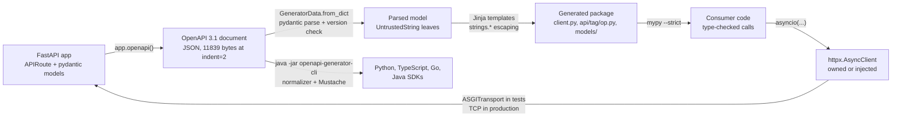

# Client SDK Generation: Typed httpx Clients (openapi-python-client 0.29.1) and Multi-Language SDKs (openapi-generator v7.27.0)

> [!summary] Claim
> A generated SDK is a compiled, frozen copy of one OpenAPI document: it gives callers static types for every documented status and body, but it checks only key presence, enums, and dates at runtime, freezes server defaults into client code, returns `None` for any status the document forgot, and executes whatever the document's author managed to smuggle into the templates, so you trust it exactly as much as you trust and gate the document.

Part of [OpenAPI JSON Schema and Contracts](README.md) in [API Engineering](../README.md).

## TL;DR

- Mechanism: `openapi-python-client` parses the document into pydantic models, renders Jinja templates into one module per `operationId` under one package per first tag, and each module exposes `sync`, `sync_detailed`, `asyncio`, and `asyncio_detailed` over an `httpx` client; `openapi-generator` does the same with a JVM, an input normalizer, and Mustache templates for 81 client targets.
- Contract rule: the response type is the union of every documented status body plus `None`, and an undocumented status (a gateway `429`, a proxy `502`) is `None` unless the client sets `raise_on_unexpected_status=True`.
- Trap: generated `from_dict` is not a validator; it raises on a missing required key, a bad enum value, or a non-string date, and passes `"not-an-int"` into an `int` field, so the static types are a promise the server must keep.
- Portability fact: `openapi-python-client 0.29.1` reads OpenAPI `3.0.x` and `3.1.x`, rejects `3.2.0` before writing a file, needs Python `>=3.11`, and pins the generated client to `httpx>=0.23.1,<0.29.0`; the lab ran on CPython 3.14.6 only.
- When not to use it: when the API is consumed by fewer callers than it has operations, when the document is not gated in CI, or when you need retries, pagination, and auth refresh that a thin per-operation wrapper does not give you; then hand-write a small client, or wrap the generated one.

## Mental model



The provider's code is the source of truth only until `app.openapi()` serializes it; from then on the document is the contract, and both generators consume the document, never the code.
`openapi-python-client` parses the document into pydantic models whose string leaves are wrapped in `UntrustedString`, so a template cannot render a document string without naming the escaping context it lands in.
The templates emit a package that `mypy` and `pyright` can check consumer code against, which is where the "typed" in "typed SDK" pays off: a wrong argument type, a missing `None` check, or an anonymous client passed to a secured operation fails before any request is sent.
At runtime each call goes through an `httpx.AsyncClient` that the generated `Client` either owns or receives from the caller, and in tests that client carries an `httpx.ASGITransport` back into the same app, closing the loop without a socket.
The second branch is `openapi-generator`, which turns the same document into SDKs for other languages with a different parser, a different type mapping, and different defaults, so two SDKs from one document are two independent compilations that can disagree.

## How it works

### Stage 1: the provider emits the document

FastAPI builds the document from routes and pydantic models and declares `"openapi": "3.1.0"` by default; the lab asserts that value before it mutates it.
Every operation needs an `operationId`, which the Operation Object defines as unique across the API, case-sensitive, and something that "Tools and libraries MAY use ... to uniquely identify an operation" (OpenAPI 3.1.1 Section 4.8.10.1).
FastAPI's default id is built by `generate_unique_id`, which concatenates the route name and `route.path_format`, replaces every non-word character with `_`, and appends the first HTTP method in lowercase (fastapi 0.162.0 fastapi/utils.py, generate_unique_id).
That produces `get_item_items__item_id__get`, and because the generator names modules after the `operationId`, the default leaks the URL into the SDK as `api/items/get_item_items_item_id_get.py`.
The lab fixes this at the source by passing `generate_unique_id_function=operation_id_from_route_name`, which returns `route.name` and turns the module into `api/items/get_item.py`.
Renaming an `operationId` later is a breaking change to every SDK even though the HTTP surface did not change; see [[Breaking-Change-Detection-and-Semantic-OpenAPI-Diffing]].

### Stage 2: load and parse

`generate()` calls `_get_document`, which reads a local path or fetches a URL with `httpx.get(source, timeout=timeout)`, where the timeout is the `http_timeout` config value, default `5` seconds (openapi-python-client 0.29.1 openapi_python_client/__init__.py, _get_document; openapi_python_client/config.py, ConfigFile).
`_load_yaml_or_json` parses `application/json` with `json.loads` and anything else with `ruamel.yaml` `YAML(typ="safe")`, so YAML tags cannot construct arbitrary Python objects (openapi-python-client 0.29.1 openapi_python_client/__init__.py, _load_yaml_or_json); YAML anchor expansion and key coercion hazards are covered in [[YAML-Media-Type-RFC-9512-and-OpenAPI-YAML-Parser-Hazards]].
The parsed dict is validated into vendored pydantic models (`openapi_schema_pydantic`), and the `openapi` field validator `check_openapi_version` raises `Invalid OpenAPI version <v>` unless the string has exactly three dot-separated parts, `Only OpenAPI versions 3.* are supported, got <v>` for a major version other than 3, and `Only OpenAPI versions 3.1.* are supported, got 3.2.0` for any minor above 1 (openapi-python-client 0.29.1 openapi_python_client/schema/openapi_schema_pydantic/open_api.py, OpenAPI.check_openapi_version).
That check runs inside `GeneratorData.from_dict`, before a `Project` exists, so the lab's `3.2.0` document returns one error and no package directory at all (openapi-python-client 0.29.1 openapi_python_client/__init__.py, _get_project_for_url_or_path).
`3.0.x` documents pass the same check, because only a minor greater than 1 is rejected.

### Stage 3: names

Every identifier the generator writes goes through `PythonIdentifier` or `ClassName` (openapi-python-client 0.29.1 openapi_python_client/strings.py).
`sanitize` drops every character that is not an identifier character, a digit, or in `DELIMITERS = r"\. _-"` (backslash, dot, space, underscore, hyphen); `snake_case` splits on case boundaries and delimiters; `fix_reserved_words` appends `_` when the result is a keyword or in `RESERVED_WORDS`.
`RESERVED_WORDS` is `set(dir(builtins)) | {"self", "true", "false", "datetime"}` minus `{"id"}`, so `id` stays `id` but a JSON property named `bin`, `type`, `list`, or `format` becomes `bin_`, `type_`, `list_`, `format_` while the JSON key is preserved (openapi-python-client 0.29.1 openapi_python_client/strings.py, RESERVED_WORDS and fix_reserved_words).
The lab proves both halves: adding `"bin"` to `Item` produces `bin_: str | Unset = UNSET` and `field_dict["bin"] = bin_`, and FastAPI's own validation error field `type` arrives as `detail[0].type_`.
A name that is still not an identifier, or that starts with `_`, gets the `field_prefix` (default `field_`) prepended.
`openapi-generator` escapes the other way: its `--reserved-words-mappings` help says "Otherwise, the default _<name> is used", a prefix, and the Python codegen's `escapeReservedWord` returns `"_" + name` unless a mapping exists (openapi-generator v7.27.0 docs/usage.md; modules/openapi-generator/src/main/java/org/openapitools/codegen/languages/AbstractPythonCodegen.java, escapeReservedWord).
Its Python reserved list is the Python keywords plus pydantic and template names such as `field`, `model_dump`, and `model_config`, because its Python models are pydantic v2 classes, but it does not contain builtins such as `type`, `bin`, or `format` (openapi-generator v7.27.0 docs/generators/python.md, Reserved Words).
So a property `type` is `type_` in the `openapi-python-client` SDK and stays `type` in the `openapi-generator` one, while `from` becomes `from_` in one and `_from` in the other; never assume attribute names are portable across generators.

### Stage 4: render

`Project.build` creates the output directory (or fails with `Directory already exists. Delete it or use the --overwrite option.`), writes the package `__init__.py` and `types.py`, writes project metadata unless `--meta none`, `shutil.rmtree`s and rebuilds `models/`, writes `client.py` and `errors.py`, `shutil.rmtree`s and rebuilds `api/`, and then runs the post hooks (openapi-python-client 0.29.1 openapi_python_client/__init__.py, Project.build, Project._create_package, Project._build_models, Project._build_api).
`py.typed` is written only when `meta_type != MetaType.NONE`; with `--meta none` the package has no PEP 561 marker, which is right for vendoring into a distribution that already ships one and wrong for a standalone wheel.
The default post hooks are `ruff check . --fix-only --extend-select=I` and `ruff format .` for `MetaType.NONE` and `ruff check --fix-only .` and `ruff format .` otherwise (openapi-python-client 0.29.1 openapi_python_client/config.py, Config.from_sources); they run through `subprocess.run(cmd, cwd=cwd, shell=True, ...)`, and a missing executable is only a `WARNING` (`Skipping Integration`).
The lab passes `post_hooks=[]`, which keeps generation in-process and is why its output is unformatted; formatting changes bytes but not behavior.
Endpoints are grouped by the operation's first tag only, unless `generate_all_tags: true`, which duplicates the function under every tag (openapi-python-client 0.29.1 README.md, generate_all_tags).

The whole configuration surface is small and checkable in the installed source (openapi-python-client 0.29.1 openapi_python_client/config.py, ConfigFile; openapi_python_client/cli.py, generate).
The config file keys are `class_overrides`, `content_type_overrides`, `project_name_override`, `package_name_override`, `package_version_override`, `use_path_prefixes_for_title_model_names` (default `true`), `post_hooks`, `docstrings_on_attributes` (default `false`), `field_prefix` (default `field_`), `generate_all_tags` (default `false`), `http_timeout` (default `5`), and `literal_enums` (default `false`, so enums are `StrEnum` classes unless you opt into `Literal` types).
The `generate` command takes `--url` or `--path`, `--custom-template-path`, `--meta` (`none`, `poetry`, `setup`, `pdm`, `uv`, default `poetry`), `--file-encoding`, `--config`, `--fail-on-warning`, `--overwrite`, and `--output-path`.
`handle_errors` exits with code `1` on any error-level problem, and on warnings only when `--fail-on-warning` is set; otherwise a generated-but-incomplete client exits `0`.
Because the default `--meta` is `poetry`, the lab's `--meta none` layout is a deliberate choice, and it changes the default post hooks as described above.

The 0.29.1 security fix changed the rendering contract: every document string is an `UntrustedString`, and templates must route it through `safe_for_docstring`, `in_double_quote_literal`, `in_f_string_literal`, or an identifier constructor; `as_unembedded_code` is reserved for `PythonCode` values the generator itself built (openapi-python-client 0.29.1 CHANGELOG.md, 0.29.1 "Breaking changes for all custom templates").
`in_double_quote_literal` strips every Unicode category `C*` character except `\b`, `\t`, and `\f` (so `\n` and `\r` are removed, not escaped) plus line and paragraph separators (`Zl`, `Zp`), then escapes with `json.dumps(value, ensure_ascii=False)`; `in_f_string_literal` additionally doubles `{` and `}`; `safe_for_docstring` strips `Cc` characters other than `\n\r\t`, escapes backslashes, and breaks `"""` (openapi-python-client 0.29.1 openapi_python_client/strings.py).
The changelog states that "ALL custom templates are expected to break with this version", and that most Unicode control characters are now stripped from string literals, which can change `const` values, enum values, and JSON property names that contained them.

### Stage 5: what one operation module contains

Each operation module has the same seven functions, three private helpers (`_get_kwargs`, `_parse_response`, `_build_response`) and four public call styles; this is the lab's `get_item`, generated and shown with blank lines removed (simplified excerpt of generated output):

```python
def _get_kwargs(
    item_id: int,
) -> dict[str, Any]:
    _kwargs: dict[str, Any] = {
        "method": "get",
        "url": "/items/{item_id}".format(item_id=quote(str(item_id), safe=""),),
    }
    return _kwargs
def _parse_response(*, client: AuthenticatedClient | Client, response: httpx.Response) -> HTTPValidationError | Item | Problem | None:
    if response.status_code == 200:
        response_200 = Item.from_dict(response.json())
        return response_200
    if response.status_code == 404:
        response_404 = Problem.from_dict(response.json())
        return response_404
    if response.status_code == 422:
        response_422 = HTTPValidationError.from_dict(response.json())
        return response_422
    if client.raise_on_unexpected_status:
        raise errors.UnexpectedStatus(response.status_code, response.content)
    else:
        return None
```

`_get_kwargs` builds the `httpx` request arguments; path parameters go through `urllib.parse.quote(str(value), safe="")`, so `/`, `?`, `#`, and space are percent-encoded and the value stays one path segment as RFC 3986 requires for data in a segment (RFC 3986 Section 3.3 and Section 2.2); this encoding exists since 0.28.0 ("URL-encode path parameters in generated endpoints (#1349)", CHANGELOG.md), so older clients sent the raw value.
`_parse_response` is a ladder of arms sorted by `HTTPStatusPattern.__lt__`, not in document order: exact codes ascending as `if response.status_code == N`, then ranges such as `2XX` as `if 200 <= response.status_code <= 299`, then either the documented `default` response or the `raise_on_unexpected_status` switch (openapi-python-client 0.29.1 openapi_python_client/templates/endpoint_module.py.jinja; openapi_python_client/parser/responses.py, HTTPStatusPattern.__lt__).
When the document declares `default`, that arm parses every remaining status and the return type loses its `| None`.
`_build_response` wraps everything in `Response(status_code=HTTPStatus(...), content=..., headers=..., parsed=...)`, so `HTTPStatus(response.status_code)` raises `ValueError` for a status code that `http.HTTPStatus` does not define.
`sync_detailed` and `asyncio_detailed` return that `Response[T]`, whose `parsed` is `T | None`; `sync` and `asyncio` return only `.parsed`, dropping status and headers.
FastAPI documents `422` on every operation that has parameters or a body unless the route already declares `422`, `4XX`, or `default` (fastapi 0.162.0 fastapi/openapi/utils.py, get_openapi_path), so the generated union for almost every FastAPI operation includes `HTTPValidationError`, which callers must narrow away.
Response bodies are mapped by media type in `_source_by_content_type`: `application/json` and any `+json` suffix (RFC 6838 Section 4.2.8) are parsed as JSON, `application/octet-stream` as bytes, `text/*` as text, and anything else is dropped with `Unsupported content_type ...` unless `content_type_overrides` maps it (openapi-python-client 0.29.1 openapi_python_client/parser/responses.py, _source_by_content_type and response_from_data).
A dropped response means its status arm is never generated, so a `200` served as `application/xml` becomes an undocumented status that returns `None`; the lab asserts exactly that, with one `WARNING` and zero errors.

### Stage 6: models, `UNSET`, and `None`

Models are `attrs` classes (`@_attrs_define`) with `to_dict` and `from_dict`, not pydantic models, and every object model carries an `additional_properties: dict[str, Any]` field that captures unknown keys (openapi-python-client 0.29.1 openapi_python_client/templates/model.py.jinja).
An optional property is typed `X | Unset` with default `UNSET`, and a nullable optional property is `None | X | Unset`; `Unset.__bool__` returns `False`.
`to_dict` omits a key whose value is `UNSET` and writes `null` for `None`, so `ItemPatch().to_dict()` is `{}` and `ItemPatch(note=None).to_dict()` is `{"note": None}`: the generated client can express JSON Merge Patch style "leave alone" versus "clear", which a plain `Optional[str] = None` model cannot.
`from_dict` does `d.pop("id")` for a required key (so a missing key raises `KeyError`), `ItemStatus(d.pop("status"))` for an enum (so an unknown value raises `ValueError`), and `datetime.datetime.fromisoformat(...)` for a `date-time` (so a number raises `TypeError`); it does nothing for `int`, `str`, `minimum`, `maxLength`, or `pattern`.
0.29.0 replaced `python-dateutil` with `datetime.fromisoformat`, which changes which timestamp spellings parse (openapi-python-client 0.29.1 CHANGELOG.md, 0.29.0).
Query parameters are filtered with `{k: v for k, v in params.items() if v is not UNSET and v is not None}`, so passing `status=None` sends nothing, and the typed API cannot express "present but null" for a query parameter (openapi-python-client 0.29.1 openapi_python_client/templates/endpoint_macros.py.jinja, query_params).

### Stage 7: the client object

`Client` and `AuthenticatedClient` are `attrs` classes holding `base_url`, `cookies`, `headers`, `timeout`, `verify_ssl`, `follow_redirects`, `httpx_args`, and `raise_on_unexpected_status`, and they build `httpx.Client` and `httpx.AsyncClient` lazily on first use (openapi-python-client 0.29.1 openapi_python_client/templates/client.py.jinja).
`timeout` defaults to `None` and is passed straight to `httpx`, which turns it into `httpx.Timeout(None)`, no timeout at all, where `httpx` itself defaults to `Timeout(timeout=5.0)` (httpx 0.28.1 httpx/_config.py, DEFAULT_TIMEOUT_CONFIG); the lab asserts `default.timeout == httpx.Timeout(None)`.
`follow_redirects` defaults to `False`, matching `httpx`, so a `301` or `308` (RFC 9110 Section 15.4) surfaces as an undocumented status and `None`.
`AuthenticatedClient` adds `token`, `prefix="Bearer"`, and `auth_header_name="Authorization"`, and writes `f"{prefix} {token}"` (or the bare token when `prefix` is empty) into its header dict only inside `get_httpx_client` and `get_async_httpx_client` when it builds its own client (RFC 6750 Section 2.1, RFC 9110 Section 11.6.2).
`set_async_httpx_client` replaces that owned client, so an injected client never receives the header; the lab proves the result is a `401` with `{"detail":"Not authenticated"}`.
`with_headers`, `with_cookies`, and `with_timeout` return an `attrs.evolve` copy that builds its own fresh `httpx` client, but they also mutate the original object's already-built `httpx` client in place, so after `b = a.with_headers(...)` the original `a` sends the new headers too (verified with a one-off probe against the generated lab package).
An operation whose own Operation-level `security` list is non-empty is typed `client: AuthenticatedClient`, and every other operation accepts `AuthenticatedClient | Client`, because the parser sets `requires_security=bool(data.security)` from the Operation Object only (openapi-python-client 0.29.1 openapi_python_client/parser/openapi.py, Endpoint.from_data).
So a document that declares `security` only at the top level gets anonymous-friendly signatures on every operation, and `security: [{}]` (authentication optional) still demands an `AuthenticatedClient`; a one-off probe on the lab document confirmed both.
Either way it is a static guard only, enforced by `mypy` in the lab, not at runtime.

### Stage 8: openapi-generator, the multi-language path

`openapi-generator` v7.27.0 is a Java project compiled for Java 11 (`maven.compiler.source` `11` in pom.xml), distributed as a jar, a Homebrew formula, a Docker image (`openapitools/openapi-generator-cli`), an npm wrapper (`@openapitools/openapi-generator-cli`), and a Python wrapper (`openapi-generator-cli` on PyPI); its README says it needs a "Java 11 runtime at a minimum" and lists OpenAPI compatibility as "1.0, 1.1, 1.2, 2.0, 3.0, 3.1 (beta support)" (openapi-generator v7.27.0 README.md).
At v7.27.0 `docs/generators.md` lists 81 client generators, 73 server generators, 9 documentation generators, 8 schema generators, and 1 config generator.
Before templating it runs the OpenAPI Normalizer; since 7.0.0 the default rules are `SIMPLIFY_ONEOF_ANYOF`, `SIMPLIFY_BOOLEAN_ENUM`, `SIMPLIFY_ONEOF_ANYOF_ENUM`, and `REFACTOR_ALLOF_WITH_PROPERTIES_ONLY`, and `DISABLE_ALL=true` turns them off (openapi-generator v7.27.0 docs/customization.md, OpenAPI Normalizer).
The normalizer rewrites the schema graph before any template sees it, so the generated model can differ structurally from the document; polymorphism details are in [[Polymorphism-and-Discriminators-in-OpenAPI-and-JSON-Schema]].
The `python` generator is `STABLE`, targets Python `3.11+`, renders Mustache by default, and its `library` option is `asyncio`, `urllib3`, `httpx`, or `httpx2`, default `urllib3`; `supportHttpxSync` (default `false`, `httpx` and `httpx2` libraries only) adds `_sync` variants that wrap the async methods (openapi-generator v7.27.0 docs/generators/python.md).
One default and one opt-in change semantics: `disallowAdditionalPropertiesIfNotPresent` defaults to `true`, which the docs describe as keeping "the old (incorrect) behaviour that 'additionalProperties' is set to false by default", and `useOneOfDiscriminatorLookup` (default `false`), when enabled, uses the discriminator mapping and skips the "one and only one match" `oneOf` validation.
Regeneration safety comes from `.openapi-generator-ignore` in the output root (gitignore syntax), `--minimal-update` (write only changed files), `--skip-overwrite`, and `--dry-run` (openapi-generator v7.27.0 docs/customization.md and docs/usage.md).
Custom templates are passed with `-t`, the engine with `-e mustache` or `-e handlebars` (beta), and type substitution with `--type-mappings` plus `--import-mappings`, which the docs say usually have to be combined.
The v7.27.0 release (published 2026-11-02, "170+ enhancements and bug fixes") removed Python 3.10 support, added Python 3.15, and fixed "unescaped description for request body" in `DefaultCodegen`, which shows the same class of escaping bug as the `openapi-python-client` advisories also exists in the JVM tool (openapi-generator v7.27.0 release notes, #25502, #25306, #25304).

## Numbers and limits

| Quantity | Value | Source |
| --- | --- | --- |
| Lab document size | 11839 bytes as the lab writes it (`json.dumps(..., indent=2)`), 5857 bytes compact; 6 operations, 8 component schemas | re-measured 2026-11-12 by the verifier with a one-off script calling `create_inventory_app().openapi()` and `generate_client_package` under `uv run --frozen python`, CPython 3.14.6, macOS 27.3 arm64 (Darwin 27.3.0) |
| Generated package | 23 files, 59805 bytes, `--meta none`, no post hooks | same run |
| Generation wall time | 0.155 s for the first in-process run, 0.075 s to 0.094 s for the next four | same run, `time.perf_counter` around `generate_client_package`, five samples, not a benchmark |
| Byte determinism | five runs, identical SHA-256 over paths and bodies | same run, and `test_generation_is_byte_deterministic_and_tracks_the_document` |
| Lab suite | 24 tests, 24 passed in 2.26 s | `uv run --frozen pytest ... -q` from `labs/`, CPython 3.14.6, macOS 27.3 arm64, finish run 2026-11-12 |
| Generated client default timeout | `None` (no timeout) | client.py.jinja; asserted in lab |
| `httpx` default timeout | 5.0 s | httpx 0.28.1 httpx/_config.py, DEFAULT_TIMEOUT_CONFIG |
| `httpx` default pool | 100 connections, 20 keep-alive | httpx 0.28.1 httpx/_config.py, DEFAULT_LIMITS |
| `httpx` default redirect cap | 20 | httpx 0.28.1 httpx/_config.py, DEFAULT_MAX_REDIRECTS |
| Document fetch timeout | 5 s (`http_timeout`) | openapi-python-client 0.29.1 config.py |
| OpenAPI versions read | `3.0.x`, `3.1.x`; `3.2.0` rejected | open_api.py, check_openapi_version; asserted in lab |
| Generator Python | `>=3.11,<4.0` | openapi-python-client 0.29.1 pyproject.toml |
| Generated client deps | `httpx>=0.23.1,<0.29.0`, `attrs>=22.2.0`, Python `>=3.11` | pyproject_uv.toml.jinja and siblings |
| openapi-generator runtime | Java 11 minimum | v7.27.0 README.md, pom.xml |
| openapi-generator targets | 81 client, 73 server generators | v7.27.0 docs/generators.md |
| CVE-2020-15142 | high, CVSS 3.1 8.0, all versions `< 0.5.3`, CWE-94 | GHSA-9x4c-63pf-525f, published 2020-08-20 |
| CVE-2026-105801 | high, CVSS 4.0 8.4 (no CVSS 3 score), all versions `< 0.29.1`, CWE-94, CWE-116, CWE-150 | GHSA-5293-mq8x-g3xj, published 2026-10-06 (as of 2026-11) |
| Release dates | 0.29.0 2026-05-30, 0.29.1 2026-08-30; v7.27.0 2026-11-02 | CHANGELOG.md, GitHub release API (as of 2026-11) |

The generation numbers are one sample on one machine and only bound the order of magnitude: generation is cheap enough to run on every CI build, so there is no excuse for committing a stale SDK.

## Portability

| Leg | Result | Evidence |
| --- | --- | --- |
| CPython 3.14.6 (workspace `.venv`) | generator and generated client work; 24 of 24 tests pass | ran here, macOS 27.3 arm64 |
| CPython 3.12.16 | not run here; generator declares support | `requires-python = ">=3.11,<4.0"` in 0.29.1 pyproject.toml |
| CPython 3.13.18 | not run here; generator declares support | same |
| CPython 3.15.2 | not run here; the 0.29.1 package classifiers list Python 3.11 to 3.14 only, so upstream makes no 3.15 claim | `Programming Language :: Python` classifiers in 0.29.1 pyproject.toml and the installed METADATA |
| CPython 3.15.2t free-threaded | not run here; no free-threaded classifier or statement in 0.29.1, so treat it as unsupported until a run proves otherwise | same classifiers; no run |
| CPython 3.10 | unsupported by both tools | 0.29.0 "Drop support for Python 3.10"; v7.27.0 #25306 |
| openapi-python-client 0.27.x -> 0.28.0 | path parameters percent-encoded with `quote(..., safe="")` | CHANGELOG.md 0.28.0, #1349 |
| openapi-python-client 0.28.x -> 0.29.0 | `python-dateutil` replaced by `datetime.fromisoformat`; minimum `httpx` 0.23.1 | CHANGELOG.md 0.29.0 |
| openapi-python-client 0.29.0 -> 0.29.1 | `StrEnum` and `-> Self` in generated code; every custom template breaks; control characters stripped | CHANGELOG.md 0.29.1 |
| `httpx` 0.28.1 | supported; `httpx` 1.x and `httpx2` are outside the generated `<0.29.0` pin | templates/pyproject_*.toml.jinja |
| openapi-generator `python` | `library=httpx` or `httpx2` for async, default `urllib3` sync | docs/generators/python.md v7.27.0 |
| HTTP/1.1 | default for the generated client | `httpx.AsyncClient(http2=False)` default, httpx 0.28.1 httpx/_client.py |
| HTTP/2 | opt-in with `httpx_args={"http2": True}` and `h2` installed | httpx 0.28.1 httpx/_client.py raises if `h2` is missing |
| HTTP/3 over QUIC | not available through `httpx` 0.28.1 | no QUIC transport in httpx 0.28.1 httpx/_transports |
| Uvicorn, Hypercorn, Granian | not run; the generated client only builds an `httpx` client, so the server is outside its code, and the lab used in-process `ASGITransport` | httpx 0.28.1 httpx/_transports/asgi.py; no server was run |

## Worked example

The lab is [implementation](../labs/src/api_labs/f08_openapi_json_schema_and_contracts/sdk_generation.py) and [test](../labs/tests/f08_openapi_json_schema_and_contracts/test_generating_typed_async_sdks_with_openapi_python_client_and_openapi_generator.py).
It builds a small FastAPI inventory provider, generates `inventory_client` from `app.openapi()` with the library API of `openapi-python-client`, imports it from a temporary directory, and drives it in-process through `httpx.ASGITransport`.

The generation step uses the programmatic API, which the changelog explicitly excludes from the versioned public API, so pin the exact generator version when you do this:

```python
def generate_client_package(document: Mapping[str, Any], root: Path, name: str) -> GeneratedPackage:
    """Render ``document`` into the importable package ``root / name``.

    ``MetaType.NONE`` writes only the package (no ``pyproject.toml``, no ``py.typed``), which
    is the layout for vendoring a client inside an existing distribution.  ``post_hooks=[]``
    skips the default ``ruff`` subprocesses so that generation stays in-process.
    """
    source = root / f"{name}.openapi.json"
    source.write_text(json.dumps(document, indent=2), encoding="utf-8")
    config = Config.from_sources(
        ConfigFile(package_name_override=name, post_hooks=[]),
        MetaType.NONE,
        document_source=source,
        file_encoding="utf-8",
        overwrite=True,
        output_path=root / name,
    )
    errors: list[str] = []
    warnings: list[str] = []
    for problem in generate(config=config):
        message = f"{problem.header} {problem.detail or ''}".strip()
        (errors if problem.level is ErrorLevel.ERROR else warnings).append(message)
    return GeneratedPackage(root=root, name=name, errors=tuple(errors), warnings=tuple(warnings))
```

The CLI equivalent is `openapi-python-client generate --path openapi.json --meta none --config config.yaml`, with `post_hooks: []` and `package_name_override: inventory_client` in the YAML file.

The test that pins the most dangerous default, an undocumented status, is real lab code:

```python
@pytest.mark.unit
@pytest.mark.asyncio
async def test_undocumented_status_is_none_by_default_and_raises_when_opted_in(sdk: Sdk) -> None:
    get_item = sdk.module("api.items.get_item")
    errors = sdk.module("errors")
    app = create_inventory_app()

    lenient = sdk.client(app)
    async with lenient:
        parsed = await get_item.asyncio(THROTTLED_ITEM_ID, client=lenient)
        detailed = await get_item.asyncio_detailed(THROTTLED_ITEM_ID, client=lenient)
    assert parsed is None
    assert detailed.status_code is HTTPStatus.TOO_MANY_REQUESTS
    assert detailed.parsed is None
    assert detailed.headers["retry-after"] == "7"

    strict = sdk.client(app, raise_on_unexpected_status=True)
    async with strict:
        with pytest.raises(errors.UnexpectedStatus) as caught:
            await get_item.asyncio(THROTTLED_ITEM_ID, client=strict)
    assert caught.value.status_code == 429
    assert caught.value.content == b'{"title":"Too Many Requests"}'
```

The provider returns `429` with `Retry-After: 7` (RFC 6585 Section 4, RFC 9110 Section 10.2.3) for item `429`, a status its document never mentions, which is what a gateway or rate limiter in front of a real service does.
`asyncio` gives `None`, indistinguishable from "not found" if the caller wrote `if result is None`; only `asyncio_detailed` keeps the status and the `Retry-After` header a retry policy needs.

The test that proves the type checker is part of the contract runs `mypy --strict` on two consumer files against the generated package:

```python
    assert (
        'bad_consumer.py:6: error: Argument 1 to "asyncio" has incompatible type "str"; '
        'expected "int"  [arg-type]'
    ) in errors
    assert (
        'bad_consumer.py:7: error: Item "None" of "HTTPValidationError | Item | Problem | None" '
        'has no attribute "quantity"  [union-attr]'
    ) in errors
    assert (
        'bad_consumer.py:11: error: Argument "client" to "asyncio_detailed" has incompatible '
        'type "Client"; expected "AuthenticatedClient"  [arg-type]'
    ) in errors
```

Those three lines are the value of a generated SDK in one place: a path parameter of the wrong type, a forgotten error arm, and an anonymous client on a secured `DELETE` all fail in CI.

Captured run, from `labs/`, CPython 3.14.6 (`main, Jun 23 2026, 15:46:31) [Clang 22.1.3]`), macOS 27.3 arm64:

```text
$ uv run --frozen pytest tests/f08_openapi_json_schema_and_contracts/test_generating_typed_async_sdks_with_openapi_python_client_and_openapi_generator.py -q
........................                                                 [100%]
24 passed in 2.26s
```

The other tests cover the package layout (`api/<tag>/<operationId>.py`, no `py.typed` under `--meta none`), the four call styles, FastAPI's default ids, byte-deterministic regeneration and the `bin_` rename, the typed async round trip, raw bytes in `asyncio_detailed`, documented `404` and `422` bodies returned as models, `UNSET` versus `None` on the wire, frozen defaults, path encoding, the limits of `from_dict`, the bearer header and its loss under `set_async_httpx_client`, disabled timeouts, the `3.2.0` rejection, the dropped `application/xml` response, and hostile document strings.

## Pitfalls

> [!warning] Undocumented statuses become `None`
> Trigger: a gateway, WAF, or load balancer returns `429`, `502`, `503`, or `504`, or the service returns a status its document omits.
> Symptom: `asyncio()` returns `None`; callers that treat `None` as "not found" silently skip work, and the `Retry-After` header is lost.
> Fix: construct clients with `raise_on_unexpected_status=True`, use `*_detailed` wherever status or headers drive behavior, and document `default` or shared error responses (OpenAPI 3.1.1 Section 4.8.16 says `default` "MAY be used as a default Response Object for all HTTP codes that are not covered individually"); with a `default` response the generated `_parse_response` parses every other status instead of returning `None`.

> [!warning] Generated clients have no timeout
> Trigger: `Client(base_url=...)` with no `timeout`.
> Symptom: a stalled upstream holds a coroutine and a pool connection forever; under load the pool of 100 connections fills and every call hangs.
> Fix: always pass `timeout=httpx.Timeout(...)` (the lab asserts the default is `httpx.Timeout(None)`), and set it in one factory function that every caller uses.

> [!warning] Injecting an httpx client drops authentication
> Trigger: `AuthenticatedClient(token=...)` followed by `set_async_httpx_client(...)` to add tracing, retries, or a test transport.
> Symptom: requests go out without `Authorization`; the server answers `401` (RFC 9110 Section 15.5.2), which looks like a revoked token.
> Fix: pass transport, hooks, and limits through `httpx_args` so the owned client is still built, or set the header on the injected client yourself; the lab reproduces the `401`.

> [!warning] Server defaults frozen into the client
> Trigger: a query parameter with a schema `default`, such as FastAPI `limit: int = 50`.
> Symptom: the generated signature is `limit: int | Unset = 50` and the client sends `limit=50` explicitly, so changing the server default to `20` changes nothing for existing SDK users until they regenerate.
> Fix: treat a changed default as a contract change, or omit `default` from parameters whose default must stay server-controlled; the lab asserts `_get_kwargs()["params"] == {"limit": 50}`.

> [!warning] Encoded slashes in path parameters
> Trigger: a path parameter value containing `/`, such as a SKU `a/b`.
> Symptom: the client correctly sends `%2F`, but `httpx` `URL.path` is decoded and `ASGITransport` puts the decoded path in `scope["path"]` (httpx 0.28.1 httpx/_transports/asgi.py), so Starlette routes `/skus/a/b` and returns `404` with `{"detail":"Not Found"}`.
> Fix: forbid `/` in identifiers in the schema (`pattern`), or route on `raw_path` in the provider; RFC 3986 Section 2.2 says a percent-encoded reserved character is not equivalent to the character, but many stacks decode before routing.

> [!warning] String defaults with quotes or backslashes are corrupted
> Trigger: a string `default` containing `"` or `\` in 0.29.1.
> Symptom: `StringProperty.convert_value` returns `PythonCode(repr(remove_string_escapes(value)))`, escaping twice, so the document default `say "hi" \ ok` becomes the Python default `say \"hi\" \\ ok` (openapi-python-client 0.29.1 openapi_python_client/parser/properties/string.py, StringProperty.convert_value; reproduced by the verifier with a one-off probe on 2026-11-12; the hostile test asserts the same doubling).
> Fix: avoid such defaults, or post-check generated defaults against the document in CI; no upstream issue tracks this as of 2026-11-12 (GitHub issue searches in `openapi-generators/openapi-python-client` for `remove_string_escapes`, for `default escape quote string`, and for `backslash default` returned only unrelated results such as #414, #500, #504, and #1350).

> [!warning] Arbitrary code generation from a malicious document
> Trigger: generating from a document you do not control with `openapi-python-client < 0.29.1` (GHSA-5293-mq8x-g3xj, CVE-2026-105801, CVSS 4.0 8.4) or `< 0.5.3` (GHSA-9x4c-63pf-525f, CVE-2020-15142, CVSS 8.0).
> Symptom: importing the generated client executes attacker code, in CI or on a developer laptop.
> Fix: upgrade to 0.29.1, regenerate, and audit code previously generated from untrusted documents, as the advisory says; custom templates must be ported to the `UntrustedString` helpers or they reopen the hole.

> [!warning] Unknown media types vanish
> Trigger: a response declared only as `application/xml`, `application/problem+xml`, `text/event-stream` handled as a stream, or a vendor type without a `+json` suffix.
> Symptom: one `WARNING` line, no error, and the status arm is missing, so success returns `None`.
> Fix: run the generator with `--fail-on-warning` in CI (without it the client is still written and the exit code stays `0`) and use `content_type_overrides` for vendor types; the lab asserts the warning text and the missing `200` arm.

## Security and robustness

Threat model one: the document is attacker-controlled.
That includes third-party APIs, a partner's document fetched by URL at build time, and an internal document edited by anyone with write access to the provider.
The generator is a compiler from that document to Python that your process will `import`, so a template injection is code execution on every machine that installs the SDK; the 2020 and 2026 advisories are both CWE-94, "Improper Control of Generation of Code".
The 0.29.1 design answer is type-level: `UntrustedString` defines no `__str__`, so rendering one directly prints an object repr rather than document text, and only `get_untrusted_value()` or the escaping helpers unwrap it, while `PythonCode` marks the only values that may appear unescaped (openapi-python-client 0.29.1 openapi_python_client/schema/untrusted_string.py, UntrustedString; openapi_python_client/strings.py, PythonCode).
The lab's hostile test injects payloads into the title, summary, description, a property default, and an enum value, then asserts that no generated module imports `os` and that importing them does not set `SDK_LAB_PWNED`; this is regression evidence for 0.29.1, not proof of absence.
Defense in depth: pin the generator version and hash, generate in CI from a checked-in document rather than a live URL, review the generated diff like code, and run the generated package through `ruff` and a type checker before publishing.

Threat model two: the server, or a man in the middle, returns hostile responses.
`from_dict` checks required keys, enums, and dates only, so an `int` field can hold a string and a non-negative field can hold `-5`; the lab asserts both.
Unknown keys land in `additional_properties` and are written back by `to_dict`, so a client that does read-modify-write echoes server-injected fields back to the server, a mass-assignment vector covered by OWASP API Security Top 10 2023 `API3:2023` Broken Object Property Level Authorization.
If the client is a trust boundary, validate the parsed objects again, or generate pydantic models for the same document with [[Generating-Pydantic-v2-Models-from-OpenAPI-with-Datamodel-Code-Generator]] and validate `response.content` with them.

Threat model three: credentials.
`AuthenticatedClient` stores the token in plain attributes and writes it into the default headers of the client it builds, which `httpx` sends to every URL that client requests, including absolute URLs on other hosts if a caller passes one.
`follow_redirects=False` by default means the generated client does not forward credentials across a redirect; turning it on delegates that decision to `httpx`.
The client-side constraint checks are absent by design: the server must enforce `ge=0`, and the lab shows the client happily sends `quantity=-1` and receives `422` (RFC 9110 Section 15.5.21).
Error bodies are typed, so map `Problem` (shaped after RFC 9457 Section 3.1 members `title`, `status`, `detail`) into your own exceptions instead of logging `response.content`, which may carry user data.

## The principal's view

The decision is not "which generator" but "who owns the SDK as a product".
A generated SDK turns every document change into a release of N packages in N ecosystems, so the document needs the same review, linting ([[OpenAPI-Linting-and-Automated-Style-Governance-with-Vacuum-and-Spectral]]), drift gates ([[Design-First-vs-Code-First-OpenAPI-and-CI-Drift-Gates]]), and semantic diffing ([[Breaking-Change-Detection-and-Semantic-OpenAPI-Diffing]]) as code, because a renamed `operationId` or tag is an SDK break even when no HTTP behavior changed.
Use `openapi-python-client` for Python consumers: it is written in Python, its output is small, idiomatic, and fully typed, and its failure modes are visible in the generated source.
Use `openapi-generator` when you must ship many languages from one pipeline, and accept the costs: a JVM in CI, a normalizer that rewrites your schema, defaults such as `disallowAdditionalPropertiesIfNotPresent=true` that diverge from JSON Schema, 3.1 support the project still calls beta, and per-language templates you will eventually fork.
In both cases wrap the generated layer in a thin handwritten facade that owns timeouts, retries keyed on `Retry-After`, pagination, auth refresh, and error mapping, and never let application code import the generated `api` modules directly; that facade is what keeps a regeneration from being a refactor.
Commit generated code or a lockfile of its hash, regenerate in CI, and fail the build on any diff; the lab shows generation is byte-deterministic, so a diff always means the document or the generator changed.
Choose a different approach when the API has one or two consumers you control (share the pydantic models as a library instead), when the protocol is better described by a schema with first-class codegen (gRPC with Protocol Buffers gives you streaming, deadlines, and wire compatibility rules that OpenAPI SDKs approximate), or when callers need a query language rather than fixed operations (GraphQL clients generated from operations, not from the schema).
The organizational trade-off is speed of the first SDK versus cost of the hundredth release: generation makes the first one free and makes every later breaking change cost one migration per consumer per language.

## Interview questions

> [!question] L5: What do `asyncio` and `asyncio_detailed` return for the same call, and when must you use the detailed form?
>
> > [!success]- Answer
> > `asyncio_detailed` returns `Response[T]` with `status_code`, `content`, `headers`, and `parsed`, where `parsed` is `T | None`.
> > `asyncio` returns only `.parsed`.
> > Use the detailed form whenever the status code or a header drives behavior, such as `Retry-After` on `429`, `ETag` for conditional requests, or distinguishing an undocumented status from a documented empty body.
> >
> > Follow-up: What does `asyncio` return for a `204` response, and how is that different from an undocumented `502`?

> [!question] L5: Predict the output: with the provider parameter `limit: int = Query(50, ge=1, le=100)`, what are `list_items._get_kwargs()["params"]` and `list_items._get_kwargs(status=None, limit=UNSET)["params"]` in the generated module?
>
> > [!success]- Answer
> > The first is `{"limit": 50}`, because the schema default is frozen into the signature as `limit: int | Unset = 50` and sent explicitly.
> > The second is `{}`, because the params dict drops every value that is `UNSET` or `None`.
> > The lab asserts both.
> >
> > Follow-up: The server team changes the default to `20`; which consumers see the change, and how would you make the default server-controlled?

> [!question] L5: Why does a FastAPI-generated SDK have module names like `get_item_items_item_id_get.py`, and how do you fix it?
>
> > [!success]- Answer
> > The generator names one module per `operationId`, and FastAPI's `generate_unique_id` builds the id from the route name, the path with non-word characters replaced by `_`, and the method.
> > Pass `generate_unique_id_function` to `FastAPI(...)` returning `route.name`, or set `operation_id` per route.
> > Do it before the first SDK release, because changing an `operationId` later renames a public function in every SDK.
> >
> > Follow-up: What happens if two routes end up with the same `operationId`?

> [!question] L6: Debug this API: why does every secured call return `401` after a service builds `AuthenticatedClient(base_url=..., token=t)` and then calls `set_async_httpx_client(httpx.AsyncClient(transport=traced_transport))` to add tracing, and what is the fix?
>
> > [!success]- Answer
> > `AuthenticatedClient` writes `Authorization: Bearer <token>` only into the headers of the `httpx` client it builds itself in `get_async_httpx_client`.
> > `set_async_httpx_client` replaces that client, so the injected one has no `Authorization` header and the server answers `401`.
> > Pass the transport and event hooks through `httpx_args` so the owned client is still built with the header, or set the header on the injected client.
> > The lab reproduces both the working and the `401` case.
> >
> > Follow-up: How would you write a test that fails if a future refactor reintroduces this?

> [!question] L6: Given a generated `Item` model with `quantity: int`, does `Item.from_dict({"quantity": "lots", ...})` raise, and what does that tell you about where validation lives?
>
> > [!success]- Answer
> > It does not raise; `from_dict` pops the key and stores the string.
> > Generated `from_dict` raises only for a missing required key (`KeyError`), an unknown enum value (`ValueError`), or a non-string `date-time` (`TypeError`).
> > The static types are a contract the server must keep, not a runtime check; if the client is a trust boundary, validate with pydantic models generated from the same document.
> >
> > Follow-up: What do unknown keys do on a read-modify-write round trip, and why is that a security concern?

> [!question] L6: How does the generated client distinguish "do not change this field" from "set this field to null" in a `PATCH`, and why does a plain `Optional[str] = None` model get it wrong?
>
> > [!success]- Answer
> > Optional properties default to the `UNSET` sentinel, and `to_dict` omits `UNSET` keys while writing `None` as JSON `null`.
> > So `ItemPatch()` sends `{}` and `ItemPatch(note=None)` sends `{"note": null}`.
> > A model that uses `None` as the default cannot tell an omitted field from an explicit null, so it either clears fields by accident or cannot clear them at all.
> >
> > Follow-up: How must the server side be written to honor the distinction, and what does FastAPI's `exclude_unset=True` do?

> [!question] L6: What is the risk when your build generates from `https://partner.example/openapi.json` with `openapi-python-client 0.28.4`, and what do you change?
>
> > [!success]- Answer
> > Every release before 0.29.1 is affected by GHSA-5293-mq8x-g3xj: a malicious document can generate arbitrary Python that runs on import.
> > Upgrade to 0.29.1, regenerate, and audit code generated earlier from that document.
> > Stop fetching at build time: check in a reviewed copy of the document, diff it on update, pin the generator, and review the generated diff.
> >
> > Follow-up: Why do custom templates have to be rewritten for 0.29.1, and what would happen if a team just renamed `utils` to `strings`?

> [!question] L7+: How would you design the pipeline that ships Python, TypeScript, Go, and Java SDKs for one public API, and what can go wrong between languages?
>
> > [!success]- Answer
> > One reviewed document in the repository is the input; lint it, run a semantic breaking-change diff against the last release, and only then generate.
> > Use `openapi-generator` for the languages you do not have a better native generator for, pin its version and templates, and pin normalizer rules explicitly instead of relying on defaults.
> > Expect divergence: reserved-word escaping differs, `additionalProperties` defaults differ, discriminator handling differs, and 3.1 support is beta, so add per-language contract tests that run each SDK against the same provider or recorded fixtures.
> > Wrap each generated layer in a small handwritten facade per language that owns retries, timeouts, pagination, and errors, and version the SDKs from the document version.
> >
> > Follow-up: How do you decide when to fork a generator's templates, and how do you keep the fork current?

> [!question] L7+: What happens to the SDK pipeline when a product team moves its public API document to OpenAPI 3.2 for the `QUERY` method and streaming schemas?
>
> > [!success]- Answer
> > `openapi-python-client 0.29.1` rejects the document before writing anything with `Only OpenAPI versions 3.1.* are supported, got 3.2.0`, which the lab asserts.
> > So either keep a 3.1 projection of the document for SDK generation, for example through an overlay that drops 3.2-only features, or wait for generator support and accept that `QUERY` operations are missing from SDKs in the meantime.
> > The decision is about who the document is for: if most consumers use SDKs, the SDK generators' supported version caps what the public contract can use.
> >
> > Follow-up: Which 3.2 features could you express in 3.1 with extensions, and what does each SDK then do with them?

> [!question] L7+: Should generated SDK code be committed to the repository, published only as packages, or generated by consumers?
>
> > [!success]- Answer
> > Committing it makes every document change visible as a code diff and lets reviewers see what callers will see, at the cost of noisy diffs.
> > Publishing only packages keeps repositories clean but hides the generated diff unless CI renders it.
> > Letting consumers generate gives N different generator versions and N different SDKs for one API, which is the worst option for support.
> > The defensible default is: generate in CI from the committed document with a pinned generator, fail on any unexpected diff, and publish versioned packages; generation is byte-deterministic, so the check is cheap.
> >
> > Follow-up: How do you handle a consumer who needs a generator option you do not ship?

## Related

Prerequisites: [[Generating-Pydantic-v2-Models-from-OpenAPI-with-Datamodel-Code-Generator]]

Next: [[OpenAPI-Overlays-Extensions-and-Multi-Audience-Specs]]

See also: [[OpenAPI-3-1-Architecture-and-JSON-Schema-Alignment]], [[OpenAPI-3-2-Additions-QUERY-Method-Streaming-and-Tag-Hierarchies]], [[Polymorphism-and-Discriminators-in-OpenAPI-and-JSON-Schema]], [[Design-First-vs-Code-First-OpenAPI-and-CI-Drift-Gates]], [[Breaking-Change-Detection-and-Semantic-OpenAPI-Diffing]], [[OpenAPI-Linting-and-Automated-Style-Governance-with-Vacuum-and-Spectral]], [[Consumer-Driven-Contract-Testing-vs-Bi-Directional-Contract-Verification]], [[Response-Schema-Conformance-Enforcement-in-Test-Suites]], [[YAML-Media-Type-RFC-9512-and-OpenAPI-YAML-Parser-Hazards]]

- Lab: `labs/tests/f08_openapi_json_schema_and_contracts/test_generating_typed_async_sdks_with_openapi_python_client_and_openapi_generator.py`

## Further reading

- [openapi-python-client 0.29.1 README](https://github.com/openapi-generators/openapi-python-client/blob/v0.29.1/README.md): the configuration keys (`class_overrides`, `literal_enums`, `post_hooks`, `content_type_overrides`) and what each output file is for.
- [openapi-python-client 0.29.1 CHANGELOG](https://github.com/openapi-generators/openapi-python-client/blob/v0.29.1/CHANGELOG.md): the versioning policy (only generated behavior and the CLI are public API) and the 0.29.1 template-escaping contract.
- [GHSA-5293-mq8x-g3xj](https://github.com/advisories/GHSA-5293-mq8x-g3xj): the 2026 arbitrary code generation advisory, affected range `< 0.29.1`.
- [GHSA-9x4c-63pf-525f](https://github.com/advisories/GHSA-9x4c-63pf-525f): the 2020 advisory, CVE-2020-15142, the origin of `remove_string_escapes`.
- [openapi-generator v7.27.0 release](https://github.com/OpenAPITools/openapi-generator/releases/tag/v7.27.0): what changed across 81 client generators in the release this note pins.
- [openapi-generator python generator options](https://github.com/OpenAPITools/openapi-generator/blob/v7.27.0/docs/generators/python.md): the `library`, `supportHttpxSync`, and `additionalProperties` switches that change generated semantics.
- [openapi-generator customization](https://github.com/OpenAPITools/openapi-generator/blob/v7.27.0/docs/customization.md): the normalizer rules and `.openapi-generator-ignore`, the two levers that decide what you regenerate.
- [OpenAPI Specification 3.1.1](https://spec.openapis.org/oas/v3.1.1.html): Section 4.8.10.1 on `operationId` and Section 4.8.16 on `default` responses, the two fields that shape every SDK.
- [RFC 3986](https://www.rfc-editor.org/rfc/rfc3986.html): Sections 2.2 and 3.3 on reserved characters and path segments, the rule behind `quote(..., safe="")`.
- [RFC 6750](https://www.rfc-editor.org/rfc/rfc6750.html): Section 2.1, the `Authorization: Bearer` form `AuthenticatedClient` writes.
- [RFC 9457](https://www.rfc-editor.org/rfc/rfc9457.html): Section 3.1, the problem details members that typed error models should mirror.
