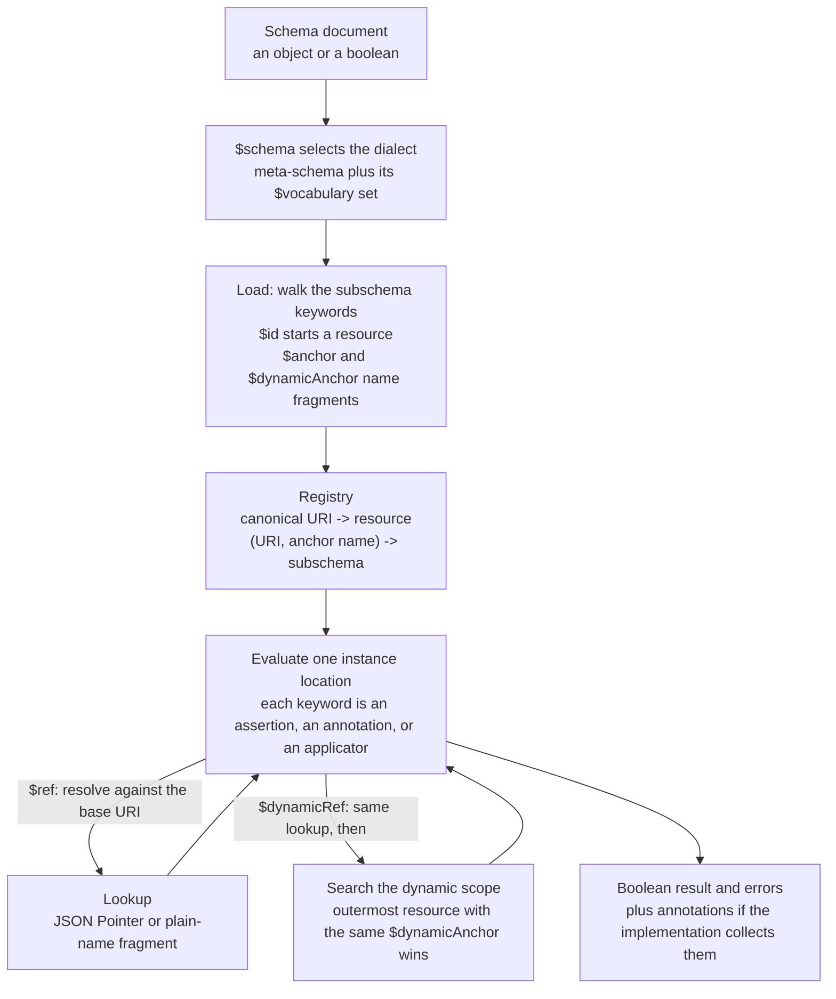

# JSON Schema Draft 2020-12 Internals: $schema, $id, $defs, $ref, $dynamicRef, and Validation Keywords

> [!summary] Claim
> A JSON Schema 2020-12 document is a URI-addressed graph of schema resources: `$schema` picks the dialect, `$id` and `$anchor` name the nodes, `$ref` follows a static edge, `$dynamicRef` follows an edge chosen from the dynamic scope at evaluation time, and the 20 Validation keywords assert over a six-type JSON data model that is not your language's type system.

Part of [OpenAPI JSON Schema and Contracts](README.md) in [API Engineering](../README.md).

## TL;DR

- Mechanism: a loader walks the document once and registers every schema resource under its canonical URI (`$id` resolved per RFC 3986) and every `$anchor` and `$dynamicAnchor` under `(URI, name)`, and evaluation then applies each keyword of a schema object to one instance location, following `$ref` statically and `$dynamicRef` through the dynamic scope `(JSON Schema Core 2020-12 Sections 8.2.1, 8.2.3.1, 8.2.3.2)`.
- Contract rule: give every published schema document a `$schema` and an absolute `$id`, validate against a closed registry that you populated yourself, and resolve every reference at startup, because a schema URI is `not necessarily a network locator, only an identifier` `(JSON Schema Core 2020-12 Section 8.2.3)`.
- Trap: `format` is an annotation, `pattern` is unanchored and runs on the host regex engine, `multipleOf` divides binary floats, and `minimum` and `maximum` pass `NaN`, so a schema that looks strict accepts `"abc\n"`, rejects `19.99`, and admits `{"price": NaN}` under `jsonschema 4.26.0` (each proven in the lab).
- Portability fact: the lab's 78 tests gave the same results in the drafter's matrix run on CPython `3.12.13`, `3.13.18`, `3.14.6`, `3.14.10`, `3.15.2`, and free-threaded `3.15.0b3`, but results differ between implementations: `jsonschema 4.26.0` uses Python `re` and float division where `jsonschema-rs 0.60.3` rejects `"abc\n"` for `^[a-z]+$` and accepts `19.99` for `multipleOf: 0.01`.
- When not to use it: do not use `$dynamicRef` for ordinary reuse (a `$ref` into `$defs` is enough), do not make JSON Schema the only gate for semantic rules such as cross-field arithmetic or authorization, and do not evaluate schemas supplied by untrusted parties in process; for closed internal RPC contracts prefer Protocol Buffers, see [[Protobuf-Governance-Linting-and-Breaking-Change-Gates-with-Buf]].

## Mental model



A schema document enters as plain JSON, and the first decision is the dialect: `$schema` names a meta-schema whose `$vocabulary` declares which keyword sets exist at all.
The loader then walks only the keywords that are known to hold subschemas, and every `$id` it meets starts a new schema resource with its own base URI, while `$anchor` and `$dynamicAnchor` attach plain-name fragments to the resource that encloses them.
The result is a registry, which is the only thing a reference can ever resolve against.
Evaluation applies every keyword of the current schema object to the current instance location and combines the results; applicators such as `properties`, `items`, `$ref`, and `$dynamicRef` move to another schema or another instance location and loop back.
A `$ref` edge is fixed by the document text and the base URI, so it can be resolved before any instance is seen.
A `$dynamicRef` edge starts with the same lookup, but if that lookup lands on a fragment made by `$dynamicAnchor`, the target is replaced by the same-named `$dynamicAnchor` in the outermost resource that evaluation has passed through, which is how an extension schema overrides a recursion point inside the schema it extends.

## How it works

### Instances, schemas, and keyword categories

JSON Schema validates an abstract instance, not text: an instance has one of six primitive types (`null`, `boolean`, `object`, `array`, `number`, `string`), numbers are arbitrary-precision base-10 values, and strings are sequences of Unicode code points `(JSON Schema Core 2020-12 Section 4.2.1)`.
`integer` is not a data-model type; the data model `makes no distinction between integers and other numbers` `(JSON Schema Core 2020-12 Section 4.2.1)`, and `type: integer` is a Validation vocabulary rule that `matches any number with a zero fractional part` `(JSON Schema Validation 2020-12 Section 6.1.1)`.
Equality is defined on the model: numbers are equal when they `have the same mathematical value`, arrays compare item by item, and objects compare as unordered property sets `(JSON Schema Core 2020-12 Section 4.2.2)`.
That is why `{"const": 1}` accepts `1.0` and rejects `true`, and why `uniqueItems` treats `{"a": 1, "b": 2}` and `{"b": 2, "a": 1}` as duplicates (lab test `test_assertions_follow_the_json_data_model`).
The behavior of an object with a repeated member name is undefined in the model `(JSON Schema Core 2020-12 Section 4.2.1)`, so the parser decides it before the validator runs.

A schema is an object or a boolean: `true` behaves as `{}` and `false` behaves as `{"not": {}}` `(JSON Schema Core 2020-12 Section 4.3.2)`.
Keywords fall into five categories `(JSON Schema Core 2020-12 Section 4.3.1)`:

| Category | What it does | Keywords in this note |
|---|---|---|
| Identifier | Sets a URI for a schema or changes how URIs resolve | `$id`, `$anchor`, `$dynamicAnchor` |
| Assertion | Produces a boolean for one instance location | The 20 Validation keywords, for example `type`, `maximum`, `required` |
| Annotation | Attaches information to an instance location | `format` (default), `title`, `default`, `readOnly` |
| Applicator | Applies subschemas or referenced schemas and combines results | `$ref`, `$dynamicRef`, `properties`, `items` |
| Reserved location | Holds reusable data and affects no result | `$defs`, `$comment` |

Three default behaviors follow from the specification and produce most surprises.
A missing keyword `MUST NOT produce a false assertion result` `(JSON Schema Core 2020-12 Section 7.3)`.
Most assertions constrain one primitive type only, and when the instance has another type `the instance is considered to conform to the assertion` `(JSON Schema Core 2020-12 Section 7.6.1)`, so `{"maxLength": 1}` accepts `12345` and `{"required": ["a"]}` accepts an array.
A property that is not a known keyword `SHOULD be treated as annotations` `(JSON Schema Core 2020-12 Section 4.3.1)`, so the typo `minLenght` validates nothing and raises nothing (lab test `test_unknown_keywords_are_ignored_and_hide_no_resources`).

### Dialects: `$schema`, `$vocabulary`, and the meta-schema

`$schema` is both the dialect identifier and the URI of the meta-schema that describes valid schemas of that dialect `(JSON Schema Core 2020-12 Section 8.1.1)`.
Its value must be a normalized URI with a scheme, it belongs in the document root, it may also appear in the root of an embedded resource, and it must not appear in any other subschema.
When it is absent from the document root `the resulting behavior is implementation-defined` `(JSON Schema Core 2020-12 Section 8.1.1)`.

A meta-schema declares its dialect with `$vocabulary`, an object whose keys are vocabulary URIs and whose boolean values mean required (`true`: an implementation that does not recognize the vocabulary must refuse to process the schema) or optional (`false`: it should proceed) `(JSON Schema Core 2020-12 Section 8.1.2)`.
The declaration is not inherited through `$ref`: every meta-schema must repeat its full vocabulary list in its own root `(JSON Schema Core 2020-12 Section 8.1.2.2)`.
The Core vocabulary is mandatory and must be listed with `true` `(JSON Schema Core 2020-12 Section 8)`.
The default dialect `https://json-schema.org/draft/2020-12/schema` declares seven vocabularies, counted here from the meta-schemas shipped in `jsonschema-specifications 2025.9.1`:

| Vocabulary URI suffix (after `.../draft/2020-12/vocab/`) | Keywords | Count |
|---|---|---|
| `core` | `$schema`, `$vocabulary`, `$id`, `$anchor`, `$dynamicAnchor`, `$ref`, `$dynamicRef`, `$defs`, `$comment` | 9 |
| `applicator` | `allOf`, `anyOf`, `oneOf`, `not`, `if`, `then`, `else`, `dependentSchemas`, `prefixItems`, `items`, `contains`, `properties`, `patternProperties`, `additionalProperties`, `propertyNames` | 15 |
| `unevaluated` | `unevaluatedItems`, `unevaluatedProperties` | 2 |
| `validation` | `type`, `enum`, `const`, and 17 type-specific assertions (table below) | 20 |
| `meta-data` | `title`, `description`, `default`, `deprecated`, `readOnly`, `writeOnly`, `examples` | 7 |
| `format-annotation` | `format` | 1 |
| `content` | `contentEncoding`, `contentMediaType`, `contentSchema` | 3 |

An eighth vocabulary, `format-assertion`, exists for custom meta-schemas and is optional to implement `(JSON Schema Validation 2020-12 Section 7.1)`.
The applicator and unevaluated keywords are the subject of [[JSON-Schema-Composition-AllOf-AnyOf-OneOf-and-UnevaluatedProperties]].

`jsonschema 4.26.0` implements dialect selection as a dictionary lookup, not as vocabulary processing.
Each validator class registers itself under the `$id` of its meta-schema in `_META_SCHEMAS`, a `URIDict` that normalizes keys with `urlsplit(uri).geturl()` so `http://json-schema.org/draft-07/schema#` and the same URI without `#` are one key (`jsonschema 4.26.0 jsonschema/validators.py, validates` and `jsonschema 4.26.0 jsonschema/_utils.py, URIDict.normalize`).
`validator_for` returns the registered class for `schema["$schema"]`, returns the latest draft class (`Draft202012Validator`) when `$schema` is absent or the schema is a boolean, and for an unregistered URI emits a `DeprecationWarning` and still returns the latest draft class (`jsonschema 4.26.0 jsonschema/validators.py, validator_for`).
No library module in `jsonschema 4.26.0` or `referencing 0.37.0` reads `$vocabulary`, and the package's own runner for the upstream test suite skips the vocabulary cases with the message `Vocabulary support is still in-progress.` (`jsonschema 4.26.0 jsonschema/tests/test_jsonschema_test_suite.py, TestDraft202012`), so a custom meta-schema that declares `format-assertion: true` changes nothing: the lab validates `"not an address"` against `{"format": "ipv4"}` under such a meta-schema and it passes (lab test `test_vocabulary_declarations_are_not_consulted`).
`Validator.check_schema` validates a schema against the class meta-schema and, unlike instance validation, passes the class `FORMAT_CHECKER` by default, which is why `{"pattern": "("}` is rejected at schema-check time through the meta-schema's `format: regex` (`jsonschema 4.26.0 jsonschema/validators.py, Validator.check_schema`).

### Identification: `$id`, base URIs, and schema resources

`$id` gives a schema resource its canonical URI `(JSON Schema Core 2020-12 Section 8.2.1)`.
The value is a URI-reference that must resolve to an absolute URI without a fragment; an empty fragment is tolerated for backward compatibility, and the Core meta-schema enforces the rule with the pattern `^[^#]*#?$`.
The same absolute URI is the base URI for every relative reference inside the resource, as a base URI embedded in content `(RFC 3986 Section 5.1.1)`.
An `$id` inside a subschema makes that subschema a distinct, embedded schema resource, and a relative `$id` there resolves against the URI of the enclosing resource, as a base URI from the encapsulating entity `(RFC 3986 Section 5.1.2)`.
When the root has no `$id`, the base URI is the retrieval URI or an implementation default `(JSON Schema Core 2020-12 Section 9.1.1)`, `(RFC 3986 Sections 5.1.3 and 5.1.4)`.
The specification asks for an absolute `$id` in every document root `(JSON Schema Core 2020-12 Section 8.2.1.1)`.

The identification example from the specification shows every form at once `(JSON Schema Core 2020-12 Appendix A)`:

```json
{
    "$id": "https://example.com/root.json",
    "$defs": {
        "A": { "$anchor": "foo" },
        "B": {
            "$id": "other.json",
            "$defs": {
                "X": { "$anchor": "bar" },
                "Y": { "$id": "t/inner.json", "$anchor": "bar" }
            }
        },
        "C": { "$id": "urn:uuid:ee564b8a-7a87-4125-8c96-e9f123d6766f" }
    }
}
```

This one document holds four schema resources: `https://example.com/root.json`, `https://example.com/other.json`, `https://example.com/t/inner.json`, and `urn:uuid:ee564b8a-7a87-4125-8c96-e9f123d6766f`.
The anchor `bar` exists twice without conflict because each one belongs to a different resource, and `https://example.com/root.json#bar` does not exist at all.
The lab resolves all 18 URIs that Appendix A lists as identifying a schema (the table also gives two plain base URIs, for `A` and `X`, which identify the enclosing resource instead) and checks that each one lands on the expected schema (lab test `test_every_appendix_a_uri_identifies_its_schema`).

`referencing 0.37.0` builds the registry with a crawl, not with a full JSON walk.
`Registry.crawl` pops each uncrawled resource, joins its `$id` onto the URI it was reached under with `urljoin`, stores it in an immutable `rpds.HashTrieMap`, stores each anchor under the key `(uri, name)`, and pushes the resource's subresources (`referencing 0.37.0 referencing/_core.py, Registry.crawl`).
Subresources are found only under keywords that the dialect declares to hold schemas: 11 keywords whose value is a schema (`additionalProperties`, `contains`, `contentSchema`, `else`, `if`, `items`, `not`, `propertyNames`, `then`, `unevaluatedItems`, `unevaluatedProperties`), 4 whose value is an array of schemas (`allOf`, `anyOf`, `oneOf`, `prefixItems`), and 5 whose value is an object of schemas (`$defs`, `definitions`, `dependentSchemas`, `patternProperties`, `properties`) (`referencing 0.37.0 referencing/jsonschema.py, DRAFT202012`).
An object that merely looks like a schema inside `enum`, `const`, `examples`, or an extension keyword such as `x-schemas` is therefore not a resource, which matches the specification's statement that a reference target under an unknown keyword is undefined behavior `(JSON Schema Core 2020-12 Section 9.4.2)`.
The lab registers a document with `$id` values under `enum` and `x-schemas` and shows that neither becomes resolvable (lab test `test_unknown_keywords_are_ignored_and_hide_no_resources`).

Two registry behaviors are stricter or looser than the specification suggests.
URIs are compared as exact strings: `Resource.id` and `Registry.__getitem__` strip a trailing `#`, and nothing applies case, percent-encoding, dot-segment, or default-port normalization `(RFC 3986 Sections 6.2.2 and 6.2.3)`, so `HTTPS://EXAMPLE.COM/a/~b.json` and `https://example.com/a/%7Eb.json` do not find a resource registered as `https://example.com/a/~b.json` (lab test `test_registry_compares_uris_as_exact_strings`).
When two schemas claim one URI the specification says validators `SHOULD raise an error condition` `(JSON Schema Core 2020-12 Section 9.1.2)`, but `Registry.with_resources` inserts into the map and the later resource silently replaces the earlier one (`referencing 0.37.0 referencing/_core.py, Registry.with_resources`), which the lab demonstrates and then guards against in `closed_registry` (lab test `test_registry_replaces_a_duplicate_id_silently_unless_guarded`).

### Anchors and fragments: `$anchor`, plain names, and JSON Pointer

The `application/schema+json` media type defines two fragment forms `(JSON Schema Core 2020-12 Section 5)`.
A fragment that matches JSON Pointer syntax, including the empty string, must be read as a JSON Pointer; any other fragment is a plain name that refers to a locally named schema.
`$anchor` creates a plain name inside the enclosing resource, and the name must start with a letter or `_` followed by any number of letters, digits, `-`, `_`, and `.` `(JSON Schema Core 2020-12 Section 8.2.2)`, which the Core meta-schema enforces as the `anchorString` pattern `^[A-Za-z_][-A-Za-z0-9._]*$`.
The value carries no `#`: `"$anchor": "foo"` is referenced as `#foo`.
Defining one name twice in one resource, with any mix of `$anchor` and `$dynamicAnchor`, is undefined `(JSON Schema Core 2020-12 Section 8.2.2)`.

A JSON Pointer fragment is percent-decoded first and then split on `/`, and each token is unescaped by turning `~1` into `/` and then `~0` into `~`, in that order, so `~01` means the literal name `~1` `(RFC 6901 Sections 4 and 6)`.
`Resource.pointer` implements exactly that order with `unquote(pointer[1:]).split("/")` followed by `.replace("~1", "/").replace("~0", "~")` (`referencing 0.37.0 referencing/_core.py, Resource.pointer`).
A consequence is that `%2F` is a separator after decoding, not an escaped slash, so `#/$defs/a%2Fb` does not address the member `a/b`; only `#/$defs/a~1b` does (lab test `test_json_pointer_fragments_decode_percent_then_tilde_escapes`).
The same method converts a token to an array index with `int(segment)`, which accepts `-1`, `01`, and `" 1"` although the array-index grammar of JSON Pointer allows only `0` or digits without a leading zero `(RFC 6901 Section 4)`; the lab shows `#/prefixItems/-1` resolving to the last element and `#/prefixItems/-` raising a bare `ValueError`.

While walking a pointer, `Resource.pointer` calls the dialect's `maybe_in_subresource` after each step, and when the walk has just entered a subschema that carries `$id`, the resolver's base URI changes to that resource (`referencing 0.37.0 referencing/jsonschema.py, _maybe_in_subresource`).
That is what makes `https://example.com/root.json#/$defs/B/$defs/X` resolve to schema `X` with base URI `https://example.com/other.json`.
The specification allows an implementation to refuse such pointers that cross a resource boundary and tells authors not to rely on them `(JSON Schema Core 2020-12 Section 9.2.1)`; a pointer relative to the resource's own canonical URI, here `https://example.com/other.json#/$defs/X`, survives when the embedded resource is moved to its own file.

### Static references: `$ref` and `$defs`

`$ref` is an applicator: it applies the referenced schema to the current instance location, and in the specification's words `Its results are the results of the referenced schema` `(JSON Schema Core 2020-12 Section 8.2.3.1)`.
Because it is an ordinary keyword, the other keywords in the same schema object apply as well.
That is a change from draft-07 and earlier, recorded in the specification changelog as `Allow keywords adjacent to "$ref"` `(JSON Schema Core 2020-12 Appendix G, draft-handrews-json-schema-02)`.
`jsonschema 4.26.0` models the old rule by building the draft-03 to draft-07 classes with `applicable_validators=_legacy_keywords.ignore_ref_siblings`, a function that returns only the `$ref` pair when `$ref` is present (`jsonschema 4.26.0 jsonschema/_legacy_keywords.py, ignore_ref_siblings`).
The lab runs one schema body under both dialects: `{"$ref": ..., "maxLength": 2}` rejects `"abc"` under 2020-12 and accepts it under draft-07 (lab test `test_schema_keyword_selects_the_dialect_and_the_meaning_of_ref_siblings`).

Resolution of a reference in `referencing 0.37.0` is four steps (`referencing 0.37.0 referencing/_core.py, Resolver.lookup`):

1. A reference that starts with `#` keeps the current base URI; any other reference is joined to the base URI with `urljoin` and split into URI and fragment with `urldefrag`.
2. `Registry.get_or_retrieve` looks the URI up, crawls the registry once if it is not found, and as a last resort calls the registry's `retrieve` hook, which by default raises `NoSuchResource` (`referencing 0.37.0 referencing/_core.py, Registry.get_or_retrieve` and `_fail_to_retrieve`).
3. A fragment that starts with `/` is walked as a JSON Pointer; any other non-empty fragment is looked up as an anchor of that resource; an empty fragment returns the resource root.
4. The result is the target schema together with a new resolver whose base URI is the target's resource, so references inside the target resolve correctly.

The specification notes that this resolution `is safe to perform on schema load` `(JSON Schema Core 2020-12 Section 8.2.3.1)`, but `jsonschema 4.26.0` performs it during evaluation, each time the keyword runs: the `$ref` keyword function calls `Validator._validate_reference`, which calls `self._resolver.lookup(ref)` and descends into the result (`jsonschema 4.26.0 jsonschema/validators.py, Validator._validate_reference`).
Two effects follow.
A reference that points nowhere passes `check_schema` and fails only when an instance reaches that branch, raising `_WrappedReferencingError`, a subclass of `referencing.exceptions.Unresolvable`, not a `ValidationError` (lab test `test_dangling_reference_passes_check_schema_and_fails_only_when_reached`).
A reference cycle with no instance descent, such as `{"$ref": "#"}`, recurses until Python raises `RecursionError`; the specification says a schema `MUST NOT be run into an infinite loop` and calls the behavior undefined `(JSON Schema Core 2020-12 Section 9.4.1)`.

`$defs` is a reserved location: an object whose values are schemas, with no effect on validation `(JSON Schema Core 2020-12 Section 8.2.4)`.
It replaced `definitions`, which the 2020-12 meta-schema still describes with `deprecated: true`, and `referencing` crawls both names.
The conventional static reference is `{"$ref": "#/$defs/name"}`, which is the shape `pydantic 2.14.3` emits: its `DEFAULT_REF_TEMPLATE` is `#/$defs/{model}` and a recursive model serializes as `{"$defs": {...}, "$ref": "#/$defs/Node"}` with no `$schema` member (`pydantic 2.14.3 pydantic/json_schema.py, DEFAULT_REF_TEMPLATE`), so `validator_for` falls back to the latest draft class for it; see [[JSON-Schema-Generation-Internals-and-GenerateJsonSchema]].

Because references are URIs, the file layout is free to change.
Bundling copies each external resource under `$defs` of the referring document, keeps its `$id`, and leaves every `$ref` untouched; the key under `$defs` is not significant `(JSON Schema Core 2020-12 Section 9.3.1 and Appendix B.1)`.
The result is a compound schema document, and it should not be validated as a single instance against one meta-schema when its embedded resources declare different dialects `(JSON Schema Core 2020-12 Section 9.3.3)`.
The lab shows both halves: `check_schema` rejects a 2020-12 document that embeds a draft-07 resource using array-form `items`, while evaluation works because `Validator.evolve` calls `validator_for` on every subschema and switches to `Draft7Validator` inside the embedded resource (`jsonschema 4.26.0 jsonschema/validators.py, Validator.evolve`; lab test `test_embedded_resource_is_validated_under_its_own_dialect`).

### Dynamic references: `$dynamicAnchor` and `$dynamicRef`

A static `$ref` cannot express "recurse into whatever schema extended me".
If a `tree` schema recurses with `{"$ref": "#"}` and a `strict-tree` schema extends it with `{"$ref": "tree", "unevaluatedProperties": false}`, the strictness applies to the root node only, because the recursion inside `tree` returns to `tree`.
`$dynamicRef` solves that with three rules `(JSON Schema Core 2020-12 Section 8.2.3.2)`:

1. Resolve the value against the base URI exactly like `$ref`; this initial resolution is static.
2. If the initially resolved URI has a fragment that was created by `$dynamicAnchor`, replace it with the URI of the outermost schema resource in the dynamic scope that defines a `$dynamicAnchor` of the same name.
3. Otherwise behave exactly like `$ref`.

The dynamic scope is the path of schema resources that evaluation has entered, from the schema where processing began to the current keyword, and following a reference counts as descending `(JSON Schema Core 2020-12 Section 7.1)`.
Rule 2 has a precondition that is easy to miss: the initial target must itself be a `$dynamicAnchor`, a requirement often called the bookend, so a generic schema needs a default definition of its own extension point.
A plain `$anchor` with the same name never takes part.

For the specification's example, validating `{"children": [{"daat": 1}]}` against `strict-tree` proceeds as follows `(JSON Schema Core 2020-12 Appendix C)`:

| Step | Keyword at | Dynamic scope, outermost first | Effect |
|---|---|---|---|
| 1 | `strict-tree#` | `strict-tree` | `$ref: "tree"` enters the base schema |
| 2 | `tree#/properties/children/items` | `strict-tree`, `tree` | `$dynamicRef: "#node"` initially resolves to `tree#node`, a `$dynamicAnchor` |
| 3 | same | `strict-tree`, `tree` | `strict-tree` is outermost and defines `$dynamicAnchor: "node"`, so the target becomes `strict-tree#node` |
| 4 | `strict-tree#` applied to `/children/0` | `strict-tree`, `tree`, `strict-tree` | `unevaluatedProperties: false` rejects `daat` |

The lab reproduces the outcome with the error located at `/children/0` under keyword `unevaluatedProperties`, and shows that the base `tree` schema alone accepts the same instance (lab test `test_dynamic_ref_rebinds_to_the_outermost_dynamic_anchor`).
The same mechanism gives JSON Schema a form of generics: the lab's `PAGE` schema declares `"items": {"$dynamicRef": "#item"}` with a default `{"$dynamicAnchor": "item"}` that accepts anything, and `PAGE_OF_MONEY` binds the parameter by defining its own `$dynamicAnchor: "item"` and referencing `PAGE`.
The official meta-schemas use it the same way: every vocabulary meta-schema and the dialect meta-schema declare `$dynamicAnchor: "meta"`, and subschema positions are written as `{"$dynamicRef": "#meta"}`, so a custom dialect that extends the meta-schema is applied at every nesting depth.

`referencing 0.37.0` implements the dynamic scope as a list of base URIs.
Every `Resolver.lookup` that moves to a resource calls `Resolver._evolve`, which pushes the current base URI onto the persistent list `_previous` when that URI is non-empty and either the list is empty or the lookup moves to a different base URI (`referencing 0.37.0 referencing/_core.py, Resolver._evolve`).
`$anchor` is stored as an `Anchor` object and `$dynamicAnchor` as a `DynamicAnchor` object in the same `(uri, name)` map (`referencing 0.37.0 referencing/jsonschema.py, _anchor`).
`DynamicAnchor.resolve` iterates `Resolver.dynamic_scope` from innermost to outermost, asks each resource for an anchor of the same name, ignores resources that have none or that have a plain `Anchor`, and keeps overwriting its candidate, so the last match, the outermost, wins (`referencing 0.37.0 referencing/jsonschema.py, DynamicAnchor.resolve`).
In `jsonschema 4.26.0` the `$dynamicRef` keyword function is identical to the `$ref` one: both call `Validator._validate_reference` (`jsonschema 4.26.0 jsonschema/_keywords.py, dynamicRef`), and the dynamic behavior lives entirely in the anchor object that the lookup returns.

That design produces two departures from the specification, both pinned by the lab (lab test `test_referencing_0_37_0_departs_from_core_8_2_3_2_in_two_cases`).
First, a `$ref` whose fragment was created by `$dynamicAnchor` is also rebound dynamically, although the specification says such anchors `only exhibit runtime dynamic behavior when referenced with "$dynamicRef"` `(JSON Schema Core 2020-12 Section 8.2.3.2)`; the upstream test suite file `dynamicRef.json` (moved from `tests/draft2020-12/` to `validation/tests/` as of 2026-11) has one case for a `$ref` to a `$dynamicAnchor`, and it stays inside one schema resource, where both readings agree.
Second, a root schema without `$id` has the empty string as its base URI (`referencing 0.37.0 referencing/_core.py, Registry.resolver_with_root`), `_evolve` never pushes an empty base URI, and so a `$dynamicAnchor` in such a root is not found from a referenced schema.
The portable rule is to reference a `$dynamicAnchor` only through `$dynamicRef` and to give every document root an absolute `$id`.

`$dynamicRef` and `$dynamicAnchor` replaced the 2019-09 keywords `$recursiveRef` and `$recursiveAnchor`, with a behavior change `(JSON Schema Core 2020-12 Appendix G, draft-bhutton-json-schema-00)`.
The old pair allowed one anonymous recursion point per resource (`"$recursiveAnchor": true` at the resource root, referenced as `"$recursiveRef": "#"`), while the new pair names the point, allows several per resource, and no longer determines the base URI at runtime.
The 2020-12 meta-schema still lists the old names with `deprecated: true` so that leftovers are at least type-checked.

### Non-validating keywords: `$comment`, meta-data, and content

`$comment` holds a string for schema maintainers, and implementations `MUST NOT take any other action based on the presence, absence, or contents` of it, including collecting it as an annotation or showing it to end users `(JSON Schema Core 2020-12 Section 8.3)`.
The seven meta-data keywords are annotations only: `default` supplies a value for documentation and tooling and is never inserted into an instance by validation, and `readOnly` and `writeOnly` describe ownership of a value without rejecting anything `(JSON Schema Validation 2020-12 Sections 9.2 and 9.4)`.
The three content keywords describe data encoded inside a string, and implementations `MUST NOT automatically decode, parse, and/or validate the string contents by default` `(JSON Schema Validation 2020-12 Section 8.2)`.
`Draft202012Validator.VALIDATORS` in `jsonschema 4.26.0` has 36 keyword functions and none for these keywords, for `minContains` and `maxContains` (handled inside `contains`), or for the retired `definitions` and `dependencies`, so a draft-07 `dependencies` keyword evaluated under 2020-12 is silently ignored (`jsonschema 4.26.0 jsonschema/validators.py, Draft202012Validator`).

### The Validation vocabulary: 20 assertion keywords

Every keyword in this vocabulary is an assertion without annotation behavior `(JSON Schema Validation 2020-12 Section 6)`.

| Keyword | Constrains | Rule `(JSON Schema Validation 2020-12 Section)` | Edge proven in the lab |
|---|---|---|---|
| `type` | any | One of six primitive names or `integer`; a unique array of names means any of them `(6.1.1)` | `1.0` is an `integer`; `true` is not an `integer` or a `number` |
| `enum` | any | Equal to one element; the array should be non-empty and unique `(6.1.2)` | `[0]` rejects `false` |
| `const` | any | Equal to the value; same as a one-element `enum` `(6.1.3)` | `1` accepts `1.0`, rejects `true`; member order ignored |
| `multipleOf` | numbers | Division by the value, which must be greater than 0, yields an integer `(6.2.1)` | `0.01` rejects `19.99` under float division |
| `maximum`, `minimum` | numbers | Inclusive bounds `(6.2.2, 6.2.4)` | `2**53 + 1` exceeds `maximum: 2**53`; `NaN` passes both |
| `exclusiveMaximum`, `exclusiveMinimum` | numbers | Strict bounds, each a number `(6.2.3, 6.2.5)` | `exclusiveMinimum: 0` rejects `0` |
| `maxLength`, `minLength` | strings | Length in characters as defined by RFC 8259; `minLength` defaults to 0 `(6.3.1, 6.3.2)` | `U+1F600` has length 1; `e` plus `U+0301` has length 2 |
| `pattern` | strings | An ECMA-262 regular expression that matches somewhere in the string `(6.3.3)` | `es` matches `expression`; Python `$` accepts a trailing newline |
| `maxItems`, `minItems` | arrays | Array size bounds; `minItems` defaults to 0 `(6.4.1, 6.4.2)` | none beyond the default |
| `uniqueItems` | arrays | With `true`, no two elements are equal; defaults to `false` `(6.4.3)` | `1` and `true` differ; `1` and `1.0` are equal |
| `maxContains`, `minContains` | arrays | Bound the number of elements matching the adjacent `contains`; no effect without it; `minContains` defaults to 1 `(6.4.4, 6.4.5)` | `minContains: 0` disables `contains`; lone `maxContains: 0` is inert |
| `maxProperties`, `minProperties` | objects | Property count bounds; `minProperties` defaults to 0 `(6.5.1, 6.5.2)` | none beyond the default |
| `required` | objects | Every listed name is a property of the instance; names unique `(6.5.3)` | `{"a": null}` satisfies `required: ["a"]` |
| `dependentRequired` | objects | For each listed name present in the instance, every name in its array is present too `(6.5.4)` | fires on presence only |

The implementation details that decide the edge cases are short enough to read in full.
The 2020-12 type checker is the draft-06 checker: `integer` accepts a Python `int` that is not a `bool`, or a `float` whose `is_integer()` is true, and `number` accepts any `numbers.Number` except `bool`, which includes `decimal.Decimal` (`jsonschema 4.26.0 jsonschema/_types.py, draft6_type_checker` and `is_number`).
`const`, `enum`, and `uniqueItems` use `equal`, which recurses into sequences and mappings and maps `True` and `False` to private sentinel objects through `unbool` so that Python's `True == 1` does not leak into JSON semantics (`jsonschema 4.26.0 jsonschema/_utils.py, equal` and `unbool`).
`uniqueItems` first tries to sort the array and compare neighbors, and when the elements are not mutually orderable, as with objects, it falls back to comparing every pair, which is quadratic (`jsonschema 4.26.0 jsonschema/_utils.py, uniq`).
`multipleOf` with a `float` divisor computes `instance / dB` and tests `int(quotient) != quotient`, so the answer inherits binary rounding: `19.99 / 0.01` is `1998.9999999999998` and fails; only when the quotient overflows to infinity does it fall back to exact `fractions.Fraction` arithmetic (`jsonschema 4.26.0 jsonschema/_keywords.py, multipleOf`).
`minLength` and `maxLength` call `len()` on a Python `str`, which counts code points, with no Unicode normalization.
`pattern` calls `re.search(patrn, instance)`, an unanchored search with the Python engine (`jsonschema 4.26.0 jsonschema/_keywords.py, pattern`).

The regular expression dialect is where implementations diverge most.
The specification asks for ECMA-262 syntax, says expressions should be built with Unicode support, recommends a small portable token subset, and states that `implementations MUST NOT take regular expressions to be anchored` `(JSON Schema Core 2020-12 Section 6.4)`.
Python `re` is not ECMA-262: `$` `Matches the end of the string or just before the newline at the end of the string`, and `\d` matches `any Unicode decimal digit` for `str` patterns (Python `re` documentation).
So `^[a-z]+$` accepts `"abc\n"` and `^\d+$` accepts Arabic-Indic digits under `jsonschema 4.26.0`, and the ECMA-262 property escape `\p{L}` is a compile error (lab test `test_python_re_is_not_the_ecma_262_dialect`).

### `format`: an annotation unless you opt in

In the default dialect `format` belongs to the Format-Annotation vocabulary: its value must be collected as an annotation, and an implementation may additionally assert it, but that option `MUST be disabled by default` `(JSON Schema Validation 2020-12 Section 7.2.1)`.
Only a custom meta-schema that requires the Format-Assertion vocabulary turns `format` into a mandatory assertion, and then unknown formats must fail `(JSON Schema Validation 2020-12 Sections 7.2.2 and 7.2.3)`.
The specification defines 19 format attributes across dates and times, email, hostnames, IP addresses, resource identifiers, URI templates, JSON Pointers, and `regex` `(JSON Schema Validation 2020-12 Section 7.3)`.

In `jsonschema 4.26.0` the `format` keyword function does nothing unless the validator was constructed with a `format_checker`, and `FormatChecker.check` returns without error for any format name it has no function for (`jsonschema 4.26.0 jsonschema/_keywords.py, format` and `jsonschema 4.26.0 jsonschema/_format.py, FormatChecker.check`).
Which functions exist depends on optional packages imported under `with suppress(ImportError)`: in this lab environment 10 names are registered (`date`, `date-time`, `email`, `idn-email`, `idn-hostname`, `ipv4`, `ipv6`, `regex`, `time`, `uuid`), so `hostname`, `uri`, and `duration` pass any string even with the checker enabled (lab test `test_format_asserts_only_with_a_checker_and_only_for_installed_formats`).
The depth of each check varies: `is_email` returns `"@" in instance`, while `date-time` delegates to `rfc3339_validator` and rejects a timestamp without an offset, as the `date-time` rule requires `(RFC 3339 Section 5.6)` (`jsonschema 4.26.0 jsonschema/_format.py, is_email` and `is_datetime`).

### The evaluation loop in `jsonschema 4.26.0`

A validator instance precomputes a list of `(function, keyword, value)` triples for the keywords of its schema that appear in the class `VALIDATORS` map, in the order of the schema's own members (`jsonschema 4.26.0 jsonschema/validators.py, Validator.__attrs_post_init__`).
`Validator.iter_errors` is a generator that calls each function with `(validator, value, instance, schema)` and yields `ValidationError` objects; `is_valid` takes only the first one, so evaluation stops at the first failure and anything after it, including a dangling reference, is never reached (`jsonschema 4.26.0 jsonschema/validators.py, Validator.iter_errors` and `Validator.is_valid`).
Applicator functions call `Validator.descend`, which creates a new validator for the subschema, rebases the resolver with `Resolver.in_subresource` when the subschema has `$id`, and prefixes the instance path and schema path of every error on the way back up (`jsonschema 4.26.0 jsonschema/validators.py, Validator.descend`).
The schema path omits `$ref` but includes `$dynamicRef`: the lab's error for the strict tree has `absolute_schema_path` `properties/children/items/$dynamicRef/unevaluatedProperties`, while errors reached through `$ref` show no `$ref` segment.
Nothing is compiled ahead of time and no annotation is collected, so every `$ref` evaluation repeats the lookup, and the specified output formats with `keywordLocation` and `absoluteKeywordLocation` are not produced; applications read `ValidationError.absolute_path`, `absolute_schema_path`, and `json_path` instead (`jsonschema 4.26.0 jsonschema/exceptions.py, _Error`).

## Numbers and limits

Measured rows were re-taken during verification on 2026-11-13 on an Apple M3 Pro, macOS `27.3` arm64 (`uname -r` = `27.3.0`), CPython `3.14.6`, `jsonschema 4.26.0`, `referencing 0.37.0`, and `rpds-py 2026.9.1`, with the commands listed below the table; `timeit` reports the best of its repeats.

| Quantity | Value | Source or measurement |
|---|---|---|
| Keywords in the Core vocabulary | 9 | `https://json-schema.org/draft/2020-12/meta/core`, counted from `jsonschema-specifications 2025.9.1` |
| Keywords in the Validation vocabulary | 20 | `https://json-schema.org/draft/2020-12/meta/validation`, same package |
| Vocabularies declared by the default dialect | 7, each with value `true` | `https://json-schema.org/draft/2020-12/schema`, fetched 2026-11 |
| Format attributes defined | 19 | `(JSON Schema Validation 2020-12 Section 7.3)` |
| Format checkers registered in the lab environment | 10 | Lab test `test_format_asserts_only_with_a_checker_and_only_for_installed_formats` |
| Keyword functions in `Draft202012Validator.VALIDATORS` | 36 | `jsonschema 4.26.0 jsonschema/validators.py, Draft202012Validator` |
| Keywords crawled for subschemas in 2020-12 | 20 (11 single, 4 array, 5 object valued) | `referencing 0.37.0 referencing/jsonschema.py, DRAFT202012` |
| Anchor name grammar | `^[A-Za-z_][-A-Za-z0-9._]*$` | `(JSON Schema Core 2020-12 Section 8.2.2)` in prose; the pattern is `anchorString` in `https://json-schema.org/draft/2020-12/meta/core` |
| Keyword defaults | `minLength` 0, `minItems` 0, `minProperties` 0, `minContains` 1, `uniqueItems` `false` | `(JSON Schema Validation 2020-12 Sections 6.3.2, 6.4.2, 6.5.2, 6.4.5, 6.4.3)` |
| Integer range that every JSON parser agrees on | `-(2**53)+1` to `(2**53)-1` | `(RFC 8259 Section 6)` |
| Deepest nested `TREE` instance validated before `RecursionError` | 164 levels at `sys.getrecursionlimit()` of 1000 | Command D below |
| Validate one small order against `ORDER` with a reused validator | `60.3` us | Command A |
| Build a validator including `check_schema` | `1.67` ms, against `6.65` us for construction alone | Commands B and C |
| `jsonschema.validate` per call, which runs `check_schema` every time | `1.71` ms | Command E |
| Build the two-document closed registry | `81.6` us | Command F |
| `uniqueItems` over 1000, 2000, 4000 one-member objects | `391` ms, `1.76` s, `6.12` s | Command G |
| `uniqueItems` over 4000 integers | `1.2` ms | Command H |
| `pattern` `^(a+)+$` against 22, 24, 26 times `a` followed by `b` | `120` ms, `493` ms, `1.98` s | Command I |
| Network or file fetches attempted by the default registry for 3 unknown `$ref` URIs | 3, including `file:///etc/passwd` | Lab test `test_default_registry_fetches_unknown_references_and_a_closed_one_does_not` |
| CVSS 3.1 base score of `CVE-2020-15366` | `5.6` | NVD record, fetched 2026-11 |

```sh
# Run from 20-API-Engineering/labs/
S="import jsonschema; import api_labs.f08_openapi_json_schema_and_contracts.core_vocabulary as L; r = L.closed_registry(L.MONEY, L.ORDER); o = {'id': '0b4f6c2e-58a1-4f0e-9d53-6d1f3a2b9c11', 'total': {'amount': 1999, 'currency': 'EUR'}, 'lines': [{'sku': 'A-1', 'qty': 2}], 'gift': {'wrap': 'box'}}; v = L.compile_validator(L.ORDER, r)"
uv run --frozen python -m timeit -s "$S" "v.is_valid(o)"                                      # A
uv run --frozen python -m timeit -s "$S" "L.compile_validator(L.ORDER, r)"                    # B
uv run --frozen python -m timeit -s "$S" "jsonschema.Draft202012Validator(L.ORDER, registry=r)"  # C
uv run --frozen python -c "import api_labs.f08_openapi_json_schema_and_contracts.core_vocabulary as L; print(L.max_nesting_depth(L.compile_validator(L.TREE, L.closed_registry(L.TREE))))"  # D
uv run --frozen python -m timeit -s "$S" "jsonschema.validate(o, L.ORDER, registry=r)"        # E
uv run --frozen python -m timeit -s "$S" "L.closed_registry(L.MONEY, L.ORDER)"                # F
uv run --frozen python -m timeit -n 1 -r 3 -s "$S; u = L.compile_validator({'uniqueItems': True}); a = [{'id': i} for i in range(4000)]" "u.is_valid(a)"  # G, also with 1000 and 2000
uv run --frozen python -m timeit -s "$S; u = L.compile_validator({'uniqueItems': True}); a = list(range(4000))" "u.is_valid(a)"  # H
uv run --frozen python -m timeit -n 1 -r 3 -s "$S; p = L.compile_validator({'pattern': '^(a+)+\$'}); s = 'a' * 26 + 'b'" "p.is_valid(s)"  # I, also with 22 and 24
```

The two quadratic rows are the ones to remember.
Doubling the object count multiplies the `uniqueItems` time by about 3.5 to 4.5, near the factor 4 of a quadratic, and adding two characters multiplies the backtracking `pattern` time by about 4.

## Portability

| Runtime or component | Behavior | Proof |
|---|---|---|
| CPython `3.12.13` | 78 passed; nesting depth 164 | Drafter's lab run on 2026-11-11 with `UV_PROJECT_ENVIRONMENT=<scratch venv> uv run --frozen --python 3.12 pytest <test> -q`, not repeated in verification (matrix runs paused); `3.12.16` is not installed on this machine |
| CPython `3.13.18` | 78 passed; nesting depth 164 | Drafter's run, same command with `--python 3.13`; not repeated in verification |
| CPython `3.14.6` (workspace interpreter) and `3.14.10` | 78 passed on each; nesting depth 164 on each | `uv run --frozen pytest <test> -q` on `3.14.6`, re-run in verification on macOS `27.3` (78 passed, depth 164); `3.14.10` is the drafter's run with `--python /opt/homebrew/bin/python3.14`, not repeated |
| CPython `3.15.2` | 78 passed; nesting depth 164 | Drafter's run, same command with `--python /opt/homebrew/bin/python3.15`; not repeated in verification |
| Free-threaded CPython `3.15.0b3` (`3.15t`) | 78 passed with `sys._is_gil_enabled()` false; nesting depth 164 | Drafter's run, `PYTHONPATH=src uv run --no-project --python 3.15t --with <the lab's 14 pinned packages> python -m pytest <test> -q`, not repeated in verification; the full workspace does not sync there because `psycopg-binary 3.3.8` has no wheel for it, and `3.15.2t` is not installed on this machine |
| `jsonschema 4.26.0` with `referencing 0.37.0` | Python `re` patterns, float `multipleOf`, references resolved during evaluation, default registry that fetches, `$vocabulary` ignored | Every lab test, CPython `3.14.6` |
| `jsonschema-rs 0.60.3` | Differs on the same inputs: rejects `"abc\n"` for `^[a-z]+$`, rejects Arabic-Indic digits for `^\d+$`, compiles `\p{L}`, accepts `19.99` for `multipleOf: 0.01`, reports a dangling `$ref` even when the instance does not reach it, and refuses `#/prefixItems/-1`; also rejects `NaN` and `Infinity` for `{"type": "number"}` (its message calls the value `null`), so `{"type": "number", "minimum": 0, "maximum": 10}` rejects `NaN` there; gives the specification's result for a `$dynamicAnchor` in a root without `$id`; agrees on `NaN` passing `minimum` and `maximum` when no `type` is present, on `1.0` as `integer`, on `1` and `true` being distinct, and on rebinding a `$ref` to a `$dynamicAnchor` | Ad hoc script run once by the drafter and once more in verification (2026-11-13) on CPython `3.14.6` in the lab venv, where the package is a locked transitive dependency; not part of the lab because `jsonschema-rs` is not pinned in `pyproject.toml` |
| Draft-07 against 2020-12 | Draft-07 ignores keywords next to `$ref`, uses `definitions`, array-form `items`, and `dependencies`; 2020-12 applies siblings and uses `$defs`, `prefixItems`, `dependentRequired`, and `dependentSchemas` | `(JSON Schema Core 2020-12 Appendix G)`; lab tests `test_schema_keyword_selects_the_dialect_and_the_meaning_of_ref_siblings` and `test_embedded_resource_is_validated_under_its_own_dialect`, CPython `3.14.6` |
| Draft 2019-09 against 2020-12 | 2019-09 has `$recursiveRef` and `$recursiveAnchor` and array-form `items` with `additionalItems`; 2020-12 has `$dynamicRef`, `$dynamicAnchor`, `prefixItems`, and a split format vocabulary | `(JSON Schema Core 2020-12 Appendix G)` and the 2020-12 release notes; not exercised in the lab |
| ASGI servers (Uvicorn, Hypercorn, Granian) and HTTP/1.1, HTTP/2, HTTP/3 | Not exercised over a socket; validation runs on the parsed request body, after the server has delivered it | The lab's ASGI test runs in process through `httpx.ASGITransport` with `starlette 1.10.0` on every interpreter above |
| Debian Trixie and Alpine containers | Not run in this job | Recorded as an open leg |

## Worked example

The lab [implementation](../labs/src/api_labs/f08_openapi_json_schema_and_contracts/core_vocabulary.py) and [test](../labs/tests/f08_openapi_json_schema_and_contracts/test_json_schema_2020_12_core_and_validation_vocabularies.py) build a closed registry from modular schema documents, resolve every URI form of the specification's identification example, extend a recursive schema and a generic container with `$dynamicRef`, and probe each Validation keyword edge case named in this note.
The module holds eight schema documents as constants: `APPENDIX_A`, `MONEY`, `ORDER` (which embeds a `gift.json` resource), `TREE`, `STRICT_TREE`, `PAGE`, `PAGE_OF_MONEY`, and `QUOTE`.
Its functions are the pieces a service needs at startup: `closed_registry` refuses duplicate URIs and installs no retrieval hook, `compile_validator` selects the class from `$schema` and runs `check_schema`, `dangling_references` resolves every `$ref` and `$dynamicRef` eagerly, `strict_json_loads` rejects `NaN`, `Infinity`, overflow, and duplicate member names, and `build_app` exposes one lenient and one strict Starlette route over the same schema.

### Implementation (`labs/src/api_labs/f08_openapi_json_schema_and_contracts/core_vocabulary.py`)

```python
"""JSON Schema 2020-12 core vocabulary lab: identification, references, and assertions."""

from __future__ import annotations

import json
import math
from dataclasses import dataclass
from typing import TYPE_CHECKING, Any
from urllib.parse import urljoin

import jsonschema  # type: ignore[import-untyped]
from referencing import Registry
from referencing.exceptions import Unresolvable
from referencing.jsonschema import DRAFT202012
from starlette.applications import Starlette
from starlette.responses import JSONResponse
from starlette.routing import Route

if TYPE_CHECKING:
    from collections.abc import Iterable

    from referencing.jsonschema import Schema, SchemaRegistry
    from starlette.requests import Request

DIALECT = "https://json-schema.org/draft/2020-12/schema"
DRAFT_07 = "http://json-schema.org/draft-07/schema#"
_JSONSCHEMA: Any = jsonschema  # jsonschema 4.26.0 ships no py.typed marker

# Core Appendix A, with a const in every schema so a lookup result names what it found.
APPENDIX_A: dict[str, Any] = {
    "$id": "https://example.com/root.json",
    "$defs": {
        "A": {"$anchor": "foo", "const": "A"},
        "B": {
            "$id": "other.json",
            "const": "B",
            "$defs": {
                "X": {"$anchor": "bar", "const": "X"},
                "Y": {"$id": "t/inner.json", "$anchor": "bar", "const": "Y"},
            },
        },
        "C": {"$id": "urn:uuid:ee564b8a-7a87-4125-8c96-e9f123d6766f", "const": "C"},
    },
}

MONEY: dict[str, Any] = {
    "$schema": DIALECT,
    "$id": "https://schemas.example/common/money.json",
    "type": "object",
    "properties": {
        "amount": {"$ref": "#/$defs/minor-units"},
        "currency": {"$ref": "#currency"},
    },
    "required": ["amount", "currency"],
    "$defs": {
        "minor-units": {"type": "integer", "minimum": 0},
        "currency": {"$anchor": "currency", "type": "string", "pattern": "^[A-Z]{3}$"},
    },
}

ORDER: dict[str, Any] = {
    "$schema": DIALECT,
    "$id": "https://schemas.example/orders/order.json",
    "type": "object",
    "properties": {
        "id": {"type": "string", "format": "uuid"},
        "total": {"$ref": "../common/money.json"},
        "lines": {"type": "array", "minItems": 1, "items": {"$ref": "#/$defs/line"}},
        "gift": {"$ref": "gift.json"},
    },
    "required": ["id", "total", "lines"],
    "dependentRequired": {"coupon": ["coupon_issuer"]},
    "$defs": {
        "line": {
            "type": "object",
            "properties": {
                "sku": {"type": "string", "minLength": 1, "maxLength": 12},
                "qty": {"type": "integer", "minimum": 1, "maximum": 999},
                "bundle": {"type": "array", "items": {"$ref": "#/$defs/line"}},
            },
            "required": ["sku", "qty"],
        },
        "gift": {
            "$id": "gift.json",
            "type": "object",
            "properties": {"note": {"$ref": "#note"}, "wrap": {"$ref": "#/$defs/wrap"}},
            "$defs": {
                "note": {"$anchor": "note", "type": "string", "maxLength": 80},
                "wrap": {"enum": ["none", "paper", "box"]},
            },
        },
    },
}

# Core Appendix C: one recursive schema and its stricter extension.
TREE: dict[str, Any] = {
    "$schema": DIALECT,
    "$id": "https://example.com/tree",
    "$dynamicAnchor": "node",
    "type": "object",
    "properties": {
        "data": True,
        "children": {"type": "array", "items": {"$dynamicRef": "#node"}},
    },
}

STRICT_TREE: dict[str, Any] = {
    "$schema": DIALECT,
    "$id": "https://example.com/strict-tree",
    "$dynamicAnchor": "node",
    "$ref": "tree",
    "unevaluatedProperties": False,
}

# A generic container: "#item" is the type parameter, and the $defs entry is its default.
PAGE: dict[str, Any] = {
    "$schema": DIALECT,
    "$id": "https://schemas.example/generic/page.json",
    "type": "object",
    "properties": {
        "items": {"type": "array", "items": {"$dynamicRef": "#item"}},
        "next": {"type": ["string", "null"]},
    },
    "required": ["items"],
    "$defs": {"any-item": {"$dynamicAnchor": "item"}},
}

PAGE_OF_MONEY: dict[str, Any] = {
    "$schema": DIALECT,
    "$id": "https://schemas.example/generic/page-of-money.json",
    "$ref": "page.json",
    "$defs": {"item": {"$dynamicAnchor": "item", "$ref": "../common/money.json"}},
}

QUOTE: dict[str, Any] = {
    "$schema": DIALECT,
    "$id": "https://schemas.example/quotes/quote.json",
    "type": "object",
    "properties": {"price": {"type": "number", "minimum": 0, "maximum": 1000000}},
    "required": ["price"],
}


@dataclass(frozen=True, slots=True)
class Violation:
    """One validation error: where in the instance, which keyword, and which schema location."""

    pointer: str
    keyword: str
    schema_path: tuple[str | int, ...]


def resource_uris(schema: Schema) -> list[str]:
    """Return the canonical URI of every schema resource in one document, embedded ones too."""
    found: list[str] = []
    pending = [("", DRAFT202012.create_resource(schema))]
    while pending:
        base, resource = pending.pop()
        identifier = resource.id()
        if identifier is not None:
            base = urljoin(base, identifier)
            found.append(base)
        pending.extend((base, each) for each in resource.subresources())
    return sorted(found)


def closed_registry(*schemas: Schema) -> SchemaRegistry:
    """Register documents under their $id with no retrieval hook; refuse a URI claimed twice."""
    registry: SchemaRegistry = Registry()
    claimed: set[str] = set()
    for schema in schemas:
        resource = DRAFT202012.create_resource(schema)
        identifier = resource.id()
        if identifier is None:
            raise ValueError("a registered schema document needs an absolute $id")
        uris = resource_uris(schema)
        clash = sorted(uri for uri in set(uris) if uris.count(uri) > 1 or uri in claimed)
        if clash:
            raise ValueError(f"schema URI claimed twice: {clash}")
        claimed.update(uris)
        registry = registry.with_resource(identifier, resource)
    return registry.crawl()


def compile_validator(
    schema: Schema,
    registry: SchemaRegistry | None = None,
    *,
    assert_format: bool = False,
) -> Any:
    """Pick the class from $schema, check the schema against its meta-schema, close the registry."""
    validators = _JSONSCHEMA.validators
    cls = validators.validator_for(schema, default=validators.Draft202012Validator)
    cls.check_schema(schema)
    closed: SchemaRegistry = Registry() if registry is None else registry
    checker = cls.FORMAT_CHECKER if assert_format else None
    return cls(schema, registry=closed, format_checker=checker)


def _pointer(parts: Iterable[str | int]) -> str:
    """Encode instance path segments as an RFC 6901 JSON Pointer."""
    return "".join("/" + str(part).replace("~", "~0").replace("/", "~1") for part in parts)


def violations(validator: Any, instance: Any) -> list[Violation]:
    """Collect every error the validator reports for the instance, in a stable order."""
    found = [
        Violation(
            _pointer(error.absolute_path),
            str(error.validator),
            tuple(error.absolute_schema_path),
        )
        for error in validator.iter_errors(instance)
    ]
    return sorted(found, key=lambda item: (item.pointer, item.keyword, str(item.schema_path)))


def resolve(registry: SchemaRegistry, uri: str) -> Schema:
    """Dereference an absolute URI, with an optional fragment, against the registry."""
    return registry.resolver().lookup(uri).contents


def dangling_references(schema: Schema, registry: SchemaRegistry) -> list[str]:
    """Eagerly resolve every $ref and $dynamicRef in one document; return those that fail."""
    root = DRAFT202012.create_resource(schema)
    pending = [(root, registry.resolver_with_root(root))]
    dangling: list[str] = []
    while pending:
        resource, resolver = pending.pop()
        contents = resource.contents
        if isinstance(contents, bool):
            continue
        for keyword in ("$ref", "$dynamicRef"):
            reference = contents.get(keyword)
            if isinstance(reference, str):
                try:
                    resolver.lookup(reference)
                except Unresolvable:
                    dangling.append(reference)
        pending.extend((each, resolver.in_subresource(each)) for each in resource.subresources())
    return sorted(dangling)


def nested_tree(depth: int) -> dict[str, Any]:
    """Build a TREE instance whose single branch is depth children deep."""
    root: dict[str, Any] = {}
    node = root
    for _ in range(depth):
        child: dict[str, Any] = {}
        node["children"] = [child]
        node = child
    return root


def max_nesting_depth(validator: Any, upper: int = 2000) -> int:
    """Binary-search the deepest nested_tree the validator finishes before RecursionError."""
    low, high = 0, upper
    while low < high:
        middle = (low + high + 1) // 2
        try:
            validator.is_valid(nested_tree(middle))
        except RecursionError:
            high = middle - 1
        else:
            low = middle
    return low


def _reject_constant(token: str) -> Any:
    raise ValueError(f"non-finite JSON number token: {token}")


def _finite_float(text: str) -> float:
    value = float(text)
    if not math.isfinite(value):
        raise ValueError(f"JSON number overflows binary64: {text}")
    return value


def _unique_members(pairs: list[tuple[str, Any]]) -> dict[str, Any]:
    members = dict(pairs)
    if len(members) != len(pairs):
        raise ValueError("duplicate object member name")
    return members


def strict_json_loads(text: str | bytes) -> Any:
    """Parse RFC 8259 JSON only: no NaN or Infinity, no overflow to inf, no duplicate names."""
    return json.loads(
        text,
        parse_constant=_reject_constant,
        parse_float=_finite_float,
        object_pairs_hook=_unique_members,
    )


def build_app() -> Starlette:
    """Two routes over QUOTE: the lenient one trusts Request.json, the strict one does not."""
    validator = compile_validator(QUOTE)

    def respond(instance: Any) -> JSONResponse:
        found = violations(validator, instance)
        if found:
            detail = [f"{item.pointer}: {item.keyword}" for item in found]
            return JSONResponse({"violations": detail}, status_code=422)
        return JSONResponse({"accepted": True})

    async def lenient(request: Request) -> JSONResponse:
        return respond(await request.json())

    async def strict(request: Request) -> JSONResponse:
        try:
            instance = strict_json_loads(await request.body())
        except ValueError as error:
            return JSONResponse({"error": str(error)}, status_code=400)
        return respond(instance)

    return Starlette(
        routes=[
            Route("/lenient/quotes", lenient, methods=["POST"]),
            Route("/strict/quotes", strict, methods=["POST"]),
        ]
    )
```

### Test suite (`labs/tests/f08_openapi_json_schema_and_contracts/test_json_schema_2020_12_core_and_validation_vocabularies.py`)

The test module has 24 test functions that expand to 78 cases.
The block below is a simplified excerpt: six of those functions copied verbatim, without the module's imports, helpers, and remaining tests.

```python
@pytest.mark.unit
def test_references_resolve_against_the_nearest_enclosing_id() -> None:
    registry = closed_registry(MONEY, ORDER)
    order = {
        "id": "0b4f6c2e-58a1-4f0e-9d53-6d1f3a2b9c11",
        "total": {"amount": 1999},
        "lines": [{"sku": "A-1", "qty": 2, "bundle": [{"sku": "B-1", "qty": 0}]}],
        "gift": {"note": "hi", "wrap": "foil"},
    }
    assert violations_of(ORDER, registry, order) == [
        Violation("/gift/wrap", "enum", ("properties", "gift", "properties", "wrap", "enum")),
        Violation(
            "/lines/0/bundle/0/qty",
            "minimum",
            (
                *("properties", "lines", "items", "properties", "bundle", "items"),
                *("properties", "qty", "minimum"),
            ),
        ),
        Violation("/total", "required", ("properties", "total", "required")),
    ]

    flattened = copy.deepcopy(ORDER)
    del flattened["$defs"]["gift"]["$id"]
    flattened["properties"]["gift"] = {"$ref": "#/$defs/gift"}
    assert dangling_references(ORDER, registry) == []
    assert dangling_references(flattened, registry) == ["#/$defs/wrap"]
    wrapped = {
        "id": "0b4f6c2e-58a1-4f0e-9d53-6d1f3a2b9c11",
        "total": {"amount": 1999, "currency": "EUR"},
        "lines": [{"sku": "A-1", "qty": 2}],
        "gift": {"wrap": "box"},
    }
    assert compile_validator(ORDER, registry).is_valid(wrapped) is True
    with pytest.raises(Unresolvable):
        compile_validator(flattened, registry).is_valid(wrapped)


@pytest.mark.unit
def test_dynamic_ref_rebinds_to_the_outermost_dynamic_anchor() -> None:
    registry = closed_registry(MONEY, TREE, STRICT_TREE, PAGE, PAGE_OF_MONEY)
    assert violations_of(TREE, registry, MISSPELLED) == []
    assert violations_of(STRICT_TREE, registry, MISSPELLED) == [
        Violation(
            "/children/0",
            "unevaluatedProperties",
            ("properties", "children", "items", "$dynamicRef", "unevaluatedProperties"),
        )
    ]

    page = {"items": [{"amount": 5, "currency": "EUR"}, {"amount": "5"}], "next": None}
    assert violations_of(PAGE, registry, page) == []
    assert [
        (each.pointer, each.keyword) for each in violations_of(PAGE_OF_MONEY, registry, page)
    ] == [("/items/1", "required"), ("/items/1/amount", "type")]


@pytest.mark.unit
def test_referencing_0_37_0_departs_from_core_8_2_3_2_in_two_cases() -> None:
    # Case 1: a $ref to a fragment made by $dynamicAnchor is rebound dynamically here,
    # although Core 8.2.3.2 gives dynamic behavior to $dynamicRef only (spec result: []).
    ref_tree = copy.deepcopy(TREE)
    ref_tree["$id"] = "https://example.com/ref-tree"
    ref_tree["properties"]["children"]["items"] = {"$ref": "#node"}
    extension = {**STRICT_TREE, "$id": "https://example.com/strict-ref-tree", "$ref": "ref-tree"}
    registry = closed_registry(TREE, ref_tree, extension)
    assert [each.pointer for each in violations_of(extension, registry, MISSPELLED)] == [
        "/children/0"
    ]

    # Case 2: a root schema without $id has an empty base URI, never enters the dynamic
    # scope, and its $dynamicAnchor is not found (spec result: one violation).
    anonymous = {
        "$schema": DIALECT,
        "$dynamicAnchor": "node",
        "$ref": "https://example.com/tree",
        "unevaluatedProperties": False,
    }
    assert violations_of(anonymous, registry, MISSPELLED) == []
    assert violations_of(STRICT_TREE, closed_registry(TREE, STRICT_TREE), MISSPELLED) != []


@pytest.mark.unit
def test_default_registry_fetches_unknown_references_and_a_closed_one_does_not(
    monkeypatch: pytest.MonkeyPatch,
) -> None:
    attempts: list[str] = []

    def refuse(request: urllib.request.Request, *args: Any, **kwargs: Any) -> Any:
        attempts.append(request.full_url)
        raise OSError("network disabled in the lab")

    monkeypatch.setattr(urllib.request, "urlopen", refuse)
    targets = [
        "https://attacker.example/schema.json",
        "file:///etc/passwd",
        "http://169.254.169.254/latest/meta-data/",
    ]
    for target in targets:
        with pytest.raises(Unresolvable):
            _JSONSCHEMA.Draft202012Validator({"$ref": target}).is_valid(1)
    assert attempts == targets

    attempts.clear()
    for target in targets:
        with pytest.raises(Unresolvable):
            compile_validator({"$ref": target}).is_valid(1)
    assert attempts == []


@pytest.mark.unit
def test_nan_passes_numeric_bounds_and_the_strict_loader_rejects_it() -> None:
    bounded = compile_validator({"type": "number", "minimum": 0, "maximum": 10})
    nan = json.loads("NaN")
    assert math.isnan(nan)
    assert bounded.is_valid(nan) is True
    assert bounded.is_valid(json.loads("1e400")) is False
    assert compile_validator({"minimum": 0}).is_valid(json.loads("Infinity")) is True
    with pytest.raises(ValueError, match="cannot convert float NaN to integer"):
        compile_validator({"multipleOf": 0.5}).is_valid(nan)

    assert json.loads('{"role": "user", "role": "admin"}') == {"role": "admin"}
    for text, message in [
        ('{"price": NaN}', "non-finite JSON number token: NaN"),
        ('{"price": -Infinity}', "non-finite JSON number token: -Infinity"),
        ('{"price": 1e400}', "JSON number overflows binary64: 1e400"),
        ('{"role": "user", "role": "admin"}', "duplicate object member name"),
    ]:
        with pytest.raises(ValueError, match=message):
            strict_json_loads(text)
    assert strict_json_loads('{"price": 12.5, "n": 9007199254740993}') == {
        "price": 12.5,
        "n": 9007199254740993,
    }


@pytest.mark.unit
@pytest.mark.asyncio
async def test_request_json_admits_nan_past_bounds_and_strict_parsing_returns_400() -> None:
    transport = httpx.ASGITransport(app=build_app())
    headers = {"content-type": "application/json"}
    async with httpx.AsyncClient(transport=transport, base_url="http://test") as client:
        over = await client.post("/lenient/quotes", content=b'{"price": 1000001}', headers=headers)
        assert over.status_code == 422
        assert over.json() == {"violations": ["/price: maximum"]}

        lenient = await client.post("/lenient/quotes", content=b'{"price": NaN}', headers=headers)
        assert lenient.status_code == 200
        assert lenient.json() == {"accepted": True}

        strict = await client.post("/strict/quotes", content=b'{"price": NaN}', headers=headers)
        assert strict.status_code == 400
        assert strict.json() == {"error": "non-finite JSON number token: NaN"}

        accepted = await client.post("/strict/quotes", content=b'{"price": 12.5}', headers=headers)
        assert accepted.status_code == 200
        missing = await client.post("/strict/quotes", content=b"{}", headers=headers)
        assert missing.status_code == 422
        assert missing.json() == {"violations": [": required"]}
```

### Captured execution output

The drafter's coverage run (2026-11-11, not repeated in verification because coverage runs are paused), executed from `labs/` with `uv run --frozen pytest tests/f08_openapi_json_schema_and_contracts/test_json_schema_2020_12_core_and_validation_vocabularies.py -q --cov=api_labs.f08_openapi_json_schema_and_contracts --cov-report=term-missing` on CPython `3.14.6` (`macOS-27.2-arm64-arm-64bit-Mach-O`):

```text
........................................................................ [ 92%]
......                                                                   [100%]
================================ tests coverage ================================
_______________ coverage: platform darwin, python 3.14.6-final-0 _______________

Name                                                                    Stmts   Miss Branch BrPart  Cover   Missing
-------------------------------------------------------------------------------------------------------------------
src/api_labs/f08_openapi_json_schema_and_contracts/__init__.py              0      0      0      0   100%
src/api_labs/f08_openapi_json_schema_and_contracts/core_vocabulary.py     136      0     28      0   100%
-------------------------------------------------------------------------------------------------------------------
TOTAL                                                                     136      0     28      0   100%
78 passed in 0.95s
```

The required plain run, `uv run --frozen pytest tests/f08_openapi_json_schema_and_contracts/test_json_schema_2020_12_core_and_validation_vocabularies.py -q -p no:cacheprovider`, captured in verification on 2026-11-13 on CPython `3.14.6` (`macOS-27.3-arm64-arm-64bit-Mach-O`):

```text
........................................................................ [ 92%]
......                                                                   [100%]
78 passed in 0.24s
```

The predict-the-output snippet from the interview section, saved to a scratch file and run with `uv run --frozen python` on the same interpreter and machine, printed:

```text
{"qty": 1.0} -> []
{"qty": true} -> ['type']
{"price": 19.99} -> ['multipleOf']
{"discount": NaN} -> []
{"code": "abc\n"} -> []
{"flags": [1, true, 1.0]} -> ['uniqueItems']
```

## Pitfalls

> [!warning] The default registry fetches unknown references over the network and from disk
> - Trigger: constructing `Draft202012Validator(schema)` without a `registry` argument when the schema, or a document it references, contains a `$ref` to a URI that is not already known.
> - Symptom: the validator's default registry carries a `retrieve` hook that calls `urllib.request.urlopen` on the URI (`jsonschema 4.26.0 jsonschema/validators.py, _warn_for_remote_retrieve`), so validation performs outbound requests, and the lab records attempts for `https://attacker.example/schema.json`, `file:///etc/passwd`, and `http://169.254.169.254/latest/meta-data/`.
> The `v4.18.0` changelog calls the behavior `a potential security risk and counter to the recommendations of the JSON Schema specifications` and deprecates it, but in `4.26.0` it still runs.
> - Fix: always pass a registry you built, even an empty `referencing.Registry()`, whose default hook raises `NoSuchResource`; the lab's `compile_validator` does this and records zero attempts.

> [!warning] A crafted schema is an attack on the validator, not only on the data
> - Trigger: compiling or evaluating a schema that an untrusted party supplied.
> - Symptom: `CVE-2020-15366` (Ajv before `6.12.3`): `A carefully crafted JSON schema could be provided that allows execution of other code by prototype pollution`; `CVE-2021-3918` (the npm package `json-schema` before `0.4.0`) is also prototype pollution.
> `jsonschema` interprets a schema and generates no code, but the same schema can still pin a CPU with `pattern` or `uniqueItems`, or reach the network through `$ref`.
> - Fix: treat schemas as code that ships through review, and evaluate any tenant-supplied schema in a separate process with CPU, memory, and wall-clock limits and a closed registry.

> [!warning] A dangling `$ref` passes `check_schema` and fails only when an instance reaches it
> - Trigger: a typo in a reference such as `#/$defs/adress`, or a file that was not registered, on a branch that most requests do not take.
> - Symptom: the meta-schema checks only that `$ref` is a string, so `check_schema` succeeds, common instances validate, and the first instance that reaches the branch raises `_WrappedReferencingError`, which is not a `ValidationError` and usually surfaces as a `500` response.
> Because `is_valid` stops at the first error, an instance that fails earlier never reaches the broken reference at all.
> - Fix: resolve every reference once at startup, as the lab's `dangling_references` does, and fail the deployment when the list is not empty.

> [!warning] `format` validates nothing by default, and less than you think when enabled
> - Trigger: relying on `{"type": "string", "format": "email"}` or `"format": "uri"` to reject bad input.
> - Symptom: without a `format_checker` every format passes; with one, only formats whose optional dependency is installed are checked, and the `email` check is `"@" in instance`.
> Checker behavior also changes between releases: `v4.18.0` fixed a `date` checker that `was too liberal` on Python 3.11, and `v4.19.1` changed `hostname` to accept single-label names (`jsonschema` changelog).
> - Fix: pass `format_checker=Draft202012Validator.FORMAT_CHECKER`, assert at startup that the formats your schemas use are in `FORMAT_CHECKER.checkers`, and add a `pattern` or application-level check for anything that matters.

> [!warning] `multipleOf` with a fractional divisor rejects valid decimal amounts
> - Trigger: `{"type": "number", "multipleOf": 0.01}` for money, or `0.1` for a step size.
> - Symptom: `19.99` and `0.3` are rejected because the keyword divides binary floats and `19.99 / 0.01` is `1998.9999999999998`, while `jsonschema-rs 0.60.3` accepts both, so producer and consumer disagree about one contract.
> - Fix: carry money as an integer count of minor units with `{"type": "integer", "minimum": 0}`, or parse with `json.loads(text, parse_float=Decimal)` and write the divisor as a `Decimal`, which the lab shows validating `19.99` and rejecting `19.995`.

> [!warning] `pattern` is unanchored and runs on the host language's regex engine
> - Trigger: writing `"pattern": "[a-z]+"` and expecting a full match, or writing `^[a-z]+$` and `\d` and expecting ECMA-262 semantics from a Python validator.
> - Symptom: the unanchored pattern accepts any string that contains one lowercase letter; under Python `re`, `^[a-z]+$` accepts `"abc\n"` and `^\d+$` accepts non-ASCII digits, and `\p{L}` fails to compile.
> - Fix: anchor both ends, write `[0-9]` instead of `\d`, stay inside the portable token subset `(JSON Schema Core 2020-12 Section 6.4)`, and exclude line breaks explicitly with `"not": {"pattern": "[\n\r]"}`, which the lab shows closing the trailing-newline gap.

> [!warning] `NaN` and `Infinity` pass through the parser and then through `minimum` and `maximum`
> - Trigger: parsing a request body with `json.loads`, which is what `Request.json` does (`starlette 1.10.0 starlette/requests.py, Request.json`), and validating numeric bounds.
> - Symptom: `json.loads` accepts the non-standard tokens `NaN`, `Infinity`, and `-Infinity`, every comparison with `NaN` is false, and so `{"minimum": 0, "maximum": 10}` accepts `NaN`; `multipleOf` with a float divisor raises `ValueError` for `NaN` instead of reporting a violation.
> The lab's lenient route answers `200` to `{"price": NaN}` with a schema that caps `price` at `1000000`.
> `jsonschema-rs 0.60.3` instead fails `NaN` on `type: number`, so two validators of one contract disagree on this input as well.
> - Fix: parse with hooks that reject the tokens, float overflow, and duplicate member names, as `strict_json_loads` does, and answer `400` before validation.

> [!warning] A missing or wrong `$schema` silently changes keyword meaning
> - Trigger: a draft-07 schema without `$schema`, or with a custom `$schema` URI, handed to `validator_for` or `jsonschema.validate`.
> - Symptom: the latest draft class is used, so `dependencies` is ignored, keywords next to `$ref` start to apply, and array-form `items` becomes a schema error; with a custom URI the only signal is a `DeprecationWarning`.
> - Fix: require `$schema` in every document root in CI, and pass the validator class explicitly when you own the dialect decision.

> [!warning] Equality bugs around `0`, `1`, `false`, and `true` existed in released validators
> - Trigger: `enum` or `const` values `0` or `1`, or `uniqueItems`, on a validator written in a language where booleans are integers.
> - Symptom: the `jsonschema` changelog entry for `v4.21.0` records a fix to `enum` in the presence of `0` or `1` so that `True` and `False` are considered unequal (issue 1208), which means earlier releases matched them.
> - Fix: pin the validator version, and keep a regression test like the lab's `enum-0-differs-from-false` case next to any contract that depends on it.

> [!warning] `$dynamicRef` fails quietly when its three preconditions are not met
> - Trigger: a `$dynamicRef` whose initial target is a plain `$anchor` or a JSON Pointer, an extension root without `$id`, or a `$ref` that points at a `$dynamicAnchor`.
> - Symptom: the first case silently behaves like `$ref`, so the extension is not applied to nested nodes; the second loses the extension under `referencing 0.37.0`; the third is rebound dynamically by `referencing 0.37.0` and `jsonschema-rs 0.60.3` although the specification keeps `$ref` static.
> Releases of `jsonschema` before `v4.20.0` also misjudged `unevaluatedProperties` behind a `$dynamicRef` (changelog `v4.20.0`).
> - Fix: declare a default `$dynamicAnchor` at the extension point, give every root an absolute `$id`, reference dynamic anchors only with `$dynamicRef`, and keep a negative test such as the misspelled `daat` instance for every extension.

> [!warning] `uniqueItems`, deep nesting, and reference cycles fail by exhausting resources
> - Trigger: `uniqueItems: true` on an array of objects with no `maxItems`, a recursive schema with no depth bound, or a reference cycle such as `{"$ref": "#"}`.
> - Symptom: 4000 small objects take `6.12` s on the lab machine, a tree nested 165 levels deep raises `RecursionError`, and the cycle recurses until the interpreter stops it.
> - Fix: put `maxItems` beside every `uniqueItems`, cap body size and nesting depth before validation, and catch `RecursionError` at the validation boundary as a client error.

> [!warning] Two schemas that claim one `$id` do not conflict, the later one wins
> - Trigger: registering a second document, or bundling an embedded resource, whose `$id` equals one already in the registry.
> - Symptom: `Registry.with_resources` replaces the earlier resource without an error, so every `$ref` to that URI now applies the newer schema; the specification's security section requires servers to prevent a party from changing an existing schema by uploading one with an existing `$id` `(JSON Schema Core 2020-12 Section 13)`.
> - Fix: reject duplicates when building the registry, including `$id` values of embedded resources, as the lab's `closed_registry` does.

## Security and robustness

- Two threat models: with a trusted schema and an untrusted instance the risks are validator cost and parser leniency; with an untrusted schema the validator itself is the attack surface, and the specification notes that `Instances and schemas are both frequently written by untrusted third parties` `(JSON Schema Core 2020-12 Section 13)`.
- `API7:2023 Server Side Request Forgery`: a `$ref` is an attacker-chosen URI whenever the schema or any referenced document is attacker-influenced, and the default `jsonschema` registry dereferences it with `urlopen`, including `file:` URIs and link-local metadata addresses.
A closed registry removes the fetch entirely, which is stronger than filtering destinations; see [[Preventing-SSRF-API7-2023-DNS-Pinning-and-Private-CIDR-Socket-Guards]].
- `API4:2023 Unrestricted Resource Consumption`: `uniqueItems` on non-sortable elements is quadratic, Python `re` backtracks (`^(a+)+$` takes `1.98` s on a 27-character string in the lab), and recursion depth is bounded only by the interpreter.
The Validation specification itself warns that regular expressions `can often also be crafted to be extremely expensive to compute` `(JSON Schema Validation 2020-12 Section 10)`.
Bound body bytes, array lengths, string lengths, and nesting depth before or inside the schema; see [[Unrestricted-Resource-Consumption-API4-2023-Payload-Depth-and-Limit-Guards]].
- `API3:2023 Broken Object Property Level Authorization`: the Core and Validation keywords never reject an undeclared property, and `readOnly` is an annotation that rejects nothing, so a write schema accepts `{"role": "admin"}` unless it is closed; closing objects is covered in [[JSON-Schema-Composition-AllOf-AnyOf-OneOf-and-UnevaluatedProperties]] and [[Defeating-BOPLA-and-Mass-Assignment-API3-2023-Strict-Input-Output-Schemas]].
- `API8:2023 Security Misconfiguration`: `format` off by default, format checkers that depend on optional packages, a `$vocabulary` declaration that the validator ignores, and an ignored misspelled keyword are all configurations that look enforced and are not.
- `API10:2023 Unsafe Consumption of APIs`: when you validate a partner's responses against the partner's schema, pin a reviewed copy in your registry instead of dereferencing their live URL, or the partner controls what your validator accepts.
- Parser boundary: `RFC 8259` does not permit `NaN` or `Infinity` `(RFC 8259 Section 6)` and says member names `SHOULD be unique` `(RFC 8259 Section 4)`, but `json.loads` accepts the tokens and keeps the last duplicate, so `{"role": "user", "role": "admin"}` validates as `admin` while another component may have read `user`.
Enforce the grammar in the parser, because the schema cannot see either problem.
- Number boundary: Python keeps integers exact, so `maximum: 2**53` rejects `2**53 + 1`, but a consumer that parses numbers as binary64 cannot represent that value; state the interoperable range `-(2**53)+1` to `(2**53)-1` in the schema with `minimum` and `maximum` when clients are not under your control `(RFC 8259 Section 6)`.
- String boundary: lengths count code points without normalization, so `maxLength` is not a byte limit and not a grapheme limit; a 1-code-point emoji is 4 bytes in UTF-8, and a decomposed `e` plus combining accent counts as 2.
Enforce byte limits at the transport and normalize before validation if equality of visually identical strings matters.
- Failure channel: validation can end in `ValidationError`, but also in `Unresolvable`, `RecursionError`, `re.error`, and `ValueError`, and only the first is a client error by construction.
Map each deliberately, and do not echo `ValidationError.message` to clients or logs unreviewed, because the message embeds `repr(instance)` and will contain a rejected password or token (`jsonschema 4.26.0 jsonschema/_keywords.py, maxLength`).
- Schema integrity: build the registry from files in the deployed artifact, refuse duplicate `$id` values, and never let request data choose a schema URI that was not already registered.

## The principal's view

The decision a staff-plus engineer owns is not which keywords to use but where the schema graph lives and who is allowed to change it.
JSON Schema 2020-12 makes a contract a set of URI-identified resources, and the specification says implementations `SHOULD understand ahead of time which schemas they will be using` `(JSON Schema Core 2020-12 Section 9.1.2)`.
Taken seriously, that sentence is an architecture: schemas are build artifacts with stable absolute `$id` values, a service loads a closed registry at startup, resolves every reference, runs its negative tests, and never dereferences anything at request time.

1. Identity and ownership: one team owns each `$id` namespace, an `$id` never changes meaning once published, and a breaking change gets a new URI; the organizational cost is a registry and a review path, discussed in [[Contract-Governance-in-Monorepos-vs-Polyrepos-Central-Schema-Registries]].
The alternative, relative file references with no `$id`, is cheaper on day one and breaks the first time a file moves or two repositories vendor different copies.
2. One dialect, declared: pin `$schema` to 2020-12 everywhere, because that is the dialect `pydantic 2.14.3` generates (`pydantic 2.14.3 pydantic/json_schema.py, GenerateJsonSchema.schema_dialect`) and the one the OpenAPI notes in this folder build on; see [[OpenAPI-3-1-Architecture-and-JSON-Schema-Alignment]] and [[OpenAPI-3-0-vs-3-1-vs-3-2-and-JSON-Schema-2020-12-Syntax-Reference]].
Mixed dialects are legal in a compound document but cost you whole-document meta-validation and every tool that assumes one dialect.
3. A portable subset: because regex dialects, float arithmetic, format coverage, and even `$ref` to `$dynamicAnchor` differ between validators, a contract that several languages enforce should restrict itself to keywords whose results agree, and prove agreement with a shared corpus of accept and reject cases run against each implementation in CI.
The trade-off is expressiveness: no `multipleOf` on fractions, no regex features beyond the recommended subset, integers for money, and `format` treated as documentation plus an explicit `pattern`.
4. `$dynamicRef` as an expert tool: it is the right mechanism for extensible recursive schemas and for meta-schemas, and almost never the right mechanism for a public API contract, because code generators, documentation renderers, and diff tools handle it poorly and static analysis cannot resolve it; a generic envelope is usually better written out per element type.
5. Validation is not parsing: the validator answers whether an already-parsed value satisfies assertions, so parser strictness, size limits, authentication, and semantic rules live elsewhere, and the 400-versus-422 split in the lab's strict route is the visible form of that separation; see [[Problem-Details-for-HTTP-APIs-RFC-9457]].
6. Cost model: a reused `jsonschema` validator takes about `60` us for a small object in the lab, which is fine for an edge service and for tests, and too slow for a hot internal path at high request rates; there a compiled Pydantic model, `jsonschema-rs`, or a schema-fixed binary protocol is the better engineering answer, at the price of the semantic differences listed above.

Choose a different paradigm when the contract is closed and both sides are generated: Protocol Buffers give field numbers, a defined wire format, and unknown-field handling that JSON Schema does not attempt.
Choose JSON Schema when the data is JSON on a public boundary, when the same contract must drive validation, documentation, and client generation, and when open-world evolution matters; see [[Additive-Schema-Evolution-and-Tolerant-Reader-Patterns]].

## Interview questions

> [!question] L5: In one schema document, what is the difference between `$id`, `$anchor`, and a JSON Pointer fragment such as `#/$defs/address`?
>
> > [!success]- Answer
> > `$id` gives a schema resource its canonical absolute URI and sets the base URI for every relative reference inside that resource `(JSON Schema Core 2020-12 Section 8.2.1)`.
> > `$anchor` creates a plain-name fragment inside the enclosing resource, so `"$anchor": "address"` is addressable as `<resource URI>#address` wherever the subschema is moved within that resource `(JSON Schema Core 2020-12 Section 8.2.2)`.
> > A JSON Pointer fragment addresses a subschema by its structural position, so it breaks when the document is reorganized, and it should be written relative to the resource that contains the target `(JSON Schema Core 2020-12 Section 9.2.1)`.
> > An `$id` in a subschema starts a new resource, and anchors and pointers inside it are then relative to that new URI, which is why the specification's example has two anchors named `bar` without conflict.
> >
> > Follow-up: In the Appendix A document, why does `https://example.com/root.json#bar` not resolve although the document contains two schemas with `"$anchor": "bar"`?

> [!question] L5: Why does `{"type": "string", "format": "email"}` accept the string `not an email` in most validators?
>
> > [!success]- Answer
> > In the default 2020-12 dialect `format` is in the Format-Annotation vocabulary, so it is collected as an annotation and is not an assertion `(JSON Schema Validation 2020-12 Section 7.2.1)`.
> > An implementation may offer assertion behavior, but the specification requires that option to be disabled by default.
> > In `jsonschema 4.26.0` the keyword function returns immediately unless a `format_checker` was passed to the validator (`jsonschema 4.26.0 jsonschema/_keywords.py, format`).
> > Even with the checker, the `email` check is only `"@" in instance`, and formats without an installed helper package pass unchecked.
> >
> > Follow-up: What would a custom meta-schema have to declare to make `format` a mandatory assertion, and does `jsonschema 4.26.0` honor that declaration?

> [!question] L5 (Predict the output): What does this script print under `jsonschema 4.26.0` on CPython 3.14?
> ```python
> import json
>
> from jsonschema import Draft202012Validator
> from referencing import Registry
>
> schema = {
>     "type": "object",
>     "properties": {
>         "qty": {"type": "integer", "minimum": 1},
>         "price": {"type": "number", "multipleOf": 0.01},
>         "discount": {"type": "number", "minimum": 0, "maximum": 100},
>         "code": {"type": "string", "pattern": "^[a-z]+$", "format": "uuid"},
>         "flags": {"type": "array", "uniqueItems": True},
>     },
> }
> validator = Draft202012Validator(schema, registry=Registry())
> for text in (
>     '{"qty": 1.0}',
>     '{"qty": true}',
>     '{"price": 19.99}',
>     '{"discount": NaN}',
>     '{"code": "abc\\n"}',
>     '{"flags": [1, true, 1.0]}',
> ):
>     errors = sorted(error.validator for error in validator.iter_errors(json.loads(text)))
>     print(text, "->", errors)
> ```
>
> > [!success]- Answer
> > It prints six lines: `[]`, `['type']`, `['multipleOf']`, `[]`, `[]`, and `['uniqueItems']`, as captured in the worked example.
> > `1.0` is an `integer` because the type matches any number with a zero fractional part, and `true` is not, because booleans are a separate primitive type.
> > `19.99` fails `multipleOf: 0.01` because the float quotient is `1998.9999999999998`.
> > `NaN` passes `minimum` and `maximum` because every comparison with it is false, and `json.loads` accepted the token in the first place.
> > `"abc\n"` passes because Python's `$` also matches before a final newline and `format` is not asserted without a checker.
> > In `[1, true, 1.0]` the values `1` and `1.0` are equal in the data model, so `uniqueItems` fails, while `1` and `true` are distinct.
> >
> > Follow-up: Which three of these six results change if the same schema is evaluated by `jsonschema-rs 0.60.3`, and why?

> [!question] L6: A draft-07 schema `{"$ref": "#/definitions/name", "maxLength": 10}` is migrated to 2020-12 by changing only `$schema`. What changes in its behavior?
>
> > [!success]- Answer
> > In draft-07 keywords next to `$ref` were ignored, so `maxLength` had no effect.
> > Since 2019-09 `$ref` is an ordinary applicator and adjacent keywords apply, so under 2020-12 the same object now also enforces `maxLength: 10` `(JSON Schema Core 2020-12 Section 8.2.3.1 and Appendix G)`.
> > `jsonschema 4.26.0` implements the old rule with `ignore_ref_siblings` for the draft-03 to draft-07 classes only.
> > The reference itself still resolves, because a JSON Pointer addresses the location whatever the keyword is called, but new documents should use `$defs`.
> > Other draft-07 keywords do change or vanish: array-form `items` becomes a schema error and must become `prefixItems`, and `dependencies` is ignored and must become `dependentRequired` or `dependentSchemas`.
> >
> > Follow-up: The schema has no `$schema` at all and is passed to `jsonschema.validate`; which dialect is used, and what warning do you get?

> [!question] L6: Walk through how `$dynamicRef: "#node"` resolves when the strict-tree schema of Appendix C validates `{"children": [{"daat": 1}]}`.
>
> > [!success]- Answer
> > Evaluation starts in `strict-tree`, whose `$ref: "tree"` enters the `tree` resource, so the dynamic scope is `strict-tree` then `tree`.
> > Inside `tree`, `properties/children/items` holds `$dynamicRef: "#node"`, which first resolves statically to `https://example.com/tree#node`.
> > That fragment was created by `$dynamicAnchor`, so the rule applies: the target is replaced by the outermost resource in the dynamic scope that defines `$dynamicAnchor: "node"`, which is `strict-tree` `(JSON Schema Core 2020-12 Section 8.2.3.2)`.
> > The child object is therefore validated by `strict-tree`, whose `unevaluatedProperties: false` rejects `daat` at `/children/0`.
> > With a static `$ref: "#"` in `tree`, the child would be validated by `tree` alone and the misspelling would pass.
> >
> > Follow-up: What happens if `tree` declares `"$anchor": "node"` instead of `"$dynamicAnchor": "node"` and keeps the `$dynamicRef`?

> [!question] L6 (Debug this API): A Starlette service validates request bodies with `Draft202012Validator(ORDER_SCHEMA).is_valid(await request.json())`. Production shows three symptoms: the egress firewall logs connection attempts to `schemas.partner.example` from API workers, roughly one request in ten thousand returns `500` with `_WrappedReferencingError`, and a load test recorded an order with `"total": NaN`. Find the root causes and fix them.
>
> > [!success]- Answer
> > The validator is constructed without a `registry`, so it uses the default registry whose `retrieve` hook calls `urlopen`, and some schema contains a `$ref` that resolves to an unknown `https://schemas.partner.example/...` URI (`jsonschema 4.26.0 jsonschema/validators.py, _warn_for_remote_retrieve`).
> > References are resolved during evaluation, so the fetch and its failure happen only for instances that reach that branch, which explains the rare `500`: the error is `_WrappedReferencingError`, not `ValidationError`.
> > `Request.json` uses `json.loads`, which accepts `NaN`, and `minimum` and `maximum` cannot reject it (`starlette 1.10.0 starlette/requests.py, Request.json`).
> > The validator is also rebuilt per request, which is wasted work but not a cause.
> > Fix it by building one closed registry from vendored schema files at startup, constructing the validator once with `registry=`, failing startup if any `$ref` does not resolve, and parsing the body with hooks that reject `NaN`, `Infinity`, overflow, and duplicate names, returning `400`.
> > Add a test that monkeypatches `urllib.request.urlopen` and asserts it is never called.
> >
> > Follow-up: The partner schema changes weekly; how do you take updates without reintroducing request-time fetching?

> [!question] L6: You must ship twelve schema files as one document. How do you bundle them, what must not change, and why can you not always run `check_schema` on the result?
>
> > [!success]- Answer
> > Give every file an absolute `$id`, then copy each referenced document under `$defs` of the entry document with its `$id` intact; the key under `$defs` is arbitrary `(JSON Schema Core 2020-12 Section 9.3.1)`.
> > No `$ref` is rewritten: each one still resolves to the same canonical URI, which now identifies an embedded resource, so validation results and error locations stay the same `(JSON Schema Core 2020-12 Appendix B.1)`.
> > Rewriting references into `#/$defs/...` pointers, or inlining the referenced schema in place of the `$ref`, is not equivalent, because sibling keywords and base URIs change.
> > The bundle is a compound schema document, and if an embedded resource declares another `$schema`, the root meta-schema is the wrong one for that part, so each resource should be checked against its own meta-schema `(JSON Schema Core 2020-12 Section 9.3.3)`.
> > The lab shows `check_schema` rejecting a 2020-12 bundle that embeds a draft-07 resource with array-form `items`, while evaluation of the same bundle works.
> >
> > Follow-up: Two of the twelve files were written without `$id`; what breaks when you bundle them, and what is the smallest fix?

> [!question] L7+: Your platform lets tenants upload JSON Schemas that your service then uses to validate their webhook payloads. Design the trust boundary.
>
> > [!success]- Answer
> > Treat an uploaded schema as untrusted code with four attack classes: reaching the network or disk through `$ref`, burning CPU through `pattern` and `uniqueItems`, exhausting the stack through recursion, and replacing another schema by reusing its `$id`.
> > Admission: parse strictly, require `$schema` equal to the one dialect you support, validate against a stricter meta-schema that forbids remote references, caps `maxItems` wherever `uniqueItems` appears, and limits pattern syntax, and reject any `$id` outside the tenant's URI prefix.
> > Registry: one closed registry per tenant, built only from that tenant's admitted documents, with duplicate `$id` values refused and every reference resolved at admission time.
> > Execution: run validation in a sandboxed worker with a wall-clock timeout, a memory limit, and bounded input size and depth, and prefer a validator with a non-backtracking regex engine.
> > Operations: version schemas immutably, record which version validated each payload, and never return raw validator messages that echo payload values.
> > The residual risk is semantic: a tenant can still write a schema that accepts everything, so the schema protects the tenant's consumers, not your platform.
> >
> > Follow-up: A tenant needs `$dynamicRef` for a recursive, extensible document type; what extra admission checks does that require?

> [!question] L7+: Why did 2020-12 replace `$recursiveRef` with `$dynamicRef`, and when would you forbid `$dynamicRef` in an organization's API contracts?
>
> > [!success]- Answer
> > `$recursiveRef` allowed one anonymous extension point per resource, always the resource root and always referenced as `#`, which was enough for extending the meta-schemas and nothing else.
> > `$dynamicRef` names the extension point, allows several per resource, accepts a full URI as its starting point, and stopped relying on a runtime-determined base URI `(JSON Schema Core 2020-12 Appendix G)`.
> > The price is that the target of a reference is no longer a property of the document: it depends on the path evaluation took, so static analysis, bundlers, code generators, and diff tools cannot resolve it without simulating evaluation.
> > Implementations also disagree at the edges, as the lab shows for a `$ref` to a `$dynamicAnchor` and for a root without `$id`.
> > I would allow it in meta-schemas and in internal schema libraries that have negative tests for every extension, and forbid it in published API contracts where generated clients and documentation must agree, expressing generic envelopes as explicit per-type schemas instead.
> >
> > Follow-up: How would you write a lint rule that detects a `$dynamicRef` whose initial target is not a `$dynamicAnchor`?

> [!question] L7+: Three services in three languages enforce the same JSON Schema and disagree on about one payload in a million. How do you find the cause and prevent the class of problem?
>
> > [!success]- Answer
> > The disagreement almost always comes from one of five places where the specification leaves room or implementations differ: the regex dialect behind `pattern`, floating-point arithmetic in `multipleOf`, whether `format` is asserted and how deeply, parser leniency for `NaN`, duplicate names, and large numbers, and equality of `1`, `1.0`, and `true`.
> > Collect the disagreeing payloads, reduce one to the smallest instance and the smallest subschema that still disagree, and classify it against that list.
> > Prevention is a conformance corpus: a set of accept and reject instances per schema, including boundary values, trailing newlines, non-ASCII digits, `19.99`, and `2**53 + 1`, executed against every implementation in CI.
> > Then narrow the contract to a portable subset so the corpus passes everywhere: integers for money, anchored patterns over ASCII classes, explicit numeric ranges, and no reliance on `format`.
> > Finally, make one parser policy, RFC 8259 only and no duplicate names, part of the contract, because the schema cannot express it.
> >
> > Follow-up: Which of these five differences can a stricter meta-schema detect at schema review time, and which need runtime tests?

## Related

Prerequisites: [[Multi-Tenancy-and-Region-Routing-in-API-Contracts]]

Next: [[JSON-Schema-Composition-AllOf-AnyOf-OneOf-and-UnevaluatedProperties]]

See also: [[OpenAPI-3-1-Architecture-and-JSON-Schema-Alignment]], [[Polymorphism-and-Discriminators-in-OpenAPI-and-JSON-Schema]], [[YAML-Media-Type-RFC-9512-and-OpenAPI-YAML-Parser-Hazards]], [[OpenAPI-Linting-and-Automated-Style-Governance-with-Vacuum-and-Spectral]], [[Breaking-Change-Detection-and-Semantic-OpenAPI-Diffing]], [[Response-Schema-Conformance-Enforcement-in-Test-Suites]], [[Property-Based-API-Testing-with-Schemathesis-and-Hypothesis]], [[JSON-Schema-Generation-Internals-and-GenerateJsonSchema]], [[OpenAPI-3-0-vs-3-1-vs-3-2-and-JSON-Schema-2020-12-Syntax-Reference]], [[History-of-JSON-JSON-Schema-and-the-OpenAPI-Specification-Swagger-to-3-2]], [[Structured-Output-Contracts-JSON-Schema-Subsets-for-Constrained-Decoding]], [[Contract-Governance-in-Monorepos-vs-Polyrepos-Central-Schema-Registries]], [[Preventing-SSRF-API7-2023-DNS-Pinning-and-Private-CIDR-Socket-Guards]], [[Unrestricted-Resource-Consumption-API4-2023-Payload-Depth-and-Limit-Guards]], [[Defeating-BOPLA-and-Mass-Assignment-API3-2023-Strict-Input-Output-Schemas]], [[Problem-Details-for-HTTP-APIs-RFC-9457]], [[Additive-Schema-Evolution-and-Tolerant-Reader-Patterns]], [[Protobuf-Governance-Linting-and-Breaking-Change-Gates-with-Buf]]

- Lab: `labs/tests/f08_openapi_json_schema_and_contracts/test_json_schema_2020_12_core_and_validation_vocabularies.py`

## Further reading

- [JSON Schema Core, draft 2020-12 (draft-bhutton-json-schema-01)](https://json-schema.org/draft/2020-12/json-schema-core.html) - the normative text for `$schema`, `$vocabulary`, `$id`, `$anchor`, `$ref`, `$dynamicRef`, `$defs`, compound documents, and the identification and recursive-extension appendices.
- [JSON Schema Validation, draft 2020-12 (draft-bhutton-json-schema-validation-01)](https://json-schema.org/draft/2020-12/json-schema-validation.html) - the 20 assertion keywords, the two `format` vocabularies, the content and meta-data annotations, and the regex security note.
- [The 2020-12 dialect meta-schema](https://json-schema.org/draft/2020-12/schema) - the seven `$vocabulary` entries and the `$dynamicAnchor: "meta"` extension point in one short document.
- [JSON Schema 2020-12 release notes](https://json-schema.org/draft/2020-12/release-notes) - the maintainers' account of `prefixItems`, `$dynamicRef`, bundling, and the format vocabulary split.
- [RFC 3986 - Uniform Resource Identifier (URI): Generic Syntax](https://www.rfc-editor.org/rfc/rfc3986.html) - base URI establishment (Section 5.1), reference resolution (Section 5.2), and normalization (Section 6.2.2) that `$id` and `$ref` rely on.
- [RFC 6901 - JavaScript Object Notation (JSON) Pointer](https://www.rfc-editor.org/rfc/rfc6901.html) - token escaping, evaluation order, array-index grammar, and the URI fragment representation.
- [RFC 8259 - The JavaScript Object Notation (JSON) Data Interchange Format](https://www.rfc-editor.org/rfc/rfc8259.html) - the grammar that excludes `NaN` and `Infinity`, the unique-names recommendation, and the interoperable number range.
- [RFC 3339 - Date and Time on the Internet: Timestamps](https://www.rfc-editor.org/rfc/rfc3339.html) - the `date-time`, `full-date`, and `full-time` rules behind three format attributes.
- [referencing 0.37.0 `referencing/_core.py`](https://raw.githubusercontent.com/python-jsonschema/referencing/v0.37.0/referencing/_core.py) - `Registry.crawl`, `Resource.pointer`, `Resolver.lookup`, and the dynamic-scope list in about 740 lines.
- [referencing 0.37.0 `referencing/jsonschema.py`](https://raw.githubusercontent.com/python-jsonschema/referencing/v0.37.0/referencing/jsonschema.py) - per-dialect subschema keyword tables and `DynamicAnchor.resolve`.
- [jsonschema 4.26.0 `jsonschema/validators.py`](https://raw.githubusercontent.com/python-jsonschema/jsonschema/v4.26.0/jsonschema/validators.py) - `create`, `validator_for`, the evaluation loop, and the deprecated remote-retrieval registry.
- [jsonschema 4.26.0 `jsonschema/_keywords.py`](https://raw.githubusercontent.com/python-jsonschema/jsonschema/v4.26.0/jsonschema/_keywords.py) - one short function per keyword, including `multipleOf`, `pattern`, `contains`, and `format`.
- [jsonschema `CHANGELOG.rst` at v4.26.0](https://raw.githubusercontent.com/python-jsonschema/jsonschema/v4.26.0/CHANGELOG.rst) - the `v4.18.0` move to `referencing` and the deprecation of automatic remote retrieval, plus the `enum` and `$dynamicRef` fixes cited above.
- [JSON-Schema-Test-Suite `validation/tests/dynamicRef.json`](https://raw.githubusercontent.com/json-schema-org/JSON-Schema-Test-Suite/main/validation/tests/dynamicRef.json) - the shared conformance cases for `$dynamicRef`, useful as a model for a contract corpus.
- [GHSA-v88g-cgmw-v5xw (CVE-2020-15366)](https://github.com/advisories/GHSA-v88g-cgmw-v5xw) - prototype pollution in Ajv from a crafted schema, the reference case for treating schemas as untrusted input.
