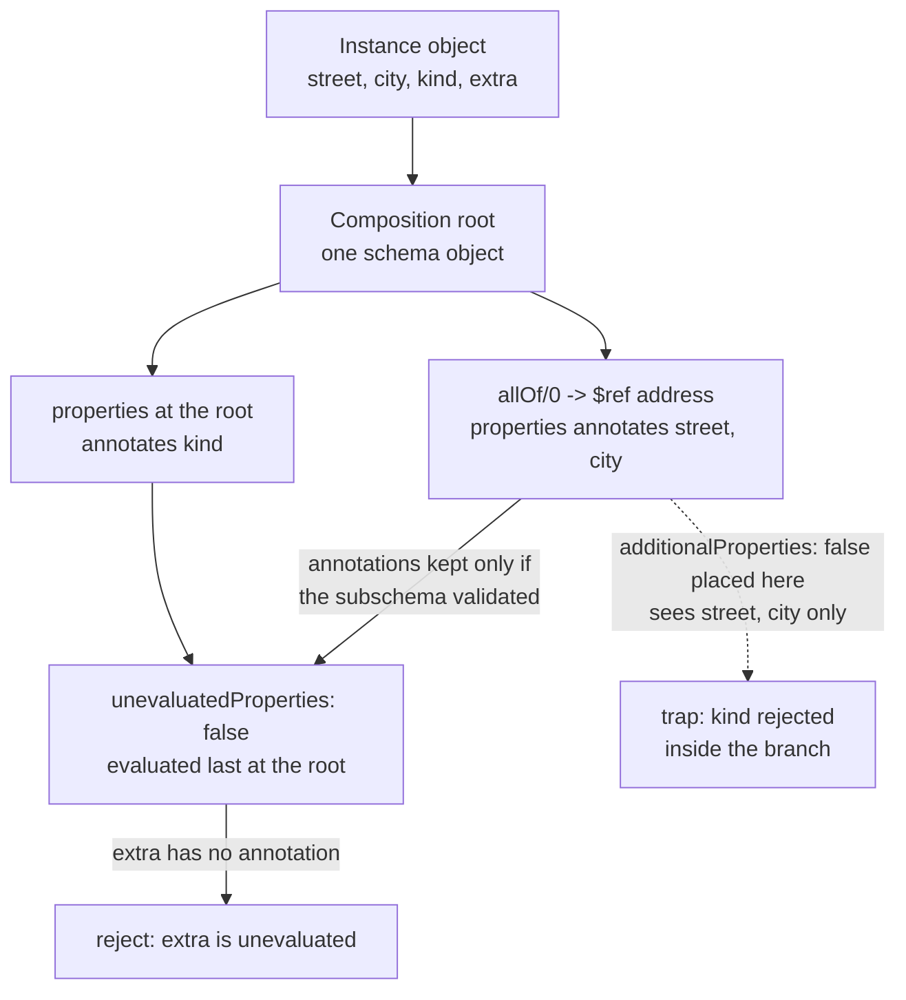

# JSON Schema Composition Traps: Why additionalProperties: false Breaks allOf and How unevaluatedProperties Fixes It

> [!summary] Claim
> `additionalProperties` sees only the `properties` and `patternProperties` of its own schema object, so two closed schemas combined with `allOf` reject every object that carries both property sets, while `unevaluatedProperties` (JSON Schema 2019-09 and later) reads the annotations of every successful adjacent subschema and closes the composed object exactly once.

Part of [OpenAPI JSON Schema and Contracts](README.md) in [API Engineering](../README.md).

## TL;DR

- Mechanism: `properties` and `patternProperties` annotate the instance property names they matched, `additionalProperties` consumes only the annotations produced inside its own schema object, and `unevaluatedProperties` consumes the annotations of every adjacent keyword plus every subschema reached through `allOf`, `anyOf`, `oneOf`, `if`, `then`, `else`, `dependentSchemas`, `$ref`, and `$dynamicRef` that validated successfully (JSON Schema 2020-12 Core Sections 10.3.2.3 and 11.3).
- Contract rule: publish open building blocks and close the composed object once, at the schema object that owns the composition, with `"unevaluatedProperties": false` next to `"type": "object"`.
- Trap: `{"allOf": [A, B]}` where `A` and `B` each carry `"additionalProperties": false` accepts `0` of the `16` property subsets in the lab, because each branch rejects the other branch's required names.
- Portability fact: the keyword exists only from draft 2019-09 on, so `Draft7Validator` (`jsonschema 4.26.0`) and `OAS30Validator` (`openapi-schema-validator 0.9.0`) skip it without any error and accept the extra property, while the 2019-09, 2020-12, OpenAPI 3.1, and OpenAPI 3.2 validators reject it.
- When not to use it: do not close response schemas that clients must tolerate growing, do not stack a closure on every inheritance layer (each layer multiplies evaluation work by about `2.62` in both pinned validators), and do not rely on it at all when any consumer still runs a draft-07 or OpenAPI 3.0 toolchain.

## Mental model



The instance enters the composition root, which applies its subschemas in place to the same object.
The `allOf` branch follows `$ref` to the address schema, whose `properties` keyword annotates `street` and `city`, and the root's own `properties` keyword annotates `kind`.
Those annotations travel up to the root only when the subschema that produced them validated, and `unevaluatedProperties` runs after every adjacent keyword, so it finds `street`, `city`, and `kind` evaluated and applies its `false` subschema to `extra` alone.
The dotted arrow is the trap: an `additionalProperties: false` placed inside the branch never receives the root's annotation for `kind`, so it rejects `kind` from inside the branch and nothing at the root can undo that failure.

## How it works

### Annotations are the only channel between keywords

JSON Schema keywords are assertions, annotations, or applicators, and they normally run independently of one another (JSON Schema 2020-12 Core Sections 7 and 10.1).
`properties` validates each named child and produces an annotation whose value is "the set of instance property names matched by this keyword", and `patternProperties` produces the same kind of set for names that match its regular expressions (JSON Schema 2020-12 Core Sections 10.3.2.1 and 10.3.2.2).
A schema object that produces a false assertion result "MUST NOT produce any annotation results, whether from their own keywords or from keywords in subschemas" (JSON Schema 2020-12 Core Section 7.7.1.2).
Applicators aggregate the annotations of their subschemas, including the target of a `$ref` (JSON Schema 2020-12 Core Sections 7.7.1.3 and 8.2.3.1).
Those four sentences are the whole mechanism: a property name is "evaluated" at an instance location when some successful schema object annotated it there.

`jsonschema-rs 0.60.3` exposes the annotations directly through `Validator.evaluate(instance).annotations()`.
For the lab's fixed schema and the object `{"street": "1 Main St", "city": "Leeds", "kind": "business"}` it returns the following units (captured on CPython `3.14.6`, simplified excerpt that drops the `null` `absoluteKeywordLocation` fields):

```json
[
  {"schemaLocation": "/properties", "instanceLocation": "", "annotations": ["kind"]},
  {"schemaLocation": "/$defs/address/properties", "instanceLocation": "", "annotations": ["city", "street"]}
]
```

Both units attach to instance location `""` (the root object), which is why a keyword at the root can use them.

### Why `additionalProperties` cannot see through `allOf`

The behavior of `additionalProperties` "depends on the presence and annotation results of `properties` and `patternProperties` within the same schema object", and it applies only to names that appear in neither of those two annotation results (JSON Schema 2020-12 Core Section 10.3.2.3).
"Within the same schema object" is a lexical scope of exactly one pair of braces.
In-place applicators such as `allOf` evaluate their subschemas "completely independently such that the results of one such subschema MUST NOT impact the results of sibling subschemas" (JSON Schema 2020-12 Core Section 10.2).

Take a closed schema `A` with declared names `P_A` and required names `R_A`, and a closed schema `B` with `P_B` and `R_B`.
`A` accepts a key set `K` only if `K` is a subset of `P_A`, and `B` accepts it only if `K` is a subset of `P_B`.
`{"allOf": [A, B]}` therefore accepts `K` only if `K` is a subset of the intersection of `P_A` and `P_B` and a superset of the union of `R_A` and `R_B`.
For the lab's address (`street`, `city` required) and kind (`kind` required) schemas the intersection is empty and the union has three names, so no object validates.
The lab enumerates all `2**4 = 16` subsets of `{street, city, kind, extra}` and `jsonschema 4.26.0` accepts none of them.
The full business address fails twice, once per branch:

- `allOf/0/additionalProperties`: `Additional properties are not allowed ('kind' was unexpected)`.
- `allOf/1/additionalProperties`: `Additional properties are not allowed ('city', 'street' were unexpected)`.

The blindness holds even one level up: `{"allOf": [{"properties": {"street": {"type": "string"}}}], "additionalProperties": false}` rejects `{"street": "x"}`, because the root object has no `properties` keyword of its own.
The specification lets implementations skip annotations for this keyword and check names directly, "such as by directly checking the names in `properties` and the patterns in `patternProperties` against the instance property set" (JSON Schema 2020-12 Core Section 10.3.2.3).
`jsonschema 4.26.0` does exactly that: it iterates the instance keys and skips those found in `schema.get("properties", {})` or matched by the `patternProperties` patterns joined with `|` (`jsonschema 4.26.0 jsonschema/_utils.py, find_additional_properties`).

### What `unevaluatedProperties` reads

`unevaluatedProperties` applies its subschema only to names "that do not appear in the `properties`, `patternProperties`, `additionalProperties`, or `unevaluatedProperties` annotation results that apply to the instance location being validated" (JSON Schema 2020-12 Core Section 11.3).
Those annotations may come from adjacent keywords, and they "can also result from any and all adjacent" in-place applicator keywords (JSON Schema 2020-12 Core Section 11.3).
Adjacent keywords "are keywords within the same schema object", and the dynamic-scope subschemas "include reference targets as well as lexical subschemas" (JSON Schema 2020-12 Core Section 11).
The keyword therefore has an ordering constraint that no other keyword has: `properties`, `patternProperties`, `additionalProperties`, "and all in-place applicators MUST be evaluated before this keyword can be evaluated" (JSON Schema 2020-12 Core Section 11.3).
It also annotates: its own result is "the set of instance property names validated by this keyword's subschema", which lets an outer `unevaluatedProperties` treat names admitted by an inner one as evaluated (JSON Schema 2020-12 Core Section 11.3).

The lab's `fixed_schema()` keeps the address open inside `$defs`, composes it with `allOf` and `$ref`, declares `kind` at the root, and closes the root once.
`jsonschema 4.26.0` accepts exactly `1` of the `16` subsets, `{street, city, kind}`, and rejects the four-property object with a single error at schema path `unevaluatedProperties`: `Unevaluated properties are not allowed ('extra' was unexpected)`.
Adding an optional `unit` property to the base schema changes nothing at the root, and `{..., "unit": "4B"}` validates, because the base's annotation now includes `unit`.

### Failed subschemas contribute nothing

The annotation-dropping rule decides every interesting case of `anyOf`, `oneOf`, `not`, and `if`.

- `anyOf`: "when annotations are being collected, all subschemas MUST be examined so that annotations are collected from each subschema that validates successfully" (JSON Schema 2020-12 Core Section 10.2.1.2).
  With two branches that declare `a` and `b`, the object `{"a": 1, "b": 2}` is valid because both branches pass and both annotate.
  The object `{"a": "x", "b": 2}` fails with `Unevaluated properties are not allowed ('a' was unexpected)`: branch `0` failed its `type` assertion, so its annotation for `a` was dropped, and only `b` is evaluated.
- `oneOf`: only the single passing branch contributes, and when two branches pass the `oneOf` assertion fails first, so the object is rejected by `oneOf` and no closure question arises (JSON Schema 2020-12 Core Section 10.2.1.3).
- `not`: a `not` subschema never contributes, because it either fails (no annotations) or passes and makes `not` fail (annotations dropped with the failing schema object), so `{"not": {"not": {"properties": {"street": true}}}, "unevaluatedProperties": false}` rejects `{"street": "x"}`.
- `if`, `then`, `else`: annotations are collected from `if` "in the usual way, including when the keyword is present without either `then` or `else`", and from whichever of `then` or `else` actually ran (JSON Schema 2020-12 Core Sections 10.2.2.1, 10.2.2.2, and 10.2.2.3).
  A `then` branch that declares `department` makes `department` legal only for objects that satisfy the `if`, which is how the lab admits `department` for `kind: business` and rejects it for `kind: residential`.
- `dependentSchemas`: a subschema contributes only when its trigger property is present in the instance (JSON Schema 2020-12 Core Section 10.2.2.4).

`required`, `propertyNames`, `minProperties`, and `maxProperties` never evaluate a name, because only `properties`, `patternProperties`, `additionalProperties`, and `unevaluatedProperties` produce the annotations this keyword reads (JSON Schema 2020-12 Core Section 11.1).

### Scope limits: cousins, closed bases, nested objects, saturation

`unevaluatedProperties` looks down into its own subschemas and never up or sideways.

- Cousins: in `{"allOf": [{"properties": {"street": ...}}, {"unevaluatedProperties": false}]}` the closure sits in a sibling branch of the declaration, so it sees no annotations and rejects `{"street": "x"}` at schema path `allOf/1/unevaluatedProperties`.
- Closed base: moving the closure into the shared base definition recreates the original trap with a newer keyword.
  A base `{"properties": {"street": ...}, "unevaluatedProperties": false}` referenced from `allOf` rejects the extension's `kind` at `allOf/0/unevaluatedProperties`, because the extension's `properties` keyword is the base's parent, not its subschema.
- Nested objects: annotations attach to an instance location, so closing the root says nothing about child objects.
  `{"properties": {"child": {"properties": {"x": true}}}, "unevaluatedProperties": false}` accepts `{"child": {"x": 1, "y": 2}}` and rejects `{"child": {"x": 1}, "y": 2}`.
- Saturation: `additionalProperties` annotates every name its subschema validated, so a base that declares `"additionalProperties": true` (or any permissive schema) marks every remaining name as evaluated and turns an outer `"unevaluatedProperties": false` into a no-op (JSON Schema 2020-12 Core Section 10.3.2.3).
- Non-objects: the keyword ignores instances that are not objects, so a closed schema still needs `"type": "object"` to reject a string or an array (`jsonschema 4.26.0 jsonschema/_keywords.py, unevaluatedProperties`).

### Dialects: where the keyword exists

`unevaluatedProperties` was added in draft 2019-09 as part of the applicator vocabulary (JSON Schema 2019-09 Core Section 9.3.2.4), after a proposal filed on 2018-03-04 that describes itself as "a distillation of the results of 230+ comments" on an earlier issue (`json-schema-org/json-schema-spec#556`).
Draft 2020-12 moved it into its own vocabulary, `https://json-schema.org/draft/2020-12/vocab/unevaluated`, which the default meta-schema requires through its `$vocabulary` entry `true` (JSON Schema 2020-12 Core Section 11; `https://json-schema.org/draft/2020-12/schema`).
The 2020-12 release notes give the reason: under 2019-09 the keywords "were expected to throw an error if not implemented", and a separate vocabulary allows "dialects to be constructed that don't require these keywords".
Draft-07 and earlier do not define the keyword, and draft-07 also states: "All other properties in a `$ref` object MUST be ignored" (JSON Schema draft-07 Core Section 8.3).
Draft 2019-09 reversed that rule and allowed keywords next to `$ref`, which is what makes `{"$ref": ..., "unevaluatedProperties": false}` meaningful (JSON Schema 2020-12 Core Section 8.2.3.1).

OpenAPI follows the same split.
The OpenAPI 3.0 Schema Object is "an extended subset of the JSON Schema Specification Draft Wright-00", lists `allOf` and `additionalProperties` among its adjusted keywords, and states that keywords "not mentioned here are strictly unsupported" (OpenAPI 3.0.4 Sections 4.7.24 and 4.7.24.1).
An OpenAPI 3.0 Reference Object "cannot be extended with additional properties, and any properties added SHALL be ignored" (OpenAPI 3.0.4 Section 4.7.23.1).
The OpenAPI 3.1 Schema Object is "a superset of the JSON Schema Specification Draft 2020-12" (OpenAPI 3.1.2 Section 4.8.24), and its dialect meta-schema `https://spec.openapis.org/oas/3.1/dialect/base` lists the unevaluated vocabulary with the value `true`.
In OpenAPI 3.0 the closed-composition problem has no in-language solution, and in OpenAPI 3.1 it does; see [[OpenAPI-3-1-Architecture-and-JSON-Schema-Alignment]] for the rest of that migration.

### How the pinned validators implement it

Neither pinned validator threads an annotation set through evaluation.
`jsonschema 4.26.0` recomputes the evaluated names every time it reaches the keyword, and `jsonschema-rs 0.60.3` recomputes them unless it can prove at compile time that the set does not depend on the instance.

In `jsonschema 4.26.0`, `Validator.iter_errors` and `Validator.descend` run each keyword function found in the class-level `VALIDATORS` table and skip any keyword that is not in the table, through the `if k in self.VALIDATORS` filter at the root and the `if validator is None: continue` branch in `descend` (`jsonschema 4.26.0 jsonschema/validators.py, create`).
The `unevaluatedProperties` keyword function calls `find_evaluated_property_keys_by_schema`, which walks the schema a second time (`jsonschema 4.26.0 jsonschema/_keywords.py, unevaluatedProperties`).
That walk follows `$ref` and `$dynamicRef`, takes `properties.keys() & instance.keys()`, adds every key whose value validates under an adjacent `additionalProperties` or `unevaluatedProperties` subschema, adds `patternProperties` matches, and recurses into `dependentSchemas`, `allOf`, `oneOf`, `anyOf`, `if`, `then`, and `else` (`jsonschema 4.26.0 jsonschema/_utils.py, find_evaluated_property_keys_by_schema`).
Before recursing into an `allOf`, `oneOf`, or `anyOf` subschema it re-validates the whole instance against that subschema with `is_valid(validator.descend(instance, subschema))`, which is how it drops the annotations of failed branches.
It re-validates the `if` subschema the same way, with `validator.evolve(schema=schema["if"]).is_valid(instance)`, to choose between `then` and `else`.
The `anyOf` keyword function itself stops at the first passing branch, and the second walk is what examines every branch as Section 10.2.1.2 requires (`jsonschema 4.26.0 jsonschema/_keywords.py, anyOf`).
`Draft201909Validator` does not share that walk: its table maps the keyword to `unevaluatedProperties_draft2019`, which calls a separate function of the same name in the legacy module (`jsonschema 4.26.0 jsonschema/_legacy_keywords.py, find_evaluated_property_keys_by_schema`).
The legacy walk still treats a non-boolean `additionalProperties` or `unevaluatedProperties` value as if it were a `properties` map and looks its keys up in the instance.
Under draft 2019-09 `{"additionalProperties": {"type": "string"}, "unevaluatedProperties": false}` therefore rejects `{"a": "x"}` with `Unevaluated properties are not allowed ('a' was unexpected)`, while `Draft202012Validator` accepts it and `jsonschema-rs 0.60.3` accepts it in both dialects.

`jsonschema-rs 0.60.3` compiles a `PropertyValidators` tree per `unevaluatedProperties` keyword at schema build time, holding the `properties` names in an `AHashSet<String>` and one `(SchemaNode, PropertyValidators)` pair per `allOf`, `anyOf`, and `oneOf` branch (`jsonschema-rs 0.60.3 crates/jsonschema/src/keywords/unevaluated_properties.rs, PropertyValidators`).
At validation time `mark_evaluated_properties_inner` calls `node.is_valid(instance, ctx)` for each branch and recurses into the branch's validators only when it passed, and for `oneOf` only when exactly one branch passed (`jsonschema-rs 0.60.3 crates/jsonschema/src/keywords/unevaluated_properties.rs, mark_evaluated_properties_inner`).
That walk is skipped when the evaluated set cannot depend on the instance: for a closure whose reachable in-place applicators are only `allOf` and `$ref`, `collect_static` folds every declared name and pattern into one `StaticEvaluated` set on first use, and `is_valid` checks each instance name against that set without re-validating a branch (`jsonschema-rs 0.60.3 crates/jsonschema/src/keywords/unevaluated_properties.rs, collect_static`).
`collect_static` gives up as soon as it meets `anyOf`, `oneOf`, `dependentSchemas`, `if`, `$dynamicRef`, `$recursiveRef`, or a nested `unevaluatedProperties`, and the error-reporting `validate` path also declines the static set when an `allOf` contributed to it, so those cases take the re-validating walk.

Re-validation has a cost that composes badly.
Let `S_0` be a leaf schema and `S_d = {"allOf": [S_(d-1)], "unevaluatedProperties": false}`.
Validating `S_d` costs `V(d) = V(d-1) + E(d)` leaf evaluations, where the evaluated-name walk costs `E(d) = V(d-1) + E(d-1)`, which solves to `V(d) = 3 * V(d-1) - V(d-2)`.
The lab counts the calls to the `properties` keyword function and measures `1, 2, 5, 13, 34, 89, 233, 610` for depths `0` to `7`, the odd-indexed Fibonacci numbers, with a growth factor that converges to `(3 + sqrt(5)) / 2`, about `2.62` per layer.
`jsonschema-rs 0.60.3` follows the same recurrence one step behind, because its static path removes the walk from the innermost closure: a counting `format` callback on the leaf property runs `1, 1, 3, 8, 21, 55, 144, 377` times under `is_valid` for depths `0` to `7`, the even-indexed Fibonacci numbers from depth `1` on, and `46368` times at depth `12`, where `jsonschema 4.26.0` makes `75025` keyword calls.
A flat schema costs `1` call, and one closure over eight open `allOf` branches costs `16` in `jsonschema 4.26.0`, twice the branch count, and `8` in `jsonschema-rs 0.60.3`, which takes the static path.
The lab's `evaluate` function shows the alternative design: it returns the verdict and the evaluated set together, so each subschema is visited once.

Draft-07 and older validator classes are built with `applicable_validators=_legacy_keywords.ignore_ref_siblings`, which returns only the `$ref` pair when a schema object contains `$ref` (`jsonschema 4.26.0 jsonschema/_legacy_keywords.py, ignore_ref_siblings`).
Their `VALIDATORS` tables have no `unevaluatedProperties` entry, so the keyword is skipped by the same filter and no error or warning is produced (`jsonschema 4.26.0 jsonschema/validators.py, create`).
`validator_for` picks the class from the `$schema` value and falls back to `Draft202012Validator` when `$schema` is absent (`jsonschema 4.26.0 jsonschema/validators.py, validator_for`).
`OAS30Validator` is created from a keyword table that contains `additionalProperties` and `allOf` and no unevaluated keyword, while `OAS31Validator` extends `Draft202012Validator` and `OAS32Validator` extends `OAS31Validator` (`openapi-schema-validator 0.9.0 openapi_schema_validator/validators.py, OAS30_VALIDATORS`).
`OAS30Validator` is built by `create` without an `applicable_validators` argument, so it keeps the default that applies every keyword of a schema object, including the siblings of `$ref` (`openapi-schema-validator 0.9.0 openapi_schema_validator/validators.py, _build_oas30_validator`).
Under it `{"$ref": "#/definitions/a", "additionalProperties": false}` rejects `{"x": 1}` exactly as under `Draft202012Validator`, which is not the Reference Object rule of OpenAPI 3.0.4 Section 4.7.23.1.

### What code-first stacks emit

Pydantic maps `ConfigDict(extra="forbid")` to `"additionalProperties": false` and `extra="allow"` to `"additionalProperties": true` on the generated object schema (`pydantic 2.14.3 pydantic/json_schema.py, GenerateJsonSchema._update_class_schema`).
Python inheritance does not become `allOf`: a subclass's JSON Schema lists the inherited fields and its own fields in one `properties` object.
The lab's `BusinessAddress(Address)` therefore publishes one flat closed object in the OpenAPI `3.1.0` document that `fastapi 0.162.0` generates, with no `allOf`, and the trap cannot occur in that output.
The trap appears when a hand-written or design-first document composes closed component schemas with `allOf`; for the generator side of that workflow see [[Generating-Pydantic-v2-Models-from-OpenAPI-with-Datamodel-Code-Generator]] and [[JSON-Schema-Generation-Internals-and-GenerateJsonSchema]].

## Numbers and limits

All lab and ad hoc measurements were re-run during verification on an Apple M3 Pro (12 cores), macOS `27.3` (`uname -r` `27.3.0`), CPython `3.14.6`, in the locked environment of `labs/`, and every count below reproduced (as of 2026-11).
Wall-clock latency is not tabulated: timings did not reproduce between runs on this machine under load, and the deterministic evaluation counts below carry the cost claim.

| Metric or parameter | Value | Source or measurement condition |
|---|---|---|
| Property subsets enumerated per schema | `16` (`2**4`) | Lab `key_subsets(SAMPLE)`, asserted in `test_allof_of_two_closed_schemas_accepts_no_object` |
| Subsets accepted by `allOf` of two closed schemas | `0` of `16` | Lab `accepted_key_sets(trap_schema(), SAMPLE)`, `jsonschema 4.26.0` and `jsonschema-rs 0.60.3` |
| Subsets accepted by the `unevaluatedProperties` fix | `1` of `16` | Lab `accepted_key_sets(fixed_schema(), SAMPLE)` |
| Subsets accepted when the same fix declares draft-07 | `2` of `16` (the extra property passes) | Lab `accepted_key_sets(fixed_schema(DRAFT_07), SAMPLE)` |
| `properties` keyword calls for closure depth `0..7` | `1, 2, 5, 13, 34, 89, 233, 610` | Lab `count_keyword_calls(closure_chain(depth), {"a": 1})` on `jsonschema 4.26.0` |
| `properties` keyword calls at closure depth `12` | `75025` | Same function, run once outside the test suite |
| Growth per closure layer | `(3 + sqrt(5)) / 2`, about `2.62` | Recurrence `V(d) = 3 * V(d-1) - V(d-2)`, asserted in the lab for depths `2..7` |
| `properties` keyword calls, one closure over `8` open `allOf` branches | `16` | Lab `test_nested_closures_cost_odd_fibonacci_keyword_calls` |
| Lab `evaluate` invocations at closure depth `12` | `14` (`depth + 2`) | Ad hoc call counter around `evaluate`, one run |
| Leaf evaluations in `jsonschema-rs 0.60.3` for closure depth `0..7` | `1, 1, 3, 8, 21, 55, 144, 377` | Ad hoc script, one run: the `closure_chain` shape with leaf `{"type": "string", "format": "probe"}`, counting calls of a `formats={"probe": ...}` callback under `is_valid({"a": "x"})` with `validate_formats=True` |
| Leaf evaluations in `jsonschema-rs 0.60.3` at closure depth `12` | `46368` | Same script and run |
| Leaf evaluations in `jsonschema-rs 0.60.3`, one closure over `8` open `allOf` branches | `8` (static path, no re-validation) | Same script and run |
| Official `unevaluatedProperties.json` suite for draft 2020-12 | `44` groups, `129` tests | JSON-Schema-Test-Suite commit `55719286` dated 2026-10-14 |
| Suite tests passed by the pinned validators | `129` of `129` each | Ad hoc run against `Draft202012Validator` (`jsonschema 4.26.0`) and `jsonschema-rs 0.60.3` |
| Official `unevaluatedProperties.json` suite for draft 2019-09 | `Draft201909Validator` passes `128` of `129`, `jsonschema-rs 0.60.3` passes `129` of `129` | Same commit and ad hoc run; the failing test is "unevaluatedProperties with adjacent non-bool additionalProperties", case "with additional properties" |
| Suite tests passed by the lab `evaluate` reference | `112` of `112` in the `38` groups that use only its keyword subset | Same ad hoc run; `6` groups use keywords it does not implement |
| Differential comparisons in the lab | `480` (`12` schemas x `40` objects), three engines agree on all | Lab `test_reference_evaluator_agrees_with_python_and_rust_validators` |
| Proposal that introduced the keyword | Opened 2018-03-04, closed 2018-11-12 | `json-schema-org/json-schema-spec#556` |
| `jsonschema` release that fixed evaluated-name calculation next to non-boolean `additionalProperties` | `4.24.0` | `jsonschema 4.26.0 CHANGELOG.rst`, pull request `#1351` (opened 2025-04-24, merged 2025-05-26) |

## Portability

| Runtime or component | Behavior | Verification |
|---|---|---|
| CPython `3.12.13` | `9 passed` | `UV_PROJECT_ENVIRONMENT=../tmp_venv_3.12 uv run --frozen --python 3.12 pytest <test> -q`, full locked environment (`3.12.16` from the matrix was not available here), drafter's run on macOS `27.2`, not re-run in verification (lab matrix paused 2026-11-11) |
| CPython `3.13.18` | `9 passed` | Same command with `--python 3.13`, full locked environment, drafter's run on macOS `27.2`, not re-run in verification (lab matrix paused 2026-11-11) |
| CPython `3.14.6` and `3.14.10` | `9 passed` on each | `uv run --frozen pytest <test> -q` on `3.14.6` (workspace interpreter, re-run in verification on macOS `27.3`) and the same command with `--python /opt/homebrew/bin/python3.14` on `3.14.10` (drafter's run, not re-run) |
| CPython `3.15.2` | `9 passed` | `uv run --frozen --python /opt/homebrew/bin/python3.15 pytest <test> -q`, full locked environment, drafter's run on macOS `27.2`, not re-run in verification (lab matrix paused 2026-11-11) |
| CPython `3.15.0b3` | `9 passed` with a minimal pinned set; the full locked environment fails before collection with `ModuleNotFoundError: No module named 'hypothesis._native'` | `uv run --no-project --python 3.15 --with jsonschema==4.26.0 --with jsonschema-rs==0.60.3 ... python -m pytest <test> -q`, drafter's run on macOS `27.2`, not re-run in verification (lab matrix paused 2026-11-11) |
| Free-threaded CPython `3.15.0b3t` and `3.14.6t` | `9 passed` on each with `sys._is_gil_enabled()` staying `False` after importing `jsonschema`, `rpds`, `pydantic_core`, and `jsonschema_rs` | Same minimal pinned set with `--python 3.15t` and `--python 3.14t` (`3.15.2t` from the matrix was not available; the full environment cannot install `psycopg-binary 3.3.8` on `3.15t`), drafter's run on macOS `27.2`, not re-run in verification (lab matrix paused 2026-11-11) |
| Draft-07 and older (`Draft7Validator`, `jsonschema 4.26.0`) | `unevaluatedProperties` skipped, siblings of `$ref` ignored, object stays open | Lab `test_older_dialects_silently_ignore_unevaluated_properties`; JSON Schema draft-07 Core Section 8.3 |
| Draft 2019-09 (`Draft201909Validator`) | Keyword enforced as part of the applicator vocabulary; names admitted by an adjacent non-boolean `additionalProperties` are wrongly reported as unevaluated in `jsonschema 4.26.0` | Lab, same test; JSON Schema 2019-09 Core Section 9.3.2.4; official 2019-09 suite, `128` of `129` |
| Draft 2020-12 (`Draft202012Validator`, `jsonschema-rs 0.60.3`) | Keyword enforced as its own vocabulary | Lab; JSON Schema 2020-12 Core Section 11.3 |
| OpenAPI 3.0 (`OAS30Validator`, `openapi-schema-validator 0.9.0`) | Keyword skipped, object stays open; siblings of `$ref` are applied, not ignored | Lab, same test; OpenAPI 3.0.4 Sections 4.7.23.1 and 4.7.24.1; `$ref` sibling behavior from one ad hoc run |
| OpenAPI 3.1 and 3.2 (`OAS31Validator`, `OAS32Validator`) | Keyword enforced | Lab, same test; OpenAPI 3.1.2 Section 4.8.24 |
| `jsonschema` point releases | Evaluated names wrong next to non-boolean `additionalProperties` before `4.24.0` for draft 2020-12 and still wrong in `4.26.0` for draft 2019-09, and wrong behind `$dynamicRef` before `4.20.0` | `jsonschema 4.26.0 CHANGELOG.rst`; `4.26.0` run here, older releases were not |
| `pydantic 2.14.3` with `fastapi 0.162.0` | Inheritance flattens to one closed object, document version `3.1.0` | Lab `test_pydantic_inheritance_publishes_one_flat_closed_object` |
| Kubernetes CustomResourceDefinition schemas | `additionalProperties` "cannot be set to false", is mutually exclusive with `properties`, and may not appear inside `allOf`, `anyOf`, `oneOf`, or `not` | Kubernetes documentation, "Validation" for the first two rules and "Specifying a structural schema" for the third (as of 2026-11) |
| ASGI servers (Uvicorn, Hypercorn, Granian) and HTTP/1.1, HTTP/2, HTTP/3 | Not exercised: schema evaluation operates on the parsed instance data model, after the transport has delivered the body | JSON Schema 2020-12 Core Section 4.2.1; the lab uses in-process `httpx.ASGITransport` only |
| Debian Trixie and Alpine musl containers | Not run for this note | No container leg was available in this environment |

## Worked example

The lab [implementation](../labs/src/api_labs/f08_openapi_json_schema_and_contracts/closed_composition.py) and [test](../labs/tests/f08_openapi_json_schema_and_contracts/test_json_schema_composition_allof_anyof_oneof_and_unevaluatedproperties.py) build the trap, the fix, and the draft-07 workaround, enumerate every property subset against three engines, implement the annotation rules in a reference evaluator, count the cost of nested closures, and check what FastAPI publishes for an inherited closed model.

### Implementation (`labs/src/api_labs/f08_openapi_json_schema_and_contracts/closed_composition.py`)

```python
"""Closed-object composition: additionalProperties vs unevaluatedProperties (2020-12)."""

from __future__ import annotations

import itertools
import re
from dataclasses import dataclass
from typing import TYPE_CHECKING, Any, Literal, cast

from fastapi import FastAPI
from jsonschema import Draft202012Validator, validators  # type: ignore[import-untyped]
from pydantic import BaseModel, ConfigDict

if TYPE_CHECKING:
    from collections.abc import Iterator, Mapping

type Schema = dict[str, Any] | bool

DRAFT_2020_12 = "https://json-schema.org/draft/2020-12/schema"
DRAFT_07 = "http://json-schema.org/draft-07/schema#"
SAMPLE: dict[str, Any] = {"street": "1 Main St", "city": "Leeds", "kind": "business", "extra": 1}
_JSONSCHEMA: Any = validators  # jsonschema 4.26.0 ships no py.typed marker


def address_schema(*, closed: bool) -> dict[str, Any]:
    """Base object schema; closed=True adds the keyword that only sees its own schema object."""
    schema: dict[str, Any] = {
        "type": "object",
        "properties": {"street": {"type": "string"}, "city": {"type": "string"}},
        "required": ["street", "city"],
    }
    if closed:
        schema["additionalProperties"] = False
    return schema


def kind_schema(*, closed: bool) -> dict[str, Any]:
    """Extension object schema that adds the kind property."""
    schema: dict[str, Any] = {
        "type": "object",
        "properties": {"kind": {"enum": ["residential", "business"]}},
        "required": ["kind"],
    }
    if closed:
        schema["additionalProperties"] = False
    return schema


def trap_schema() -> dict[str, Any]:
    """Two individually closed schemas under allOf: no object can satisfy both."""
    return {
        "$schema": DRAFT_2020_12,
        "allOf": [address_schema(closed=True), kind_schema(closed=True)],
    }


def fixed_schema(dialect: str = DRAFT_2020_12) -> dict[str, Any]:
    """Open building blocks, closed once at the composition root by unevaluatedProperties."""
    return {
        "$schema": dialect,
        "$defs": {"address": address_schema(closed=False)},
        "allOf": [{"$ref": "#/$defs/address"}],
        **kind_schema(closed=False),
        "unevaluatedProperties": False,
    }


def redeclared_schema() -> dict[str, Any]:
    """Draft-07 compatible workaround: redeclare inherited names beside additionalProperties."""
    return {
        "$schema": DRAFT_07,
        "allOf": [address_schema(closed=False)],
        "type": "object",
        "properties": {"street": True, "city": True, "kind": {"enum": ["residential", "business"]}},
        "required": ["kind"],
        "additionalProperties": False,
    }


def closure_chain(depth: int) -> dict[str, Any]:
    """Wrap one leaf schema in depth layers of allOf, each layer closing itself again."""
    schema: dict[str, Any] = {"properties": {"a": {"type": "integer"}}}
    for _ in range(depth):
        schema = {"allOf": [schema], "unevaluatedProperties": False}
    return schema


@dataclass(frozen=True, slots=True)
class Violation:
    """One jsonschema error reduced to the fields a contract test asserts on."""

    keyword: str
    schema_path: tuple[str | int, ...]
    message: str


def violations(schema: Schema, instance: Any, validator_cls: Any = None) -> list[Violation]:
    """Validate with jsonschema; the class defaults to the one that $schema selects."""
    cls = _JSONSCHEMA.validator_for(schema) if validator_cls is None else validator_cls
    found = [
        Violation(str(error.validator), tuple(error.absolute_schema_path), str(error.message))
        for error in cls(schema).iter_errors(instance)
    ]
    return sorted(found, key=lambda item: (item.keyword, [str(part) for part in item.schema_path]))


def key_subsets(sample: Mapping[str, Any]) -> Iterator[dict[str, Any]]:
    """Yield every object that keeps a subset of the sample's properties (2**n objects)."""
    names = list(sample)
    for size in range(len(names) + 1):
        for chosen in itertools.combinations(names, size):
            yield {name: sample[name] for name in chosen}


def accepted_key_sets(schema: Schema, sample: Mapping[str, Any]) -> set[frozenset[str]]:
    """Exhaustively list the property-name sets that the schema accepts."""
    return {frozenset(obj) for obj in key_subsets(sample) if not violations(schema, obj)}


@dataclass(frozen=True, slots=True)
class Outcome:
    """Assertion result plus the property names annotated as evaluated at this location."""

    valid: bool
    evaluated: frozenset[str] = frozenset()


def _same(left: object, right: object) -> bool:
    return type(left) is type(right) and left == right


def _has_type(instance: object, name: str) -> bool:
    if name == "integer":
        return isinstance(instance, int) and not isinstance(instance, bool)
    kinds: dict[str, type] = {"object": dict, "string": str, "boolean": bool, "array": list}
    return isinstance(instance, kinds[name])


def evaluate(schema: Schema, instance: object, root: Schema | None = None) -> Outcome:
    """Reference evaluator for the closed-object keyword subset, following annotation rules."""
    root = schema if root is None else root
    if isinstance(schema, bool):
        return Outcome(schema)  # boolean schemas never produce annotations
    seen: set[str] = set()

    def in_place(subschema: Schema) -> bool:
        result = evaluate(subschema, instance, root)
        seen.update(result.evaluated)  # a failed subschema returns no annotations
        return result.valid

    checks: list[bool] = []
    if "$ref" in schema:
        target = cast("dict[str, Any]", root)["$defs"][schema["$ref"].removeprefix("#/$defs/")]
        checks.append(in_place(target))
    if "type" in schema:
        checks.append(_has_type(instance, schema["type"]))
    if "const" in schema:
        checks.append(_same(instance, schema["const"]))
    if "enum" in schema:
        checks.append(any(_same(instance, option) for option in schema["enum"]))
    if "allOf" in schema:
        checks.append(all([in_place(sub) for sub in schema["allOf"]]))
    if "anyOf" in schema:
        checks.append(any([in_place(sub) for sub in schema["anyOf"]]))  # examine every branch
    if "oneOf" in schema:
        passing = [r for sub in schema["oneOf"] if (r := evaluate(sub, instance, root)).valid]
        checks.append(len(passing) == 1)
        seen.update(passing[0].evaluated if len(passing) == 1 else ())
    if "not" in schema:
        checks.append(not evaluate(schema["not"], instance, root).valid)  # annotations discarded
    if "if" in schema:
        branch = schema.get("then" if in_place(schema["if"]) else "else", True)
        checks.append(in_place(branch))
    if isinstance(instance, dict):
        obj = cast("dict[str, Any]", instance)
        checks.append(all(name in obj for name in schema.get("required", ())))
        for name, sub in schema.get("dependentSchemas", {}).items():
            if name in obj:
                checks.append(in_place(sub))
        local: set[str] = set()  # annotations of properties and patternProperties in THIS object
        for name, sub in schema.get("properties", {}).items():
            if name in obj:
                local.add(name)
                checks.append(evaluate(sub, obj[name], root).valid)
        for pattern, sub in schema.get("patternProperties", {}).items():
            for name in obj:
                if re.search(pattern, name):
                    local.add(name)
                    checks.append(evaluate(sub, obj[name], root).valid)
        seen |= local
        if "additionalProperties" in schema:
            for name in obj.keys() - local:  # blind to allOf, $ref, and every other subschema
                checks.append(evaluate(schema["additionalProperties"], obj[name], root).valid)
                seen.add(name)
        if "unevaluatedProperties" in schema:
            for name in obj.keys() - seen:  # sees every successful in-place subschema above
                checks.append(evaluate(schema["unevaluatedProperties"], obj[name], root).valid)
                seen.add(name)
    return Outcome(True, frozenset(seen)) if all(checks) else Outcome(False)


def count_keyword_calls(schema: Schema, instance: Any, keyword: str = "properties") -> int:
    """Count how often jsonschema runs one keyword function while validating the instance."""
    original: Any = Draft202012Validator.VALIDATORS[keyword]
    calls = 0

    def counting(validator: Any, value: Any, target: Any, parent: Any) -> Iterator[Any]:
        nonlocal calls
        calls += 1
        yield from original(validator, value, target, parent)

    counting_cls = _JSONSCHEMA.extend(Draft202012Validator, {keyword: counting})
    list(counting_cls(schema).iter_errors(instance))
    return calls


class Address(BaseModel):
    """Closed write model: extra='forbid' compiles to additionalProperties: false."""

    model_config = ConfigDict(extra="forbid")

    street: str
    city: str


class BusinessAddress(Address):
    """Python inheritance flattens into one schema object, so no allOf is emitted."""

    kind: Literal["residential", "business"]


def build_address_app() -> FastAPI:
    """ASGI app whose OpenAPI document publishes the flattened closed schema."""
    app = FastAPI()

    @app.post("/addresses")
    async def create_address(address: BusinessAddress) -> BusinessAddress:
        return address

    return app
```

### Test suite (`labs/tests/f08_openapi_json_schema_and_contracts/test_json_schema_composition_allof_anyof_oneof_and_unevaluatedproperties.py`)

```python
"""Tests for closed-object composition: additionalProperties vs unevaluatedProperties."""

from __future__ import annotations

from typing import Any

import httpx
import jsonschema_rs
import pytest
from jsonschema import (  # type: ignore[import-untyped]
    Draft7Validator,
    Draft201909Validator,
    Draft202012Validator,
    validators,
)
from openapi_schema_validator import OAS30Validator, OAS31Validator, OAS32Validator

from api_labs.f08_openapi_json_schema_and_contracts.closed_composition import (
    DRAFT_07,
    DRAFT_2020_12,
    SAMPLE,
    Outcome,
    Violation,
    accepted_key_sets,
    address_schema,
    build_address_app,
    closure_chain,
    count_keyword_calls,
    evaluate,
    fixed_schema,
    key_subsets,
    redeclared_schema,
    trap_schema,
    violations,
)

FULL = frozenset({"street", "city", "kind"})
WITH_EXTRA = FULL | {"extra"}
BUSINESS = {"street": "1 Main St", "city": "Leeds", "kind": "business"}
JSONSCHEMA: Any = validators

BRANCHES: dict[str, Any] = {
    "$schema": DRAFT_2020_12,
    "anyOf": [
        {"properties": {"a": {"type": "integer"}}, "required": ["a"]},
        {"properties": {"b": {"type": "integer"}}, "required": ["b"]},
    ],
    "unevaluatedProperties": False,
}
ONE_OF: dict[str, Any] = {
    "$schema": DRAFT_2020_12,
    "oneOf": [
        {"properties": {"a": {"type": "integer"}}, "required": ["a"]},
        {"properties": {"b": {"type": "integer"}}, "required": ["b"]},
    ],
    "unevaluatedProperties": False,
}
CONDITIONAL: dict[str, Any] = {
    "$schema": DRAFT_2020_12,
    "type": "object",
    "properties": {"kind": {"enum": ["residential", "business"]}},
    "required": ["kind"],
    "if": {"properties": {"kind": {"const": "business"}}, "required": ["kind"]},
    "then": {"properties": {"department": {"type": "string"}}},
    "unevaluatedProperties": False,
}
COUSINS: dict[str, Any] = {
    "$schema": DRAFT_2020_12,
    "allOf": [{"properties": {"street": {"type": "string"}}}, {"unevaluatedProperties": False}],
}
BLIND: dict[str, Any] = {
    "$schema": DRAFT_2020_12,
    "allOf": [{"properties": {"street": {"type": "string"}}}],
    "additionalProperties": False,
}
CLOSED_BASE: dict[str, Any] = {
    "$schema": DRAFT_2020_12,
    "$defs": {
        "base": {"properties": {"street": {"type": "string"}}, "unevaluatedProperties": False}
    },
    "allOf": [{"$ref": "#/$defs/base"}],
    "properties": {"kind": {"type": "string"}},
}
REF_SIBLING: dict[str, Any] = {
    "definitions": {"a": {"properties": {"x": {}}}},
    "$ref": "#/definitions/a",
    "additionalProperties": False,
}
DOUBLE_NEGATION: dict[str, Any] = {
    "$schema": DRAFT_2020_12,
    "not": {"not": {"properties": {"street": True}}},
    "unevaluatedProperties": False,
}
OPEN_BASE: dict[str, Any] = {
    "$schema": DRAFT_2020_12,
    "allOf": [{"properties": {"street": True}, "additionalProperties": True}],
    "unevaluatedProperties": False,
}
NESTED: dict[str, Any] = {
    "$schema": DRAFT_2020_12,
    "properties": {"child": {"properties": {"x": True}}},
    "unevaluatedProperties": False,
}
DEPENDENT: dict[str, Any] = {
    "$schema": DRAFT_2020_12,
    "dependentSchemas": {"kind": {"properties": {"city": True}}},
    "patternProperties": {"^str": {"type": "string"}},
    "unevaluatedProperties": False,
}


def rust_accepts(schema: dict[str, Any], instance: object) -> bool:
    return jsonschema_rs.validator_for(schema).is_valid(instance)


@pytest.mark.unit
def test_allof_of_two_closed_schemas_accepts_no_object() -> None:
    assert accepted_key_sets(address_schema(closed=True), SAMPLE) == {frozenset({"street", "city"})}
    assert len(list(key_subsets(SAMPLE))) == 16
    assert accepted_key_sets(trap_schema(), SAMPLE) == set()
    assert violations(trap_schema(), BUSINESS) == [
        Violation(
            "additionalProperties",
            ("allOf", 0, "additionalProperties"),
            "Additional properties are not allowed ('kind' was unexpected)",
        ),
        Violation(
            "additionalProperties",
            ("allOf", 1, "additionalProperties"),
            "Additional properties are not allowed ('city', 'street' were unexpected)",
        ),
    ]
    assert not any(rust_accepts(trap_schema(), obj) for obj in key_subsets(SAMPLE))


@pytest.mark.unit
def test_unevaluated_properties_closes_the_composition_once() -> None:
    assert accepted_key_sets(fixed_schema(), SAMPLE) == {FULL}
    assert violations(fixed_schema(), SAMPLE) == [
        Violation(
            "unevaluatedProperties",
            ("unevaluatedProperties",),
            "Unevaluated properties are not allowed ('extra' was unexpected)",
        )
    ]
    assert [obj for obj in key_subsets(SAMPLE) if rust_accepts(fixed_schema(), obj)] == [BUSINESS]

    grown = fixed_schema()
    grown["$defs"]["address"]["properties"]["unit"] = {"type": "string"}
    assert violations(grown, {**BUSINESS, "unit": "4B"}) == []


@pytest.mark.unit
def test_redeclaring_names_works_on_draft_07_but_drifts_from_the_base() -> None:
    schema = redeclared_schema()
    assert JSONSCHEMA.validator_for(schema) is Draft7Validator
    assert accepted_key_sets(schema, SAMPLE) == {FULL}

    schema["allOf"][0]["properties"]["unit"] = {"type": "string"}
    assert (
        violations(schema["allOf"][0], {"street": "1 Main St", "city": "Leeds", "unit": "4B"}) == []
    )
    assert violations(schema, {**BUSINESS, "unit": "4B"}) == [
        Violation(
            "additionalProperties",
            ("additionalProperties",),
            "Additional properties are not allowed ('unit' was unexpected)",
        )
    ]


@pytest.mark.unit
def test_older_dialects_silently_ignore_unevaluated_properties() -> None:
    downgraded = fixed_schema(DRAFT_07)
    assert JSONSCHEMA.validator_for(downgraded) is Draft7Validator
    Draft7Validator.check_schema(downgraded)
    assert "unevaluatedProperties" not in Draft7Validator.VALIDATORS
    assert accepted_key_sets(downgraded, SAMPLE) == {FULL, WITH_EXTRA}

    component = {key: value for key, value in fixed_schema().items() if key != "$schema"}
    accepted = {
        cls: {frozenset(obj) for obj in key_subsets(SAMPLE) if not violations(component, obj, cls)}
        for cls in (
            OAS30Validator,
            OAS31Validator,
            OAS32Validator,
            Draft201909Validator,
            Draft202012Validator,
        )
    }
    assert violations(REF_SIBLING, {"x": 1, "y": 2}, Draft7Validator) == []
    closed_everything = violations(REF_SIBLING, {"x": 1}, Draft202012Validator)
    assert [error.keyword for error in closed_everything] == ["additionalProperties"]

    assert accepted[OAS30Validator] == {FULL, WITH_EXTRA}
    assert "unevaluatedProperties" not in OAS30Validator.VALIDATORS
    assert accepted[OAS31Validator] == {FULL}
    assert accepted[OAS32Validator] == {FULL}
    assert accepted[Draft201909Validator] == {FULL}
    assert accepted[Draft202012Validator] == {FULL}


@pytest.mark.unit
def test_failed_branches_contribute_no_evaluated_names() -> None:
    assert violations(BRANCHES, {"a": 1, "b": 2}) == []
    assert violations(BRANCHES, {"a": "x", "b": 2}) == [
        Violation(
            "unevaluatedProperties",
            ("unevaluatedProperties",),
            "Unevaluated properties are not allowed ('a' was unexpected)",
        )
    ]
    assert evaluate(BRANCHES, {"a": 1, "b": 2}) == Outcome(True, frozenset({"a", "b"}))
    assert evaluate(BRANCHES, {"a": "x", "b": 2}) == Outcome(False)
    assert evaluate(BRANCHES["anyOf"][1], {"a": "x", "b": 2}) == Outcome(True, frozenset({"b"}))

    assert [error.keyword for error in violations(ONE_OF, {"a": 1, "b": 2})] == ["oneOf"]
    assert violations(ONE_OF, {"a": 1}) == []

    assert violations(CONDITIONAL, {"kind": "business", "department": "HR"}) == []
    assert [
        error.message
        for error in violations(CONDITIONAL, {"kind": "residential", "department": "HR"})
    ] == ["Unevaluated properties are not allowed ('department' was unexpected)"]

    assert (
        violations(
            {"properties": {"street": True}, "unevaluatedProperties": False}, {"street": "x"}
        )
        == []
    )
    assert [error.keyword for error in violations(DOUBLE_NEGATION, {"street": "x"})] == [
        "unevaluatedProperties"
    ]


@pytest.mark.unit
def test_closure_reaches_adjacent_subschemas_only() -> None:
    assert violations(BLIND, {"street": "x"}) == [
        Violation(
            "additionalProperties",
            ("additionalProperties",),
            "Additional properties are not allowed ('street' was unexpected)",
        )
    ]
    assert violations(COUSINS, {"street": "x"}) == [
        Violation(
            "unevaluatedProperties",
            ("allOf", 1, "unevaluatedProperties"),
            "Unevaluated properties are not allowed ('street' was unexpected)",
        )
    ]
    assert rust_accepts(COUSINS, {"street": "x"}) is False
    assert violations(CLOSED_BASE, {"street": "x", "kind": "business"}) == [
        Violation(
            "unevaluatedProperties",
            ("allOf", 0, "unevaluatedProperties"),
            "Unevaluated properties are not allowed ('kind' was unexpected)",
        )
    ]

    assert violations(OPEN_BASE, {"street": "x", "anything": 1}) == []
    assert rust_accepts(OPEN_BASE, {"street": "x", "anything": 1}) is True
    assert evaluate(OPEN_BASE, {"street": "x", "anything": 1}).evaluated == {"street", "anything"}

    assert violations(NESTED, {"child": {"x": 1, "y": 2}}) == []
    assert [error.message for error in violations(NESTED, {"child": {"x": 1}, "y": 2})] == [
        "Unevaluated properties are not allowed ('y' was unexpected)"
    ]


@pytest.mark.unit
def test_reference_evaluator_agrees_with_python_and_rust_validators() -> None:
    corpus: list[dict[str, Any]] = [
        trap_schema(),
        fixed_schema(),
        BRANCHES,
        ONE_OF,
        CONDITIONAL,
        COUSINS,
        CLOSED_BASE,
        BLIND,
        DOUBLE_NEGATION,
        OPEN_BASE,
        DEPENDENT,
        {"$schema": DRAFT_2020_12, **closure_chain(3)},
    ]
    samples: list[dict[str, Any]] = [
        SAMPLE,
        {"a": 1, "b": 2, "street": "x"},
        {"a": "x", "b": 2},
        {"kind": "business", "department": "HR", "city": "Leeds"},
        {"kind": "residential", "department": "HR"},
    ]
    compared = 0
    verdicts: set[bool] = set()
    for schema in corpus:
        for sample in samples:
            for obj in key_subsets(sample):
                expected = not violations(schema, obj)
                assert evaluate(schema, obj).valid is expected, (schema, obj)
                assert rust_accepts(schema, obj) is expected, (schema, obj)
                compared += 1
                verdicts.add(expected)
    assert compared == 12 * (16 + 8 + 4 + 8 + 4)
    assert verdicts == {True, False}

    assert evaluate(fixed_schema(), BUSINESS) == Outcome(True, FULL)
    annotated: dict[str, list[str]] = {}
    for entry in jsonschema_rs.validator_for(fixed_schema()).evaluate(BUSINESS).annotations():
        names = entry["annotations"]
        if entry["instanceLocation"] == "" and isinstance(names, list):
            annotated[entry["schemaLocation"]] = sorted(str(name) for name in names)
    assert annotated == {"/properties": ["kind"], "/$defs/address/properties": ["city", "street"]}
    assert evaluate(address_schema(closed=True), BUSINESS) == Outcome(False)


@pytest.mark.unit
def test_nested_closures_cost_odd_fibonacci_keyword_calls() -> None:
    calls = [count_keyword_calls(closure_chain(depth), {"a": 1}) for depth in range(8)]
    assert calls == [1, 2, 5, 13, 34, 89, 233, 610]
    assert all(calls[d] == 3 * calls[d - 1] - calls[d - 2] for d in range(2, 8))

    flat = {"properties": {"a": {"type": "integer"}}, "additionalProperties": False}
    assert count_keyword_calls(flat, {"a": 1}) == 1

    wide = {
        "allOf": [{"properties": {f"p{index}": {"type": "integer"}}} for index in range(8)],
        "unevaluatedProperties": False,
    }
    instance = {f"p{index}": index for index in range(8)}
    assert violations(wide, instance) == []
    assert count_keyword_calls(wide, instance) == 16


@pytest.mark.unit
@pytest.mark.asyncio
async def test_pydantic_inheritance_publishes_one_flat_closed_object() -> None:
    app = build_address_app()
    transport = httpx.ASGITransport(app=app)
    async with httpx.AsyncClient(transport=transport, base_url="http://test") as client:
        document = (await client.get("/openapi.json")).json()
        assert document["openapi"] == "3.1.0"
        component = document["components"]["schemas"]["BusinessAddress"]
        assert "allOf" not in component
        assert component["additionalProperties"] is False
        assert set(component["properties"]) == FULL
        assert accepted_key_sets(component, SAMPLE) == {FULL}

        created = await client.post("/addresses", json=BUSINESS)
        assert created.status_code == 200
        assert created.json() == BUSINESS

        rejected = await client.post("/addresses", json=SAMPLE)
        assert rejected.status_code == 422
        detail = rejected.json()["detail"]
        assert [(item["type"], item["loc"]) for item in detail] == [
            ("extra_forbidden", ["body", "extra"])
        ]
```

### Captured execution output

Executed from `labs/` with `uv run --frozen pytest tests/f08_openapi_json_schema_and_contracts/test_json_schema_composition_allof_anyof_oneof_and_unevaluatedproperties.py -q` on CPython `3.14.6` (`macOS-27.3-arm64-arm-64bit-Mach-O`):

```text
.........                                                                [100%]
9 passed in 0.47s
```

## Pitfalls

> [!warning] Closing every component schema, then composing them with `allOf`
> - Trigger: each reusable component carries `"additionalProperties": false` (often because a style guide demands closed objects) and a derived schema lists two of them under `allOf`.
> - Symptom: every request is rejected with one `additionalProperties` error per branch, each naming the other branch's properties, and the schema accepts `0` of `16` property subsets in the lab.
> The JSON Schema reference documents the same failure under "Extending Closed Schemas".
> - Fix: remove the closure from the components and place `"unevaluatedProperties": false` on the schema object that contains the `allOf`.
> The cost is that the components are open when referenced on their own, so every public entry point needs its own closure.

> [!warning] `$ref` with a sibling `additionalProperties: false` changes meaning between dialects
> - Trigger: a schema written for draft-07 or OpenAPI 3.0 contains `{"$ref": "#/definitions/a", "additionalProperties": false}`, where the sibling was always ignored (JSON Schema draft-07 Core Section 8.3, OpenAPI 3.0.4 Section 4.7.23.1), and the document is migrated to 2020-12 or OpenAPI 3.1.
> - Symptom: under draft-07 the lab's `{"x": 1, "y": 2}` validates, and under 2020-12 the same schema rejects even `{"x": 1}`, because the sibling is now applied and sees no local `properties`.
> The flip does not wait for the migration in every tool: `OAS30Validator` (`openapi-schema-validator 0.9.0`) already applies the sibling and rejects `{"x": 1}`.
> - Fix: during the migration replace every such sibling with `"unevaluatedProperties": false`, and add one accepted and one rejected fixture per closed schema so the flip is caught in CI.

> [!warning] A dialect downgrade silently reopens the object
> - Trigger: the schema uses `unevaluatedProperties` and is evaluated by a draft-07 validator, an OpenAPI 3.0 validator, or after a 3.1 to 3.0 down-conversion.
> - Symptom: no error at schema load, `Draft7Validator.check_schema` passes, and the extra property is accepted, so the lab's draft-07 variant accepts `2` of `16` subsets instead of `1`.
> - Fix: pin the dialect with `$schema` (or `jsonSchemaDialect` in OpenAPI 3.1), keep a negative fixture with an extra property for every closed schema in the contract tests, and run that fixture through every validator in the request path.

> [!warning] Putting `unevaluatedProperties` in the shared base or in a sibling branch
> - Trigger: the closure is written inside the base definition that other schemas extend, or inside one `allOf` branch next to the branch that declares the properties.
> - Symptom: the extension's properties are rejected at `allOf/0/unevaluatedProperties`, or the sibling's properties at `allOf/1/unevaluatedProperties`, because the keyword only sees its own subschemas.
> The official test suite pins both cases as "unevaluatedProperties can't see inside cousins" and "property is evaluated in an uncle schema to unevaluatedProperties".
> - Fix: close only the outermost schema object of each public shape.

> [!warning] An explicitly open base defeats the closure
> - Trigger: a referenced schema declares `"additionalProperties": true` or a permissive subschema, which Pydantic emits for `extra="allow"` models (`pydantic 2.14.3 pydantic/json_schema.py, GenerateJsonSchema._update_class_schema`).
> - Symptom: the root's `"unevaluatedProperties": false` accepts any property, as the lab's `OPEN_BASE` schema accepts `{"street": "x", "anything": 1}`, because `additionalProperties` annotated every remaining name.
> - Fix: omit `additionalProperties` from building blocks instead of setting it to `true`, and lint for it in components that are composed.

> [!warning] Validator point releases have computed evaluated names incorrectly
> - Trigger: running `jsonschema` older than `4.24.0` with `unevaluatedProperties` next to a non-boolean `additionalProperties`, any release up to `4.26.0` with that combination under draft 2019-09, or a release older than `4.20.0` behind `$dynamicRef`.
> - Symptom: properties that are valid under a non-boolean `additionalProperties` subschema were not treated as evaluated, and the fixing pull request describes the old code as "producing a wrong list of evaluated keys" (`python-jsonschema/jsonschema#1351`).
> - Fix: pin the validator, and run the official `unevaluatedProperties.json` suite for every dialect in use against the pinned release in CI; both pinned validators pass `129` of `129` for draft 2020-12 here, and `Draft201909Validator` passes `128` of `129` for draft 2019-09.

> [!warning] A closure on every inheritance layer multiplies validation cost
> - Trigger: each layer of a schema hierarchy is written as `{"allOf": [parent], "unevaluatedProperties": false}`.
> - Symptom: `jsonschema 4.26.0` runs `34` leaf evaluations at four layers and `75025` at twelve, and `jsonschema-rs 0.60.3` runs `21` and `46368` for the same shapes, so each added layer multiplies the work by about `2.62` in both.
> - Fix: close once at the outermost layer; if intermediate shapes must also be closed when used alone, publish a separate closed wrapper for each instead of nesting closures.

> [!warning] Leaving write schemas open
> - Trigger: a request body schema has neither closure, and the handler binds the parsed object onto a domain object.
> - Symptom: clients can set properties the API never declared, the failure GitHub reported on 2012-03-04, when a user "exploited a security vulnerability in the public key update form" and the stated root cause was "a failure to properly check incoming form parameters, a problem known as the mass-assignment vulnerability" (GitHub blog, "Public Key Security Vulnerability and Mitigation").
> - Fix: close request schemas at the composition root and enforce the same rule in the model layer; see [[Defeating-BOPLA-and-Mass-Assignment-API3-2023-Strict-Input-Output-Schemas]].

## Security and robustness

- Mass assignment (`API3:2023 Broken Object Property Level Authorization`): OWASP lists an endpoint as vulnerable when it "allows a user to change, add/or delete the value of a sensitive object's property which the user should not be able to access", and recommends allowing changes "only to the object's properties that should be updated by the client".
  A closed request schema is the declarative form of that allowlist, and it only works if the closure actually evaluates, which is what the dialect and placement pitfalls above break.
- Validation is not authorization: a closed schema proves the property set is known, not that this caller may write each known property, so per-property authorization still belongs in the handler or a separate write model.
- Defense in depth: enforce closure twice, in the contract (gateway or middleware schema validation) and in the model (`ConfigDict(extra="forbid")`, which returns `422` with `extra_forbidden` in the lab), so a dialect downgrade in one layer does not open the other.
- Nested objects and arrays: closure is per instance location, so every nested object schema needs its own closure and array elements need `items` schemas that carry it; a closed root with open children accepts arbitrary nested data.
- Canary fixtures: for each closed schema keep one fixture that differs from a valid body only by an unknown property and assert it is rejected by every validator in the path, because a silently ignored keyword produces no load-time signal.
- Evaluation cost (`API4:2023 Unrestricted Resource Consumption`): OWASP asks for "a maximum size of data on all incoming parameters and payloads", and for services that accept schemas as input the schema is such a parameter.
  A caller-supplied schema with nested closures costs about `2.62` times more per layer in both pinned validators, so bound schema depth and size, compile validators once, and run untrusted schemas under a time budget; see [[Unrestricted-Resource-Consumption-API4-2023-Payload-Depth-and-Limit-Guards]].
- Error output is not portable: the specification accepts two processing models for `additionalProperties` and notes that the ambiguity "does not affect validation results, but it does affect the resulting output format" (JSON Schema 2020-12 Core Section 10.3.2.3, decision record for issue `#1172`).
  Assert on the verdict and on your own error taxonomy, not on a validator's message list, when the contract must survive a validator swap.
- Response schemas: closing a response makes every additive field a contract violation for strict consumers, so close what you accept and stay tolerant in what you read; see [[Additive-Schema-Evolution-and-Tolerant-Reader-Patterns]].

## The principal's view

The decision is where closure lives, and the answer that scales is: building blocks are open, public shapes are closed exactly once at their composition root, and the dialect that makes this expressible is pinned and tested.

That choice has an organizational price.
`unevaluatedProperties` requires every tool that reads the contract to implement draft 2019-09 or later with annotation-aware evaluation, and one OpenAPI 3.0 gateway, one draft-07 validator, or one code generator that skips the keyword turns a closed contract into an open one without any error.
A platform team that standardizes on it must own a conformance fixture set (the official suite plus canary bodies) and run it against every validator and generator the organization ships; see [[OpenAPI-Linting-and-Automated-Style-Governance-with-Vacuum-and-Spectral]] and [[Contract-Governance-in-Monorepos-vs-Polyrepos-Central-Schema-Registries]] for the governance mechanics.

The alternatives are legitimate and each has a named cost.

1. Flatten at build time: generate one flat object schema per public shape, as Pydantic does for inheritance, and close it with `additionalProperties`.
   This works in every dialect and costs one keyword evaluation, and the price is that the published document no longer shows the reuse structure and must be regenerated whenever a base changes.
2. Redeclare inherited names: keep `allOf` and list every inherited name as `true` beside `additionalProperties: false`.
   This works on draft-07 and OpenAPI 3.0, and the lab shows the price: when the base gains `unit`, the base accepts it and the composed schema rejects it until someone edits the list.
3. Forbid closure and prune instead: Kubernetes CustomResourceDefinition schemas refuse `additionalProperties: false`, refuse `additionalProperties` inside logical junctors, and require every field named under `allOf`, `anyOf`, `oneOf`, or `not` to be declared outside them as well.
   The documentation states that a field the API server does not recognize "is pruned (removed) before being persisted", so the set of known fields is computable from the `properties` tree without annotation tracking.
4. Leave the contract open: accept unknown properties and ignore them.
   This is the right default for responses and event payloads that must evolve, and the wrong default for writes that reach persistence.

Opening or closing a published schema is itself a compatibility event: closing a request schema breaks clients that send extra properties, and closing a response schema breaks nothing on the wire while breaking every strict consumer on the next additive change; see [[Breaking-Change-Detection-and-Semantic-OpenAPI-Diffing]] and [[Anatomy-of-Breaking-Changes-in-HTTP-and-JSON-APIs]].
When the domain needs closed, nominally typed messages more than it needs JSON Schema's structural composition, a schema language without intersection types, such as Protocol Buffers, does not have this problem, because messages are composed by field reference and not by intersecting constraints on one object.

## Interview questions

> [!question] L5: Why does `allOf` over two component schemas that each set `additionalProperties: false` reject an object that has exactly the union of their properties?
>
> > [!success]- Answer
> > `additionalProperties` applies to instance names that are not matched by `properties` or `patternProperties` "within the same schema object" (JSON Schema 2020-12 Core Section 10.3.2.3).
> > `allOf` applies each subschema to the whole object independently, and sibling subschemas must not affect each other (JSON Schema 2020-12 Core Section 10.2).
> > Each branch therefore treats the other branch's properties as additional and fails.
> > The accepted key sets must be a subset of the intersection of the two declared sets and a superset of the union of the two required sets, which is empty for disjoint schemas with required properties.
> > The lab enumerates `16` subsets and `jsonschema 4.26.0` accepts `0`.
> >
> > Follow-up: What is the smallest change that makes the composed schema both satisfiable and closed?

> [!question] L5: What does `unevaluatedProperties` see that `additionalProperties` does not?
>
> > [!success]- Answer
> > It reads the `properties`, `patternProperties`, `additionalProperties`, and `unevaluatedProperties` annotations of adjacent keywords and of every subschema reached through adjacent in-place applicators, including `$ref` targets (JSON Schema 2020-12 Core Section 11.3).
> > It runs after all of those keywords, and it counts only annotations from subschemas that validated.
> > `additionalProperties` reads only the `properties` and `patternProperties` of its own schema object.
> > Neither keyword sees a parent schema, a sibling branch, or a nested instance location.
> >
> > Follow-up: Why does `{"allOf": [{"properties": {"a": true}}, {"unevaluatedProperties": false}]}` reject `{"a": 1}`?

> [!question] L5 (Predict the output): What does this print under `jsonschema 4.26.0`?
> ```python
> from jsonschema import Draft202012Validator
>
> schema = {
>     "anyOf": [
>         {"properties": {"a": {"type": "integer"}}, "required": ["a"]},
>         {"properties": {"b": {"type": "integer"}}, "required": ["b"]},
>     ],
>     "unevaluatedProperties": False,
> }
> validator = Draft202012Validator(schema)
> for instance in ({"a": 1, "b": 2}, {"a": "x", "b": 2}, {"a": "x"}):
>     print([error.message for error in validator.iter_errors(instance)])
> ```
>
> > [!success]- Answer
> > It prints three lines.
> > The first is `[]`, because both branches pass and both annotate, so `a` and `b` are evaluated.
> > The second is `["Unevaluated properties are not allowed ('a' was unexpected)"]`, because branch `0` fails its `type` assertion, its annotation for `a` is dropped (JSON Schema 2020-12 Core Section 7.7.1.2), and only branch `1` contributes `b`.
> > The third is `["{'a': 'x'} is not valid under any of the given schemas", "Unevaluated properties are not allowed ('a' was unexpected)"]`, because no branch passes, so `anyOf` fails and nothing is evaluated.
> >
> > Follow-up: Would the first line change if a validator stopped at the first passing `anyOf` branch while collecting annotations?

> [!question] L6: Why must an implementation evaluate every `anyOf` branch when `unevaluatedProperties` is present, and what does `jsonschema 4.26.0` do instead?
>
> > [!success]- Answer
> > The assertion result of `anyOf` is known after the first passing branch, and the annotation result is not.
> > The specification requires that "all subschemas MUST be examined so that annotations are collected from each subschema that validates successfully" (JSON Schema 2020-12 Core Section 10.2.1.2).
> > Stopping early would leave properties that a later passing branch declares unevaluated and reject a valid object.
> > `jsonschema 4.26.0` keeps the short circuit in the `anyOf` keyword function and compensates in `find_evaluated_property_keys_by_schema`, which loops over every `allOf`, `oneOf`, and `anyOf` subschema and re-validates the instance against each one (`jsonschema 4.26.0 jsonschema/_utils.py, find_evaluated_property_keys_by_schema`).
> > The lab's reference evaluator fails the differential test when its `anyOf` uses a generator that short-circuits.
> >
> > Follow-up: For `oneOf`, which branches may contribute annotations when two branches pass?

> [!question] L6: What happens when a team moves `unevaluatedProperties: false` into the shared `Base` component so that everything that extends `Base` is closed?
>
> > [!success]- Answer
> > Every extension breaks.
> > The keyword in `Base` sees `Base`'s own keywords and subschemas only, and an extension's `properties` keyword is in the parent schema object that references `Base`.
> > The lab's `CLOSED_BASE` schema rejects `{"street": "x", "kind": "business"}` with `Unevaluated properties are not allowed ('kind' was unexpected)` at schema path `allOf/0/unevaluatedProperties`.
> > That is the original `additionalProperties` trap rebuilt with the newer keyword.
> > The closure belongs on the outermost schema object of each public shape, and `Base` stays open.
> >
> > Follow-up: How do you offer a closed `Base` for direct use without breaking extensions?

> [!question] L6 (Debug this API): The OpenAPI 3.1 document for `POST /addresses` closes the body with `unevaluatedProperties: false` and the contract tests pass, yet production, whose gateway validates requests with an OpenAPI 3.0 validator fed by a down-converted copy of the document, still accepts `{"street": "...", "city": "...", "kind": "business", "is_admin": true}`; what is the root cause?
>
> > [!success]- Answer
> > The keyword does not exist in the OpenAPI 3.0 Schema Object, whose keyword list ends with "Additional keywords defined by the JSON Schema specification that are not mentioned here are strictly unsupported" (OpenAPI 3.0.4 Section 4.7.24.1).
> > A 3.0 validator has no handler for it and skips it without an error.
> > The lab reproduces this with `OAS30Validator` from `openapi-schema-validator 0.9.0`, whose `VALIDATORS` table has no `unevaluatedProperties` entry, and which accepts the object with the extra property while `OAS31Validator` and `OAS32Validator` reject it.
> > The contract tests passed because they ran against the 3.1 document with a 2020-12 validator, so the layer under test was not the layer in the request path.
> > The fix is to validate with a 3.1 capable validator in the gateway, or to flatten and close with `additionalProperties` in the down-converted copy, and in both cases to send a canary body with an unknown property through the real gateway in CI.
> > The application model should also forbid extras so that one layer failing open does not expose the handler.
> >
> > Follow-up: Which other 2020-12 constructs change meaning or disappear in a 3.1 to 3.0 down-conversion?

> [!question] L6: Why does every request fail after a draft-07 schema that contains `{"$ref": "#/definitions/a", "additionalProperties": false}`, and that worked for years, is migrated to 2020-12?
>
> > [!success]- Answer
> > Draft-07 states: "All other properties in a `$ref` object MUST be ignored" (JSON Schema draft-07 Core Section 8.3), so the sibling `additionalProperties` never ran.
> > `jsonschema 4.26.0` implements that with `ignore_ref_siblings` for draft-07 and older classes (`jsonschema 4.26.0 jsonschema/_legacy_keywords.py, ignore_ref_siblings`).
> > From 2019-09 on, `$ref` is an ordinary applicator and adjacent keywords apply (JSON Schema 2020-12 Core Section 8.2.3.1).
> > The sibling `additionalProperties` now runs, finds no `properties` in its own schema object, and treats every instance property as additional.
> > The lab shows the same schema accepting `{"x": 1, "y": 2}` under `Draft7Validator` and rejecting `{"x": 1}` under `Draft202012Validator`.
> > The migration must rewrite the sibling as `unevaluatedProperties: false`.
> >
> > Follow-up: How would you find every such sibling in a large document before flipping the dialect?

> [!question] L7+: Validation cost for one schema family grew by more than four orders of magnitude after a refactor made each of twelve inheritance layers `{"allOf": [parent], "unevaluatedProperties": false}`; what explains the growth, and how would you design an evaluator that does not have it?
>
> > [!success]- Answer
> > For nested closures both pinned validators compute evaluated names by re-validating each in-place subschema and then recursing into it.
> > In `jsonschema 4.26.0` the keyword calls `find_evaluated_property_keys_by_schema`, which runs `is_valid(validator.descend(instance, subschema))` for the `allOf` branch and then recurses, and `jsonschema-rs 0.60.3` does the same with `node.is_valid` followed by `mark_evaluated_properties`.
> > Validating layer `d` costs the validation of layer `d-1` plus the walk, and the walk costs another validation of layer `d-1` plus the walk below it, which gives `V(d) = 3 * V(d-1) - V(d-2)`.
> > The lab measures `1, 2, 5, 13, 34, 89, 233, 610` leaf evaluations for depths `0` to `7` and `75025` at depth `12` in `jsonschema 4.26.0`, and a counting `format` callback measures `46368` at depth `12` in `jsonschema-rs 0.60.3`.
> > A single-pass evaluator returns the assertion result and the evaluated set together from each subschema, discards the set when the result is false, and unions the sets of in-place applicators into the parent, so each subschema is evaluated once per instance location.
> > The lab's `evaluate` function does this in about sixty lines and makes `14` calls at depth `12`.
> > The trade-off is that every keyword must return a set even when no `unevaluatedProperties` exists, so production implementations either pay that allocation always or detect at compile time whether an unevaluated keyword is in scope.
> > `jsonschema-rs 0.60.3` takes a third route for the common case: when the evaluated set cannot depend on the instance it precomputes the set once, which is why a single closure over `allOf` and `$ref` costs no re-validation there.
> > The cheaper organizational fix is to close once at the outermost layer.
> >
> > Follow-up: How would you memoize subschema results by schema node and instance location without breaking `$dynamicRef` scoping?

> [!question] L7+: Kubernetes CustomResourceDefinition schemas forbid `additionalProperties: false` and forbid `additionalProperties` and `type` inside `allOf`, `anyOf`, `oneOf`, and `not`; what problem does that solve, and what does it give up?
>
> > [!success]- Answer
> > It makes the set of known fields a static property of the schema instead of a result of evaluating an instance.
> > Every field mentioned under a logical junctor must also be declared outside it, so the structure is readable from the `properties` tree alone, and the logical keywords carry value constraints only.
> > With a static field set the API server can prune: the documentation states that a field the API server does not recognize "is pruned (removed) before being persisted".
> > It gives up closure expressed in the schema, conditional shapes where a property exists only in one `oneOf` branch, and objects that combine declared fields with a typed map of extras, and it requires schema authors to duplicate field declarations.
> > It is the same design decision as build-time flattening, enforced by the platform.
> >
> > Follow-up: When is pruning unknown fields more dangerous than rejecting them?

> [!question] L7+: You own the API standard for two hundred services: do you mandate closed request schemas, and with which keyword?
>
> > [!success]- Answer
> > Mandate closed write contracts, because unknown writable properties are the mass-assignment surface described by `API3:2023`, and keep responses and events open, because closure there turns additive evolution into consumer breakage.
> > Choose the keyword by the weakest tool in the chain.
> > If every validator, gateway, and generator handles 2020-12, standardize on open components with `unevaluatedProperties: false` at each public shape and pin the dialect.
> > If any consumer is on OpenAPI 3.0 or draft-07, publish flattened schemas closed with `additionalProperties`, generated from the composed source, until that consumer is retired.
> > In both cases ship canary fixtures and the official suite as a conformance gate for every tool, limit closure to one layer per shape, and treat opening or closing a schema as a versioned change.
> > The cost is a build step and a conformance suite owned by the platform team, which is cheaper than discovering in an incident that a keyword was skipped.
> >
> > Follow-up: How do you roll out closure on an existing endpoint whose clients already send unknown properties?

## Related

Prerequisites: [[JSON-Schema-2020-12-Core-and-Validation-Vocabularies]]

Next: [[OpenAPI-3-1-Architecture-and-JSON-Schema-Alignment]]

See also: [[Polymorphism-and-Discriminators-in-OpenAPI-and-JSON-Schema]], [[Breaking-Change-Detection-and-Semantic-OpenAPI-Diffing]], [[Generating-Pydantic-v2-Models-from-OpenAPI-with-Datamodel-Code-Generator]], [[OpenAPI-Linting-and-Automated-Style-Governance-with-Vacuum-and-Spectral]], [[Response-Schema-Conformance-Enforcement-in-Test-Suites]], [[Property-Based-API-Testing-with-Schemathesis-and-Hypothesis]], [[JSON-Schema-Generation-Internals-and-GenerateJsonSchema]], [[Defeating-BOPLA-and-Mass-Assignment-API3-2023-Strict-Input-Output-Schemas]], [[Unrestricted-Resource-Consumption-API4-2023-Payload-Depth-and-Limit-Guards]], [[Additive-Schema-Evolution-and-Tolerant-Reader-Patterns]], [[Anatomy-of-Breaking-Changes-in-HTTP-and-JSON-APIs]], [[Structured-Output-Contracts-JSON-Schema-Subsets-for-Constrained-Decoding]], [[Contract-Governance-in-Monorepos-vs-Polyrepos-Central-Schema-Registries]]

- Lab: `labs/tests/f08_openapi_json_schema_and_contracts/test_json_schema_composition_allof_anyof_oneof_and_unevaluatedproperties.py`

## Further reading

- [JSON Schema 2020-12 Core](https://json-schema.org/draft/2020-12/json-schema-core) - Sections 7.7 (annotations), 10.2 (in-place applicators), 10.3.2.3 (`additionalProperties`), and 11 (the unevaluated vocabulary) define every rule in this note.
- [JSON Schema 2019-09 Core](https://json-schema.org/draft/2019-09/json-schema-core.html) - Section 9.3.2.4 is the first normative definition of `unevaluatedProperties`, inside the applicator vocabulary.
- [JSON Schema draft-07 Core](https://json-schema.org/draft-07/draft-handrews-json-schema-01) - Section 8.3 is the rule that siblings of `$ref` are ignored, which explains the migration pitfall.
- [JSON Schema 2020-12 release notes](https://json-schema.org/draft/2020-12/release-notes) - Explains why the unevaluated keywords moved into their own vocabulary.
- [json-schema-spec issue 556](https://github.com/json-schema-org/json-schema-spec/issues/556) - The proposal and use case that produced `unevaluatedProperties`.
- [json-schema-spec decision record for issue 1172](https://raw.githubusercontent.com/json-schema-org/json-schema-spec/main/adr/2022-04-08-cref-for-ambiguity-and-fix-later-gh-spec-issue-1172.md) - Records that two processing models for `additionalProperties` are allowed and differ only in output.
- [JSON-Schema-Test-Suite `unevaluatedProperties.json`](https://raw.githubusercontent.com/json-schema-org/JSON-Schema-Test-Suite/55719286c33ae0d1823bfb65fea10338a19bc37c/tests/draft2020-12/unevaluatedProperties.json) - The `129` conformance tests, including the cousin, uncle, and nested-closure cases.
- [OpenAPI Specification 3.1.2](https://spec.openapis.org/oas/v3.1.2.html) - Section 4.8.24 makes the Schema Object a superset of JSON Schema 2020-12.
- [OpenAPI Specification 3.0.4](https://spec.openapis.org/oas/v3.0.4.html) - Sections 4.7.23.1 and 4.7.24.1 show why 3.0 can neither express the fix nor keep siblings of `$ref`.
- [jsonschema 4.26.0 `jsonschema/_utils.py`](https://raw.githubusercontent.com/python-jsonschema/jsonschema/v4.26.0/jsonschema/_utils.py) - `find_additional_properties` and `find_evaluated_property_keys_by_schema`, the two functions that implement the two keywords.
- [jsonschema-rs 0.60.3 `unevaluated_properties.rs`](https://raw.githubusercontent.com/Stranger6667/jsonschema/python-v0.60.3/crates/jsonschema/src/keywords/unevaluated_properties.rs) - `PropertyValidators` and `mark_evaluated_properties_inner`, the compiled form of the same walk.
- [Kubernetes CustomResourceDefinition documentation](https://kubernetes.io/docs/tasks/extend-kubernetes/custom-resources/custom-resource-definitions/) - The structural schema rules, a production design that bans closure inside composition.
- [OWASP API3:2023](https://owasp.org/API-Security/editions/2023/en/0xa3-broken-object-property-level-authorization/) - The risk that closed request schemas mitigate.
- [GitHub, "Public Key Security Vulnerability and Mitigation"](https://github.blog/news-insights/the-library/public-key-security-vulnerability-and-mitigation/) - The primary report of the 2012-03-04 mass-assignment incident.
