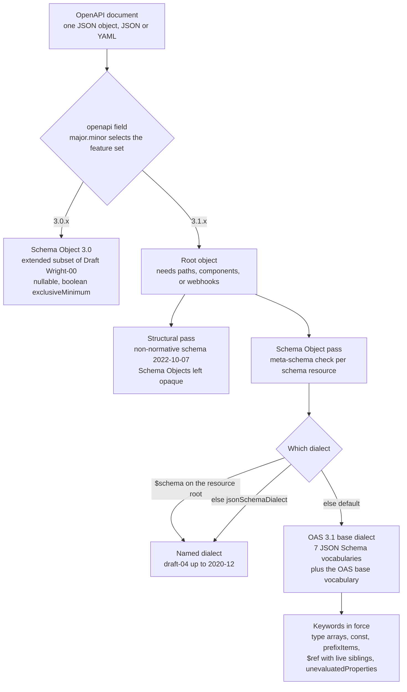

# OpenAPI 3.1 (v3.1.2) Architecture: Full JSON Schema 2020-12 Alignment, Type Arrays for Nullable, and Webhooks

> [!summary] Claim
> OpenAPI 3.1 stops defining its own schema language: every Schema Object is a JSON Schema Draft 2020-12 schema in the dialect `https://spec.openapis.org/oas/3.1/dialect/base`, so `nullable: true` becomes `type: ["string", "null"]`, a document may consist of `webhooks` alone, and a tool that does not switch keyword sets on the `openapi` field silently validates the wrong contract.

Part of [OpenAPI JSON Schema and Contracts](README.md) in [API Engineering](../README.md).

## TL;DR

- Mechanism: an OpenAPI 3.1 document is a JSON object whose root needs `openapi`, `info`, and at least one of `paths`, `components`, or `webhooks`, and whose Schema Objects are evaluated as JSON Schema 2020-12 under a dialect chosen by `$schema`, then `jsonSchemaDialect`, then the OAS base dialect (OAS 3.1.2 Section 4.8.1.1 and Section 4.8.24.5).
- Contract rule: migrate keywords and the version label together, because `nullable`, boolean `exclusiveMinimum`, and `format: binary` are not errors in 3.1, they are unknown or reinterpreted keywords that change which payloads validate (OAS 3.1.2 Section 4.8.24.1).
- Trap: `openapi-spec-validator 0.9.0` meta-checks a Schema Object in only 3 of the 14 location kinds exercised in the lab, so a malformed schema in a `requestBody`, in `webhooks`, or in `components.responses` passes `validate()` (`openapi-spec-validator 0.9.0 openapi_spec_validator/validation/keywords.py, RootValidator.__call__`).
- Portability fact: in the drafter's matrix run the lab passed on CPython `3.12.13`, `3.13.18`, `3.14.6`, `3.14.10`, `3.15.2`, and free-threaded `3.14.6t` and `3.15.0b3t`, and on both validator backends (`jsonschema-rs 0.60.3` and `jsonschema 4.26.0`), which differ in error text but not in verdicts; the fact-check re-ran only CPython `3.14.6` with `jsonschema-rs` and re-observed the error-text difference.
- When not to use it: keep publishing OpenAPI 3.0 while any consumer in the chain (gateway importer, SDK generator, documentation portal) still parses only 3.0, and describe broker-delivered events with AsyncAPI instead of `webhooks`, which model only HTTP requests; see [[Event-Driven-APIs-and-AsyncAPI-3-1-0-Specification]].

## Mental model



A tool reads the `openapi` string first, and the `major.minor` part alone decides whether the document is parsed with the 3.0 feature set or the 3.1 feature set (OAS 3.1.2 Section 4.1).
On the 3.0 branch every Schema Object is an extended subset of JSON Schema Draft Wright-00 with OpenAPI-only keywords such as `nullable` (OAS 3.0.4 Section 4.7.24).
On the 3.1 branch the root object is checked for shape, which a validator typically does with the non-normative JSON Schema published at `https://spec.openapis.org/oas/3.1/schema/2022-10-07` (or a later dated iteration), a schema that deliberately treats every Schema Object as an opaque object or boolean.
Each Schema Object is then checked against a meta-schema, and the meta-schema is chosen by the nearest `$schema` on a schema resource root, otherwise by the root `jsonSchemaDialect`, otherwise by the OAS base dialect (OAS 3.1.2 Section 4.8.24.5).
Only after that choice is the keyword set known, which is why the same bytes `{"type": "string", "nullable": true}` accept `null` on the left branch and reject it on the right.

## How it works

### 1. The version string is the dispatch key, and 3.1 is a breaking minor

The `openapi` field is REQUIRED, and tooling SHOULD use it to interpret the document (OAS 3.1.2 Section 4.8.1.1).
The `major.minor` portion designates the feature set, patch versions only correct or clarify the text, and tooling SHOULD NOT distinguish `3.1.0` from `3.1.1` (OAS 3.1.2 Section 4.1).
The same section states that non-backwards-compatible changes may be made in minor versions where impact is believed to be low relative to the benefit.
The `3.1.0-rc0` release notes say it directly: the project decided to no longer follow SemVer, and they list the removal of `nullable`, numeric-only `exclusiveMaximum` and `exclusiveMinimum`, the end of the `required` and `readOnly` interaction, and the end of `format` for file payloads as breaking changes (OAI release notes for `3.1.0-rc0`, published 2020-06-18).
`3.1.0` was released on 2021-02-15, `3.1.1` on 2024-10-24, and `3.1.2` on 2025-09-19 (OAS 3.1.2 Appendix A).
`3.1.1` makes no changes to the requirements of `3.1.0` and declares the HTML rendering at `spec.openapis.org` authoritative instead of the Markdown source, and `3.1.2` has no material changes (OAI release notes for `3.1.1` and `3.1.2`).
`openapi-spec-validator 0.9.0` implements the dispatch with the regular expression `(?P<major>\d+)\.(?P<minor>\d+)(\..*)?` (`openapi-spec-validator 0.9.0 openapi_spec_validator/versions/finders.py, SpecVersionFinder.find`) and maps the keyword `openapi` with major `3` and minor `1` to `OpenAPIV31SpecValidator` (`openapi-spec-validator 0.9.0 openapi_spec_validator/shortcuts.py, get_validator_cls`).
The structural schema then enforces the pattern `^3\.1\.\d+(-.+)?$` on the field, so `3.1.99` is accepted and a bare `3.1` is rejected, which the lab asserts.

### 2. The root object and the fields that changed

The OpenAPI Object in 3.1 has ten fixed fields: `openapi`, `info`, `jsonSchemaDialect`, `servers`, `paths`, `webhooks`, `components`, `security`, `tags`, and `externalDocs` (OAS 3.1.2 Section 4.8.1.1).
3.0 has eight, and it marks `paths` REQUIRED (OAS 3.0.4 Section 4.7.1).
In 3.1 an OpenAPI Description MUST contain at least one `paths` field, `components` field, or `webhooks` field (OAS 3.1.2 Section 3.1).
A document can therefore be a pure component library or a pure event catalog, and the `3.1.0-rc0` release notes observe that an OpenAPI document no longer necessarily describes an API.
The structural schema encodes the rule as `anyOf` over three `required` clauses, and it closes the root with `unevaluatedProperties: false` after admitting `^x-` extensions.

The other document-level changes are small but each one breaks a 3.0 parser that sees it:

| Location | OpenAPI 3.0.4 | OpenAPI 3.1.2 | Source |
|---|---|---|---|
| Root `paths` | REQUIRED | optional if `components` or `webhooks` is present | OAS 3.1.2 Section 3.1 |
| Root `webhooks` | absent | map of name to Path Item Object | OAS 3.1.2 Section 4.8.1.1 |
| Root `jsonSchemaDialect` | absent | default `$schema` for Schema Objects in the document | OAS 3.1.2 Section 4.8.1.1 |
| `info.summary` | absent | short summary string | OAS 3.1.2 Section 4.8.2.1 |
| `info.license.identifier` | absent | SPDX expression, mutually exclusive with `url` | OAS 3.1.2 Section 4.8.4.1 |
| `components.pathItems` | absent | reusable Path Item Objects | OAS 3.1.2 Section 4.8.7.1 |
| Operation `responses` | REQUIRED | optional | OAS 3.1.2 Section 4.8.10.1 |
| Operation `requestBody` on `GET`, `HEAD`, `DELETE` | SHALL be ignored by consumers | permitted, SHOULD be avoided | OAS 3.1.2 Section 4.8.10.1 |
| Reference Object | `$ref` only | `$ref`, `summary`, `description` | OAS 3.1.2 Section 4.8.23.1 |
| Security Scheme `type` | 4 values | adds `mutualTLS` | OAS 3.1.2 Section 4.8.27.1 |
| Security Requirement values | scopes for `oauth2` and `openIdConnect`, MUST be empty otherwise | may list role names for other scheme types | OAS 3.1.2 Section 4.8.30.1 |
| Server Variable `enum` | SHOULD NOT be empty, `default` SHOULD be in it | MUST NOT be empty, `default` MUST be in it | OAS 3.1.2 Section 4.8.6.1 |
| Discriminator Object | no extension clause | MAY carry `x-` extensions | OAS 3.1.2 Section 4.8.25.1 |

The lab asserts the `paths`, `webhooks`, `jsonSchemaDialect`, `license`, `pathItems`, `responses`, and Reference Object rows against the bundled structural schemas.
The `info.summary` and `mutualTLS` rows were confirmed by one-off probes of the same schemas, which the 3.1 schema accepts and the 3.0 schema rejects, and the remaining rows rest on the specification text alone.

### 3. A Schema Object is a JSON Schema in a named dialect

In 3.0 the Schema Object is an extended subset of JSON Schema Draft Wright-00: sixteen keywords are taken directly, eleven are adjusted, eight OpenAPI fields are added, and any other JSON Schema keyword is strictly unsupported (OAS 3.0.4 Section 4.7.24).
In 3.1 the Schema Object is a superset of JSON Schema Draft 2020-12, the booleans `true` and `false` are schemas, and unless stated otherwise the keyword definitions follow JSON Schema and add no semantics (OAS 3.1.2 Section 4.8.24).
The superset is expressed with the vocabulary mechanism rather than with prose.
A dialect is a meta-schema whose `$vocabulary` object names the vocabularies in force and marks each one required (`true`) or optional (`false`) (JSON Schema 2020-12 Core Section 8.1.2).
The OAS dialect meta-schema at `https://spec.openapis.org/oas/3.1/dialect/base` declares eight entries:

| Vocabulary URI | Required | Keywords it brings |
|---|---|---|
| `https://json-schema.org/draft/2020-12/vocab/core` | `true` | `$schema`, `$id`, `$ref`, `$anchor`, `$dynamicRef`, `$dynamicAnchor`, `$defs`, `$comment`, `$vocabulary` |
| `https://json-schema.org/draft/2020-12/vocab/applicator` | `true` | `allOf`, `anyOf`, `oneOf`, `not`, `if`, `then`, `else`, `dependentSchemas`, `prefixItems`, `items`, `contains`, `properties`, `patternProperties`, `additionalProperties`, `propertyNames` |
| `https://json-schema.org/draft/2020-12/vocab/unevaluated` | `true` | `unevaluatedItems`, `unevaluatedProperties` |
| `https://json-schema.org/draft/2020-12/vocab/validation` | `true` | `type`, `enum`, `const`, numeric, string, array, and object assertions |
| `https://json-schema.org/draft/2020-12/vocab/meta-data` | `true` | `title`, `description`, `default`, `deprecated`, `readOnly`, `writeOnly`, `examples` |
| `https://json-schema.org/draft/2020-12/vocab/format-annotation` | `true` | `format` as an annotation |
| `https://json-schema.org/draft/2020-12/vocab/content` | `true` | `contentEncoding`, `contentMediaType`, `contentSchema` |
| `https://spec.openapis.org/oas/3.1/vocab/base` | `false` | `discriminator`, `xml`, `externalDocs`, `example` |

The `false` on the OAS base vocabulary is the alignment itself.
An implementation that does not recognize a vocabulary marked `false` SHOULD proceed, and unrecognized keywords SHOULD be treated as annotations (JSON Schema 2020-12 Core Section 8.1.2 and Section 6.5).
A plain JSON Schema 2020-12 validator can therefore evaluate an OpenAPI 3.1 Schema Object without knowing OpenAPI, and the OAS text says so: JSON Schema implementations MAY treat the base vocabulary keywords as unknown keywords (OAS 3.1.2 Section 4.8.24.1).
The reverse also holds: the Schema Object supports keywords from any other vocabulary or entirely arbitrary properties, and the `x-` prefix is not required inside it (OAS 3.1.2 Section 4.8.24.1 and Section 4.8.24.2).
The cost of that openness is that a misspelled keyword is an annotation, not an error: the lab shows `{"type": "object", "additionalProperites": false}` accepting `{"x": 1}` under `OAS31Validator` and passing `validate()` as a component schema.

The structural schema uses the same mechanism to stay dialect-neutral.
Its `$defs/schema` is `{"$dynamicAnchor": "meta", "type": ["object", "boolean"]}` plus a `$comment`, and every place that holds a Schema Object says `{"$dynamicRef": "#meta"}`.
A `$dynamicRef` resolves to the outermost schema resource in the dynamic scope that defines the same `$dynamicAnchor` (JSON Schema 2020-12 Core Section 8.2.3.2).
The companion document `https://spec.openapis.org/oas/3.1/schema-base/2025-09-15` wraps the `2025-09-15` structural schema with `$ref`, redefines `$dynamicAnchor: meta` as a `$ref` to the dated dialect `https://spec.openapis.org/oas/3.1/dialect/2024-11-10`, and pins `jsonSchemaDialect` and `$schema` to that URI with `const`, which turns the unedited structural schema into a full validator of that dialect.

### 4. Dialect selection

Three rules decide the dialect of a Schema Object (OAS 3.1.2 Section 4.8.24.5).
`$schema` MAY appear in any Schema Object that is a schema resource root, and if present it MUST be used.
Otherwise the root `jsonSchemaDialect` supplies the default `$schema` for every Schema Object in that document.
Otherwise the OAS dialect schema id `https://spec.openapis.org/oas/3.1/dialect/base` MUST be used.
Tooling MUST support the OAS dialect and MAY support additional values of `$schema`.
`$schema` MUST NOT appear in a schema object that is not a resource root, and embedded resources without their own `$schema` use the dialect of the enclosing resource (JSON Schema 2020-12 Core Section 8.1.1 and Section 9.3.2).

`openapi-spec-validator 0.9.0` implements exactly this order (`openapi-spec-validator 0.9.0 openapi_spec_validator/validation/keywords.py, OpenAPIV31SchemaValidator._get_schema_dialect_id`; `OpenAPIV31SchemaValidator._get_default_jsonschema_dialect_id`).
It reads `$schema` from the schema, falls back to `(spec_root / "jsonSchemaDialect").read_str(default=...)`, caches the result for the validator instance, and asks `jsonschema.validators.validator_for` for the class registered under that URI.
An unregistered URI produces the error `Unknown JSON Schema dialect: '...'` rather than a silent fallback (`openapi-spec-validator 0.9.0 openapi_spec_validator/validation/keywords.py, OpenAPIV31SchemaValidator._get_schema_checker`).
The lab proves all three branches: a boolean `exclusiveMinimum` fails under the default dialect, passes when `jsonSchemaDialect` is `http://json-schema.org/draft-04/schema#`, passes when only that one schema carries the draft-04 `$schema`, and an unknown dialect URI is reported.

One interoperability gap is measurable (as of 2026-11).
The OpenAPI Initiative also publishes dated iterations of the dialect, and the structural schema `https://spec.openapis.org/oas/3.1/schema/2025-09-15` declares `https://spec.openapis.org/oas/3.1/dialect/2024-11-10` as the default of `jsonSchemaDialect`, while the specification text names `https://spec.openapis.org/oas/3.1/dialect/base`.
`openapi-schema-validator 0.9.0` registers only the `base` URI (`openapi-schema-validator 0.9.0 openapi_schema_validator/_dialects.py, OAS31_BASE_DIALECT_ID`), so a document that sets `jsonSchemaDialect` to the dated URI fails with `Unknown JSON Schema dialect`, which the lab asserts.

### 5. Keyword delta from 3.0 to 3.1

| Concern | OpenAPI 3.0.4 Schema Object | OpenAPI 3.1.2 Schema Object | Source |
|---|---|---|---|
| Null | `nullable: true` next to a `type` | `"null"` is a type, alone or in a `type` array | JSON Schema 2020-12 Validation Section 6.1.1 |
| Multiple types | `type` MUST be a string | `type` is a string or an array of unique strings | JSON Schema 2020-12 Validation Section 6.1.1 |
| Exclusive bounds | boolean modifier of `minimum` and `maximum` | `exclusiveMinimum` and `exclusiveMaximum` are numbers | JSON Schema 2020-12 Validation Section 6.2.5 |
| Single value | `enum` with one element | `const` | JSON Schema 2020-12 Validation Section 6.1.3 |
| Tuples | `items` MUST be an object | `prefixItems` positions, `items` for the tail | JSON Schema 2020-12 Core Section 10.3.1.1 |
| Examples | `example` (one value) | `examples` (array), `example` deprecated | OAS 3.1.2 Section 4.8.24.2 |
| Reference | Reference Object replaces the schema, siblings ignored | `$ref` is a keyword, siblings apply | JSON Schema 2020-12 Core Section 8.2.3.1 |
| Closed composition | `additionalProperties: false` only | `unevaluatedProperties`, `unevaluatedItems` | JSON Schema 2020-12 Core Section 11.3 |
| Conditionals | unsupported | `if`, `then`, `else`, `dependentSchemas`, `dependentRequired` | JSON Schema 2020-12 Core Section 10.2.2; Validation Section 6.5.4 |
| Reuse inside a schema | none | `$defs`, `$id`, `$anchor`, `$dynamicRef` | JSON Schema 2020-12 Core Section 8.2 |
| Binary | `format: binary`, `format: byte` | `contentMediaType`, `contentEncoding` | OAS 3.1.2 Section 4.4.2.1 |
| `format` | 9 OAS formats | 5 OAS formats, annotation by default | OAS 3.1.2 Section 4.4.1 |
| `readOnly` and `required` | a `readOnly` required property is required on responses only | annotations, no interaction with `required` | OAS 3.1.2 Section 4.8.24.3.2 |
| `discriminator` | hint | hint that MUST NOT change the validation outcome | OAS 3.1.2 Section 4.8.25 |
| Boolean schemas | not available | `true` accepts everything, `false` nothing | JSON Schema 2020-12 Core Section 4.3.2 |

Composition and the `unevaluatedProperties` mechanics belong to [[JSON-Schema-Composition-AllOf-AnyOf-OneOf-and-UnevaluatedProperties]], the full keyword catalog to [[JSON-Schema-2020-12-Core-and-Validation-Vocabularies]], and `discriminator` mapping to [[Polymorphism-and-Discriminators-in-OpenAPI-and-JSON-Schema]].

Simplified excerpt of `oas30_document()` and `oas31_document()` from the lab, the same four properties in both dialects:

```json
{
  "id":     {"type": "string", "example": "sub_1"},
  "plan":   {"type": "string", "enum": ["pro"]},
  "coupon": {"type": "string", "nullable": true, "maxLength": 8},
  "seats":  {"type": "integer", "minimum": 0, "exclusiveMinimum": true}
}
```

```json
{
  "id":     {"type": "string", "examples": ["sub_1"]},
  "plan":   {"const": "pro"},
  "coupon": {"type": ["string", "null"], "maxLength": 8},
  "seats":  {"type": "integer", "exclusiveMinimum": 0}
}
```

### 6. Null in depth

`nullable` in 3.0 only takes effect if `type` is explicitly defined within the same Schema Object, and other constraints retain their behavior and may still disallow `null` (OAS 3.0.4 Section 4.7.24).
`openapi-schema-validator 0.9.0` implements that inside its 3.0 `type` keyword: when the instance is `None` it returns without error if `schema.get("nullable") is True` and otherwise reports `None for not nullable` (`openapi-schema-validator 0.9.0 openapi_schema_validator/_keywords.py, type`).
The 3.0 type checker does not define `"null"` at all (`openapi-schema-validator 0.9.0 openapi_schema_validator/_types.py, oas30_type_checker`).
In 3.1 `"null"` is one of seven type names and the `type` keyword succeeds if the instance matches any listed type (JSON Schema 2020-12 Validation Section 6.1.1).
The design reason is keyword independence: a keyword may add a constraint but must not relax one imposed by a sibling, and `nullable` was a keyword whose only job was to relax `type` (OpenAPI Initiative, "Migrating from OpenAPI 3.0 to 3.1.0", 2021-02-16).

Four consequences follow, and each is asserted in the lab:

- `{"type": "string", "nullable": true}` under the 3.1 keyword set rejects `null`, because `nullable` is now an unknown keyword, and the document still validates.
- A closed `enum` excludes `null` in both versions, so `{"type": ["string", "null"], "enum": ["a"]}` rejects `null` until `null` is added to the `enum` array.
- A nullable reference cannot be written as a type array, because `$ref` has no `type`; write `{"anyOf": [{"$ref": "#/components/schemas/A"}, {"type": "null"}]}`.
- `oneOf` is the wrong combinator when a branch already admits `null`: `{"oneOf": [{"type": ["string", "null"]}, {"type": "null"}]}` rejects `null` because two branches match.

Generators do not agree on the spelling.
Pydantic emits the `anyOf` form for every nullable field: `GenerateJsonSchema.nullable_schema` builds `{'type': 'null'}` and returns `get_union_of_schemas([inner_json_schema, null_schema])` (`pydantic 2.14.3 pydantic/json_schema.py, GenerateJsonSchema.nullable_schema`).
The lab's FastAPI app therefore publishes `coupon` as `{"anyOf": [{"type": "string"}, {"type": "null"}]}`, never as `{"type": ["string", "null"]}`.
Both spellings accept the same instances, but a consumer that pattern-matches on type arrays to detect optionality misses every FastAPI-generated field; generation internals are in [[JSON-Schema-Generation-Internals-and-GenerateJsonSchema]] and [[OpenAPI-Generation-Internals-in-FastAPI-Get-OpenAPI-and-Separate-Schemas]].

### 7. Three kinds of `$ref`

OpenAPI 3.1 has three reference constructs with three sibling rules.

- Schema Object `$ref` is the JSON Schema keyword: it is an applicator whose results are the results of the referenced schema, so other keywords can appear alongside it and all of them apply (JSON Schema 2020-12 Core Section 8.2.3.1).
- The Reference Object, used wherever a non-schema component may be referenced, allows only `$ref`, `summary`, and `description`; the two text fields SHOULD override those of the target, and any other property SHALL be ignored (OAS 3.1.2 Section 4.8.23.1).
- The Path Item Object has its own `$ref` field, and if a field appears both in the referencing and the referenced Path Item the behavior is undefined (OAS 3.1.2 Section 4.8.9.1).

In 3.0 every `$ref` was a JSON Reference whose siblings SHALL be ignored (OAS 3.0.4 Section 4.7.23).
A 3.0 document that carries stray keywords next to a schema `$ref` therefore changes meaning on upgrade, because the dead keywords come alive.
Implementations already disagreed in 3.0: `OAS30Validator` is built with `jsonschema.validators.create` and its default `applicable_validators`, not with `ignore_ref_siblings`, so it applies the siblings that the 3.0 text says to ignore (`openapi-schema-validator 0.9.0 openapi_schema_validator/validators.py, _build_oas30_validator`; `jsonschema 4.26.0 jsonschema/_legacy_keywords.py, ignore_ref_siblings`).
In the lab `{"$ref": "#/definitions/code", "maxLength": 3}` rejects `"abcdef"` under `OAS30Validator`.

Base URIs changed as well.
Relative references inside Schema Objects resolve against the nearest parent `$id`, and all other relative references resolve against the referring document's base URI, normally its retrieval URI (OAS 3.1.2 Section 4.6; RFC 3986 Section 5.1.2 to Section 5.1.4).
A fragment in a JSON or YAML target SHOULD be read as a JSON Pointer, in which `~` is written `~0` and `/` is written `~1` (OAS 3.1.2 Section 4.6; RFC 6901 Section 3).
Because `$id` can re-base a subtree, 3.1 inherits the JSON Schema requirement to parse a complete document before declaring a schema reference unresolvable, and the result of parsing fragments in isolation is undefined (OAS 3.1.2 Section 4.3.1).

### 8. Webhooks

`webhooks` is a map from an arbitrary unique name to a Path Item Object that describes a request the API provider initiates and the responses it expects from the consumer (OAS 3.1.2 Section 4.8.1.1).
Three properties distinguish it from the neighbouring constructs:

- The key is a name, not a URL template: the structural schema types `webhooks` as `additionalProperties` of `path-item-or-reference`, with no `^/` pattern, and the lab key `not/a path {x}` validates while a `paths` key without a leading slash does not.
- The direction is inverted: the `requestBody` is what the provider sends and the `responses` are what the consumer must return.
- It is independent of any operation, whereas a Callback Object hangs off the operation that registered it and is keyed by a runtime expression such as `{$request.body#/url}` (OAS 3.1.2 Section 4.8.18).

The specification gives webhooks no field for the delivery URL, the retry schedule, or the signature scheme, so those remain prose or `x-` extensions; delivery patterns are in [[HTTP-Callback-Subscriptions-WebSub-and-Async-Request-Reply-Patterns]].
`components.pathItems` makes a webhook payload reusable, and the lab's `oas31_document()` declares the webhook as `{"$ref": "#/components/pathItems/SubscriptionEvent"}`.
FastAPI exposes the feature as `app.webhooks`, an `APIRouter` whose routes are passed to `get_openapi` and written under `output["webhooks"]` only when at least one exists (`fastapi 0.162.0 fastapi/applications.py, FastAPI.__init__`; `fastapi 0.162.0 fastapi/applications.py, FastAPI.openapi`; `fastapi 0.162.0 fastapi/openapi/utils.py, get_openapi`).

### 9. Binary data and `format`

`format` is treated as a non-validating annotation by default, and support for any registered format is OPTIONAL (OAS 3.1.2 Section 4.4.1).
The format-annotation vocabulary requires an implementation to offer assertion as an option that MUST be disabled by default (JSON Schema 2020-12 Validation Section 7.2.1).
3.1 keeps five OAS-defined formats (`int32`, `int64`, `float`, `double`, `password`) and drops `byte`, `binary`, `date`, and `date-time` from its own table; `date` and `date-time` remain available as JSON Schema formats (JSON Schema 2020-12 Validation Section 7.3.1).
Binary payloads move to the content vocabulary: raw binary omits `type` and uses `contentMediaType`, and encoded binary keeps `type: string` and adds `contentEncoding: base64` or `base64url` (OAS 3.1.2 Section 4.4.2).
`contentEncoding` is unrelated to the HTTP `Content-Encoding` header, and implementations MUST NOT decode or validate string contents by default (JSON Schema 2020-12 Validation Section 8.3 and Section 8.2).
The lab confirms the defaults in `openapi-schema-validator 0.9.0`: `{"type": "integer", "format": "int32"}` accepts `2**40` when no format checker is passed, and a `contentEncoding: base64` string schema accepts `"!!!not base64!!!"`.
Assertion is the opt-in `format_checker=oas31_format_checker` (`openapi-schema-validator 0.9.0 openapi_schema_validator/_format.py, oas31_format_checker`).
The specification's migration table drops `type` for raw binary, so `{"type": "string", "format": "binary"}` becomes `{"contentMediaType": "application/octet-stream"}`, the one rewrite in the lab that widens the set of accepted JSON instances (OAS 3.1.2 Section 4.4.2.1).

### 10. What the Python validator stack actually executes

`openapi_spec_validator.validate(spec)` selects a validator class from the version, wraps the dictionary in a `SchemaPath`, and raises the first error (`openapi-spec-validator 0.9.0 openapi_spec_validator/shortcuts.py, validate`).
`SpecValidator.iter_errors` runs two passes (`openapi-spec-validator 0.9.0 openapi_spec_validator/validation/validators.py, SpecValidator.iter_errors`).

The structural pass evaluates the whole document against the bundled schema.
The structural validator is a lazy proxy, so its backend is fixed on first use in the process: with `OPENAPI_SPEC_VALIDATOR_SCHEMA_VALIDATOR_BACKEND` unset or `auto` it uses `jsonschema-rs` when that package imports and `jsonschema` otherwise (`openapi-spec-validator 0.9.0 openapi_spec_validator/schemas/__init__.py, openapi_v31_schema_validator`; `openapi-spec-validator 0.9.0 openapi_spec_validator/schemas/backend/__init__.py, _use_jsonschema_rs`).
The bundled file still carries the `$id` `https://spec.openapis.org/oas/3.1/schema/2022-10-07`, and it differs from the document served at that URL on 2026-11-10 in two places: `paths` entries use `path-item-or-reference`, and `responses` has an `if`/`then` that requires `default` when no status code key is present.

The semantic pass is a hand-written walk (`openapi-spec-validator 0.9.0 openapi_spec_validator/validation/keywords.py, RootValidator.__call__`).
It visits `tags`, `paths`, and `components`, and inside `components` only `schemas`.
Per operation it checks `operationId` uniqueness, descends into `responses` content and into `parameters`, and matches path template variables against `in: path` parameters (`openapi-spec-validator 0.9.0 openapi_spec_validator/validation/keywords.py, OperationValidator.__call__`).
For each Schema Object it reaches, it runs one meta-schema check at the root of the schema, recurses through `allOf`, `anyOf`, `oneOf`, `not`, `items`, and `properties`, and validates `default` against the schema (`openapi-spec-validator 0.9.0 openapi_spec_validator/validation/keywords.py, SchemaValidator.__call__`).
It never visits `webhooks`, `requestBody`, response `headers`, Encoding Object `headers`, `callbacks`, or the non-schema maps of `components`.
Because the structural schema treats a Schema Object as opaque, a schema outside the walk is checked for nothing beyond being an object or a boolean.
The lab measures the consequence across 14 location kinds: `type: "strnig"` is reported in `components.schemas`, in a `paths` parameter `schema`, and in a `paths` response `content` schema, and in none of the other eleven.

The instance validators are thin extensions of `jsonschema`.
`OAS31Validator` is `extend(Draft202012Validator, ...)` with a replaced `pattern` keyword and no-op handlers for `description`, `discriminator`, `xml`, `externalDocs`, and `example`, registered for the dialect id with the OAS meta-schema (`openapi-schema-validator 0.9.0 openapi_schema_validator/validators.py, _build_oas31_validator`).
`OAS30Validator` is created from the Draft 4 meta-schema with OpenAPI versions of `type`, `allOf`, `oneOf`, `anyOf`, `items`, `required`, `additionalProperties`, `pattern`, and `format` (`openapi-schema-validator 0.9.0 openapi_schema_validator/validators.py, _build_oas30_validator`).
Two differences are visible to callers.
`"integer"` in 2020-12 matches any number with a zero fractional part, so `1.0` is an integer under `OAS31Validator`, while the 3.0 type checker accepts only Python `int` (`jsonschema 4.26.0 jsonschema/_types.py, draft6_type_checker`; `openapi-schema-validator 0.9.0 openapi_schema_validator/_types.py, oas30_type_checker`).
`pattern` is evaluated with Python `re.search` unless the optional `regress` package is installed (`openapi-schema-validator 0.9.0 openapi_schema_validator/_regex.py, search`), although JSON Schema recommends the ECMA-262 dialect (JSON Schema 2020-12 Core Section 6.4).
In the lab environment `regress` is absent, so the lab shows `^\d{3}$` matching three Arabic-Indic digits and the Python-only group syntax `(?P<x>a)` being accepted.

## Numbers and limits

| Metric or parameter | Value | Source or measurement condition |
|---|---|---|
| Release dates of the 3.1 line | `3.1.0` 2021-02-15, `3.1.1` 2024-10-24, `3.1.2` 2025-09-19 | OAS 3.1.2 Appendix A |
| Fixed fields of the OpenAPI Object | 10 in 3.1, 8 in 3.0 | OAS 3.1.2 Section 4.8.1.1; OAS 3.0.4 Section 4.7.1 |
| Root fields of which at least one is required | 3 (`paths`, `components`, `webhooks`) | OAS 3.1.2 Section 3.1 |
| Maps in the Components Object | 10 in 3.1 (adds `pathItems`), 9 in 3.0 | OAS 3.1.2 Section 4.8.7.1; OAS 3.0.4 Section 4.7.7 |
| Component key pattern | `^[a-zA-Z0-9\.\-_]+$` | OAS 3.1.2 Section 4.8.7.1 |
| Type names | 7 in 3.1 (`null`, `boolean`, `object`, `array`, `number`, `string`, `integer`), 6 in 3.0 | OAS 3.1.2 Section 4.4; OAS 3.0.4 Section 4.4 |
| OAS-defined formats | 5 in 3.1, 9 in 3.0 | OAS 3.1.2 Section 4.4.1; OAS 3.0.4 Section 4.4.1 |
| Vocabularies in the OAS dialect | 8 (7 required, 1 optional) | `https://spec.openapis.org/oas/3.1/dialect/base`, fetched 2026-11-10 |
| Keywords in the OAS base vocabulary | 4 (`discriminator`, `xml`, `externalDocs`, `example`) | OAS 3.1.2 Section 4.8.24.2 |
| Security scheme types | 5 in 3.1, 4 in 3.0 | OAS 3.1.2 Section 4.8.27.1; OAS 3.0.4 Section 4.7.27 |
| Operation fields of a Path Item | 8 (`get`, `put`, `post`, `delete`, `options`, `head`, `patch`, `trace`) | OAS 3.1.2 Section 4.8.9.1 |
| Minimum Markdown dialect for `description` | CommonMark 0.27 | OAS 3.1.2 Section 4.5 |
| Bundled 3.1 structural schema | 34260 bytes, 39 `$defs` entries | Measured on `openapi-spec-validator 0.9.0` in `labs/.venv`, CPython `3.14.6`, re-measured in the fact-check on macOS `27.3` (as of 2026-11) |
| Schema location kinds meta-checked by `validate()` | 3 of 14 exercised | Lab test `test_malformed_schema_is_found_at_every_location_by_the_walk_only`, CPython `3.14.6`, macOS `27.3` arm64 |
| Validator instances retained after use | 100 of 100 | Measured on CPython `3.14.6`, macOS `27.3` arm64: `SpecValidator.iter_errors` is wrapped in `functools.lru_cache(maxsize=None)`, and its `cache_info().currsize` grew by 100 after 100 validators and a `gc.collect()`; the lab test `test_spec_validator_instances_are_retained_by_the_method_cache` pins the same fact with a weak reference |
| Reference resolution cache | `resolved_cache_maxsize` default `128` | `openapi-spec-validator 0.9.0 openapi_spec_validator/settings.py, RESOLVED_CACHE_MAXSIZE_DEFAULT` |
| Timeout of the default URL handlers | `10` seconds | `jsonschema-path 0.5.0 jsonschema_path/handlers/urllib.py, UrllibHandler.__init__`; `jsonschema-path 0.5.0 jsonschema_path/handlers/requests.py, UrlRequestsHandler.__init__` |
| CPU time to validate the lab 3.1 document (1056 bytes of JSON) | 1240 to 1498 us with `jsonschema-rs`, 2915 to 3118 us with `jsonschema` | Range of the per-run median over 4 runs of 200 validations each, command below, Apple M3 Pro, macOS `27.3`, CPython `3.14.6`, on a shared host whose 1-minute load average was 5.9 to 6.4, so read these as upper bounds (as of 2026-11) |
| Same for the FastAPI-generated document (2467 bytes of JSON) | 3354 to 3590 us with `jsonschema-rs`, 9584 to 10589 us with `jsonschema` | Same conditions |
| Time from `3.1.0` to Swagger UI support | 2021-02-15 to 2023-06-12 | OAS 3.1.2 Appendix A; Swagger UI `v5.0.0` release notes |
| FastAPI default `openapi` value | `3.1.0` since `0.99.0` (2023-06-30) | `fastapi 0.162.0 fastapi/applications.py, FastAPI.__init__`; FastAPI release notes for `0.99.0` |

The CPU time rows were produced from `labs/` with this command, four times as shown and four times with `OPENAPI_SPEC_VALIDATOR_SCHEMA_VALIDATOR_BACKEND=jsonschema` set:

```sh
uv run --frozen python -c "
import json, statistics, time
from openapi_spec_validator import OpenAPIV31SpecValidator as V
from api_labs.f08_openapi_json_schema_and_contracts.oas31_alignment import build_subscription_app, oas31_document
for name, doc in (('lab', oas31_document()), ('fastapi', build_subscription_app().openapi())):
    runs = []
    for _ in range(201):
        start = time.process_time_ns()
        list(V(doc).iter_errors())
        runs.append(time.process_time_ns() - start)
    print(name, len(json.dumps(doc)), 'bytes', round(statistics.median(runs[1:]) / 1000), 'us CPU')
"
```

## Portability

| Runtime or component | Behavior | Verification |
|---|---|---|
| CPython `3.12.13` | 31 tests pass | `UV_PROJECT_ENVIRONMENT=../tmp_venvs/py3.12 uv run --frozen --python 3.12 pytest <test> -q` on macOS `27.2` arm64; drafter's run, not re-run in the fact-check |
| CPython `3.13.18` | 31 tests pass | Same command with `--python 3.13`; drafter's run, not re-run in the fact-check |
| CPython `3.14.6` (workspace interpreter) and `3.14.10` | 31 tests pass | `uv run --frozen pytest <test> -q`, and the same with `--python /opt/homebrew/bin/python3.14`; the fact-check re-ran `3.14.6` only (31 passed, macOS `27.3`) |
| CPython `3.15.2` | 31 tests pass | Same command with `--python /opt/homebrew/bin/python3.15`; drafter's run, not re-run in the fact-check |
| Free-threaded CPython `3.15.0b3t` and `3.14.6t` | 31 tests pass and `sys._is_gil_enabled()` is `False` before and after the run | `uv run --no-project --python 3.15t --with <pins> python -c "pytest.main(...)"` with `PYTHONPATH=src`; the frozen workspace cannot install on `3.15t` because `psycopg-binary 3.3.8` has no wheel for it; `3.15.2t` was not available here; drafter's run, not re-run in the fact-check |
| Backend `jsonschema-rs 0.60.3` (default when installed) | 31 tests pass | Default run on every interpreter above, each of which reported `get_validator_backend() == "jsonschema-rs"`; re-confirmed on `3.14.6` in the fact-check |
| Backend `jsonschema 4.26.0` | 31 tests pass, error text differs (`'webhooks' does not match any of the regexes: '^x-'` instead of `Additional properties are not allowed ('webhooks' was unexpected)`) | `OPENAPI_SPEC_VALIDATOR_SCHEMA_VALIDATOR_BACKEND=jsonschema uv run --frozen pytest <test> -q` on CPython `3.14.6`; the fact-check re-observed the two messages with `audit` but did not re-run the suite on this backend |
| `openapi` `3.1.0`, `3.1.1`, `3.1.2` | One feature set; tooling SHOULD NOT distinguish patch versions | OAS 3.1.2 Section 4.1; the lab validates `3.1.0` (FastAPI), `3.1.2`, and `3.1.99` with the same class |
| `openapi` `3.0.x` | Rejects type arrays, `const`, numeric `exclusiveMinimum`, `webhooks`, and a missing `paths` | Lab test `test_oas30_document_validates_and_rejects_every_31_only_construct` |
| `openapi` `3.2.x` | Separate validator class `OpenAPIV32SpecValidator` and dialect `https://spec.openapis.org/oas/3.2/dialect/2025-09-17` | `openapi-schema-validator 0.9.0 openapi_schema_validator/_dialects.py, OAS32_BASE_DIALECT_ID`; not exercised in this lab, see [[OpenAPI-3-2-Additions-QUERY-Method-Streaming-and-Tag-Hierarchies]] |
| `fastapi 0.162.0` with `pydantic 2.14.3` | Emits `openapi: 3.1.0`, `anyOf` with `{"type": "null"}`, `const`, numeric `exclusiveMinimum`, `prefixItems`, and `webhooks` | Lab test `test_fastapi_emits_openapi_31_with_null_union_const_tuple_and_webhooks` |
| Uvicorn, Hypercorn, Granian and HTTP/1.1, HTTP/2, HTTP/3 | Not applicable to a description format; the lab reads `/openapi.json` in process through `httpx.ASGITransport`, and no server or HTTP version leg was run | Not run |
| Debian Trixie and Alpine containers | Not run for this note | Not run |

`<test>` is `tests/f08_openapi_json_schema_and_contracts/test_openapi_3_1_architecture_and_json_schema_alignment.py`, and `<pins>` is the pinned set `fastapi`, `starlette`, `pydantic`, `pydantic-core`, `pydantic-settings`, `httpx`, `openapi-spec-validator`, `openapi-schema-validator`, `jsonschema`, `jsonschema-path`, `referencing`, `rpds-py`, `jsonschema-rs`, `pytest`, and `pytest-asyncio` at the versions in `labs/uv.lock`.

## Worked example

The lab [implementation](../labs/src/api_labs/f08_openapi_json_schema_and_contracts/oas31_alignment.py) and [test](../labs/tests/f08_openapi_json_schema_and_contracts/test_openapi_3_1_architecture_and_json_schema_alignment.py) describe one subscriptions API twice, as OpenAPI 3.0.4 and as OpenAPI 3.1.2.
`migrate_schema_30_to_31` rewrites the 3.0 keywords, and the tests prove the rewrite is idempotent and keeps every verdict except for raw binary, where the specification drops `type`.
`audit` runs the `openapi-spec-validator` class selected by `feature_set`, `verdicts` runs the 3.0 and 3.1 instance validators, `check_every_schema_object` re-runs the library's own per-schema check at every Schema Object location, and `external_references` lists references that leave the document.
`build_subscription_app` shows what FastAPI `0.162.0` actually publishes.

### Implementation (`labs/src/api_labs/f08_openapi_json_schema_and_contracts/oas31_alignment.py`)

```python
"""Compare OpenAPI 3.0 Schema Objects with the OpenAPI 3.1 JSON Schema 2020-12 dialect."""

from __future__ import annotations

import copy
from dataclasses import dataclass
from typing import TYPE_CHECKING, Any, Literal, cast

from fastapi import FastAPI
from jsonschema_path import SchemaPath
from openapi_schema_validator import OAS30Validator, OAS31Validator
from openapi_spec_validator import OpenAPIV30SpecValidator, OpenAPIV31SpecValidator
from openapi_spec_validator.schemas import get_validator_backend
from openapi_spec_validator.validation.keywords import OpenAPIV31SchemaValidator
from pydantic import BaseModel, Field

if TYPE_CHECKING:
    from collections.abc import Iterator, Sequence

type JsonObject = dict[str, Any]
type Tokens = tuple[str | int, ...]

OAS31_DIALECT = "https://spec.openapis.org/oas/3.1/dialect/base"
DRAFT4_DIALECT = "http://json-schema.org/draft-04/schema#"
HTTP_METHODS = ("get", "put", "post", "delete", "options", "head", "patch", "trace")

_PATH_SEPARATOR = "\x00"
_SUBSCHEMA_MAPS = ("properties",)
_SUBSCHEMA_LISTS = ("allOf", "anyOf", "oneOf")
_SUBSCHEMA_SINGLE = ("items", "additionalProperties", "not")
_EXCLUSIVE_BOUNDS = (("minimum", "exclusiveMinimum"), ("maximum", "exclusiveMaximum"))
_SPEC_VALIDATORS = {"3.0": OpenAPIV30SpecValidator, "3.1": OpenAPIV31SpecValidator}


def oas30_document() -> JsonObject:
    """Return an OpenAPI 3.0.4 description that uses the 3.0-only Schema Object keywords."""
    subscription: JsonObject = {
        "type": "object",
        "required": ["id", "plan", "coupon", "seats"],
        "properties": {
            "id": {"type": "string", "example": "sub_1"},
            "plan": {"type": "string", "enum": ["pro"]},
            "coupon": {"type": "string", "nullable": True, "maxLength": 8},
            "seats": {"type": "integer", "minimum": 0, "exclusiveMinimum": True},
            "window": {
                "type": "array",
                "items": {"type": "string"},
                "minItems": 2,
                "maxItems": 2,
            },
        },
    }
    return {
        "openapi": "3.0.4",
        "info": {"title": "Subscriptions", "version": "1.0.0"},
        "paths": {
            "/subscriptions/{subscription_id}": {
                "get": {
                    "operationId": "getSubscription",
                    "parameters": [
                        {
                            "name": "subscription_id",
                            "in": "path",
                            "required": True,
                            "schema": {"type": "string"},
                        }
                    ],
                    "responses": {
                        "200": {
                            "description": "The subscription.",
                            "content": {
                                "application/json": {
                                    "schema": {"$ref": "#/components/schemas/Subscription"}
                                }
                            },
                        }
                    },
                }
            }
        },
        "components": {"schemas": {"Subscription": subscription}},
    }


def oas31_document() -> JsonObject:
    """Return the same API as OpenAPI 3.1.2, using the constructs 3.0 cannot express."""
    subscription: JsonObject = {
        "type": "object",
        "required": ["id", "plan", "coupon", "seats"],
        "properties": {
            "id": {"type": "string", "examples": ["sub_1"]},
            "plan": {"const": "pro"},
            "coupon": {"type": ["string", "null"], "maxLength": 8},
            "seats": {"type": "integer", "exclusiveMinimum": 0},
            "window": {
                "type": "array",
                "prefixItems": [{"type": "string"}, {"type": "integer"}],
                "items": False,
            },
        },
    }
    event_body: JsonObject = {
        "required": True,
        "content": {"application/json": {"schema": {"$ref": "#/components/schemas/Subscription"}}},
    }
    return {
        "openapi": "3.1.2",
        "info": {
            "title": "Subscriptions",
            "summary": "Subscription lifecycle API and its outbound events.",
            "version": "1.0.0",
            "license": {"name": "Apache 2.0", "identifier": "Apache-2.0"},
        },
        "jsonSchemaDialect": OAS31_DIALECT,
        "webhooks": {"subscription.renewed": {"$ref": "#/components/pathItems/SubscriptionEvent"}},
        "components": {
            "schemas": {"Subscription": subscription},
            "pathItems": {
                "SubscriptionEvent": {
                    "post": {
                        "operationId": "onSubscriptionRenewed",
                        "requestBody": event_body,
                        "responses": {"204": {"description": "Event accepted."}},
                    }
                }
            },
        },
    }


def migrate_schema_30_to_31(schema: JsonObject) -> JsonObject:
    """Rewrite one OpenAPI 3.0 Schema Object into the OpenAPI 3.1 dialect."""
    if "$ref" in schema:
        # A 3.0 Reference Object ignores its siblings; in 3.1 they would become live keywords.
        return {"$ref": schema["$ref"]}
    out: JsonObject = {}
    for key, value in schema.items():
        if key in ("nullable", "example"):
            continue
        if key in _SUBSCHEMA_MAPS:
            out[key] = {name: migrate_schema_30_to_31(sub) for name, sub in value.items()}
        elif key in _SUBSCHEMA_LISTS:
            out[key] = [migrate_schema_30_to_31(sub) for sub in value]
        elif key in _SUBSCHEMA_SINGLE and isinstance(value, dict):
            out[key] = migrate_schema_30_to_31(cast("JsonObject", value))
        else:
            out[key] = copy.deepcopy(value)
    for bound, exclusive in _EXCLUSIVE_BOUNDS:
        flag = out.get(exclusive)
        if isinstance(flag, bool):  # a number is already the 3.1 form and is left alone
            del out[exclusive]
            if flag and bound in out:
                out[exclusive] = out.pop(bound)
    if "example" in schema:
        out["examples"] = [copy.deepcopy(schema["example"])]
    if schema.get("type") == "string" and schema.get("format") == "byte":
        del out["format"]
        out["contentEncoding"] = "base64"
    elif schema.get("type") == "string" and schema.get("format") == "binary":
        # Raw binary is not a JSON instance: OAS 3.1.2 Section 4.4.2.1 drops `type` as well.
        del out["type"], out["format"]
        out["contentMediaType"] = "application/octet-stream"
    if schema.get("nullable") is True and "type" in out:
        out["type"] = [out["type"], "null"]
    return out


@dataclass(frozen=True, slots=True)
class SpecAudit:
    """Outcome of validating one OpenAPI document with openapi-spec-validator."""

    validator: str
    backend: str
    errors: tuple[str, ...]

    @property
    def valid(self) -> bool:
        """Report whether the validator yielded no error."""
        return not self.errors


def feature_set(document: JsonObject) -> str:
    """Return the `major.minor` part of the `openapi` field, which selects the feature set."""
    return ".".join(str(document.get("openapi", "")).split(".")[:2])


def audit(document: JsonObject) -> SpecAudit:
    """Validate a document with the validator class its `openapi` field selects."""
    validator_cls = _SPEC_VALIDATORS.get(feature_set(document))
    if validator_cls is None:
        raise ValueError(f"unsupported openapi version: {document.get('openapi')!r}")
    errors = tuple(
        str(error.message).splitlines()[0] for error in validator_cls(document).iter_errors()
    )
    return SpecAudit(
        validator=validator_cls.__name__, backend=get_validator_backend(), errors=errors
    )


def verdicts(
    family: Literal["3.0", "3.1"], schema: JsonObject | bool, instances: Sequence[object]
) -> tuple[bool, ...]:
    """Validate each instance against one Schema Object under the 3.0 or 3.1 keyword set."""
    validator = (OAS30Validator if family == "3.0" else OAS31Validator)(schema)
    return tuple(bool(validator.is_valid(instance)) for instance in instances)


def json_pointer(tokens: Tokens) -> str:
    """Encode reference tokens as a JSON Pointer."""
    return "".join("/" + str(token).replace("~", "~0").replace("/", "~1") for token in tokens)


def _is_reference(value: Any) -> bool:
    return not isinstance(value, dict) or "$ref" in value


def _content_schemas(tokens: Tokens, holder: JsonObject) -> Iterator[Tokens]:
    for media_type, media in holder.get("content", {}).items():
        base = (*tokens, "content", media_type)
        if "schema" in media:
            yield (*base, "schema")
        for name, encoding in media.get("encoding", {}).items():
            for header_name, header in encoding.get("headers", {}).items():
                header_tokens = (*base, "encoding", name, "headers", header_name)
                yield from _parameter_schemas(header_tokens, header)


def _parameter_schemas(tokens: Tokens, parameter: Any) -> Iterator[Tokens]:
    if _is_reference(parameter):
        return
    if "schema" in parameter:
        yield (*tokens, "schema")
    yield from _content_schemas(tokens, parameter)


def _response_schemas(tokens: Tokens, response: Any) -> Iterator[Tokens]:
    if _is_reference(response):
        return
    yield from _content_schemas(tokens, response)
    for name, header in response.get("headers", {}).items():
        yield from _parameter_schemas((*tokens, "headers", name), header)


def _callback_schemas(tokens: Tokens, callback: Any) -> Iterator[Tokens]:
    if _is_reference(callback):
        return
    for expression, item in callback.items():
        if not expression.startswith("x-"):
            yield from _path_item_schemas((*tokens, expression), item)


def _path_item_schemas(tokens: Tokens, path_item: Any) -> Iterator[Tokens]:
    if _is_reference(path_item):
        return
    for index, parameter in enumerate(path_item.get("parameters", [])):
        yield from _parameter_schemas((*tokens, "parameters", index), parameter)
    for method in HTTP_METHODS:
        operation = path_item.get(method)
        if operation is None:
            continue
        base = (*tokens, method)
        for index, parameter in enumerate(operation.get("parameters", [])):
            yield from _parameter_schemas((*base, "parameters", index), parameter)
        body = operation.get("requestBody")
        if not _is_reference(body):
            yield from _content_schemas((*base, "requestBody"), body)
        for status, response in operation.get("responses", {}).items():
            if not status.startswith("x-"):
                yield from _response_schemas((*base, "responses", status), response)
        for name, callback in operation.get("callbacks", {}).items():
            yield from _callback_schemas((*base, "callbacks", name), callback)


def schema_object_locations(document: JsonObject) -> tuple[Tokens, ...]:
    """List every location in an OpenAPI 3.1 document that holds a Schema Object."""
    found: list[Tokens] = []
    components: JsonObject = document.get("components", {})
    found.extend(("components", "schemas", name) for name in components.get("schemas", {}))
    for section in ("parameters", "headers"):
        for name, parameter in components.get(section, {}).items():
            found.extend(_parameter_schemas(("components", section, name), parameter))
    for name, body in components.get("requestBodies", {}).items():
        if not _is_reference(body):
            found.extend(_content_schemas(("components", "requestBodies", name), body))
    for name, response in components.get("responses", {}).items():
        found.extend(_response_schemas(("components", "responses", name), response))
    for name, callback in components.get("callbacks", {}).items():
        found.extend(_callback_schemas(("components", "callbacks", name), callback))
    for name, item in components.get("pathItems", {}).items():
        found.extend(_path_item_schemas(("components", "pathItems", name), item))
    for name, item in document.get("paths", {}).items():
        if not name.startswith("x-"):  # the Paths Object admits extensions, `webhooks` does not
            found.extend(_path_item_schemas(("paths", name), item))
    for name, item in document.get("webhooks", {}).items():
        found.extend(_path_item_schemas(("webhooks", name), item))
    return tuple(found)


def check_every_schema_object(document: JsonObject) -> tuple[str, ...]:
    """Run the validator's per-schema check on every Schema Object, not only the walked ones."""
    if feature_set(document) != "3.1":
        raise ValueError("the exhaustive walk implements the OpenAPI 3.1 object model only")
    validator = OpenAPIV31SpecValidator(document)
    problems: list[str] = []
    for tokens in schema_object_locations(document):
        # The `/` operator splits keys on "#", which callback expressions contain.
        path = SchemaPath(validator.schema_path.accessor, *tokens, separator=_PATH_SEPARATOR)
        # A fresh checker per location: the library dedupes schemas by `id()` per instance.
        check = OpenAPIV31SchemaValidator(validator.keyword_validators_registry)
        problems.extend(
            f"{json_pointer(tokens)}: {str(error.message).splitlines()[0]}" for error in check(path)
        )
    return tuple(problems)


def external_references(node: object) -> tuple[str, ...]:
    """Collect every `$ref` string that leaves the current document."""
    found: list[str] = []
    if isinstance(node, dict):
        for key, value in cast("dict[str, object]", node).items():
            if key == "$ref" and isinstance(value, str):
                if not value.startswith("#"):
                    found.append(value)
            else:
                found.extend(external_references(value))
    elif isinstance(node, list):
        for value in cast("list[object]", node):
            found.extend(external_references(value))
    return tuple(found)


class Subscription(BaseModel):
    """Pydantic model whose generated JSON Schema needs the OpenAPI 3.1 dialect."""

    id: str
    plan: Literal["pro"]
    coupon: str | None
    seats: int = Field(gt=0)
    window: tuple[str, int]


def build_subscription_app() -> FastAPI:
    """Create an app with one path operation and one documented webhook."""
    app = FastAPI(title="Subscriptions", version="1.0.0")

    @app.get("/subscriptions/{subscription_id}")
    async def get_subscription(subscription_id: str) -> Subscription:
        return Subscription(
            id=subscription_id, plan="pro", coupon=None, seats=3, window=("2026-11", 30)
        )

    @app.webhooks.post("subscription.renewed", status_code=204)
    async def subscription_renewed(body: Subscription) -> None:
        """Document the request this API sends to the consumer."""

    del get_subscription, subscription_renewed
    return app
```

### Test suite (`labs/tests/f08_openapi_json_schema_and_contracts/test_openapi_3_1_architecture_and_json_schema_alignment.py`)

Simplified excerpt: the module header and five of the eighteen test functions, copied verbatim; the linked file holds the other thirteen, including the 14-row location matrix.

```python
"""Unit tests for OpenAPI 3.0 versus OpenAPI 3.1 Schema Object and document semantics."""

from __future__ import annotations

import gc
import json
import weakref
from typing import TYPE_CHECKING, Any

import httpx
import pytest
from jsonschema_path import SchemaPath
from openapi_spec_validator import OpenAPIV31SpecValidator

from api_labs.f08_openapi_json_schema_and_contracts.oas31_alignment import (
    DRAFT4_DIALECT,
    audit,
    build_subscription_app,
    check_every_schema_object,
    external_references,
    migrate_schema_30_to_31,
    oas30_document,
    oas31_document,
    schema_object_locations,
    verdicts,
)

if TYPE_CHECKING:
    from pathlib import Path

WEBHOOK_BODY_SCHEMA = (
    "/webhooks/subscription.renewed/post/requestBody/content/application~1json/schema"
)


def _schemas(document: dict[str, Any]) -> dict[str, Any]:
    schemas: dict[str, Any] = document["components"]["schemas"]
    return schemas


def _properties(document: dict[str, Any]) -> dict[str, Any]:
    properties: dict[str, Any] = _schemas(document)["Subscription"]["properties"]
    return properties


@pytest.mark.unit
def test_nullable_is_inert_in_31_and_type_arrays_do_not_exist_in_30() -> None:
    nullable = {"type": "string", "nullable": True}
    type_array = {"type": ["string", "null"]}
    instances = [None, "abc", 7]

    assert verdicts("3.0", nullable, instances) == (True, True, False)
    assert verdicts("3.1", type_array, instances) == (True, True, False)
    assert verdicts("3.1", _properties(oas31_document())["coupon"], instances) == (
        True,
        True,
        False,
    )
    # `nullable` is an unknown keyword in the 3.1 dialect: the document still validates
    # and null is silently rejected.
    assert verdicts("3.1", nullable, instances) == (False, True, False)
    silent = oas31_document()
    _properties(silent)["coupon"] = nullable
    assert audit(silent).valid is True

    # Pinned behavior of openapi-schema-validator 0.9.0: the 3.0 `type` keyword looks the
    # value up in a dict, so a type array is a crash, not a validation result.
    with pytest.raises(TypeError, match="unhashable"):
        verdicts("3.0", type_array, instances)

    # A closed enum still excludes null in both dialects.
    assert verdicts("3.0", {**nullable, "enum": ["a"]}, [None, "a"]) == (False, True)
    assert verdicts("3.1", {**type_array, "enum": ["a"]}, [None, "a"]) == (False, True)
    assert verdicts("3.1", {**type_array, "enum": ["a", None]}, [None, "a"]) == (True, True)

    # A reference has no `type` to extend: use anyOf, and not oneOf when a branch admits null.
    defs = {"$defs": {"code": {"type": "string"}}}
    nullable_ref = {"anyOf": [{"$ref": "#/$defs/code"}, {"type": "null"}], **defs}
    assert verdicts("3.1", nullable_ref, [None, "abc", 7]) == (True, True, False)
    double_match = {"oneOf": [type_array, {"type": "null"}]}
    assert verdicts("3.1", double_match, [None, "abc"]) == (False, True)


@pytest.mark.unit
def test_boolean_exclusive_minimum_is_read_as_the_number_one_by_the_31_keyword_set() -> None:
    legacy = {"type": "integer", "minimum": 0, "exclusiveMinimum": True}
    migrated = migrate_schema_30_to_31(legacy)
    assert migrated == {"type": "integer", "exclusiveMinimum": 0}

    assert verdicts("3.0", legacy, [0, 1, 2]) == (False, True, True)
    assert verdicts("3.1", migrated, [0, 1, 2]) == (False, True, True)
    # Unmigrated, the 3.1 keyword takes a number and Python's True equals 1: 1 is now rejected.
    assert verdicts("3.1", legacy, [0, 1, 2]) == (False, False, True)
    # With a bound above 1 the same leftover makes an exclusive bound inclusive instead.
    above_one = {"minimum": 7, "exclusiveMinimum": True}
    assert verdicts("3.0", above_one, [7]) == (False,)
    assert verdicts("3.1", above_one, [7]) == (True,)

    unmigrated = oas31_document()
    _properties(unmigrated)["seats"] = legacy
    assert audit(unmigrated).errors == ("True is not of type 'number'",)


@pytest.mark.unit
def test_spec_validator_skips_webhook_schemas_that_the_exhaustive_walk_checks() -> None:
    document = oas31_document()
    assert check_every_schema_object(document) == ()
    assert [location[:2] for location in schema_object_locations(document)] == [
        ("components", "schemas"),
        ("components", "pathItems"),
    ]

    in_components = oas31_document()
    _schemas(in_components)["Broken"] = {"type": "strnig"}
    assert audit(in_components).errors == ("'strnig' is not valid under any of the given schemas",)

    in_webhook = oas31_document()
    in_webhook["webhooks"]["subscription.renewed"] = {
        "post": {
            "requestBody": {"content": {"application/json": {"schema": {"type": "strnig"}}}},
            "responses": {
                "200": {
                    "description": "ok",
                    "headers": {"X-Trace": {"schema": {"type": "string", "default": 5}}},
                }
            },
        }
    }
    assert audit(in_webhook).errors == ()
    assert check_every_schema_object(in_webhook) == (
        f"{WEBHOOK_BODY_SCHEMA}: 'strnig' is not valid under any of the given schemas",
        "/webhooks/subscription.renewed/post/responses/200/headers/X-Trace/schema: "
        "5 is not of type 'string'",
    )


@pytest.mark.unit
def test_external_file_reference_is_read_by_default_and_flagged_by_the_prescan(
    tmp_path: Path,
) -> None:
    external = tmp_path / "external.json"
    external.write_text(json.dumps({"type": "string", "default": 5}), encoding="utf-8")

    document = oas31_document()
    assert external_references(document) == ()
    _schemas(document)["Imported"] = {"$ref": external.as_uri()}

    # The error can only come from the file's contents: the validator opened it.
    assert audit(document).errors == ("5 is not of type 'string'",)
    assert external_references(document) == (external.as_uri(),)

    # An empty handler map is not a control: unknown schemes fall through to urlopen.
    unguarded = OpenAPIV31SpecValidator(SchemaPath.from_dict(document, handlers={}))
    assert [str(error.message) for error in unguarded.iter_errors()] == [
        "5 is not of type 'string'"
    ]

    external.write_text(json.dumps({"type": "string", "default": "ok"}), encoding="utf-8")
    assert audit(document).errors == ()


@pytest.mark.unit
@pytest.mark.asyncio
async def test_fastapi_emits_openapi_31_with_null_union_const_tuple_and_webhooks() -> None:
    app = build_subscription_app()
    transport = httpx.ASGITransport(app=app)
    async with httpx.AsyncClient(transport=transport, base_url="http://test") as client:
        document = (await client.get("/openapi.json")).json()
        resource = (await client.get("/subscriptions/sub_1")).json()

    assert document["openapi"] == "3.1.0"
    assert sorted(document) == ["components", "info", "openapi", "paths", "webhooks"]
    assert list(document["webhooks"]) == ["subscription.renewed"]
    properties = _properties(document)
    assert properties["coupon"]["anyOf"] == [{"type": "string"}, {"type": "null"}]
    assert properties["plan"]["const"] == "pro"
    assert properties["seats"]["exclusiveMinimum"] == 0
    assert properties["window"]["prefixItems"] == [{"type": "string"}, {"type": "integer"}]

    assert audit(document).errors == ()
    assert check_every_schema_object(document) == ()
    assert resource == {
        "id": "sub_1",
        "plan": "pro",
        "coupon": None,
        "seats": 3,
        "window": ["2026-11", 30],
    }
    schema = _schemas(document)["Subscription"]
    assert verdicts("3.1", schema, [resource, {**resource, "seats": 0}]) == (True, False)
```

### Captured run

Command run from `labs/` on macOS `27.3` arm64 (`uname -r` `27.3.0`, Apple M3 Pro) with CPython `3.14.6`, in the fact-check:

```sh
uv run --frozen pytest tests/f08_openapi_json_schema_and_contracts/test_openapi_3_1_architecture_and_json_schema_alignment.py -q
```

```text
...............................                                          [100%]
31 passed in 1.65s
```

The 14 parametrized rows of the coverage matrix are named by JSON Pointer, listed here with `uv run --frozen pytest <test> --collect-only -q | grep walk_only | sed 's/.*walk_only//'`:

```text
[/components/schemas/S]
[/paths/~1x/get/parameters/0/schema]
[/paths/~1x/get/responses/200/content/application~1json/schema]
[/paths/~1x/post/requestBody/content/application~1json/schema]
[/paths/~1x/parameters/0/content/application~1json/schema]
[/paths/~1x/post/callbacks/done/{$request.body#~1url}/post/requestBody/content/application~1json/schema]
[/webhooks/ping/post/requestBody/content/application~1json/schema]
[/components/pathItems/P/post/requestBody/content/application~1json/schema]
[/components/parameters/Q/schema]
[/components/headers/H/schema]
[/components/requestBodies/B/content/application~1json/schema]
[/components/responses/R/content/application~1json/schema]
[/components/callbacks/C/{$request.body#~1url}/post/requestBody/content/application~1json/schema]
[/components/requestBodies/B/content/multipart~1form-data/encoding/file/headers/X-Sum/schema]
```

Only the first three are reported by `openapi_spec_validator` itself.

## Pitfalls

> [!warning] `nullable: true` left behind after relabelling the document as 3.1
> Trigger: the `openapi` field is bumped to `3.1.x` and the schemas are not rewritten.
> Symptom: the document still validates, because `nullable` is an unknown keyword that the dialect admits, and every `null` the API returns now fails response validation; the lab asserts `verdicts("3.1", {"type": "string", "nullable": True}, [None])` is `(False,)` while `audit` reports no error.
> Fix: rewrite to `type: [T, "null"]`, or `anyOf` with `{"type": "null"}` for references, and add a lint rule that forbids `nullable` in 3.1 documents; see [[OpenAPI-Linting-and-Automated-Style-Governance-with-Vacuum-and-Spectral]].

> [!warning] Boolean `exclusiveMinimum` evaluated as the number `1`
> Trigger: `{"minimum": 0, "exclusiveMinimum": true}` survives a migration and is handed to a 3.1 validator that was never asked to check the schema.
> Symptom: `jsonschema` compares `instance <= minimum` with `minimum` equal to `True` (`jsonschema 4.26.0 jsonschema/_keywords.py, exclusiveMinimum`), so the bound becomes "greater than 1": the lab shows `1` rejected where 3.0 accepted it, and with `minimum: 7` the value `7` accepted where 3.0 rejected it.
> Fix: move the number into `exclusiveMinimum` and delete `minimum`, and always meta-validate schemas before using them, which reports `True is not of type 'number'`.

> [!warning] Relabelling a 3.1 document as 3.0 to satisfy an old tool
> Trigger: `app.openapi_version = "3.0.2"` on a FastAPI application whose models use optional fields, `Literal`, tuples, or webhooks.
> Symptom: the FastAPI source documents the attribute as a hack that only works if no 3.1 feature is used (`fastapi 0.162.0 fastapi/applications.py, FastAPI.__init__`), and the lab shows the relabelled document failing `OpenAPIV30SpecValidator` on `webhooks` and, after removing `webhooks`, on the schemas.
> Fix: publish a real downgrade produced by a converter, and accept that `const`, `prefixItems`, `if`, and `unevaluatedProperties` have no exact 3.0 equivalent; drift gates are in [[Design-First-vs-Code-First-OpenAPI-and-CI-Drift-Gates]].

> [!warning] A green `validate()` that never looked at the webhook schemas
> Trigger: a malformed Schema Object in a `requestBody`, under `webhooks`, in `callbacks`, in a response or Encoding Object header, or in `components.responses`, `components.parameters`, `components.requestBodies`, `components.headers`, `components.callbacks`, or `components.pathItems`.
> Symptom: `openapi-spec-validator 0.9.0` reports nothing, and the first tool to fail is a code generator or a runtime validator; the lab's coverage matrix proves 11 unseen location kinds out of 14.
> Fix: run a per-schema meta-check over every Schema Object location, as `check_every_schema_object` does, and run a second independent linter in CI.

> [!warning] Dead keywords next to `$ref` come alive
> Trigger: a 3.0 document with `nullable`, `description`, or constraints written beside a schema `$ref`.
> Symptom: 3.0 says the siblings SHALL be ignored (OAS 3.0.4 Section 4.7.23), 3.1 applies them (JSON Schema 2020-12 Core Section 8.2.3.1), and tools already disagreed in 3.0, since `OAS30Validator` applies them.
> Fix: on migration either delete the siblings to preserve the 3.0 meaning, as `migrate_schema_30_to_31` does, or keep them deliberately and re-run contract tests.

> [!warning] Two different `examples` keywords
> Trigger: copying an `examples` value between a Schema Object and a Media Type Object.
> Symptom: in a Schema Object `examples` is an array of instances (JSON Schema 2020-12 Validation Section 9.5), and in a Media Type Object it is a map of names to Example Objects (OAS 3.1.2 Section 4.8.14.1), so the wrong shape fails the structural schema in one place and is silently an annotation in the other.
> Fix: use the array form only inside schemas, and treat the Schema Object `example` as deprecated (OAS 3.1.2 Section 4.8.24.2).

> [!warning] Tooling lagged the specification by more than two years
> Trigger: adopting 3.1 because the specification is final.
> Symptom: `3.1.0` is dated 2021-02-15, Swagger UI gained 3.1.0 support in `v5.0.0` on 2023-06-12, and FastAPI switched its default in `0.99.0` on 2023-06-30; GitHub still publishes its REST description twice, 3.0 in `descriptions` and 3.1 in `descriptions-next`, the latter marked subject to breaking changes (github/rest-api-description README, fetched 2026-11-10).
> Fix: inventory every consumer of the document before switching, and publish both versions from one source until the last 3.0-only consumer is gone.

> [!warning] Validator objects that are never freed
> Trigger: a long-running service validates uploaded documents with `OpenAPIV31SpecValidator(doc).iter_errors()` or `validate(doc)`.
> Symptom: `iter_errors` is decorated with `functools.lru_cache(maxsize=None)` on the method, the cache key holds `self`, and each validator and its document stay reachable for the life of the process (`openapi-spec-validator 0.9.0 openapi_spec_validator/validation/validators.py, SpecValidator.iter_errors`); 100 validations left 100 cache entries after a collection.
> Fix: validate in a short-lived worker process, or bound the number of validations per process.

> [!warning] Asserting on validator error text
> Trigger: a test or a CI parser matches the message of a structural error.
> Symptom: the same 3.0 document with a `webhooks` field yields `Additional properties are not allowed ('webhooks' was unexpected)` under `jsonschema-rs` and `'webhooks' does not match any of the regexes: '^x-'` under `jsonschema`, and the backend changes when `jsonschema-rs` is installed or removed.
> Fix: assert on validity and on the offending key, or pin `OPENAPI_SPEC_VALIDATOR_SCHEMA_VALIDATOR_BACKEND`.

## Security and robustness

The specification's own threat list is short: documents may reference external resources on untrusted domains that tools dereference automatically, references may form cycles that tooling must detect to prevent resource exhaustion, and `description` fields may carry HTML and script that tooling must sanitize (OAS 3.1.2 Section 5.4, Section 5.5, and Section 5.6).
The move to JSON Schema 2020-12 adds the JSON Schema list: validators must not loop forever, annotation collection can be abused to copy large values, and a server must not let a party register a schema under an existing `$id` (JSON Schema 2020-12 Core Section 13).

Treat an OpenAPI document from a tenant, a partner, or a pull request as untrusted input, not as configuration.

- Reference retrieval is a server-side request primitive.
  `openapi-spec-validator 0.9.0` builds its `SchemaPath` with `default_handlers`, which map `http`, `https`, and `file` to readers (`jsonschema-path 0.5.0 jsonschema_path/handlers/__init__.py, default_handlers`).
  The lab proves the file case without a socket: a `$ref` to a `file:` URI under `tmp_path` is opened during `validate`, and the reported error `5 is not of type 'string'` is derived from the file's contents.
  Passing an empty handler map does not disable retrieval, because an unknown scheme falls through to `urllib.request.urlopen`, or to `requests.get` for `http` and `https` when `requests` is installed, in both cases without the handlers' 10-second timeout (`jsonschema-path 0.5.0 jsonschema_path/retrievers.py, SchemaRetriever.__call__`), and the lab asserts the file is still read with `handlers={}`.
  The mapping to OWASP is API7:2023 Server Side Request Forgery, and the controls are in [[Preventing-SSRF-API7-2023-DNS-Pinning-and-Private-CIDR-Socket-Guards]].
- Pre-scan before validating.
  `external_references` returns every `$ref` string that does not start with `#`; reject the upload if the list is non-empty, or resolve only against an allowlisted, pre-fetched registry.
  The scan is deliberately conservative: it also flags a `$ref` string inside an example value.
  It does not cover the other URI-bearing fields, namely Link `operationRef`, Example `externalValue`, and URI-form `discriminator` `mapping` values (OAS 3.1.2 Section 4.3 and Section 4.8.19.1).
- `$id` and `$schema` are attacker-controlled when the document is.
  A nested `$id` re-bases every relative reference beneath it (OAS 3.1.2 Section 4.6), and a per-schema `$schema` of `http://json-schema.org/draft-04/schema#` downgrades the keyword set for that resource, which the lab demonstrates with a boolean `exclusiveMinimum` that becomes legal.
  Pin `jsonSchemaDialect`, and reject `$schema` values outside an allowlist.
- Regular expressions run in the validator's engine.
  JSON Schema warns that `pattern` values can be crafted for catastrophic backtracking (JSON Schema 2020-12 Validation Section 10), and the Python stack evaluates them with the backtracking `re` module unless `regress` is installed.
- `contentEncoding` and `contentSchema` must not trigger decoding by default (JSON Schema 2020-12 Validation Section 8.2), so a `base64` payload is not validated until the application decodes it.
- `readOnly` is no longer an input filter.
  In 3.1 it is an annotation and the owning authority MAY ignore or reject a `readOnly` field (OAS 3.1.2 Section 4.8.24.3.2), so a server that relied on a 3.0 write-validator to reject client-supplied `id` or `role` properties must enforce that itself.
- Misspelled keywords are accepted.
  `additionalProperites: false` closes nothing, so closed-object guarantees need a lint rule against unknown keywords in addition to validation.
- Reference tooling has had real vulnerabilities: CVE-2024-29651 is a prototype pollution in `@apidevtools/json-schema-ref-parser` `11.0.0` and `11.1.0`, fixed in `11.2.0`, reachable through `bundle()`, `parse()`, `resolve()`, and `dereference()` (GitHub advisory GHSA-5f97-h2c2-826q).
- Undocumented webhooks are inventory debt.
  API9:2023 Improper Inventory Management asks for visibility of how an API shares data with external third parties, and an undocumented outbound webhook is such a flow.
  A top-level `webhooks` map is the first place a consumer's security review can read what will be posted to them.

## The principal's view

The decision is not whether 3.1 is better, it is who is allowed to depend on which version and when.
3.1 removes a private schema language, which means one validator family, one generator input, and schemas that can be shared with non-HTTP systems; that is a durable reduction in organizational surface.
The price is a breaking minor release in a format that most pipelines treat as stable, and a tooling estate that adopted it unevenly.

A workable policy has four parts.

- Make the source of truth 3.1 and generate 3.0 only as a compatibility artifact, never the reverse, because the downgrade is lossy and the upgrade is mechanical.
- Gate on behavior, not on labels: every published document is validated by two independent tools, every Schema Object location is meta-checked, and payload fixtures are validated against the schemas in CI; see [[Response-Schema-Conformance-Enforcement-in-Test-Suites]] and [[Breaking-Change-Detection-and-Semantic-OpenAPI-Diffing]].
- Constrain the dialect: forbid per-schema `$schema`, forbid `nullable` and `example` in 3.1, and restrict the JSON Schema surface to what the weakest generator in use supports, such as [[Generating-Pydantic-v2-Models-from-OpenAPI-with-Datamodel-Code-Generator]] and [[Generating-Typed-Async-SDKs-with-OpenAPI-Python-Client-and-OpenAPI-Generator]].
- Put webhooks in the same document as the API that emits them, so that versioning, review, and breaking-change detection cover outbound contracts too.

The organizational trade-off is that a restricted profile disappoints the teams that want `if`/`then`/`else` and `$dynamicRef`, and an unrestricted one moves the cost to every SDK consumer.
Choose a different tool when the contract is not request and response over HTTP: AsyncAPI for broker topics and streams, Protocol Buffers when the wire format is binary and code generation is the product, and plain JSON Schema when there is no HTTP surface at all.

## Interview questions

> [!question] L5: Why did OpenAPI 3.1 remove `nullable`, and how do you express a nullable string and a nullable reference?
>
> > [!success]- Answer
> > In 3.0 `null` was not a type, so `nullable: true` was an OpenAPI keyword that relaxed the adjacent `type`.
> > JSON Schema keywords are meant to be independent constraints, and 3.1 adopts JSON Schema 2020-12 unchanged, where `"null"` is a type and `type` may be an array.
> > A nullable string is `{"type": ["string", "null"]}`.
> > A nullable reference is `{"anyOf": [{"$ref": "#/components/schemas/A"}, {"type": "null"}]}`, because `$ref` has no `type` to extend.
> > If the schema also has an `enum`, `null` must be listed in it.
> >
> > Follow-up: Why is `oneOf` risky for the nullable reference form?

> [!question] L5: Predict the output of these four calls from the lab: `verdicts("3.0", {"type": "string", "nullable": True}, [None])`, `verdicts("3.1", {"type": "string", "nullable": True}, [None])`, `verdicts("3.1", {"type": "integer", "minimum": 0, "exclusiveMinimum": True}, [0, 1, 2])`, and `verdicts("3.1", {"type": "integer"}, [1.0])`.
>
> > [!success]- Answer
> > The results are `(True,)`, `(False,)`, `(False, False, True)`, and `(True,)`.
> > The first accepts `null` because the 3.0 `type` keyword honors `nullable`.
> > The second rejects it because `nullable` is an unknown keyword in the 3.1 dialect.
> > The third treats `True` as the number `1`, so the instance must be greater than `1` and at least `0`.
> > The fourth is valid because 2020-12 defines `integer` as any number with a zero fractional part.
> >
> > Follow-up: Which of these four surprises would a meta-schema check of the schema have caught?

> [!question] L5: What is the difference between top-level `webhooks` and an operation's `callbacks`?
>
> > [!success]- Answer
> > Both describe requests that the API provider sends to the consumer, and both use Path Item Objects.
> > A callback belongs to one operation and is keyed by a runtime expression that computes the target URL from that operation's request or response.
> > A webhook is keyed by a plain name at the root and is independent of any operation, for example when registration happens out of band.
> > Neither says how deliveries are retried or signed.
> >
> > Follow-up: Where would you document the signature header so that generated consumer stubs can verify it?

> [!question] L6: What does the schema `{"$ref": "#/components/schemas/Address", "description": "Billing address", "maxProperties": 5}` mean in 3.0 and in 3.1?
>
> > [!success]- Answer
> > In 3.0 it is a Reference Object, and properties other than `$ref` SHALL be ignored, so only `Address` applies.
> > In 3.1 it is a Schema Object, `$ref` is an applicator keyword, and `description` and `maxProperties` apply alongside it.
> > The instance must therefore satisfy `Address` and have at most five properties.
> > Outside schemas, a 3.1 Reference Object allows only `summary` and `description` next to `$ref`.
> > A Path Item `$ref` with sibling fields is undefined behavior.
> >
> > Follow-up: How would you detect during migration which sibling keywords were dead in 3.0?

> [!question] L6: Debug this API: CI runs `openapi_spec_validator.validate()` on a 3.1 document and passes, yet the SDK generator crashes on the payload of the `invoice.paid` webhook, so what do you check?
>
> > [!success]- Answer
> > First reproduce by meta-validating the webhook's request body schema directly against the OAS 3.1 dialect.
> > `openapi-spec-validator 0.9.0` checks Schema Objects semantically only under `components.schemas`, in `paths` parameters, and in `paths` response content.
> > Its structural schema treats every Schema Object as an opaque object or boolean, so a typo such as `type: "strnig"` under `webhooks` is never examined.
> > The fix is to meta-check every Schema Object location, to move inline webhook schemas into `components.schemas`, and to add a second linter.
> > Then add a regression fixture with a broken schema under `webhooks` to prove the gate fails.
> >
> > Follow-up: Why does moving the schema into `components.schemas` change the outcome?

> [!question] L6: How does a tool decide which JSON Schema dialect applies to a Schema Object in a 3.1 document?
>
> > [!success]- Answer
> > It uses `$schema` if the Schema Object is a schema resource root and declares one.
> > Otherwise it uses the root `jsonSchemaDialect` of the document.
> > Otherwise it uses the OAS dialect `https://spec.openapis.org/oas/3.1/dialect/base`.
> > Tools must support the OAS dialect and may support others, so an unknown dialect should be an error, not a guess.
> > An embedded resource without `$schema` inherits the dialect of its enclosing resource.
> >
> > Follow-up: What breaks if a document sets `jsonSchemaDialect` to the dated URI `https://spec.openapis.org/oas/3.1/dialect/2024-11-10`?

> [!question] L6: What does a 3.1 validator guarantee about a 64-bit identifier described as `{"type": "integer", "format": "int64"}`?
>
> > [!success]- Answer
> > It guarantees only `type: integer`, which in 2020-12 means a number with a zero fractional part.
> > `format` is an annotation by default, and assertion must be an opt-in.
> > In `openapi-schema-validator 0.9.0` a value of `2**40` passes `format: int32` unless a format checker is passed.
> > Range must therefore be stated with `minimum` and `maximum`, and precision for JavaScript clients needs a string type.
> >
> > Follow-up: Which vocabulary would a dialect declare to make `format` an assertion?

> [!question] L7+: Plan the move to 3.1 for four hundred services whose OpenAPI 3.0 documents are consumed by a gateway, three SDK generators, and a documentation portal.
>
> > [!success]- Answer
> > Start with an inventory of consumers and the highest version each one parses, because the slowest consumer sets the date.
> > Make 3.1 the source and generate 3.0 as an artifact for consumers that need it, with a diff gate that fails when the downgrade would lose a constraint.
> > Migrate schemas mechanically, covering `nullable`, exclusive bounds, `example`, binary formats, and `$ref` siblings, and prove equivalence by validating recorded payloads against both versions.
> > Publish a restricted keyword profile so that teams do not adopt constructs the generators cannot handle.
> > Roll out per domain, watch generator and gateway error rates, and delete the 3.0 artifact only when telemetry shows no fetches.
> >
> > Follow-up: Which 3.1 constructs make the 3.0 artifact dishonest rather than merely less precise?

> [!question] L7+: What does the breaking minor release 3.1 teach about using a specification version as a governance control?
>
> > [!success]- Answer
> > The version field is a dispatch key for parsers, not a compatibility promise.
> > The specification itself says minor versions may contain breaking changes and that patch versions must not be distinguished.
> > Governance should therefore pin `major.minor` per pipeline, test behavior with fixtures, and treat a minor bump as a migration with an owner.
> > It also argues for keeping a dialect profile owned by the organization, so that an external release cannot silently change what validates.
> >
> > Follow-up: How would you detect a document whose label and content disagree?

> [!question] L7+: What is the threat model for the validation step of a platform that lets customers upload OpenAPI documents to configure a gateway?
>
> > [!success]- Answer
> > The document is untrusted input that can direct the validator to fetch `http`, `https`, and `file` URIs through `$ref`.
> > It can re-base references with `$id`, select an older dialect with `$schema`, supply expensive regular expressions, and build reference cycles.
> > It can carry script in Markdown descriptions that a portal later renders.
> > Mitigations are a pre-scan that rejects external references, validation in a sandboxed short-lived process without network access, dialect allowlists, size and depth limits, and Markdown sanitization at render time.
> > The validator process must also be recycled, because the library retains validator objects.
> >
> > Follow-up: Why is passing an empty handler map to the resolver not a sufficient control in `jsonschema-path 0.5.0`?

## Related

Prerequisites: [[JSON-Schema-Composition-AllOf-AnyOf-OneOf-and-UnevaluatedProperties]], [[JSON-Schema-2020-12-Core-and-Validation-Vocabularies]]

Next: [[OpenAPI-3-2-Additions-QUERY-Method-Streaming-and-Tag-Hierarchies]]

See also: [[02-Programming-Languages/Python/Python-Backend-Interview-Prep/04-FastAPI]], [[02-Programming-Languages/Python/Python-Backend-Interview-Prep/05-REST-API-Design]], [[Polymorphism-and-Discriminators-in-OpenAPI-and-JSON-Schema]], [[YAML-Media-Type-RFC-9512-and-OpenAPI-YAML-Parser-Hazards]], [[Breaking-Change-Detection-and-Semantic-OpenAPI-Diffing]], [[OpenAPI-Linting-and-Automated-Style-Governance-with-Vacuum-and-Spectral]], [[OpenAPI-Overlays-Extensions-and-Multi-Audience-Specs]], [[OpenAPI-Generation-Internals-in-FastAPI-Get-OpenAPI-and-Separate-Schemas]], [[JSON-Schema-Generation-Internals-and-GenerateJsonSchema]], [[HTTP-Callback-Subscriptions-WebSub-and-Async-Request-Reply-Patterns]], [[Event-Driven-APIs-and-AsyncAPI-3-1-0-Specification]], [[Preventing-SSRF-API7-2023-DNS-Pinning-and-Private-CIDR-Socket-Guards]]

- Lab: `labs/tests/f08_openapi_json_schema_and_contracts/test_openapi_3_1_architecture_and_json_schema_alignment.py`

## Further reading

- [OpenAPI Specification v3.1.2](https://spec.openapis.org/oas/v3.1.2.html): the authoritative text; Section 4.8.24 defines the Schema Object and Section 4.8.24.5 the dialect rules.
- [OpenAPI Specification v3.0.4](https://spec.openapis.org/oas/v3.0.4.html): the baseline; Section 4.7.24 lists the Draft Wright-00 subset and defines `nullable`.
- [OAS 3.1 dialect meta-schema](https://spec.openapis.org/oas/3.1/dialect/base): the eight `$vocabulary` entries that make a Schema Object a JSON Schema dialect.
- [OAS 3.1 base vocabulary meta-schema](https://spec.openapis.org/oas/3.1/meta/base): the four OpenAPI keywords and their shapes.
- [OAS 3.1 structural schema, 2022-10-07](https://spec.openapis.org/oas/3.1/schema/2022-10-07): the non-normative document schema and its `$dynamicRef` extension point for Schema Objects.
- [JSON Schema Draft 2020-12 Core](https://json-schema.org/draft/2020-12/json-schema-core.html): `$vocabulary`, `$ref`, `$dynamicRef`, `prefixItems`, and `unevaluatedProperties`.
- [JSON Schema Draft 2020-12 Validation](https://json-schema.org/draft/2020-12/json-schema-validation.html): `type`, `const`, numeric bounds, `format`, and the content vocabulary.
- [OAS 3.1.0-rc0 release notes](https://github.com/OAI/OpenAPI-Specification/releases/tag/3.1.0-rc0): the list of breaking changes and the statement that the specification no longer follows SemVer.
- [Migrating from OpenAPI 3.0 to 3.1.0](https://www.openapis.org/blog/2021/02/16/migrating-from-openapi-3-0-to-3-1-0): the OpenAPI Initiative's own migration walkthrough for `nullable`, exclusive bounds, examples, and file uploads.
- [RFC 6901: JSON Pointer](https://www.rfc-editor.org/rfc/rfc6901.html): the fragment syntax used by every local `$ref`.
- [RFC 3986: URI Generic Syntax](https://www.rfc-editor.org/rfc/rfc3986.html): base URI determination and relative reference resolution.
- [openapi-spec-validator 0.9.0 `keywords.py`](https://raw.githubusercontent.com/python-openapi/openapi-spec-validator/0.9.0/openapi_spec_validator/validation/keywords.py): the semantic walk whose coverage the lab measures.
- [openapi-schema-validator 0.9.0 `validators.py`](https://raw.githubusercontent.com/python-openapi/openapi-schema-validator/0.9.0/openapi_schema_validator/validators.py): how `OAS30Validator` and `OAS31Validator` are derived from `jsonschema`.
