# What Changed in OpenAPI 3.2 (v3.2.1): HTTP QUERY Method, Streaming itemSchema, Tag Hierarchies, and OAuth Metadata

> [!summary] Claim
> OpenAPI 3.2 is a purely additive feature set over 3.1 whose four headline additions (`query` and `additionalOperations` on the Path Item Object, `itemSchema` on the Media Type Object, `parent` and `kind` on the Tag Object, `oauth2MetadataUrl` and `deviceAuthorization` on security schemes) each carry a rule that the published JSON Schema cannot express, so a 3.2 document is only trustworthy after a semantic check and only usable when every tool in the pipeline reads `openapi: 3.2.x`.

Part of [OpenAPI JSON Schema and Contracts](README.md) in [API Engineering](../README.md).

## TL;DR

OpenAPI 3.2 (feature set `3.2`, current text `3.2.1`, dated 2026-09-10) adds a ninth fixed method field `query` and an `additionalOperations` map to the Path Item Object, a per-item `itemSchema` to the Media Type Object for sequential media types, `summary`, `parent`, and `kind` to the Tag Object, and `oauth2MetadataUrl` plus a `deviceAuthorization` flow to OAuth2 security schemes `(OpenAPI 3.2.1 Section 4.9.1, Section 4.14.1, Section 4.22.1, Section 4.27.1, Section 4.28.1)`.
The contract rules are that a `query` operation describes a request whose content is mandatory because a server must fail a `QUERY` without `Content-Type` `(RFC 10008 Section 2)`, that `schema` validates the whole content while `itemSchema` validates each item independently `(OpenAPI 3.2.1 Section 4.14.3.1.1)`, and that a tag `parent` must name an existing tag without forming a cycle `(OpenAPI 3.2.1 Section 4.22.1)`.
The trap is version skew: `fastapi 0.162.0` emits the 3.2 fields `query` and `itemSchema` under `openapi: 3.1.0` and omits `requestBody` on `QUERY` routes, so the generated document fails 3.1 validation and silently under-describes the request (proven in the lab).
The lab's `55` tests passed on CPython `3.12.13`, `3.13.18`, `3.14.6`, `3.14.10`, and `3.15.2` in the drafting run (`3.14.6` rerun in verification), and they show that `h11 0.16.0` accepts any method token while `httptools 0.9.0` rejects an unknown one, and that `httpx 0.28.1` rewrites `QUERY` to a bodiless `GET` on `302 Found`.
Do not move a description to 3.2 while any consumer in the chain is 3.1-only (`openapi-python-client 0.29.1` refuses `3.2.*` outright), and do not model a query as `QUERY` when it fits in a URI or when an intermediary you do not control sits on the path.

## Mental model

```mermaid
flowchart TD
    DOC["OpenAPI document<br/>openapi: 3.2.1"] --> GATE{"Tool reads major.minor<br/>and ignores patch"}
    GATE -->|"3.1-only tool"| REJ["Rejects or misreads<br/>query, itemSchema, parent"]
    GATE -->|"3.2 tool"| STRUCT["3.2 JSON Schema<br/>structural check"]
    STRUCT --> SEM["Semantic check<br/>parent exists, no cycle,<br/>query vs querystring,<br/>TLS metadata URL"]
    SEM --> Q["Path Item<br/>query + additionalOperations"]
    SEM --> ST["Media Type<br/>schema vs itemSchema"]
    SEM --> TG["Tag<br/>parent, kind, summary"]
    SEM --> OA["Security Scheme<br/>oauth2MetadataUrl,<br/>deviceAuthorization"]
    Q --> WIRE["QUERY /feed HTTP/1.1<br/>Content-Type is mandatory"]
    ST --> ITEMS["Decode framing first<br/>then validate each item"]
    TG --> NAV["Navigation tree<br/>root-first tag path"]
    OA --> META["RFC 8414 document<br/>issuer must match"]
```



A tool first reads the `openapi` string and selects a feature set from `major.minor`, ignoring the patch number, so `3.2.0` and `3.2.1` are the same contract language and `3.1.x` is a different one `(OpenAPI 3.2.1 Section 2.1)`.
A 3.1-only tool takes the left branch and either rejects the document or drops the unknown fields, which is why the version label is part of the contract and not a comment.
A 3.2 tool validates structure with the published JSON Schema and then needs a second pass, because the specification declares its own text authoritative over that informational schema, and the schema cannot express cross-object rules such as "the parent tag exists" `(OpenAPI 3.2.1 Section 4)`.
After that pass the four additions fan out to four different consumers: the Path Item fields decide the request method put on the wire, `itemSchema` decides how a stream is validated after its framing is decoded, the tag fields build a navigation tree, and the security fields point a client at an authorization server metadata document whose `issuer` it must check.

## How it works

### The version gate and what 3.2.1 changed over 3.2.0

The `major.minor` portion of the `openapi` string designates the feature set, patch releases only correct or clarify the text, and tooling should not distinguish `3.2.0` from `3.2.1` `(OpenAPI 3.2.1 Section 2.1)`.
The pinned validator implements exactly that: `SpecVersionFinder.find` matches `(?P<major>\d+)\.(?P<minor>\d+)(\..*)?` and compares only the two captured groups `(openapi-spec-validator 0.9.0 openapi_spec_validator/versions/finders.py, SpecVersionFinder.find)`.
The upgrade guide states that, unlike the 3.0 to 3.1 transition, 3.2 introduces no breaking changes and "all existing 3.1 documents will work without modification after updating the version number" `(OpenAPI Initiative, Upgrading from OpenAPI 3.1 to 3.2)`.
The reverse is false, because the 3.1 schema closes its objects with `unevaluatedProperties: false`, so each 3.2 field is a hard validation error under 3.1 (the lab relabels its document `3.1.2` and collects errors naming `query`, `additionalOperations`, `parent`, `kind`, `querystring`, `deviceAuthorization`, and `oauth2MetadataUrl`).
Version `3.2.1` (2026-09-10) is a patch release that changes no feature `(OpenAPI 3.2.1 Section 2.1, Appendix A)`, and its release notes say it "brings no significant changes" (OAI, OAS 3.2.1 release notes).
A text diff of `3.2.0` against `3.2.1` run for this note shows the `query` field now citing RFC 10008 instead of `draft-ietf-httpbis-safe-method-w-body-08`, corrected style-example tables, a statement that `explode: false` is invalid with `in: cookie`, a path-matching clarification for values containing `/`, and reworded `encoding` rules, which matches the release notes (OAI, OAS 3.2.1 release notes).

The complete set of 3.2 additions, with the note that owns each one, is below.

| Object | Added in 3.2 | Rule that matters | Owner |
|---|---|---|---|
| OpenAPI Object | `$self` | Self-assigned document URI and base URI; implementations must support identifying the document by it when present `(OpenAPI 3.2.1 Section 4.1.1)` | [[OpenAPI-3-1-Architecture-and-JSON-Schema-Alignment\|3.1 architecture]] for `$ref` resolution |
| Path Item Object | `query`, `additionalOperations` | `additionalOperations` must not repeat a fixed-field method `(OpenAPI 3.2.1 Section 4.9.1)` | This note |
| Parameter Object | `in: querystring`, `style: cookie` | `querystring` requires `content` and excludes `in: query` `(OpenAPI 3.2.1 Section 4.12.1)` | This note for `querystring` |
| Media Type Object | `itemSchema`, `prefixEncoding`, `itemEncoding` | `itemSchema` applies per item `(OpenAPI 3.2.1 Section 4.14.3.1.1)` | This note |
| Components Object | `mediaTypes` | Reusable Media Type Objects `(OpenAPI 3.2.1 Section 4.7.1)` | This note (mention only) |
| Tag Object | `summary`, `parent`, `kind` | Parent must exist and must not be circular `(OpenAPI 3.2.1 Section 4.22.1)` | This note |
| Security Scheme Object | `oauth2MetadataUrl`, `deprecated` | TLS is required for the metadata URL `(OpenAPI 3.2.1 Section 4.27.1)` | This note |
| OAuth Flows Object | `deviceAuthorization` with `deviceAuthorizationUrl` | Both `deviceAuthorizationUrl` and `tokenUrl` are required `(OpenAPI 3.2.1 Section 4.29.1)` | This note |
| Security Requirement Object | URI form of a scheme name | Component-name match wins over URI resolution `(OpenAPI 3.2.1 Section 4.30)` | This note (security section) |
| Server Object | `name` | Optional unique string for the host `(OpenAPI 3.2.1 Section 4.5.1)` | This note (mention only) |
| Response Object | `summary`, optional `description` | Short meaning of the response `(OpenAPI 3.2.1 Section 4.17.1)` | This note (mention only) |
| Example Object | `dataValue`, `serializedValue` | `value` is deprecated for non-JSON targets `(OpenAPI 3.2.1 Section 4.19.1)` | [[Response-Schema-Conformance-Enforcement-in-Test-Suites\|Conformance enforcement]] |
| Discriminator Object | `defaultMapping` | Required when the discriminating property is optional `(OpenAPI 3.2.1 Section 4.25.1)` | [[Polymorphism-and-Discriminators-in-OpenAPI-and-JSON-Schema\|Polymorphism]] |
| XML Object | `nodeType` | `attribute` and `wrapped` are deprecated `(OpenAPI 3.2.1 Section 4.26.1)` | Not covered in this folder |

### The query operation and additionalOperations

The Path Item Object gains one fixed field, `query`, defined as "A definition of a `QUERY` operation, as defined in [RFC10008], on this path", and a map `additionalOperations` whose key is "the HTTP method with the same capitalization that is to be sent in the request" `(OpenAPI 3.2.1 Section 4.9.1)`.
That map must not contain an entry for a method that has its own fixed field, so `POST` belongs under `post` and never under `additionalOperations` `(OpenAPI 3.2.1 Section 4.9.1)`.
The published schema enforces the token grammar and the exclusion with `propertyNames`, a `1*tchar` pattern, and a `not` over the nine upper-case names `GET`, `PUT`, `POST`, `DELETE`, `OPTIONS`, `HEAD`, `PATCH`, `TRACE`, and `QUERY` (schema `$id` `https://spec.openapis.org/oas/3.2/schema/2025-11-23`, bundled in `openapi-spec-validator 0.9.0` at `resources/schemas/v3.2/schema.json`).
Because HTTP method tokens are case-sensitive `(RFC 9110 Section 9.1)`, the key `post` is a different method from `POST`, so the schema accepts it, and the lab lint reports it as a misplaced fixed-field method.

`QUERY` is a safe and idempotent method whose request content defines the query, so it fills the gap between `GET`, which carries no content with defined semantics, and `POST`, which is not known to be safe `(RFC 10008 Section 1)`.
The wire form is an ordinary request with content:

```text
QUERY /feed HTTP/1.1
Host: example.org
Content-Type: application/x-www-form-urlencoded

q=foo&limit=10&sort=-published
```

Four rules of the method shape what a correct Operation Object must say.
First, a server must fail the request when `Content-Type` is missing or inconsistent with the content, so the `requestBody` is `required: true` and every supported query format is a key of its `content` map `(RFC 10008 Section 2)`.
Second, the failure taxonomy is specific: `400 Bad Request` for missing media type information or content that contradicts its declared type, `415 Unsupported Media Type` for an unsupported query format, `422 Unprocessable Content` for a well-formed query that cannot be processed, and `406 Not Acceptable` for an unsupported `Accept` `(RFC 10008 Section 2.1)`.
The `406` case is real content negotiation, in which a weight of `0` means not acceptable and the most specific media range has precedence `(RFC 9110 Section 12.4.2, Section 12.5.1)`, so the lab's `negotiate` applies weights, wildcards, and server preference instead of reading only the first range.
Third, the `Accept-Query` response field advertises the supported query formats as a Structured Field List of Tokens or Strings, and it applies to every URI that shares the path `(RFC 10008 Section 3)`.
Fourth, a `2xx` response may carry `Location` for a `GET`-able resource that repeats the query and `Content-Location` for a `GET`-able resource holding this result, which is how a body-defined query regains a URI `(RFC 10008 Section 2.3, Section 2.4)`.
The semantics of the method itself (cache keys, conditional requests, redirects) belong to [[The-HTTP-QUERY-Method-Safe-Requests-with-Bodies-RFC-10008]], and this note only covers how they surface in a description.

The Operation Object text still says `requestBody` is "fully supported in HTTP methods where the HTTP specification RFC 9110 Section 9.3 has explicitly defined semantics for request bodies" `(OpenAPI 3.2.1 Section 4.10.1)`.
`QUERY` is not defined in RFC 9110 Section 9.3, so the support for its body follows from the `query` field citing RFC 10008 and not from that sentence, which is a wording gap worth knowing when a reviewer quotes the old rule.

### The querystring parameter location

OpenAPI 3.2 has five parameter locations, and the new one, `querystring`, treats the entire URL query string as a single value described by `content` `(OpenAPI 3.2.1 Section 4.12.1)`.
A `querystring` parameter must use `content` with exactly one media type, must not use `schema` or `style`, must not appear more than once, and must not coexist with any `in: query` parameter in the same operation or in the operation's path item `(OpenAPI 3.2.1 Section 4.12.1, Section 4.12.2.2, Section 4.12.2.3)`.
Its `name` is required by the object but is not used in serialization `(OpenAPI 3.2.1 Section 4.12.2.1)`.
The pinned schema enforces "requires `content`" with an `if`/`then` and enforces "not both in one `parameters` array" with a pair of `contains` clauses, but an array-local rule cannot see a path-item parameter and an operation parameter together, so the cross-level case passes the validator and is caught only by the lab lint.
`querystring` and `query` are the two halves of one design: the lab describes `GET /feed` with a `querystring` parameter whose `application/x-www-form-urlencoded` content reuses the same `FeedQuery` schema as the `QUERY /feed` request body, so one schema defines the query whether it travels in the URI or in the content.
For query string syntaxes that no standard defines, the specification offers `text/plain` with an out-of-band format or a media type registered with the OpenAPI Media Type Registry `(OpenAPI 3.2.1 Section 4.12.7)`.

### Sequential media types, schema, and itemSchema

A sequential media type is one that "consists of a repeating structure, without any sort of header, footer, envelope, or other metadata in addition to the sequence" `(OpenAPI 3.2.1 Section 4.14.3.1)`.
The specification names six: `application/jsonl`, `application/x-ndjson`, `application/json-seq`, `application/geo+json-seq`, `text/event-stream`, and `multipart/mixed` `(OpenAPI 3.2.1 Section 4.14.3.1)`.
Implementations must map such content into the JSON Schema data model "as if the values were in an array in the same order" `(OpenAPI 3.2.1 Section 4.14.3.1)`.
That single sentence defines both fields.
`schema` must be applied to the complete content, which for a sequential type means the whole array and therefore the whole stream in memory `(OpenAPI 3.2.1 Section 4.14.3)`.
`itemSchema` must be applied "to each item in the stream independently", which is what lets a consumer validate and discard one item at a time `(OpenAPI 3.2.1 Section 4.14.3.1.1)`.
The two fields may be combined in one Media Type Object, although the specification notes that doing so is unlikely to beat `items` inside `schema` `(OpenAPI 3.2.1 Section 4.14.3.1.1)`.
The specification's own example keeps them in two separate responses over the same three media types: `schema` with `maxItems: 100` for a bounded log excerpt and `itemSchema` for an unbounded log stream `(OpenAPI 3.2.1 Section 4.14.6.2)`.
The practical consequence is that array keywords such as `maxItems`, `minItems`, and `uniqueItems` are expressible only in `schema`, so an unbounded stream described only by `itemSchema` has no schema-level length bound.

Validation happens after the framing is decoded, and the three JSON framings differ on the wire:

```text
application/jsonl      7b 22 69 64 22 3a 31 7d 0a          {"id":1} LF
application/json-seq   1e 7b 22 69 64 22 3a 31 7d 0a       RS {"id":1} LF
text/event-stream      64 61 74 61 3a 20 7b ... 7d 0a 0a   data: {"id":1} LF LF
```

JSON Lines requires UTF-8, one JSON value per line, and `\n` as the terminator, and it states that a blank line is not a valid value `(JSON Lines, jsonlines.org)`.
Python's `json.loads` accepts `NaN` and `Infinity`, which the JSON grammar does not permit `(RFC 8259 Section 6)`, so every lab decoder parses through `loads_strict`, whose `parse_constant` hook rejects them.
Neither `application/jsonl` nor `application/x-ndjson` is registered with IANA `(OpenAPI 3.2.1 Section 4.14.6.2)`.
A JSON text sequence prefixes every text with the record separator `0x1E` and follows it with `0x0A` `(RFC 7464 Section 2.2)`.
A sequence parser should continue past a text that fails to parse, treats consecutive `RS` octets as one separator and not as empty elements, and must drop a top-level number, `true`, `false`, or `null` that is not followed by whitespace, because the trailing `LF` is the canary that detects truncation `(RFC 7464 Section 2.1, Section 2.4)`.
That makes `application/json-seq` the only one of the three that defines recovery from a torn write, at a cost of one extra octet per item.
Octets before the first `RS` are outside the sequence grammar `(RFC 7464 Section 2.1)`, and the lab counts them as one dropped text.

`multipart` content uses the same idea with `prefixEncoding` and `itemEncoding`, which mirror the JSON Schema keywords `prefixItems` and `items` and must not be combined with the name-based `encoding` field `(OpenAPI 3.2.1 Section 4.14.1, Section 4.14.5.2)`.
For binary streams `maxLength` may bound the payload in octets and may be enforced outside JSON Schema evaluation `(OpenAPI 3.2.1 Section 4.14.3.2)`.
Multipart streaming is left to [[Multipart-Form-Streaming-and-Upload-Memory-Bounds]].

### Server-Sent Events under itemSchema

For `text/event-stream`, an implementation must work with event data "after it has been parsed according to the `text/event-stream` specification", including ignoring comments and unknown fields and combining `data` lines `(OpenAPI 3.2.1 Section 4.14.4)`.
The item that `itemSchema` sees is therefore an object with up to four properties, and the specification gives the generic schema: `data` (string, required), `event` (string), `id` (string), and `retry` (integer, minimum `0`) `(OpenAPI 3.2.1 Section 4.14.4)`.
The parsing rules that produce that object come from the HTML Standard `(WHATWG HTML Section 9.2.6)`:

- a line ends at `CRLF`, a lone `LF`, or a lone `CR`, and one leading byte order mark is stripped;
- an empty line dispatches the event, a line starting with `:` is a comment, and a line without `:` is a field with an empty value;
- one single leading space is removed from a field value;
- each `data` field appends its value plus `LF` to the data buffer, and the final `LF` is removed at dispatch;
- `id` is ignored when the value contains `U+0000`, and `retry` is ignored unless the value is only ASCII digits;
- an event whose data buffer is empty is not dispatched, and a pending event at end of stream is discarded.

The lab decoder implements these rules and reproduces the specification's own example, in which three events become the JSON Lines document `{"event": "addString", "data": "This data is formatted\nacross two lines", "retry": 5}`, `{"event": "addInt64", "data": "1234"}`, and `{"event": "addJSON", "data": "{\"foo\": 42}"}` `(OpenAPI 3.2.1 Section 4.14.6.3)`.
The decoder reports the fields of each event block, so `id` is the block's own field and is not inherited from an earlier event, whereas the browser's last event ID string persists across events `(WHATWG HTML Section 9.2.6)`, and the specification does not say which of the two an `id` property in an `itemSchema` describes.
It decodes invalid UTF-8 with replacement instead of raising, so one bad octet does not abort a long-lived stream.
Every field value is a string except `retry`, so a JSON payload inside `data` is described with `contentMediaType: application/json` and `contentSchema`, and the specification warns that "`contentSchema` is not automatically validated by default" `(OpenAPI 3.2.1 Section 4.14.4)`.
The lab proves the warning against `jsonschema 4.26.0`: an event whose `data` is the truncated text `{` and an event whose embedded item violates `minimum: 1` both pass `itemSchema`, and they fail only when the lab decodes `data` and applies the `contentSchema` explicitly.
`fastapi 0.162.0` generates nearly this shape: it copies the four generic event properties but omits the specification's `required: [data]`, and it inserts `contentMediaType` and `contentSchema` for the yielded model `(fastapi 0.162.0 fastapi/sse.py, _SSE_EVENT_SCHEMA)` `(fastapi 0.162.0 fastapi/openapi/utils.py, get_openapi_path)`.
It also sends the comment `: ping` every `15.0` seconds on an idle stream, which a conforming parser ignores and which therefore never reaches `itemSchema` `(fastapi 0.162.0 fastapi/sse.py, KEEPALIVE_COMMENT)`.
The protocol itself (`Last-Event-ID`, reconnection, proxies) belongs to [[Server-Sent-Events-SSE-Protocol-Last-Event-ID-and-SSE-Starlette]].

### Tag hierarchies

The Tag Object gains `summary` (a short display string), `parent` (the name of the tag this tag is nested under), and `kind` (a machine-readable category) `(OpenAPI 3.2.1 Section 4.22.1)`.
The named parent "MUST exist in the API description, and circular references between parent and child tags MUST NOT be used" `(OpenAPI 3.2.1 Section 4.22.1)`.
`kind` accepts any string, and the Tag Kinds Registry holds three conventional values `(as of 2026-11)`: `nav` for grouping operations into documentation sections, `badge` for visible badges, and `audience` for the intended consumer group `(OpenAPI Initiative, Tag Kinds Registry)`.
An operation still lists flat tag names, so one operation can sit at a navigation node and carry an audience tag at the same time, as `QUERY /feed` does in the lab with `feed-streaming` and `partner`.
The fields replace two widespread extensions: `x-displayName` becomes `summary`, and `x-tagGroups` becomes a `parent` chain `(OpenAPI Initiative, Upgrading from OpenAPI 3.1 to 3.2)`.

The published schema types `parent` as a plain string, so neither rule is structural.
The pinned validator adds them in code: it collects `name -> parent`, reports each parent that is not a declared tag, and walks from every tag toward the root with a position map, deduplicating cycles by their joined string, so each rotation of a cycle is reported separately (a two-tag cycle `a`, `b` yields both `a -> b -> a` and `b -> a -> b`, observed here) `(openapi-spec-validator 0.9.0 openapi_spec_validator/validation/keywords.py, OpenAPIV32TagsValidator.__call__)`.
The lab resolver computes what a documentation generator needs, the root-first path of every tag, and memoizes resolved ancestors so that each tag is visited once.
A tag connection is an implicit connection by name with no URI form, so in a multi-document description a tool is recommended to resolve tag names from the entry document, and the specification points to Overlays for sharing Tag Objects across documents `(OpenAPI 3.2.1 Section 4.1.2.3, Appendix G.3)`.

### OAuth metadata and the device authorization flow

The Security Scheme Object gains `oauth2MetadataUrl`, the URL of the OAuth2 authorization server metadata defined by RFC 8414, for which TLS is required, and `deprecated`, which declares that consumers should refrain from using the scheme `(OpenAPI 3.2.1 Section 4.27.1)`.
The OAuth Flows Object gains `deviceAuthorization`, whose flow object requires `deviceAuthorizationUrl`, `tokenUrl`, and `scopes` `(OpenAPI 3.2.1 Section 4.28.1, Section 4.29.1)`.
Before 3.2 an `oauth2` scheme could only hard-code endpoint URLs, while `openIdConnect` had discovery through `openIdConnectUrl`; `oauth2MetadataUrl` gives plain OAuth2 the same discovery pointer without removing the hard-coded URLs.

The metadata location is derived from the issuer identifier by inserting `/.well-known/oauth-authorization-server` between the host and the path, after removing any trailing `/` from the path `(RFC 8414 Section 3, Section 3.1)`.
For issuer `https://example.com/issuer1` the request is `GET /.well-known/oauth-authorization-server/issuer1` `(RFC 8414 Section 3.1)`.
The issuer is an `https` URL with no query or fragment `(RFC 8414 Section 2)`.
The `issuer` value in the returned document must be identical to the issuer that produced the URL, and otherwise the document must not be used `(RFC 8414 Section 3.3)`.
The OpenID Connect transformation is equivalent only when the issuer has no path component, so a path-bearing issuer has two different well-known URLs depending on which convention the server follows `(RFC 8414 Section 5)`.

The device flow declares itself in that metadata with `device_authorization_endpoint` and with `urn:ietf:params:oauth:grant-type:device_code` in `grant_types_supported` `(RFC 8628 Section 4)`.
When `grant_types_supported` is omitted its default is `["authorization_code", "implicit"]`, so a server that omits the field does not advertise the device grant `(RFC 8414 Section 2)`.
A description that carries both a metadata URL and literal flow URLs therefore has two sources of truth, and the lab's `metadata_drift` compares them: issuer identity, each flow URL against its metadata claim, and the device grant against `grant_types_supported`.
The grant mechanics and token handling belong to [[OAuth-2-0-to-OAuth-2-1-and-RFC-9700-Security-BCP]] and [[OpenID-Connect-OIDC-ID-Tokens-vs-Access-Tokens-and-Metadata-Discovery]].

### How the pinned stack implements the additions

`openapi-spec-validator 0.9.0` selects `OpenAPIV32SpecValidator` for any `3.2.x` document, validates against its bundled 3.2 schema, and then runs keyword validators that also descend into `query` and every `additionalOperations` entry `(openapi-spec-validator 0.9.0 openapi_spec_validator/validation/keywords.py, OpenAPIV32PathValidator.__call__)`.
`starlette 1.10.0` routes any method string and lists `QUERY` among the handlers of a class-based endpoint and among the methods that `allow_methods=["*"]` expands to `(starlette 1.10.0 starlette/endpoints.py, HTTPEndpoint.__init__)` `(starlette 1.10.0 starlette/middleware/cors.py, ALL_METHODS)`.
A route answers a non-matching method with `405 Method Not Allowed` and an `Allow` header joined from its method set, to which `HEAD` is added whenever `GET` is present `(starlette 1.10.0 starlette/routing.py, Route.handle)` `(starlette 1.10.0 starlette/routing.py, Route.__init__)`.
`fastapi 0.162.0` writes each operation at `path[method.lower()]`, so a `QUERY` route lands on the correct `query` field and a `PROPFIND` route lands on an invalid `propfind` field instead of `additionalOperations` `(fastapi 0.162.0 fastapi/openapi/utils.py, get_openapi_path)`.
It adds `requestBody` only when the method is in `METHODS_WITH_BODY`, which is `{"GET", "HEAD", "POST", "PUT", "DELETE", "PATCH"}` and does not contain `QUERY` `(fastapi 0.162.0 fastapi/openapi/constants.py, METHODS_WITH_BODY)`.
Its default `openapi_version` is `"3.1.0"` `(fastapi 0.162.0 fastapi/openapi/utils.py, get_openapi)`.
`h11 0.16.0` defines `method = token`, so every RFC 9110 token parses `(h11 0.16.0 h11/_abnf.py, method)`.
`httptools 0.9.0` wraps the llhttp parser and raises `HttpParserInvalidMethodError` for a method it does not know (`FROBNICATE` in the lab), and `uvicorn 0.54.0` answers any `HttpParserError` with `400` and selects `httptools` whenever it is importable `(uvicorn 0.54.0 uvicorn/protocols/http/httptools_impl.py, HttpToolsProtocol.data_received)` `(uvicorn 0.54.0 uvicorn/protocols/http/auto.py, AutoHTTPProtocol)`.
`httpx 0.28.1` sends any method string and, when following redirects, turns every non-`HEAD` method into `GET` on `303` and on `302`, and drops the body whenever the method changed to `GET` `(httpx 0.28.1 httpx/_client.py, BaseClient._redirect_method)` `(httpx 0.28.1 httpx/_client.py, BaseClient._redirect_stream)`.
That contradicts the method's definition, under which `301`, `302`, `307`, and `308` all mean "send a similar `QUERY` request to the new target" and the historical `POST`-to-`GET` exception does not apply `(RFC 10008 Section 2.5)`.

## Numbers and limits

| Parameter or metric | Value | Source or measurement context |
|---|---|---|
| OpenAPI 3.2.0 and 3.2.1 release dates | 2025-09-19 and 2026-09-10 | `(OpenAPI 3.2.1 Appendix A)` |
| RFC 10008 publication | June 2026, Standards Track | `(RFC 10008)` front matter |
| Fixed method fields on a Path Item | `9` in 3.2 (`8` in 3.1) | `(OpenAPI 3.2.1 Section 4.9.1)` |
| Parameter locations | `5` in 3.2 (`4` in 3.1) | `(OpenAPI 3.2.1 Section 4.12.1)` |
| OAuth flow kinds | `5` in 3.2 (`4` in 3.1) | `(OpenAPI 3.2.1 Section 4.28.1)` |
| Sequential media types named by the specification | `6` | `(OpenAPI 3.2.1 Section 4.14.3.1)` |
| Tag kind registry values | `3` (`audience`, `badge`, `nav`) | Tag Kinds Registry `(as of 2026-11)` |
| URI length a recipient should support | `8000` octets | `(RFC 9110 Section 4.1)`, cited by `(RFC 10008 Section 1)` |
| Device flow polling interval | default `5` s, plus `5` s per `slow_down` | `(RFC 8628 Section 3.2, Section 3.5)` |
| Structured Field Token length a parser must support | `512` characters | `(RFC 9651 Section 3.3.4)` |
| `:method` entries in the HPACK static table | `2` (`GET`, `POST`) | `(RFC 7541 Appendix A)` |
| `:method` entries in the QPACK static table | `7` (`CONNECT`, `DELETE`, `GET`, `HEAD`, `OPTIONS`, `POST`, `PUT`) | `(RFC 9204 Appendix A)` |
| `fastapi` SSE keep-alive | `: ping` comment every `15.0` s | `(fastapi 0.162.0 fastapi/sse.py, _PING_INTERVAL)` `(as of 2026-11)` |
| `starlette` CORS defaults | `allow_methods=("GET",)`, `max_age=600` | `(starlette 1.10.0 starlette/middleware/cors.py, CORSMiddleware.__init__)` `(as of 2026-11)` |
| Framing overhead per item | JSONL `1` byte, JSON-seq `2` bytes, lab SSE frame `26` bytes | Lab response to `QUERY /feed` with `{"q": "a"}`: `74` payload bytes become `77`, `80`, and `152` wire bytes (JSON array: `78`), re-measured in verification |
| Wire size of `10,000` items | JSONL `327,788`, JSON-seq `337,788`, SSE `606,682` bytes | Measured in `labs/`, items `{"id": n, "title": "title-n"}`, SSE frame `event`, `id`, `data`, re-measured in verification |
| Decode time for `10,000` items | JSONL `17.5` ms, JSON-seq `25.7` ms, SSE `8.4` ms | Median of `5` runs of the lab decoders from a one-off `uv run --frozen python` probe in `labs/`, `CPython 3.14.6`, `macOS 27.3 arm64` (`Darwin 27.3.0`), Apple M3 Pro, load average `56` from other jobs |
| Per-item `itemSchema` validation | `19.7` us per item | `jsonschema 4.26.0` `Draft202012Validator` through a `$ref`, median of `5` runs of `10,000` items, same probe and machine |
| Tag path resolution, `2,000`-deep parent chain | lab `13.3` ms, pinned validator `239` ms | Median of `3` runs, same probe and machine; the validator figure includes schema validation |
| Tag path resolution, `20,000`-deep parent chain | lab `1.87` s | Median of `3` runs, same probe and machine; quadratic because each path tuple has the length of its depth |
| Lab suite | `55` tests in `1.48` s | `uv run --frozen pytest ... -q`, `CPython 3.14.6`, `macOS 27.3 arm64` |

The timing rows are orders of magnitude and not benchmarks, because the machine was shared with other jobs (load average `56`) during the verification run that produced them.

## Portability

| Runtime, library, or protocol | `QUERY` and extension methods | OpenAPI 3.2 fields | Verification source |
|---|---|---|---|
| CPython `3.12.13`, `3.13.18`, `3.14.6`, `3.14.10`, `3.15.2` | Identical behavior | Identical behavior | `55 passed` under each interpreter on `macOS 27.2 arm64` in the drafting run (2026-11-11); verification reran only `3.14.6` on `macOS 27.3 arm64` (`55 passed`), because lab matrix runs are paused |
| CPython `3.15.0b3` | Not run | Not run | Collection aborts before any test: `ModuleNotFoundError: No module named 'hypothesis._native'` while loading a pytest plugin |
| CPython `3.15.0b3` free-threaded | Not run | Not run | Environment cannot be built: `psycopg-binary==3.3.8` has no wheel for the platform; `3.15.2t` and `3.12.16` were not available here |
| `openapi-spec-validator 0.9.0` | Validates `query` and each `additionalOperations` entry | Accepts every field in the lab document; rejects tag cycles and unknown parents; misses four rules listed under Pitfalls | Lab tests `test_document_validates_as_3_2_and_fails_as_3_1`, `test_lint_catches_rules_the_pinned_validator_accepts` |
| `fastapi 0.162.0` | Routes `QUERY` through `api_route`; omits `requestBody` for it | Emits `query` and `itemSchema` under `openapi: 3.1.0`; writes `PROPFIND` as `propfind` | Lab test `test_fastapi_query_route_drops_request_body_and_mislabels_version` |
| `starlette 1.10.0` | Routes any method; `405` lists `QUERY` in `Allow`; CORS preflight for `QUERY` is `400` unless allowed | Not applicable | Lab tests `test_get_querystring_and_query_content_select_the_same_representation`, `test_cors_preflight_for_query_requires_explicit_allow_methods` |
| `uvicorn 0.54.0` with `h11 0.16.0` | Any RFC 9110 token parses | Not applicable | Lab test `test_http_parsers_differ_on_extension_methods` (parser level, no socket) |
| `uvicorn 0.54.0` with `httptools 0.9.0` | `QUERY` and `PURGE` parse; `FROBNICATE` raises `HttpParserInvalidMethodError` | Not applicable | Same lab test, plus `(uvicorn 0.54.0 uvicorn/protocols/http/httptools_impl.py, HttpToolsProtocol.data_received)` |
| `hypercorn 0.18.0` | HTTP/1.1 parsing delegates to `h11`; not run as a server here | Not applicable | `(hypercorn 0.18.0 hypercorn/protocol/h11.py, H11Protocol)` |
| `granian 2.8.7` | `QUERY`, `PURGE`, `FROBNICATE`, and lower-case `query` all reach the ASGI app with the method unchanged | Not applicable | Verification socket probe: `granian --interface asgi` on `127.0.0.1`, one raw HTTP/1.1 request per method, each answered `200` with the echoed method and body (`macOS 27.3 arm64`, CPython `3.14.6`); not part of the lab suite |
| `httpx 0.28.1` | Sends `QUERY`; keeps it on `301`, `307`, `308`; rewrites to bodiless `GET` on `302` and `303` | Not applicable | Lab test `test_httpx_redirect_rewrites_query_to_get_on_302` |
| `schemathesis 4.33.1` | Not exercised here | Ships a 3.2 adapter in which `schema` covers the whole stream; for `text/event-stream` the per-value schema is `itemSchema`, and JSON Lines or JSON-seq bodies are checked as one array `{"type": "array", "items": itemSchema}` with `schema` added under `allOf` | `(schemathesis 4.33.1 schemathesis/specs/openapi/adapter/v3_2.py, extract_schema_for_media_type)` `(schemathesis 4.33.1 schemathesis/specs/openapi/adapter/responses.py, _media_type_schema)` |
| `datamodel-code-generator 0.89.0` | Not applicable | Enables `itemSchema`, `$self`, and `querystring` handling for 3.2 input | `(datamodel-code-generator 0.89.0 datamodel_code_generator/parser/schema_version.py, OpenAPISchemaFeatures.from_openapi_version)` |
| `openapi-python-client 0.29.1` | Not applicable | Refuses the document: "Only OpenAPI versions 3.1.* are supported" | `(openapi-python-client 0.29.1 openapi_python_client/schema/openapi_schema_pydantic/open_api.py, OpenAPI.check_openapi_version)` |
| HTTP/1.1 | Method is the first token of the request line | Not applicable | `(RFC 9110 Section 9.1)` |
| HTTP/2 ([[HTTP-2-Binary-Framing-and-Stream-State-Machine\|RFC 9113]]) | Method travels in `:method`; `QUERY` has no HPACK static entry, so its first use is a literal | Not applicable | `(RFC 9113 Section 8.3.1)` and `(RFC 7541 Appendix A)` |
| HTTP/3 over QUIC | Method travels in `:method`; `QUERY` has no QPACK static entry | Not applicable | `(RFC 9204 Appendix A)` |
| Debian Trixie and Alpine musl containers | Not run | Not run | The lab workspace has no container definitions yet |

## Worked example

The [implementation](../labs/src/api_labs/f08_openapi_json_schema_and_contracts/openapi_3_2_additions.py) builds one OpenAPI 3.2.1 document that uses every addition, resolves its tag tree, lints the rules the published schema cannot express, decodes the three sequential framings with a strict JSON parser, validates stream items against `itemSchema`, serves the described `/feed` path item from a Starlette application, and checks an OAuth2 scheme against an RFC 8414 metadata document.
The [test](../labs/tests/f08_openapi_json_schema_and_contracts/test_openapi_3_2_additions_query_method_streaming_and_tag_hierarchies.py) validates the document with `openapi-spec-validator 0.9.0`, drives the application through `httpx.ASGITransport`, and pins the behavior of `fastapi`, `h11`, `httptools`, `httpx`, and Starlette CORS that the Portability table relies on.

Full byte-identical source of the implementation:

```python
"""OpenAPI 3.2.1 additions as executable rules: QUERY, itemSchema, tag trees, OAuth metadata."""

from __future__ import annotations

import json
from typing import TYPE_CHECKING, Any, Protocol
from urllib.parse import parse_qs, urlsplit

from jsonschema import Draft202012Validator  # type: ignore[import-untyped]
from referencing import Registry, Resource
from referencing.jsonschema import DRAFT202012
from starlette.applications import Starlette
from starlette.responses import JSONResponse, Response, StreamingResponse
from starlette.routing import Route

if TYPE_CHECKING:
    from collections.abc import Iterable, Iterator, Mapping, Sequence

    from starlette.requests import Request


class SchemaValidator(Protocol):
    """The slice of the jsonschema validator interface this lab relies on."""

    def iter_errors(self, instance: Any) -> Iterator[Any]: ...


SELF_URI = "https://api.example.com/openapi/feed.json"
ISSUER = "https://auth.example.com/tenants/acme"
FIXED_METHODS = ("get", "put", "post", "delete", "options", "head", "patch", "trace", "query")
SEQUENTIAL_MEDIA_TYPES = frozenset(
    {"application/jsonl", "application/x-ndjson", "application/json-seq", "text/event-stream"}
)
STREAM_MEDIA_TYPES = ("application/jsonl", "application/json-seq", "text/event-stream")
OFFERS = ("application/json", *STREAM_MEDIA_TYPES)
DEVICE_GRANT = "urn:ietf:params:oauth:grant-type:device_code"
RS = b"\x1e"
FEED: tuple[dict[str, Any], ...] = (
    {"id": 1, "title": "alpha"},
    {"id": 2, "title": "beta"},
    {"id": 3, "title": "alphabet"},
)


def build_document() -> dict[str, Any]:
    """Return an OpenAPI 3.2.1 description that uses every addition this lab exercises."""
    item_ref = {"$ref": "#/components/schemas/FeedItem"}
    query_content = {"schema": {"$ref": "#/components/schemas/FeedQuery"}}
    responses = {
        "200": {
            "summary": "Matching feed items",
            "content": {
                "application/json": {"schema": {"type": "array", "items": item_ref}},
                "application/jsonl": {"itemSchema": item_ref},
                "application/json-seq": {"itemSchema": item_ref},
                "text/event-stream": {"itemSchema": {"$ref": "#/components/schemas/FeedEvent"}},
            },
        }
    }
    return {
        "openapi": "3.2.1",
        "$self": SELF_URI,
        "info": {"title": "Feed", "version": "1.0.0"},
        "servers": [{"url": "https://api.example.com", "name": "production"}],
        "tags": [
            {"name": "catalog", "summary": "Catalog", "kind": "nav"},
            {"name": "feed", "summary": "Feed", "parent": "catalog", "kind": "nav"},
            {"name": "feed-streaming", "summary": "Streaming", "parent": "feed", "kind": "nav"},
            {"name": "partner", "summary": "Partner", "kind": "audience"},
        ],
        "paths": {
            "/feed": {
                "query": {
                    "operationId": "queryFeed",
                    "tags": ["feed-streaming", "partner"],
                    "requestBody": {
                        "required": True,
                        "content": {"application/json": query_content},
                    },
                    "responses": responses,
                    "security": [{"feed_oauth": ["feed:read"]}],
                },
                "get": {
                    "operationId": "getFeed",
                    "tags": ["feed"],
                    "parameters": [
                        {
                            "name": "filter",
                            "in": "querystring",
                            "content": {"application/x-www-form-urlencoded": query_content},
                        }
                    ],
                    "responses": responses,
                },
                "additionalOperations": {
                    "PURGE": {
                        "operationId": "purgeFeedCache",
                        "tags": ["feed"],
                        "responses": {"204": {"summary": "Cache entry dropped"}},
                    }
                },
            }
        },
        "components": {
            "schemas": {
                "FeedQuery": {
                    "type": "object",
                    "required": ["q"],
                    "properties": {
                        "q": {"type": "string", "minLength": 1},
                        "limit": {"type": "integer", "minimum": 1, "maximum": 100},
                    },
                    "additionalProperties": False,
                },
                "FeedItem": {
                    "type": "object",
                    "required": ["id", "title"],
                    "properties": {
                        "id": {"type": "integer", "minimum": 1},
                        "title": {"type": "string"},
                    },
                    "additionalProperties": False,
                },
                "FeedEvent": {
                    "type": "object",
                    "required": ["data", "event"],
                    "properties": {
                        "data": {
                            "type": "string",
                            "contentMediaType": "application/json",
                            "contentSchema": item_ref,
                        },
                        "event": {"const": "item"},
                        "id": {"type": "string"},
                        "retry": {"type": "integer", "minimum": 0},
                    },
                },
            },
            "securitySchemes": {
                "feed_oauth": {
                    "type": "oauth2",
                    "oauth2MetadataUrl": well_known_metadata_url(ISSUER),
                    "flows": {
                        "deviceAuthorization": {
                            "deviceAuthorizationUrl": f"{ISSUER}/device_authorization",
                            "tokenUrl": f"{ISSUER}/token",
                            "scopes": {"feed:read": "Read the feed"},
                        }
                    },
                }
            },
        },
    }


def tag_paths(tags: Sequence[Mapping[str, Any]]) -> dict[str, tuple[str, ...]]:
    """Map each tag name to its root-first ancestry, rejecting unknown parents and cycles."""
    parents: dict[str, str | None] = {tag["name"]: tag.get("parent") for tag in tags}
    paths: dict[str, tuple[str, ...]] = {}
    for name in parents:
        trail: list[str] = []
        seen: set[str] = set()
        current: str | None = name
        while current is not None and current not in paths:
            if current not in parents:
                raise ValueError(f"tag {trail[-1]!r} references unknown parent {current!r}")
            if current in seen:
                cycle = [*trail[trail.index(current) :], current]
                raise ValueError(f"circular tag hierarchy: {' -> '.join(cycle)}")
            seen.add(current)
            trail.append(current)
            current = parents[current]
        prefix = paths[current] if current is not None else ()
        for node in reversed(trail):
            prefix = (*prefix, node)
            paths[node] = prefix
    return paths


def is_sequential(media_type: str) -> bool:
    """Report whether OpenAPI 3.2 treats the media type as a sequence of items."""
    essence = media_type.split(";", 1)[0].strip().lower()
    return (
        essence in SEQUENTIAL_MEDIA_TYPES
        or essence.endswith("+json-seq")
        or essence.startswith("multipart/")
    )


def _operations(path_item: Mapping[str, Any]) -> Iterator[tuple[str, Mapping[str, Any]]]:
    for field in FIXED_METHODS:
        if field in path_item:
            yield field.upper(), path_item[field]
    yield from path_item.get("additionalOperations", {}).items()


def _media_types(operation: Mapping[str, Any]) -> Iterator[tuple[str, Mapping[str, Any]]]:
    yield from operation.get("requestBody", {}).get("content", {}).items()
    for response in operation.get("responses", {}).values():
        yield from response.get("content", {}).items()


def lint_oas32(document: Mapping[str, Any]) -> list[str]:
    """Return the OpenAPI 3.2 rule violations that the published JSON Schema cannot express."""
    findings: list[str] = []
    schemes = document.get("components", {}).get("securitySchemes", {})
    for name, scheme in schemes.items():
        url = scheme.get("oauth2MetadataUrl")
        if url is not None and urlsplit(str(url)).scheme != "https":
            findings.append(f"securitySchemes.{name}: oauth2MetadataUrl requires TLS")
    for path, path_item in document.get("paths", {}).items():
        for method in path_item.get("additionalOperations", {}):
            if method.lower() in FIXED_METHODS:
                findings.append(
                    f"{path}: additionalOperations {method!r} belongs in the "
                    f"{method.lower()!r} fixed field"
                )
        for method, operation in _operations(path_item):
            parameters = [*path_item.get("parameters", []), *operation.get("parameters", [])]
            if {"query", "querystring"} <= {parameter.get("in") for parameter in parameters}:
                findings.append(f"{method} {path}: in=query and in=querystring are exclusive")
            for media_type, media in _media_types(operation):
                if "itemSchema" in media and not is_sequential(media_type):
                    findings.append(f"{method} {path}: itemSchema on non-sequential {media_type}")
    return findings


def loads_strict(text: str | bytes) -> Any:
    """Parse RFC 8259 JSON only: reject NaN and Infinity, report runaway nesting as ValueError."""

    def reject(constant: str) -> Any:
        raise ValueError(f"{constant} is not JSON")

    try:
        return json.loads(text, parse_constant=reject)
    except RecursionError as error:
        raise ValueError("JSON nesting is too deep") from error


def decode_jsonl(body: bytes) -> list[Any]:
    """Decode JSON Lines or NDJSON: one JSON value per LF-terminated line, no blank lines."""
    lines = body.decode("utf-8").split("\n")
    if lines[-1] == "":
        lines.pop()
    return [loads_strict(line) for line in lines]


def decode_json_seq(body: bytes) -> tuple[list[Any], int]:
    """Decode an RFC 7464 sequence, returning the items and the count of dropped texts."""
    items: list[Any] = []
    leading, *texts = body.split(RS)
    dropped = 1 if leading else 0
    for text in texts:
        if not text:
            continue
        try:
            value = loads_strict(text)
        except ValueError:
            dropped += 1
            continue
        if not isinstance(value, dict | list | str) and text[-1:] not in b" \t\r\n":
            dropped += 1
            continue
        items.append(value)
    return items, dropped


def decode_sse(body: bytes) -> list[dict[str, Any]]:
    """Parse text/event-stream into the objects that an OpenAPI 3.2 itemSchema validates.

    Each object carries the fields of its own event block, so "id" is not inherited from an
    earlier event the way the WHATWG last event ID string is.
    """
    text = body.decode("utf-8", errors="replace").removeprefix("\ufeff")
    lines = text.replace("\r\n", "\n").replace("\r", "\n").split("\n")[:-1]
    events: list[dict[str, Any]] = []
    data: list[str] = []
    fields: dict[str, Any] = {}
    for line in lines:
        if line == "":
            if data:
                events.append({**fields, "data": "\n".join(data)})
            data, fields = [], {}
        elif not line.startswith(":"):
            name, _, value = line.partition(":")
            value = value.removeprefix(" ")
            if name == "data":
                data.append(value)
            elif name == "event" and value:
                fields["event"] = value
            elif name == "event":
                fields.pop("event", None)
            elif name == "id" and "\x00" not in value:
                fields["id"] = value
            elif name == "retry" and value.isascii() and value.isdigit():
                fields["retry"] = int(value)
    return events


def schema_validator(document: Mapping[str, Any], pointer: str) -> SchemaValidator:
    """Build a validator for the Schema Object at a JSON Pointer inside the document."""
    base = str(document.get("$self", "urn:oas32:lab"))
    resource: Resource[Any] = Resource.from_contents(document, default_specification=DRAFT202012)
    registry = Registry[Any]().with_resource(base, resource)
    validator: SchemaValidator = Draft202012Validator(
        {"$ref": f"{base}#{pointer}"}, registry=registry
    )
    return validator


def item_errors(document: Mapping[str, Any], pointer: str, items: Iterable[Any]) -> list[str]:
    """Apply the schema at the pointer to every item independently, as itemSchema requires."""
    validator = schema_validator(document, pointer)
    return [
        f"item[{index}]: {error.message}"
        for index, item in enumerate(items)
        for error in validator.iter_errors(item)
    ]


def content_errors(document: Mapping[str, Any], pointer: str, texts: Iterable[str]) -> list[str]:
    """Assert a contentSchema, which JSON Schema validators only collect as an annotation."""
    validator = schema_validator(document, pointer)
    findings: list[str] = []
    for index, text in enumerate(texts):
        try:
            value = loads_strict(text)
        except ValueError:
            findings.append(f"item[{index}]: content is not application/json")
            continue
        findings.extend(f"item[{index}]: {error.message}" for error in validator.iter_errors(value))
    return findings


def _encode(media_type: str, items: Sequence[Mapping[str, Any]]) -> Iterator[bytes]:
    for item in items:
        text = json.dumps(item, separators=(",", ":"))
        if media_type == "text/event-stream":
            yield f"event: item\nid: {item['id']}\ndata: {text}\n\n".encode()
        elif media_type == "application/json-seq":
            yield RS + text.encode() + b"\n"
        else:
            yield text.encode() + b"\n"


def negotiate(accept: str) -> str | None:
    """Pick the offered media type with the highest Accept weight, or None if none is acceptable."""
    weights: dict[str, float] = {}
    for element in accept.split(","):
        media_range, *parameters = (part.strip().lower() for part in element.split(";"))
        weight = 1.0
        for parameter in parameters:
            if parameter.startswith("q="):
                try:
                    weight = float(parameter[2:])
                except ValueError:
                    weight = 0.0
        weights[media_range] = weight if 0.0 <= weight <= 1.0 else 0.0

    def weigh(offer: str) -> float:
        for media_range in (offer, f"{offer.split('/')[0]}/*", "*/*"):
            if media_range in weights:
                return weights[media_range]
        return 0.0

    best = max(OFFERS, key=weigh)
    return best if weigh(best) > 0.0 else None


def _answer(query: Any, accept: str) -> Response:
    headers = {"Accept-Query": "application/json"}
    if list(schema_validator(build_document(), "/components/schemas/FeedQuery").iter_errors(query)):
        return JSONResponse({"title": "query cannot be processed"}, 422, headers)
    media_type = negotiate(accept or "*/*")
    if media_type is None:
        return JSONResponse({"title": "no acceptable representation"}, 406, headers)
    items = [item for item in FEED if query["q"] in item["title"]][: int(query.get("limit", 100))]
    if media_type == "application/json":
        return JSONResponse(items, headers=headers)
    return StreamingResponse(_encode(media_type, items), media_type=media_type, headers=headers)


async def _feed(request: Request) -> Response:
    headers = {"Accept-Query": "application/json"}
    accept = request.headers.get("accept", "application/json")
    if request.method == "PURGE":
        return Response(status_code=204)
    if request.method != "QUERY":
        pairs = parse_qs(request.url.query, keep_blank_values=True)
        fields: dict[str, Any] = {name: values[-1] for name, values in pairs.items()}
        if str(fields.get("limit", "")).isdecimal():
            fields["limit"] = int(fields["limit"])
        return _answer(fields, accept)
    content_type = request.headers.get("content-type")
    if content_type is None:
        return JSONResponse({"title": "QUERY requires Content-Type"}, 400, headers)
    if content_type.split(";", 1)[0].strip().lower() != "application/json":
        return JSONResponse({"title": "unsupported query format"}, 415, headers)
    try:
        query = loads_strict(await request.body())
    except ValueError:
        return JSONResponse({"title": "content is not application/json"}, 400, headers)
    return _answer(query, accept)


def create_app() -> Starlette:
    """Serve the /feed path item of build_document(): QUERY, GET, and the PURGE extension method."""
    return Starlette(routes=[Route("/feed", _feed, methods=["QUERY", "GET", "PURGE"])])


def well_known_metadata_url(issuer: str, suffix: str = "oauth-authorization-server") -> str:
    """Insert the well-known suffix between the issuer host and path (RFC 8414 Section 3.1)."""
    parts = urlsplit(issuer)
    if parts.scheme != "https" or not parts.netloc or "?" in issuer or "#" in issuer:
        raise ValueError(f"issuer must be an https URL without query or fragment: {issuer!r}")
    return f"https://{parts.netloc}/.well-known/{suffix}{parts.path.rstrip('/')}"


def metadata_drift(scheme: Mapping[str, Any], metadata: Mapping[str, Any]) -> list[str]:
    """Compare an oauth2 Security Scheme Object with the RFC 8414 document it points at."""
    findings: list[str] = []
    try:
        location = well_known_metadata_url(str(metadata.get("issuer", "")))
    except ValueError:
        location = ""
    if location != scheme.get("oauth2MetadataUrl"):
        findings.append("issuer does not match the URL the metadata was retrieved from")
    endpoints = {
        "authorizationUrl": "authorization_endpoint",
        "tokenUrl": "token_endpoint",
        "deviceAuthorizationUrl": "device_authorization_endpoint",
    }
    flows: Mapping[str, Mapping[str, Any]] = scheme.get("flows", {})
    for flow_name, flow in flows.items():
        for field, claim in endpoints.items():
            if field in flow and flow[field] != metadata.get(claim):
                findings.append(f"{flow_name}.{field} differs from {claim}")
    grants = metadata.get("grant_types_supported", ["authorization_code", "implicit"])
    if "deviceAuthorization" in flows and DEVICE_GRANT not in grants:
        findings.append("deviceAuthorization flow is not in grant_types_supported")
    return findings
```

A simplified excerpt from the test, showing the specification's own Server-Sent Events example as the decoder's test vector and the `contentSchema` gap:

```python
# simplified excerpt from tests/f08_openapi_json_schema_and_contracts/test_openapi_3_2_additions_query_method_streaming_and_tag_hierarchies.py
SPEC_SSE = (
    b"event: addString\ndata: This data is formatted\ndata: across two lines\nretry: 5\n\n"
    b"event: addInt64\ndata: 1234\nunknownField: this is ignored\n\n"
    b': This is a comment\nevent: addJSON\ndata: {"foo": 42}\n\n'
)
SPEC_JSONL = (
    b'{"event": "addString", "data": "This data is formatted\\nacross two lines", "retry": 5}\n'
    b'{"event": "addInt64", "data": "1234"}\n'
    b'{"event": "addJSON", "data": "{\\"foo\\": 42}"}\n'
)


@pytest.mark.unit
def test_decode_sse_reproduces_the_openapi_specification_example() -> None:
    assert decode_sse(SPEC_SSE) == decode_jsonl(SPEC_JSONL)


@pytest.mark.unit
@pytest.mark.asyncio
async def test_sse_item_schema_needs_explicit_content_schema_assertion() -> None:
    document = build_document()
    async with client(create_app()) as http:
        response = await http.request(
            "QUERY", "/feed", json={"q": "beta"}, headers={"accept": "text/event-stream"}
        )

    events = decode_sse(response.content)
    assert events == [{"event": "item", "id": "2", "data": '{"id":2,"title":"beta"}'}]
    assert item_errors(document, EVENT, events) == []

    content = f"{EVENT}/properties/data/contentSchema"
    bad = [{"event": "item", "data": '{"id":0,"title":"zero"}'}, {"event": "item", "data": "{"}]
    assert item_errors(document, EVENT, bad) == []
    assert content_errors(document, content, [event["data"] for event in bad]) == [
        "item[0]: 0 is less than the minimum of 1",
        "item[1]: content is not application/json",
    ]
```

Output captured from `labs/` on `CPython 3.14.6`, `macOS 27.3 arm64` (`Darwin 27.3.0`):

```text
$ uv run --frozen pytest tests/f08_openapi_json_schema_and_contracts/test_openapi_3_2_additions_query_method_streaming_and_tag_hierarchies.py -q
.......................................................                  [100%]
55 passed in 1.48s
```

The four responses of the lab application to `QUERY /feed` with content `{"q":"alpha"}`, captured in the same environment, show one payload under four framings:

```text
application/json      b'[{"id":1,"title":"alpha"},{"id":3,"title":"alphabet"}]'
application/jsonl     b'{"id":1,"title":"alpha"}\n{"id":3,"title":"alphabet"}\n'
application/json-seq  b'\x1e{"id":1,"title":"alpha"}\n\x1e{"id":3,"title":"alphabet"}\n'
text/event-stream     b'event: item\nid: 1\ndata: {"id":1,"title":"alpha"}\n\nevent: item\nid: 3\ndata: {"id":3,"title":"alphabet"}\n\n'
```

## Pitfalls

> [!warning] A code-first QUERY route publishes no request body
> Trigger: a `fastapi 0.162.0` route declared with `api_route(..., methods=["QUERY"])` and a Pydantic body parameter.
> Symptom: the generated `query` operation has no `requestBody`, so generated clients send nothing and every call returns `422`, while the handler still validates the body at run time.
> Cause: `get_openapi_path` adds `requestBody` only for methods in `METHODS_WITH_BODY`, which lacks `QUERY` `(fastapi 0.162.0 fastapi/openapi/constants.py, METHODS_WITH_BODY)`.
> Fix: pass the body through `openapi_extra={"requestBody": ...}` on the route, which a probe run here confirmed produces a valid 3.2 document, and gate the published file with a 3.2 validator as in [[Design-First-vs-Code-First-OpenAPI-and-CI-Drift-Gates]].

> [!warning] The version label lags the fields
> Trigger: the same framework default, `openapi: 3.1.0`, on a document that contains `query` or `itemSchema`.
> Symptom: a 3.1 validator reports `'query' was unexpected` and `'itemSchema' was unexpected`, and a lenient 3.1 tool silently drops the operation or the stream schema.
> Fix: set `app.openapi_version = "3.2.1"` (confirmed here to validate as 3.2), and treat the `openapi` string as part of the contract that a diff tool must flag, as covered in [[Breaking-Change-Detection-and-Semantic-OpenAPI-Diffing]].

> [!warning] Passing the 3.2 schema is not passing the 3.2 specification
> Trigger: relying on JSON Schema validation alone.
> Symptom: `openapi-spec-validator 0.9.0` accepts an `http://` value for `oauth2MetadataUrl`, an `additionalOperations` key `post`, an `itemSchema` on `application/json`, and an `in: query` path-item parameter combined with an `in: querystring` operation parameter.
> Fix: add lint rules for these four cases, as the lab's `lint_oas32` does, and keep them in the ruleset described in [[OpenAPI-Linting-and-Automated-Style-Governance-with-Vacuum-and-Spectral]].

> [!warning] An extension method that the description allows may be unservable
> Trigger: an `additionalOperations` key that is a valid RFC 9110 token but is unknown to llhttp, served by `uvicorn 0.54.0` with `httptools 0.9.0`.
> Symptom: the parser raises `HttpParserInvalidMethodError` and the server answers `400` before the application runs, while the same request succeeds under the `h11` implementation, under `granian 2.8.7` (verification socket probe), and under in-process ASGI tests.
> Fix: restrict extension methods to ones every hop parses, or pin `--http h11`, and test through a real socket before publishing the operation.

> [!warning] A redirect silently turns QUERY into GET
> Trigger: `httpx 0.28.1` with `follow_redirects=True` and a `302 Found` answer to `QUERY`.
> Symptom: the client replays the request as `GET` with no content, so the server evaluates an empty query, although RFC 10008 Section 2.5 says a `302` suggests sending a similar `QUERY` to the new target and that the `POST`-to-`GET` exception does not apply.
> Fix: answer `QUERY` with `307` or `308` when the query must be resent, use `303` only when a `GET` on the new URI is intended, and document the redirect statuses of a `query` operation explicitly.

> [!warning] Browser clients cannot send QUERY without a preflight
> Trigger: a cross-origin `QUERY` from a browser, since `QUERY` is not a CORS-safelisted method `(RFC 10008 Section 4)`.
> Symptom: with Starlette's default `allow_methods=("GET",)` the preflight returns `400` with the body `Disallowed CORS method`, and the browser never sends the request.
> Fix: list `QUERY` in `allow_methods`, and see [[CORS-Protocol-Internals-Preflight-Caching-and-Origin-Reflection-Exploits]] for the cost of the extra round trip.

> [!warning] An SSE item schema that looks strict validates nothing inside data
> Trigger: `contentMediaType` and `contentSchema` on the `data` property, validated with a standard JSON Schema validator.
> Symptom: malformed or out-of-range JSON inside `data` passes, because `contentSchema` is an annotation `(OpenAPI 3.2.1 Section 4.14.4)`.
> Fix: decode `data` and assert the `contentSchema` explicitly in conformance tests, as the lab's `content_errors` does.

> [!warning] The last event of a truncated stream disappears without an error
> Trigger: a `text/event-stream` body that ends without the final blank line, or a `retry` value such as `5s`.
> Symptom: the pending event is discarded and the invalid `retry` is ignored, so the item count is short and no validator complains `(WHATWG HTML Section 9.2.6)`.
> Fix: make truncation observable with an explicit terminal event in the item schema, and prefer `application/json-seq` when torn writes must be detected by the framing.

> [!warning] A schema-valid integer can arrive as a float
> Trigger: a query such as `{"q": "alpha", "limit": 1.0}` validated with `jsonschema 4.26.0` against `type: integer`.
> Symptom: validation passes, the handler receives the Python float `1.0`, and code that needs an `int` (a slice bound in an earlier revision of this lab) raises, which surfaces as `500`.
> Fix: convert after validation or validate into a typed model, and add a float-valued integer to the request examples that conformance tests replay.

> [!warning] Sending content with GET is not a substitute
> Trigger: describing a `requestBody` on a `get` operation to avoid `QUERY`.
> Symptom: content in a `GET` request "has no generally defined semantics" and may cause an implementation to reject the request and close the connection `(RFC 9110 Section 9.3.1)`.
> Fix: use `in: querystring` for a URI-borne query and `query` for a content-borne one.

No CVE or public postmortem specific to these four additions was found in the sources fetched for this note, so every pitfall above cites a specification section or a behavior reproduced in the lab.

## Security and robustness

A `QUERY` moves the query out of the URI, which is more likely to be logged or processed by intermediaries than request content, but a server that then assigns a `Location` or `Content-Location` URI to the query or its result should choose one that does not include sensitive portions of the content `(RFC 10008 Section 4)`.
A cache that serves `QUERY` responses must incorporate the request content and its metadata into the cache key, and a cache that normalizes content differently from the origin can return another query's response `(RFC 10008 Section 2.7, Section 4)`.
Because many caches in common use store only `GET` responses and use only the URI as the cache key `(RFC 9111 Section 2)`, treat any intermediary that caches `QUERY` without documented support for the content-derived key as a cross-user data exposure risk.
The method is safe by definition and not by enforcement, so authorization still applies per operation, and a `query` operation needs the same object-level checks as the equivalent `get` (OWASP API Security Top 10 2023, API1:2023 Broken Object Level Authorization).
A `QUERY` body is attacker-sized input on an endpoint that looks read-only, so bound the content length, the query depth, and the result size, and reject before parsing when `Content-Type` is absent, as the lab application does (OWASP API Security Top 10 2023, API4:2023 Unrestricted Resource Consumption).

An unbounded stream described only by `itemSchema` has no schema-level limit, so enforce item size, item count, and idle time in the consumer and validate every item, because a per-item contract that is sampled is not enforced.
Stream decoders are parsers of untrusted input: the lab's JSON-seq decoder drops unparseable and truncated texts and reports the count instead of raising, and its JSONL decoder raises on a blank line, and both choices are deliberate so that corruption is visible to the caller.
A JSON parser may limit nesting depth `(RFC 8259 Section 9)`, and CPython's raises `RecursionError` on `100,000` nested arrays, which the lab converts to a `ValueError` so that the application answers `400` instead of `500`.

Tag hierarchies are attacker-controlled graph input whenever a platform ingests third-party descriptions.
Reference cycles must be detected to prevent resource exhaustion `(OpenAPI 3.2.1 Section 6.6)`, and the same holds for `parent` chains, where a naive resolver that rebuilds every ancestor path is the risk, and the lab's memoized resolver takes `13.3` ms on a `2,000`-deep chain (measured in verification, see Numbers and limits).
`summary` and `description` are rendered text, and sanitizing Markdown that can contain HTML is the responsibility of the tool `(OpenAPI 3.2.1 Section 6.7)`.

The metadata URL is a trust pointer.
A client must perform TLS certificate checking for the metadata request and must ensure that the issuer it used as the prefix exactly matches the `issuer` value in the document, because an attacker can otherwise publish metadata naming a legitimate issuer with its own endpoints and keys `(RFC 8414 Section 6.2)`.
A tool that fetches `oauth2MetadataUrl` automatically is making a server-side request to a URL taken from a document, so restrict it to `https` and to an allowlist of hosts when descriptions come from outside (OWASP API Security Top 10 2023, API7:2023 Server Side Request Forgery).
The device flow has its own considerations, including user-code brute forcing and remote phishing `(RFC 8628 Section 5.1, Section 5.4)`.
The 3.2 URI form of a Security Requirement name has a documented hijack: a component whose name is identical to the URI takes precedence over URI resolution, so a referenced document can redirect a requirement to a weaker scheme, and it is implementation-defined whether a component name in a referenced document resolves from the entry document `(OpenAPI 3.2.1 Section 6.3)`.

## The principal's view

The decision is not whether 3.2 is better than 3.1, because it is a strict superset, but when the organization's weakest tool can read it.
One 3.1-only stage, such as an SDK generator that refuses `3.2.*`, makes the upgrade a fork: either the source of truth stays 3.1 and the new features live in extensions, or the source becomes 3.2 and a downgrade step feeds the lagging tool.
The downgrade step is cheap for tags (`parent` back to `x-tagGroups`) and lossy for `query` and `itemSchema`, which have no 3.1 equivalent, so the features you adopt decide how long you carry two pipelines.
Adopt in the order of blast radius: tag hierarchy and `summary` first, because they only affect documentation; `oauth2MetadataUrl` second, because it removes hand-copied endpoint URLs; `itemSchema` third, because it converts streaming endpoints from prose to a testable contract; and `query` last, because it depends on every proxy, gateway, WAF, cache, browser policy, and client library on the request path understanding a method registered in 2026.

For `QUERY` specifically, the organizational trade-off is correctness of semantics against reach.
`POST /search` works through every intermediary and is opaque to retries and caches, while `QUERY` states safety and idempotency in the method and fails closed wherever a hop does not know it.
A staff-plus engineer therefore offers both for a transition period, describes the `GET` form with `in: querystring` for queries that fit in `8000` octets, and measures the share of traffic that can use `QUERY` before deprecating the `POST` form.

For streaming, choose the paradigm before the keyword.
`itemSchema` describes a one-way sequence of homogeneous items over HTTP, which fits exports, logs, and token streams.
Bidirectional or multiplexed streaming with flow control and typed messages is a different contract, better served by gRPC or WebSockets with their own schema languages, as compared in [[Real-Time-Push-Protocols-Compared-WebSockets-vs-SSE-vs-HTTP-2-3-Streaming-vs-Long-Polling]].
For event-driven systems where the server is the initiator across many channels, an OpenAPI document with `itemSchema` is the wrong artifact.

The governance cost is the semantic layer.
Every rule that the JSON Schema cannot express becomes a lint rule someone must own, and this note's lab found four such rules against a single pinned validator, which is a floor for what an internal style guide has to add on day one.

## Interview questions

> [!question] L5: What is the difference between `schema` and `itemSchema` on a Media Type Object, and when would you use both?
>
> > [!success]- Answer
> > `schema` is applied to the complete content, which for a sequential media type is treated as one array of all items `(OpenAPI 3.2.1 Section 4.14.3)`.
> > `itemSchema` is applied to each item independently, so a consumer can validate and release one item at a time `(OpenAPI 3.2.1 Section 4.14.3.1.1)`.
> > Use `itemSchema` alone for an unbounded stream, `schema` alone for a bounded response where array keywords such as `maxItems` matter, and both only when a bounded response must also be consumable incrementally.
> > The specification's log example uses `schema` with `maxItems: 100` for an excerpt and `itemSchema` for the live stream `(OpenAPI 3.2.1 Section 4.14.6.2)`.
> >
> > Follow-up: Which array constraints become impossible to express when only `itemSchema` is present?

> [!question] L5: A teammate puts `HEAD` under `additionalOperations`: what is wrong, and what is that map for?
>
> > [!success]- Answer
> > `additionalOperations` must not contain an entry for a method that has its own fixed field, and `head` is one of the nine fixed fields `(OpenAPI 3.2.1 Section 4.9.1)`.
> > The map is for methods outside those nine, keyed by the exact capitalization sent on the wire, such as `PURGE` or `LINK`.
> > The published schema rejects the upper-case names of the nine fixed methods, which the lab confirms for `POST`.
> > A lower-case key such as `post` passes the schema, because method tokens are case-sensitive, and needs a lint rule.
> >
> > Follow-up: Why does the key use the wire capitalization instead of lower case like the fixed fields?

> [!question] L5: Why must the `requestBody` of a `query` operation be `required: true`, and which status codes should the operation document for bad input?
>
> > [!success]- Answer
> > A server must fail a `QUERY` whose `Content-Type` is missing or inconsistent with the content, so a request without content is never valid `(RFC 10008 Section 2)`.
> > Missing media type information or content that contradicts its type is `400`, an unsupported query format is `415`, a well-formed but unprocessable query is `422`, and an unsupported `Accept` is `406` `(RFC 10008 Section 2.1)`.
> > The server may not sniff the content to repair a wrong `Content-Type`.
> > The lab application returns exactly these four codes and sends `Accept-Query: application/json` on each response.
> >
> > Follow-up: How does a client discover the supported query formats without sending a query?

> [!question] L6: Predict the output: what does the lab's `decode_sse(b"retry: 5s\nevent:\ndata\n\n")` return, and why?
>
> > [!success]- Answer
> > It returns `[{"data": ""}]`.
> > `retry: 5s` is ignored because the value is not only ASCII digits `(WHATWG HTML Section 9.2.6)`.
> > `event:` sets the event type buffer to the empty string, which means the default type, so no `event` property is produced.
> > `data` without a colon is a field with an empty value, which appends an empty string and a line feed to the data buffer, so the event is dispatched with `data` equal to the empty string after the final line feed is removed.
> > A block with no `data` field at all would dispatch nothing.
> >
> > Follow-up: What does the same input return if the final blank line is missing?

> [!question] L6: Debug this API: partners report that the SDK generated from your FastAPI service always gets `422` from `QUERY /search` while your curl command works, so what do you check?
>
> > [!success]- Answer
> > Read the published document first: the `query` operation has no `requestBody`, so the SDK has no body parameter to send.
> > `fastapi 0.162.0` adds `requestBody` only for methods in `METHODS_WITH_BODY`, and that set does not include `QUERY` `(fastapi 0.162.0 fastapi/openapi/constants.py, METHODS_WITH_BODY)`.
> > The handler still validates the body, which is why an empty request fails with `422` and curl with a body succeeds.
> > The lab reproduces this and shows the same handler published as `POST` does carry the `requestBody`.
> > Fix it with `openapi_extra` on the route and set `app.openapi_version` to `3.2.1`, because the default `3.1.0` label makes the `query` field invalid as well.
> >
> > Follow-up: Which CI check would have caught this before the SDK was generated?

> [!question] L6: Why can the OpenAPI 3.2 JSON Schema not guarantee a valid tag hierarchy, and how do you validate one?
>
> > [!success]- Answer
> > JSON Schema validates one instance location against one schema and has no way to say that a string value must equal the `name` of another array element, or that a chain of such values must not loop.
> > The schema therefore types `parent` as a string, and the specification text carries the two rules `(OpenAPI 3.2.1 Section 4.22.1)`.
> > Validation is a graph check: build a `name -> parent` map, report any parent that is not a key, and walk each tag toward the root while tracking visited names to report cycles.
> > `openapi-spec-validator 0.9.0` does this in `OpenAPIV32TagsValidator.__call__`, and the lab resolver additionally memoizes resolved ancestors so that a deep chain costs one visit per tag.
> >
> > Follow-up: In a multi-document description, from which document should a tag name be resolved?

> [!question] L6: Your description has both `oauth2MetadataUrl` and literal `tokenUrl` values, so which one does a client trust and how do you keep them from diverging?
>
> > [!success]- Answer
> > The specification does not rank them, so a client can legitimately use either, which makes divergence a contract bug.
> > The metadata document is authoritative for the authorization server, provided its `issuer` is identical to the issuer that produced the well-known URL `(RFC 8414 Section 3.3)`.
> > Keep them aligned with a CI check that fetches the metadata, verifies the issuer, and compares each flow URL with its claim, `tokenUrl` with `token_endpoint` and `deviceAuthorizationUrl` with `device_authorization_endpoint`.
> > For the device flow, also check that `grant_types_supported` contains the device grant URN, because its default omits it `(RFC 8414 Section 2)` `(RFC 8628 Section 4)`.
> > The lab's `metadata_drift` implements these comparisons.
> >
> > Follow-up: Why are the RFC 8414 and OpenID Connect well-known URLs different for an issuer with a path?

> [!question] L7+: You own an API platform with 200 services on OpenAPI 3.1, so how do you plan the move to 3.2?
>
> > [!success]- Answer
> > Start with an inventory of every consumer of the descriptions and record the highest version each one reads, because one 3.1-only stage blocks the feature set for everyone downstream of it.
> > Change the version label first on a pilot, since every valid 3.1 document is valid 3.2, and confirm that the validators, linters, diff tools, generators, and portals in the path accept it.
> > Add a semantic lint stage before adopting any feature, covering tag existence and cycles, `querystring` exclusivity across levels, `additionalOperations` case variants, and the TLS rule for metadata URLs.
> > Adopt features by blast radius: tags, then metadata URLs, then `itemSchema`, then `query`.
> > Keep a generated 3.1 artifact for lagging consumers only as long as no service uses `query` or `itemSchema`, because those have no 3.1 form, and publish that boundary as policy.
> > The trade-off is a period with two artifacts and a lint ruleset to own, against descriptions that finally state streaming and safe-query semantics.
> >
> > Follow-up: How do you detect a service that emits 3.2 fields under a 3.1 label?

> [!question] L7+: Should a public search API expose `QUERY`, `POST /search`, or `GET` with a query string, and how do you defend the design to a skeptical architecture board?
>
> > [!success]- Answer
> > Expose `GET` with an `in: querystring` description for queries that fit comfortably under the `8000`-octet URI floor, because it works through every cache and intermediary `(RFC 9110 Section 4.1)`.
> > Add `QUERY` for large or sensitive queries, because it states safety and idempotency in the method, which permits automatic retries, and keeps the query out of logged URIs `(RFC 10008 Section 1, Section 4)`.
> > Keep `POST /search` during the transition, because a hop that does not parse `QUERY` fails the request, as the `httptools` result for unknown methods illustrates.
> > Return `Location` from `QUERY` so clients can switch to a cacheable `GET` for repeated queries `(RFC 10008 Section 2.4)`.
> > State the risks: browser clients pay a CORS preflight, a redirect may be replayed as `GET` by current clients, and shared caches need a content-derived key.
> > Measure adoption per client library before deprecating the `POST` form.
> >
> > Follow-up: What must a shared cache include in its key for `QUERY`, and what breaks if it normalizes the content incorrectly?

> [!question] L7+: A team wants to describe a bidirectional chat protocol with `itemSchema`, so what do you tell them?
>
> > [!success]- Answer
> > `itemSchema` describes a one-way sequence of items inside one HTTP message, with framing supplied by the media type and no acknowledgements, multiplexing, or typed message exchange.
> > It is the right tool for a server-to-client token stream or an export, and it can describe a streamed request body, but it cannot express a conversation in which each side reacts to the other.
> > A bidirectional protocol needs a contract language with channels and message directions, such as gRPC streaming or an event description format, and forcing it into OpenAPI yields a description that validates items and says nothing about ordering or state.
> > The decision rule is to pick the interaction pattern first and the description format second.
> > The trade-off of leaving OpenAPI is losing the shared tooling, which is acceptable when the alternative is a contract that cannot be tested.
> >
> > Follow-up: How would you describe mid-stream errors for a one-way `text/event-stream` response using `itemSchema`?

## Related

Prerequisites: [[OpenAPI-3-1-Architecture-and-JSON-Schema-Alignment]]

Next: [[YAML-Media-Type-RFC-9512-and-OpenAPI-YAML-Parser-Hazards]]

See also: [[02-Programming-Languages/Python/Python-Backend-Interview-Prep/05-REST-API-Design]], [[The-HTTP-QUERY-Method-Safe-Requests-with-Bodies-RFC-10008]], [[HTTP-Method-Semantics-Safety-and-Idempotency-Invariants]], [[Server-Sent-Events-SSE-Protocol-Last-Event-ID-and-SSE-Starlette]], [[Streaming-Exports-and-NDJSON-for-Unbounded-Collections]], [[Streaming-LLM-Token-APIs-SSE-Framing-Heartbeats-and-Mid-Stream-Errors]], [[OpenID-Connect-OIDC-ID-Tokens-vs-Access-Tokens-and-Metadata-Discovery]], [[OAuth-2-0-to-OAuth-2-1-and-RFC-9700-Security-BCP]], [[FastAPI-Security-Utilities-OAuth2-SecurityScopes-and-OpenAPI-Wiring]], [[CORS-Protocol-Internals-Preflight-Caching-and-Origin-Reflection-Exploits]], [[JSON-Schema-2020-12-Core-and-Validation-Vocabularies]], [[Polymorphism-and-Discriminators-in-OpenAPI-and-JSON-Schema]], [[Design-First-vs-Code-First-OpenAPI-and-CI-Drift-Gates]], [[OpenAPI-Linting-and-Automated-Style-Governance-with-Vacuum-and-Spectral]], [[Breaking-Change-Detection-and-Semantic-OpenAPI-Diffing]], [[OpenAPI-Overlays-Extensions-and-Multi-Audience-Specs]], [[Generating-Typed-Async-SDKs-with-OpenAPI-Python-Client-and-OpenAPI-Generator]], [[Generating-Pydantic-v2-Models-from-OpenAPI-with-Datamodel-Code-Generator]], [[Property-Based-API-Testing-with-Schemathesis-and-Hypothesis]], [[Response-Schema-Conformance-Enforcement-in-Test-Suites]]

- Lab: `labs/tests/f08_openapi_json_schema_and_contracts/test_openapi_3_2_additions_query_method_streaming_and_tag_hierarchies.py`

## Further reading

- [OpenAPI Specification v3.2.1](https://spec.openapis.org/oas/v3.2.1.html) - The normative text for every field in this note; Sections 4.9, 4.12, 4.14, 4.22, 4.27 to 4.30, 6.3, and Appendix G are the ones to read first.
- [OpenAPI Specification v3.2.0](https://spec.openapis.org/oas/v3.2.0.html) - The first 3.2 text, useful only to diff against 3.2.1 and see that the patch release changed wording and not features.
- [Upgrading from OpenAPI 3.1 to 3.2](https://learn.openapis.org/upgrading/v3.1-to-v3.2.html) - The OpenAPI Initiative's migration guide, including the `x-tagGroups` and `x-displayName` replacements.
- [Tag Kinds Registry](https://spec.openapis.org/registry/tag-kind/) - The registry of conventional `kind` values.
- [Media Type Registry](https://spec.openapis.org/registry/media-type/) - The index of media types the specification addresses, including the sequential JSON and Server-Sent Events groups.
- [RFC 10008: The HTTP QUERY Method](https://www.rfc-editor.org/rfc/rfc10008.txt) - Defines the method, its failure status codes, `Accept-Query`, caching, and redirect behavior that a `query` operation must describe.
- [RFC 9110: HTTP Semantics](https://www.rfc-editor.org/rfc/rfc9110.txt) - Section 9.1 for method tokens, Section 9.2 for safe and idempotent methods, and Section 9.3.1 for why content in `GET` is not an alternative.
- [RFC 9111: HTTP Caching](https://www.rfc-editor.org/rfc/rfc9111.txt) - Section 2 defines the cache key that `QUERY` extends with request content.
- [RFC 9651: Structured Field Values for HTTP](https://www.rfc-editor.org/rfc/rfc9651.txt) - The syntax of the `Accept-Query` field value.
- [RFC 8414: OAuth 2.0 Authorization Server Metadata](https://www.rfc-editor.org/rfc/rfc8414.txt) - The document that `oauth2MetadataUrl` points at, with the well-known URL construction and the issuer validation rule.
- [RFC 8628: OAuth 2.0 Device Authorization Grant](https://www.rfc-editor.org/rfc/rfc8628.txt) - The flow behind `deviceAuthorization`, its polling rules, and its metadata registration.
- [RFC 7464: JSON Text Sequences](https://www.rfc-editor.org/rfc/rfc7464.txt) - The `application/json-seq` framing and its truncation rules.
- [RFC 8259: The JSON Data Interchange Format](https://www.rfc-editor.org/rfc/rfc8259.txt) - Section 6 excludes `NaN` and `Infinity`, and Section 9 allows a parser to limit nesting depth.
- [HTML Standard: Server-sent events](https://html.spec.whatwg.org/multipage/server-sent-events.html) - Sections 9.2.5 and 9.2.6 define the `text/event-stream` grammar and the interpretation algorithm that produces the object `itemSchema` validates.
- [JSON Lines](https://jsonlines.org/) - The three requirements of the format behind `application/jsonl`.
- [OWASP API Security Top 10 2023](https://owasp.org/API-Security/editions/2023/en/0x11-t10/) - The risk list behind the authorization, resource consumption, and request forgery points in the security section.
- [RFC 7541: HPACK](https://www.rfc-editor.org/rfc/rfc7541.txt) and [RFC 9204: QPACK](https://www.rfc-editor.org/rfc/rfc9204.txt) - The static tables that show `QUERY` has no pre-assigned `:method` entry in HTTP/2 or HTTP/3.
