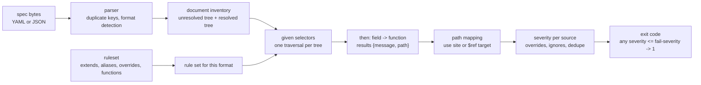

# Automated OpenAPI Linting: Writing Custom Rulesets for vacuum (v0.39.0) and Spectral (v6.17.0)

> [!summary] Claim
> A lint rule is a selector (`given`) plus an assertion (`then`), and the same YAML ruleset can run on Spectral and vacuum, but the two engines disagree on where a finding lands, which rules an override touches, what a malformed selector does, and even what an "ID" is, so a ruleset is code that needs its own good and bad fixture tests.

Part of [OpenAPI JSON Schema and Contracts](README.md) in [API Engineering](../README.md).

## TL;DR

- Mechanism: each rule's `given` JSONPath selects nodes in the `$ref`-resolved document, `then.field` narrows each node to a target, and `then.function` (`truthy`, `pattern`, `schema`, or your own JavaScript) returns zero or more `{message, path}` results that the engine maps back to a source line, a severity, and an exit code.
- Contract rule: severities are numbered `error=0`, `warn=1`, `info=2`, `hint=3`, a rule with no `severity` is `warn` in both engines, and both CLIs exit `1` when any result is at or above `--fail-severity` (default `error`) and `2` for a tool or input error.
- Trap: a typo in `given` (`$.pathz`) selects nothing and both engines exit `0` with no output, so a green lint run proves nothing until a known-bad fixture is shown to fail; the engines also disagree on malformed selectors, since Spectral 6.17.0 silently evaluated the unterminated `$.paths[*` as `$.paths[*]` while vacuum rejected it with exit `2`.
- Portability fact: the same ruleset gave 7 findings in both engines on the lab's bad document, but Spectral reported a `$ref`'d parameter at `components.parameters.OrderId.schema` while vacuum reported it at the use site, and after `extends: [[spectral:oas, off]]` the override `operation-operationId: error` re-enabled the rule in Spectral and was ignored by vacuum.
- When not to use it: a linter checks the shape of one document; it cannot see breaking changes between versions ([[Breaking-Change-Detection-and-Semantic-OpenAPI-Diffing]]), drift between the spec and the code ([[Design-First-vs-Code-First-OpenAPI-and-CI-Drift-Gates]]), or whether the server honours the contract ([[Response-Schema-Conformance-Enforcement-in-Test-Suites]]).

## Mental model



The parser turns bytes into a tree and decides the document's format (`oas3_1`, `oas3_2`, and so on), and that format filters which rules are relevant at all.
The document inventory keeps two trees, the document as written and the document with every `$ref` resolved; a rule runs on the resolved tree unless it says `resolved: false`.
The ruleset loader flattens `extends`, expands `#Alias` references into JSONPath strings, and registers custom functions.
The runner evaluates every `given` against the chosen tree, calls `then.function` once per matched target, and collects results.
The last two boxes are where the engines differ most: a result path computed on the resolved tree has to be mapped back to a line in a real file, and that mapping decides which override, ignore entry, or inline suppression applies before the severities are compared with `--fail-severity` to produce the exit code.

## How it works

### The rule contract: `given`, `then`, `field`, `function`

A rule in either engine has the same declarative shape:

```yaml
rules:
  acme-operation-id:
    description: Every operation must have an operationId.
    message: "{{description}} {{error}}"
    severity: error
    given: "#Operation"
    then:
      field: operationId
      function: truthy
```

Spectral's runner groups every enabled, format-matching rule by its expanded `given` strings into two callback maps, `resolved` and `unresolved`, and runs one Nimma traversal per tree, so a hundred rules that share a selector cost one walk, not a hundred (spectral-core 1.24.0 src/runner/runner.ts, Runner.run).
Nimma is constructed with `jsonPathPlus` as its fallback, which is the engine that evaluates expressions Nimma cannot compile itself (spectral-core 1.24.0 src/runner/runner.ts, execute).
For each matched node, `lintNode` computes the lint targets from `then.field` (spectral-core 1.24.0 src/runner/utils/getLintTargets.ts, getLintTargets):

- `field: "@key"` makes every key of the matched object a target, which is how you lint path templates or response codes as strings.
- A `field` that starts with `$` is evaluated as a JSONPath relative to the matched node.
- Any other `field` is a lodash path (`a.b[0]`), so `field: operationId` reads one property, and a missing property still yields one target whose value is `undefined`, which is why `truthy` on a missing `operationId` fires instead of silently skipping.
- If a `$` field or `@key` produces no target at all, the function is still called once with `undefined` on the matched node's own path ("must call then at least once, with no document").

The function receives `(targetValue, functionOptions, context)` and returns an array of results or a promise of one; an exception from a function is rethrown as `Function "<name>" threw an exception`, which aborts the run rather than producing a finding (spectral-core 1.24.0 src/runner/lintNode.ts, lintNode).

vacuum implements the same contract in Go over `yaml.Node` trees: `runRule` expands aliases, evaluates each `given` with `findRuleGivenNodes`, decodes `then` as one action or a list of actions, and builds results per node (vacuum 0.39.0 motor/rule_applicator.go, runRule).
Each JSONPath evaluation runs in a goroutine raced against a timer with a 500 ms default (`--lookup-timeout`), and each rule against a 5 s default (`--timeout`) (vacuum 0.39.0 motor/rule_jsonpath.go, findRuleGivenNodes; motor/rule_runner.go, runRuleContexts).
vacuum compiles selectors with `jsonpathConfig.WithSpectralCompatibility()` from `pb33f/jsonpath`, which is the code path that lets one YAML ruleset run on both engines (vacuum 0.39.0 motor/rule_jsonpath.go, compileRuleGivenPath).

### The selector language is JSONPath-Plus, not RFC 9535

RFC 9535 standardised JSONPath in 2024, but Spectral rulesets are written in the JSONPath-Plus dialect that predates it, and the differences matter for rule authors:

| Construct | Spectral and vacuum rulesets | RFC 9535 |
|---|---|---|
| Regex test in a filter | `[?(@property.match(/^[45]/))]`, a JavaScript regex on the member name | `[?match(@.name, "re")]`, an I-Regexp (RFC 9485) on a value, whole-string match (RFC 9535 Section 2.4.6) |
| Member name in a filter | `@property` | not available |
| Parent of the match | trailing `^` (used by the OWASP ruleset) | not available |
| Several members | `[get,put,post]` | `['get','put','post']` (RFC 9535 Section 2.5.1) |
| Descendants | `..` | `..` (RFC 9535 Section 2.5.2) |

RFC 9535 Section 2.1.2 defines the result of a query as a nodelist that every implementation must reproduce exactly; JSONPath-Plus makes no such promise, which is why the same selector can behave differently across engines.

Aliases remove repetition and are expanded textually before evaluation.
`#Operation.responses` becomes each target of `Operation` with `.responses` appended, an alias that refers to itself throws `Alias "X" is circular. Resolution stack: ...`, and an unknown alias throws `Alias "X" does not exist` (spectral-core 1.24.0 src/ruleset/alias.ts, resolveAlias and _resolveAlias).
A scoped alias maps formats to targets, and resolution walks the targets from the end so the last matching format wins (spectral-core 1.24.0 src/ruleset/alias.ts, resolveAliasForFormats).
The built-in `#OperationObject` alias in `spectral:oas` is `#PathItem[get,put,post,delete,options,head,patch,trace]` (spectral-rulesets 1.23.0 src/oas/index.ts, aliases), so it does not include the `query` field that OpenAPI 3.2.0 adds to the Path Item Object or the `additionalOperations` map (OAS 3.2.0 Section 4.9.1).

### Resolved trees and where a finding lands

Rules default to the resolved tree in both engines: Spectral sets `resolved = definition.resolved !== false` (spectral-core 1.24.0 src/ruleset/rule.ts, Rule constructor), and vacuum sets `rule.Resolved = true` when the key is absent (vacuum 0.39.0 rulesets/rulesets.go, CreateRuleSetUsingJSON and GenerateRuleSetFromSuppliedRuleSetWithHTTPClient).
On a resolved tree, a parameter written as `{"$ref": "#/components/parameters/OrderId"}` is the component's object itself, so a rule sees through references, but the result path now points into an object that does not exist at that location in any file.

Spectral maps the path back with `findAssociatedItemForPath`, which finds the closest real path and walks the unresolved tree until it meets a `$ref`, then reports at the reference target (spectral-core 1.24.0 src/documentInventory.ts, DocumentInventory.findAssociatedItemForPath).
It then removes duplicates by a fingerprint of `code`, `path`, `source`, and `message` (spectral-core 1.24.0 src/runner/utils/results.ts, computeResultFingerprint), so a bad component referenced from ten operations is one finding at `components.parameters.OrderId.schema`.
vacuum keeps the use site: the same document produced one finding per referencing location, at `paths//orders/{orderId}/items/parameters/0`.
Measured on the lab's bad document (both outputs in the Worked example), the counts agreed (7 and 7) only because the component happened to be used once.

Message templates also differ.
With `message: "{{description}} {{error}}"`, Spectral printed `Every operation must have an operationId. "get.operationId" property must be truthy`, and vacuum printed `Every operation must have an operationId. Every operation must have an operationId.: ...`, because vacuum's `{{error}}` already includes the description.

### Severity, `extends`, and the exit code

Spectral's numbering is `DiagnosticSeverity`: `Error=0`, `Warning=1`, `Information=2`, `Hint=3`, and the default for a rule without `severity` is `DEFAULT_SEVERITY_LEVEL = DiagnosticSeverity.Warning` (spectral-core 1.24.0 src/ruleset/utils/severity.ts).
vacuum's `spectral-report` JSON uses the same integers; a probe rule without a severity came out as `1` in vacuum and `warning` in Spectral.
`spectral lint` fails the run when `results.some(r => r.severity <= diagnosticSeverity)` (spectral-cli 6.17.0 src/commands/lint.ts, severeEnoughToFail) and calls `process.exit(2)` on a runtime error; vacuum documents the same three codes as constants, `0` success, `1` violations at threshold, `2` tool or input error (vacuum 0.39.0 cmd/exit_codes.go).
Both default the threshold to `error`: `-F/--fail-severity` in Spectral, `-n/--fail-severity` in vacuum, which also accepts `none` (vacuum 0.39.0 cmd/lint_cmd.go).
vacuum has a second failure path: `--min-score N` with `N > 10` also exits `1` when the quality score is below `N`; the default of `10` disables it (vacuum 0.39.0 cmd/lint_cmd.go, `scoreFailed`).

`extends: [[spectral:oas, recommended]]` enables rules whose `recommended !== false`, `all` enables every rule, and `off` disables them all while keeping them defined (spectral-core 1.24.0 src/ruleset/rule.ts, Rule.isEnabled).
A later `rules: {name: error}` sets that rule's severity, which in Spectral also turns an `off` rule back on (spectral-core 1.24.0 src/ruleset/mergers/rules.ts, mergeRule; measured: `operation-operationId` fired as an `error` after `extends: [[spectral:oas, off]]`).
vacuum's `off` is a deletion: `extends: [[spectral:oas, off]]` replaces the rule map with an empty one (`rs.Rules = make(map[string]*model.Rule)`), a per-rule `off` calls `delete(rs.Rules, k)`, and a later string severity for a rule that is no longer present logs `Rule does not exist, ignoring it` and does nothing, while a boolean `true` copies the rule back in from the built-in set (vacuum 0.39.0 rulesets/rulesets.go, GenerateRuleSetFromSuppliedRuleSetWithHTTPClient).
Measured: the `error` form gave vacuum `containing 0 rules`, and the `true` form gave `containing 1 rules`, with the re-added rule at vacuum's built-in severity `error` while Spectral ran the same `true` form at `warning`.
vacuum treats `extends: spectral:oas` as its own recommended set (55 rules in 0.39.0), not as Spectral's (57 defined, 46 recommended in spectral-rulesets 1.23.0).

### Suppressing findings: overrides, ignore files, and `x-lint-ignore`

Spectral's `overrides` take `files` entries that are globs, optionally with a JSON Pointer fragment, and per-rule severities, resolved per result in `Rule.getSeverityForSource`; `off` maps to `-1` (spectral-core 1.24.0 src/ruleset/utils/severity.ts, SEVERITY_MAP), and a `-1` result is dropped (spectral-core 1.24.0 src/runner/lintNode.ts, processTargetResults).
Because the match is against the mapped path, an override on `bad.json#/paths/~1orders~1%7BorderId%7D/parameters/0` removed the inline parameter's finding but not the finding Spectral had moved to `components.parameters.OrderId.schema` (measured: 7 findings -> 6).

vacuum supports two suppression mechanisms Spectral lacks.
An `x-lint-ignore` key naming rule IDs on any node suppresses those rules for that node and its children; vacuum builds a node -> rule-ID index once per run and returns `nil` when the document has none (vacuum 0.39.0 motor/inline_ignore.go, buildInlineIgnoreIndex).
An `--ignore-file` is YAML mapping rule IDs to JSONPath locations, which `vacuum generate-ignorefile` produces from a report, so a team can adopt a strict ruleset with a baseline and fail only on new findings (vacuum 0.39.0 cmd/generate_ignorefile.go).
Measured: `x-lint-ignore: acme-error-problem-json` on the `404` response took vacuum from 7 findings to 6, and Spectral, which treats `x-*` keys as plain data (OAS 3.2.0 Section 5), still reported both `acme-error-problem-json` findings.

### Custom functions in each engine

Spectral loads a YAML ruleset by migrating it to a JavaScript module; each name in `functions:` becomes an import of `<functionsDir or "functions">/<name>.js` next to the ruleset (spectral-ruleset-migrator 1.13.0 src/transformers/functions.ts).
The function is an ES module default export:

```js
// Spectral custom function: collection GETs must declare the listed query parameters.
const names = (parameters) =>
  new Set((parameters ?? []).filter((p) => p && p.in === "query").map((p) => p.name));

export default (paths, options, context) => {
  const results = [];
  for (const [template, item] of Object.entries(paths ?? {})) {
    if (template.endsWith("}") || !item || typeof item.get !== "object") continue;
    const declared = new Set([...names(item.parameters), ...names(item.get.parameters)]);
    for (const required of options.required) {
      if (!declared.has(required)) {
        results.push({
          message: `GET ${template} is a collection and must declare the "${required}" query parameter.`,
          path: [...context.path, template, "get"],
        });
      }
    }
  }
  return results;
};
```

Wrapping it in `createRulesetFunction({input, options}, fn)` from `@stoplight/spectral-core` validates the input and options against JSON Schemas before the function runs; the built-in `schema` function is written that way (spectral-functions 1.11.0 src/schema/index.ts, schema).

vacuum runs JavaScript functions in goja, an ECMAScript interpreter written in Go, with no Node.js runtime.
A function file from the `-f` directory must define a global `getSchema()` that returns a non-empty `name` and a global `runRule(input)`; options arrive through a global `context`, built-in functions are callable as `vacuum_<name>`, and each invocation per node has a 5 s default timeout (vacuum 0.39.0 plugin/javascript/js_plugin.go, DefaultRuleTimeout and JSRuleFunction).
The same rule therefore needed a second file:

```js
// vacuum custom function: collection GETs must declare the listed query parameters.
function getSchema() {
  return { name: "paginationParams", description: "collection GETs declare pagination parameters" };
}

function queryNames(parameters) {
  return (parameters || []).filter((p) => p && p.in === "query").map((p) => p.name);
}

function runRule(paths) {
  const required = context.ruleAction.functionOptions.required;
  const results = [];
  for (const template of Object.keys(paths || {})) {
    const item = paths[template];
    if (template.endsWith("}") || !item || typeof item.get !== "object") continue;
    const declared = queryNames(item.parameters).concat(queryNames(item.get.parameters));
    for (const name of required) {
      if (declared.indexOf(name) === -1) {
        results.push({
          message: 'GET ' + template + ' is a collection and must declare the "' + name + '" query parameter.',
          path: "$.paths['" + template + "'].get",
        });
      }
    }
  }
  return results;
}
```

vacuum 0.39.0 can also load a Spectral-style JavaScript ruleset module and provides shims for `@stoplight/spectral-core` (`createRulesetFunction`), `@stoplight/spectral-functions` (the 13 core functions bound to vacuum's native ones), and `@stoplight/spectral-formats`, but that formats shim exports only `oas2`, `oas3`, `oas3_0`, `oas3_1`, `asyncapi2`, and `asyncapi3`, with no `oas3_2` (vacuum 0.39.0 plugin/jsruleset/compatibility.go, compatibilityModules).
Go plugins (`.so` files) are a third option (vacuum 0.39.0 plugin/plugin_loader.go).

### The four house rules, and why each is written the way it is

The ruleset below is the file that was run on both engines for this note; it implements the lab plan.

```yaml
aliases:
  PathItem:
    - "$.paths[*]"
  Operation:
    - "#PathItem[get,put,post,delete,options,head,patch,trace,query]"
  Parameter:
    - "#PathItem.parameters[*]"
    - "#Operation.parameters[*]"
functions:
  - paginationParams
rules:
  acme-operation-id:
    description: Every operation must have an operationId.
    message: "{{description}} {{error}}"
    severity: error
    given: "#Operation"
    then:
      field: operationId
      function: truthy
  acme-error-problem-json:
    description: Every 4xx and 5xx response must offer application/problem+json (RFC 9457).
    severity: error
    given:
      - "#Operation.responses[?(@property.match(/^[45]/))]"
      - "#Operation.responses.default"
    then:
      function: schema
      functionOptions:
        schema:
          type: object
          required: [content]
          properties:
            content:
              type: object
              required: ["application/problem+json"]
  acme-collection-pagination:
    description: A GET on a collection path must declare the limit and cursor query parameters.
    message: "{{error}}"
    severity: warn
    given: "$.paths"
    then:
      function: paginationParams
      functionOptions:
        required: [limit, cursor]
  acme-no-numeric-ids:
    description: Identifier parameters must not be integers.
    severity: error
    given: "#Parameter"
    then:
      function: schema
      functionOptions:
        schema:
          if:
            required: [name]
            properties:
              name:
                pattern: "(^id$|_id$|Id$|-id$)"
          then:
            properties:
              schema:
                not:
                  required: [type]
                  properties:
                    type:
                      anyOf:
                        - const: integer
                        - type: array
                          contains:
                            const: integer
```

`acme-operation-id` uses `truthy`, not `defined`, because `operationId: ""` is defined but useless to a code generator; measured on a probe document, Spectral's built-in `truthy`-based `operation-operationId` flagged the empty string.
OpenAPI requires the value to be unique and case-sensitive (OAS 3.2.0 Section 4.10.1, unchanged from 3.1.1), which a per-node function cannot check; `spectral:oas` has a separate `operation-operationId-unique` rule whose `given` is `$.paths` for exactly that reason (spectral-rulesets 1.23.0 src/oas/index.ts).
The custom `Operation` alias adds `query`, because both engines' built-in operation rules skipped a `query` operation in a 3.2.0 probe document.

`acme-error-problem-json` selects response codes by key with `@property.match(/^[45]/)`, which also catches the range keys `4XX` and `5XX` that OpenAPI allows (OAS 3.2.0 Section 4.16.2), and adds `default` as a second `given`, since a `default` response is how most specs describe errors.
The assertion is a JSON Schema on the Response Object, requiring the `application/problem+json` media type that RFC 9457 Section 3 defines for the problem details object; the rule cannot check that the body schema carries `type`, `title`, and `status` (RFC 9457 Section 3.1) without a second rule on `content['application/problem+json'].schema`, which is a reasonable next step.
Spectral's `schema` function picks the JSON Schema dialect from `$schema`, falling back to draft 7, so `if`/`then` and `contains` work but 2020-12-only keywords need an explicit `dialect` (spectral-functions 1.11.0 src/schema/index.ts, schema).

`acme-collection-pagination` needs a function because "collection" is a property of the path key (it does not end in a template segment), and a rule must also merge path-level and operation-level parameters, which the OpenAPI Path Item Object defines as overridable by `name` and `in` (OAS 3.2.0 Section 4.9.1).
The JavaScript versions above work only because the rule runs on the resolved tree, which is the default.
With `resolved: false` each referenced parameter is still `{"$ref": ...}`, `p.in` is `undefined`, and the rule would report every collection `GET`; the lab's Python version resolves references explicitly for that reason.

`acme-no-numeric-ids` keeps the selector simple (`#Parameter`) and moves the decision into a JSON Schema `if`/`then`, so the name test and the type test are visible in one place and the type test understands OpenAPI 3.1 type arrays such as `["integer", "null"]`.

### Two published "no numeric IDs" rules that disagree

OWASP API1:2023 (Broken Object Level Authorization) is the reason style guides ban guessable IDs.
spectral-owasp-ruleset 2.0.1 (npm `latest`, published 2024-03-12) defines `owasp:api1:2023-no-numeric-ids` with `given: $.paths..parameters[*][?(@property === "name" && (@ === "id" || @.match(/(_id|Id|-id)$/)))]^.schema` and asserts that the schema must not validate against `{properties: {type: {const: "integer"}}}`.
That inner schema is satisfied when `type` is absent, so the rule flags an untyped schema, and is not satisfied by `["integer", "null"]`, so it misses an OpenAPI 3.1 nullable integer.
vacuum's `owasp-no-numeric-ids` is native Go: it lower-cases the name, tests `HasSuffix(name, "id")` (which subsumes its `_id` and `-id` tests), and checks `slices.Contains(type, "integer")` (vacuum 0.39.0 functions/owasp/no_numeric_ids.go, NoNumericIds.RunRule).
Measured on one probe document (Spectral running the 2.0.1 rule copied into a local ruleset, vacuum running `vacuum:owasp`):

| Parameter | Schema | spectral-owasp 2.0.1 | vacuum 0.39.0 | lab rule |
|---|---|---|---|---|
| `bid` | `{type: integer}` | not flagged | flagged | not flagged |
| `orderId` | `{type: [integer, "null"]}` | not flagged | flagged | flagged |
| `id` | `{}` | flagged | not flagged | not flagged |
| `ID` | `{type: integer}` | not flagged | flagged | flagged |

Every row is a disagreement, and each engine is wrong somewhere: vacuum flags `bid` (and would flag `paid` or `grid`), and the Spectral rule misses `ID` and nullable integers.

## Numbers and limits

Measured on an Apple M3 Pro, macOS 27.3 (Darwin 27.3.0, arm64), Node.js v26.13.1, `@stoplight/spectral-cli` 6.17.0 from npm and the vacuum 0.39.0 darwin arm64 release binary, on 2026-11-12, one run each unless stated.
`npm install @stoplight/spectral-cli@6.17.0` resolved spectral-core 1.24.1, spectral-functions 1.11.1, and spectral-rulesets 1.23.1 (patch releases of 2026-11-06, because the CLI declares caret ranges); a diff of those tags against 1.24.0, 1.11.0, and 1.23.0 changes alias ownership in `rule.ts`, error wording in `schema/index.ts`, and one discriminator `given`, none of which touch the code cited here.
Newer releases exist and were not tested: spectral-cli 6.17.1 (npm `latest`, 2026-11-06) and vacuum v0.40.1 (latest tag) (as of 2026-11).

| Quantity | Value | Source |
|---|---|---|
| Rules in `spectral:oas` (rulesets 1.23.1) | 57 defined, 46 enabled by `recommended` | measured, `spectral lint --verbose` (`Found 57 rules (46 enabled)`) |
| Rules in vacuum `recommended` / `all` / `vacuum:owasp` / `--hard-mode` | 55 / 69 / 26 / 95 | measured, vacuum banner line |
| Spectral, 4-rule custom ruleset, lab good document | 0.45 s, 0.44 s, 0.44 s wall (3 runs) | measured, `/usr/bin/time -p spectral lint good.json -r ruleset.yaml` |
| vacuum, same ruleset and document | 0.03 s wall (3 runs) | measured, `/usr/bin/time -p vacuum lint -r ruleset.yaml -f vfunctions good.json` |
| Stripe spec (`stripe/openapi` commit `a045100c`, `openapi/spec3.json`), 8,317,513 bytes JSON, `openapi: 3.0.0`, `info.version` `2026-09-30.endive`, 431 paths, recommended rules | Spectral 10.90 s wall, 489 MB max RSS; vacuum 1.31 s wall, 1,011 MB max RSS | measured, `/usr/bin/time -l spectral lint spec3.json -r rec.yaml -f json` (`rec.yaml` is `extends: [[spectral:oas, recommended]]`) and `/usr/bin/time -l vacuum spectral-report spec3.json`, single run |
| Findings on that spec | Spectral 618 (all `warn`); vacuum 23,989 (2 `error`, 16,623 `warn`, 7,364 `info`) | measured |
| Top vacuum findings on that spec | `camel-case-properties` 8,834, `description-duplication` 7,364, `oas3-missing-example` 3,614 | measured |
| vacuum JSONPath lookup timeout | 500 ms default, `--lookup-timeout` | vacuum 0.39.0 motor/rule_runner.go, runRuleContexts; cmd/root.go |
| vacuum rule timeout | 5 s default, `-g/--timeout` | vacuum 0.39.0 cmd/root.go |
| vacuum JavaScript function timeout | 5 s per node | vacuum 0.39.0 plugin/javascript/js_plugin.go, DefaultRuleTimeout |
| Exit codes, both CLIs | `0` clean, `1` findings at threshold, `2` tool or input error | spectral-cli 6.17.0 src/commands/lint.ts; vacuum 0.39.0 cmd/exit_codes.go |
| Severity integers | `error=0`, `warn=1`, `info=2`, `hint=3` | spectral-core 1.24.0 src/ruleset/utils/severity.ts |

The two engines' recommended sets differ, so the 618-versus-23,989 gap is not comparable speed for equal work; it is the cost of adopting each default set on a large real spec.
The vacuum timing is one run, and its memory is roughly twice Spectral's on this input (1,011 MB versus 489 MB); neither number is a benchmark.
The finding counts are deterministic for a fixed spec and ruleset; the wall times and RSS are single runs, so read them as magnitudes.

## Portability

The lab is pure Python with no I/O; it ran once on the workspace interpreter only, because lab matrix runs were paused for this draft (see `report.md`).

| Leg | Result | Evidence |
|---|---|---|
| CPython 3.14.6 (workspace) | 32 passed | measured, `uv run --frozen pytest`, macOS 27.3 arm64 |
| CPython 3.12, 3.13, 3.15, 3.15t | not run | the module uses the PEP 695 `type` statement, so 3.12 is the floor (`requires-python = ">=3.12,<3.16"`) |
| Uvicorn, Hypercorn, Granian; HTTP/1.1, HTTP/2, HTTP/3 | not applicable | linting reads a static document and opens no connection |

The portability that matters for this topic is between engines and specification versions:

| Behaviour | Spectral 6.17.0 | vacuum 0.39.0 | Evidence |
|---|---|---|---|
| Same 4-rule ruleset on bad document | 7 findings, 5 `error` | 7 findings, 5 `error` | measured |
| Finding inside a `$ref` target | reported once at the component | reported at each use site | measured; DocumentInventory.findAssociatedItemForPath |
| Rule without `severity` | `warn` | `warn` (`1`) | measured |
| `rule: error` after `extends: [[spectral:oas, off]]` | rule re-enabled | ignored, 0 rules | measured; mergers/rules.ts, rulesets.go |
| Unterminated `given: "$.paths[*"` | accepted and evaluated as `$.paths[*]` (a `falsy` rule reported all 3 path items, exit `1`) | `unmatched [` lookup error, exit `2` | measured |
| `given` without `$` (`"paths"`) | ruleset rejected, `must be a valid JSON Path expression`, exit `2` | lookup error `expected '$'`, exit `2` | measured |
| Unknown function name | exit `2` | exit `2` | measured |
| Duplicate YAML key `/a` | `parser` error finding, lint continues on the last value | `failed to decode YAML to JSON`, exit `2` | measured |
| `openapi: 4.0.0` | `unrecognized-format` warning, exit `0` | `unable to parse the document`, exit `1` | measured |
| `x-lint-ignore` | no effect | suppresses the rule for that node | measured; inline_ignore.go |
| OpenAPI 3.2 `query` in built-in operation rules | skipped (`#OperationObject` lists 8 methods) | skipped by `operation-operationId` on the probe | measured; spectral-rulesets 1.23.0 src/oas/index.ts |
| Custom JavaScript | Node ES module, `export default` | goja globals `getSchema` and `runRule` | source, both |

## Worked example

The lab is a 233-line Spectral-semantics linter in Python that implements the four house rules, both result-path policies, and the exit-code rule, and models the two published OWASP rules: [implementation](../labs/src/api_labs/f08_openapi_json_schema_and_contracts/openapi_style_linter.py) and [test](../labs/tests/f08_openapi_json_schema_and_contracts/test_openapi_linting_and_automated_style_governance_with_vacuum_and_spectral.py).
The `good.json` and `bad.json` files that were run through both CLIs are the lab's `GOOD` and `make_bad()` documents written with `json.dumps(doc, indent=2)`, so the lab's expected findings can be compared line by line with real engine output.

The two path policies differ by one line in `_emit`:

```python
    def _emit(
        self, code: str, sev: Severity, msg: str, use: JsonPath, definition: JsonPath | None
    ) -> None:
        # Spectral (resolved rules) reports a finding inside a $ref target at the target's
        # own location and dedupes on code+path+message; vacuum keeps the use site.
        path = definition if self.report == "definition" and definition is not None else use
        diag = Diagnostic(path, code, msg, sev)
        if diag not in self.results:
            self.results.append(diag)
```

Parameters are resolved and merged the way OpenAPI defines it, so an operation-level parameter replaces a path-level one with the same `name` and `in`:

```python
    def _parameters(self, op: Operation) -> Iterator[tuple[Mapping[str, Any], JsonPath, Any]]:
        """Effective parameters: operation entries override path-item ones by (name, in)."""
        merged: dict[tuple[str, str], tuple[Mapping[str, Any], JsonPath, Any]] = {}
        sources = ((op.item, ("paths", op.template)), (op.node, op.path))
        for owner, owner_path in sources:
            for index, raw in enumerate(cast("list[Any]", owner.get("parameters") or [])):
                param, definition = resolve(self.doc, raw)
                key = (str(param.get("name")), str(param.get("in")))
                merged[key] = (param, (*owner_path, "parameters", index), definition)
        yield from merged.values()
```

The identifier test uses token boundaries instead of a bare suffix:

```python
# "id", "order_id", "order-id", "orderId", "orderID", "ID"; not "bid", "paid", "grid".
IDENTIFIER_NAME = re.compile(r"^(?:id|ID|Id)$|[_-](?:id|ID|Id)$|(?<=[a-z0-9])(?:Id|ID)$")
```

The use-site test asserts the same seven rule and location pairs vacuum produced, except that the lab extends the two numeric-ID paths to the offending `schema/type` (simplified excerpt, the assertion only):

```python
    assert codes_and_paths(results) == [
        ("acme-collection-pagination", "paths//orders/get"),
        ("acme-collection-pagination", "paths//orders/get"),
        ("acme-operation-id", "paths//orders/get/operationId"),
        ("acme-error-problem-json", "paths//orders/get/responses/400"),
        ("acme-error-problem-json", "paths//orders/{orderId}/get/responses/404"),
        ("acme-no-numeric-ids", "paths//orders/{orderId}/parameters/0/schema/type"),
        ("acme-no-numeric-ids", "paths//orders/{orderId}/items/parameters/0/schema/type"),
    ]
```

The real vacuum 0.39.0 result for the same document, from `vacuum spectral-report -r ruleset.yaml -f vfunctions bad.json bad.vacuum.json` (exit `0`; `spectral-report` writes a report and does not gate) and printed as `severity code path start message[:90]`:

```text
1 acme-collection-pagination paths//orders/get {'line': 7, 'character': 12} GET /orders is a collection and must declare the "limit" query parameter.
1 acme-collection-pagination paths//orders/get {'line': 7, 'character': 12} GET /orders is a collection and must declare the "cursor" query parameter.
0 acme-operation-id paths//orders/get/operationId {'line': 9, 'character': 14} Every operation must have an operationId. Every operation must have an operationId.: `oper
0 acme-error-problem-json paths//orders/get/responses/400 {'line': 14, 'character': 18} Every 4xx and 5xx response must offer application/problem+json (RFC 9457).: missing proper
0 acme-no-numeric-ids paths//orders/{orderId}/parameters/0 {'line': 40, 'character': 9} Identifier parameters must not be integers.: 'not' failed
0 acme-error-problem-json paths//orders/{orderId}/get/responses/404 {'line': 55, 'character': 18} Every 4xx and 5xx response must offer application/problem+json (RFC 9457).: missing proper
0 acme-no-numeric-ids paths//orders/{orderId}/items/parameters/0 {'line': 63, 'character': 9} Identifier parameters must not be integers.: 'not' failed
```

The real Spectral 6.17.0 result, from `spectral lint bad.json -r ruleset.yaml` (exit `1`; directory prefix removed, and the summary line's non-ASCII marker glyph replaced with `x`):

```text
bad.json
  9:13  warning  acme-collection-pagination  GET /orders is a collection and must declare the "limit" query parameter.            paths./orders.get
  9:13  warning  acme-collection-pagination  GET /orders is a collection and must declare the "cursor" query parameter.           paths./orders.get
  9:13    error  acme-operation-id           Every operation must have an operationId. "get.operationId" property must be truthy  paths./orders.get
 16:23    error  acme-error-problem-json     Every 4xx and 5xx response must offer application/problem+json (RFC 9457).           paths./orders.get.responses[400].content
 44:20    error  acme-no-numeric-ids         Identifier parameters must not be integers.                                          paths./orders/{orderId}.parameters[0].schema
 55:17    error  acme-error-problem-json     Every 4xx and 5xx response must offer application/problem+json (RFC 9457).           paths./orders/{orderId}.get.responses[404]
 92:18    error  acme-no-numeric-ids         Identifier parameters must not be integers.                                          components.parameters.OrderId.schema

x 7 problems (5 errors, 2 warnings, 0 infos, 0 hints)
```

The last line of each block is the portability point: the same `$ref`'d parameter is `components.parameters.OrderId.schema` in Spectral and `paths//orders/{orderId}/items/parameters/0` in vacuum, which the lab's `test_definition_reporting_moves_ref_findings_to_the_component_like_spectral` and `test_definition_reporting_dedupes_a_component_used_twice` pin down.

Captured from `labs/` with CPython 3.14.6 on macOS 27.3 (arm64):

```text
$ uv run --frozen pytest tests/f08_openapi_json_schema_and_contracts/test_openapi_linting_and_automated_style_governance_with_vacuum_and_spectral.py -q
................................                                         [100%]
32 passed in 0.17s
```

## Pitfalls

> [!warning] A selector typo turns a rule into a permanent pass
> Trigger: `given: "$.pathz[*][get,post]"` or an alias that no longer matches after a refactor.
> Symptom: measured on both engines, zero findings and exit `0`, with no warning that the selector matched nothing.
> Fix: keep a known-bad fixture per rule and assert that it fails in CI, as the lab does.
> vacuum's engine also has a per-selector match-count record (`SelectorEvidence{Given, Matches}` in vacuum 0.39.0 motor/rule_applicator.go, runRule); `vacuum lint` does not expose it, but the `vacuum test <suite.yaml>` harness always collects it and `--evidence detailed` adds matched source samples (vacuum 0.39.0 harness/run.go; cmd/test.go, GetTestCommand), so a suite can assert that a selector matched at least once.

> [!warning] Spectral accepted an unterminated selector
> Trigger: `given: "$.paths[*"` (missing `]`).
> Symptom: Spectral 6.17.0 accepted the ruleset and evaluated the selector as `$.paths[*]`: a `falsy` rule reported all three path items and exited `1`, so the same ruleset means something on one engine and is an error on the other; vacuum exited `2` with `Spectral compatibility mode: unmatched [` and a caret under the column.
> Mechanism: Nimma 0.2.3 throws `Error parsing $.paths[*`, and the runner's `jsonPathPlus` fallback (jsonpath-plus 10.4.0) then evaluates the expression leniently (measured by calling both directly with Spectral's Nimma options; spectral-core 1.24.0 src/runner/runner.ts, execute).
> Fix: lint the ruleset with the stricter engine, or with a fixture test, before trusting it.

> [!warning] Descendant selectors reach into schemas
> Trigger: `$.paths..parameters[*]`, the shape the OWASP rule uses.
> Symptom: measured on a probe document, both engines matched a request-body schema property that happened to be named `parameters` and reported `every parameter needs a name` at `...schema.properties.parameters.properties`.
> Fix: anchor selectors to the object model (`$.paths[*].parameters[*]`, `$.paths[*][get,...].parameters[*]`) and use `..` only when the target cannot appear inside a schema.

> [!warning] Suppression aimed at the wrong location
> Trigger: a Spectral `overrides` entry or a vacuum ignore entry written against the use site of a `$ref`'d object.
> Symptom: the finding survives, because Spectral moved it to the component (measured: the JSON Pointer override removed 1 of 2 numeric-ID findings).
> Fix: suppress at the location the engine reports, and prefer fixing the component, since one component finding stands for every use.

> [!warning] Migrating a ruleset from Spectral to vacuum silently drops re-enabled rules
> Trigger: `extends: [[spectral:oas, off]]` followed by `rules: {operation-operationId: error}`.
> Symptom: Spectral runs the rule; vacuum logs `Rule does not exist, ignoring it` and runs 0 rules.
> Fix: write `operation-operationId: true` and set the severity in a second ruleset that extends the first, or extend `recommended` and turn rules off instead of on; note that `true` alone gave `error` in vacuum (its built-in severity) and `warning` in Spectral.

> [!warning] OpenAPI 3.2 operations escape built-in operation rules
> Trigger: a `query` operation or an `additionalOperations` entry in an `openapi: 3.2.0` document.
> Symptom: measured, neither engine's built-in `operation-operationId` flagged a `query` operation that had no `operationId`.
> Fix: define your own operation alias that includes `query`, and a separate rule for `additionalOperations[*]`; also remember that a pagination rule that looks for `in: query` will not see an OpenAPI 3.2 `in: querystring` parameter (OAS 3.2.0 Section 4.12.1).

> [!warning] Parse failures look like lint results, or like success
> Trigger: a duplicated YAML key, or an `openapi` version string the engine does not know.
> Symptom: Spectral reported `Duplicate key: /a` as an `error` finding and linted the last value, and gave `openapi: 4.0.0` only an `unrecognized-format` warning with exit `0`; vacuum exited `2` and `1` for the same inputs.
> Fix: run with `--fail-severity warn` or treat `parser` and `unrecognized-format` as gate failures, and see [[YAML-Media-Type-RFC-9512-and-OpenAPI-YAML-Parser-Hazards]] for why duplicate keys are a security issue.

> [!warning] Reusing a published rule without reading its schema
> Trigger: adopting `owasp:api1:2023-no-numeric-ids` or `owasp-no-numeric-ids` as a blocking `error`.
> Symptom: false positives on `bid` and `paid` in vacuum, false negatives on `ID` and `["integer", "null"]` in Spectral (table above).
> Fix: read the rule's `given` and `functionOptions` before promoting it, and keep a fixture of edge-case names alongside the ruleset.

No CVE or public postmortem specific to Spectral or vacuum rule evaluation is cited here; none was found that could be verified from a primary source.

## Security and robustness

- A ruleset is code.
  Spectral's `--resolver` flag loads an arbitrary module with `require` (spectral-cli 6.17.0 src/services/linter/utils/getResolver.ts, getResolver), and custom functions get no sandbox: the CLI bundles the ruleset and its functions to CommonJS and runs the bundle with `Function('module, require', source)(m, _require)` inside the Node.js process, with a working `require` (spectral-cli 6.17.0 src/services/linter/utils/getRuleset.ts, load).
  vacuum runs JavaScript in goja with per-node timeouts, and the `fetch()` it gives those functions refuses plain HTTP and private networks unless `--allow-http` or `--allow-private-networks` is passed (vacuum 0.39.0 cmd/root.go); it also loads native Go `.so` plugins, which run with full process privileges.
  Review a ruleset and its functions like any other build dependency, and pin `extends` URLs.
- `$ref` fetching is on by default.
  Spectral's default resolver handles `file`, `http`, and `https` references (spectral-cli 6.17.0 src/services/linter/utils/getResolver.ts, getResolver; spectral-ref-resolver 1.0.5 src/index.ts, createHttpAndFileResolver), and vacuum's `-u/--remote` flag defaults to `true` (vacuum 0.39.0 cmd/root.go).
  Linting an untrusted spec in CI therefore lets the spec choose URLs the runner will request, an SSRF path in the sense of [[Preventing-SSRF-API7-2023-DNS-Pinning-and-Private-CIDR-Socket-Guards]].
  Run without network or with remote references disabled; OAS 3.2.0 Section 6.5 (Handling External Resources) is the specification's own warning about external documents.
  The lab's resolver refuses every non-local `$ref`.
- Resource limits: a crafted spec can make selectors and schema functions expensive.
  vacuum bounds each lookup (500 ms) and each rule (5 s), and the lab bounds `$ref` chains by refusing cycles.
  Spectral has no equivalent: spectral-core 1.24.0 `src/runner/` and `src/spectral.ts` contain no timeout, timer, or `AbortSignal`, so a slow selector or function is bounded only by an outer CI job timeout.
- What linting can and cannot prove about OWASP API1:2023: a no-numeric-IDs rule raises the cost of enumeration but authorises nothing.
  The control is the object-level check in [[Defeating-BOLA-API1-2023-Tenant-Scoped-Queries-and-PostgreSQL-RLS]], and the linter is defence in depth.
- Error contracts leak: requiring `application/problem+json` standardises the error shape, but RFC 9457 Section 5 warns that problem details can leak implementation detail such as stack dumps.
  Pair the lint rule with a review of what `detail` may contain ([[Problem-Details-for-HTTP-APIs-RFC-9457]]).
- Suppressions are an attack surface for governance: `x-lint-ignore` lives in the spec, so whoever edits the spec can silence the rule.
  Require code-owner review for new ignore entries, or keep the ignore file outside the producer's control.

## The principal's view

The decision is not Spectral or vacuum; it is which ruleset semantics you standardise on, and how you prove the ruleset itself.
Write rules in the shared declarative subset (`given`, `field`, core functions, `schema`), keep custom functions few and duplicated in both engines' calling conventions only when you must run both, and pin the engine version, because the measured differences above are behaviour, not bugs anyone promised to fix.
vacuum is the better CI default for large estates: one static binary, about 8 times faster on the Stripe spec (1.31 s versus 10.90 s, one run each), baseline ignore files for incremental adoption, and inline suppressions; its costs are the Spectral divergences above and roughly twice the memory on that spec.
Spectral is the better choice when the rules need the npm ecosystem or full Node.js JavaScript, or when the editor and portal tooling already speak Spectral; its costs are speed and the Node.js supply chain.
Treat the ruleset as a product with its own tests: one conforming fixture that must stay clean, one fixture per rule that must fail, and a severity policy (`error` blocks merges, `warn` is reported, `info` is advisory) that the organisation agrees on before the rule ships.
Roll out with a baseline, not a flag day; [[Rolling-Out-Automated-API-Linting-Across-Hundreds-of-Repositories]] covers the organisational mechanics, and [[Synthesizing-an-Organizational-API-Style-Guide]] covers where the rules come from.
Choose a different tool when the question is not about one document: semantic diffing for compatibility, contract tests for consumer expectations, and conformance tests for runtime behaviour.

## Interview questions

> [!question] L5: What do `given`, `then.field`, and `then.function` each do in a Spectral rule, and what happens when `field` names a property that is missing?
>
> > [!success]- Answer
> > `given` is a JSONPath (or alias) that selects nodes in the resolved document.
> > `field` narrows each matched node to a target: a lodash path, a relative JSONPath when it starts with `$`, or `@key` for the node's keys.
> > `function` receives the target value, the `functionOptions`, and a context with the path, and returns results.
> > When `field` names a missing property, `getLintTargets` still returns one target whose value is `undefined`, so `truthy` reports the missing property instead of skipping it; a `$` field that matches nothing also triggers one call with `undefined`.
> >
> > Follow-up: Why would `defined` be the wrong function for `operationId`?

> [!question] L5: Predict the output: a ruleset sets `extends: [[spectral:oas, off]]` and then `rules: {operation-operationId: error}`, and the document has an operation with no `operationId`. What do Spectral 6.17.0 and vacuum 0.39.0 report?
>
> > [!success]- Answer
> > Spectral reports one `error`, `Operation must have "operationId".`, because `off` only disables rules and a severity re-enables the rule.
> > vacuum reports nothing: `off` deletes the built-in rules, and a string severity for a rule that no longer exists logs `Rule does not exist, ignoring it`.
> > Measured, vacuum's banner said `containing 0 rules`; with `operation-operationId: true` it said `containing 1 rules`.
> >
> > Follow-up: How would you write the ruleset so that both engines run the rule at `error`?

> [!question] L5: How do the two CLIs decide the exit code, and how would you make warnings block a merge?
>
> > [!success]- Answer
> > Both map severities to `error=0`, `warn=1`, `info=2`, `hint=3` and exit `1` if any result's number is less than or equal to the `--fail-severity` threshold, which defaults to `error`.
> > Both exit `2` for tool or input errors such as an unknown function or an unreadable ruleset.
> > Use `-F warn` in Spectral or `-n warn` in vacuum; measured, a warning-only document exited `0` by default and `1` with the flag in both engines.
> >
> > Follow-up: What is the risk of `-n none` in a pipeline that also uses exit codes to detect parse errors?

> [!question] L6: Debug this API linting setup: a team adds a rule with `given: "$.paths[*][get,post].responses[?(@property.match(/^[45]/))]"` that should require `application/problem+json`, CI is green, and production still returns `text/html` errors; what do you check?
>
> > [!success]- Answer
> > First prove the rule can fail: run it on a fixture with a bare `404` and confirm a finding, because a selector that matches nothing exits `0` in both engines.
> > Then check coverage: the method list omits `put`, `patch`, `delete`, and OpenAPI 3.2 `query`, and the filter misses `default` responses, so most error responses may be unselected.
> > Then check that responses defined through `$ref` are linted where you expect, since Spectral reports them at the component.
> > Finally, the linter only proves the spec declares the media type; the server sending `text/html` is a conformance failure that needs a response-conformance test or a gateway check.
> >
> > Follow-up: Which test would you add so this class of failure cannot come back silently?

> [!question] L6: A finding inside `components.parameters.OrderId` appears once in Spectral and three times in vacuum: explain the mechanism and the consequence for suppression lists.
>
> > [!success]- Answer
> > Rules run on the resolved tree, so each operation that references the component sees its contents.
> > Spectral maps each result path back through `findAssociatedItemForPath` to the `$ref` target and deduplicates on code, path, source, and message, leaving one finding at the component.
> > vacuum keeps the use-site path, so there is one finding per reference.
> > Suppressions must name the location the engine reports: a Spectral override on the use site does not remove the component finding, and a vacuum ignore entry is needed per use site.
> >
> > Follow-up: When would you set `resolved: false` on a rule, and what do you lose?

> [!question] L6: Why does the lab's numeric-ID rule test type arrays and token boundaries, and what do the two published OWASP rules get wrong?
>
> > [!success]- Answer
> > OpenAPI 3.1 expresses nullable as `type: ["integer", "null"]`, so a test for `type == "integer"` misses nullable IDs.
> > spectral-owasp-ruleset 2.0.1 asserts `not {properties: {type: {const: integer}}}`, which flags an untyped schema and passes a type array, and its name regex is case-sensitive, so it misses `ID`.
> > vacuum lower-cases the name and tests a bare `id` suffix, so it flags `bid` and `paid`, but it does check type arrays.
> > The lab treats `id` as a token: whole name, after `_` or `-`, or a camel-case `Id`/`ID` after a lowercase letter or digit.
> >
> > Follow-up: Would you also flag `format: int64` on a string-typed ID, and why?

> [!question] L6: Why must the pagination rule be a custom function rather than a declarative rule, and what makes it subtle?
>
> > [!success]- Answer
> > "Collection" is a property of the path key (the last segment is not a template), and the requirement spans two nodes, because parameters can be declared on the Path Item and on the Operation, with the operation overriding by `name` and `in`.
> > A declarative `given`/`field` pair sees one node at a time, so it cannot merge the two lists.
> > The subtlety is `$ref`: on the resolved tree the references are already replaced, but on the unresolved tree a function reading `p.in` sees `{"$ref": ...}` and misses the parameter.
> > OpenAPI 3.2 adds `in: querystring`, which a rule looking for `in: query` will not count.
> >
> > Follow-up: How would you also require that `limit` declares a `maximum`?

> [!question] L7+: You own API governance for 300 repositories: Spectral or vacuum, and how do you introduce a blocking ruleset without stopping every team?
>
> > [!success]- Answer
> > Standardise on the declarative ruleset subset first, then pick the engine per surface: vacuum in CI for speed and baselines, and whichever the editor and portal tooling support for local feedback, with the engine version pinned.
> > Ship the ruleset as a versioned package with conforming and failing fixtures per rule, so a ruleset change is tested like code.
> > Adopt with a generated baseline ignore file and fail only on new findings, then burn the baseline down with owners and dates.
> > Start rules at `warn`, promote to `error` only after measuring false positives on the real estate, and require code-owner review for new suppressions.
> >
> > Follow-up: What metric tells you a rule should be demoted or deleted?

> [!question] L7+: The security team wants to lint specs submitted by external partners in your CI. What is the threat model?
>
> > [!success]- Answer
> > The spec is untrusted input to a parser and a resolver: both engines fetch remote `$ref` targets by default, so the spec can make the CI runner request internal URLs, and YAML features such as aliases can amplify memory use.
> > Rulesets and custom functions are code, so they must come from your repository, never from the submission.
> > Run the lint offline (vacuum `--remote=false`, or a Spectral custom resolver that refuses non-local references), with CPU, memory, and wall-clock limits, and treat parse failures as rejections.
> > Remember that a clean lint says nothing about the partner's runtime behaviour.
> >
> > Follow-up: Which of these controls would you also apply to your own internal specs, and why?

> [!question] L7+: When is a linter the wrong tool, and what do you use instead?
>
> > [!success]- Answer
> > A linter judges one document against style and safety rules.
> > It cannot detect that a response field was removed since the last release, which is semantic diffing; that the code no longer matches the spec, which is a drift gate; or that the server returns undeclared status codes, which is conformance testing or fuzzing.
> > Using lint rules for those questions produces either rules that cannot see the needed history or brittle checks that duplicate a better tool.
> >
> > Follow-up: Which of those checks would you run on every pull request, and which nightly?

## Related

Prerequisites: [[Design-First-vs-Code-First-OpenAPI-and-CI-Drift-Gates]]

Next: [[Breaking-Change-Detection-and-Semantic-OpenAPI-Diffing]]

See also: [[OpenAPI-3-1-Architecture-and-JSON-Schema-Alignment]], [[OpenAPI-3-2-Additions-QUERY-Method-Streaming-and-Tag-Hierarchies]], [[JSON-Schema-2020-12-Core-and-Validation-Vocabularies]], [[OpenAPI-Overlays-Extensions-and-Multi-Audience-Specs]], [[YAML-Media-Type-RFC-9512-and-OpenAPI-YAML-Parser-Hazards]], [[Response-Schema-Conformance-Enforcement-in-Test-Suites]], [[Problem-Details-for-HTTP-APIs-RFC-9457]], [[Keyset-Seek-Pagination-and-Composite-Tie-Breaker-Cursors]], [[Defeating-BOLA-API1-2023-Tenant-Scoped-Queries-and-PostgreSQL-RLS]], [[OWASP-API-Security-Top-10-2023-Complete-Threat-Model]], [[Preventing-SSRF-API7-2023-DNS-Pinning-and-Private-CIDR-Socket-Guards]], [[Rolling-Out-Automated-API-Linting-Across-Hundreds-of-Repositories]], [[Synthesizing-an-Organizational-API-Style-Guide]], [[Zalando-RESTful-API-and-Event-Guidelines-in-Depth]]

- Lab: `labs/tests/f08_openapi_json_schema_and_contracts/test_openapi_linting_and_automated_style_governance_with_vacuum_and_spectral.py`

## Further reading

- [RFC 9535: JSONPath](https://www.rfc-editor.org/rfc/rfc9535.html) - the standard query semantics that Spectral-dialect selectors predate and differ from.
- [RFC 9457: Problem Details for HTTP APIs](https://www.rfc-editor.org/rfc/rfc9457.html) - the `application/problem+json` contract the error rule enforces.
- [OpenAPI Specification 3.2.0](https://spec.openapis.org/oas/v3.2.0.html) - Path Item `query` and `additionalOperations`, `operationId` uniqueness, and status-code ranges that rules must cover.
- [OpenAPI Specification 3.1.1](https://spec.openapis.org/oas/v3.1.1.html) - the 3.1 baseline, including type arrays that numeric-ID rules must understand.
- [Spectral source](https://github.com/stoplightio/spectral) - `packages/core/src/runner` for the runner, path mapping, and dedupe; `packages/rulesets/src/oas/index.ts` for the built-in rules.
- [vacuum v0.39.0 source](https://github.com/daveshanley/vacuum/tree/v0.39.0) - `motor/rule_applicator.go` for rule execution and `rulesets/rulesets.go` for `extends` and override semantics.
- [spectral-owasp-ruleset v2.0.1](https://github.com/stoplightio/spectral-owasp-ruleset/blob/v2.0.1/src/ruleset.ts) - the published OWASP rules, worth reading before adopting any of them.
