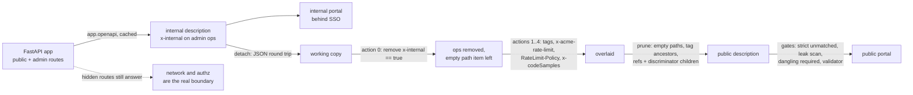

# OpenAPI Specification Extensions (x-*), Overlays, and Stripping Internal Admin Routes for Public Portals

> [!summary] Claim
> Keep one internal OpenAPI description, mark audience with `x-` extensions or OpenAPI 3.2 `kind: audience` tags, and derive each public description with an ordered Overlay of RFC 9535 JSONPath actions followed by a reachability prune and a leak gate, because removing operations alone leaves their schemas, security schemes, tags, and `required` names behind, and hiding a route from any description never stops it from answering.

Part of [OpenAPI JSON Schema and Contracts](README.md) in [API Engineering](../README.md).

## TL;DR

- Mechanism: a specification extension is any field matching the case-sensitive pattern `^x-` on an object that says it "MAY be extended" (OpenAPI 3.1.2 Section 4.9), and an Overlay is an ordered list of `update`, `copy`, or `remove` actions whose `target` is an RFC 9535 JSONPath query, each applied to the result of the previous one (Overlay 1.2.0 Sections 4.5.1 and 4.5.4).
- Contract rule: an Overlay merge is not JSON Merge Patch: objects merge recursively, arrays concatenate, primitives replace, a `null` member is not a deletion, and every other combination is an error (Overlay 1.2.0 Section 4.5.4; contrast RFC 7396 Section 2).
- Trap: deleting the admin operations leaves `AdminAuditEntry`, `OperatorIdentity`, the `AdminToken` scheme, and an empty Path Item in the output, a forward-only prune then deletes `allOf` subtypes of a discriminated parent, and `[?@['x-internal']]` is an existence test that also matches `x-internal: false`; the lab proves all three.
- Portability: Overlay 1.0.0 (2024-10-17) has only `update` and `remove` on objects and arrays, 1.1.0 (2026-01-14) adds `copy`, primitive targets, array concatenation, the same-kind rule, and an explicit zero-match success sentence (1.0.0 already allowed "zero or more" results), and 1.2.0 (2026-09-22) adds `$self` and reusable actions; the `x-oai-` and `x-oas-` reservation exists only from OpenAPI 3.1.0 on (as of 2026-11).
- When not to use it: a filtered description is never an access-control boundary (OWASP API5:2023 and API9:2023); when the operator surface is large or has its own release cadence, split it into a separate application or host that produces its own description.

## Mental model



The application generates exactly one internal description, which FastAPI caches on the app object and serves from `openapi_url`.
The publisher never touches that cached object: it detaches a JSON copy, runs the Overlay actions in order, and records which nodes each action selected as RFC 9535 Normalized Paths.
The first action removes operations flagged `x-internal: true`, which leaves an empty Path Item and every component those operations referenced.
The prune step deletes empty Path Items, tag definitions that no surviving operation or ancestor chain needs, and components that are unreachable from the surviving document.
Reachability is a transitive closure over `$ref`, Security Requirement names, discriminator `mapping` and `defaultMapping` values, and the one reverse edge JSON Schema does not express: an `allOf` child of a discriminated parent.
The gates fail the build when an action matched nothing, when a forbidden word survives anywhere, when a `required` array names a removed property, or when the result is not a valid description.
The dotted edge is the point of the whole note: none of this changes what the server answers, so authorization and network placement remain the boundary.

## How it works

### Specification extensions: the `^x-` contract

OpenAPI defines extensions as a patterned field: "The field name MUST begin with `x-`", the value "can be any valid JSON value (null, a primitive, an array, or an object.)", and "Support for any one extension is OPTIONAL, and support for one extension does not imply support for others" (OpenAPI 3.1.2 Section 4.9; the same text is Section 5 in OpenAPI 3.2.1).
The reservation "Field names beginning `x-oai-` and `x-oas-` are reserved for uses defined by the OpenAPI Initiative" appears in OpenAPI 3.1.0 Section 4.9 and later, but not in Section 4.8 of OpenAPI 3.0.3 or 3.0.4, so a 3.0 description may legally use `x-oas-` names that a 3.1 description may not.
The value wording itself moved: 3.0.3 says "The value can be null, a primitive, an array or an object. Can have any valid JSON format value.", while 3.0.4 and 3.1.2 say "any valid JSON value (null, a primitive, an array, or an object.)", which lists `null` separately from "a primitive" (this matters for the Overlay merge rules below).
The pattern is case-sensitive: `openapi-spec-validator` 0.9.0 encodes it as `"patternProperties": {"^x-": true}` in its 3.1 meta-schema (`resources/schemas/v3.1/schema.json`, `$defs/specification-extensions`), and the lab shows that `X-Internal` and `internal` on an operation both fail with `Unevaluated properties are not allowed`, while `x-internal` passes.

Extensions are only allowed where an object says "This object MAY be extended with Specification Extensions", and three positions in a description look extensible but are not:

- Name maps such as `components.schemas`, `properties`, `headers`, and `content` hold author-chosen names, so `x-request-id` as a response header name or `x-legacy` as a schema property is data, not an extension.
  Component names must match `^[a-zA-Z0-9\.\-_]+$` (OpenAPI 3.1.2 Section 4.8.7), so a schema may itself be named `x-foo`; an extension scanner has to know where it is in the tree, which is why the lab's `extension_inventory` is position-aware.
- The Reference Object "cannot be extended with additional properties, and any properties added SHALL be ignored" (OpenAPI 3.1.2 Section 4.8.23; OpenAPI 3.2.1 Section 4.23).
  An `x-internal: true` written next to a `$ref` in a `parameters` array is therefore a no-op by the prose, and `openapi-spec-validator` 0.9.0 is stricter than the prose: it rejects it with `'x-internal' was unexpected` from `$defs/reference` (`test_validator_rejects_an_extension_beside_a_reference_object_ref`).
  Put audience flags on the component or the operation, never on the reference.
- The Paths Object "MAY be extended" and its path keys "MUST begin with a forward slash" (OpenAPI 3.1.2 Section 4.8.8), so `x-` keys and `/` keys share one map and every tool that iterates `paths` has to separate them; `openapi-spec-validator` 0.9.0 does not (see Pitfalls).

The Schema Object is the inverse exception: it "MAY be extended with Specification Extensions, though as noted, additional properties MAY omit the x- prefix within this object" (OpenAPI 3.1.2 Section 4.8.24; OpenAPI 3.2.1 Section 4.24), because JSON Schema 2020-12 treats unknown keywords as annotations, so `x-` inside a schema is a convention rather than a requirement.
Overlay documents carry their own extensions under the same rules: "The field name MUST begin with x-", with the same `x-oai-` and `x-oas-` reservation, and "The value MAY be null, a primitive, an array or an object" (Overlay 1.2.0 Section 4.7).

The OpenAPI Initiative keeps three registries that matter here (as of 2026-11):

- The extension registry lists 36 names, among them `x-codeSamples`, `x-sensitive-data`, `x-data-classification`, and a family of `x-oai-*` and `x-jsonschema-*` names that carry 3.2 or JSON Schema features into older OpenAPI versions, such as `x-oai-$self` ("used when targeting OpenAPI versions prior to 3.2") and `x-jsonschema-unevaluatedProperties`.
  The `x-codeSamples` entry is valid on the Operation Object, defines an array of objects with required `lang` and `source` and optional `label`, lets `source` be a string or an object with a required `$ref`, and documents `x-code-samples` as the older spelling that "tooling may also support ... separately for compatibility".
- The namespace registry assigns eight prefixes: `x-oai-` and `x-oas-` (reserved for the OAI), `x-oas-draft-` (proposed specification changes), `x-jsonschema-`, `x-ms-` (Microsoft), `x-sap-` (SAP), `x-fdx-` (Financial Data Exchange), and `x-scalar-` (Scalar).
- The tag kind registry lists `nav`, `badge`, and `audience`, where "Tags with kind: audience indicate the intended audience for an operation".

The namespace registry is the practical answer to collisions: an organization's own extensions should carry one vendor prefix, which is why the lab uses `x-acme-rate-limit` rather than a bare `x-rate-limit` that another tool may already interpret.

### Audience as data: `x-internal`, `x-audience`, and OpenAPI 3.2 `kind`

There is no standard "internal" keyword in OpenAPI; audience is expressed by convention.
The three common encodings are a boolean extension (`x-internal: true`, the default flag of Redocly's `remove-x-internal` decorator, configurable through `internalFlagProperty`), a string extension (`x-audience`, the example property of Redocly's `filter-out` decorator, which takes `property`, `value`, `matchStrategy` of `all` or `any`, and `applyTo` of `PathItem` or `Operation`), and, from OpenAPI 3.2, a Tag Object with `kind: audience`.
OpenAPI 3.2.1 Section 4.22.1 gives the Tag Object `parent` ("The named tag MUST exist in the API description, and circular references between parent and child tags MUST NOT be used") and `kind` ("common uses are `nav` for Navigation, `badge` for visible badges, `audience` for APIs used by different groups"), and its example in Section 4.22.2 nests a `partner` audience tag under an `external` one.
A tag-based audience is visible to every tool that understands tags, while an extension is visible only to tools configured for it.
The trade-off is that tags are many-to-many and hierarchical, so a publisher has to decide whether an operation tagged both `partner` and `internal` is published, and a prune that keeps a used tag must also keep its whole ancestor chain.
`openapi-spec-validator` 0.9.0 enforces the `parent` rule for 3.2 descriptions in `OpenAPIV32TagsValidator.__call__`, yielding `Tag '<name>' references unknown parent tag '<parent>'` and `Circular tag hierarchy detected: ...` (openapi-spec-validator 0.9.0 openapi_spec_validator/validation/keywords.py, OpenAPIV32TagsValidator.__call__); the lab's earlier prune kept only direct parents, and the new test shows that the validator rejects the result for a three-level chain (`test_pruning_keeps_the_whole_tag_ancestor_chain_and_webhook_tags`).

### Three ways to hide something in FastAPI 0.162.0

`include_in_schema=False` on a route removes it at generation time: `get_openapi_path` emits an operation only `if route.include_in_schema`, and `get_fields_from_routes` collects request and response models only from included routes, so models used only by hidden routes never enter `components` (fastapi 0.162.0 fastapi/openapi/utils.py, get_openapi_path and get_fields_from_routes).
The same `get_openapi` emits the app's `openapi_tags` unconditionally (`if tags: output["tags"] = tags`), so the description of an `admin` tag is published even when every admin route is hidden; the lab pins this (`test_fastapi_hides_models_but_still_emits_tag_metadata`).
`include_in_schema` also exists on parameter functions such as `Header` and `Query` (fastapi 0.162.0 fastapi/param_functions.py), and `_get_openapi_operation_parameters` skips a parameter whose `field_info` sets it to false (fastapi 0.162.0 fastapi/openapi/utils.py, _get_openapi_operation_parameters), so a debug header can be undocumented and still be read on every request.
`openapi_extra` is merged into the generated operation by `deep_dict_update(operation, route.openapi_extra)` (fastapi 0.162.0 fastapi/openapi/utils.py, get_openapi_path), and `deep_dict_update` recurses into dicts, builds a new concatenated list for two lists, and otherwise replaces (fastapi 0.162.0 fastapi/utils.py, deep_dict_update), which is the same merge shape Overlay 1.1.0 adopted, except that FastAPI silently replaces where Overlay raises an error.
`include_in_schema=False` is all-or-nothing per application: it produces one description in which the route does not exist, so it cannot also feed the internal portal; `openapi_extra={"x-internal": True}` keeps one complete description and moves the audience decision to publication time, which is the design this note recommends.
`FastAPI.openapi()` caches its result in `app.openapi_schema` and regenerates only when `self.router._get_routes_version()` changes, and `setup()` serves that object from `openapi_url` through `JSONResponse` (fastapi 0.162.0 fastapi/applications.py, FastAPI.openapi and FastAPI.setup), so any in-place edit of the returned dict changes what `/openapi.json` serves.
When the ASGI scope carries a `root_path` and `root_path_in_servers` is true (the default), `setup()` prepends `{"url": root_path}` to `servers` in a shallow copy for that response, unless that URL is already listed, so the served description can name a proxy prefix that the offline export does not contain (fastapi 0.162.0 fastapi/applications.py, FastAPI.setup).
The Swagger UI route is added only `if self.openapi_url and self.docs_url` and the ReDoc route only `if self.openapi_url and self.redoc_url`, and the schema route itself is added with `include_in_schema=False`, so `openapi_url=None` removes the internal description and both UIs at once.

### The Overlay document

An Overlay is a JSON or YAML object with these fields (Overlay 1.2.0 Section 4.5.1):

- `overlay`: REQUIRED; the `major.minor` part "SHALL designate the Overlay feature set", and "The patch version SHOULD NOT be considered by tooling" (Section 4.1).
- `$self` (1.2.0): the Overlay's own URI and base URI, which "MUST NOT contain a fragment identifier".
- `info`: REQUIRED, with REQUIRED string `title` and `version` (Section 4.5.2).
- `extends`: an optional URI reference to the target description; "when a target [OpenAPI] Description defines $self, the Overlay's extends value SHOULD match the target's $self URI" (Section 4.3), fragments "MUST NOT be used" (Section 4.4.2), and relative values resolve against the Overlay's `$self` or retrieval URI (Section 4.4.1, Appendix B).
- `actions`: REQUIRED, "The array MUST contain at least one value", and "The list of actions MUST be applied in sequential order to ensure a consistent outcome. Actions are applied to the result of the previous action. This enables objects to be deleted in one action and then re-created in a subsequent action".
- `components` (1.2.0): holds `actions`, the reusable actions.

OpenAPI 3.2 added the matching `$self` to the OpenAPI Object, "the self-assigned URI of this document, which also serves as its base URI" (OpenAPI 3.2.1 Section 4.1.1), so `extends` is identifier-based rather than location-based: Overlay 1.2.0 Appendix B.6 shows a mirror copy matching an `extends` URI through its `$self` "even though retrieval occurred from a different location".
For 3.1 descriptions the registry's `x-oai-$self` carries the same identifier.

An Action Object has `target`, `description`, and one modifier (Overlay 1.2.0 Section 4.5.4):

| Modifier | Target kind | Payload rule |
| --- | --- | --- |
| `update` | objects | an object merged into each selected object |
| `update` | arrays | an array concatenated to each, or an object or primitive appended to each |
| `update` | primitives (1.1+) | a primitive that replaces each selected node |
| `copy` (1.1+) | same as `update` | a JSONPath that selects a single node, used as the payload |
| `remove` | any | each selected node "MUST be removed from the the map or array it is contained in" |

The merge is defined step by step (Overlay 1.1.0 Section 4.4.3 and 1.2.0 Section 4.5.4): a property only in the target is unchanged, a property only in the payload is inserted, primitive replaces primitive, array concatenates with array, object merges recursively with object, and "Other property value combinations are incompatible and result in an error".
When a target selects two or more nodes for `update` or `copy`, "the selected nodes MUST be either all objects or all arrays or all primitives", and a target that selects zero nodes "succeeds without changing the target document" (both sentences from 1.1.0 on; 1.0.0 Section 4.4.3 already said the result "MUST be zero or more objects or arrays", so zero matches were never an error).
`remove` defaults to `false`; `update` "has no impact if the remove field of this action object is true or if the copy field contains a value", and `copy` has no impact "if the remove field of this action object is true or if the update field contains a value".
Read literally, an action with both `update` and `copy` does nothing at all, because each field defers to the other; the lab rejects that combination as an error instead of guessing (a lab policy, not a specification rule).
Overlay 1.0.0 Section 4.4.3 was narrower: "The result of the target JSONPath expression MUST be zero or more objects or arrays (not primitive types or null values)", and an `update` on an array "MUST be an entry to append to the array", with no concatenation rule; the lab gates primitive targets and `copy` on `overlay >= 1.1`.
Array removal by index is fragile, and the specification says so: "Use of array indexes to remove array items should be avoided where possible as indexes will change when items are removed" (Overlay 1.2.0 Section 4.6.4); when one filter selects several elements, the lab deletes the deepest and highest-index nodes first so earlier deletions never shift a pending one.

Overlay 1.2.0 adds `components.actions`, a map of Reusable Action Objects whose `fields` hold "An Action Object where no field is required, except that the target field MUST NOT be provided" (Section 4.5.5), referenced from `actions` by a Reusable Action Reference Object with a REQUIRED `$ref` whose pointer prefix is "restricted to /components/actions/" and a REQUIRED `target` (Section 4.5.6).
The key "MUST be encoded according to [RFC6901], Section 3", so a reusable action named `error/404` is referenced as `#/components/actions/error~1404`, and decoding must replace `~1` before `~0`, because the reverse order would turn `~01` into `/` instead of `~1` (RFC 6901 Section 4).
The reference "MAY provide action fields that override values from the referenced reusable action for that use", and a `description` on the reference "MUST be used" over one in `fields` (Section 4.5.6).

The Overlay merge is deliberately not RFC 7396 JSON Merge Patch:

| Situation | Overlay 1.1+ `update` | RFC 7396 merge patch | RFC 6902 JSON Patch |
| --- | --- | --- | --- |
| payload member is `null` | inserted when absent; against an object or array, an error | member removed | explicit `remove` op |
| both sides arrays | concatenated | payload replaces | `add` at an index or `/-` |
| object into primitive | error | payload replaces | `replace` |
| addressing | JSONPath, many nodes | the document root | JSON Pointer, one node per op |
| precondition | none | none | `test` op |

RFC 7396 Section 2 gives the pseudocode in which a `null` value removes the member and any non-object patch replaces the whole target, and notes it "is not possible to patch part of a target that is not an object, such as to replace just some of the values in an array"; RFC 6902 Section 4 defines `add`, `remove`, `replace`, `move`, `copy`, and `test`.
The practical consequence: an Overlay cannot delete a property by setting it to `null`; it needs a `remove` action that targets the property.
The Structured Overlay example in Overlay 1.2.0 Section 4.6.1 still ends with `components:` and `tags:` with empty YAML values, which parse as `null`; under the 1.1+ merge steps that is an object or array target receiving a non-object, an error, and the lab reproduces it (`test_structured_example_null_members_are_incompatible_with_objects`).
Whether `null` counts as a "primitive" is not defined in the Overlay text: RFC 8259 Section 1 says JSON "can represent four primitive types (strings, numbers, booleans, and null)", while both OpenAPI 3.1.2 Section 4.9 and Overlay 1.2.0 Section 4.7 list "null, a primitive, an array" as separate cases; the lab follows RFC 8259, so `null` replaces a primitive.
Two more document-level facts bound what an Overlay can promise: YAML 1.2 "is RECOMMENDED along with the additional constraints listed in [RFC9512] Section 3.4" (Overlay 1.2.0 Section 4.2.1), and applying actions "MAY result in the loss of such comments in the updated description" (Overlay 1.2.0 Section 4.10).

### RFC 9535 JSONPath, the parts overlays depend on

Every Overlay `target` is "A RFC9535 JSONPath query expression" (Overlay 1.2.0 Section 4.5.4), a compliant tool "MUST fully implement [RFC9535]", and interoperable Overlays "MUST NOT use tool-specific JSONPath extensions" (Overlay 1.1.0 Section 4.8; 1.2.0 Section 4.9).
The rules that decide what an overlay actually selects:

- A query maps a nodelist through each segment, "Duplicate nodes are not removed", and an empty result is a valid result, not an error (RFC 9535 Section 2.1.2); the lab de-duplicates by location before applying an action, so `['200','200']` updates once.
- An implementation "MUST raise an error for any query that is not well-formed and valid", and since an empty nodelist is not an error, "implementations might therefore want to provide diagnostics" (RFC 9535 Section 2.1).
- The dot shorthand allows only `name-first *name-char`, with `name-first = ALPHA / "_" / %x80-D7FF / %xE000-10FFFF` and `name-char = name-first / DIGIT` (RFC 9535 Section 2.5.1.1), so `@.x-internal` is not well-formed, and extension names always need bracket notation, `@['x-internal']`.
- "The children of an object are its member values, not its member names" (RFC 9535 Section 2.3.2.2), so `$.paths.*` is the list of Path Items.
- A filter selector iterates the children of the node it is applied to, with `@` bound to each child (RFC 9535 Section 2.3.5), so `$.paths.*[?...]` tests every member of each Path Item: the operations, but also a `parameters` array or an `x-` value at Path Item level.
- An existence test "yields true if the query selects at least one node", whatever that node's value; the same section contrasts it with `!@.foo`, which "yields false if @.foo selects a node, regardless of the node's value" (RFC 9535 Section 2.3.5.2.1).
- In a comparison, when either side is an empty nodelist, `==` "yields true if and only the other side also results in an empty nodelist", and `<` yields false (RFC 9535 Section 2.3.5.2.2); `!=` is the negation of `==`, so `@.a != 'internal'` is true for an operation with no `a` at all, and `<=` is true when both sides are missing.
- `true`, `false`, and `null` are literals distinct from numbers (RFC 9535 Sections 2.3.5.1 and 2.6); in Python `True == 1` is true, so an evaluator built on `==` silently matches `x-internal: 1` against `true`, which the lab tests.
- Comparisons accept only singular queries (name or index segments only), while existence tests accept any query, including nested filters (RFC 9535 Section 2.3.5.1); the lab raises on `$[?@..a == 1]`.
- A Normalized Path such as `$['paths']['/v1/orders']['post']` uses single-quoted bracket notation (RFC 9535 Section 2.7); the lab reports every action's matches in this form.
- Integers in a query are bounded to the interval `[-(2^53)+1, (2^53)-1]` (RFC 9535 Section 2.1).

Overlay 1.0.0 Section 4.5.5 itself used `$.paths.*.get[?@.x-oai-traits.paged]`, which is not well-formed RFC 9535 for the hyphenated shorthand, and is also semantically wrong because the filter tests the members of `get`, not `get`.
Overlay 1.1.0 Section 4.5.5 (and 1.2.0 Section 4.6.5) replaced it with `$.paths[?(@.get['x-oai-traits'][?(@ == 'paged')])].get`, which filters Path Items whose `get` has a `paged` trait and then descends into `get`; the lab's evaluator rejects the first with `'-' is not allowed in member-name-shorthand` and selects exactly the two operations the 1.1.0 example shows for the second.

### Removal and the orphaned remainder

Removing an operation touches only the operation.
Everything it referenced stays: schemas, parameters, responses, headers, security schemes, tags, and the now empty Path Item.
Redocly's documentation for `remove-x-internal` says to "Remove additional remnants from components by also using the --remove-unused-components CLI argument" (as of 2026-11), which is the same problem stated by a tool vendor.
OpenAPI treats an empty Path Item as a deliberate disclosure: "the viewer will be aware that the path exists, but will not be able to see any of its operations or parameters" (OpenAPI 3.1.2 Section 4.10, Security Filtering; OpenAPI 3.2.1 Section 6.4), so a public portal must delete the key, not leave `{}`.
A correct prune is a graph reachability problem whose roots are everything outside `components` (`paths`, `webhooks`, root `security`):

- Forward edges are local `$ref` values, Security Requirement keys (which name `securitySchemes` entries without any `$ref`), and Discriminator `mapping` and `defaultMapping` values, which are "schema names or URI references" (OpenAPI 3.2.1 Section 4.25.1).
- A mapping value that is both a valid name and a relative URI is "implementation-defined, but it is RECOMMENDED that it be treated as a schema name", and authors force a URI with `./foo` (OpenAPI 3.2.1 Section 4.25.3); the lab treats a value matching the component-name pattern as a name and refuses `./Dog` until the description is bundled.
- One edge points backwards: with the `allOf` form of a discriminator, "no standard JSON Schema keyword connects the parent schema to the child schemas" (OpenAPI 3.2.1 Section 4.25.2), so the operation reaches `Pet` while `Cat` and `Dog` only reference `Pet`; a forward-only prune deletes every implicit-mapping subtype and silently breaks generated SDKs, and the lab adds the reverse edge for children of a reachable schema that carries a `discriminator`.
- The closure must be transitive, because `Order` reaches `Money` only through `components.schemas.Order`.
- External references (`other.yaml#/...`) must be bundled first, or reachability is undefined; the lab raises.

Field-level stripping has its own remnant: removing a property with `$..properties[?@['x-internal'] == true]` leaves its name in the parent's `required` array, so the public schema still demands a member it no longer documents.
The fix is a second action, `$..required[?@ == 'operator_note']` with `remove: true`, and a gate that lists `required` entries naming no sibling property; the lab's `dangling_required` returns `$['components']['schemas']['Order']['required'][1]` after the first action and nothing after both (`test_removing_an_internal_property_leaves_it_required_until_required_is_edited`).

In the lab's FastAPI app, the overlay grows the canonical JSON from 3735 to 3832 bytes, and the prune then shrinks it to 3225 bytes, dropping schemas from 7 to 5 and security schemes from 2 to 1.

## Numbers and limits

| Quantity | Value | Source |
| --- | --- | --- |
| Extension field pattern | `^x-`, case-sensitive | OpenAPI 3.1.2 Section 4.9; openapi-spec-validator 0.9.0 v3.1 schema.json; lab |
| Reserved prefixes | `x-oai-`, `x-oas-` from OpenAPI 3.1.0; absent from 3.0.3 and 3.0.4 | OpenAPI 3.1.0 Section 4.9; OpenAPI 3.0.3 and 3.0.4 Section 4.8 |
| Component key pattern | `^[a-zA-Z0-9\.\-_]+$` | OpenAPI 3.1.2 Section 4.8.7 |
| Overlay releases | 1.0.0 2024-10-17, 1.1.0 2026-01-14, 1.2.0 2026-09-22 | Overlay 1.2.0 Appendix A |
| Minimum `actions` | 1 | Overlay 1.2.0 Section 4.5.1 |
| `copy` source | exactly one node | Overlay 1.2.0 Section 4.5.4 |
| JSONPath integers | `-(2^53)+1` to `(2^53)-1` | RFC 9535 Section 2.1 |
| Extension registry entries | 36 | OAI extension registry (as of 2026-11) |
| Namespace prefixes | 8 | OAI namespace registry (as of 2026-11) |
| Tag kinds | 3 (`audience`, `badge`, `nav`) | OAI tag kind registry (as of 2026-11) |
| `RateLimit-Policy` parameters | `q` REQUIRED non-negative Integer, `qu` (default `requests`), `w` non-zero Integer seconds, `pk` Byte Sequence | draft-ietf-httpapi-ratelimit-headers-12 Sections 2.1 to 2.1.4 (dated 2026-11-20, expires 2027-05-24) |
| Lab internal description | 3735 bytes canonical JSON, 3 operations, 3 paths, 7 schemas, 2 security schemes, 2 tags | measured, see below |
| After overlay, before prune | 3832 bytes, 2 operations, 3 path keys (one `{}`), 7 schemas, 2 security schemes, 1 tag | measured |
| Public description | 3225 bytes, 2 operations, 2 paths, 5 schemas, 1 security scheme, 1 tag | measured |
| Removed by prune | 4 pointers: 1 path, 2 schemas, 1 security scheme | measured; `test_removing_operations_leaves_orphans_until_pruned` |
| Public SHA-256 | `bdce215631a1e77da257a0c197c69152d22b02a1004dd8b34a518ff75c6c25d1` | measured; equal across two app builds in `test_publication_is_deterministic_and_leaves_the_served_schema_alone` |
| Lab module | 41 test functions, 56 cases, 6.47 s wall time for the run | pytest run below |

The sizes are `len(canonical_json(doc))`, where `canonical_json` is `json.dumps(doc, sort_keys=True, separators=(",", ":"), ensure_ascii=True).encode()`, re-measured on 2026-11-21 by the fact-checker with a throwaway script run once from `labs/` as `uv run --frozen python ../tmp_tools/measure.py` (CPython 3.14.6, macOS 27.3 arm64, fastapi 0.162.0, pydantic 2.14.3), since removed; every size, count, removed pointer, and the digest matched the drafter's figures exactly, across two app builds in one process.
The overlay's net change is +97 bytes, because its additions (the rate-limit extension on two operations, the header on two responses, and one code sample) outweigh the admin operation and tag it removes, and the prune then removes 607 bytes of admin remnants.
The 6.47 s is one run's wall time including imports, not a benchmark (the drafter's earlier run on the same machine took 7.12 s).

## Portability

| Dimension | Behavior | Evidence |
| --- | --- | --- |
| CPython 3.14.6 (workspace `.venv`) | 56 passed | lab, one `uv run --frozen pytest` run, macOS 27.3 arm64, 2026-11-21 |
| CPython 3.12.16, 3.13.18, 3.14.10, 3.15.2, 3.15.2t | not run: lab checks were paused by the user on 2026-11-11, so only the workspace interpreter ran | `report.md`; `labs/pyproject.toml` declares `requires-python = ">=3.12,<3.16"` |
| Debian Trixie, Alpine musl | not run, same reason | none |
| Uvicorn, Hypercorn, Granian; HTTP/1.1, HTTP/2, HTTP/3 | not applicable: the pipeline is an offline transformation of a JSON document; FastAPI serves the cached description through `JSONResponse` on any ASGI server | fastapi 0.162.0 fastapi/applications.py, FastAPI.setup |
| OpenAPI 3.0.x | `^x-` rule; no `x-oai-` or `x-oas-` reservation; no `$self`, no Tag `kind` | OpenAPI 3.0.3 and 3.0.4 Section 4.8 |
| OpenAPI 3.1.x | reservation added; Schema Object may omit `x-`; Reference Object ignores added properties; `webhooks` are prune roots | OpenAPI 3.1.0 and 3.1.2 Sections 4.9, 4.8.23, 4.8.24 |
| OpenAPI 3.2.x | adds `$self`, Tag `parent` and `kind`, `additionalOperations`, `defaultMapping`; extensions renumbered to Section 5, Security Filtering to 6.4 | OpenAPI 3.2.1 Sections 4.1.1, 4.22.1, 4.25.1, 5, 6.4 |
| Overlay 1.0 | `update`, `remove`; objects and arrays only; array `update` appends one entry (the lab concatenates an array payload for every version, a simplification it does not gate on 1.1) | Overlay 1.0.0 Section 4.4.3; lab `test_primitive_targets_need_overlay_1_1` |
| Overlay 1.1 | adds `copy`, primitive targets, array concatenation, an explicit zero-match success sentence, same-kind rule, RFC 9535 compliance section | Overlay 1.1.0 Sections 4.4.3 and 4.8; lab `test_copy_rules` |
| Overlay 1.2 | adds `$self`, `components.actions`, Reusable Action References | Overlay 1.2.0 Sections 4.5.1, 4.5.3, 4.5.5, 4.5.6; lab `test_reusable_actions_resolve_escaped_keys_and_reference_fields_win` |
| FastAPI 0.162.0 | route `include_in_schema=False` drops operations and their models but keeps `openapi_tags`; parameter `include_in_schema`; `openapi_extra` deep-merged; default `openapi_version` `3.1.0` | fastapi 0.162.0 fastapi/openapi/utils.py, get_openapi; lab |
| openapi-spec-validator 0.9.0 | bundles schemas for 2.0, 3.0, 3.1, and 3.2; rejects non-`x-` and `X-` fields and `x-` beside `$ref`; checks 3.2 tag parents and cycles; raises `KeyError` on a Paths-level extension; a dangling `$ref` raises `referencing.exceptions.PointerToNowhere` | lab, six tests; (openapi-spec-validator 0.9.0 openapi_spec_validator/validation/keywords.py, PathsValidator.__call__ and OpenAPIV32TagsValidator.__call__) |
| Redocly CLI | `remove-x-internal` and `filter-out` decorators, with `--remove-unused-components` for remnants | Redocly documentation (as of 2026-11); not run here |

## Worked example

The [implementation](../labs/src/api_labs/f08_openapi_json_schema_and_contracts/multi_audience_specs.py) has four parts: an RFC 9535 parser and evaluator (no slices and no function extensions, which raise `JsonPathUnsupportedError`, so it is deliberately not an Overlay-compliant tool under Overlay 1.2.0 Section 4.9), an Overlay 1.0 to 1.2 applier, a publication pruner with a leak scan, a `required` check, and an extension inventory, and a FastAPI app with two public routes, one `x-internal` admin route, and one `include_in_schema=False` admin route.
The [test](../labs/tests/f08_openapi_json_schema_and_contracts/test_openapi_overlays_extensions_and_multi_audience_specs.py) has 41 functions and 56 cases, and reproduces Overlay specification examples (the 1.0.0 and 1.1.0 traits examples, and the 1.2.0 structured, array, move, and reusable-action examples) alongside the FastAPI pipeline.

The public overlay, a simplified excerpt of `PUBLIC_PORTAL_OVERLAY` written as YAML (the lab holds the same structure as a Python dict, and `components.actions.rateLimitHeader.fields.update` adds a `RateLimit-Policy` Header Object with the example `"default";q=100;w=60`):

```yaml
overlay: 1.2.0
info: {title: Public developer portal, version: 1.0.0}
actions:
  - description: Drop operator-only operations.
    target: "$.paths.*[?@['x-internal'] == true]"
    remove: true
  - target: "$.tags[?@.name == 'admin']"
    remove: true
  - target: "$.paths.*[?@.operationId]"
    update: {x-acme-rate-limit: {policy: default, quota: 100, window: 60}}
  - $ref: '#/components/actions/rateLimitHeader'
    target: "$.paths.*.*.responses['200','201']"
  - target: "$.paths['/v1/orders'].post"
    update: {x-codeSamples: [{lang: Python, label: httpx, source: "..."}]}
```

The merge, verbatim from the module:

```python
def merge_update(target: dict[str, Any], update: dict[str, Any], where: str = "$") -> None:
    """Overlay 1.2.0 Section 4.5.4 merge: insert, replace primitives, concatenate arrays."""
    for key, value in update.items():
        here = f"{where}[{key!r}]"
        if key not in target:
            target[key] = copy.deepcopy(value)
            continue
        current = target[key]
        if _kind(current) == "primitive" and _kind(value) == "primitive":
            target[key] = value
        elif is_array(current) and is_array(value):
            current.extend(copy.deepcopy(value))
        elif is_object(current) and is_object(value):
            merge_update(current, value, here)
        else:
            raise OverlayError(
                f"incompatible merge of {_kind(value)} into {_kind(current)} at {here}"
            )
```

The reachability closure, verbatim lines from `prune_for_publication`; the `found |=` line is the reverse discriminator edge:

```python
    components: dict[str, Any] = doc.get("components", {})
    reachable: set[tuple[str, str]] = set()
    _references({k: v for k, v in doc.items() if k != "components"}, reachable)
    frontier = set(reachable)
    while frontier:
        found: set[tuple[str, str]] = set()
        for section, name in frontier:
            _references(components.get(section, {}).get(name), found)
        found |= _discriminated_children(components.get("schemas", {}), reachable | found)
        frontier = found - reachable
        reachable |= frontier
```

`_references` follows `$ref`, the keys of every `security` requirement, and `discriminator.mapping` and `defaultMapping`, and `_discriminated_children` adds every unreached schema whose `allOf` contains a `$ref` to a reached schema with a `discriminator`.
Before running any action, `apply_overlay` detaches the input with a JSON round trip instead of `copy.deepcopy`, because `deepcopy` preserves aliasing: one shared response object reachable from two operations, which is what a YAML loader produces for an anchor and its aliases, stays shared in the copy, and an `update` on one operation then appears on the other (`test_aliased_input_nodes_are_detached_before_actions_run`).
The round trip also rejects `NaN` and values JSON cannot represent, and turns a YAML integer key such as `200:` into the string `"200"`.

Two of the tests, verbatim:

```python
def test_existence_test_matches_a_false_valued_extension() -> None:
    doc = spec({"/a": {"get": {"x-internal": False}, "post": {"x-internal": True}, "put": {}}})
    exists = JsonPath("$.paths.*[?@['x-internal']]").find(doc)
    equals_true = JsonPath("$.paths.*[?@['x-internal'] == true]").find(doc)
    assert paths_of(exists) == ["$['paths']['/a']['get']", "$['paths']['/a']['post']"]
    assert paths_of(equals_true) == ["$['paths']['/a']['post']"]
```

```python
def test_pruning_keeps_allof_children_of_a_discriminated_parent() -> None:
    # OpenAPI 3.2.1 Section 4.25.2: children point at the parent, never the reverse.
    pet_ref = {"$ref": "#/components/schemas/Pet"}
    schemas = {
        "Pet": {"type": "object", "discriminator": {"propertyName": "petType"}},
        "Cat": {"allOf": [pet_ref, {"properties": {"meows": {"type": "boolean"}}}]},
        "Dog": {"allOf": [pet_ref, {"$ref": "#/components/schemas/Collar"}]},
        "Collar": {"type": "object"},
        "Plain": {"allOf": [{"$ref": "#/components/schemas/Collar"}]},
    }
    body = {"description": "OK", "content": {"application/json": {"schema": pet_ref}}}
    doc = spec({"/pets": {"get": {"responses": {"200": body}}}}, components={"schemas": schemas})
    pruned, removed = prune_for_publication(doc)
    assert sorted(pruned["components"]["schemas"]) == ["Cat", "Collar", "Dog", "Pet"]
    assert removed == ("/components/schemas/Plain",)
```

The per-action match report from the measurement script, which is what a CI log should show for every publication:

```text
0 remove $.paths.*[?@['x-internal'] == true] ["$['paths']['/admin/orders/{order_id}/refund-override']['post']"]
1 remove $.tags[?@.name == 'admin'] ["$['tags'][1]"]
2 update $.paths.*[?@.operationId] ["$['paths']['/v1/orders/{order_id}']['get']", "$['paths']['/v1/orders']['post']"]
3 update $.paths.*.*.responses['200','201'] ["$['paths']['/v1/orders/{order_id}']['get']['responses']['200']", "$['paths']['/v1/orders']['post']['responses']['201']"]
4 update $.paths['/v1/orders'].post ["$['paths']['/v1/orders']['post']"]
```

Output captured on 2026-11-21 from `labs/` on macOS 27.3 (arm64) with CPython 3.14.6:

```text
$ uv run --frozen pytest tests/f08_openapi_json_schema_and_contracts/test_openapi_overlays_extensions_and_multi_audience_specs.py -q
........................................................                 [100%]
56 passed in 6.47s
```

## Pitfalls

> [!warning] Hidden from the description is not hidden from the network
> Trigger: an admin route registered with `include_in_schema=False`, or filtered out of the public description, on the same host and app as the public API.
> Symptom: the route still answers; in the lab `GET /admin/debug/config` returns `401` without a credential and `200` with one, while `/openapi.json` does not list it (`test_a_route_hidden_from_the_schema_is_still_served`).
> Fix: enforce function-level authorization on every admin route and deny by default; OWASP API5:2023 asks "Can a regular user access administrative endpoints?" and warns "Don't assume that an API endpoint is regular or administrative only based on the URL path"; put operator tooling on a separate app or host where possible.

> [!warning] Orphaned components after removing operations
> Trigger: an overlay or a decorator removes operations and nothing prunes `components`.
> Symptom: the public description still carries `AdminAuditEntry`, `OperatorIdentity`, and an `AdminToken` scheme whose `name` is `X-Admin-Token`, plus an empty Path Item that reveals `/admin/orders/{order_id}/refund-override` exists (OpenAPI 3.1.2 Section 4.10).
> Fix: prune by reachability after every overlay and delete empty Path Items; Redocly's documentation pairs `remove-x-internal` with `--remove-unused-components` for this reason.

> [!warning] A forward-only prune deletes polymorphic subtypes
> Trigger: a prune that follows only `$ref` and `mapping` on a description that uses the `allOf` form of a discriminator with implicit mapping.
> Symptom: `Cat` and `Dog` disappear because only they reference `Pet`, and "no standard JSON Schema keyword connects the parent schema to the child schemas" (OpenAPI 3.2.1 Section 4.25.2); the public SDK loses every subtype while validation still passes.
> Fix: add the reverse edge from a reachable discriminated parent to its `allOf` children, follow `defaultMapping`, and diff the public schema set against the last release ([[Polymorphism-and-Discriminators-in-OpenAPI-and-JSON-Schema]]).

> [!warning] Tag hierarchy pruned one level deep
> Trigger: a prune that keeps used tags and their direct `parent` only, on a 3.2 description with `partner -> external -> everyone`.
> Symptom: `everyone` is removed, and `openapi-spec-validator` 0.9.0 fails with `Tag 'external' references unknown parent tag 'everyone'`; OpenAPI 3.2.1 Section 4.22.1 says the parent "MUST exist".
> Fix: keep the transitive ancestor closure, and include tags used only by `webhooks` or `additionalOperations`.

> [!warning] Existence test instead of comparison
> Trigger: `$.paths.*[?@['x-internal']]` written to mean "internal operations".
> Symptom: operations explicitly marked `x-internal: false` are removed too, because an existence test "yields true if the query selects at least one node", whatever its value (RFC 9535 Section 2.3.5.2.1).
> Fix: compare, `[?@['x-internal'] == true]`, and make the evaluator distinguish JSON `true` from the number `1`, which Python's `==` does not (`test_json_true_is_not_equal_to_the_number_one`).

> [!warning] A typo in a removal target is a successful no-op
> Trigger: `$.paths.*[?@['x-internl'] == true]`, or a filter on a field the generator renamed.
> Symptom: Overlay 1.1.0 and 1.2.0 say an action that selects zero nodes "succeeds without changing the target document", so internal operations are published and the pipeline is green.
> Fix: run publication overlays in a strict mode that fails on zero matches (the lab's `strict=True`), log every action's Normalized Paths, and follow the removal with a leak scan for words such as `admin` and `internal`.

> [!warning] Deny-list filters publish everything unlabeled
> Trigger: `[?@['x-audience'] != 'internal']` as the publication filter.
> Symptom: an operation with no `x-audience` at all is published, because a missing member compares unequal (RFC 9535 Section 2.3.5.2.2), so every new route is public until someone remembers to label it.
> Fix: allow-list instead: keep only operations whose audience is explicitly public, and fail CI on operations with no audience.

> [!warning] Audience flag on a Reference Object
> Trigger: `parameters: [{$ref: '#/components/parameters/Debug', x-internal: true}]`.
> Symptom: by OpenAPI 3.1.2 Section 4.8.23 the flag "SHALL be ignored", so a spec-faithful filter never sees it, while `openapi-spec-validator` 0.9.0 rejects the document with `'x-internal' was unexpected`.
> Fix: put the flag on `components.parameters.Debug`, or on the operation.

> [!warning] Removed property still listed in `required`
> Trigger: an overlay removes `x-internal` properties from schemas and does nothing else.
> Symptom: `required` still names `operator_note`, so the public schema demands an undocumented member and generated clients cannot satisfy it.
> Fix: pair every property removal with a `$..required[?@ == '<name>']` removal and gate on `dangling_required`.

> [!warning] Pre-RFC JSONPath engines and hyphenated names
> Trigger: an overlay written against a pre-RFC 9535 JSONPath library, or copied from Overlay 1.0.0 Section 4.5.5 (`@.x-oai-traits.paged`).
> Symptom: one tool rejects the query, another accepts it with its own semantics; Overlay 1.2.0 Section 4.9 warns such libraries "might differ entirely (expressions syntax is incompatible), or implement additional capabilities", and RFC 9535 Section 4.3 covers attacks on security mechanisms that employ JSONPath.
> Fix: use bracket notation for every `x-` name, run the publication overlay with one pinned RFC 9535 engine, and treat overlay changes as code under review.

> [!warning] Editing FastAPI's cached description in place
> Trigger: `schema = app.openapi(); del schema["paths"][...]` inside a publish script or a custom `openapi()` override.
> Symptom: `/openapi.json` on the running app now serves the edited object, because `FastAPI.openapi()` returns the cached `app.openapi_schema` that `setup()` serves (fastapi 0.162.0 fastapi/applications.py).
> Fix: detach a copy first; `test_publication_is_deterministic_and_leaves_the_served_schema_alone` checks the cached description's digest before and after publication.

> [!warning] Validator blind spots
> Trigger: gating publication with `openapi-spec-validator` 0.9.0 and catching only `OpenAPIValidationError`.
> Symptom: a valid Paths-level extension such as `x-owner` crashes validation with `KeyError: 'x-owner'`, because `PathsValidator.__call__` treats every key of `paths` as a URL, and a dangling `$ref` left by over-pruning raises `referencing.exceptions.PointerToNowhere`, which is not a subclass of `OpenAPIValidationError` (both pinned in the lab).
> Fix: keep extensions off the Paths Object when this validator gates the build, and treat any exception from validation as a failure.

> [!warning] A public docs page that renders any description it is given
> Trigger: a Swagger UI portal that accepts the description URL from a query parameter.
> Symptom: CVE-2018-25031 (published in NVD 2022-03-11, CVSS 3.1 base score 4.3 from NVD): "Swagger UI 4.1.2 and earlier could allow a remote attacker to conduct spoofing attacks. By persuading a victim to open a crafted URL, an attacker could exploit this vulnerability to display remote OpenAPI definitions", and NVD notes that third parties report 4.1.3 is still affected.
> Fix: serve the portal from a fixed, built artifact (the public description file), disable URL-parameter loading, and pin the UI version.

## Security and robustness

- Threat model: the internal description is a map of the attack surface, including admin operations, operator header names, internal schemas with field names such as `operator_id`, and rate-limit capacity; publishing it is reconnaissance for OWASP API5:2023 (Broken Function Level Authorization) and API9:2023 (Improper Inventory Management).
- OWASP API9:2023 lists "Who should have network access to the API (e.g. public, internal, partners)?" among the questions whose missing answers form a "documentation blindspot", and recommends "Make API documentation available only to those authorized to use the API" and "Include the documentation build in your CI/CD pipeline", which is exactly where the overlay and the gates belong ([[Improper-Inventory-Management-API9-2023-and-Unsafe-Consumption-of-APIs-API10-2023]]).
- Boundary enforcement: documentation filtering is defense in depth at best; OpenAPI's Security Filtering section describes "an additional layer of access control over the documentation" (OpenAPI 3.1.2 Section 4.10), not over the API, so the controls that hold are deny-by-default authorization on every route ([[Defeating-BFLA-API5-2023-Function-Level-Guards-and-Deny-By-Default-Routers]]), separate hosts or apps for operator surfaces, and network policy.
- Leak channels beyond paths: `components` remnants, `tags` metadata (FastAPI emits `openapi_tags` even for hidden routes), `servers` URLs of internal hosts or a proxy `root_path`, `required` names of stripped properties, examples containing real data, `description` Markdown that links to internal wikis, and extension values such as an owner email; scan member names and string values, as the lab's `find_leaks` does.
- Rate-limit disclosure: draft-ietf-httpapi-ratelimit-headers-12 Section 9.2 says "Servers should not disclose to untrusted parties operational capacity information that can be used to saturate its infrastructural resources", so publish the public policy (`q=100;w=60`) and keep internal quotas out of the public description ([[Standard-RateLimit-Headers-IETF-Draft-and-429-Retry-After-Semantics]]).
- Untrusted overlays: if overlays or their targets are assembled from user input (a self-service portal), JSONPath injection is real (RFC 9535 Section 4.2), and RFC 9535 Section 4.1 warns of "surprisingly high, possibly exponential" CPU cost and, for the descendant segment, "stack overflow"; the lab's descendant walk is iterative, but it has no CPU budget.
- Rendering: Overlay 1.2.0 Section 4.2.3 lets tooling "ignore some CommonMark or extension features to address security concerns", and OpenAPI 3.2.1 Section 6.7 is Markdown and HTML Sanitization; a portal that renders `description` and `x-codeSamples` must sanitize them like any user content.
- Input validation in the lab: malformed JSONPath raises before evaluation (dangling `.`, leading zeros, unterminated strings, trailing blanks, `!` on a comparison, non-singular comparisons), unknown Overlay versions are rejected, mixed node kinds and `update` plus `copy` are rejected, removal of the root is rejected, external `$ref` values and relative discriminator URIs stop the prune, and `NaN` or non-JSON values stop `detach`.

## The principal's view

The decision is where audience lives: in code structure (separate apps, routers, or services), in annotations on one description (`x-internal`, `x-audience`, or 3.2 audience tags), or in separately maintained descriptions.
Separately maintained descriptions drift, so the real choice is between structure and annotations.
For a mostly public API with a small operator surface, annotate at the source, keep one internal description, and generate every audience description in CI with one pinned overlay per audience, strict matching, reachability pruning, a leak scan, a `required` check, a validator, and a semantic diff against the last published version ([[Breaking-Change-Detection-and-Semantic-OpenAPI-Diffing]]), so an accidental publication shows up as an added operation in review.
Make the annotation an allow-list (`x-audience: public` or a `kind: audience` tag) with a lint rule that fails any operation without one ([[OpenAPI-Linting-and-Automated-Style-Governance-with-Vacuum-and-Spectral]]); the deny-list form fails open on every new route.
Prefer overlays over tool-specific decorators for the transformation itself, because an Overlay is a versioned, tool-neutral artifact that SDK generators, docs portals, and gateways can all consume, while decorators lock the pipeline to one vendor.
The cost is that Overlay tooling quality varies and RFC 9535 compliance has to be verified per tool, which is why the pipeline should pin one engine and log Normalized Path match reports.
When the operator surface is large, has its own release cadence, or needs a different security posture, split it structurally: a separate FastAPI app or service on a separate host produces its own description for free and makes the network the boundary, which no documentation pipeline can.
Also split when audiences differ in schema shape rather than in operation membership, because per-audience property stripping drags `required`, examples, and discriminator mappings with it and is hard to review.
The organizational trade-off is ownership: annotations put the audience decision in the hands of every route author, overlays put it in a platform team's CI, and structural splits put it in the architecture; choose the one whose failure your organization notices fastest.

## Interview questions

> [!question] L5: What makes a field a valid OpenAPI specification extension, and where can it appear?
>
> > [!success]- Answer
> > Its name matches the case-sensitive pattern `^x-` and it sits on an object whose definition says it "MAY be extended with Specification Extensions" (OpenAPI 3.1.2 Section 4.9).
> > Its value may be any JSON value, and support for any extension is optional.
> > `x-oai-` and `x-oas-` are reserved for the OpenAPI Initiative from 3.1.0 on.
> > Keys inside name maps such as `properties`, `headers`, or `components.schemas` are names, not extensions, and added properties on a Reference Object are ignored.
> >
> > Follow-up: Why does the Schema Object let you omit the `x-` prefix?

> [!question] L5: Why is `include_in_schema=False` not enough to keep an admin endpoint private?
>
> > [!success]- Answer
> > It only removes the route from the generated description; the route is still registered and answers requests, as the lab's `GET /admin/debug/config` shows with `401` and `200`.
> > Attackers guess or enumerate paths, so the protection must be function-level authorization (OWASP API5:2023) and, ideally, network separation.
> > In FastAPI 0.162.0 it also leaves the tag metadata from `openapi_tags` in the description.
> >
> > Follow-up: What else does `include_in_schema=False` remove that an overlay `remove` does not?

> [!question] L6: Predict the output: the operations are `get` with `x-internal: false`, `post` with `x-internal: true`, and `put` with no extension; what do `$.paths.*[?@['x-internal']]`, `$.paths.*[?@['x-internal'] == true]`, and `$.paths.*[?@['x-internal'] != true]` select?
>
> > [!success]- Answer
> > The first selects `get` and `post`: an existence test is true whenever the member exists, whatever its value (RFC 9535 Section 2.3.5.2.1).
> > The second selects only `post`.
> > The third selects `get` and `put`: for `put` the left side is an empty nodelist, `==` against a value is false, so `!=` is true (RFC 9535 Section 2.3.5.2.2).
> > That last result is why deny-list publication filters leak unlabeled operations.
> >
> > Follow-up: Why is `$.paths.*[?@.x-internal == true]` an error rather than an empty result?

> [!question] L6: How does an Overlay `update` differ from an RFC 7396 merge patch, and why does it matter for publishing?
>
> > [!success]- Answer
> > Overlay 1.1+ concatenates arrays, replaces only primitive with primitive, merges objects recursively, and errors on other combinations (Overlay 1.2.0 Section 4.5.4).
> > RFC 7396 replaces arrays wholesale and treats `null` as "remove this member" (RFC 7396 Section 2).
> > So you cannot delete with an Overlay `update`; you need a `remove` action, and an overlay that adds `parameters` appends to the existing list instead of replacing it.
> >
> > Follow-up: What does the lab do with the Structured Overlay example's `components:` line, and why?

> [!question] L6: Debug this API: the new public portal shows no admin paths, but a security researcher reports that it documents an `X-Admin-Token` header and a schema named `AdminAuditEntry`; what happened and how do you prevent it?
>
> > [!success]- Answer
> > The pipeline removed the admin operations but did not prune `components`, so the schemas and the `AdminToken` security scheme they referenced were still published.
> > Confirm by diffing the public description against the internal one and listing components with no path from `paths`, `webhooks`, or root `security`.
> > Fix with a transitive reachability prune over `$ref`, security requirement names, and discriminator mappings, then delete empty Path Items.
> > Prevent recurrence with a leak scan for `admin` and `internal` and a strict mode that fails when a removal matched nothing.
> >
> > Follow-up: Why is leaving `"/admin/orders/{order_id}/refund-override": {}` itself a disclosure?

> [!question] L6: After adding a reachability prune, the public Python SDK no longer has `Cat` or `Dog` classes, and nothing failed in CI; why?
>
> > [!success]- Answer
> > The API uses the `allOf` form of a discriminator with implicit mapping, so the children reference `Pet` but nothing references the children.
> > OpenAPI 3.2.1 Section 4.25.2 says no standard JSON Schema keyword connects parent to children, so a forward-only closure deletes them.
> > Validation passes because the remaining document is still valid.
> > The fix is a reverse edge from a reachable discriminated parent to its `allOf` children, plus following `defaultMapping`, and a semantic diff that flags removed schemas.
> >
> > Follow-up: How would an explicit `mapping` change the prune?

> [!question] L6: A teammate's overlay works in one tool and silently does nothing in another; where do you look?
>
> > [!success]- Answer
> > First at JSONPath dialect: Overlay 1.1+ requires full RFC 9535, many libraries predate it, and shorthand like `@.x-internal` is not well-formed RFC 9535.
> > Then at zero-match behavior: an action that selects nothing succeeds (stated explicitly from 1.1.0, and already allowed by 1.0.0), so a dialect mismatch looks like success.
> > Compare each action's Normalized Path match list across both tools, and pin one engine in CI.
> >
> > Follow-up: Which RFC 9535 section covers attacks on security mechanisms that employ JSONPath?

> [!question] L7+: Would you mark audience with `x-internal`, `x-audience`, or OpenAPI 3.2 `kind: audience` tags?
>
> > [!success]- Answer
> > A tag with `kind: audience` is standard metadata that any 3.2 tool can display and filter, supports hierarchy through `parent`, and is many-to-many, so a partner tier nested under external is expressible (OpenAPI 3.2.1 Section 4.22).
> > A string extension such as `x-audience` works on any OpenAPI version and on objects tags cannot label, such as parameters and schema properties, but only configured tools understand it.
> > A boolean `x-internal` is the simplest and matches Redocly's default, but it is a deny-list and fails open on unlabeled routes.
> > I would use an allow-list audience value enforced by a lint rule, as a tag on 3.2 and an extension on 3.1.
> >
> > Follow-up: How do you resolve an operation tagged both `partner` and `internal`?

> [!question] L7+: Your company wants one source of truth for public, partner, and internal API documentation and SDKs; design the pipeline and name its failure modes.
>
> > [!success]- Answer
> > Generate one internal description from code or keep one design-first description, annotate audience at the source, and keep one pinned Overlay per audience in the same repository.
> > In CI, detach, apply each overlay strictly, prune by reachability with the discriminator reverse edge, check `required`, scan for leaks, validate, semantic-diff against the last published artifact, and publish immutable files to each portal and SDK generator.
> > Failure modes: zero-match no-ops, existence tests that over-match, deny-list filters that fail open, orphaned components, deleted subtypes, broken tag chains, aliased YAML nodes, edits to cached descriptions, validators that crash or raise unexpected exception types, and the belief that any of this is access control.
> > Keep operator surfaces on separate hosts so the documentation pipeline is never the only boundary.
> >
> > Follow-up: Which artifact do SDK generators consume, and how do you stop a partner-only type from reaching the public SDK?

> [!question] L7+: When would you abandon the single-description-plus-overlays approach?
>
> > [!success]- Answer
> > When the internal surface is large, changes on a different cadence, or needs a different security posture, because then most overlay actions are deletions and every new internal route is a potential leak.
> > A separate app or service produces its own description and puts the boundary in the network, which is stronger than any filter.
> > I would also abandon it when audiences differ in schema shape rather than in operation membership, since per-audience property stripping drags `required`, examples, and discriminator mappings with it.
> >
> > Follow-up: How would you still give the internal portal a combined view of both surfaces?

## Related

Prerequisites: [[Generating-Typed-Async-SDKs-with-OpenAPI-Python-Client-and-OpenAPI-Generator]]

Next: [[Consumer-Driven-Contract-Testing-vs-Bi-Directional-Contract-Verification]]

See also: [[OpenAPI-3-1-Architecture-and-JSON-Schema-Alignment]], [[OpenAPI-3-2-Additions-QUERY-Method-Streaming-and-Tag-Hierarchies]], [[Design-First-vs-Code-First-OpenAPI-and-CI-Drift-Gates]], [[OpenAPI-Linting-and-Automated-Style-Governance-with-Vacuum-and-Spectral]], [[Breaking-Change-Detection-and-Semantic-OpenAPI-Diffing]], [[Polymorphism-and-Discriminators-in-OpenAPI-and-JSON-Schema]], [[JSON-Schema-Composition-AllOf-AnyOf-OneOf-and-UnevaluatedProperties]], [[YAML-Media-Type-RFC-9512-and-OpenAPI-YAML-Parser-Hazards]], [[Response-Schema-Conformance-Enforcement-in-Test-Suites]], [[OpenAPI-Generation-Internals-in-FastAPI-Get-OpenAPI-and-Separate-Schemas]], [[Partial-Updates-JSON-Merge-Patch-RFC-7396-vs-JSON-Patch-RFC-6902]], [[Standard-RateLimit-Headers-IETF-Draft-and-429-Retry-After-Semantics]], [[Defeating-BFLA-API5-2023-Function-Level-Guards-and-Deny-By-Default-Routers]], [[Improper-Inventory-Management-API9-2023-and-Unsafe-Consumption-of-APIs-API10-2023]], [[API-Estate-Inventory-Cataloging-RFC-9727-and-Shadow-API-Discovery]], [[Synthesizing-an-Organizational-API-Style-Guide]]

- Lab: `labs/tests/f08_openapi_json_schema_and_contracts/test_openapi_overlays_extensions_and_multi_audience_specs.py`

## Further reading

- [Overlay Specification 1.2.0](https://spec.openapis.org/overlay/latest.html) - the current action semantics, merge steps, reusable actions, `$self`, and the RFC 9535 compliance rule.
- [Overlay Specification 1.1.0](https://spec.openapis.org/overlay/v1.1.0.html) - where `copy`, primitive targets, array concatenation, and zero-match success were introduced.
- [Overlay Specification 1.0.0](https://spec.openapis.org/overlay/v1.0.0.html) - the first release, needed to read older overlays and tools.
- [OpenAPI Specification 3.1.2](https://spec.openapis.org/oas/v3.1.2.html) - Section 4.9 on extensions, Section 4.8.23 on Reference Objects, and Section 4.10 on security filtering.
- [OpenAPI Specification 3.2.1](https://spec.openapis.org/oas/v3.2.1.html) - `$self`, Tag `parent` and `kind`, `defaultMapping`, the `allOf` discriminator rule in Section 4.25.2, and the security considerations in Section 6.
- [OpenAPI Specification 3.0.4](https://spec.openapis.org/oas/v3.0.4.html) - the 3.0 extension rule without the `x-oai-` reservation.
- [RFC 9535: JSONPath: Query Expressions for JSON](https://www.rfc-editor.org/rfc/rfc9535.txt) - the grammar and semantics every Overlay target must follow, and the security considerations in Section 4.
- [RFC 7396: JSON Merge Patch](https://www.rfc-editor.org/rfc/rfc7396.txt) - the merge semantics Overlay deliberately does not use.
- [RFC 6902: JSON Patch](https://www.rfc-editor.org/rfc/rfc6902.txt) - the pointer-addressed alternative with `test` preconditions.
- [RFC 6901: JSON Pointer](https://www.rfc-editor.org/rfc/rfc6901.txt) - the `~0` and `~1` escaping used in Reusable Action references and `$ref`.
- [OAI Extensions Registry](https://spec.openapis.org/registry/extension/) - registered extension names, including `x-codeSamples`, with the namespace and tag kind registries linked from it.
- [draft-ietf-httpapi-ratelimit-headers-12](https://www.ietf.org/archive/id/draft-ietf-httpapi-ratelimit-headers-12.txt) - the `RateLimit-Policy` field the public overlay documents, and its information-disclosure guidance.
- [OWASP API9:2023 Improper Inventory Management](https://owasp.org/API-Security/editions/2023/en/0xa9-improper-inventory-management/) - documentation blindspots and who should see which documentation.
- [OWASP API5:2023 Broken Function Level Authorization](https://owasp.org/API-Security/editions/2023/en/0xa5-broken-function-level-authorization/) - why a hidden admin route still needs its own authorization check.
