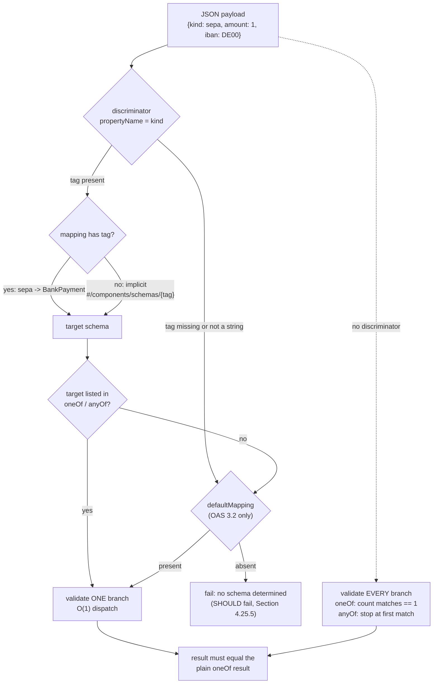

# Modeling Polymorphism in OpenAPI 3.1/3.2: oneOf with Discriminator Mapping vs anyOf Performance and Ambiguity

> [!summary] Claim
> `oneOf` and `anyOf` define what a polymorphic payload is, the Discriminator Object only says which branch to try first, and the specification forbids it from changing the validation outcome, so a correct contract makes its branches mutually exclusive through `const` or `enum` on the tag property and treats `discriminator` as a performance and error-quality hint that every runtime must agree with.

Part of [OpenAPI JSON Schema and Contracts](README.md) in [API Engineering](../README.md).

## TL;DR

- Mechanism: JSON Schema `oneOf` must evaluate every branch to prove exactly one matches, `anyOf` may stop at the first match, and an OpenAPI `discriminator` maps a property value (`kind: card`) to one branch so a parser can validate one branch instead of N.
- Contract rule: "discriminator MUST NOT change the validation outcome of the schema" (OAS 3.2.1 Section 4.25), so the tag must also be constrained inside each branch with `const` or `enum`, or the `oneOf` stays ambiguous and plain JSON Schema validators reject payloads your server accepts.
- Trap: implicit mapping uses the tag value as a component name under `#/components/schemas/`, so a validator that dispatches on it without checking the listed branches lets the client pick any component; openapi-schema-validator 0.9.0 `OAS30Validator` does exactly that in the lab.
- Portability: OAS 3.0 and 3.1 leave an absent tag undefined; OAS 3.2 adds `defaultMapping` for optional tags (OAS 3.2.1 Section 4.25.4); Pydantic 2.14.3 emits `oneOf` plus `discriminator` for `Field(discriminator=...)`, `anyOf` for an untagged union, and no `discriminator` at all for a callable `Discriminator`.
- When not to use it: skip `discriminator` for unions of scalars or of shapes with no shared tag property, and do not reach for `allOf` inheritance plus `discriminator` when you need validation, because the `allOf` form "is only useful for non-validation use cases" (OAS 3.2.1 Section 4.25.2).

## Mental model



The solid path is what a discriminator-aware parser does: read the tag, translate it through `mapping` or the implicit component name, refuse a target that is not one of the listed branches, fall back to `defaultMapping` only in OAS 3.2, and validate a single branch.
The dotted path is what any plain JSON Schema 2020-12 validator does with the same document, because `discriminator` is an OAS base vocabulary keyword declared with `$vocabulary` `false` and may be treated as an unknown keyword (OAS 3.2.1 Section 4.24.1).
Both arrows end in the same box because the specification requires them to agree; every bug in this note is a case where they do not.

## How it works

### The JSON Schema layer: what oneOf and anyOf actually compute

`anyOf` succeeds if the instance "validates successfully against at least one schema", and `oneOf` succeeds if it validates "against exactly one schema" (JSON Schema Core 2020-12 Sections 10.2.1.2 and 10.2.1.3).
The cost difference follows from the definitions: `anyOf` can stop at the first passing branch, while `oneOf` must evaluate every remaining branch to prove none of them also passes.
python-jsonschema 4.26.0 implements exactly that: `anyOf` breaks out of its loop on the first branch with no errors, and `oneOf` finds the first valid branch, then runs `validator.evolve(schema=each).is_valid(instance)` on every remaining branch and reports `is valid under each of ...` if any also passes (jsonschema 4.26.0 jsonschema/_keywords.py, anyOf and oneOf).
Annotation collection removes the `anyOf` shortcut: "when annotations are being collected, all subschemas MUST be examined" (JSON Schema Core 2020-12 Section 10.2.1.2), and Section 7.7 repeats that short-circuiting is possible only for assertions, never for annotation collection.
That matters as soon as a schema uses `unevaluatedProperties`, which depends on annotations from every passing `anyOf` branch; see [[JSON-Schema-Composition-AllOf-AnyOf-OneOf-and-UnevaluatedProperties]].

So the two keywords answer different questions.
`oneOf` says "the variants are disjoint, and a payload that fits two of them is an error".
`anyOf` says "the variants may overlap, and a payload that fits several is fine".
For a tagged sum type the correct keyword is `oneOf`, and disjointness is cheap to guarantee: give every branch a required tag property constrained with `const` or `enum`, and no payload can satisfy two branches.

### The Discriminator Object, field by field

The Discriminator Object has three fixed fields in OAS 3.2.1 (Section 4.25.1):

- `propertyName` (REQUIRED): the payload property holding the tag.
- `mapping` (`Map[string, string]`): tag value -> schema name or URI reference.
- `defaultMapping` (new in 3.2): the schema to use when the tag is absent or has no explicit or implicit mapping.

OAS 3.1.2 and 3.0.4 have only `propertyName` and `mapping`, and say the property "SHOULD be required in the payload schema, as the behavior when the property is absent is undefined" (OAS 3.1.2 Section 4.8.25.1, OAS 3.0.4 Section 4.7.25.1).
The section text for the Discriminator Object is identical between 3.2.0 and 3.2.1; a diff of the two extracted sections, run while researching this note, found no change.

The rules that matter for correctness:

1. Legal only next to `oneOf`, `anyOf`, or `allOf`, and with `oneOf` or `anyOf` "all possible schemas MUST be listed explicitly" (OAS 3.2.1 Section 4.25.2).
2. Without a `mapping` entry, the tag value "is used as the name of the associated schema under the Components Object" (OAS 3.2.1 Section 4.25.3), so `{"kind": "Cat"}` means `#/components/schemas/Cat`.
3. "When using implicit or explicit schema component names, inline `oneOf` or `anyOf` subschemas are not considered" (OAS 3.2.1 Section 4.25.3): implicit mapping only reaches named components, never an inline branch.
4. A mapping value that is both a valid schema name and a valid relative URI reference is implementation-defined; it is RECOMMENDED to treat it as a schema name, and authors MUST write `./foo` to force the URI reading (OAS 3.2.1 Section 4.25.3).
5. Mapping keys MUST be strings; tooling MAY stringify payload values for comparison, and how is implementation-defined (OAS 3.2.1 Section 4.25.3), so a boolean or integer tag is a portability hazard.
6. "If the discriminating value does not match an implicit or explicit mapping, no schema can be determined and validation SHOULD fail" (OAS 3.2.1 Section 4.25.5).
7. The `allOf` form puts the discriminator on a parent that children `allOf`-reference, but "validation with the parent schema with this form of discriminator does not perform a search for child schemas" because "no standard JSON Schema keyword connects the parent schema to the child schemas" (OAS 3.2.1 Section 4.25.2).
   OAS 3.0.4 adds that whether tools search all named components or only directly referenced ones for children is implementation-defined (OAS 3.0.4 Section 4.7.25.2), the question raised in OAI issue 3591.

### defaultMapping and the exclusivity requirement (OAS 3.2)

An optional tag is the evolution path for an API that predates its discriminator: old clients keep sending untagged payloads.
OAS 3.2.1 Section 4.25.4 requires `defaultMapping` in that case, and requires that "each subschema that defines a value for the discriminating property also define the property as required".
The fallback schema must also exclude the mapped tags, for example `petType: {not: {enum: [cat, dog]}}`, because otherwise a `cat` payload satisfies both `Cat` and the fallback and a `oneOf` fails (OAS 3.2.1 Section 4.25.4).
The lab's `OtherPayment` schema uses `kind: {not: {enum: [card, bank_transfer, sepa]}}` and the test proves that each of a card payload, an unknown-tag payload, and an untagged payload matches exactly one branch of `LenientPayment`.

### Why "MUST NOT change the validation outcome" is the design center

The 3.0, 3.1, and 3.2 texts all say "discriminator MUST NOT change the validation outcome of the schema" (OAS 3.0.4 Section 4.7.25, OAS 3.1.2 Section 4.8.25, OAS 3.2.1 Section 4.25).
3.2.1 Section 4.25.5 states the intent: "Deserialization of a oneOf can be a costly operation", and the discriminator is a "hint" that "can only help make the deserialization more efficient and provide better error messaging".
The consequence is that the discriminator is redundant information by construction: if your branches are disjoint by `const`, the hint and the plain `oneOf` always agree; if they are not, a hint-following validator and a plain one will disagree on some payload, and both cannot be right.
In OAS 3.1 this was made structural: the Schema Object is a JSON Schema 2020-12 dialect, `https://spec.openapis.org/oas/3.1/dialect/base`, that includes the OAS base vocabulary with `$vocabulary` `false`, so a generic validator may ignore `discriminator` (OAS 3.1.2 Section 4.8.24.1); OAS 3.2 uses a dated dialect URI of the form `https://spec.openapis.org/oas/3.2/dialect/YYYY-MM-DD` (OAS 3.2.1 Section 4.24.1).
OAI issue 2143 (opened 2020-02-16, 104 comments, closed 2024-04-22) asked whether `discriminator` should be deprecated now that full JSON Schema can express the same constraint; it was not, and 3.2 extended it with `defaultMapping` instead.

### Implementation 1: python-jsonschema and openapi-schema-validator

openapi-schema-validator 0.9.0 builds `OAS31Validator` by extending `Draft202012Validator` and registers `discriminator` as `not_implemented`, with the source comment "discriminator is annotation-only in OAS 3.1+" (openapi-schema-validator 0.9.0 openapi_schema_validator/validators.py, _build_oas31_validator); `OAS32Validator` extends `OAS31Validator` with only a new format checker and dialect id (openapi-schema-validator 0.9.0 openapi_schema_validator/validators.py, _build_oas32_validator).
So under 3.1 and 3.2 it validates the full `oneOf`, which is the specification's required outcome.
`OAS30Validator` instead maps `oneOf`, `anyOf`, and `allOf` to wrappers that call `handle_discriminator` whenever a `discriminator` is present in the same schema (openapi-schema-validator 0.9.0 openapi_schema_validator/_keywords.py, oneOf, anyOf, allOf, and handle_discriminator).
That function reads `instance.get(prop_name)`, treats any falsy value (missing, `""`, `0`) as missing, computes `mapping.get(value) or f"#/components/schemas/{value}"`, and descends into that one `$ref`; it never checks that the target is one of the listed branches and never evaluates the other branches.
The lab proves three outcome changes under the 3.0 dialect: a tag naming an unrelated component (`LedgerAdjustment`) is accepted, a payload matching two `oneOf` branches is accepted, and a bare schema-name mapping value (`sepa: BankPayment`) fails to resolve because it is used as a relative URI.
Each of those violates the "MUST NOT change the validation outcome" rule, and the first is a type-confusion hole; see Security.

### Implementation 2: pydantic-core tagged unions

`Field(discriminator="kind")` makes pydantic 2.14.3 build a `tagged-union` core schema instead of `union`.
At schema build time `_ApplyInferredDiscriminator` reads each branch's `kind` field and requires it to be a `Literal` (or `None`, a union of literals, a `RootModel[Literal]`, a `Literal` with a default, or a `Literal` wrapped in an after-validator); a before, wrap, or plain validator on the tag raises `PydanticUserError` with code `discriminator-validator`, and anything else raises `discriminator-needs-literal` (pydantic 2.14.3 pydantic/_internal/_discriminated_union.py, _ApplyInferredDiscriminator._infer_discriminator_values_for_inner_schema).
`_set_unique_choice_for_values` raises `TypeError` "mapped to multiple choices" if two branches claim the same tag, so the disjointness that OpenAPI only recommends is a build-time error in Pydantic.
At validation time `TaggedUnionValidator::validate` extracts the tag through `LookupPaths` (the source comment: "same as we do to find values in typed_dict aliases", pydantic-core 2.50.4 src/common/union.rs, Discriminator), or calls the function for a callable `Discriminator`, and `find_call_validator` looks the tag up in a `LiteralLookup` and runs exactly one branch validator (pydantic-core 2.50.4 src/validators/union.rs, TaggedUnionValidator::validate and find_call_validator).
`LiteralLookup` keeps specialised `AHashMap<String, usize>` and `AHashMap<i64, usize>` tables for string and integer tags, so dispatch is a hash probe, not a scan (pydantic-core 2.50.4 src/validators/literal.rs, LiteralLookup).
A missing tag raises `union_tag_not_found`; a tag with no branch raises `union_tag_invalid` with `ctx.expected_tags`; a branch error is wrapped with the tag as the outer `loc` element (`err.with_outer_location(tag)`).

### Implementation 3: pydantic-core untagged unions (smart and left_to_right)

Without a discriminator the core schema is `union` and the default mode is `smart` (pydantic-core 2.50.4 src/validators/union.rs, UnionValidator::build).
`validate_smart` tries every branch, returns immediately only on an `Exactness::Exact` result with no `fields_set_count`, and otherwise keeps the best candidate: a higher `fields_set_count` wins, and on a tie the higher exactness wins, with the earlier branch kept on a full tie (pydantic-core 2.50.4 src/validators/union.rs, UnionValidator::validate_smart).
Models, dataclasses, and typed dicts report a `fields_set_count`, so for a union of models validated from a `dict` every branch runs; the lab's trace confirms that smart mode enters all four payment branches even when the first one matches.
The fields-set metric arrived in Pydantic 2.8.0 (pydantic 2.14.3 docs/concepts/unions.md), through pydantic-core PR 1332 (merged 2024-06-19), whose description says it "almost fixes" pydantic issue 9095, where `Foo | Bar` with `extra="ignore"` chose `Foo` for a `{"bar": "bar"}` payload; the follow-up pydantic-core PR 1334 (merged 2024-06-20) closed it, and both shipped in pydantic-core 2.20.0, the version pydantic 2.8.0 pins.
On 2.14.3 the issue's payload resolves to `Bar` (one-off check during verification).
The docs reserve the right to change the smart algorithm between minor releases and recommend `left_to_right` or a discriminated union if you depend on the choice (pydantic 2.14.3 docs/concepts/unions.md).
`validate_left_to_right` returns the first success and accumulates errors otherwise (pydantic-core 2.50.4 src/validators/union.rs, UnionValidator::validate_left_to_right).
Error collection uses a `SmallVec` with inline capacity `SMALL_UNION_THRESHOLD = 4` (pydantic-core 2.50.4 src/common/union.rs), so a failed untagged union reports one error list per branch, and the lab measures 12 errors for a 4-branch union against 1 for the tagged form.

### Implementation 4: JSON Schema and OpenAPI emission

`GenerateJsonSchema.tagged_union_schema` emits `{"oneOf": [...]}` with deduplicated branches, and adds `discriminator: {propertyName, mapping}` only when `_extract_discriminator` returns a string; mapping values are the branches' `$ref` strings, boolean tags become `"true"` and `"false"`, and `None` becomes `"null"` (pydantic 2.14.3 pydantic/json_schema.py, GenerateJsonSchema.tagged_union_schema and _extract_discriminator).
A callable `Discriminator` is not a string or alias path, so the output is a bare `oneOf` with no `discriminator`; the lab shows that this published `oneOf` rejects a card payload that the runtime accepts, because the fallback branch also matches it.
An untagged union emits `anyOf` through `get_union_of_schemas` (or the single schema when only one choice survives) under the default `union_format='any_of'`; the opt-in `primitive_type_array` format collapses unions of unconstrained primitive types to a `type` array (pydantic 2.14.3 pydantic/json_schema.py, GenerateJsonSchema.union_schema and get_union_of_schemas), which correctly tells consumers that overlap is allowed and that the server picks.
FastAPI 0.162.0 generates `openapi: 3.1.0` by default (fastapi 0.162.0 fastapi/openapi/utils.py, get_openapi) and rewrites refs with `REF_TEMPLATE = "#/components/schemas/{model}"` (fastapi 0.162.0 fastapi/openapi/constants.py), so the emitted `mapping` holds full component URIs, which every reader resolves the same way.
The lab asserts that FastAPI's document passes `openapi_spec_validator.validate`, that the tagged body is `oneOf` with a five-entry `mapping` (two tags for `BankPayment`), that `CardPayment.kind` is `const: card`, and that `BankPayment.kind` is `enum: [bank_transfer, sepa]`; the branches are disjoint, so the hint is sound.
How FastAPI assembles the document is covered in [[OpenAPI-Generation-Internals-in-FastAPI-Get-OpenAPI-and-Separate-Schemas]].

### Implementation 5: code generators

Generators turn the hint into a type switch, so their discriminator handling decides runtime behavior in every client.
openapi-generator's Java generator documents `legacyDiscriminatorBehavior` (default `true`), whose `false` setting includes `oneOf` and `anyOf` schemas in the mapping and "validates that oneOf and anyOf schemas contain the required discriminator and throws an error if the discriminator is missing" (openapi-generator docs/generators/java.md, as of 2026-11).
Its `useOneOfDiscriminatorLookup` option uses the mapping to speed up lookup, and the docs warn "Validation (e.g. one and only one match in oneOf's schemas) will be skipped", and only the `jersey2`, `jersey3`, `native`, and `okhttp-gson` libraries support it (openapi-generator docs/generators/java.md, as of 2026-11), which is the same trade the `OAS30Validator` makes.
`useDeductionForOneOfInterfaces` resolves discriminator-free `oneOf` by field set through Jackson `@JsonTypeInfo(use = Id.DEDUCTION)` and "Requires subtypes to have structurally distinct sets of properties" (openapi-generator docs/generators/java.md, as of 2026-11), the generator equivalent of Pydantic smart mode.
Python generation from the same contract is in [[Generating-Pydantic-v2-Models-from-OpenAPI-with-Datamodel-Code-Generator]] and [[Generating-Typed-Async-SDKs-with-OpenAPI-Python-Client-and-OpenAPI-Generator]].

## Numbers and limits

Measured rows were re-measured once during independent verification (2026-11) on an Apple M3 Pro, macOS 27.3 (arm64, Darwin 27.3.0), CPython 3.14.6, with `uv run --frozen python -I -m api_labs.f08_openapi_json_schema_and_contracts.discriminated_polymorphism` from `labs/`, best of 5 `timeit` repeats (200 000 calls for Pydantic, 2 000 for jsonschema); single-run microbenchmarks, so treat them as ratios, not absolutes.

| Quantity | Value | Source |
| --- | --- | --- |
| Pydantic tagged union, 4 branches, last-declared tag | 0.528 us per call | measured, lab `main()` |
| Pydantic smart union, same payload | 1.451 us per call (2.7x tagged) | measured, lab `main()` |
| Pydantic `left_to_right` union, same payload | 1.415 us per call | measured, lab `main()` |
| jsonschema `oneOf`, 2 overlapping branches, validator and registry rebuilt per call | 39.638 us per call | measured; includes construction cost, so it overstates per-branch cost |
| jsonschema, discriminator-resolved single branch, same rebuild | 20.495 us per call | measured; about half, consistent with 2 -> 1 branch evaluations, though both rows also pay construction and the hinted row pays the resolver |
| Branches entered: tagged / smart / `left_to_right`, first-declared tag | 1 / 4 / 1 | lab `test_union_mode_decides_how_many_branches_run` |
| Branches entered: tagged / smart / `left_to_right`, last-declared tag | 1 / 4 / 4 | same test |
| Error entries for `{"kind": "wire", "amount": "x"}`: tagged / smart | 1 / 12 | lab `test_unknown_tag_is_one_error_...`; JSON error body more than 4x larger |
| jsonschema 4.26.0 branch evaluations for a valid instance, N branches | `anyOf`: 1 to N; `oneOf`: always N | jsonschema 4.26.0 jsonschema/_keywords.py, anyOf and oneOf |
| pydantic-core inline error slots before heap allocation | 4 (`SMALL_UNION_THRESHOLD`) | pydantic-core 2.50.4 src/common/union.rs |
| Smart-mode fields-set tiebreak | since Pydantic 2.8.0 | pydantic 2.14.3 docs/concepts/unions.md |
| Discriminator Object fixed fields | 2 in 3.0.4 and 3.1.2; 3 in 3.2.0 and 3.2.1 | OAS 3.0.4 4.7.25.1, 3.1.2 4.8.25.1, 3.2.1 4.25.1 |
| Release dates | 3.0.4 2024-10-24; 3.1.2 and 3.2.0 2025-09-19; 3.2.1 2026-09-10 | OAS 3.2.1 Appendix A |
| FastAPI default `openapi` version | `3.1.0` | fastapi 0.162.0 fastapi/openapi/utils.py, get_openapi |
| CVE-2017-7525 CVSS 3.1 base score | 9.8 CRITICAL | NVD record |

The growth law is the useful number: untagged validation of a model union costs about N branch validations in smart mode and up to N in `left_to_right` or `oneOf`, while a tagged union costs one hash probe plus one branch, independent of N.
A failing untagged payload also produces errors proportional to N times the fields per branch, which is a response-size amplification under attack (OWASP API4:2023).

## Portability

Lab checks were paused on 2026-11-11 by the user; the lab ran once, on the workspace interpreter only.

| Dimension | Behavior | Evidence |
| --- | --- | --- |
| CPython 3.14 | 26 of 26 pass on 3.14.6, rerun once during verification (the matrix patch 3.14.10 was not run) | lab, `uv run --frozen pytest`, macOS 27.3 arm64 |
| CPython 3.12, 3.13, 3.15, 3.15t | not run (lab checks paused); `requires-python = ">=3.12,<3.16"` admits them | `labs/pyproject.toml`; no run on these interpreters, so no behavior claim is made for them |
| Debian Trixie and Alpine musl | not run (lab checks paused) | no container run, so no behavior claim is made for them |
| OAS 3.0.x | 2 fields; absent tag undefined; `allOf` child search implementation-defined | OAS 3.0.4 Sections 4.7.25.1 and 4.7.25.2 |
| OAS 3.1.x | 2 fields; `discriminator` is an OAS base vocabulary keyword, `$vocabulary` `false` | OAS 3.1.2 Sections 4.8.24.1 and 4.8.25.1 |
| OAS 3.2.x | adds `defaultMapping` and the optional-tag rules; 3.2.0 and 3.2.1 texts identical | OAS 3.2.1 Sections 4.25.1 and 4.25.4; diff of the extracted section text |
| openapi-schema-validator 0.9.0 `OAS30Validator` | dispatches on the tag, skips other branches, no listed-branch check | lab `test_oas30_validator_dispatch_changes_the_validation_outcome`; `_keywords.py`, handle_discriminator |
| openapi-schema-validator 0.9.0 `OAS31Validator`, `OAS32Validator` | `discriminator` ignored; full `oneOf` | lab (3.1); validators.py, `_build_oas32_validator` extends `OAS31Validator`; `OAS32Validator` gave the same `is valid under each of` error as 3.1 for `LOOSE` in a one-off probe, rerun during verification |
| Pydantic 2.14.3 / pydantic-core 2.50.4 | tagged union: one branch; smart: all model branches; JSON duplicate tag key: last value wins | lab |
| Pydantic < 2.8.0 | smart mode uses exactness only, no fields-set count | pydantic 2.14.3 docs/concepts/unions.md |
| FastAPI 0.162.0 | `oneOf` + full-URI `mapping` for tagged; `anyOf`, no `discriminator`, for untagged; `422` with one `union_tag_invalid` entry | lab |
| Uvicorn, Hypercorn, Granian; HTTP/1.1, HTTP/2, HTTP/3 | no effect: union dispatch runs on the decoded body after the ASGI server delivers it | mechanism; the lab uses `httpx.ASGITransport`, no server |

## Worked example

The [implementation](../labs/src/api_labs/f08_openapi_json_schema_and_contracts/discriminated_polymorphism.py) defines one payment union three ways (Pydantic tagged, smart, and `left_to_right`), a hand-written OpenAPI component graph with a mapped `oneOf`, an OAS 3.2 `defaultMapping` union, an ambiguous `oneOf`, and an overlapping `anyOf`, plus a reference discriminator resolver and a FastAPI app.
The [test](../labs/tests/f08_openapi_json_schema_and_contracts/test_polymorphism_and_discriminators_in_openapi_and_json_schema.py) has 26 cases.

Every branch records entry into its `model_validator(mode="before")`, which is how the test counts attempts per union mode:

```python
class TracedModel(BaseModel):
    """Append the class name to context["attempts"] each time a union enters this branch."""

    @model_validator(mode="before")
    @classmethod
    def record_attempt(cls, data: Any, info: ValidationInfo) -> Any:
        if info.context is not None:
            cast("dict[str, list[str]]", info.context)["attempts"].append(cls.__name__)
        return data


class CardPayment(TracedModel):
    kind: Literal["card"]
    amount: int
    last4: str


class BankPayment(TracedModel):
    kind: Literal["bank_transfer", "sepa"]
    amount: int
    iban: str
```

The resolver applies the specification's order and adds the listed-branch check that openapi-schema-validator's 3.0 path lacks:

```python
def resolve_discriminator(document: dict[str, Any], union_ref: str, instance: object) -> str:
    """Select the branch a Discriminator Object names, refusing targets outside the union.

    Explicit mapping wins, then the implicit component name, then defaultMapping (OAS 3.2).
    A mapping value that names a component is read as a schema name before a URI reference.
    """
    schemas = cast("dict[str, dict[str, Any]]", document["components"]["schemas"])
    discriminator = schemas[union_ref.removeprefix(COMPONENT_PREFIX)]["discriminator"]
    listed = branch_refs(document, union_ref)

    def as_ref(target: str) -> str:
        return COMPONENT_PREFIX + target if target in schemas else target

    def fallback(reason: str, detail: str) -> str:
        if "defaultMapping" in discriminator:
            return as_ref(cast("str", discriminator["defaultMapping"]))
        raise DiscriminatorError(reason, detail)

    payload = cast("dict[str, object]", instance) if isinstance(instance, dict) else {}
    tag = payload.get(discriminator["propertyName"])
    if not isinstance(tag, str):
        return fallback("tag-missing", f"no string {discriminator['propertyName']!r} property")
    mapping = cast("dict[str, str]", discriminator.get("mapping", {}))
    target = as_ref(mapping.get(tag, tag))
    if target not in listed:
        return fallback("target-not-listed", f"{tag!r} selects {target!r}, not a listed branch")
    return target
```

The test that pins the 3.0 dispatch changing the outcome:

```python
@pytest.mark.unit
def test_oas30_validator_dispatch_changes_the_validation_outcome() -> None:
    # A tag naming a component outside the oneOf is accepted by the 3.0 dispatch only.
    assert is_valid(PAYMENT_DOCUMENT, ref("Payment"), FORGED, "3.0") is True
    assert is_valid(PAYMENT_DOCUMENT, ref("Payment"), FORGED, "3.1") is False
    # Two matching branches fail a real oneOf, yet the 3.0 dispatch checks one branch.
    assert is_valid(PAYMENT_DOCUMENT, ref("LoosePayment"), LOOSE, "3.0") is True
    assert is_valid(PAYMENT_DOCUMENT, ref("LoosePayment"), LOOSE, "3.1") is False
    # A bare schema-name mapping value is not resolved by the 3.0 dispatch.
    assert is_valid(PAYMENT_DOCUMENT, ref("Payment"), SEPA, "3.0") is False
    assert is_valid(PAYMENT_DOCUMENT, ref("Payment"), SEPA, "3.1") is True
    assert is_valid(PAYMENT_DOCUMENT, ref("Payment"), CARD, "3.0") is True
```

Output captured from `labs/` on CPython 3.14.6, macOS 27.3 arm64:

```text
$ uv run --frozen pytest tests/f08_openapi_json_schema_and_contracts/test_polymorphism_and_discriminators_in_openapi_and_json_schema.py -q -p no:cacheprovider
..........................                                               [100%]
26 passed in 0.75s
```

The timing harness, same machine and interpreter:

```text
$ uv run --frozen python -I -m api_labs.f08_openapi_json_schema_and_contracts.discriminated_polymorphism
pydantic tagged-union                0.528 us/call
pydantic smart union                 1.451 us/call
pydantic left_to_right union         1.415 us/call
jsonschema oneOf (2 branches)       39.638 us/call
jsonschema hinted branch only       20.495 us/call
```

What the 26 cases establish:

- Tagged mode enters exactly one branch; smart mode enters all four for both the first and the last tag; `left_to_right` enters one for the first tag and four for the last.
- `{"amount": 5}` fits both `Refund` and `Charge`: smart and `left_to_right` both return `Refund` (declaration order); `{"amount": 5, "capture": false}` makes smart return `Charge` (more fields set) while `left_to_right` still returns `Refund` and silently drops `capture`.
- The same overlap passes `anyOf` and fails `oneOf` under python-jsonschema.
- The resolver maps `card` through a URI value, `sepa` through a schema-name value, `LooseCard` implicitly, and sends an unmapped, a missing, and an out-of-union tag to `defaultMapping`; without `defaultMapping` it raises `target-not-listed` or `tag-missing`, including for a non-string tag `7`.
- `{"kind":"card","kind":"sepa",...}` validates as `BankPayment` and the reversed order as `CardPayment`: the last duplicate key decides the branch.
- FastAPI returns `422` with one `union_tag_invalid` entry at `loc` `["body"]` and `ctx.expected_tags` `'card', 'bank_transfer', 'sepa', 'wallet', 'voucher'` for an unknown tag, `union_tag_not_found` for a missing one, and one error per branch (`["body", "Refund", "amount"]`, `["body", "Charge", "amount"]`) for the untagged body.

## Pitfalls

> [!warning] Discriminator without `const` on the tag
> Trigger: branches declare `kind: {type: string}` and rely on `discriminator` alone for exclusivity.
> Symptom: a discriminator-aware server accepts `{"kind": "LooseCard", ...}`, while any plain JSON Schema 2020-12 validator (python-jsonschema 4.26.0, openapi-schema-validator `OAS31Validator`) rejects it with `is valid under each of`, so contract tests, gateways, and SDKs disagree with the server; the lab's `LoosePayment` shows exactly this split.
> Fix: put `const` (or `enum` for multi-tag branches) and `required` on the tag in every branch; Pydantic's `Literal` tag generates both.

> [!warning] Validators that follow the hint skip the oneOf
> Trigger: an OAS 3.0 document validated with openapi-schema-validator 0.9.0 `OAS30Validator`, or a Java client generated with `useOneOfDiscriminatorLookup`.
> Symptom: payloads matching two branches pass, and a tag naming any component outside the union is accepted; OAI issue 2141 (2020) records a user finding that none of the validators they tried validated discriminators as expected.
> Fix: validate with the 3.1 or 3.2 dialect, keep branches disjoint so hint and full evaluation cannot disagree, and add a listed-branch check where you dispatch yourself.

> [!warning] Bare schema names in `mapping`
> Trigger: `mapping: {sepa: BankPayment}`, which 3.0.4, 3.1.2, and 3.2.1 all RECOMMEND be read as a schema name but leave implementation-defined (OAS 3.0.4 Section 4.7.25.3, OAS 3.1.2 Section 4.8.25.3, OAS 3.2.1 Section 4.25.3).
> Symptom: the lab's `OAS30Validator` treats `BankPayment` as a relative URI and fails a valid `sepa` payload, against the 3.0.4 recommendation, while the 3.1 path accepts it.
> Fix: write full URIs (`#/components/schemas/BankPayment`), which is what FastAPI and Pydantic emit; write `./foo` when you mean a relative URI (OAS 3.2.1 Section 4.25.3).

> [!warning] Callable discriminators publish an ambiguous contract
> Trigger: `Discriminator(callable)` with a catch-all branch, the usual way to accept unknown tags in Pydantic.
> Symptom: the emitted JSON Schema is a bare `oneOf` with no `discriminator`, and because the catch-all also matches card payloads, the published contract rejects payloads the server accepts; the lab proves `is_valid(emitted, "", CARD) is False` while `LENIENT_PAYMENT.validate_python(CARD)` returns `CardPayment`.
> Fix: override the generated schema with a `not: {enum: [...]}` fallback and an explicit `discriminator` with `defaultMapping` (OAS 3.2), or keep the string discriminator and reject unknown tags.

> [!warning] Smart mode on overlapping models
> Trigger: untagged `Refund | Charge` where both have only optional fields beyond `amount`.
> Symptom: the chosen class depends on which optional fields the client sent; Pydantic issue 9095 records `Foo | Bar` with `extra="ignore"` resolving `{"bar": "bar"}` to `Foo` before 2.8.0, and the docs reserve the right to change the algorithm between minor releases.
> Fix: add a tag and `Field(discriminator=...)`; use `left_to_right` only when you want a documented priority order.

> [!warning] allOf inheritance plus discriminator as a validation tool
> Trigger: `Pet` carries the discriminator and `Cat` and `Dog` are `allOf: [$ref: Pet, ...]`, and the request body references `Pet`.
> Symptom: validation against `Pet` checks only `Pet`'s own keywords; `Cat`-specific constraints never run (OAS 3.2.1 Section 4.25.2), and which children a tool even finds was implementation-defined in 3.0 (OAI issue 3591).
> Fix: reference a `oneOf` of the children from the body, and keep `allOf` for reuse of shared properties.

## Security and robustness

Tag-to-type dispatch is a deserialization decision, and the attacker controls the tag.
CVE-2017-7525 is the canonical failure: jackson-databind polymorphic typing let "an unauthenticated user perform code execution by sending the maliciously crafted input to the readValue method of the ObjectMapper", scored 9.8 CRITICAL, fixed in 2.6.7.1, 2.7.9.1, and 2.8.9 (NVD CVE-2017-7525; jackson-databind issue 1599).
OpenAPI implicit mapping has the same shape at the schema level: the tag value names a component, and any dispatcher that does not intersect that name with the listed branches lets the client choose a schema the endpoint never offered.
The lab's `FORGED` payload, `{"kind": "LedgerAdjustment", "amount": -500, "approved_by": "mallory"}`, is accepted against `Payment` by `OAS30Validator` because `LedgerAdjustment` is a real component, which is an OWASP API3:2023 Broken Object Property Level Authorization pattern: the client sets a field (`approved_by`) the operation's contract never exposed.

Defenses in depth:

- Closed tag set: a string discriminator over `Literal` tags gives `union_tag_invalid` for anything else, before any branch logic runs, and the message lists only the declared tags.
- Listed-branch check in every custom dispatcher; the lab's `resolve_discriminator` refuses with `target-not-listed`.
- Fallback branches are where mass assignment hides: the lab's `OtherPayment` uses `extra="allow"` and stores `approved_by` in `model_extra`; a production fallback should store the raw payload for audit and never bind it to domain fields.
  See [[Defeating-BOPLA-and-Mass-Assignment-API3-2023-Strict-Input-Output-Schemas]].
- Duplicate keys: RFC 8259 Section 4 says names "SHOULD be unique" and that with duplicates "the behavior of software that receives such an object is unpredictable"; pydantic-core's JSON parser keeps the last value, so a WAF or gateway that reads the first `kind` and the service that reads the last can route the same body to different branches; reject duplicate keys at the edge if anything upstream inspects the tag.
- Error amplification: a failing untagged union returns one error list per branch (12 entries for 4 branches in the lab), and FastAPI echoes `input` in each, because it forwards `exc.errors(include_url=False)` with Pydantic's default `include_input` (fastapi 0.162.0 fastapi/_compat/v2.py, ModelField.validate); tagged unions bound the response to one entry, which matters for OWASP API4:2023 Unrestricted Resource Consumption.
  See [[Unrestricted-Resource-Consumption-API4-2023-Payload-Depth-and-Limit-Guards]].
- Non-string tags: mapping keys MUST be strings and conversions are implementation-defined (OAS 3.2.1 Section 4.25.3); the lab's resolver rejects `kind: 7` as `tag-missing`, while `OAS30Validator` builds `#/components/schemas/7` and fails with "could not be resolved" (one-off probe during verification); use string tags only.

## The principal's view

The decision is not "`oneOf` or `anyOf`" but where the source of truth for variant selection lives.
Make the schema self-sufficient: every branch carries a required `const` tag, the union is `oneOf`, and `discriminator` repeats what the `const` values already say.
Then every consumer, whether a discriminator-aware generator, a plain JSON Schema validator in a gateway, Schemathesis, or a hand-written client, reaches the same verdict, and the discriminator is purely an optimization you can trust.
The organizational cost is that schema authors must write the tag twice (in `const` and in `mapping`) and a linter must keep them in sync; that is cheaper than debugging a contract that three tools interpret three ways.
Use `anyOf` deliberately and rarely: for genuinely overlapping shapes (a search filter that may carry several facets) where "the server picks" is the contract, and accept that consumers cannot tell which branch applies.
For evolution, adding a variant to a response union is a breaking change for any client with an exhaustive switch, and adding one to a request union is safe for the server; plan a `defaultMapping` or catch-all branch before the first release, because retrofitting one changes the published `oneOf`; see [[Breaking-Change-Detection-and-Semantic-OpenAPI-Diffing]] and [[Additive-Schema-Evolution-and-Tolerant-Reader-Patterns]].
Choose a different paradigm when polymorphism dominates the domain: Protocol Buffers `oneof` encodes the variant in the field number, so the wire format is unambiguous by construction, and GraphQL unions resolve the concrete type on the server with `__typename`; JSON plus OpenAPI makes you rebuild that guarantee with `const`.

## Interview questions

> [!question] L5: What is the difference between `oneOf` and `anyOf` for a payload that matches two branches?
>
> > [!success]- Answer
> > `anyOf` passes because at least one branch validates, while `oneOf` fails because more than one validates (JSON Schema Core 2020-12 Sections 10.2.1.2 and 10.2.1.3).
> > A validator can stop `anyOf` at the first match, but must evaluate every branch of `oneOf` to prove exclusivity.
> >
> > Follow-up: When can a validator not stop `anyOf` early?

> [!question] L5: What does `Field(discriminator="kind")` change in Pydantic validation and in the generated schema?
>
> > [!success]- Answer
> > The core schema becomes `tagged-union`, so pydantic-core reads `kind`, looks it up in a hash table, and runs one branch instead of trying every member.
> > Errors become one `union_tag_invalid` or `union_tag_not_found` entry instead of one list per branch.
> > The JSON Schema becomes `oneOf` plus `discriminator: {propertyName, mapping}`, where an untagged union would emit `anyOf`.
> >
> > Follow-up: What does Pydantic require of the `kind` field in each branch, and what happens if two branches share a tag?

> [!question] L6: Predict the output of this simplified excerpt of the lab's `SMART_ADJUSTMENT` and `LEFT_TO_RIGHT_ADJUSTMENT` test.
> ```python
> SMART = TypeAdapter(Refund | Charge)            # both have amount: int
> LTR = TypeAdapter(Annotated[Refund | Charge, Field(union_mode="left_to_right")])
> body = {"amount": 5, "capture": False}          # capture only exists on Charge
> print(type(SMART.validate_python({"amount": 5})).__name__,
>       type(SMART.validate_python(body)).__name__,
>       type(LTR.validate_python(body)).__name__)
> ```
>
> > [!success]- Answer
> > `Refund Charge Refund`.
> > With only `amount`, both branches set one field, and the tie keeps the first-declared `Refund`.
> > With `capture`, `Charge` sets two fields and smart mode prefers the higher `fields_set_count` (Pydantic >= 2.8.0).
> > `left_to_right` returns the first success, `Refund`, and silently ignores `capture`.
> >
> > Follow-up: How would you make the choice independent of which optional fields the client sends?

> [!question] L6: The spec says the discriminator "MUST NOT change the validation outcome". Why, and what must the schema contain for that to hold?
>
> > [!success]- Answer
> > Because in OAS 3.1 and 3.2 the Schema Object is a JSON Schema dialect in which `discriminator` may be ignored, so a generic validator and a discriminator-aware one must agree.
> > That holds only if the branches are disjoint, which you guarantee with a required tag constrained by `const` or `enum` in every branch.
> > Then the discriminator is a hint for speed and error quality only.
> >
> > Follow-up: Show a schema where a discriminator-following validator and a plain one disagree.

> [!question] L6: Debug this API: your FastAPI service accepts `{"kind": "LooseCard", "amount": 1}`, the API gateway (which validates with a JSON Schema 2020-12 library) rejects it, and the generated TypeScript client deserializes it fine, so which component is wrong?
>
> > [!success]- Answer
> > The contract is wrong: both branches type `kind` as a plain string, so the payload matches both and the plain `oneOf` correctly fails, while the server and client follow the discriminator and check one branch.
> > The gateway is the only tool implementing the specified outcome.
> > Fix the schema with `const` on each branch's tag, which makes all three agree.
> >
> > Follow-up: How would you catch this class of bug in CI before deployment?

> [!question] L6: What does `defaultMapping` add in OAS 3.2, and what must the default schema contain to keep `oneOf` valid?
>
> > [!success]- Answer
> > It names the schema for payloads whose tag is absent or unmapped, which makes an optional tag legal (OAS 3.2.1 Section 4.25.4).
> > The default schema must exclude the mapped tags, for example `kind: {not: {enum: [card, sepa]}}`, or a `card` payload matches both `CardPayment` and the default and the `oneOf` fails.
> > Every tagged branch must also mark the tag `required`, because the parent no longer does.
> >
> > Follow-up: How do you express the same fallback in Pydantic, and what does its generated schema miss?

> [!question] L7+: If a gateway routes on the first `kind` key and the Python service behind it reads the last, what is the attack and what is the fix?
>
> > [!success]- Answer
> > A body with two `kind` keys can pass the gateway's per-branch policy as `card` and be processed by the service as `sepa`, a parser-differential that bypasses the edge check.
> > RFC 8259 Section 4 makes behavior with duplicate names unpredictable, and pydantic-core keeps the last value, which the lab proves.
> > Reject duplicate keys at the edge, or validate and dispatch once and forward a canonical re-serialization.
> >
> > Follow-up: Which other JSON parser differentials matter for tag routing?

> [!question] L7+: With 400 OpenAPI documents carrying polymorphic payloads across your organization, what standard do you set and how do you enforce it?
>
> > [!success]- Answer
> > Every polymorphic body is a `oneOf` of named components, each branch has a required tag with `const` or `enum`, `mapping` uses full URIs, and the discriminator's tag set equals the union of the branch `const` values.
> > Enforce it with a lint rule, a CI job that validates sample payloads with both a discriminator-aware and a plain 2020-12 validator and fails on disagreement, and a breaking-change check for added response variants.
> > Allow `anyOf` only with a written justification that overlap is intended.
> >
> > Follow-up: How do you roll a discriminator out to an existing untagged union without breaking old clients?

> [!question] L7+: When would you not model polymorphism in JSON and OpenAPI at all?
>
> > [!success]- Answer
> > When variants dominate the domain and must be unambiguous on the wire across many languages, Protocol Buffers `oneof` encodes the choice in the field number and generated code gets a native sum type.
> > When clients select fields per variant, GraphQL unions and `__typename` move resolution to the server.
> > The cost is losing plain-JSON debuggability, HTTP caching semantics, and the OpenAPI tooling ecosystem.
> >
> > Follow-up: What does a `oneof` field-number change do to compatibility compared with renaming a `const` tag?

## Related

Prerequisites: [[YAML-Media-Type-RFC-9512-and-OpenAPI-YAML-Parser-Hazards]]

Next: [[Design-First-vs-Code-First-OpenAPI-and-CI-Drift-Gates]]

See also: [[JSON-Schema-Composition-AllOf-AnyOf-OneOf-and-UnevaluatedProperties]], [[JSON-Schema-2020-12-Core-and-Validation-Vocabularies]], [[OpenAPI-3-1-Architecture-and-JSON-Schema-Alignment]], [[OpenAPI-3-2-Additions-QUERY-Method-Streaming-and-Tag-Hierarchies]], [[Discriminated-Unions-Tag-and-Callable-Discriminator-Dispatch]], [[JSON-Schema-Generation-Internals-and-GenerateJsonSchema]], [[OpenAPI-Generation-Internals-in-FastAPI-Get-OpenAPI-and-Separate-Schemas]], [[Generating-Pydantic-v2-Models-from-OpenAPI-with-Datamodel-Code-Generator]], [[Generating-Typed-Async-SDKs-with-OpenAPI-Python-Client-and-OpenAPI-Generator]], [[Breaking-Change-Detection-and-Semantic-OpenAPI-Diffing]], [[OpenAPI-Linting-and-Automated-Style-Governance-with-Vacuum-and-Spectral]], [[Property-Based-API-Testing-with-Schemathesis-and-Hypothesis]], [[Response-Schema-Conformance-Enforcement-in-Test-Suites]], [[Defeating-BOPLA-and-Mass-Assignment-API3-2023-Strict-Input-Output-Schemas]], [[Unrestricted-Resource-Consumption-API4-2023-Payload-Depth-and-Limit-Guards]], [[Mapping-Pydantic-Validation-Errors-to-RFC-9457-Problem-Details]], [[Additive-Schema-Evolution-and-Tolerant-Reader-Patterns]], [[Protobuf-Schema-Evolution-Invariants-Reserved-Tags-and-Unknown-Fields]]

- Lab: `labs/tests/f08_openapi_json_schema_and_contracts/test_polymorphism_and_discriminators_in_openapi_and_json_schema.py`

## Further reading

- [OpenAPI Specification v3.2.1](https://spec.openapis.org/oas/v3.2.1.html) - Section 4.25 (Discriminator Object, `defaultMapping`, mapping resolution) and Section 4.24.6.1 (composition and polymorphism).
- [OpenAPI Specification v3.1.2](https://spec.openapis.org/oas/v3.1.2.html) - Section 4.8.25 and the OAS base vocabulary in Section 4.8.24.1.
- [OpenAPI Specification v3.0.4](https://spec.openapis.org/oas/v3.0.4.html) - Section 4.7.25, including the implementation-defined `allOf` child search.
- [JSON Schema 2020-12 Core](https://json-schema.org/draft/2020-12/json-schema-core) - Sections 10.2.1.2 and 10.2.1.3 (`anyOf`, `oneOf`) and Section 7.7 (annotations and why they block short-circuiting).
- [RFC 8259](https://www.rfc-editor.org/rfc/rfc8259.html) - Section 4 on duplicate object member names.
- [pydantic-core 2.50.4 src/validators/union.rs](https://raw.githubusercontent.com/pydantic/pydantic/v2.14.3/pydantic-core/src/validators/union.rs) - `validate_smart`, `validate_left_to_right`, and `TaggedUnionValidator`.
- [pydantic 2.14.3 pydantic/_internal/_discriminated_union.py](https://raw.githubusercontent.com/pydantic/pydantic/v2.14.3/pydantic/_internal/_discriminated_union.py) - how tags are inferred from `Literal` fields and why duplicates fail at build time.
- [pydantic 2.14.3 pydantic/json_schema.py](https://raw.githubusercontent.com/pydantic/pydantic/v2.14.3/pydantic/json_schema.py) - `tagged_union_schema` and `_extract_discriminator`, the source of the emitted `oneOf` and `mapping`.
- [pydantic-core PR 1332](https://github.com/pydantic/pydantic-core/pull/1332) - the fields-set tiebreak in smart mode.
- [OAI/OpenAPI-Specification issue 2143](https://github.com/OAI/OpenAPI-Specification/issues/2143) - the maintainers' debate on deprecating `discriminator` in favour of plain JSON Schema.
- [NVD CVE-2017-7525](https://services.nvd.nist.gov/rest/json/cves/2.0?cveId=CVE-2017-7525) - polymorphic type dispatch from attacker input as remote code execution.
