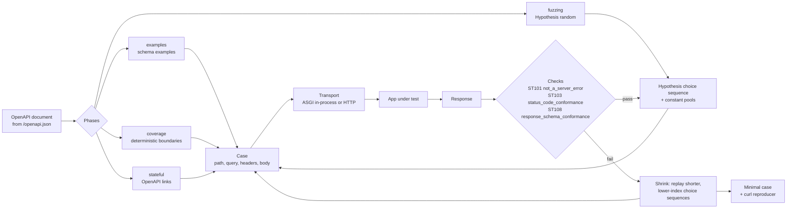

# Property-Based API Fuzzing with Schemathesis (4.33.1) and Hypothesis (6.170.14): Finding 500s Automatically

> [!summary] Claim
> Schemathesis turns every OpenAPI operation into a Hypothesis strategy and asserts one universal property, "no input yields a `5xx`", then shrinks each counterexample to the simplest request that still fails; it finds the boundary bugs a schema implies (`x=0`, an empty API key) deterministically, but it only finds the bugs a schema does not mention (a NUL a database refuses, a lone surrogate) if its alphabet, its budget, or a constant harvested from your source code happens to reach them.

Part of [OpenAPI JSON Schema and Contracts](README.md) in [API Engineering](../README.md).

## TL;DR

- Mechanism: Schemathesis 4.33.1 derives positive and negative request strategies from the OpenAPI document, runs an `examples`, a deterministic `coverage`, a random `fuzzing`, and a `stateful` phase, sends each `Case` through a transport, and runs checks such as `not_a_server_error` (`ST101`) on every response; Hypothesis 6.170.14 drives generation and shrinks failures on the underlying choice sequence.
- Contract rule: `not_a_server_error` passes only `2xx`, `3xx`, and `4xx` (`NOT_A_SERVER_ERROR_EXPECTED_STATUSES` in `config/_checks.py`), because RFC 9110 Section 15.6.1 defines `500` as "an unexpected condition", which is by definition a bug in the server, never a correct answer to client input.
- Trap: the fuzzer is only as good as its alphabet and budget; in this lab 100 examples per operation found a NUL-byte crash in 10 of 10 seeds when the literal `"\x00"` appeared in the app's source and in 0 of 10 seeds when it did not, and the default `codec="utf-8"` alphabet can never produce the lone surrogate that crashes FastAPI's default `422` handler.
- Portability: the lab passes 16 of 16 tests on CPython 3.12.13, 3.13.18, and 3.14.6; under the pinned lock it cannot run on 3.15.0b3 (`hypothesis._native` import failure) or 3.15t (no `psycopg-binary` wheel); in-process ASGI never yields the `500` itself, because Starlette re-raises the exception and only the server (Uvicorn, Hypercorn) turns it into a response.
- When not to use it: for an API without a truthful schema (the run reports schema drift as hundreds of `ST103` and `ST202` failures, not bugs), for operations with side effects you cannot reset between examples, or as a replacement for business-rule tests, since "no `500`" says nothing about whether a `200` is right.

## Mental model



Schemathesis loads the OpenAPI document and plans the phases; `examples` replays `example` values from the document, `coverage` walks each schema to emit a fixed set of boundary and constraint-violating values, `fuzzing` asks Hypothesis for random positive and negative cases, and `stateful` chains operations through OpenAPI links.
In the fuzzing phase every case is the deterministic image of a sequence of choices Hypothesis made, biased by built-in "nasty" constants and by literals harvested from the application's own modules.
Each `Case` goes through a transport, either an in-process ASGI or WSGI adapter or a real HTTP client, and every response runs through the enabled checks.
A passing response feeds the next example; a failing one makes Hypothesis replay simpler choice sequences, shorter first and lower-valued next, keeping any that still fail, until no simpler failing sequence exists.
The last survivor is the minimal case, reported with its failure code and a `curl` command.

## How it works

### The property: a `5xx` is never a correct answer

RFC 9110 Section 15.6.1 says `500 (Internal Server Error)` "indicates that the server encountered an unexpected condition that prevented it from fulfilling the request".
An unexpected condition triggered by client input is a defect: the input was either acceptable (the server should answer `2xx`) or unacceptable (the server should answer `4xx`, usually `400` or `422`, RFC 9110 Sections 15.5.1 and 15.5.21).
That makes "the status is not `5xx`" a universal property that needs no oracle about what the right answer is, which is why it is the first and cheapest check in every API fuzzer.
Schemathesis implements it as `not_a_server_error` (schemathesis 4.33.1 `src/schemathesis/checks.py`, `not_a_server_error`): it compares the status against `ctx.config.not_a_server_error.expected_statuses`, which defaults to `["2xx", "3xx", "4xx"]` (`src/schemathesis/config/_checks.py`, `NOT_A_SERVER_ERROR_EXPECTED_STATUSES`), and raises `ServerError` with code `ST101` and `Severity.CRITICAL` (`src/schemathesis/core/failures.py`, `ServerError`).
Two refinements keep it from producing false positives.
If the case is one of the coverage phase's `Content-Type` probes, the check resends the same request without the odd header and reports `ST102` only when the header alone caused the `5xx` (`checks.py`, `_check_content_type_probe`).
If the schema classifies the response as "not served" (`CallOutcome.NOT_SERVED`; the source comment reads "A server that does not serve the operation at all has not failed on the data it was sent"), the check returns without failing.

The other checks turn the OpenAPI document into further oracles; the codes below are the 4.33.1 catalogue (`src/schemathesis/failure_codes.py`, `FAILURE_CLASSES`), printed from the installed package:

| Code | Failure class | Check | What it asserts |
| --- | --- | --- | --- |
| `ST101` | `ServerError` | `not_a_server_error` | Status is `2xx`, `3xx`, or `4xx` |
| `ST102` | `ContentTypeServerError` | `not_a_server_error` | An undeclared or malformed `Content-Type` yields `4xx`, not `5xx` |
| `ST103` | `UndefinedStatusCode` | `status_code_conformance` | Status is declared under `responses` |
| `ST104` | `MissingContentType` | `content_type_conformance` | Response has a `Content-Type` |
| `ST105` | `UndefinedContentType` | `content_type_conformance` | `Content-Type` is one the operation declares |
| `ST107` | `MissingHeaders` | `response_headers_conformance` | Required response headers are present |
| `ST108` | `JsonSchemaError` | `response_schema_conformance` | Body validates against the declared schema |
| `ST112` | `ResponseTimeExceeded` | `max_response_time` | Elapsed time under the limit (default 10.0 s when enabled) |
| `ST201` | `AcceptedNegativeData` | `negative_data_rejection` | Schema-invalid input is rejected with `4xx` |
| `ST202` | `RejectedPositiveData` | `positive_data_acceptance` | Schema-valid input is not rejected |
| `ST203` | `MissingHeaderNotRejected` | `missing_required_header` | Omitting a required header yields `4xx` |
| `ST204` | `UnsupportedMethodResponse` | `unsupported_method` | An undeclared method yields `405` |
| `ST401` | `IgnoredAuth` | `ignored_auth` | Declared authentication is enforced |

Response-side checks (`ST103` to `ST111`) are the subject of [[Response-Schema-Conformance-Enforcement-in-Test-Suites]]; stateful ones (`ST301`, `ST302`, `ST402`) belong to [[Stateful-API-State-Machine-Testing-with-OpenAPI-Links-and-Schemathesis]].
This note is about the generation side and the `5xx` property.

### From schema to strategy

Schemathesis 4.x no longer delegates to `hypothesis-jsonschema`; its documentation describes "a built-in JSON Schema strategy engine for OpenAPI" in which Hypothesis supplies "primitive strategies (strings, integers, objects), shrinking, and the example database" (Schemathesis docs, Understanding Data Generation).
Each operation becomes a `SearchStrategy[Case]` through `APIOperation.as_strategy(generation_mode=...)` (`src/schemathesis/schemas.py`, `APIOperation.as_strategy`), which is also the public hook for driving it from your own `@given` or `hypothesis.find` code, as the lab does.
Two generation modes exist (`src/schemathesis/generation/modes.py`, `GenerationMode`): `positive` produces values the schema accepts, `negative` produces values it rejects, and the default configuration enables both (`GenerationConfig.__init__` sets `self.modes = modes or list(GenerationMode)`).
The string alphabet is built in `src/schemathesis/generation/jsonschema/context.py`, `_characters`: with the default `codec="utf-8"` it returns `st.characters(codec="utf-8", ...)`, and with `codec=None` it explicitly excludes category `Cs` under the comment "Lone surrogates cannot be encoded for the wire."
Either way, Schemathesis never generates an unpaired UTF-16 surrogate, which is reasonable for a wire fuzzer, since a request body must be valid UTF-8 (RFC 8259 Section 8.1), but it means a whole class of server crashes is out of its reach (see the worked example).
`allow_x00` defaults to `True`, so NUL is in the alphabet unless you pass `--generation-allow-x00 false`.

### The four phases

`schemathesis run --phases` accepts `examples`, `coverage`, `fuzzing`, and `stateful`; the engine also runs internal `probing`, `schema_analysis`, and `auth_bootstrap` phases (`src/schemathesis/engine/run/__init__.py`, `PhaseName`).
`examples` sends the `example` and `examples` values from the document.
`coverage` is deterministic: for every parameter and body schema it emits values named by `CoverageScenario` (`src/schemathesis/generation/meta.py`), including `minimum_value`, `maximum_value`, `near_boundary_number`, `large_number`, `minimum_length_string`, `oversized_string`, `value_above_maximum`, `string_above_max_length`, `incorrect_type`, `invalid_enum_value`, `invalid_pattern`, `missing_parameter`, `duplicate_parameter`, `unspecified_http_method`, `malformed_content_type`, and `unsupported_content_type`.
Its case count is "a deterministic count based on your constraints" (Schemathesis docs, Understanding Data Generation); in the lab the fixed app's `GET /ratio` got 20 coverage cases, `GET /me` 10, and `POST /users` 28 (one of them the `invalid_pattern` case the `pattern` adds), identical for seeds 1 and 2, and the buggy app's coverage findings were identical for seeds 1 and 2 (lab test `test_coverage_phase_is_seed_independent_and_misses_the_nul`).
`fuzzing` is random: Hypothesis draws `max_examples` cases per operation (Hypothesis's default 100 when `--max-examples` is not set), positive and negative mixed.
`stateful` builds a Hypothesis state machine from OpenAPI links and inferred dependencies; it is covered in [[Stateful-API-State-Machine-Testing-with-OpenAPI-Links-and-Schemathesis]].

Before any phase, the `probing` phase sends capability probes so that a test case that cannot reach the application is not reported as an application bug (`src/schemathesis/engine/run/probes.py`, module docstring).
`NullByteInHeader` sends `GET` with `X-Schemathesis-Probe-Null: \x00`; if the server answers `400`, `OpenApiSchema.adapt_to_null_byte_in_header_failure` re-registers the header string format with `\x00` excluded (`src/schemathesis/specs/openapi/schemas.py`).
That probe exists because RFC 9110 Section 5.5 says "a recipient of CR, LF, or NUL within a field value MUST either reject the message or replace each of those characters with SP", and RFC 9113 Section 8.2.1 says an HTTP/2 "field value MUST NOT contain the zero value (ASCII NUL, 0x00)", so a NUL in a header is legitimately stopped by the server or proxy before the application sees it.
`UnsafePathDecoder` does the same for backslashes and control characters in the path, which strict decoders such as Tomcat and common WAFs reject (`probes.py`, `UnsafePathDecoder` comment).

### Hypothesis underneath: choice sequences, budgets, and shrinking

Every value Hypothesis generates is the image of a sequence of typed choices (integers, floats, strings, bytes, booleans) recorded in a `ConjectureData` object (hypothesis 6.170.14 `hypothesis/internal/conjecture/data.py`, `ConjectureData`); strategies never see randomness directly, they ask the data object for choices.
That indirection is what makes shrinking generic: the reducer edits the recorded choices and regenerates, so the reduced input is always one the strategy could have produced, and it never has to understand JSON, URLs, or OpenAPI.
MacIver and Donaldson describe this as internal test-case reduction, "applied ... to the sequence of random choices made during generation", which "significantly mitigates the impact of the test-case validity problem" (ECOOP 2020).
"Simpler" has a precise definition: `sort_key(nodes)` returns `(len(nodes), tuple(choice_to_index(...)))`, so a shorter choice sequence is always simpler, and among equal lengths the one with lower choice indices wins, earlier choices weighted first (`hypothesis/internal/conjecture/shrinker.py`, `sort_key`).
For floats the lowest index is `0.0`, for strings the empty string and then the lowest characters, which is why the lab's three server errors shrink to `x=0.0`, `name="\x00"`, and `X-API-Key: ""`.

The runner bounds every phase with constants in `hypothesis/internal/conjecture/engine.py`.
Shrinking stops after `MAX_SHRINKS = 500` successful reductions or `MAX_SHRINKING_SECONDS = 300` seconds per run.
Generation gives up on a strategy that keeps producing invalid data once it is 99 percent confident the valid rate is below 1 percent: `_invalid_thresholds(r=0.01, c=0.99)` evaluates to a base of 458 invalid examples plus 100 per valid one (printed from the installed module).
After the first bug, Hypothesis keeps generating while `call_count < MIN_TEST_CALLS` (10) or `call_count < min(first_bug_found_at + 1000, last_bug_found_at * 2)`, and stops outright once the first bug is more than 10 seconds old or `report_multiple_bugs` is off (`ConjectureRunner.should_generate_more`), so that it can find distinct bugs without running the full budget.
Bugs are distinct when their `InterestingOrigin` differs: exception type, file name, line number, and the origin of any `__context__` or exception-group members (`hypothesis/internal/escalation.py`, `InterestingOrigin.from_exception`); with `report_multiple_bugs=True` (the default profile) each is shrunk and reported separately.

Hypothesis does not sample uniformly.
`HypothesisProvider._maybe_draw_constant` replaces a draw with a constant with probability `p=0.05` for most types and `p=0.15` for floats, and float draws additionally pick a "weird" float (signed zeros, infinities, NaNs, and the bounds and their neighbors, where the constraints permit them) with probability 0.05 (`hypothesis/internal/conjecture/providers.py`, `HypothesisProvider`).
The global pool holds powers of two and ten, factorials, and primorials with their `+1` and `-1` neighbours and negations (`_constants_integers`), floats such as `next_up(0.0)` (`5e-324`), `float_info.max`, and subnormals, and strings such as `"null"`, `"NaN"`, `"1/0"`, `"__proto__"`, and `"NUL"` (`_constant_strings`).
The local pool is harvested from the literals in your own, non-site-packages modules (`_get_local_constants`).
Schemathesis 4.33.1 adds a third pool: `make_constants_value_source(schema)` walks the handlers of the application under test (for Starlette, through `StarletteAdapter.handlers`), extracts their modules' literals, drops trivial ones such as `0`, `1`, `-1` and common HTTP status codes (`src/schemathesis/python/_constants/filter.py`, `_keep_integer`), and feeds the rest into generation (`src/schemathesis/python/_constants/orchestrator.py`).
An app that is not a Starlette instance, such as the lab's `ServerErrorBoundary` wrapper, matches no adapter, and `_resolve_with_adapters` falls back to the module that defines the object plus its local imports; for the lab that is `property_fuzzing.py` alone, and its harvested pool (37 strings, 3 integers, 2 floats, printed at verification) contains no NUL.
The lab measured the effect: with the store written as `if "\x00" in value` the harvested string pool contained `"\x00"` and the NUL bug was found in 10 of 10 seeds at 100 examples; with the constant written as `chr(0)`, it was found in 0 of 10 at 100 examples, 2 of 10 at 300, and 9 of 10 at 1000.

### Settings Schemathesis hands to Hypothesis

`ProjectConfig.get_hypothesis_settings` (`src/schemathesis/config/_projects.py`) builds the `hypothesis.settings` for each operation and phase.
It sets `deadline=None` and `print_blob=False`, removes `Phase.explain`, sets `derandomize` from `generation.deterministic`, uses `verbosity=quiet`, sets `stateful_step_count` from `phases.stateful.max_steps` (default `DEFAULT_MAX_SCENARIO_STEPS = 6` in `src/schemathesis/core/__init__.py`), maps `--generation-database none` to `database=None` and drops `Phase.reuse`, and maps `:memory:` to `InMemoryExampleDatabase`.
The engine calls it with `apply_ci_profile=False`, which skips the `ci` profile Hypothesis would otherwise load whenever `CI` is set, so "the same command behaves the same locally and in CI" (method docstring).
For comparison, Hypothesis's own `default` profile is `max_examples=100`, `deadline=200 ms`, `stateful_step_count=50`, `derandomize=False`, and the `ci` profile adds `derandomize=True`, `deadline=None`, `database=None`, `print_blob=True`, and `suppress_health_check=[HealthCheck.too_slow]` (`hypothesis/_settings.py`, `settings` docstring).
A `--seed` "takes precedence over `derandomize`", so deterministic mode receives a seed only when the user supplied one (`src/schemathesis/generation/hypothesis/builder.py`).
Without `--generation-database`, Hypothesis's default database stays active, which writes failing examples under `.hypothesis/examples` in the working directory and replays them first on the next run (`Phase.reuse`).
Deterministic mode is the exception: `settings.__init__` turns `derandomize=True` into `database=None` and raises `InvalidArgument` if a database is also passed, and the CLI likewise rejects `--generation-deterministic` together with `--generation-database` (`src/schemathesis/cli/validation.py`).

### The transport, and why an in-process client never sees the `500`

`schemathesis.openapi.from_asgi("/openapi.json", app)` fetches the document through an in-process client and binds `schema.app = app` (`src/schemathesis/openapi/loaders.py`, `from_asgi`).
That client is a `requests.Session` with a custom adapter, `_ASGIAdapter`, which builds an ASGI scope with `"http_version": "1.1"`, `"client": ["testclient", 50000]`, a `host` header of `testserver`, and header bytes encoded as latin-1 "so the app gets the same octets a real server would give it" (`src/schemathesis/python/asgi.py`, `_ASGIAdapter.send`).
All applications share one event loop thread created with `anyio.from_thread.start_blocking_portal`, and an application's lifespan is started once and kept for the rest of the process (`_get_portal`, `_LIFESPANS`).
The adapter runs the app with `portal.call(run)` and builds a `urllib3.HTTPResponse` only after the app returns, so an exception raised by the app propagates out of `Case.call()`.
That is exactly what a Starlette app does on an unhandled error: `ServerErrorMiddleware.__call__` sends a `500` if no response has started and then executes `raise exc`, with the comment "We always continue to raise the exception. This allows servers to log the error, or allows test clients to optionally raise the error within the test case" (starlette 1.10.0 `starlette/middleware/errors.py`, `ServerErrorMiddleware.__call__`).
A real server contains the exception.
Uvicorn logs "Exception in ASGI application" and calls `send_500_response()` (`500`, `content-type: text/plain; charset=utf-8`, `connection: close`, body `Internal Server Error`) if the response has not started, or closes the transport if it has (uvicorn 0.54.0 `uvicorn/protocols/http/h11_impl.py`, `RequestResponseCycle.run_asgi`).
Hypercorn logs "Error in ASGI Framework" and calls `send(None)`, and `HTTPStream.app_send` answers `500` when the stream is still in the request state (hypercorn 0.18.0 `hypercorn/asyncio/task_group.py`, `_handle`, and `hypercorn/protocol/http_stream.py`, `HTTPStream.app_send`).
Granian (2.8.7) wraps the application in `future_watcher`, which calls `watcher.err(exc)` for any `BaseException`; the Rust side calls `done()`, which sends `response_500()` (`500`, body `Internal server error`) through the response channel if `ASGIHTTPProtocol::tx()` still holds it, then logs the traceback (`granian/_futures.py`, `_future_watcher_wrapper`; `src/asgi/callbacks.rs`, `CallbackWatcherHTTP::err`; `src/utils.rs`, `log_application_callable_exception`).
The channel is consumed by `send_response` when the response is handed to the connection, so after that point `tx()` returns `None`, nothing more is sent, and `tx()` aborts the open body stream with "Closed with outstanding data" (`src/asgi/io.rs`, `send_response`, `tx`).
So in-process, a bug shows up as a raised `ZeroDivisionError` in the test, not as `ST101`; under the engine it shows up as an error, not a failed check (at verification, a coverage-phase engine run on the unwrapped buggy app emitted `NonFatalError` events with `ZeroDivisionError` and `AttributeError`, and its `GET /ratio` and `GET /me` scenarios finished with status `error` and no failed check).
The lab's `ServerErrorBoundary` reproduces Uvicorn's containment in about 30 lines of code, and with it the in-process run reports the same `ST101` a deployed service would.

### What FastAPI 0.162.0 does with the edge inputs

The bugs the lab plants are not exotic; each follows from a documented behavior of the stack.

- Body parsing: FastAPI calls `await request.json()` for `application/json` and `+json` bodies; a `json.JSONDecodeError` becomes a `RequestValidationError` (`422`, `"type": "json_invalid"`), but any other exception becomes `HTTPException(status_code=400, detail="There was an error parsing the body")` (fastapi 0.162.0 `fastapi/routing.py`, `get_request_handler`).
  Invalid UTF-8 (`UnicodeDecodeError`) and a JSON integer longer than CPython's 4300-digit `int` conversion limit (`ValueError: Exceeds the limit (4300 digits) for integer string conversion`, run here on CPython 3.14.6) both land on that `400`, which FastAPI never adds to the generated document; Schemathesis's negative mode sends invalid UTF-8, so an undocumented `400` surfaces as `ST103`.
- Floats: pydantic 2.14.3 accepts `"nan"` and `"inf"` for a `float` parameter unless `allow_inf_nan=False` (`pydantic/config.py`, `allow_inf_nan`), and serializes infinity and NaN as `null` by default (`ser_json_inf_nan`, "Defaults to `'null'`"); RFC 8259 Section 6 says "Numeric values that cannot be represented in the grammar below (such as Infinity and NaN) are not permitted", so the `null` is the only legal JSON spelling and it silently violates `"type": "number"`.
  If you build the response yourself, Starlette's `JSONResponse.render` calls `json.dumps(..., ensure_ascii=False, allow_nan=False)` and raises `ValueError` on NaN instead (starlette 1.10.0 `starlette/responses.py`, `JSONResponse.render`).
- Lone surrogates: CPython's `json.loads('"\\ud800"')` returns a one-character `str`, pydantic accepts it as `str`, and the failure appears on the way out: serializing the model raises `PydanticSerializationError` ("surrogates not allowed").
  RFC 8259 Section 8.2 anticipates this: for a string like `"\uDEAD"`, "the behavior of software that receives JSON texts containing such values is unpredictable; ... implementations might ... even suffer fatal runtime exceptions".
  FastAPI's default handler makes it worse: `request_validation_exception_handler` returns `JSONResponse(status_code=422, content={"detail": jsonable_encoder(exc.errors())})` (fastapi 0.162.0 `fastapi/exception_handlers.py`), and `exc.errors()` includes the offending `input`, so a surrogate that fails validation is echoed into a response whose `render` ends in `.encode("utf-8")` and raises `UnicodeEncodeError`; the `422` becomes a `500`.
- API keys: `APIKeyHeader.check_api_key` treats a missing and an empty header the same (`if not api_key:`) and, with `auto_error=False`, returns `None`; with `auto_error=True` it raises `401` with `WWW-Authenticate: APIKey` (fastapi 0.162.0 `fastapi/security/api_key.py`), which satisfies RFC 9110 Section 15.5.2's "MUST send a `WWW-Authenticate` header field".
  Schemathesis generates security parameters by default (`with_security_parameters=True`), so the header is always present and the simplest failing value is the empty string.
- NUL in text columns: PostgreSQL documents that "the character with code zero (sometimes called NUL) cannot be stored" in `char`, `varchar`, or `text` (PostgreSQL docs, Character Types), and `pg_verify_mbstr_len` reports it through `report_invalid_encoding` as `invalid byte sequence for encoding "UTF8": 0x00` with `ERRCODE_CHARACTER_NOT_IN_REPERTOIRE` (`postgres REL_18_0 src/backend/utils/mb/mbutils.c`), which is SQLSTATE `22021` `character_not_in_repertoire` (PostgreSQL docs, Appendix A).
  JSON Schema `"type": "string"` allows `\u0000`, so every positive-mode string is a candidate, and only a schema `pattern` or the driver tells the fuzzer otherwise.

## Numbers and limits

| Quantity | Value | Source |
| --- | --- | --- |
| `not_a_server_error` passing statuses | `2xx`, `3xx`, `4xx` | schemathesis 4.33.1 `config/_checks.py`, `NOT_A_SERVER_ERROR_EXPECTED_STATUSES` |
| `negative_data_rejection` passing statuses | `400 401 403 404 405 406 409 415 422 428 429 5xx` | same file, `NEGATIVE_DATA_REJECTION_EXPECTED_STATUSES` |
| `positive_data_acceptance` passing statuses | `2xx 3xx 401 403 404 409 429 5xx` | same file, `POSITIVE_DATA_ACCEPTANCE_EXPECTED_STATUSES` |
| `max_response_time` default limit | 10.0 s | `checks.py`, `DEFAULT_MAX_RESPONSE_TIME` |
| Examples per operation, fuzzing | 100 unless `--max-examples` | hypothesis 6.170.14 `_settings.py`, default profile |
| Hypothesis `deadline` | 200 ms default; `None` under Schemathesis | `_settings.py`; schemathesis `config/_projects.py` |
| `stateful_step_count` | 50 Hypothesis default; 6 under Schemathesis | `_settings.py`; schemathesis `core/__init__.py`, `DEFAULT_MAX_SCENARIO_STEPS` |
| Max successful shrinks per run | 500 (`MAX_SHRINKS`) | `internal/conjecture/engine.py` |
| Max shrinking time | 300 s (`MAX_SHRINKING_SECONDS`) | same |
| Entropy budget per test case | `BUFFER_SIZE = 8 * 1024` (unit-less) | same |
| Invalid-data give-up threshold | 458 + 100 per valid example | same, `_invalid_thresholds(r=0.01, c=0.99)`, printed on CPython 3.14.6 |
| Extra search after first bug | until `min(first + 1000, last * 2)` calls (at least 10), at most 10 s after the first bug | same, `should_generate_more` |
| Constant injection probability | 0.05 default, 0.15 floats, +0.05 weird floats | `internal/conjecture/providers.py` |
| CPython `int` string limit | 4300 digits (`sys.int_info.default_max_str_digits`) | printed on CPython 3.14.6; CVE-2020-10735 |
| Lab: NUL found at 100 examples, literal in source | 10 of 10 seeds | measured, see Worked example |
| Lab: NUL found, no literal, 100 / 300 / 1000 examples | 0 / 2 / 9 of 10 seeds | measured, same machine; identical on a second run |
| Lab: NUL found, no literal, `400` undocumented | 0 of 10 seeds at 100, 300, and 1000 | measured; generation ends soon after the first `ST103` |
| Lab: coverage cases, fixed app | 20 (`GET /ratio`), 10 (`GET /me`), 28 (`POST /users`) | measured, seeds 1 and 2 |
| Lab: full module, 16 tests | 21.44 s (3.14.6) | measured, one run |

All measurements: Apple M3 Pro, macOS 27.3 arm64 (`uname -r` `27.3.0`), CPython 3.14.6, `uv run --frozen` from `labs/`, seeds 1 to 10, `phases=("fuzzing",)`, `generation.deterministic=true`, `generation.database=none`, re-measured at verification on 2026-11-13 (as of 2026-11).
The detection rates come from throwaway scripts that call `run_engine` from the lab module (the literal variant is the lab module with only `if NUL in value:` rewritten as `if "\x00" in value:`) and count runs whose findings include `POST /users` `ST101`; the scripts were not kept, and they describe this app on this machine, not Schemathesis in general.

## Portability

| Dimension | Behavior | Evidence |
| --- | --- | --- |
| CPython 3.12.13 (not 3.12.16) | 16 passed | drafter's lab run, `UV_PROJECT_ENVIRONMENT` side venv, `--frozen`; not re-run at verification (matrix paused 2026-11-11) |
| CPython 3.13.18 | 16 passed | drafter's lab run, side venv; not re-run at verification |
| CPython 3.14.6 (not 3.14.10) | 16 passed | lab, workspace venv; re-run at verification, 16 passed in 21.44 s |
| CPython 3.15.0b3 (not 3.15.2) | Cannot run: `ModuleNotFoundError: No module named 'hypothesis._native'` while pytest loads the Hypothesis plugin | drafter's lab run, before any lab code executes; not re-run at verification |
| CPython 3.15.0b3t free-threaded | Cannot run: `psycopg-binary==3.3.8` has no wheel, `uv sync` refuses the lock | drafter's lab run; not re-run at verification |
| Uvicorn 0.54.0 | Escaped exception -> logged, `500` if not started, else connection closed | `uvicorn/protocols/http/h11_impl.py`, `run_asgi` |
| Hypercorn 0.18.0 | Escaped exception -> logged, `500` if still in request state | `hypercorn/asyncio/task_group.py`, `_handle`; `protocol/http_stream.py`, `HTTPStream.app_send` |
| Granian 2.8.7 | Escaped exception -> logged as "Application callable raised an exception" with the traceback; `500` (`Internal server error`) only if no response has been handed to the connection yet, else the open body stream is aborted | source read at tag v2.8.7, not run here: `granian/_futures.py`, `_future_watcher_wrapper`; `src/asgi/callbacks.rs`, `CallbackWatcherHTTP::err`; `src/asgi/io.rs`, `ASGIHTTPProtocol::tx`; `src/http.rs`, `response_500` |
| Schemathesis in-process ASGI | Exception propagates out of `Case.call()`; no `500` | lab `test_starlette_reraises_so_in_process_client_sees_exception_not_500` |
| HTTP/1.1 | In-process scope always says `"http_version": "1.1"` | `schemathesis/python/asgi.py`, `_ASGIAdapter.send` |
| HTTP/2 | NUL, CR, LF in a field value is malformed; the intermediary rejects before the app | RFC 9113 Section 8.2.1 |
| HTTP/3 | Same as HTTP/2: a field value with NUL, CR, or LF is malformed, and intermediaries "MUST NOT forward a malformed request"; not exercised by the lab | RFC 9114 Section 4.1.2 and Section 10.3 |

The `hypothesis._native` failure is the same one other labs in this workspace hit under the lock; it is a packaging issue between the 6.170.14 wheel and the 3.15 beta, not a behavior of the code under test, and it was not investigated further.
The 3.15 and 3.15t runs were made on the revision before the final two edits to the lab (the `pattern` on `SafeNewUser` and `max_examples=1000` in the fixed-app test); both fail before any lab code is imported, so the edits cannot change their result.

## Worked example

The lab is one FastAPI app in two versions: `build_app(fixed=False)` has four edge-input bugs behind three operations, and `build_app(fixed=True)` has the same contract with the bugs removed.
[implementation](../labs/src/api_labs/f08_openapi_json_schema_and_contracts/property_fuzzing.py) and [test](../labs/tests/f08_openapi_json_schema_and_contracts/test_property_based_api_testing_with_schemathesis_and_hypothesis.py).

The buggy handlers (simplified excerpt; the `if fixed:` branch and decorator arguments are in the file):

```python
@app.get("/ratio")
def ratio(x: float) -> dict[str, float]:
    # x == 0.0 raises; a subnormal x overflows to inf, which FastAPI writes as null.
    return {"inverse": 1.0 / x}

@app.post("/users", status_code=201, responses=unparseable)
def create(user: NewUser) -> CreatedUser:
    # NUL fails in the store; a lone surrogate fails when the response is serialized.
    return CreatedUser(id=table.insert(user.name), name=user.name)

@app.get("/me", responses=unauthorized)
def me(key: LenientKey) -> dict[str, str]:
    # auto_error=False hands a missing or empty key to the handler as None.
    return {"tenant": key.split(":")[0]}
```

The containment layer that makes the in-process run see what production sees (simplified excerpt):

```python
class ServerErrorBoundary:
    def __init__(self, app: ASGIApp) -> None:
        self.app = app
        self.errors: list[Exception] = []

    async def __call__(self, scope: Scope, receive: Receive, send: Send) -> None:
        if scope["type"] != "http":
            await self.app(scope, receive, send)
            return
        started = False

        async def tracking_send(message: Message) -> None:
            nonlocal started
            if message["type"] == "http.response.start":
                started = True
            await send(message)

        try:
            await self.app(scope, receive, tracking_send)
        except Exception as exc:
            self.errors.append(exc)
            if started:
                return
            await send(
                {
                    "type": "http.response.start",
                    "status": 500,
                    "headers": [(b"content-type", b"text/plain; charset=utf-8")],
                }
            )
            await send({"type": "http.response.body", "body": b"Internal Server Error"})
```

Two drivers wrap Schemathesis (simplified excerpt).
`run_engine` runs the same engine `schemathesis run` drives and collects every failed check; `minimal_failing_case` uses `hypothesis.find` over one operation's strategy to return the shrunk counterexample directly.

```python
def run_engine(
    app: ASGIApp, *, phases: tuple[str, ...], max_examples: int = 50, seed: int = 1
) -> list[Finding]:
    schema = load_schema(app, phases=phases, max_examples=max_examples, seed=seed)
    found: set[Finding] = set()
    for event in from_schema(schema).execute():
        if isinstance(event, events.FatalError):
            raise RuntimeError(f"Schemathesis engine failed: {event.exception!r}")
        if not isinstance(event, events.ScenarioFinished):
            continue
        for nodes in event.recorder.checks.values():
            for node in nodes:
                if node.failure_info is not None:
                    code = node.failure_info.failure.code
                    found.add(Finding(str(event.phase), str(event.label), code, node.name))
    return sorted(found, key=lambda f: (f.operation, f.phase, f.code, f.check))


def minimal_failing_case(
    app: ASGIApp, path: str, method: str, *, max_examples: int = 500
) -> FuzzCase:
    schema = load_schema(app, phases=("fuzzing",), max_examples=max_examples, seed=1)
    strategy: SearchStrategy[FuzzCase] = schema[path][method].as_strategy()

    def answers_500(case: FuzzCase) -> bool:
        return case.call().status_code == 500

    return find(strategy, answers_500, settings=search_settings(max_examples))
```

`load_schema` passes `{"seed": seed, "cache": {"enabled": False}, "generation": {"deterministic": True, "database": "none", "max-examples": ...}, "phases": {...}}` to `schemathesis.Config.from_dict`, so the run writes no example database and no Schemathesis cache, and `search_settings` uses `derandomize=True, database=None, deadline=None`.
The NUL check is written `NUL = chr(0)` on purpose, so the literal never enters the constant pools and the fuzzer has to find it on its own.

A scratch script called these functions once on each app with `phases=("examples", "coverage", "fuzzing")` and `max_examples=1000` (`run_engine`), then `minimal_failing_case` on each buggy operation; captured output, reproduced byte for byte at verification on CPython 3.14.6:

```text
buggy 11 findings
  coverage  GET /me      ST101 not_a_server_error
  coverage  GET /me      ST103 status_code_conformance
  coverage  GET /me      ST203 missing_required_header
  fuzzing   GET /me      ST101 not_a_server_error
  fuzzing   GET /me      ST103 status_code_conformance
  coverage  GET /ratio   ST101 not_a_server_error
  coverage  GET /ratio   ST103 status_code_conformance
  fuzzing   GET /ratio   ST101 not_a_server_error
  fuzzing   GET /ratio   ST103 status_code_conformance
  fuzzing   POST /users  ST101 not_a_server_error
  fuzzing   POST /users  ST103 status_code_conformance
fixed 0 findings
GET /ratio -> {'x': 0.0}
POST /users -> {'name': '\x00'}
GET /me -> {'X-API-Key': ''}
```

Read it column by column.
The coverage phase found `GET /ratio` (it sends `x=0`, a boundary of an unconstrained number) and `GET /me` (it drops the required header) but never `POST /users`, because no coverage scenario puts a NUL inside a valid string.
Every `ST101` comes with an `ST103`, since `500` is also undeclared in the document.
The fuzzing phase found the NUL at this 1000-example budget; the Numbers table shows how often 100 or 300 examples miss it.
The three shrunk cases are the lowest-index choices that still fail: the float `0.0`, the one-character string `"\x00"`, and the empty header.

The first run of that script on an earlier "fixed" app reported one finding, `fuzzing POST /users ST202 positive_data_acceptance`: the fix rejected NUL in a `field_validator`, but the published schema still said any string was valid, so a schema-valid request got `422`.
Verification reproduced it with a scratch copy of the module whose `SafeNewUser` drops the `pattern` and whose validator adds `if "\x00" in value: raise ValueError(...)`; written as `if NUL in value:` instead, the same run (seed 1, 1000 examples) reports 0 findings, so this `ST202` was also found through the harvested literal.
Moving the ban into the schema, `Field(min_length=1, max_length=64, pattern=r"^[^\x00]+$")`, made the contract and the server agree, and the run above reports 0 findings.

The surrogate bugs are invisible to that run, so the tests reach them with Hypothesis directly (simplified excerpt):

```python
@pytest.mark.unit
def test_shrinking_past_nul_lands_on_the_first_surrogate() -> None:
    app = ServerErrorBoundary(build_app(fixed=False))
    schema = load_schema(app, phases=("fuzzing",), max_examples=1, seed=1)
    operation = schema["/users"]["POST"]

    def crashes(char: str) -> bool:
        return char != NUL and operation.Case(body={"name": char}).call().status_code == 500

    assert minimal_failing_text(st.characters(), crashes) == "\ud800"
```

`st.characters()` without arguments includes category `Cs` (the `text()` docstring says to use it "to find surrogate-related bugs"), and the minimal non-NUL crashing character is `U+D800`, the first code point of the surrogate block; with `st.characters(codec="utf-8")`, Schemathesis's default, `find` raises `NoSuchExample`.

Command, run once at verification from `labs/` (CPython 3.14.6, macOS 27.3 arm64, Apple M3 Pro):

```text
$ uv run --frozen pytest tests/f08_openapi_json_schema_and_contracts/test_property_based_api_testing_with_schemathesis_and_hypothesis.py -q -p no:cacheprovider
................                                                         [100%]
16 passed in 21.44s
```

The 16 tests cover: Starlette's re-raise in-process; the boundary's `500`; shrinking to `x=0.0`, `"\x00"`, and `""`; the subnormal input `5e-324` producing `200 {"inverse": null}` and `ST108`; `x=nan` accepted by default and rejected as `finite_number` with `allow_inf_nan=False`; the surrogate failing serialization (`PydanticSerializationError`); FastAPI's default `422` handler turning a surrogate into `UnicodeEncodeError` and `500`; `st.characters()` reaching surrogates and `codec="utf-8"` never doing so; seed-independent coverage findings; fuzzing finding all three `ST101`s at 1000 examples; an undocumented `400` reported as `ST103`; the fixed app passing every default check at 1000 examples with no logged exception; and the fixed `/me` answering `401` with `WWW-Authenticate: APIKey`.

## Pitfalls

> [!warning] The in-process run shows a traceback, not a `500`
> Trigger: `schemathesis.openapi.from_asgi(...)` or `starlette.testclient.TestClient` against a Starlette or FastAPI app with an unhandled exception.
> Symptom: the test fails with the application's own exception (`ZeroDivisionError`), the engine logs an error instead of an `ST101`, and failure counts differ from a run against the deployed service.
> Fix: understand that `ServerErrorMiddleware` re-raises by design (starlette 1.10.0 `starlette/middleware/errors.py`); either accept the exception as the finding, or wrap the app in a boundary that contains it like Uvicorn does, as the lab's `ServerErrorBoundary` does.

> [!warning] Your fuzzer found it because your source said so
> Trigger: the string that breaks the server appears as a literal in the app's modules, for example a guard `if "\x00" in value`.
> Symptom: Schemathesis 4.33.1 harvests the literal (`python/_constants/orchestrator.py`) and finds the bug almost immediately; remove or move the literal, and the same budget finds nothing (10 of 10 seeds versus 0 of 10 in this lab).
> Fix: do not read a fast find as evidence the fuzzer would catch the next bug of that class; when you compare fuzzers or budgets, control for harvested constants, and keep explicit regression tests for every bug class you care about.

> [!warning] One undocumented status hides the bug behind it
> Trigger: FastAPI answers an unparseable body with `400` (`fastapi/routing.py`) but documents only `422`.
> Symptom: negative mode sends invalid UTF-8, gets `400`, and `validate_response` raises the `ST103` out of the Hypothesis test (`src/schemathesis/engine/_validate.py`); Hypothesis then generates only until `min(first + 1000, last * 2)` calls before shrinking, so the deeper `500` is almost never reached (0 of 10 seeds even at 1000 examples in this lab, versus 9 of 10 with the `400` documented).
> Fix: document every status the framework can return (`responses={400: ...}`), and use `--continue-on-failure` when you need everything one operation can produce.

> [!warning] Validation the schema does not express becomes `ST202`
> Trigger: the fix for a fuzz finding is a `field_validator` or a handler check that rejects something the schema allows.
> Symptom: `positive_data_acceptance` reports `ST202 RejectedPositiveData` on the "fixed" endpoint, and SDK users hit `422`s the contract never warned them about.
> Fix: put the constraint in the schema (`pattern`, `minimum`, `exclusiveMinimum`, `maxLength`) so generators, SDKs, and the server agree; use code-only validation only for constraints JSON Schema cannot express, such as "no lone surrogates".

> [!warning] Infinity and NaN become `null`
> Trigger: a `float` that overflows (`1.0 / 5e-324`) or a `nan` query value, which pydantic accepts unless `allow_inf_nan=False`.
> Symptom: `200 {"inverse": null}`; no `500`, so `not_a_server_error` passes, and only `response_schema_conformance` (`ST108`, `null is not of type "number"`) notices.
> Fix: bound inputs in the schema (`ge`, `le`) and reject non-finite values with `allow_inf_nan=False`; RFC 8259 Section 6 forbids Infinity and NaN on the wire, so the only alternative is a string encoding the contract names explicitly.

> [!warning] The default `422` handler reflects input
> Trigger: a request whose invalid value is a lone surrogate, with FastAPI's default `request_validation_exception_handler`.
> Symptom: the handler puts `input` into the response, `JSONResponse.render` raises `UnicodeEncodeError`, and the client gets `500` instead of `422`; Schemathesis's UTF-8 alphabet never sends such input, so the fuzz run is green.
> Fix: register a `RequestValidationError` handler that returns `type`, `loc`, and `msg` without `input` (the lab's `unreflected_validation_error`), or an RFC 9457 problem document as in [[Mapping-Pydantic-Validation-Errors-to-RFC-9457-Problem-Details]]; also add a Hypothesis test over `st.characters()`.

> [!warning] Parsing cost is a bug class `5xx` does not catch
> Trigger: inputs whose cost grows superlinearly, such as CPython `int("text")` with many digits (CVE-2020-10735: "50ms to parse an int string with 100,000 digits and 5s for 1,000,000 digits") or python-multipart's `Content-Type` regex (CVE-2024-24762, "stalling indefinitely (minutes or more) while holding the main event loop", fixed in 0.0.7).
> Symptom: no `500`, only latency or a stalled worker; a fuzzer finds it only with `max_response_time` enabled and an input generator that reaches the expensive shape.
> Fix: enable `--max-response-time`, cap sizes in the schema (`maxLength`, `maximum`), rely on runtime limits such as CPython's 4300-digit default, and treat parser CVEs as dependency updates rather than fuzzing targets.

> [!warning] The example database and cache land in the repository
> Trigger: running Hypothesis or Schemathesis without `--generation-database none` from a repository root.
> Symptom: `.hypothesis/examples` appears in the working tree, replays old failures first, and makes "deterministic" runs depend on what the last run found.
> Fix: choose explicitly: `none` for reproducible CI gates, a directory you persist between runs for long fuzzing campaigns, `:memory:` for one session; ignore the directory in Git either way.

## Security and robustness

Schemathesis is a cheap, continuous version of the input-validation part of a penetration test.
The `500` it finds is often a security defect in its own right: OWASP API8:2023 Security Misconfiguration lists "Error messages include stack traces, or expose other sensitive information" among the conditions that make an API vulnerable, and a debug-mode `ServerErrorMiddleware` renders exactly that page (`debug_response`).
The missing-auth crash is an OWASP API2:2023 Broken Authentication smell: the authentication path had a branch for "no credentials" that nobody had executed, and in a less forgiving handler the same `None` could have been treated as a valid tenant.
`ignored_auth` (`ST401`) is the check aimed at the dangerous version, a `2xx` without valid credentials.

Threat model for the generated inputs.
NUL bytes cross three boundaries with different rules: HTTP field values (rejected or replaced, RFC 9110 Section 5.5; malformed in HTTP/2, RFC 9113 Section 8.2.1), JSON strings (legal as `\u0000`), and PostgreSQL text (unstorable, SQLSTATE `22021`); an API must pick one rule at its edge and enforce it in the schema, otherwise each layer fails differently.
Lone surrogates are legal JSON syntax but not Unicode (RFC 8259 Section 8.2); reject them at validation, and never reflect raw input into error bodies.
Non-finite floats have no JSON encoding (RFC 8259 Section 6); reject them at the edge.
Oversized numbers and strings are an OWASP API4:2023 Unrestricted Resource Consumption concern; declare `maxLength`, `maximum`, and `maxItems` so negative mode tests the rejection path and positive mode cannot generate a payload you never meant to accept.

Defense in depth for the fuzzing itself.
Never point a fuzzer with negative mode and the stateful phase at production data: it creates, mutates, and deletes resources by design.
Run it against an isolated instance with synthetic credentials, and treat its curl reproducers as sensitive, since they contain the credentials and the payload.
Keep the boundary that turns exceptions into `500` in the deployed server, not in application code, so the application cannot swallow its own failures silently.

## The principal's view

The decision is not whether to fuzz but which property the organization agrees to enforce mechanically, and where.
"No `5xx` for any input" is the right first gate because it is universal, needs no domain oracle, and every team agrees a `500` on client input is a bug.
The `coverage` phase is deterministic and seed-independent, so it belongs on every pull request as a hard gate, with `--generation-database none` and a pinned `--seed`; it reliably finds what the schema implies: boundaries, missing parameters, wrong types, undeclared methods.
The `fuzzing` phase is a search, so it belongs in a scheduled, longer-budget job with a persistent example database and a baseline (`--baseline`) of accepted failures, because its findings depend on budget and luck and a flaky PR gate trains people to rerun until green.

The organizational cost is schema truthfulness.
The first run on a code-first service usually reports more `ST103` and `ST202` than `ST101`, because frameworks return statuses (`400` for unparseable bodies, `401`, `405`) and enforce rules that the generated document never mentions.
Each of those is a contract bug that SDK consumers already experience, which makes fuzzing a forcing function for [[Design-First-vs-Code-First-OpenAPI-and-CI-Drift-Gates]]; budget a cleanup sprint before turning the gate on.
The second cost is reach: the lab shows that the fuzzer's alphabet, its budget, and constants harvested from source decide what it can find, so a green run proves the absence of bugs only within that space.
Complement it with targeted Hypothesis tests for the classes your stack is known to mishandle (surrogates, NUL, non-finite floats, huge integers), with [[Consumer-Driven-Contract-Testing-vs-Bi-Directional-Contract-Verification]] for consumer expectations, and with [[Response-Schema-Conformance-Enforcement-in-Test-Suites]] for every hand-written test.

Choose something else when the interface has no truthful machine-readable schema (fuzz the parser directly with Hypothesis or a coverage-guided fuzzer), when correctness depends on sequences of calls (move to [[Stateful-API-State-Machine-Testing-with-OpenAPI-Links-and-Schemathesis]]), or when the service is gRPC or GraphQL, where Schemathesis has separate loaders and narrower generation (its docs note that "gRPC skips Examples and negative generation").
Hatfield-Dodds and Dygalo's evaluation of eight fuzzers on sixteen open-source services found that Schemathesis "finds 1.4 times to 4.5 times more unique defects than the respectively second-best fuzzer for each target" (arXiv 2112.10328, 2021); the number is a 2021 result on those services, not a guarantee for yours.

## Interview questions

> [!question] L5: What exactly does Schemathesis's `not_a_server_error` check assert, and why is it valid without knowing the business rules?
>
> > [!success]- Answer
> > It passes only when the status is in `2xx`, `3xx`, or `4xx` (schemathesis 4.33.1 `NOT_A_SERVER_ERROR_EXPECTED_STATUSES`) and otherwise raises `ServerError` with code `ST101`.
> > RFC 9110 Section 15.6.1 defines `500` as an unexpected condition in the server, so for any client input the correct answer is either success or a client error.
> > That makes it a universal property: no oracle about the right body is needed.
> > Its limit is the converse: a wrong `200` or a silent `null` passes it.
> >
> > Follow-up: Which check would catch a `200` whose body says `{"inverse": null}` for a `number` field, and what code does it report?

> [!question] L5: Predict the output: with FastAPI 0.162.0 and `@app.get("/ratio") def ratio(x: float) -> dict[str, float]: return {"inverse": 1.0 / x}`, what does `GET /ratio?x=5e-324` return?
>
> > [!success]- Answer
> > `200 OK` with body `{"inverse":null}`.
> > `1.0 / 5e-324` overflows to `inf` in CPython without raising, and pydantic serializes infinity and NaN as `null` by default (`ser_json_inf_nan='null'`).
> > There is no `500`, so `not_a_server_error` passes; `response_schema_conformance` fails with `ST108`, `null is not of type "number"`, as the lab test shows.
> > With `x=nan` the result is the same, because pydantic accepts `"nan"` for `float` unless `allow_inf_nan=False`.
> >
> > Follow-up: What changes if the handler returns `JSONResponse({"inverse": float("nan")})` directly?

> [!question] L6: Debug this API: a Schemathesis run in pytest with `schemathesis.openapi.from_asgi("/openapi.json", app)` fails with `ZeroDivisionError` in a FastAPI handler, while the same run against staging reports `ST101` for the same input; why, and what do you change?
>
> > [!success]- Answer
> > Starlette's `ServerErrorMiddleware` sends a `500` and then re-raises the exception, by design, so servers can log it and test clients can surface it.
> > Schemathesis's in-process ASGI adapter runs the app on a blocking portal and propagates whatever the app raises, so the test sees the exception instead of the response.
> > In staging, Uvicorn's `run_asgi` catches it, logs "Exception in ASGI application", and sends `500`, so the check fires.
> > Both runs found the same bug; to make in-process match production, wrap the app in an exception boundary that logs and sends `500` when no response has started, like the lab's `ServerErrorBoundary`.
> >
> > Follow-up: What should the boundary do if the exception happens after `http.response.start` has been sent?

> [!question] L6: Why does Hypothesis report `x=0.0`, `name="\x00"`, and `X-API-Key: ""` rather than the random values that first failed?
>
> > [!success]- Answer
> > Hypothesis records every generated value as a sequence of choices and shrinks by editing that sequence and regenerating.
> > `sort_key` orders sequences by length first and by choice index second, so a candidate replaces the current failure only if it is shorter, or equally long with lower indices, and still fails.
> > The lowest-index float is `0.0`, the shortest strings are `""` and then single low code points, so the survivors are those three values.
> > Because the reduction happens on choices, every reduced case is one the schema strategy could generate, so no invalid "minimal" request appears.
> >
> > Follow-up: Why does the API-key case shrink to `""` and not to an absent header?

> [!question] L6: A colleague says "Schemathesis found our NUL-byte bug in two seconds, so fuzzing covers that class"; what do you check before agreeing?
>
> > [!success]- Answer
> > Whether the NUL literal appears in the application's source, because Schemathesis 4.33.1 and Hypothesis both harvest literals from local modules into their constant pools.
> > In the lab, a `"\x00"` literal made the find 10 of 10 seeds at 100 examples; written as `chr(0)`, the same budget found it 0 of 10 times, and 1000 examples found it 9 of 10 times.
> > The next bug of that class, in a database driver rather than your code, will not have a literal to harvest.
> > So keep an explicit regression test and size the scheduled fuzz budget on bugs without harvested hints.
> >
> > Follow-up: How would you design a fair comparison of two fuzzers on your own services?

> [!question] L6: Why will the default Schemathesis run never find a crash on a lone UTF-16 surrogate, and how do you test that class anyway?
>
> > [!success]- Answer
> > Its alphabet is `st.characters(codec="utf-8")` by default, and with `codec=None` it excludes category `Cs` explicitly, so no case contains `U+D800` to `U+DFFF`.
> > A JSON body can still carry one as the escape `"\ud800"`, which CPython's `json` accepts and pydantic stores, and FastAPI then fails when serializing it, in the response or in the default `422` handler's echoed `input`.
> > Test it with Hypothesis directly: `st.characters()` without arguments includes surrogates, and the lab's `find` shrinks the minimal non-NUL crashing character to `"\ud800"`.
> > Fix it by rejecting surrogates at validation and not reflecting input into errors.
> >
> > Follow-up: Which RFC 8259 section warns about this, and what does it say implementations might do?

> [!question] L7+: Design the CI policy for Schemathesis across 200 services owned by 40 teams.
>
> > [!success]- Answer
> > On every pull request run only the deterministic phases (`examples`, `coverage`) with `--generation-database none`, a pinned `--seed`, and `not_a_server_error` plus `status_code_conformance` as blocking checks, because those results do not depend on luck.
> > Run `fuzzing` and `stateful` nightly against an isolated environment with a larger `--max-examples`, a persisted example database so known failures replay first, and a `--baseline` file so only new failures page the owning team.
> > Roll out with a schema-truthfulness phase: the first runs will be dominated by `ST103` and `ST202`, which are contract bugs, and gating before they are fixed produces a red wall nobody reads.
> > Publish detection budgets per service tier and measure them against seeded bugs, since budget, alphabet, and harvested constants decide reach.
> >
> > Follow-up: What would make you allow a service to opt out of the nightly fuzz entirely?

> [!question] L7+: After a fuzz finding, a team "fixed" the NUL crash with a `field_validator`, and the next run reported `ST202 RejectedPositiveData`. Explain the failure and the governance rule it implies.
>
> > [!success]- Answer
> > The schema still declared `name` as any string, so Schemathesis generated a schema-valid name containing NUL and the server answered `422`; the server now rejects inputs the contract promises to accept.
> > Every generated SDK, mock, and consumer test inherits the wrong promise.
> > Moving the rule into the schema, here `pattern: "^[^\x00]+$"`, made the run clean at 1000 examples in the lab.
> > The rule: validation that can be expressed in JSON Schema must be expressed there, and code-only validation is reserved for constraints the schema language cannot state, documented in the operation description.
> >
> > Follow-up: How does this interact with breaking-change detection when you add the `pattern` to a published API?

> [!question] L7+: Why can an undocumented `400` make a fuzzer miss a real `500` on the same operation, and what is the systemic fix?
>
> > [!success]- Answer
> > Unless `--continue-on-failure` is set, the first failing check raises out of the operation's Hypothesis test, and Hypothesis then keeps generating only until `min(first_bug_found_at + 1000, last_bug_found_at * 2)` calls (`should_generate_more`), so an early failure cuts the search short.
> > FastAPI answers invalid UTF-8 with an undocumented `400`, negative mode sends that early, the run records `ST103`, and the positive-mode strings that would have reached the NUL are rarely drawn; in the lab the NUL was found 0 of 10 times at 1000 examples in that state, versus 9 of 10 with the `400` documented.
> > Locally, document the status or enable `--continue-on-failure`.
> > Systemically, generate framework-level statuses into the schema by default (a shared FastAPI `responses` base), so no team's contract is silently incomplete.
> >
> > Follow-up: What is the cost of running every scenario with `--continue-on-failure` in a nightly job?

## Related

Prerequisites: [[Consumer-Driven-Contract-Testing-vs-Bi-Directional-Contract-Verification]]

Next: [[Stateful-API-State-Machine-Testing-with-OpenAPI-Links-and-Schemathesis]]

See also: [[02-Programming-Languages/Python/Python-Backend-Interview-Prep/04-FastAPI]], [[Response-Schema-Conformance-Enforcement-in-Test-Suites]], [[Design-First-vs-Code-First-OpenAPI-and-CI-Drift-Gates]], [[JSON-Schema-2020-12-Core-and-Validation-Vocabularies]], [[OpenAPI-3-1-Architecture-and-JSON-Schema-Alignment]], [[Breaking-Change-Detection-and-Semantic-OpenAPI-Diffing]], [[HTTP-Status-Code-Taxonomy-and-Selection-Decision-Trees]], [[Mapping-Pydantic-Validation-Errors-to-RFC-9457-Problem-Details]], [[Lax-vs-Strict-Validation-Modes-and-Coercion-Tables]], [[Pydantic-v2-Architecture-CoreSchema-and-Rust-Pydantic-Core]], [[HTTP-Message-Abstraction-RFC-9110]]

- Lab: `labs/tests/f08_openapi_json_schema_and_contracts/test_property_based_api_testing_with_schemathesis_and_hypothesis.py`

## Further reading

- [Deriving Semantics-Aware Fuzzers from Web API Schemas](https://arxiv.org/abs/2112.10328) - Hatfield-Dodds and Dygalo, 2021: the design of Schemathesis and its evaluation against seven other fuzzers on sixteen services.
- [Hypothesis: A new approach to property-based testing](https://joss.theoj.org/papers/10.21105/joss.01891) - MacIver, Hatfield-Dodds, and contributors, JOSS 2019: the library's model of strategies over a choice sequence.
- [Test-Case Reduction via Test-Case Generation: Insights from the Hypothesis Reducer](https://drops.dagstuhl.de/entities/document/10.4230/LIPIcs.ECOOP.2020.13) - MacIver and Donaldson, ECOOP 2020: why shrinking the choice sequence keeps reduced cases valid.
- [schemathesis 4.33.1 `checks.py`](https://raw.githubusercontent.com/schemathesis/schemathesis/v4.33.1/src/schemathesis/checks.py) - `not_a_server_error` and the content-type probe logic.
- [schemathesis 4.33.1 `python/asgi.py`](https://raw.githubusercontent.com/schemathesis/schemathesis/v4.33.1/src/schemathesis/python/asgi.py) - the in-process ASGI adapter and why exceptions propagate.
- [schemathesis 4.33.1 `config/_projects.py`](https://raw.githubusercontent.com/schemathesis/schemathesis/v4.33.1/src/schemathesis/config/_projects.py) - how Schemathesis configures Hypothesis (`get_hypothesis_settings`).
- [hypothesis 6.170.14 `internal/conjecture/engine.py`](https://raw.githubusercontent.com/HypothesisWorks/hypothesis/v6.170.14/hypothesis/src/hypothesis/internal/conjecture/engine.py) - generation budgets, invalid thresholds, and shrink limits.
- [hypothesis 6.170.14 `internal/conjecture/shrinker.py`](https://raw.githubusercontent.com/HypothesisWorks/hypothesis/v6.170.14/hypothesis/src/hypothesis/internal/conjecture/shrinker.py) - the `sort_key` that defines "simpler".
- [starlette 1.10.0 `middleware/errors.py`](https://raw.githubusercontent.com/Kludex/starlette/1.10.0/starlette/middleware/errors.py) - the deliberate re-raise after the `500`.
- [uvicorn 0.54.0 `protocols/http/h11_impl.py`](https://raw.githubusercontent.com/Kludex/uvicorn/0.54.0/uvicorn/protocols/http/h11_impl.py) - how a server turns an escaped exception into `500`.
- [RFC 9110](https://www.rfc-editor.org/rfc/rfc9110.html) - Section 15.6.1 (`500`), Section 5.5 (NUL in field values), Section 15.5.2 (`401` and `WWW-Authenticate`).
- [RFC 8259](https://www.rfc-editor.org/rfc/rfc8259.html) - Section 6 (no Infinity or NaN), Section 8.1 (UTF-8), Section 8.2 (unpaired surrogates).
- [RFC 9113](https://www.rfc-editor.org/rfc/rfc9113.html) - Section 8.2.1, HTTP/2 field validity including NUL.
- [PostgreSQL Character Types](https://www.postgresql.org/docs/current/datatype-character.html) - why NUL cannot be stored in `text`.
