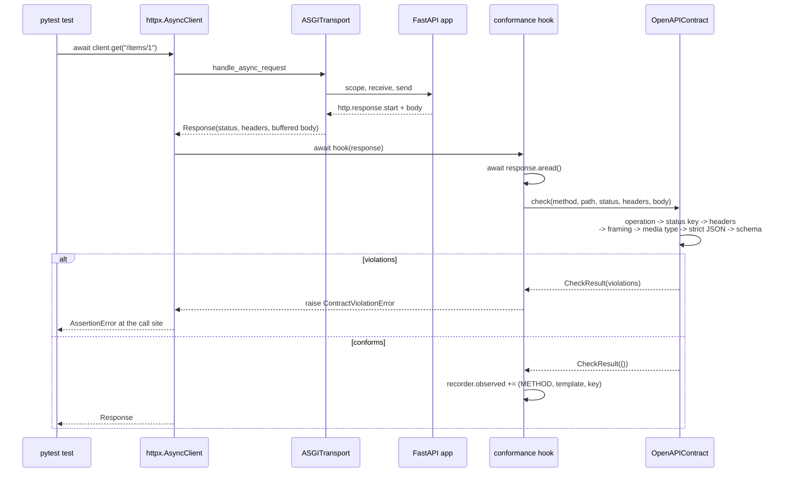

# Zero-Tolerance Contract Enforcement: Asserting Every Test Response Matches the OpenAPI Schema and Status Contract

> [!summary] Claim
> Install the contract check as an `httpx` response event hook on the one client every test uses, and make it judge the operation, the status code, the headers, the media type, the framing, the JSON syntax, and the JSON Schema body of every response, because FastAPI's own `response_model` validation checks only the body of the happy path and is skipped entirely when an endpoint returns a `Response` object.

Part of [OpenAPI JSON Schema and Contracts](README.md) in [API Engineering](../README.md).

## TL;DR

- Mechanism: an async response hook on `httpx.AsyncClient` reads the body, resolves the request to an OpenAPI operation, selects the Response Object (exact code, then `NXX`, then `default`), selects the Media Type Object (exact, then `type/*`, then `*/*`), and validates headers and body with a JSON Schema 2020-12 validator; httpx runs the hook inside `_send_handling_redirects` and re-raises anything it raises, so a non-conforming response fails the test that caused it (httpx 0.28.1 `httpx/_client.py`, `AsyncClient._send_handling_redirects`).
- Contract rule: every status a test observes must be documented for that operation, every body must have a documented `Content-Type` and validate against that media type's schema, `204` and `304` must carry no content (RFC 9110 Sections 15.3.5 and 15.4.5), required response headers must be present, and opt-outs need a named, recorded reason.
- Trap: the lab shows four ways FastAPI 0.162.0 lets a broken response through its own validation: returning a `JSONResponse` skips `serialize_response`, a `float('nan')` passes validation and is then serialized as `null`, `HTTPException(404)` is never documented unless you add it to `responses=`, and a `Response` returned with `status_code=204` keeps its body.
- Portability fact: all 26 lab tests passed in the drafter's runs on CPython `3.12.13`, `3.13.18`, `3.14.6`, `3.14.10`, `3.15.2`, and free-threaded `3.14.6t` with the locked packages (only `3.14.6` was re-run in the fact-check); `format: date-time` is asserted only if `rfc3339-validator` happens to be installed, which in this lock is a transitive dependency of `openapi-schema-validator`, so the lab fails closed at load time instead of silently passing.
- When not to use it: the check proves conformance of the responses your tests happen to provoke, not of the input space; use [[Property-Based-API-Testing-with-Schemathesis-and-Hypothesis]] to generate inputs, and do not run it as a production response filter, where it doubles serialization cost and turns a documentation bug into an outage.

## Mental model



The test talks to one client, and the client owns the only path a response can take back to the test.
The in-process transport runs the ASGI app, buffers its whole body, and builds an `httpx.Response`; only then does httpx call the response hooks, one per hop of any redirect chain.
The hook reads the body, hands the raw facts (method, path, status, headers, bytes) to the compiled contract, and the contract walks a fixed pipeline whose first failing stage decides the rule name.
A violation raises from inside `client.get`, so the traceback points at the line of the test that provoked it, and a conforming response is recorded in a ledger that can later prove which documented responses no test ever exercised.

## How it works

### Why the framework's own validation is not enough

FastAPI validates a return value only on one branch of its request handler.
When the endpoint returns anything that is not a `Response`, FastAPI calls `serialize_response`, which calls `field.validate(response_content, {}, loc=("response",))` and raises `ResponseValidationError` on errors (fastapi 0.162.0 `fastapi/routing.py`, `serialize_response`).
When the endpoint returns a `Response` instance, the handler takes the `if isinstance(raw_response, Response):` branch and uses it as is, with no validation and no serialization (fastapi 0.162.0 `fastapi/routing.py`, `get_request_handler`).
That branch is not exotic: it is how endpoints set a custom media type, custom headers on an error, or a `204` status.
The lab's `leaked-field` defect returns `JSONResponse({**item, "supplier_cost": 0.11})` from a route declared with `response_model=ItemOut`, and FastAPI sends it unchanged.

Validation also does not mean the bytes conform.
On the default path FastAPI serializes through Pydantic's Rust serializer when a response field exists and no custom response class was set (`use_dump_json`, fastapi 0.162.0 `fastapi/routing.py`, `get_request_handler`).
Pydantic's `allow_inf_nan` "Defaults to `True`" and `ser_json_inf_nan` "Defaults to `'null'`" (pydantic 2.14.3 `pydantic/config.py`, `ConfigDict`), so a `float('nan')` price validates as a `float` and is then written as `null`, which the generated schema (`"price": {"type": "number"}`) forbids.
The lab test `test_nan_passes_fastapi_validation_then_serializes_to_null_and_fails_schema` captures the wire bytes `{"id":1,"name":"bolt","price":null}` and the contract violation `price: None is not of type 'number'`.
Starlette's own `JSONResponse.render` would have refused the value instead, because it calls `json.dumps(..., allow_nan=False)` (starlette 1.10.0 `starlette/responses.py`, `JSONResponse.render`); the two serializers disagree, and only a check on the bytes sees the result.

The framework also never checks status codes, response headers, or media types against what it documents, and what it documents is incomplete.
`get_openapi_path` writes the route's own status code, then merges the `responses=` argument, then adds `422` with the `HTTPValidationError` schema only if the route has parameters or a body and no `422`, `4XX`, or `default` key already exists (fastapi 0.162.0 `fastapi/openapi/utils.py`, `get_openapi_path`).
Nothing documents the `404` produced by `raise HTTPException(status_code=404)`, the `401` produced by a security dependency, or the `500` produced by an unhandled exception.
The lab test `test_fastapi_adds_422_only_to_routes_with_parameters_and_not_beside_4xx` pins all three branches, and the generated document declares `"openapi": "3.1.0"` because `openapi_version` defaults to `"3.1.0"` (fastapi 0.162.0 `fastapi/applications.py`, `FastAPI.__init__`).

### Where the check lives: the httpx response hook

`AsyncClient._send_handling_redirects` loops over hops; for each hop it awaits every request hook, sends the request, then awaits every response hook inside a `try` whose `except BaseException` branch calls `await response.aclose()` and re-raises (httpx 0.28.1 `httpx/_client.py`, `AsyncClient._send_handling_redirects`).
Three consequences follow from that source.
First, the hook runs before the body is read, so it must call `await response.aread()` itself; for `ASGITransport` that read is free because the transport already joined every `http.response.body` chunk into one buffer (httpx 0.28.1 `httpx/_transports/asgi.py`, `ASGIResponseStream.__aiter__`).
Second, the hook runs once per hop, so with `follow_redirects=True` (the client default is `False`, which returns the first `3xx` after one hook call) every `3xx` in a redirect chain is checked as a response of the operation that produced it; the loop raises `TooManyRedirects` once `len(history) > self.max_redirects`, so with `DEFAULT_MAX_REDIRECTS = 20` (httpx 0.28.1 `httpx/_config.py`) the hook runs at most 21 times per request.
Third, an exception raised in the hook propagates out of `client.get()` at the test's call site, and because the lab's `ContractViolationError` subclasses `AssertionError`, pytest reports it as a test failure rather than an error.

The transport decides whether the hook ever runs.
`ASGITransport(raise_app_exceptions=True)` is the default and re-raises any exception the app raises, before a `Response` exists; with `False` it substitutes status `500` if the app had not started a response (httpx 0.28.1 `httpx/_transports/asgi.py`, `ASGITransport.handle_async_request`).
The lab test `test_app_exception_reaches_the_test_before_any_response_hook_runs` proves both: with the default the test sees `ResponseValidationError` and the ledger is empty, and with `raise_app_exceptions=False` the contract sees the `500` and reports `status 500 is not documented; documented: ['200', '404', '422']`.
Zero tolerance therefore needs both settings in a suite: the default for debugging, and at least one pass with `False` to prove what a real client receives.

### Step 1: resolve the operation

OpenAPI appends each Paths Object key to the server URL without relative resolution, and "When matching URLs, concrete (non-templated) paths would be matched before their templated counterparts" (OpenAPI 3.1.2 Section 4.8.8.1).
The same section forbids two templated paths with the same hierarchy and different parameter names, and leaves other ambiguity "up to the tooling".
The lab sorts templates by the number of `{` expressions and then by depth, compiles each `{name}` to `[^/]+` because path parameter values "MUST NOT contain any unescaped" `/`, `?`, or `#` (OpenAPI 3.1.2 Section 3.5), and returns the first template whose path item has the request's method.
`test_concrete_path_matches_before_a_template_declared_earlier` declares `/users/{user_id}` before `/users/me` and still resolves `/users/me` to the concrete path.
A request with no matching operation is itself a violation (`operation` rule): a route that exists in the app but not in the document is the shadow endpoint OWASP API9:2023 describes, where "There is no documentation or the existing documentation is not updated".

### Step 2: select the Response Object for the status code

The Responses Object allows any status code as a quoted key, ranges written with the uppercase wildcard `X`, and "Only the following range definitions are allowed: 1XX, 2XX, 3XX, 4XX, and 5XX", and "the explicit code definition takes precedence over the range definition for that code" (OpenAPI 3.1.2 Section 4.8.16.2).
`default` documents "responses other than the ones declared for specific HTTP response codes" (OpenAPI 3.1.2 Section 4.8.16.1).
The lab's `select_response_key` therefore tries `str(status)`, then `f"{status // 100}XX"`, then `"default"`, and a miss is a `status` violation.
A `default` key makes step 2 vacuous, which is why Schemathesis's `status_code_conformance` returns early with `if "default" in status_codes: return None` (schemathesis 4.33.1 `src/schemathesis/specs/openapi/checks.py`, `status_code_conformance`).
The lab test `test_default_response_accepts_any_status_so_it_disables_the_status_gate` shows a `500` passing a `default` with no `content`, and failing only when it carries a body.

### Step 3: headers

The Response Object `headers` map is keyed case-insensitively, and "If a response header is defined with the name "Content-Type", it SHALL be ignored" (OpenAPI 3.1.2 Section 4.8.17.1).
A Header Object's `required` "Determines whether this header is mandatory. The default value is false." (OpenAPI 3.1.2 Section 4.8.21.1.1), its only legal `style` is `simple`, and implementations "MUST pass header values through unchanged rather than attempting to automatically quote header values" (OpenAPI 3.1.2 Section 4.8.21.1.2).
Header values are strings on the wire while the JSON Schema data model has numbers and booleans, and OpenAPI says there is "no general-purpose specification for converting schema-validated non-UTF-8 primitive data types" to strings (OpenAPI 3.1.2 Appendix B), so every validator invents a coercion; the lab's `_coerce_header` converts only `integer`, `number`, and `boolean` scalars, and Schemathesis has its own `_coerce_header_value` (schemathesis 4.33.1 `src/schemathesis/specs/openapi/checks.py`).
FastAPI can document response headers only through `responses={201: {"headers": ...}}`, which `get_openapi_path` deep-merges into the route's own `201` entry; the lab's `missing-location` defect drops `Location` and the hook reports `required header Location is missing`.

### Step 4: framing, before any body parsing

"A 204 response is terminated by the end of the header section; it cannot contain content or trailers" (RFC 9110 Section 15.3.5), the same sentence appears for `304` (RFC 9110 Section 15.4.5) and for every `1xx` (RFC 9110 Section 15.2), and HTTP/1.1 framing ends any response to `HEAD` and any `1xx`, `204`, or `304` response at the first empty line "regardless of the header fields present in the message" (RFC 9112 Section 6.3).
The in-process transport enforces none of this: it appends every non-empty body chunk unless the method is `HEAD` (httpx 0.28.1 `httpx/_transports/asgi.py`, `ASGITransport.handle_async_request`).
A real HTTP/1.1 server does enforce it: h11 maps `204`, `304`, and `HEAD` responses to `("content-length", (0,))` (h11 0.16.0 `h11/_connection.py`, `_body_framing`), and its writer raises `LocalProtocolError("Too much data for declared Content-Length")` on extra bytes (h11 0.16.0 `h11/_writers.py`, `ContentLengthWriter`).
So a `204` with a body passes every in-process test and fails in production; the lab's `body-on-204` defect returns `Response(b"{}", status_code=204)`, which FastAPI does not strip because its `response.body = b""` fix-up for bodiless statuses runs only on the non-`Response` branch (fastapi 0.162.0 `fastapi/routing.py`, `get_request_handler`), and the contract reports a `framing` violation.

### Step 5: select the Media Type Object

The `content` map is keyed by "a media type or media type range", and "For responses that match multiple keys, only the most specific key is applicable. e.g. "text/plain" overrides "text/*"" (OpenAPI 3.1.2 Section 4.8.17.1).
HTTP media types are `type "/" subtype parameters`, and "The type and subtype tokens are case-insensitive" (RFC 9110 Section 8.3.1), so the lab compares the lowercased essence without parameters and tries the exact essence, then `type/*`, then `*/*`.
`application/json; charset=utf-8` therefore selects `application/json`, which matters because Starlette appends `; charset=utf-8` to every `text/` media type that does not already carry a `charset=` parameter (starlette 1.10.0 `starlette/responses.py`, `Response.init_headers`), and no `charset` parameter is even defined for `application/json` (RFC 8259 Section 11).
A body without `Content-Type` is a violation: RFC 9110 lets a recipient assume `application/octet-stream` or sniff (RFC 9110 Section 8.3), and either is a contract the API never wrote down.
`Content-Type` is a singleton field that is "sometimes incorrectly generated multiple times" (RFC 9110 Section 8.3); httpx joins repeated values with `, ` (`httpx.Headers.get` returned `'application/json, text/html'` in this job), so the joined value matches no exact key and the lab reports it as undocumented rather than guessing which member wins; the lab does not reject it outright, so a documented `application/*` or `*/*` range still accepts it.
A response whose Response Object has no `content` but whose body is non-empty is also a violation in the lab, a deliberate tightening: OpenAPI does not say a missing `content` forbids a body, but nothing documents what that body is.

### Step 6: strict JSON

JSON media types are `application/json` and any `+json` structured syntax suffix (RFC 6839 Section 3.1), which covers `application/problem+json` (RFC 9457 Section 3); the lab test `test_structured_suffix_json_body_is_parsed_and_validated` validates a problem body through that suffix.
Python's `json` module accepts four inputs RFC 8259 rejects or discourages, and the lab's `parse_strict_json` closes each one:

- `NaN` and `Infinity` tokens: "Numeric values that cannot be represented in the grammar below (such as Infinity and NaN) are not permitted" (RFC 8259 Section 6); the lab passes `parse_constant` that raises.
- Duplicate member names: "The names within an object SHOULD be unique" (RFC 8259 Section 4), and `json.loads` silently keeps the last one; the lab passes an `object_pairs_hook` that raises.
- A byte order mark: "Implementations MUST NOT add a byte order mark (U+FEFF)" (RFC 8259 Section 8.1), yet `json.loads(b'\xef\xbb\xbf{"a":1}')` returns `{'a': 1}` (observed on CPython `3.14.6` in this job); the lab decodes with `bytes.decode("utf-8")` first, which keeps the BOM, and `json.loads` then raises `Unexpected UTF-8 BOM`.
- Non-UTF-8 bytes: JSON exchanged between systems "MUST be encoded using UTF-8" (RFC 8259 Section 8.1); the strict decode rejects a Latin-1 `0xe9`.

The parametrized `test_strict_json_rejects_what_python_json_accepts` proves each of the four.

### Step 7: JSON Schema 2020-12 validation with a closed registry

OpenAPI 3.1 Schema Objects default to the OAS dialect `https://spec.openapis.org/oas/3.1/dialect/base` unless `jsonSchemaDialect` or a resource-root `$schema` says otherwise (OpenAPI 3.1.2 Sections 4.8.24.1 and 4.8.24.5), and that dialect is JSON Schema 2020-12 plus OpenAPI's annotation keywords, so a 2020-12 validator is the right engine; see [[OpenAPI-3-1-Architecture-and-JSON-Schema-Alignment]].
The response schema usually contains `{"$ref": "#/components/schemas/ItemOut"}`, a fragment relative to the OpenAPI document, so validating the extracted subschema on its own would resolve `#/components/...` against the subschema and fail.
The lab registers the whole document as one `referencing.Resource` under `urn:api-labs:openapi-contract` and validates against `{"$ref": "urn:api-labs:openapi-contract#/paths/~1items~1{item_id}/get/responses/200/content/application~1json/schema"}`, escaping `~` as `~0` and `/` as `~1` (RFC 6901 Section 3).
Two edge cases come with that design: a pointer built in the wrong escape order (`/` before `~`) points at a different member, and an `$id` embedded inside `components` is not discovered, because the 2020-12 specification only walks subresources under schema keywords and the OpenAPI root is not a schema.

The registry choice is also a security decision.
jsonschema 4.26.0 builds its default registry as `SPECIFICATIONS.combine(referencing.Registry(retrieve=_warn_for_remote_retrieve))`, and that function calls `urlopen` on any unknown `$ref` URI, emits a `DeprecationWarning` that "Automatically retrieving remote references can be a security vulnerability", and returns the fetched document (jsonschema 4.26.0 `jsonschema/validators.py`, `_warn_for_remote_retrieve` and `_REMOTE_WARNING_REGISTRY`).
Passing any explicit `registry=` replaces that default with `SPECIFICATIONS.combine(registry)` (jsonschema 4.26.0 `jsonschema/validators.py`, `Validator.__attrs_post_init__`), which keeps only the passed registry's retriever (referencing 0.37.0 `referencing/_core.py`, `Registry.combine`); the lab's plain `Registry()` has none, so the lab's `test_remote_ref_is_unresolvable_instead_of_fetched` sees `referencing.exceptions.Unresolvable` for `https://schemas.invalid/thing.json` with no network access.

### What JSON Schema does not assert unless you ask

`format` is an annotation by default: an implementation "MAY still treat "format" as an assertion", but "MUST provide options to enable and disable such evaluation and MUST be disabled by default" (JSON Schema Validation 2020-12 Section 7.2.1).
In jsonschema 4.26.0 the validator's `format_checker` field defaults to `None`, so nothing is asserted until you pass one (jsonschema 4.26.0 `jsonschema/validators.py`, `create`), and the shipped checker registers `date-time` only inside `with suppress(ImportError): from rfc3339_validator import validate_rfc3339` (jsonschema 4.26.0 `jsonschema/_format.py`).
That means the same schema asserts `date-time` in one environment and silently accepts `"yesterday"` in another.
This job hit it for real: on free-threaded `3.14.6t` with a minimal package set, `"date-time" in Draft202012Validator.FORMAT_CHECKER.checkers` was `False`, while in the locked workspace it is `True` only because `openapi-schema-validator` depends on `rfc3339-validator` (`uv.lock`).
A misspelled format such as `date_time` is likewise accepted as valid, because an unknown format has no checker.
The lab therefore fails closed: with `assert_formats=True` the contract collects every `format` value in the document and raises `ValueError` at load time for any name that has no checker and is not one of the annotation-only registry names `int32`, `int64`, `float`, `double`, or `password` (`test_misspelled_or_uncheckable_format_fails_closed_at_load_time`).

`readOnly` and `writeOnly` are annotations as well, and OpenAPI 3.1.2 Section 4.8.24.3.2 notes that "JSON Schema is not aware of how the data it is validating is being used".
For a response the meaning is unambiguous: `writeOnly: true` "indicates that the value is never present when the instance is retrieved from the owning authority" (JSON Schema Validation 2020-12 Section 9.4).
The lab extends `Draft202012Validator` with a `writeOnly` keyword function that yields an error whenever the keyword is evaluated with `true`, which happens only when the property is present, so `test_write_only_property_present_in_a_response_is_a_violation` fails a response that echoes a `password` declared `writeOnly`.
Pydantic has no `writeOnly` field argument, so a plain field emits it only through `json_schema_extra`, as the lab's `ItemIn.supplier_token` does; `SecretStr` and `SecretBytes` emit `writeOnly: true` with `format: password` on their own (pydantic 2.14.3 `pydantic/types.py`, `_SecretField.__get_pydantic_core_schema__`), so a secret type placed in a response model trips this rule.

Openness is the last default to override.
A Pydantic model with the default `extra='ignore'` emits no `additionalProperties`, which is an open object, so an extra member such as `supplier_cost` validates; the lab's `ItemOut` sets `model_config = ConfigDict(extra="forbid")`, the generated component then carries `"additionalProperties": false`, and the leaked field fails with `Additional properties are not allowed ('supplier_cost' was unexpected)`.
The cost is that the same closed model now also makes FastAPI raise `ResponseValidationError` when an endpoint returns a dict with extra keys, which is the behavior you want from a response model; see [[Additive-Schema-Evolution-and-Tolerant-Reader-Patterns]] for why clients must stay open while the server's own output stays closed.

### Coverage and waivers

A hook that only rejects bad responses proves nothing about responses no test provoked.
The lab's `ConformanceRecorder` adds `(METHOD, path template, response key)` for every conforming response and `uncovered(contract)` subtracts that set from every pair the document declares, so a session-end assertion can demand that every documented response, including each `404` and `422`, was exercised at least once; `test_conformant_app_exercises_every_documented_response` reaches all 8 pairs of the inventory app.
Tests that deliberately provoke a non-conforming response, such as a test that inspects raw bytes, opt out per request with `extensions={"contract_waiver": "<reason>"}`; httpx carries request extensions to the transport and back on `response.request.extensions`, an empty reason does not waive, and every waiver is appended to `recorder.waived`, so the exception list is reviewable instead of hidden in `xfail` markers.

### How Schemathesis compares

Schemathesis splits conformance into separate checks: `status_code_conformance`, `content_type_conformance`, `response_headers_conformance`, and `response_schema_conformance` (schemathesis 4.33.1 `src/schemathesis/specs/openapi/checks.py`).
Its `APIOperation.validate_response` delegates to `validate_documented_response`, which returns `None` for `HEAD`, returns `None` when `find_by_status_code` finds no definition for the status, and returns `None` when the media type has no schema (schemathesis 4.33.1 `src/schemathesis/specs/openapi/validation.py`, `validate_documented_response`).
So calling `validate_response` from a hand-written test is a body check only; the lab test `test_schemathesis_validate_response_checks_only_the_body` shows it returning `None` for an undocumented `404` and for an undocumented `text/plain`, both of which the lab's contract rejects.
`content_type_conformance` also passes when the matched response documents no content types, which is the case the lab tightens in Step 5.
Schemathesis validates with `jsonschema_rs` rather than the pure-Python `jsonschema`, which matters if your format and keyword behavior must match a specific validator; the two are separate implementations with separate format support.

## Numbers and limits

| Quantity | Value | Source or measurement |
|---|---|---|
| Status-key lookup order | `str(code)` -> `NXX` -> `default` | (OpenAPI 3.1.2 Sections 4.8.16.1 and 4.8.16.2) |
| Allowed range keys | 5: `1XX`, `2XX`, `3XX`, `4XX`, `5XX`, uppercase `X` only | (OpenAPI 3.1.2 Section 4.8.16.2) |
| Media-type lookup order | exact -> `type/*` -> `*/*`, most specific wins | (OpenAPI 3.1.2 Section 4.8.17.1) |
| Statuses that cannot carry content | every `1xx`, `204`, `304`, and any response to `HEAD` | (RFC 9110 Sections 15.2, 15.3.5, 15.4.5; RFC 9112 Section 6.3) |
| Response hooks per request | one call per hop; with `follow_redirects=True`, at most 21 (`DEFAULT_MAX_REDIRECTS = 20` followed redirects plus the first response) | httpx 0.28.1 `httpx/_config.py` and `AsyncClient._send_handling_redirects` |
| `ASGITransport` body buffering | the whole body, joined into one chunk before the hook runs | httpx 0.28.1 `httpx/_transports/asgi.py`, `ASGIResponseStream` |
| FastAPI generated `openapi` field | `"3.1.0"` (not `3.1.2`) | fastapi 0.162.0 `fastapi/applications.py`, `openapi_version`, and lab test |
| Contract check, warm validator, one `200` `GET /items/1` with the 35-byte body `{"id":1,"name":"bolt","price":0.25}` | `28.4` us per call | Measured once in the fact-check: minimum of `timeit.repeat(number=2000, repeat=7)` divided by `number`, `uv run --frozen python <bench script>` in `labs/`, CPython `3.14.6`, macOS `27.3` arm64, Apple M3 Pro, load average `12` to `15` on `12` cores (as of 2026-11) |
| New `OpenAPIContract` plus its first check | `78.8` us per call | Same run, `number=200` |
| `build_inventory_app()` plus `app.openapi()` | `2339.7` us per call | Same run, `number=100` |
| Lab runtime | `26 passed in 1.16s` | `uv run --frozen pytest ... -q -p no:cacheprovider`, CPython `3.14.6`, macOS `27.3` arm64, same loaded machine |

A new contract plus its first check costs about `2.8x` a warm check (`78.8 / 28.4`), so the per-pointer validator cache pays for itself and the contract should be built once, not per request; the remaining `28` us is pure-Python schema evaluation with `$ref` resolution, so a suite of 10,000 requests spends about `0.3` s in the check.
Generating the OpenAPI document costs about `82x` one warm check (`2339.7 / 28.4`), so build the contract once per app factory or per session.
These figures come from one run on a loaded machine; treat them as upper bounds (the drafter's earlier run on the same machine reported `68.1`, `76.8`, and `3789.8` us, which shows how much load moves them).

## Portability

The interpreter rows other than the workspace `3.14.6` are the drafter's runs; the fact-check did not re-run them, per the 2026-11-11 pause on lab matrix checks.

| Runtime or component | Behavior | Evidence |
|---|---|---|
| CPython `3.12.13` (the matrix pin is `3.12.16`; uv offered only `3.12.13` here) | 26 passed | `UV_PROJECT_ENVIRONMENT=<separate env> uv run --frozen --python <3.12.13> pytest <test> -q -p no:cacheprovider` -> `26 passed in 0.45s`, macOS `27.3` arm64; the lab's PEP 695 `type` statements make `3.12` the floor |
| CPython `3.13.18` | 26 passed | same method -> `26 passed in 0.41s` |
| CPython `3.14.6` (workspace) and `3.14.10` | 26 passed | workspace `uv run --frozen pytest` -> `26 passed in 1.16s` (fact-check run; the drafter saw `0.47s`); `3.14.10` separate env -> `26 passed in 0.43s` |
| CPython `3.15.2` | 26 passed | separate env -> `26 passed in 0.43s` |
| Free-threaded CPython `3.15.2t` | Not run | `uv 0.11.26` reports `No download found for request: cpython-3.15.2+freethreaded-macos-aarch64-none` |
| Free-threaded CPython `3.15.0b3t` (local beta) | Collection error | The full lock cannot install (`psycopg-binary 3.3.8` has no `cp315t` wheel); with a pinned subset, importing `schemathesis` fails with `ModuleNotFoundError: No module named 'hypothesis._native'`: the `hypothesis 6.170.14` wheel ships `_native.abi3t-darwin.so`, while this interpreter's `EXTENSION_SUFFIXES` lists `.abi3t.so` |
| Free-threaded CPython `3.14.6t` | 26 passed with `rfc3339-validator 0.1.4`; 13 failed without it | `PYTHONPATH=src uv run --no-project --python <3.14.6t> --with <lab packages pinned to uv.lock>`: without `rfc3339-validator` every design-first test raises `ValueError: format assertion has no checker for ['date-time']` at load time, which is the fail-closed behavior working; adding the locked `rfc3339-validator==0.1.4` -> `26 passed in 1.53s`, `sys._is_gil_enabled()` `False` before and after |
| jsonschema `format` support | Depends on optional imports | `date-time` needs `rfc3339-validator` (jsonschema 4.26.0 `jsonschema/_format.py`); the `format` extra lists it among eight optional packages (`jsonschema-4.26.0.dist-info/METADATA`) |
| FastAPI `0.162.0` | Generates `3.1.0`, auto-`422` only with parameters and without `4XX`/`default`, validation skipped for returned `Response` objects | lab tests plus fastapi 0.162.0 source cited above |
| Schemathesis `4.33.1` | `validate_response` checks the body only | lab test `test_schemathesis_validate_response_checks_only_the_body` |
| Uvicorn, Hypercorn, Granian | Not run; the lab is in-process | The contract judges HTTP semantics (status, fields, content), which RFC 9110 defines independently of the HTTP version; the framing rule for `204` and `304` is enforced by h11 0.16.0 `_body_framing` on HTTP/1.1, so a defect the in-process transport tolerates becomes a server-side `LocalProtocolError` |
| HTTP/1.1, HTTP/2, HTTP/3 | Not run | Same reasoning; status, header, and content semantics are version-independent (RFC 9110), but no server leg was executed in this job |
| Containers (Debian Trixie, Alpine musl) | Not run | Lab checks were paused on 2026-11-11 |

## Worked example

The lab is one module and one test file.
The [implementation](../labs/src/api_labs/f08_openapi_json_schema_and_contracts/response_conformance.py) holds `OpenAPIContract`, `ConformanceRecorder`, `conformance_hook`, and a small FastAPI inventory app whose `defects` set breaks exactly one contract clause per defect, so each test can prove that its rule, and only its rule, fires.
The [test](../labs/tests/f08_openapi_json_schema_and_contracts/test_response_schema_conformance_enforcement_in_test_suites.py) drives the code-first contract (`app.openapi()`), a hand-written design-first OpenAPI `3.1.2` document, and a Schemathesis comparison.

### The hook (simplified excerpt: verbatim lines from `response_conformance.py`, docstring shortened)

```python
def conformance_hook(
    contract: OpenAPIContract, recorder: ConformanceRecorder
) -> Callable[[httpx.Response], Awaitable[None]]:
    """An httpx response event hook that fails the request when the response breaks the contract."""

    async def check_response(response: httpx.Response) -> None:
        request = response.request
        waiver = request.extensions.get(WAIVER_EXTENSION)
        if isinstance(waiver, str) and waiver:
            recorder.waived.append((request.method, request.url.path, waiver))
            return
        body = await response.aread()
        result = contract.check(
            request.method, request.url.path, response.status_code, response.headers, body
        )
        recorder.record(result)
        if result.violations:
            raise ContractViolationError(
                request.method, request.url.path, response.status_code, result.violations
            )

    return check_response
```

### The pipeline (simplified excerpt: verbatim lines from `response_conformance.py`)

```python
def select_response_key(responses: Mapping[str, Json], status: int) -> str | None:
    """An explicit code beats its range (OpenAPI 3.1.2 Section 4.8.16.2); `default` is last."""
    for key in (str(status), f"{status // 100}XX", "default"):
        if key in responses:
            return key
    return None
```

```python
    def check(
        self, method: str, path: str, status: int, headers: httpx.Headers, body: bytes
    ) -> CheckResult:
        op = self.find_operation(method, path)
        if op is None:
            detail = f"no operation documents {method.upper()} {path}"
            return CheckResult(None, None, (Violation("operation", detail),))
        responses: Mapping[str, Json] = op.operation.get("responses", {})
        status_key = select_response_key(responses, status)
        if status_key is None:
            detail = f"status {status} is not documented; documented: {sorted(responses)}"
            return CheckResult(op, None, (Violation("status", detail),))
        response: Mapping[str, Json] = responses[status_key]
        template, key = escape_pointer_token(op.path_template), escape_pointer_token(status_key)
        base = f"/paths/{template}/{method.lower()}/responses/{key}"
        violations = [*self._check_headers(response, headers, base)]
        violations.extend(self._check_body(method, status, response, headers, body, base))
        return CheckResult(op, status_key, tuple(violations))
```

### The fixture and one test (simplified excerpt: verbatim lines from the test file)

```python
def make_harness(
    defects: frozenset[Defect] = frozenset(), *, raise_app_exceptions: bool = True
) -> Harness:
    """Code-first: the contract is the app's own generated OpenAPI document."""
    app = build_inventory_app(defects)
    contract = OpenAPIContract(app.openapi())
    recorder = ConformanceRecorder()
    transport = httpx.ASGITransport(app=app, raise_app_exceptions=raise_app_exceptions)
    client = httpx.AsyncClient(
        transport=transport,
        base_url="http://test",
        event_hooks={"response": [conformance_hook(contract, recorder)]},
    )
    return Harness(client, recorder, contract)


@pytest_asyncio.fixture
async def conformant() -> AsyncIterator[Harness]:
    harness = make_harness()
    async with harness.client:
        yield harness
```

```python
@pytest.mark.unit
@pytest.mark.asyncio
async def test_nan_passes_fastapi_validation_then_serializes_to_null_and_fails_schema() -> None:
    harness = make_harness(frozenset({"nan-price"}))
    async with harness.client:
        waived = await harness.client.get(
            "/items/1", extensions={"contract_waiver": "inspect the raw body"}
        )
        with pytest.raises(ContractViolationError) as caught:
            await harness.client.get("/items/1")
    assert waived.content == b'{"id":1,"name":"bolt","price":null}'
    assert harness.recorder.waived == [("GET", "/items/1", "inspect the raw body")]
    assert [v.detail for v in caught.value.violations] == ["price: None is not of type 'number'"]
```

### Captured output

The failure message a developer sees, captured in the fact-check by `GET /items/9` through `conformance_hook` on `build_inventory_app(frozenset({"undocumented-404"}))`, printing the raised `ContractViolationError`:

```text
GET /items/9 -> 404 breaks the OpenAPI contract:
  [status] status 404 is not documented; documented: ['200', '422']
```

The lab run, from `labs/`, CPython `3.14.6`, macOS `27.3` arm64:

```text
$ uv run --frozen pytest tests/f08_openapi_json_schema_and_contracts/test_response_schema_conformance_enforcement_in_test_suites.py -q -p no:cacheprovider
..........................                                               [100%]
26 passed in 1.16s
```

The 26 tests are: one conformant end-to-end coverage test, six single-defect tests (undocumented `404`, leaked field through `JSONResponse`, `NaN` -> `null`, `text/plain` media type, missing `Location`, body on `204`), an undocumented-route test, an empty-waiver test, the app-exception transport test, the FastAPI `422` documentation test, thirteen design-first rule cases (ten test functions, one of them the four-case parametrized strict-JSON test), and two Schemathesis comparison cases.

## Pitfalls

> [!warning] Returning a `Response` object turns off FastAPI's response validation
> Trigger: an endpoint returns `JSONResponse(...)` or `Response(...)` to set a status, header, or media type.
> Symptom: undeclared fields, wrong types, and bodies on `204` reach clients even though the route declares `response_model`, because `get_request_handler` uses a returned `Response` as is (fastapi 0.162.0 `fastapi/routing.py`).
> Fix: set status and headers through the injected `response: Response` parameter and return data, or keep returning `Response` objects and let the contract hook judge them; the lab's `leaked-field` and `body-on-204` defects are both this pattern.

> [!warning] `NaN` validates, then serializes as `null`
> Trigger: a `float` field computed from a division by zero or a missing market price.
> Symptom: the response schema says `number`, the bytes say `null`, and a strict client fails to parse; FastAPI raised nothing because `allow_inf_nan` defaults to `True` and `ser_json_inf_nan` to `'null'` (pydantic 2.14.3 `pydantic/config.py`).
> Fix: `Field(allow_inf_nan=False)` or `ConfigDict(allow_inf_nan=False)` on response models, plus the contract hook to catch the ones you missed.

> [!warning] A `default` response makes every status code conform
> Trigger: a design-first document adds `default: {description: Unexpected error}` to every operation.
> Symptom: a `500` or a `404` from a mistyped route passes both the lab's status rule and Schemathesis's `status_code_conformance`, which returns early when `default` exists (schemathesis 4.33.1 `checks.py`).
> Fix: document `4XX` and `5XX` with a problem-details schema instead of `default`, and lint for `default` in CI; see [[OpenAPI-Linting-and-Automated-Style-Governance-with-Vacuum-and-Spectral]].

> [!warning] `format` assertion depends on what happens to be installed
> Trigger: a `date-time` field, validated by jsonschema with `format_checker=...FORMAT_CHECKER`.
> Symptom: the check passes `"yesterday"` in an environment without `rfc3339-validator`, because the checker is registered inside `suppress(ImportError)` (jsonschema 4.26.0 `jsonschema/_format.py`); this job reproduced it on free-threaded `3.14.6t`.
> Fix: depend on `jsonschema[format]` explicitly and fail at load time for any `format` with no checker, as the lab does.

> [!warning] The in-process transport is more forgiving than a real server
> Trigger: tests use only `httpx.ASGITransport`.
> Symptom: a body on `204` passes, but h11 raises `LocalProtocolError("Too much data for declared Content-Length")` in production (h11 0.16.0 `h11/_writers.py`); app exceptions surface as Python exceptions instead of the `500` a client receives.
> Fix: check framing in the contract, run part of the suite with `raise_app_exceptions=False`, and keep a socket-tier smoke test against a real server.

> [!warning] Percent-encoded slashes break template matching
> Trigger: a path parameter value containing `%2F`.
> Symptom: `httpx.URL("http://test/items/a%2Fb").path` is `'/items/a/b'` while `raw_path` is `b'/items/a%2Fb'` (observed on httpx 0.28.1 in this job), so a matcher on `.path` sees an extra segment and reports an `operation` violation; the lab's matcher has this limitation.
> Fix: match on `raw_path` and percent-decode each captured segment, because OpenAPI forbids an unescaped `/` inside a path parameter value (OpenAPI 3.1.2 Section 3.5).

> [!warning] Conformance is not authorization
> Trigger: relying on a closed response schema to prevent data exposure.
> Symptom: Pen Test Partners reported (2021-05-05) that Peloton endpoints let "An unauthenticated user" view private user data such as age, gender, location, and workout statistics "despite having a private mode"; every field in such a response can be documented and still must not be returned to that caller.
> Fix: make the status contract depend on the security requirement (document and test `401` and `403` for every secured operation with an unauthenticated and an unauthorized client) and keep object-level authorization tests separate; see [[Problem-Details-for-HTTP-APIs-RFC-9457]] for the error body.

## Security and robustness

OWASP API3:2023 (Broken Object Property Level Authorization) recommends to "Implement a schema-based response validation mechanism as an extra layer of security" and to "define and enforce data returned by all API methods"; a closed response schema plus this hook is exactly that layer in the test suite, and `writeOnly` enforcement catches the secret-echo variant.
OWASP API8:2023 (Security Misconfiguration) lists "Error messages include stack traces, or expose other sensitive information"; documenting `5XX` with a problem schema and running with `raise_app_exceptions=False` turns a leaked HTML traceback into a `content-type` violation.
OWASP API9:2023 (Improper Inventory Management) describes a "documentation blindspot" where "There is no documentation or the existing documentation is not updated"; the `operation` rule rejects any response from a route missing from the document, which makes every undocumented route a failing test.

The contract document is input to the test process, so treat it as untrusted when it comes from outside the repository.
A validator with jsonschema's default registry performs `urlopen` on remote `$ref` URIs, which is network access from CI and, with an attacker-controlled document, a server-side request forgery primitive (jsonschema 4.26.0 `jsonschema/validators.py`, `_warn_for_remote_retrieve`); pass an explicit `Registry` and bundle remote schemas instead.
Reference cycles and deep schemas cost validator time; OpenAPI 3.1.2 Section 5.5 ("Handling Reference Cycles") asks tooling to detect them, and the per-pointer validator cache in the lab bounds compilation but not evaluation depth.
Strict JSON parsing defends against parser differentials: duplicate keys are resolved last-wins by Python but may be resolved first-wins or rejected by other parsers, so a response that two clients read differently is a contract violation even when one of them validates it.
Defense in depth means three layers with different owners: Pydantic response models in the app, this hook in the test suite, and generated-input testing in [[Property-Based-API-Testing-with-Schemathesis-and-Hypothesis]] and [[Stateful-API-State-Machine-Testing-with-OpenAPI-Links-and-Schemathesis]]; none of them replaces object-level authorization tests.

## The principal's view

The architectural decision is where the contract is enforced and who owns the exceptions.
Putting the check on the shared test client makes conformance a property of the whole suite rather than of the few tests someone remembered to write, and it costs one fixture and about `28` us per request here.
The organizational trade-off is that the first enablement on an existing service fails dozens of tests at once, mostly undocumented `404`, `401`, and `409` responses; the right rollout is to run it in report-only mode for a week, convert the findings into `responses=` declarations or documented `4XX`/`5XX` problem schemas, then flip to raising, with the waiver list as the only escape hatch and a size budget on that list.
Code-first contracts (`app.openapi()`) catch implementation bugs but cannot catch documentation bugs, because the document is derived from the same code; design-first contracts catch both but need the drift gate in [[Design-First-vs-Code-First-OpenAPI-and-CI-Drift-Gates]] to keep the checked-in document and the app aligned.
The coverage ledger is the part that changes behavior: demanding that every documented response is observed at least once turns the OpenAPI document into a test plan, and deleting an unreachable response from the document is a reviewable API change, which [[Breaking-Change-Detection-and-Semantic-OpenAPI-Diffing]] then classifies.
Choose a different tool when the question is "can any input break the contract", which is generated testing, or "do my consumers still work", which is [[Consumer-Driven-Contract-Testing-vs-Bi-Directional-Contract-Verification]]; and do not move this check into production middleware, where a documentation mistake would become a `500` for real users.
For gRPC the equivalent is weaker by design because protobuf decoders tolerate unknown fields, and for GraphQL the schema is enforced by the server's executor, so response conformance testing is mostly an HTTP-JSON concern.

## Interview questions

> [!question] L5: FastAPI already validates responses against `response_model`. Name three response defects it does not catch.
>
> > [!success]- Answer
> > It never checks the status code against the documented responses, so an undocumented `HTTPException(404)` passes.
> > It skips validation entirely when the endpoint returns a `Response` object, so a `JSONResponse` with extra fields or a body on `204` passes.
> > It validates Python values, not bytes, so a `NaN` float passes validation and is serialized as `null`.
> > It also never checks response headers or the `Content-Type` against the document.
> >
> > Follow-up: Which of these does a real Uvicorn server catch on its own?

> [!question] L5: Predict the output. A route declares `response_model=Item` with `price: float` and returns `{"id": 1, "name": "bolt", "price": float("nan")}`. What bytes does FastAPI 0.162.0 send, and what does a JSON Schema check say?
>
> > [!success]- Answer
> > The body is `{"id":1,"name":"bolt","price":null}` with status `200`.
> > Pydantic accepts `NaN` because `allow_inf_nan` defaults to `True`, and FastAPI's `dump_json` path serializes it as `null` because `ser_json_inf_nan` defaults to `'null'`.
> > The schema check reports `price: None is not of type 'number'`.
> > Starlette's `JSONResponse` would instead raise `ValueError`, because it renders with `allow_nan=False`.
> >
> > Follow-up: Which setting makes FastAPI reject the value at validation time instead?

> [!question] L5: Why does the hook call `await response.aread()`, and when is that read free?
>
> > [!success]- Answer
> > httpx calls response hooks before the body is read, so the body is not yet available.
> > With `ASGITransport` the transport has already joined every body chunk into one buffer, so the read is a memory copy.
> > With a real network transport the read pulls the whole body, which defeats streaming and must be skipped or bounded for streamed endpoints.
> >
> > Follow-up: How would you check a streamed NDJSON response without buffering it?

> [!question] L6: Debug this API. A design-first spec documents `200` and `default` for `GET /orders/{id}`; the contract tests are green, yet clients report HTML error pages. What is wrong?
>
> > [!success]- Answer
> > `default` matches every status code that is not listed, so the status rule can never fail, and Schemathesis's `status_code_conformance` returns early when `default` exists.
> > If `default` also has no `content`, an HTML `500` with an empty-content contract can only be caught by a rule that rejects bodies on responses that document no content.
> > Replace `default` with `4XX` and `5XX` responses that document `application/problem+json`, and run the suite once with `raise_app_exceptions=False` so the test client sees the real `500`.
> >
> > Follow-up: How would a linter rule prevent `default` from returning?

> [!question] L6: A response has `Content-Type: application/problem+json` and the operation documents `4XX` with `application/problem+json` and `application/*`. Which schema is applied, and how is the body parsed?
>
> > [!success]- Answer
> > The `4XX` Response Object is selected because no explicit `4xx` code is listed.
> > The exact media type key wins over the range, because only the most specific key applies (OpenAPI 3.1.2 Section 4.8.17.1).
> > The body is parsed as JSON because `+json` is a structured syntax suffix for JSON (RFC 6839 Section 3.1).
> >
> > Follow-up: What should happen if the response has two `Content-Type` fields?

> [!question] L6: Your contract check passes `"created": "yesterday"` for a `format: date-time` field in CI but fails it locally. Explain.
>
> > [!success]- Answer
> > `format` is an annotation unless assertion is enabled (JSON Schema Validation 2020-12 Section 7.2.1).
> > Even with jsonschema's format checker enabled, `date-time` is registered only if `rfc3339_validator` imports, so an environment without it silently accepts any string.
> > Pin `jsonschema[format]`, and make the contract fail at load time when a document uses a format the environment cannot check.
> >
> > Follow-up: Which OpenAPI format names would you treat as annotation-only, and why?

> [!question] L6: Why does the lab register the entire OpenAPI document in a `referencing.Registry` instead of passing the response schema to the validator?
>
> > [!success]- Answer
> > Response schemas contain `$ref` fragments such as `#/components/schemas/Item`, which are relative to the OpenAPI document.
> > Passing the subschema as the root would resolve `#/components/...` against the subschema and fail.
> > Registering the document under one URI and validating `{"$ref": "<uri>#<escaped pointer>"}` keeps the original base, and an explicit registry has no retriever, so remote `$ref`s fail instead of being fetched over the network.
> >
> > Follow-up: What breaks if you escape `/` as `~1` before escaping `~` as `~0`?

> [!question] L7+: You are rolling this check out to 40 services with thousands of existing tests. How do you sequence it, and what do you measure?
>
> > [!success]- Answer
> > Start in report-only mode that records violations per rule and per operation, without raising.
> > Fix the documentation gaps first, which are mostly undocumented `4xx` statuses, then flip to raising per service when its report is empty.
> > Make waivers require a reason and publish the waiver count and the uncovered-response count per service, with a budget that only goes down.
> > Measure suite time added (about `28` us per response in the lab) and the number of production incidents traced to contract mismatches before and after.
> >
> > Follow-up: When would you accept a permanent waiver?

> [!question] L7+: Code-first or design-first contract for this check? Argue the trade-off.
>
> > [!success]- Answer
> > A code-first contract from `app.openapi()` is always in sync, so it catches implementation bugs such as returned `Response` objects and `NaN`, but it cannot catch a wrong document, because the document comes from the same code.
> > A design-first document catches both, and it is what consumers actually read, but it needs a drift gate in CI to keep it aligned with the app.
> > For a public API choose design-first plus a drift gate; for an internal service with one consumer, code-first plus closed response models is usually enough.
> >
> > Follow-up: How does the coverage ledger change when the document is design-first?

> [!question] L7+: Should the same conformance check run as production middleware? Defend your answer.
>
> > [!success]- Answer
> > Usually not: it adds a second parse and validation per response, and it turns a documentation mistake into a user-facing failure.
> > A safer production form is sampled, asynchronous validation that emits metrics and logs without changing the response.
> > The blocking form belongs in tests, where the cost is paid once per build and a failure blocks a merge instead of a customer.
> >
> > Follow-up: What would you alert on from the sampled production check?

## Related

Prerequisites: [[Stateful-API-State-Machine-Testing-with-OpenAPI-Links-and-Schemathesis]], [[JSON-Schema-2020-12-Core-and-Validation-Vocabularies]], [[OpenAPI-3-1-Architecture-and-JSON-Schema-Alignment]]

Next: [[Pydantic-v2-Architecture-CoreSchema-and-Rust-Pydantic-Core]]

See also: [[02-Programming-Languages/Python/Python-Backend-Interview-Prep/04-FastAPI]], [[Property-Based-API-Testing-with-Schemathesis-and-Hypothesis]], [[Design-First-vs-Code-First-OpenAPI-and-CI-Drift-Gates]], [[Breaking-Change-Detection-and-Semantic-OpenAPI-Diffing]], [[OpenAPI-Linting-and-Automated-Style-Governance-with-Vacuum-and-Spectral]], [[Consumer-Driven-Contract-Testing-vs-Bi-Directional-Contract-Verification]], [[JSON-Schema-Composition-AllOf-AnyOf-OneOf-and-UnevaluatedProperties]], [[Polymorphism-and-Discriminators-in-OpenAPI-and-JSON-Schema]], [[Problem-Details-for-HTTP-APIs-RFC-9457]], [[HTTP-Status-Code-Taxonomy-and-Selection-Decision-Trees]], [[Content-Negotiation-Media-Types-and-Charsets]], [[Additive-Schema-Evolution-and-Tolerant-Reader-Patterns]], [[Field-Behavior-Semantics-Input-Only-Output-Only-and-Immutable-AIP-203]]

- Lab: `labs/tests/f08_openapi_json_schema_and_contracts/test_response_schema_conformance_enforcement_in_test_suites.py`

## Further reading

- [OpenAPI Specification v3.1.2](https://spec.openapis.org/oas/v3.1.2.html): Sections 4.8.8 (path matching), 4.8.16 (status keys and ranges), 4.8.17 (media type precedence and ignored `Content-Type` headers), and 4.8.21 (Header Object), the rules every step of the check implements.
- [JSON Schema Validation 2020-12](https://json-schema.org/draft/2020-12/json-schema-validation): Section 7.2 on why `format` is not asserted by default, and Section 9.4 on what `readOnly` and `writeOnly` mean for retrieved instances.
- [RFC 9110](https://www.rfc-editor.org/rfc/rfc9110.html): Sections 8.3 (`Content-Type`), 15.3.5 (`204`), and 15.4.5 (`304`), the semantics behind the framing and media type rules.
- [RFC 9112](https://www.rfc-editor.org/rfc/rfc9112.html): Section 6.3, why a real HTTP/1.1 server cannot send a body on `204`, `304`, `1xx`, or a `HEAD` response.
- [RFC 8259](https://www.rfc-editor.org/rfc/rfc8259.html): Sections 4, 6, and 8.1, the JSON rules Python's parser does not enforce by default.
- [RFC 6839](https://www.rfc-editor.org/rfc/rfc6839.html): Section 3.1, the `+json` suffix that makes `application/problem+json` parseable as JSON.
- [RFC 6901](https://www.rfc-editor.org/rfc/rfc6901.html): Section 3, the `~0` and `~1` escaping used to point into an OpenAPI document.
- [RFC 9457](https://www.rfc-editor.org/rfc/rfc9457.html): Section 3, the problem details object to document for `4XX` and `5XX` instead of `default`.
- [httpx 0.28.1 `_client.py`](https://raw.githubusercontent.com/encode/httpx/0.28.1/httpx/_client.py): `AsyncClient._send_handling_redirects`, where response hooks run and how their exceptions propagate.
- [FastAPI 0.162.0 `routing.py`](https://raw.githubusercontent.com/fastapi/fastapi/0.162.0/fastapi/routing.py): `serialize_response` and the `Response` bypass branch in `get_request_handler`.
- [Schemathesis 4.33.1 `checks.py`](https://raw.githubusercontent.com/schemathesis/schemathesis/v4.33.1/src/schemathesis/specs/openapi/checks.py): the upstream split of status, content type, header, and schema conformance checks.
- [OWASP API3:2023](https://owasp.org/API-Security/editions/2023/en/0xa3-broken-object-property-level-authorization/): the recommendation to enforce response schemas for every API method.
