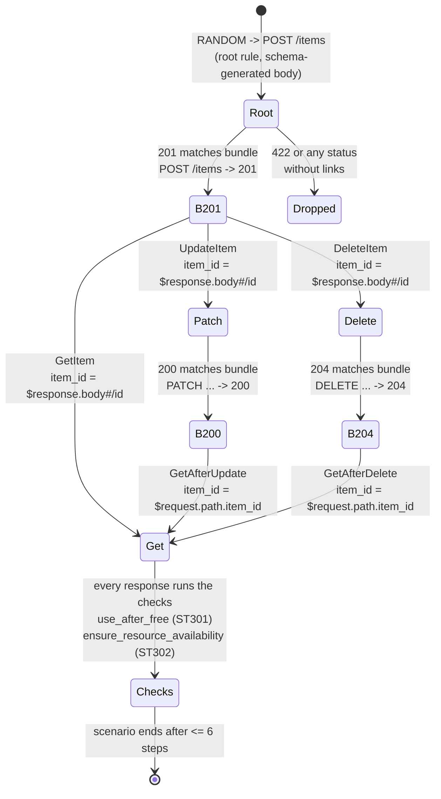

# Stateful Multi-Step API Fuzzing: Chaining POST -> GET -> PATCH -> DELETE via OpenAPI Links in Schemathesis

> [!summary] Claim
> An OpenAPI Link turns "the `id` in this `201` response is the `{item_id}` of that operation" into data a fuzzer can execute, so Schemathesis compiles each link into one Hypothesis state-machine rule and can then find lifecycle bugs (a deleted row that still answers `200`, a created row that answers `404`) that no single-request fuzz case can reach; but a link that does not resolve degrades silently to random ids, and built-in checks see only status codes, so semantic invariants still need a model.

Part of [OpenAPI JSON Schema and Contracts](README.md) in [API Engineering](../README.md).

## TL;DR

- Mechanism: Schemathesis 4.33.1 reads every Link Object under every Response Object, creates one Hypothesis `Bundle` per `"<source operation> -> <status code>"`, one rule per link that draws an earlier response from that bundle and evaluates the link's runtime expressions against it, and one root rule (`RANDOM -> POST /items`) per likely entry point; Hypothesis then runs scenarios of up to 6 calls by default `(schemathesis 4.33.1 specs/openapi/stateful/__init__.py, create_state_machine)`.
- Contract rule: declare the link under the status code the API really returns, address the target with `operationId` (unique in the OpenAPI Description) or a correctly escaped `operationRef`, qualify parameter keys as `path.item_id`, and remember that "When a runtime expression fails to evaluate, no parameter value is passed to the target operation" `(OpenAPI 3.1.2 Section 4.8.20.2)`.
- Trap: a typo such as `$response.body#/identifier` raises no error; the parameter is simply generated at random, and in the lab a server that never deletes anything then passes 60 scenarios, unless ids are small sequential integers or a literal in the app source happens to equal a live id, both of which the lab shows can mask the broken link.
- Portability fact: the Link Object and runtime-expression grammar are unchanged in substance from OpenAPI 3.1.2 (Section 4.8.20) to 3.2.1 (Section 4.20); Schemathesis reads `links` for 3.0, 3.1, and 3.2 and `x-links` for Swagger 2.0, and the lab's 40 tests passed on CPython `3.14.6` (the other matrix interpreters were not run in this job).
- When not to use it: links describe pairwise "next call" edges, not whole business workflows with success criteria, so a fixed multi-step flow that must run in order is better written as an explicit test or an Arazzo 1.1.0 workflow, and a consumer's real usage is better pinned by [[Consumer-Driven-Contract-Testing-vs-Bi-Directional-Contract-Verification]].

## Mental model



A scenario starts with the only root rule, because `POST` is the operation Schemathesis classifies as a reliable entry point, and the generated `POST /items` either returns `201`, which puts the whole step output (request plus response) into the bundle `POST /items -> 201`, or returns something else, which no link listens to.
Every link rule is guarded by that bundle: Hypothesis can choose `GetItem`, `UpdateItem`, or `DeleteItem` only once the bundle is non-empty, and when it does, it draws one earlier output, evaluates `$response.body#/id` against it, and pins `item_id` while the rest of the request is still generated from the schema.
`PATCH` and `DELETE` responses feed their own bundles, so `GetAfterUpdate` and `GetAfterDelete` can follow them with `$request.path.item_id`, which reads the id from the request that produced the response rather than from a body that a `204` does not have.
After every call the response is validated, and the two stateful checks walk the recorded tree of calls: a `GET` that returns `200` after a successful `DELETE` of the same path is a use-after-free, and a `404` for an id that a successful `POST` just returned (with every parameter supplied by links) is a missing resource.

## How it works

### 1. The Link Object is design-time data, not a hypermedia control

A Response Object has a `links` field, "A map of operations links that can be followed from the response", whose keys follow "the naming constraints of the names for Component Objects" `(OpenAPI 3.1.2 Section 4.8.17.1)`.
Each value is a Link Object, which "represents a possible design-time link for a response" and, unlike hypermedia links in the payload, "does not require link information in the runtime response" `(OpenAPI 3.1.2 Section 4.8.20)`.
Its fixed fields are `operationRef`, `operationId`, `parameters`, `requestBody`, `description`, and `server` `(OpenAPI 3.1.2 Section 4.8.20.1)`.

- `operationRef` is a URI reference that "MUST point to an Operation Object"; `operationId` names an existing operation; the two are mutually exclusive, and a link MUST use one of them.
- An `operationId` "MUST be resolved within the scope of the OpenAPI Description" `(OpenAPI 3.1.2 Section 4.8.20.1)`, and the specification recommends considering Operation Objects from every parsed document before declaring one unresolvable `(OpenAPI 3.1.2 Section 4.3.3)`.
- `operationRef` is preferred for multi-document descriptions because of name clashes, but an operation reached through a Path Item that is referenced more than once is ambiguous and the result is implementation-defined `(OpenAPI 3.1.2 Section 4.8.20.1)`.
- In an `operationRef` the JSON Pointer escapes `/` as `~1` and the URI escapes `{` and `}` as `%7B` and `%7D`, so `/2.0/repositories/{username}` becomes `#/paths/~12.0~1repositories~1%7Busername%7D/get` `(OpenAPI 3.1.2 Section 4.8.20.2.1)`.
- `parameters` maps a parameter name, "optionally qualified with the parameter location, e.g. `path.id`", to a constant or an expression, and when `id` in `path` and `path.id` in `query` collide, implementations "SHOULD prefer the qualified interpretation".
- A constant that looks like a runtime expression cannot be passed at all, because the value would be evaluated.
- "Clients follow all links at their discretion", and the existence of a link guarantees neither permission nor success `(OpenAPI 3.1.2 Section 4.8.20.2)`.

OpenAPI 3.2 moved the object to Section 4.20 without changing its fields; a line-by-line diff of the extracted text of 3.1.2 and 3.2.0 shows only renumbering, clarified example comments, "URI-reference" spelled "URI reference", and the grammar's references updated from RFC 7159 and RFC 7230 to RFC 8259 Section 7 and RFC 9110 Section 5.6.2; 3.2.1 keeps the same section numbers `(OpenAPI 3.2.1 Sections 4.20 and 4.20.3)`.

### 2. Runtime expressions: the grammar and its corners

The value side of a link is a runtime expression with this ABNF `(OpenAPI 3.1.2 Section 4.8.20.3)`:

```text
expression = "$url" / "$method" / "$statusCode" / "$request." source / "$response." source
source     = header-reference / query-reference / path-reference / body-reference
header-reference = "header." token
query-reference  = "query." name
path-reference   = "path." name
body-reference   = "body" ["#" json-pointer ]
```

- `json-pointer` is RFC 6901 syntax, `name` is any sequence of JSON characters, and `token` is the HTTP field-name token; "The `name` identifier is case-sensitive, whereas `token` is not", so `$request.query.Trace` and `$request.query.trace` are different expressions while `$response.header.LOCATION` and `$response.header.Location` are the same one.
- `$response.query` and `$response.path` are syntactically valid but name nothing, because a response has no query or path; the lab's reference evaluator rejects them.
- Request parameters "MUST be declared in the parameters section of the parent operation or they cannot be evaluated", headers included `(OpenAPI 3.1.2 Section 4.8.20.3.1)`.
- `$response.header.X` returns a single value only ("Single header values only are available").
- "Runtime expressions preserve the type of the referenced value", so `$response.body#/id` passes the integer `7`, not the string `"7"`.
- "Expressions can be embedded into string values by surrounding the expression with `{}` curly braces", and an embedded result is necessarily a string, so `/items/{$response.body#/id}` yields `"/items/7"`.
- RFC 6901 decodes each reference token by replacing `~1` with `/` first and `~0` with `~` second, so `~01` becomes `~1` and not `/` `(RFC 6901 Section 4)`; an array index must be `0` or a digit string without a leading zero, which excludes `-1`, `01`, and ` 1` `(RFC 6901 Section 4)`.

### 3. How Schemathesis compiles links into a state machine

`schema.as_state_machine()` calls `build_state_machine`, which first injects inferred links if dependency analysis is enabled and then calls `create_state_machine` `(schemathesis 4.33.1 specs/openapi/schemas.py, OpenApiSchema.build_state_machine)`.
The build is a pure function of the schema; nothing is sent until a scenario runs.

1. `collect_transitions` iterates every operation, every response, and every `(name, link)` pair, and builds an `OpenApiLink`; any error (unknown `operationId`, a `$ref` link that does not resolve, an unqualified parameter name the target does not declare, a `$request.path.x` that the source does not declare, or a malformed expression; a qualified key such as `path.x` is taken at its word and is not checked against the target's parameters) is collected and raised together as `InvalidStateMachine` `(schemathesis 4.33.1 specs/openapi/stateful/__init__.py, collect_transitions; specs/openapi/stateful/links.py, OpenApiLink.__init__)`.
2. For every outgoing link it creates a Hypothesis `Bundle` named `f"{operation.label} -> {link.status_code}"`, so all links under `POST /items` `201` share the bundle `POST /items -> 201`.
3. A response matcher per source operation routes each finished `StepOutput` into the first bundle whose status filter matches: `match_status_code` expands `2XX`-style codes, and `default_status_code` matches only codes that no other declared response covers `(make_response_filter, match_status_code, default_status_code)`.
4. One rule per incoming link is created with `Rule(targets=("catch_all",), arguments={"input": ...}, preconditions=(...,))` and `rule.bundles = (source_bundle,)`, built directly instead of through `@rule` because Hypothesis's decorators leave an exec'd module per rule behind and "Link-heavy schemas define rules by the thousands" `(transition)`.
5. Rule names come from `normalize_name(link.full_name)`, which replaces non-word characters (and a leading digit) with `_` and then collapses each `__` pair to `_` `(schemathesis 4.33.1 generation/stateful/state_machine.py, normalize_name, unique_rule_name)`, so the lab's rules are named like `POST_items___201_GetItem__GET_items_item_id_`; `unique_rule_name` appends `_2`, `_3` when two operations normalize alike.
6. `classify_root_transitions` marks an operation with outgoing links as a reliable root if it is a `POST`, or a `GET` without path parameters, unless one of its inputs is a foreign key to a resource no operation produces; the others are fallback roots used only when no reliable root exists `(is_likely_root_transition)`.
7. The class is created with `type("APIWorkflow", (OpenAPIStateMachine,), {...})` and keyed into the Hypothesis example database by the joined rule names `(add_database_key)`.

For the lab's spec this yields exactly six rules: five link rules and `RANDOM__POST_items`; `GET`, `PATCH`, and `DELETE` get no root rule because only operations with outgoing links are classified at all: `GET /items/{item_id}` has none, and `PATCH` and `DELETE` are only fallback roots, which are used only when no reliable root exists (lab test `test_each_link_becomes_one_rule_and_only_post_is_a_root`).

If no rule exists, the class still builds, and the failure appears when Hypothesis instantiates it: `RuleBasedStateMachine.__init__` raises `InvalidDefinition` containing "defines no rules", which `APIStateMachine.__init__` turns into `NoLinksFound("Schema contains no link definitions required for stateful testing")`, or a message about filters or unparseable request bodies when those are the cause `(schemathesis 4.33.1 generation/stateful/state_machine.py, APIStateMachine.__init__)`.

### 4. One step: how a link becomes a concrete request

`into_step_input` returns the strategy a link rule draws from `(schemathesis 4.33.1 specs/openapi/stateful/__init__.py, into_step_input)`:

1. Draw an earlier `StepOutput` from the source bundle; Hypothesis lists bundle elements newest-first and shrinks the index towards zero, so shrinking prefers the most recent producer `(hypothesis 6.170.14 hypothesis/stateful.py, Bundle.do_draw)`.
2. `link.extract(output)` evaluates every parameter expression and the `requestBody` expression into `ExtractedParam` values wrapped in `Ok` or `Err`; results are memoized per link with `lru_cache(8)` keyed by the producing case id `(specs/openapi/stateful/links.py, OpenApiLink.extract, StepOutputWrapper)`.
3. Each value that is `Ok` and neither `None` nor `UNRESOLVABLE` is applied with probability `p`, using a `random.Random` drawn as `st.randoms(use_true_random=True)`; without link calibration, `p = 1 - 0.15 x 0.5 (path) x 0.5 (required)`, which is `0.9625` for the lab's required path parameter, so about 1 step in 27 deliberately ignores a working link to look for bugs that need unknown ids (`BASE_EXPLORATION_RATE: Final = 0.15` in `schemathesis 4.33.1 generation/stateful/state_machine.py`).
4. A value that failed to extract is skipped without any warning, and the target's own schema strategy generates the parameter.
5. A link `requestBody` replaces the generated body, with probability `DEFAULT_USE_PROBABILITY`, when `x-schemathesis.merge_body` is `false`, and otherwise is merged field by field into the generated body, each field kept with probability `DEFAULT_USE_PROBABILITY = 0.85` `(schemathesis 4.33.1 engine/link_calibration.py)`.
6. The rest of the case is drawn from `target.as_strategy(...)` with the overrides fixed; with generation mode `all`, each step is negative with probability 10 percent (`NEGATIVE_TEST_CASES_THRESHOLD = 10`).
7. The rule function records the case under its parent in a `ScenarioRecorder` and in the transition controller `(specs/openapi/stateful/__init__.py, transition)`; the step then runs `before_call`, calls the API (in process for an ASGI app), re-authenticates and replays on a stale token, runs `after_call`, then runs every enabled check, and returns `StepOutput(response, case)` `(generation/stateful/state_machine.py, APIStateMachine.step)`.
8. Hypothesis then calls Schemathesis's `_add_results_to_targets`, which ignores the declared target `catch_all` and puts the output into the bundle chosen by the response matcher, or nowhere if no link listens to that status `(OpenAPIStateMachine._get_target_for_result)`.

The `TransitionController` adds preconditions on top of bundle availability `(schemathesis 4.33.1 generation/stateful/control.py, TransitionController)`.

- Calls from one source operation to one target operation, summed over every case of that source in the scenario, are capped at `max(2, stateful_step_count // number_of_operations)` (`_get_max_operations_per_source`, `allow_transition`); the lab has 4 operations in the transition graph and 6 steps, so the cap is 2 (`MAX_OPERATIONS_PER_SOURCE_CAP = 2`), which is "enough to be able to catch double-click type of issues".
- A root operation may run freely `MAX_ROOT_SOURCES = 2` times per scenario; after that it runs again only when no link rule is currently allowed, and then a root whose responses fed no later step yields to roots that did or that are still under the limit (`allow_root_transition`).
- Swarm testing can disable all rules valid at a step; `_ValidRuleFallbackFlags` re-enables every valid rule in that case, because API machines usually have one or two valid rules at a time `(schemathesis 4.33.1 generation/stateful/state_machine.py, _ValidRuleFallbackFlags)`.
- `_shuffle_root_rules` reorders only root rules when the class attribute `rule_order_seed` is set (it is `None` by default, which keeps Hypothesis order), because Hypothesis's simplest choice is the first valid rule and a fixed order would let one root start most scenarios `(generation/stateful/state_machine.py, _shuffle_root_rules)`.

### 5. The Hypothesis loop underneath

`run_state_machine_as_test` passes `_min_steps=2` to Hypothesis `(schemathesis 4.33.1 generation/stateful/__init__.py)`.
Hypothesis then draws, per step, a boolean that stops the scenario with probability `2**-16`, forced to continue while `steps_run <= _min_steps` and forced to stop at `stateful_step_count` or when the choice sequence exceeds `0.8 x BUFFER_SIZE` (`BUFFER_SIZE = 8 x 1024`) `(hypothesis 6.170.14 hypothesis/stateful.py, get_state_machine_test; hypothesis/internal/conjecture/engine.py)`.
The near-zero stop probability exists so that the shrinker can delete steps from a failing scenario; in normal generation almost every scenario runs to the step limit.
Schemathesis's `DEFAULT_STATE_MACHINE_SETTINGS` set `phases=[Phase.generate]`, `deadline=None`, `stateful_step_count=6`, and suppress every health check, against Hypothesis's own default of 50 steps and `max_examples=100` `(schemathesis 4.33.1 generation/stateful/state_machine.py; hypothesis 6.170.14 hypothesis/_settings.py)`.
Because `phases` contains only `generate`, a failure is reported as found, without shrinking, unless you add `Phase.shrink`.
`st.randoms(use_true_random=True)` draws a 64-bit seed from the test's choice sequence and wraps a plain `random.Random(seed)` `(hypothesis 6.170.14 hypothesis/strategies/_internal/random.py, RandomStrategy.do_draw)`, so the link-application coin flips are reproducible under `derandomize=True`, but only the seed is a choice Hypothesis tracks, so a shrinker could change the seed but never a single flip.

### 6. Expression evaluation inside Schemathesis

The parser is a cached recursive descent over a small lexer `(schemathesis 4.33.1 specs/openapi/expressions/parser.py, parse)`, and the evaluator is in `nodes.py` and `expressions/__init__.py`.

- `$response.body#/...` deserializes the response by its `Content-Type`, treats a response with no `Content-Type` as `application/json`, and resolves the pointer with `resolve_pointer` `(specs/openapi/expressions/nodes.py, BodyResponse.evaluate, link_media_type)`.
- `$response.header.X` looks up `X.lower()` and returns the first value, which matches the specification's single-value rule; `$request.header.X` uses a `CaseInsensitiveDict` `(HeaderResponse.evaluate, NonBodyRequest.evaluate)`.
- A body-less pointer such as `$response.body.id` is rejected at build time with the hint "Did you mean `$response.body#/id`?" `(parser.py, _dotted_body_error)`.
- Schemathesis extends the grammar with `#regex:` extractors, for example `$response.header.Location#regex:/items/(.+)`, compiled with Python `re` and required to have exactly one capture group (`compile_extractor`); the stateful-testing guide documents this form, and it is not part of the OpenAPI grammar, so other tools will reject it.
- A single-node expression returns the referenced value with its type, except `$statusCode`, which `StatusCode.evaluate` returns as a string (`"201"`, not `201`) `(nodes.py, StatusCode.evaluate)`; a template with several nodes is joined with `str()` and becomes `UNRESOLVABLE` if any part is unresolvable `(expressions/__init__.py, evaluate)`.
- `resolve_pointer` decodes tokens with `value.replace("~1", "/").replace("~0", "~")`, which is the RFC order, but indexes lists with `target[int(token)]`, so `/-1` returns the last element, `/01` and `/ 1` return element 1, and only out-of-range or non-integer tokens fail `(schemathesis 4.33.1 core/transforms.py, resolve_path)`; the lab pins all three cases against a strict RFC 6901 resolver.
- Schemathesis 4.33.1 reads `operationId`, `operationRef`, `parameters`, `requestBody`, and `x-schemathesis` from a link, and does not read `server` `(specs/openapi/stateful/links.py, OpenApiLink.__init__)`.

### 7. The two built-in stateful checks

Both live in `schemathesis 4.33.1 specs/openapi/checks.py` and run on every response of every step, using the recorder's tree of cases.

`use_after_free` (failure code `ST301`, severity critical) returns early unless the current response is `2xx` or `3xx`, the current method is not `DELETE` (a repeated `DELETE` may legitimately succeed because the method is idempotent), and the method is in `_NON_CREATION_METHODS = {"get", "head", "options", "query", "delete", "patch"}`.
It then walks every case related to the current one (the whole tree from the scenario root), and fails if it finds a `DELETE` whose own response was `2xx`, whose parent's response was `2xx`, that had path parameters, and whose path is a prefix of the current path with equal parameter values.
It skips the failure if a successful creation (`POST`, `PUT`, or another method outside the non-creation set) on a prefix of the deleted path happened between the `DELETE` and the current step `(_resource_recreated_after_delete)`, and it appends a hint when the response carries `Age > 0` or an `X-Cache` containing `HIT`, because "A shared cache can keep serving the pre-write state" `(_stale_cache_hint)`.

`ensure_resource_availability` (failure code `ST302`, severity medium) fires only on `404`, only when the parent call was a `POST` with a `2xx` or `3xx` response whose path is a prefix of the current path, only when the `POST` provably created something (the target path is deeper than the `POST` path, or the response was `201` or carried `Location`), only when every parameter of the current operation was supplied by link overrides, and only when the scenario records no successful `DELETE` of the resource or a parent path, and no other successful unsafe request (besides the creating `POST`) to the same URI, because such a request may be a removal spelled with the wrong method `(resource_was_deleted)`.

The rules come from Microsoft Research's RESTler work: Atlidakis, Godefroid, and Polishchuk define a use-after-free rule ("A resource that has been deleted must no longer be accessible"), a resource-leak rule, a resource-hierarchy rule, and a user-namespace rule, and report bugs found with them in production Azure and Office365 services, all fixed `(Atlidakis, Godefroid, Polishchuk, "Checking Security Properties of Cloud Service REST APIs", ICST 2020, Sections I and III-A)`.
The difference matters: RESTler's checkers are active (they generate the extra requests that try to break the rule, Section III-B), whereas Schemathesis's two checks are passive monitors over whatever sequence Hypothesis happened to generate, so a link graph that never generates "`DELETE` then `GET`" can never report `ST301`.
`ensure_resource_availability` is close to the inverse of the resource-leak rule: it asserts that a successful create is visible, while the paper's rule asserts that "A resource that was not created successfully must not be accessible and must not "leak" any side-effect in the backend service state" (Section I).

### 8. Link inference: when no links are declared

The stateful phase's `inference.algorithms` default to both `location-headers` and `dependency-analysis` `(schemathesis 4.33.1 config/_phases.py, InferenceAlgorithm, InferenceConfig)`.

- `dependency-analysis` runs at `build_state_machine` time, builds a producer-consumer dependency graph from the operations, their parameters, and their response schemas, and writes links into the in-memory raw schema with `operationRef` targets and `x-schemathesis: {"is_inferred": true}`; a link that is a subset of an existing one for the same target is skipped `(specs/openapi/stateful/dependencies/__init__.py, inject_links)`.
- On the lab spec with all links removed it injected `GetItem`, `PatchItem`, and `DeleteItem` under `POST 201`, plus `GET 200 -> PATCH` and `DELETE`, `PATCH 200 -> GET` and `DELETE`, and `PatchItem` carried `requestBody: {"name": "$response.body#/name"}` with `merge_body: true`; it injected nothing under `DELETE 204`, because a `204` has no body to read an id from (lab test `test_dependency_analysis_infers_links_when_none_are_declared`, output inspected by the drafter and again in the verify pass on CPython `3.14.6`, identical).
- The inferred `operationRef` values were written as `#/paths/~1items~1{item_id}/get`, with raw braces, although Section 4.8.20.2.1 says `{` and `}` must be percent-encoded; it works because Schemathesis resolves its own references, but exporting such a link to another tool is not safe.
- `location-headers` is wired into the engine run (`Engine.execute`), which the CLI uses and which collects `Location` headers observed in earlier phases `(schemathesis 4.33.1 engine/core.py, Engine.execute)`; `as_state_machine()` does not use it, and the stateful-testing guide warns that running only the stateful phase in the CLI can find fewer links.
- Inferred links still reached `ST301` in the lab even without a `DELETE -> GET` link, because `use_after_free` searches the whole tree: `POST -> DELETE` and a sibling `POST -> GET` share a root.

### 9. Constants harvested from the application's source

With `analysis.constants.enabled` (on by default), Schemathesis walks the local, non-third-party modules of the application bound to the schema (`schema.app`, set by `from_asgi` or, as in the lab's `load_schema`, by assignment), extracts literals with Python's `ast`, and feeds them into generation as candidate values `(schemathesis 4.33.1 python/_constants/orchestrator.py, build_constants_pool; python/_constants/extract.py)`.
The lab found this the hard way: with a broken link pointer and ids starting at `700_000_001`, a run still reported `ST301` for `DELETE /items/700000001`, because the test module that defines the app wrapper contains the literal `700_000_001`; with `analysis.constants.enabled = false` the same run sent 0 successful `DELETE` requests (tests `test_constants_harvested_from_app_source_can_stand_in_for_a_broken_link` and `test_typo_in_link_pointer_silently_hides_use_after_free`).
A side effect is that the generated sequence depends on literals elsewhere in your source: during development, an earlier version of the broken-link assertion (ids from 1, constants on) passed, then failed after edits to the test module that did not touch the code under test; constants harvesting is the likely cause but that flip was not isolated, whereas the on/off pair of tests above is.

### 10. What the built-in checks cannot see, and the model that can

Built-in checks know status codes, schemas, and the call tree, not your business rules.
The lab's `stale_patch` defect answers `PATCH` with `200` and the new representation but persists nothing; every response is schema-valid and every status is plausible, so 60 scenarios pass (`test_builtin_checks_miss_a_lost_update`).
The fix is model-based testing in the Hypothesis sense: keep a reference model, update it from each successful write, and compare each read; the lab's `LifecycleModel` does that from `after_call`, and the same 60 scenarios then fail with `lifecycle invariant broken: GET /items/1 -> ..., model expects ...` (`test_model_check_catches_the_lost_update`).
`setup()` runs once per scenario, so the lab resets both the store and the model there; without that, ids and rows leak between scenarios and the model compares against state it never saw.

## Numbers and limits

| Quantity | Value | Source |
|---|---|---|
| Default steps per scenario | `6` (`DEFAULT_MAX_SCENARIO_STEPS`); Hypothesis's own default is `50` | `schemathesis 4.33.1 core/__init__.py`; `hypothesis 6.170.14 hypothesis/_settings.py` |
| Minimum steps per scenario | `3`: Schemathesis passes `_min_steps=2`, and Hypothesis forces another step while `steps_run <= _min_steps`, so steps 1 to 3 always run | `schemathesis 4.33.1 generation/stateful/__init__.py, run_state_machine_as_test`; `hypothesis 6.170.14 hypothesis/stateful.py, get_state_machine_test` |
| `max-steps` config floor | `minimum: 2` | `schemathesis 4.33.1 config/schema.json, StatefulPhaseConfig` |
| Early-stop probability per step | `2**-16`; forced stop above `0.8 x 8192` choices | `hypothesis 6.170.14 hypothesis/stateful.py, get_state_machine_test` |
| Calls per (source, target) link per scenario | `max(2, steps // operations)`; `2` in the lab | `generation/stateful/control.py, _get_max_operations_per_source` |
| Root calls before roots are throttled | `2` (`MAX_ROOT_SOURCES`) | `generation/stateful/control.py` |
| Probability a resolved required path link value is used | `0.9625` (exploration `0.15 x 0.5 x 0.5`) | `specs/openapi/stateful/__init__.py, into_step_input` |
| Same, optional non-path parameter | `0.55` (exploration `0.15 x 3.0`) | same |
| Body link field use probability, uncalibrated | `0.85`; calibrated after `5` samples, floor `0.05` | `engine/link_calibration.py` |
| Negative steps in mode `all` | `10` percent | `specs/openapi/stateful/__init__.py, NEGATIVE_TEST_CASES_THRESHOLD` |
| Extraction memo per link | `lru_cache(8)` | `specs/openapi/stateful/links.py` |
| Rules for the lab spec | `6` (5 links + 1 root) | lab, `test_each_link_becomes_one_rule_and_only_post_is_a_root` |
| Calls for `max_examples=60`, `stateful_step_count=6`, positive mode, correct app | `379`: `POST 201` 105, `DELETE 204` 62, `DELETE 404` 41, `PATCH 200` 41, `PATCH 404` 24, `GET 404` 90, `GET 200` 16 | measured by the drafter and re-measured identically in the verify pass (as of 2026-11), `uv run --frozen python <scratch script>` calling the test module's `run_machine`, CPython `3.14.6`, macOS 27.3 arm64, Apple M3 Pro; identical counts with the model on |
| Same, mode `all` | `355` calls, including `POST 422` 32 | same run |
| Same, broken link `$response.body#/identifier`, ids from 1, correct app | constants on: `DELETE 204` 4 of 99 `DELETE` calls; constants off: 16 of 71 | same run |
| Wall time of one 60-scenario run | `0.90 s` (built-in checks, first run in the process) and `0.51 s` (with the model, second run) | same run, `time.perf_counter()` around `run_machine`; one sample each, so treat as order of magnitude |
| Full lab module | `40 passed in 5.24s` (the drafter saw `11.66s` on the same machine) | captured run below |

The skew in the measured counts is the controller at work: `GET 404` (90) dwarfs `GET 200` (16) because most `GET` steps follow a `DELETE` or a sibling `DELETE`, and `DELETE 404` (41) is mostly a second `DELETE` of an id that is already gone, which the cap of 2 `POST -> DELETE` calls per scenario permits (the rest come from the 3.75 percent of link steps that deliberately ignore the link and use a random id).

## Portability

| Runtime or component | Behavior | Proof |
|---|---|---|
| CPython `3.14.6` (workspace interpreter) | 40 passed | `uv run --frozen pytest <test> -q` in `labs/`, macOS 27.3 arm64 |
| CPython `3.12.16`, `3.13.18`, `3.14.10`, `3.15.2`, `3.15.2t` | Not run in this job: lab matrix runs were paused by the user's instruction of 2026-11-11 | `labs/pyproject.toml` declares `requires-python = ">=3.12,<3.16"`; no claim beyond that |
| OpenAPI 3.1.2 vs 3.2.1 Link Object | Same fields and grammar; Section 4.8.20 became 4.20, grammar references moved to RFC 8259 and RFC 9110 | Text diff of the fetched 3.1.2 and 3.2.0 specifications, section numbers checked in 3.2.1 |
| Swagger 2.0, OpenAPI 3.0, 3.1, 3.2 in Schemathesis | Links read from `x-links` (2.0) and `links` (3.0, 3.1; 3.2 reuses the 3.1 adapter's keyword) | `schemathesis 4.33.1 specs/openapi/adapter/v2.py, v3_0.py, v3_1.py, v3_2.py, links_keyword` |
| Hypothesis versions | Schemathesis overrides both `_add_result_to_targets` (Hypothesis `<= 6.131.15`) and `_add_results_to_targets` (newer) | `generation/stateful/state_machine.py`, comments on both methods; lab ran `6.170.14` only |
| Runtime expressions, Schemathesis vs the specification | Schemathesis accepts `/-1`, `/01`, `/ 1` as array indexes and adds `#regex:` extractors | `test_schemathesis_accepts_array_indexes_rfc_6901_forbids`, CPython `3.14.6`; `parser.py, compile_extractor` |
| Arazzo 1.1.0 workflows | Not read by Schemathesis 4.33.1 (no occurrence of `arazzo` in the installed package) | `grep -ril arazzo` over the installed `schemathesis` package |
| ASGI servers (Uvicorn, Hypercorn, Granian) and HTTP/1.1, HTTP/2, HTTP/3 | Not exercised: Schemathesis calls the ASGI app in process through its own `requests`-adapter client, so no server or wire protocol is involved | `schemathesis 4.33.1 transport/asgi.py, ASGITransport.send`; `python/asgi.py, ASGIClient` (a `requests.Session` with an ASGI adapter mounted for `http://` and `https://`) |
| Debian Trixie and Alpine containers | Not run in this job | open leg |

## Worked example

The lab is one module and one test module:
[implementation](../labs/src/api_labs/f08_openapi_json_schema_and_contracts/stateful_links.py) and
[test](../labs/tests/f08_openapi_json_schema_and_contracts/test_stateful_api_state_machine_testing_with_openapi_links_and_schemathesis.py).

The app is a Starlette router over an in-memory `ItemStore` with three switchable `Defects`: `keep_deleted` (answers `204` and keeps the row), `drop_creates` (answers `201` and stores nothing), and `stale_patch` (answers `200` with the new name and persists nothing).
The links under `POST /items` `201`, rendered as JSON from `LIFECYCLE_SPEC` (generated output, not a source excerpt):

```json
{
  "GetItem": {
    "operationId": "getItem",
    "parameters": {
      "path.item_id": "$response.body#/id"
    }
  },
  "UpdateItem": {
    "operationId": "updateItem",
    "parameters": {
      "path.item_id": "$response.body#/id"
    }
  },
  "DeleteItem": {
    "operationId": "deleteItem",
    "parameters": {
      "path.item_id": "$response.body#/id"
    }
  }
}
```

and under `DELETE /items/{item_id}` `204`, which has no body, the id comes from the request:

```json
{
  "description": "Deleted",
  "links": {
    "GetAfterDelete": {
      "operationId": "getItem",
      "parameters": {
        "path.item_id": "$request.path.item_id"
      }
    }
  }
}
```

The state machine subclass, verbatim from `stateful_links.py` (lines 294 to 351):

```python
@dataclass(slots=True)
class LifecycleModel:
    """Reference model of the store; `observe` returns the first invariant a response breaks."""

    names: dict[int, str] = field(default_factory=dict[int, str])
    deleted: set[int] = field(default_factory=set[int])

    def observe(
        self, method: str, item_id: int | None, sent: object, status: int, body: object
    ) -> str | None:
        fields = _object(body)
        got = fields.get("name")
        if method == "POST" and status == 201 and "id" in fields:
            self.names[int(cast("int", fields["id"]))] = str(got)
        elif item_id is None or item_id not in self.names.keys() | self.deleted:
            return None  # an id this scenario never created: nothing to compare against
        elif method == "GET" and status == 200 and item_id in self.deleted:
            return f"GET /items/{item_id} -> 200 after a successful DELETE"
        elif method == "GET" and status == 200 and got != self.names[item_id]:
            return f"GET /items/{item_id} -> {got!r}, model expects {self.names[item_id]!r}"
        elif method == "GET" and status == 404 and item_id in self.names:
            return f"GET /items/{item_id} -> 404 for an item that was never deleted"
        elif method == "PATCH" and status == 200 and "name" in _object(sent):
            self.names[item_id] = str(_object(sent)["name"])
        elif method == "DELETE" and status == 204:
            self.names.pop(item_id, None)
            self.deleted.add(item_id)
        return None


def lifecycle_machine(
    schema: OpenApiSchema, store: ItemStore, *, model: bool = False
) -> type[APIStateMachine]:
    """The Schemathesis state machine, reset per scenario, optionally checked against the model."""
    base = schema.as_state_machine()

    class Lifecycle(base):  # type: ignore[misc, valid-type]
        reference: LifecycleModel

        def setup(self) -> None:
            store.reset()
            self.reference = LifecycleModel()

        def after_call(self, response: StResponse, case: Case[Any]) -> None:
            # schemathesis 4.33.1 annotates `case: Case` without its type argument
            super().after_call(response, case)  # pyright: ignore[reportUnknownMemberType]
            if not model:
                return
            raw = (case.path_parameters or {}).get("item_id")
            item_id = raw if isinstance(raw, int) else None
            body: object = response.json() if response.content else None
            problem = self.reference.observe(
                case.method.upper(), item_id, case.body, response.status_code, body
            )
            if problem is not None:
                raise AssertionError(f"lifecycle invariant broken: {problem}")

    return Lifecycle
```

`super().after_call` must run first: `RecordingStateMachine.after_call` records the response, and the stateful checks look up earlier responses through that recorder.

The harness, two verbatim slices of the test module (lines 42 to 50 and 78 to 93):

```python
# Schemathesis defaults (generate phase only, no deadline, health checks off), made
# deterministic and small: 60 scenarios of up to 6 calls and no example database.
SCENARIOS = settings(
    DEFAULT_STATE_MACHINE_SETTINGS,
    max_examples=60,
    stateful_step_count=6,
    derandomize=True,
    database=None,
)
```

```python
def run_machine(
    defects: Defects,
    *,
    spec: dict[str, Any] | None = None,
    model: bool = False,
    inference: bool = False,
    negative: bool = False,
    first_id: int = 1,
    constants: bool = True,
) -> CountingApp:
    store = ItemStore(first_id=first_id)
    app = CountingApp(make_app(store, defects))
    config = stateful_config(inference=inference, negative=negative, constants=constants)
    schema = load_schema(app, spec, config=config)  # type: ignore[arg-type]
    lifecycle_machine(schema, store, model=model).run(settings=SCENARIOS)
    return app
```

`stateful_config` sets generation mode `positive` (or `all`), `phases.stateful.inference.algorithms = []` unless inference is requested, and `analysis.constants.enabled`, so that the declared links, not inference or harvested constants, drive the result unless a test asks otherwise.

What the 40 tests pin:

- The contract: the spec passes `openapi-spec-validator` and declares five links; it compiles to exactly the six rules listed above; with links removed and inference off, instantiating the machine raises `NoLinksFound`; with inference on, dependency analysis restores `POST 201 -> GET` but adds nothing under `DELETE 204`; a dangling `operationId: getItm` raises `InvalidStateMachine` with `Operation 'getItm' not found` when the class is built.
- The lifecycle: the correct app passes 60 scenarios with built-in checks and with the model, and the counting ASGI wrapper proves that `POST 201`, `GET 200`, `PATCH 200`, `DELETE 204`, and `GET 404` all occurred; it also passes in mode `all`, where `POST 422` occurred.
- The defects: `keep_deleted` raises a `FailureGroup` containing exactly `UseAfterFree`; `drop_creates` raises exactly `EnsureResourceAvailability`; `stale_patch` passes the built-in checks and fails the model.
- The silent failure: with `$response.body#/identifier` in the `POST` links, ids starting at `700_000_001`, and constants off, `keep_deleted` passes because `DELETE` never returned `204`; with ids starting at 1 random draws still hit live rows; with constants on the harvested literal finds the bug; with the correct links and unguessable ids the bug is still found.
- The grammar: 11 expressions resolve with their type preserved, 6 do not resolve, an embedded template yields a string, `~01` decodes to `~1` in both resolvers, and Schemathesis accepts `/-1`, `/01`, and `/ 1` where RFC 6901 does not.

Captured run (CPython `3.14.6`, macOS 27.3 arm64, from `labs/`):

```text
$ uv run --frozen pytest tests/f08_openapi_json_schema_and_contracts/test_stateful_api_state_machine_testing_with_openapi_links_and_schemathesis.py -q
........................................                                 [100%]
40 passed in 5.24s
```

The report Schemathesis raised for `Defects(keep_deleted=True)` through the same harness (captured in the verify pass, CPython `3.14.6`, identical to the drafter's capture):

```text
Schemathesis found 1 distinct failure

- ST301 Deleted resource still available

    The API did not return a `HTTP 404 Not Found` response (got `HTTP 200 OK`) for a resource that was previously deleted.

    The resource was deleted with `DELETE /items/1`

[200] OK:

    `{"id":1,"name":"#"}`

Reproduce with:

    curl -X GET http://testserver/items/1

 (1 sub-exception)
```

and for `Defects(drop_creates=True)`:

```text
Schemathesis found 1 distinct failure

- ST302 Created resource not found

    The API returned `404 Not Found` for a resource that was just created.

    Created with      : `POST /items`
    Not available with: `DELETE /items/{item_id}`

[404] Not Found:

    `{"detail":"no such item"}`

Reproduce with:

    curl -X DELETE http://testserver/items/1

 (1 sub-exception)
```

## Pitfalls

> [!warning] The link sits under a status code the API never returns
> Trigger: links declared under `200` while `POST` answers `201`, or under `201` while the handler returns `200`.
> Symptom: the response matcher routes no output into the link's bundle, the link rule is never eligible, and the CLI's stateful phase reports zero links in its "`N covered / N selected / N total`" line `(schemathesis 4.33.1 cli/commands/run/handlers/output.py)`; the stateful-testing guide names a wrong status code as the usual reason a defined link is never followed.
> Fix: declare links under the code the API actually returns, or under a range such as `2XX`, which `match_status_code` expands; test it with a run that asserts the edge occurred, as the lab's counting wrapper does.

> [!warning] A pointer typo degrades the chain to random ids without any error
> Trigger: `$response.body#/identifier` where the field is `id`, or a field renamed in a later version.
> Symptom: extraction yields `UNRESOLVABLE`, the parameter is generated from its schema, and lifecycle checks stop firing; in the lab a server that never deletes passed 60 scenarios.
> Fix: assert in CI that every declared link fires at least once (Schemathesis CLI coverage statistics, or a counter like the lab's), and lint links against response schemas with a ruleset from [[OpenAPI-Linting-and-Automated-Style-Governance-with-Vacuum-and-Spectral]].

> [!warning] Small sequential ids hide broken links
> Trigger: ids that start at 1 in a fresh test database, combined with Hypothesis's preference for small integers.
> Symptom: random ids collide with live rows (one measured broken-link run with constants analysis on produced 4 successful `DELETE` requests out of 99, and `test_with_small_sequential_ids_random_guesses_still_hit_live_rows` shows at least one with it off), so the suite looks healthy while the link graph is broken.
> Fix: seed test stores with unguessable ids (UUIDs or a large offset), see [[Resource-Identifiers-UUIDv4-vs-UUIDv7-ULID-and-Public-IDs]].

> [!warning] Harvested constants make results depend on unrelated literals
> Trigger: `analysis.constants.enabled` (default on) and an app object whose modules contain literals that equal real ids or names.
> Symptom: bugs are found or missed depending on literals elsewhere in the source; in the lab the literal `700_000_001` in the test module found a use-after-free that the broken link could not.
> Fix: disable constants analysis for tests that must prove link behavior, keep it on for exploratory fuzzing, and pin `derandomize=True` with `database=None` so a given source tree gives a given result.

> [!warning] Asynchronous deletes trip `use_after_free`
> Trigger: `DELETE` returns `202 Accepted`, which RFC 9110 allows when "the action will likely succeed but has not yet been enacted" `(RFC 9110 Section 9.3.5)`.
> Symptom: `use_after_free` treats every `2xx` `DELETE` as completed, so a `GET 200` during the deletion window is reported as `ST301`.
> Fix: return `202` with a status monitor and model the monitor in the spec, or exclude the check for that operation; do not paper over it by answering `204` before the delete is durable.

> [!warning] A stale cache answers after the delete
> Trigger: a shared cache or CDN in front of the API caches `GET /items/{id}`.
> Symptom: `ST301` with the hint "The response came from a cache (`Age: ...`) and may be stale", added when `Age > 0` or `X-Cache` contains `HIT` `(schemathesis 4.33.1 specs/openapi/checks.py, _stale_cache_hint)`.
> Fix: rely on the rule that "A cache MUST invalidate the target URI" after a non-error response to an unsafe method `(RFC 9111 Section 4.4)`, purge shared caches the API does not control, or test the origin directly; see [[Cache-Invalidation-Upon-Unsafe-Methods-and-Purge-Patterns]].

> [!warning] State leaks between scenarios
> Trigger: a shared store or database that `setup()` does not reset, or a model created once per class.
> Symptom: ids drift between scenarios, a model compares against rows it never saw, and failures do not reproduce in isolation.
> Fix: reset per scenario in `setup()`, which the guide documents as running at the start of each scenario, and reserve session fixtures for once-per-run work.

> [!warning] Status-code checks cannot see lost updates
> Trigger: a `PATCH` that answers `200` with the requested representation but never commits, or a write that a cache or replica serves stale.
> Symptom: every built-in check passes (lab test `test_builtin_checks_miss_a_lost_update`).
> Fix: add a reference model in `after_call` or a Hypothesis `@invariant`, and assert read-after-write explicitly; see [[Optimistic-Concurrency-Control-If-Match-and-412-Precondition-Failed]] for the protocol-level defense against concurrent lost updates.

> [!warning] An `operationRef` that is not escaped, or `operationId` collisions across documents
> Trigger: `#/paths/~1items~1{item_id}/get` copied into a multi-document description, or two documents defining `getItem`.
> Symptom: tools that follow Section 4.8.20.2.1 fail to resolve the reference, and `operationId` resolution becomes ambiguous.
> Fix: percent-encode `{` and `}` in `operationRef`, enforce unique `operationId` values across the bundle, and prefer `operationRef` only when the target path item is referenced exactly once.

## Security and robustness

- Use-after-free is a security property, not a cosmetic one: the ICST 2020 paper argues that violations "might allow an attacker to hijack cloud resources or bypass quotas (Elevation-of-Privilege attack), or to steal information from other users (Information-Disclosure attack)" `(Atlidakis, Godefroid, Polishchuk, ICST 2020, Section I)`.
- API1:2023 Broken Object Level Authorization is the stateful sibling of these checks: Schemathesis 4.33.1 ships `object_level_authorization` (failure `ST402`), whose docstring reads "Check that one identity cannot read an object another identity created" `(schemathesis 4.33.1 specs/openapi/checks.py)`; the lab does not exercise it, and this note does not describe how identities are configured, see [[Defeating-BOLA-API1-2023-Tenant-Scoped-Queries-and-PostgreSQL-RLS]].
- API3:2023 Broken Object Property Level Authorization shows up when a link's `requestBody` copies response fields (as the inferred `PatchItem` link copies `name`) into a write; close request schemas with `additionalProperties: false`, as the lab does, see [[Defeating-BOPLA-and-Mass-Assignment-API3-2023-Strict-Input-Output-Schemas]].
- API4:2023 Unrestricted Resource Consumption applies to the fuzzer itself: every scenario creates rows, the controller throttles root `POST` calls only after two per scenario, and the lab's 60 scenarios issued 105 creates, so run against disposable environments, cap `max_examples` and `stateful_step_count`, and clean up in `teardown()`.
- Treat the OpenAPI document as untrusted input when it comes from another team or tenant: a Link Object's `server` field can name another host, and while Schemathesis 4.33.1 ignores `server` in links, a generic link-following client might not; `#regex:` extractors are compiled with Python `re` and run on response data, so a hostile spec can supply a catastrophic pattern.
- Credentials belong in `setup()` and `before_call()`, not in the spec; the guide's example fetches a bearer token once per scenario in `setup()` and attaches it to every request in `before_call()`, and Schemathesis re-authenticates and replays when a token goes stale `(schemathesis 4.33.1 auths.py, reauth_and_replay, called from generation/stateful/state_machine.py, APIStateMachine.step)`.
- Make lifecycle endpoints robust to the inputs a stateful fuzzer produces: duplicate `DELETE` (must not `500`), `PATCH` after `DELETE` (must `404`), and ids far outside the live range (must `404` or `422`, never a database error); the lab's `_parse_id` rejects non-ASCII digits and ids longer than 18 digits before touching the store.

## The principal's view

The architectural decision is whether links are part of the contract or a test artifact.
Declared links document intent ("this `id` addresses that resource") for humans, SDK generators, and fuzzers at once, and they survive refactors that change names, which is exactly where inference guesses wrong; their cost is that they are one more thing the spec author must keep true, and the lab shows that nothing fails loudly when they drift.
Inference gives coverage on day one for large legacy specs, but it encodes only what names and shapes suggest, so it missed `DELETE 204 -> GET` in the lab, and it changes the raw schema in memory, which makes "what did we test" harder to answer.
The defensible policy is to declare links for every create-read-update-delete family, run inference as a supplement, and gate CI on two things: no `InvalidStateMachine`, and every declared link observed at least once per run.
Built-in checks are a floor, not a test plan: a staff engineer should insist on a small reference model for each resource family's core invariant (read-after-write, delete-then-404, version monotonicity), because that is where real data-loss bugs live and status-code checks are blind to them.
Budget explicitly: scenarios times steps times latency is the cost, so run a small deterministic configuration (like the lab's 60 x 6 in about 1 to 2 seconds in process) on every pull request and a larger randomized one nightly against a deployed environment, where caches, replicas, and asynchronous deletes can produce the failures an in-process app cannot.
Choose something else when the flow is a business workflow with ordering and success criteria rather than a graph of possible next calls: the Arazzo Specification (1.1.0, released 2026-05-17 per its revision history) describes workflows, steps, dependencies, and success criteria over OpenAPI operations, but Schemathesis 4.33.1 does not read it, so it is a documentation and workflow-runner choice, not a fuzzing one.
Choose consumer-driven contracts when the risk is a specific client's assumptions, and choose explicit example-based integration tests when a single known sequence (payment capture, refund) must be proven exactly, see [[Property-Based-API-Testing-with-Schemathesis-and-Hypothesis]] for where stateless fuzzing stops.

## Interview questions

> [!question] L5: What does an OpenAPI Link Object say, and what does it not say?
>
> > [!success]- Answer
> > It says that a value from a response or its request (via a runtime expression) can be passed as a parameter or body of another operation, identified by `operationId` or `operationRef`.
> > It is design-time data in the description, not a link in the response payload, so the API does not have to return anything extra.
> > It does not promise that the call will succeed or that the caller is permitted: "Clients follow all links at their discretion" `(OpenAPI 3.1.2 Section 4.8.20.2)`.
> > It also does not say in what order calls must happen or what success means, which is why workflow specifications such as Arazzo exist.
> >
> > Follow-up: Why does a `DELETE` returning `204` need `$request.path.item_id` rather than `$response.body#/id` to link to the follow-up `GET`?

> [!question] L5: Which of these runtime expressions are equivalent: `$response.header.Location`, `$response.header.location`, `$request.query.Page`, `$request.query.page`?
>
> > [!success]- Answer
> > The two header expressions are equivalent because a header reference uses `token`, which is case-insensitive.
> > The two query expressions are different because `name` is case-sensitive `(OpenAPI 3.1.2 Section 4.8.20.3)`.
> > Schemathesis implements this by lower-casing response header names and using a case-insensitive dictionary for request headers, while path and query lookups are exact.
> >
> > Follow-up: What happens to the target parameter if `$request.query.Page` does not match any declared query parameter of the source operation in Schemathesis?

> [!question] L6: Walk through what Schemathesis builds from five links on a `POST /items` and its item operations, before any request is sent.
>
> > [!success]- Answer
> > It parses each link into an `OpenApiLink`, collecting every resolution error into one `InvalidStateMachine`.
> > It creates one Hypothesis `Bundle` per source operation and status code, for example `POST /items -> 201`, and a response matcher that routes each step output into the bundle its status matches.
> > It creates one rule per link, guarded by the source bundle being non-empty and by the transition controller's caps, whose input strategy draws an earlier output, evaluates the expressions, and generates the rest of the request from the schema.
> > It adds root rules only for likely entry points, here `RANDOM -> POST /items`, and names everything with `normalize_name`, which in the lab gives exactly six rules.
> > If there are no rules, the class still builds, and `NoLinksFound` is raised when Hypothesis instantiates it.
> >
> > Follow-up: Why does Schemathesis construct `Rule` objects directly instead of decorating generated methods with `@rule`?

> [!question] L6: Predict the output: when Schemathesis 4.33.1 evaluates `$response.body#/tags/-1` against `{"tags": ["a", "b", "c"]}`, what value does the linked parameter get, and what would a strict RFC 6901 resolver do?
>
> > [!success]- Answer
> > Schemathesis passes `"c"`, because `resolve_path` indexes lists with `target[int(token)]` and Python's negative indexing returns the last element.
> > A strict RFC 6901 resolver fails, because an array index must be `0` or a digit string without a leading zero, so `-1` is not an index.
> > The same leniency makes `/01` and `/ 1` resolve to element 1; the lab pins all three against a strict resolver.
> > When the strict resolver fails, the specification says no value is passed and the parameter would be generated instead.
> >
> > Follow-up: In what real situation would this leniency hide a contract bug rather than help?

> [!question] L6: Debug this API: links `orderId: $response.body#/orderId` under `201` chain `POST /orders` to `GET` and `DELETE /orders/{orderId}`, the stateful run has been green for weeks, and production now shows deleted orders still readable; what do you check?
>
> > [!success]- Answer
> > First check whether the links ever fired: if `POST` returns `200`, or the body field is `id` rather than `orderId`, extraction fails silently and the ids are random, so `use_after_free` never sees a `DELETE` of a real order.
> > Then check whether the test database uses small sequential ids, because random ids can still hit live rows and make the run look exercised.
> > Then check whether the run includes a `DELETE` followed by a `GET` in the same scenario tree, because the check is passive and only inspects what was generated.
> > In production, also check caches (`Age`, `X-Cache`) and asynchronous deletes returning `202`, which the in-process test cannot reproduce.
> > Fix the link, add an assertion that every link fired, and seed unguessable ids.
> >
> > Follow-up: How would you make "every declared link fired at least once" a CI gate without parsing Schemathesis's human-readable output?

> [!question] L6: Why does `use_after_free` skip a successful `DELETE` that follows a `DELETE`, and why does it skip a `PUT` that succeeds after a `DELETE`?
>
> > [!success]- Answer
> > `DELETE` is idempotent in HTTP: "the intended effect on the server of multiple identical requests with that method is the same as the effect for a single such request", and the response "might differ" `(RFC 9110 Section 9.2.2)`, so a second `DELETE` returning `200` or `204` is not a use.
> > `PUT` and `POST` can re-create a resource at the same URI, so success after a `DELETE` is a re-creation; the check only fires for methods in its non-creation set (`GET`, `HEAD`, `OPTIONS`, `QUERY`, `DELETE`, `PATCH`).
> > It also suppresses the failure if a successful creation on a prefix of the deleted path happened between the `DELETE` and the current step.
> >
> > Follow-up: RFC 5789 says `PATCH` is neither safe nor idempotent; why is it still in the non-creation set?

> [!question] L7+: Your organization has 400 OpenAPI documents; do you mandate declared links, rely on inference, or neither?
>
> > [!success]- Answer
> > Mandate declared links for resource families that have create, read, update, and delete operations, because they are the only machine-checkable statement of which field identifies which resource, and they help SDK generators and humans as well as fuzzers.
> > Run inference as a supplement for coverage on legacy specs, knowing that it encodes naming heuristics, can miss edges such as `DELETE 204 -> GET`, and writes non-portable `operationRef` values.
> > Gate on structure (no `InvalidStateMachine`, unique `operationId`s, links under statuses the operation declares) with a linter, and on behavior (each declared link fired) in the stateful run.
> > Accept the cost that link maintenance becomes part of every breaking-change review, and give teams a small reference-model template for their core invariant, because status-code checks will not find lost updates.
> >
> > Follow-up: Where would you put Arazzo workflows in this policy, given that the fuzzer does not read them?

> [!question] L7+: A stateful run is reproducible on one laptop and not in CI with the same seed; which mechanisms in Schemathesis and Hypothesis can make two runs of "the same" test diverge?
>
> > [!success]- Answer
> > The Hypothesis example database replays earlier failures first unless `database=None`, and without `derandomize=True` the seed differs per run.
> > Under `derandomize=True` the sequence is a function of the test and its strategies, but Schemathesis's constants analysis adds literals harvested from the application's source modules to the generation pool, so source differences change the run; the lab saw an outcome flip from test-module edits alone.
> > Link application uses `st.randoms(use_true_random=True)`, whose seed comes from the choice sequence, so it is reproducible but not shrunk.
> > Server state that `setup()` does not reset, caches, and wall-clock-dependent behavior diverge regardless of the fuzzer.
> > Hypothesis's early-stop and buffer limits (`2**-16`, `0.8 x 8192` choices) can end scenarios at different lengths if strategies draw different amounts.
> >
> > Follow-up: Which of these would you pin in a pull-request gate, and which would you deliberately leave random in a nightly run?

> [!question] L7+: A product team argues that because every response passes schema validation and the stateful checks, their resource lifecycle is correct; construct the counterexample and the fix.
>
> > [!success]- Answer
> > A `PATCH` that returns `200` with the requested representation but does not persist it passes `response_schema_conformance`, `use_after_free`, and `ensure_resource_availability`, because each looks at shapes, statuses, and the call tree, not at whether the stored value changed; the lab's `stale_patch` defect passes 60 scenarios.
> > The fix is a reference model updated from successful writes and compared on every read, implemented in `after_call` or as a Hypothesis invariant, and reset per scenario.
> > At the protocol level, `ETag` with `If-Match` lets clients detect lost updates under concurrency, which a single-client fuzzer will not exercise.
> >
> > Follow-up: How would you extend the model to an eventually consistent read replica without making the test flaky?

## Related

Prerequisites: [[Property-Based-API-Testing-with-Schemathesis-and-Hypothesis]]

Next: [[Response-Schema-Conformance-Enforcement-in-Test-Suites]]

See also: [[OpenAPI-3-1-Architecture-and-JSON-Schema-Alignment]], [[OpenAPI-3-2-Additions-QUERY-Method-Streaming-and-Tag-Hierarchies]], [[JSON-Schema-2020-12-Core-and-Validation-Vocabularies]], [[OpenAPI-Linting-and-Automated-Style-Governance-with-Vacuum-and-Spectral]], [[Consumer-Driven-Contract-Testing-vs-Bi-Directional-Contract-Verification]], [[Design-First-vs-Code-First-OpenAPI-and-CI-Drift-Gates]], [[Breaking-Change-Detection-and-Semantic-OpenAPI-Diffing]], [[HTTP-Method-Semantics-Safety-and-Idempotency-Invariants]], [[Richardson-Maturity-Model-HATEOAS-and-Web-Linking-RFC-8288]], [[Resource-Identifiers-UUIDv4-vs-UUIDv7-ULID-and-Public-IDs]], [[Soft-Delete-Undelete-and-Expiration-Lifecycles-AIP-164]], [[Custom-Methods-and-State-Machine-Transitions-AIP-136]], [[Optimistic-Concurrency-Control-If-Match-and-412-Precondition-Failed]], [[Partial-Updates-JSON-Merge-Patch-RFC-7396-vs-JSON-Patch-RFC-6902]], [[Cache-Invalidation-Upon-Unsafe-Methods-and-Purge-Patterns]], [[Problem-Details-for-HTTP-APIs-RFC-9457]], [[OWASP-API-Security-Top-10-2023-Complete-Threat-Model]], [[Defeating-BOLA-API1-2023-Tenant-Scoped-Queries-and-PostgreSQL-RLS]], [[Defeating-BOPLA-and-Mass-Assignment-API3-2023-Strict-Input-Output-Schemas]], [[Unrestricted-Resource-Consumption-API4-2023-Payload-Depth-and-Limit-Guards]]

- Lab: `labs/tests/f08_openapi_json_schema_and_contracts/test_stateful_api_state_machine_testing_with_openapi_links_and_schemathesis.py`

## Further reading

- [OpenAPI Specification 3.1.2](https://spec.openapis.org/oas/v3.1.2.html) - Sections 4.8.17 (Response Object `links`), 4.8.20 (Link Object), and 4.8.20.3 (runtime expression ABNF), the normative text this note follows.
- [OpenAPI Specification 3.2.1](https://spec.openapis.org/oas/v3.2.1.html) - Section 4.20, the same Link Object renumbered, with grammar references updated to RFC 8259 and RFC 9110.
- [RFC 6901 - JavaScript Object Notation (JSON) Pointer](https://www.rfc-editor.org/rfc/rfc6901.html) - Section 4 fixes the `~1`-then-`~0` decoding order and the array-index grammar that Schemathesis relaxes.
- [RFC 9110 - HTTP Semantics](https://www.rfc-editor.org/rfc/rfc9110.html) - Sections 9.2.2 (idempotency), 9.3.5 (`DELETE` and its `202`, `204`, `200` responses), 15.3.2 (`201 Created` and `Location`), and 15.5.5 (`404`), the semantics the stateful checks encode.
- [RFC 5789 - PATCH Method for HTTP](https://www.rfc-editor.org/rfc/rfc5789.html) - Section 2, "PATCH is neither safe nor idempotent", relevant to why lost updates need a model.
- [Schemathesis 4.33.1 `specs/openapi/stateful/__init__.py`](https://raw.githubusercontent.com/schemathesis/schemathesis/v4.33.1/src/schemathesis/specs/openapi/stateful/__init__.py) - `create_state_machine`, `into_step_input`, root classification, and response matchers in about 600 lines.
- [Schemathesis 4.33.1 `specs/openapi/checks.py`](https://raw.githubusercontent.com/schemathesis/schemathesis/v4.33.1/src/schemathesis/specs/openapi/checks.py) - `use_after_free`, `ensure_resource_availability`, and `object_level_authorization`.
- [Schemathesis stateful testing guide](https://schemathesis.readthedocs.io/en/stable/guides/stateful-testing/) - the maintainers' instructions for links, `#regex:` extractors, `as_state_machine`, and per-scenario hooks.
- [Atlidakis, Godefroid, Polishchuk: Checking Security Properties of Cloud Service REST APIs (ICST 2020)](https://patricegodefroid.github.io/public_psfiles/icst2020.pdf) - the use-after-free, resource-leak, resource-hierarchy, and user-namespace rules and their active checkers.
- [Atlidakis, Godefroid, Polishchuk: REST-ler: Automatic Intelligent REST API Fuzzing (arXiv:1806.09739)](https://arxiv.org/abs/1806.09739) - "inferring dependencies among request types declared in the Swagger specification" (a request that takes a resource id returned by another must run after it), the idea behind dependency analysis.
- [Arazzo Specification 1.1.0](https://spec.openapis.org/arazzo/latest.html) - the OpenAPI Initiative's workflow format for ordered steps with success criteria, the alternative when links are not enough.
