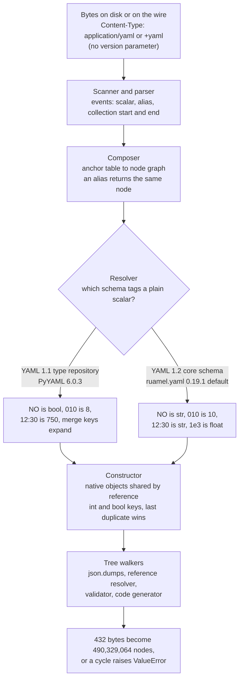

# YAML Media Type (RFC 9512) and OpenAPI YAML Hazards: YAML 1.1 vs 1.2, Anchor Bomb Billions-Laughs, and Key Coercion

> [!summary] Claim
> An OpenAPI document written in YAML has no single meaning until a loader picks a schema: `application/yaml` is version-independent by design `(RFC 9512 Section 3.1)`, PyYAML 6.0.3 types plain scalars with the YAML 1.1 type repository while YAML 1.2 loaders use the core schema, and aliases make the document a graph rather than a tree, so a contract is portable only when every re-typeable scalar is quoted, every key is a string, and the loader enforces byte, depth, and expanded-node limits before anything walks the result.

Part of [OpenAPI JSON Schema and Contracts](README.md) in [API Engineering](../README.md).

## TL;DR

A YAML loader runs four stages (scan and parse to events, compose a node graph, resolve a tag for each plain scalar, construct native objects), and the three OpenAPI hazards sit in the last three: aliases turn the document into a shared graph or a cycle, tag resolution depends on the YAML version the library implements, and construction coerces keys and keeps only the last duplicate.
The contract rule is that an OpenAPI Description should be YAML 1.2 restricted to what JSON can express `(OAS 3.2.1 Section 3.1)`, which by reference to `(RFC 9512 Section 3.4)` means avoiding the features that list flags as JSON interoperability problems (multi-document streams, non-UTF-8 encodings, non-string keys, cyclic references, `.inf` and `.nan`, non-JSON types, and tags that do not map to JSON types), and it requires status-code keys to be strings such as `"200"` `(OAS 3.2.1 Section 4.16)`.
The trap is that the same bytes are different documents in different tools: `enum: [SE, DK, NO, FI]` loads as `['SE', 'DK', False, 'FI']` under PyYAML and as four strings under a YAML 1.2 loader, `version: 3.10` loads as the float `3.1` under both, and the five permissive loaders in this book's lockfile read one ten-line probe five different ways while the lab's strict loader rejects it.
The portability fact is that these results are properties of the library, not of CPython: the drafting run reports the same 69 passes on CPython 3.12.13, 3.13.18, 3.14.6, 3.14.10, 3.15.2, and free-threaded 3.15.0b3 (verification re-ran only 3.14.6), while PyYAML 6.0.3 on 3.15 here is built without libyaml, which moves every tool onto the recursive pure-Python composer.
Do not accept YAML from untrusted clients or publish it as the machine contract at all when you control both ends: author in YAML if you like, convert once in CI to JSON, and serve `application/openapi+json` or plain `application/json`, because JSON has no aliases, no tags, no implicit typing, and string-only keys.

## Mental model



The first arrow carries only bytes and a media type that says "YAML" without saying which YAML, because the registration has no version parameter `(RFC 9512 Section 3.1)`.
The scanner and parser turn those bytes into an event stream that is nearly identical across libraries, so syntax is not where tools disagree.
The composer replaces every alias event with a reference to the node that carries the anchor, which makes the output a graph in which one node can have many parents or be its own ancestor `(RFC 9512 Section 4.2)`.
The resolver is the fork: a plain scalar such as `NO` has no type on the wire, and each library assigns one by matching regular expressions that differ between the YAML 1.1 type repository and the YAML 1.2 core schema `(YAML 1.2.2 Section 10.3.2)`.
The constructor then builds native objects once per node and shares them by reference, coerces mapping keys with the same resolver, and overwrites earlier duplicates.
Nothing has gone wrong in memory yet; the damage happens on the last arrow, when a serializer, a `$ref` resolver, a validator, or a code generator walks that graph as if it were a tree.

## How it works

### The media type: what `application/yaml` promises and what it does not

RFC 9512 (February 2024, Informational) registers the media type `application/yaml` and the structured syntax suffix `+yaml` `(RFC 9512 Section 2.1)` `(RFC 9512 Section 2.2)`.
The registration has no required parameters, states that "unrecognized parameters should be ignored", declares the encoding as `binary`, prefers the `yaml` filename extension over `yml`, and lists `application/x-yaml`, `text/yaml`, and `text/x-yaml` as deprecated aliases that "are used but are not registered" `(RFC 9512 Section 2.1)`.
The type and subtype tokens compare case-insensitively like every media type `(RFC 9110 Section 8.3.1)`, so `Application/YAML; charset=utf-8` is the registered type with a parameter the receiver should ignore.

A request that carries an OpenAPI document looks like this on the wire:

```text
POST /openapi/normalize HTTP/1.1
Host: api.example.test
Content-Type: application/openapi+yaml;version=3.1
Content-Length: 39

openapi: 3.1.0
info: {version: "1.10"}
```

Nothing in those 39 content bytes or in the header says whether the sender meant YAML 1.1 or YAML 1.2.
That is deliberate: the registration "is independent of the YAML version", and a sender that cares must say so inside the document with a `%YAML` directive `(RFC 9512 Section 3.1)`.
The consequence for an API is that content negotiation can select YAML over JSON but can never select a YAML schema, so the receiver's library version decides what `NO` means.

Three more rules from the registration matter for OpenAPI tooling:

- In a single-document stream, a fragment identifier on `application/yaml` that is empty or starts with `/` is a JSON Pointer `(RFC 6901 Section 3)` evaluated on the representation graph "traversing alias nodes", and one that starts with `*` names an alias node `(RFC 9512 Section 1.2)`.
- A `+yaml` media type does not inherit those fragment rules and must define its own `(RFC 9512 Section 2.2)`.
- A receiver that expects one document "should signal an error instead of ignoring the extra documents" when the stream holds several `(RFC 9512 Section 3.2)`.

The OpenAPI-specific media types are not registered yet.
The OpenAPI Specification uses `application/openapi+yaml` and `application/openapi+json` in its own examples `(OAS 3.2.1 Appendix F)` `(OAS 3.2.1 Appendix G)`, and their registration is the subject of `draft-ietf-httpapi-rest-api-mediatypes-09` (dated 23 May 2026, in working group last call `(as of 2026-11)`), which gives both an optional `version` parameter and records `application/vnd.oai.openapi` as a deprecated alias that "is used, but not registered".
The IANA `application` registry fetched for this note lists `application/yaml` with references `[YAML]; [RFC 9512]` and other `+yaml` types such as `application/asyncapi+yaml` and `application/vnd.oai.workflows+yaml`, but no `openapi+yaml` entry `(as of 2026-11)`.
Starlette and Litestar still emit the unregistered, suffix-less alias: `OpenAPIResponse.media_type = "application/vnd.oai.openapi"` `(starlette 1.10.0 starlette/schemas.py, OpenAPIResponse)` and `OPENAPI_YAML = "application/vnd.oai.openapi"` `(litestar 2.25.0 litestar/enums.py, OpenAPIMediaType)`.
A generic client cannot tell from that name that the body is YAML, which is exactly what the `+yaml` suffix exists to signal `(RFC 6838 Section 4.2.8)`.
FastAPI avoids the question by serving JSON only, at the default `openapi_url` of `/openapi.json` `(fastapi 0.162.0 fastapi/applications.py, FastAPI.__init__)`; see [[OpenAPI-Generation-Internals-in-FastAPI-Get-OpenAPI-and-Separate-Schemas]].

### Stage 1 and 2: events, anchors, and the node graph

The parser emits one event per syntactic element, and an alias is its own event that carries only an anchor name.
PyYAML's composer resolves that name against a per-document table and returns the node already built for the anchor (simplified excerpt from `(PyYAML 6.0.3 yaml/composer.py, Composer.compose_node)`):

```python
def compose_node(self, parent, index):
    if self.check_event(AliasEvent):
        event = self.get_event()
        anchor = event.anchor
        if anchor not in self.anchors:
            raise ComposerError(None, None, "found undefined alias %r" % anchor, event.start_mark)
        return self.anchors[anchor]
```

No copy is made, so after composition a node referenced by nine aliases is one node with nine parents.
The constructor preserves the sharing because it memoizes by node: `construct_object` returns `self.constructed_objects[node]` when the node was built before `(PyYAML 6.0.3 yaml/constructor.py, BaseConstructor.construct_object)`.
This is why the classic nine-level, nine-way alias bomb is cheap to load: the lab composes the 432-byte document into 28 nodes, and both PyYAML and ruamel.yaml return a structure in which `a8[0] is a7` and `a8[8] is a8[0]`.
The same mechanism makes cycles legal: `x: &x {y: *x}` loads as a dictionary that contains itself in both libraries, which matches the specification's statement that YAML documents "can contain reference cycles, so they can't be treated as simple trees" `(RFC 9512 Section 4.2)`.

The expansion is paid by whoever walks the graph as a tree.
`json.dumps` has no notion of shared references, so serializing level 4 of a five-level bomb turns 248 bytes of YAML into 428,103 bytes of JSON containing `9**5 = 59,049` copies of `"lol"`, and each further level multiplies the output by nine.
On a cycle the same call raises `ValueError: Circular reference detected`.
A `$ref` resolver, a JSON Schema validator, a diff tool, and a code generator are all tree walkers of this kind, which is why the specification lists "when trying to serialize it as JSON" and "when searching/identifying nodes using specifications based on the JSON data model" as the two places where the loop or the blow-up appears `(RFC 9512 Section 4.2)`.

The composer itself has one more limit.
`compose_node`, `compose_sequence_node`, and `compose_mapping_node` call each other once per nesting level, so under the default recursion limit of 1,000 PyYAML's pure-Python loader loads `"[" * 494 + "]" * 494` and raises `RecursionError` at depth 495, and ruamel.yaml's pure-Python loader fails at the same depth (one run of `uv run --frozen python` in `labs/`, CPython 3.14.6, macOS 27.3 arm64).
The parser underneath does not recurse: it is a state machine with an explicit `self.states` stack `(PyYAML 6.0.3 yaml/parser.py, Parser)`, and the lab's loader, which consumes `yaml.parse` events directly, builds a 1,100-level structure without error.
The scanner has its own per-token cost in deep flow collections, because it keeps one candidate "simple key" per open flow level and rescans that table on every token until entries age out after 1,024 characters `(PyYAML 6.0.3 yaml/scanner.py, Scanner.stale_possible_simple_keys)`, which mirrors the specification's 1,024-character lookahead bound for implicit keys `(YAML 1.2.2 Section 7.4.2)`.

### Stage 3: tag resolution, where YAML 1.1 and YAML 1.2 part ways

A plain (unquoted) scalar carries no tag, so the resolver assigns one.
PyYAML indexes a table of regular expressions by the scalar's first character and takes the first match `(PyYAML 6.0.3 yaml/resolver.py, BaseResolver.resolve)`.
Its table is the YAML 1.1 type repository (simplified excerpt from `(PyYAML 6.0.3 yaml/resolver.py, Resolver)`):

```python
Resolver.add_implicit_resolver(
        'tag:yaml.org,2002:bool',
        re.compile(r'''^(?:yes|Yes|YES|no|No|NO
                    |true|True|TRUE|false|False|FALSE
                    |on|On|ON|off|Off|OFF)$''', re.X),
        list('yYnNtTfFoO'))

Resolver.add_implicit_resolver(
        'tag:yaml.org,2002:int',
        re.compile(r'''^(?:[-+]?0b[0-1_]+
                    |[-+]?0[0-7_]+
                    |[-+]?(?:0|[1-9][0-9_]*)
                    |[-+]?0x[0-9a-fA-F_]+
                    |[-+]?[1-9][0-9_]*(?::[0-5]?[0-9])+)$''', re.X),
        list('-+0123456789'))
```

The integer expression is the one published in the YAML 1.1 integer type (working draft 2005-02-11): a leading `0` means octal, `_` is ignored, and `:` separates base-60 digits.
The constructor implements exactly that: `value.replace('_', '')`, `int(value, 8)` for a leading zero, and a base-60 accumulation when `:` is present `(PyYAML 6.0.3 yaml/constructor.py, SafeConstructor.construct_yaml_int)`.

YAML 1.2 replaced the type repository with three recommended schemas, and its core schema resolves plain scalars with this table, first match wins `(YAML 1.2.2 Section 10.3.2)`:

```text
null | Null | NULL | ~                                   -> null
/* Empty */                                              -> null
true | True | TRUE | false | False | FALSE               -> bool
[-+]? [0-9]+                                             -> int (base 10)
0o [0-7]+                                                -> int (base 8)
0x [0-9a-fA-F]+                                          -> int (base 16)
[-+]? ( \. [0-9]+ | [0-9]+ ( \. [0-9]* )? ) ( [eE] [-+]? [0-9]+ )?   -> float
[-+]? ( \.inf | \.Inf | \.INF )                          -> float (infinity)
\.nan | \.NaN | \.NAN                                    -> float (not a number)
*                                                        -> str
```

`yes`, `no`, `on`, `off`, base-60, binary, `_` separators, timestamps, the merge key `<<`, and the value key `=` are all gone, and octal needs the `0o` prefix.
The specification's own history section says the 1.2 revision "removed many of the problematic implicit typing recommendations" `(YAML 1.2.2 Section 1.2)`.

The lab loads each scalar with both libraries.
Every cell below is asserted by `test_plain_scalar_resolution_in_pyyaml_and_ruamel` or `test_six_loaders_read_one_document_six_ways`:

| Plain scalar in the document | PyYAML 6.0.3 `yaml.safe_load` | ruamel.yaml 0.19.1 `YAML(typ="safe")` | Why it matters in an OpenAPI document |
|---|---|---|---|
| `NO` | `False` | `'NO'` | A country-code `enum` or `default` loses Norway |
| `on` | `True` | `'on'` | A property named `on` becomes the key `True` |
| `y` | `'y'` | `'y'` | PyYAML never implemented the single-letter booleans |
| `3.10` | `3.1` | `3.1` | A version string is a float in both versions |
| `1.0` | `1.0` | `1.0` | `info.version: 1.0` is not a string in either |
| `3.1.0` | `'3.1.0'` | `'3.1.0'` | Two dots are safe, which is why `openapi: 3.1.0` works unquoted |
| `1e3` | `'1e3'` | `1000.0` | PyYAML requires a `.` in the mantissa |
| `010` | `8` | `10` | A ZIP or account-number example changes value |
| `08` | `'08'` | `8` | Not valid octal in 1.1, decimal in 1.2 |
| `0o17` | `'0o17'` | `15` | The 1.2 octal spelling is a string in 1.1 |
| `12:30` | `750` | `'12:30'` | A time-of-day example becomes base-60 |
| `12:30:00` | `45000` | `'12:30:00'` | Same, three digits |
| `-.5` | `'-.5'` | `-0.5` | PyYAML's leading-dot float has no sign |
| `2026-11-11` | `datetime.date(2026, 11, 11)` | `datetime.date(2026, 11, 11)` | Neither result is JSON |

Three rows deserve a second look because they contradict the usual one-line summary of the problem.
First, `3.10` is not a YAML 1.1 problem: both schemas define it as a float, so no loader upgrade fixes an unquoted version string.
Second, PyYAML is not a complete YAML 1.1 implementation: the boolean type page lists `y|Y|yes|Yes|YES|n|N|no|No|NO|...`, PyYAML's expression omits `y`, `Y`, `n`, and `N`, and its `bool_values` table has only `yes`, `no`, `true`, `false`, `on`, and `off` `(PyYAML 6.0.3 yaml/constructor.py, SafeConstructor.bool_values)`.
That is why the example in `(RFC 9512 Section 4.4)`, `{insecure: n}`, loads as the string `'n'` in PyYAML but as `False` in a loader that follows the type page, such as ruamel.yaml under `%YAML 1.1`.
Third, ruamel.yaml is not a pure core-schema implementation either: its 1.2 resolver still accepts `0b101` as `5`, `1_000` as `1000`, and signed hex, and it keeps the merge, timestamp, and value resolvers for both versions `(ruamel.yaml 0.19.1 ruamel/yaml/resolver.py, implicit_resolvers)`.

The `%YAML` directive is the only in-band version signal, and the two libraries handle it in opposite ways.
PyYAML records the directive and rejects only a major version other than 1 `(PyYAML 6.0.3 yaml/parser.py, Parser.process_directives)`, and the lab shows that `%YAML 1.2` followed by `b: NO` still yields `False`.
ruamel.yaml defaults to `(1, 2)` `(ruamel.yaml 0.19.1 ruamel/yaml/compat.py, _DEFAULT_YAML_VERSION)` and switches its whole resolver table to 1.1 when the document says `%YAML 1.1` `(ruamel.yaml 0.19.1 ruamel/yaml/resolver.py, VersionedResolver.processing_version)`, so under that directive `a: y` is `True` in ruamel.yaml and `'y'` in PyYAML.
A `%YAML 1.3` directive is accepted by PyYAML and raises `AssertionError: version minor part can only be 2 or 1, got (1, 3)` in ruamel.yaml, although the specification asks a 1.2 processor to process a higher minor version "with an appropriate warning" `(YAML 1.2.2 Section 6.8.1)`.

Explicit tags do not remove the ambiguity.
`a: !!int 010` is `8` in PyYAML and `10` in ruamel.yaml, because the tag selects the constructor and the constructor still applies its own version's spelling rules.
The non-specific tag `!` is worse: the specification resolves a `!`-tagged scalar to a string `(YAML 1.2.2 Section 10.1.2)`, but both libraries treat `!` as if no tag were present, so `a: ! 12` is the integer `12` in both and `a: ! NO` is `False` in one and `'NO'` in the other.

### Stage 4: construction, keys, merges, duplicates, and tags

Mapping keys are ordinary nodes, so they are resolved and constructed like values.
An unquoted `200:` under `responses` is an integer key under both YAML versions, because both schemas type `200` as an integer.
An unquoted `on:` is the key `True` under YAML 1.1, `null:` is the key `None`, and a date-shaped key is a `datetime.date`.
JSON has only string member names, so `json.dumps` coerces: `200` becomes `"200"`, `True` becomes `"true"`, `None` becomes `"null"`, and a date key raises `TypeError`.
That coercion collides: a mapping that holds both `200` and `"200"` serializes to an object with two `"200"` members, which violates "the names within an object SHOULD be unique" `(RFC 8259 Section 4)`, and reading it back keeps one of them.
With `sort_keys=True` the same mapping raises `TypeError` because `str` and `int` do not order.

OpenAPI has always forbidden this.
OpenAPI 3.0.4 and 3.1.2 say "Keys used in YAML maps MUST be limited to a scalar string, as defined by the YAML Failsafe schema ruleset" `(OAS 3.1.2 Section 4.2)`, and the Responses Object says the status code "MUST be enclosed in quotation marks (for example, "200") for compatibility between JSON and YAML" `(OAS 3.1.2 Section 4.8.16)`.
OpenAPI 3.2.1 rewrote the format section to point at the RFC: "YAML version 1.2 is RECOMMENDED along with the additional constraints listed in [RFC9512] Section 3.4", and it adds that the older "JSON schema ruleset" wording "allowed for the inclusion of certain values that (despite the name) cannot be represented in JSON" `(OAS 3.2.1 Section 3.1)`.

Duplicate keys are the quiet failure.
The specification requires mapping keys to be unique `(YAML 1.2.2 Section 3.2.1.1)` and lists "mapping keys may not be unique" among the loading failure points `(YAML 1.2.2 Section 3.3)`.
PyYAML does not check: the duplicate test in `compose_mapping_node` is commented out `(PyYAML 6.0.3 yaml/composer.py, Composer.compose_mapping_node)`, and the constructor runs `mapping[key] = value` in document order `(PyYAML 6.0.3 yaml/constructor.py, BaseConstructor.construct_mapping)`, so the last entry wins.
A `paths` map with `/pets` defined twice therefore loads with only the second Path Item, and the `get` operation on the first one disappears without a warning.
ruamel.yaml raises `DuplicateKeyError` for the same input `(ruamel.yaml 0.19.1 ruamel/yaml/constructor.py, BaseConstructor.check_mapping_key)`.

The merge key is a YAML 1.1 type ("Specify one or more mappings to be merged with the current one", working draft 2005-01-18) that never entered YAML 1.2, yet both libraries implement it in their safe loaders.
PyYAML implements it by copying key-value node pairs from every merged mapping into the current one before construction (simplified excerpt from `(PyYAML 6.0.3 yaml/constructor.py, SafeConstructor.flatten_mapping)`):

```python
if key_node.tag == 'tag:yaml.org,2002:merge':
    del node.value[index]
    if isinstance(value_node, MappingNode):
        self.flatten_mapping(value_node)
        merge.extend(value_node.value)
    elif isinstance(value_node, SequenceNode):
        submerge = []
        for subnode in value_node.value:
            self.flatten_mapping(subnode)
            submerge.append(subnode.value)
        submerge.reverse()
        for value in submerge:
            merge.extend(value)
```

Unlike a plain alias, this copies, and the copies compound: a chain in which each level merges the previous level twice doubles the pair list per level.
The lab composes a 12-level chain of 296 bytes and finds `2**11 = 2,048` pairs in the last mapping after `construct_document`, for a result that is just `{'k': 'v'}`.
So `yaml.safe_load` is not safe against a merge-key bomb: the cost is paid at load time, inside the library, before any application limit can run.
Merge keys also break JSON Pointer addressing, which is why the specification warns that "the YAML version and supported features (e.g., merge keys) can affect the generation of the representation graph" `(RFC 9512 Section 3.5)`.

Tags are the last construction hazard.
`yaml.safe_load` refuses language-specific tags but still constructs non-JSON types from standard ones: `!!binary` gives `bytes`, `!!set` gives a `set`, and an untagged ISO date gives a `datetime.date`.
`yaml.load` without a `Loader` argument is a `TypeError` in PyYAML 6 `(PyYAML 6.0.3 yaml/__init__.py, load)`.
`yaml.full_load` still resolves `!!python/name:` tags to live objects for any module already present in `sys.modules` `(PyYAML 6.0.3 yaml/constructor.py, FullConstructor.find_python_name)`; the lab confirms that `x: !!python/name:os.system` returns the `system` function.
The specification's guidance is that "code execution in deserializers should be disabled by default and only be enabled explicitly" `(RFC 9512 Section 4.1)`.

### How the pinned OpenAPI tools patch the loader

Every OpenAPI tool pinned in this workspace knows about some of this and patches a different subset.
The lab loads one probe document with five permissive loaders and with its own gate:

```yaml
country: NO
flag: on
version: 3.10
rate: 1e3
zip: 010
window: 12:30
day: 2026-11-11
responses:
  200: ok
  on: x
```

| Loader | `country` | `rate` | `zip` | `window` | `day` | `responses` keys |
|---|---|---|---|---|---|---|
| PyYAML 6.0.3 `yaml.safe_load` | `False` | `'1e3'` | `8` | `750` | `date` | `200`, `True` |
| ruamel.yaml 0.19.1 `YAML(typ="safe")` | `'NO'` | `1000.0` | `10` | `'12:30'` | `date` | `200`, `'on'` |
| schemathesis 4.33.1 `deserialize_yaml` | `'NO'` | `1000.0` | `8` | `750` | `'2026-11-11'` | `'200'`, `'on'` |
| jsonschema-path 0.5.0 `JsonschemaSafeLoader` | `False` | `1000.0` | `8` | `750` | `'2026-11-11'` | `200`, `True` |
| datamodel-code-generator 0.89.0 `get_safe_loader()` | `'NO'` | `1000.0` | `8` | `750` | `'2026-11-11'` | `200`, `'on'` |
| lab `load_openapi_yaml` | rejects the document at `/country` with `version-dependent-scalar` | | | | | |

`version` is `3.1` in all five permissive loaders.
The patches explain the columns:

- Schemathesis subclasses PyYAML's safe loader, drops the timestamp and boolean resolvers, re-adds a `true`/`false`-only boolean, adds a float pattern for exponents without a dot, and overrides `construct_mapping` so that any key whose tag is not `str` keeps its source text `(schemathesis 4.33.1 schemathesis/core/deserialization.py, get_yaml_loader)`.
  It still inherits YAML 1.1 octal and base-60.
- jsonschema-path, which `openapi-spec-validator 0.9.0` uses to read files, removes only the timestamp resolver and adds the exponent float `(jsonschema-path 0.5.0 jsonschema_path/loaders.py, JsonschemaSafeLoader)`, then round-trips through `loads(dumps(data))` `(jsonschema-path 0.5.0 jsonschema_path/handlers/file.py, FileHandler.__call__)`.
  It keeps YAML 1.1 booleans, so it reads `NO` as `False`, and the JSON round trip turns the keys `200` and `True` into `"200"` and `"true"`.
- datamodel-code-generator replaces the boolean resolver with the YAML 1.2 set, maps the timestamp tag to the string constructor, and adds the exponent float `(datamodel-code-generator 0.89.0 datamodel_code_generator/util.py, get_safe_loader)`; see [[Generating-Pydantic-v2-Models-from-OpenAPI-with-Datamodel-Code-Generator]].
- openapi-python-client loads with `YAML(typ="safe")` from ruamel.yaml, the YAML 1.2 column `(openapi-python-client 0.29.1 openapi_python_client/__init__.py, _load_yaml_or_json)`; see [[Generating-Typed-Async-SDKs-with-OpenAPI-Python-Client-and-OpenAPI-Generator]].

A pipeline that lints with one of these, generates models with another, and fuzzes with a third is therefore checking three different contracts unless the source text is restricted to scalars they all read the same way.

### The emit side: round trips are not symmetric

An emitter decides whether to quote a string by asking its own resolver whether the plain form would be re-typed.
PyYAML's serializer computes `detected_tag = self.resolve(ScalarNode, node.value, (True, False))` and marks the scalar implicit only when that equals the node's tag `(PyYAML 6.0.3 yaml/serializer.py, Serializer.serialize_node)`.
It therefore quotes `'NO'`, `'010'`, and `'12:30'`, but it writes the strings `1e3`, `0o17`, `08`, and `-.5` unquoted, because its YAML 1.1 resolver sees them as strings.
A YAML 1.2 reader then loads those four as `1000.0`, `15`, `8`, and `-0.5`.
ruamel.yaml makes the mirror-image choice and writes the strings `NO`, `on`, and `12:30` unquoted, which PyYAML reads back as `False`, `True`, and `750`.
Starlette's `OpenAPIResponse.render` and Litestar's `YamlRenderPlugin.render` both emit with PyYAML's `yaml.dump(..., default_flow_style=False)` `(starlette 1.10.0 starlette/schemas.py, OpenAPIResponse)` `(litestar 2.25.0 litestar/openapi/plugins.py, YamlRenderPlugin)`, so a schema that contains the string example `"1e3"` is served in a form a YAML 1.2 client misreads.
Re-encoding also changes anchors, document markers, and other serialization details, which "can break signature validation" `(RFC 9512 Section 4.3)`.

### The gate: a loader that accepts only what every reader agrees on

The lab's `load_openapi_yaml` is the constructive answer.
It consumes PyYAML's event stream with an explicit stack, so it never composes a node graph, never calls a constructor, and never recurses.
For each plain scalar it computes the YAML 1.2 core-schema value with its own table and the YAML 1.1 value with PyYAML's own resolver table and `SafeConstructor`, and it rejects the scalar when the two differ.
It charges every alias the full expanded size of its target against a node budget, tracks the height of every anchored collection so an alias cannot exceed the depth limit, and refuses cycles, undefined aliases, and reused anchors.
Each rejection carries a code and a JSON Pointer:

| Code | Rejected construct | Rule it enforces |
|---|---|---|
| `too-large`, `too-deep`, `node-budget` | Stream bytes, nesting depth (including through aliases), expanded node count | `(RFC 9512 Section 4.2)` resource exhaustion |
| `cyclic-alias`, `undefined-alias`, `duplicate-anchor` | An alias inside its own anchor, an alias with no anchor, an anchor name defined twice | `(RFC 9512 Section 3.4)` cyclic references; PyYAML rejects reused anchors while the specification allows them, an alias referring to "the most recent preceding node having the same anchor" `(YAML 1.2.2 Section 7.1)` |
| `version-dependent-scalar` | A plain or explicitly tagged scalar whose YAML 1.1 and YAML 1.2 values differ | `(RFC 9512 Section 4.4)` and `(YAML 1.2.2 Section 10.3.2)` |
| `non-string-key`, `duplicate-key`, `merge-key` | Integer, boolean, null, or collection keys; repeated keys; a plain `<<` key | `(RFC 9512 Section 3.4)` and `(OAS 3.1.2 Section 4.2)` |
| `tag` | Any tag outside `!!str`, `!!int`, `!!float`, `!!bool`, `!!null`, `!!seq`, `!!map`, including the non-specific `!` | `(RFC 9512 Section 3.4)` tags that do not map to JSON types |
| `non-json-float` | `.inf`, `-.inf`, `.nan` | `(RFC 8259 Section 6)` |
| `multi-document`, `empty`, `yaml-version` | A second document, no document, a `%YAML` directive other than `1.2` | `(RFC 9512 Section 3.2)` and `(RFC 9512 Section 3.1)` |
| `unloadable-number`, `syntax` | A number CPython refuses to convert, malformed YAML | Converts library exceptions into one error type |

The companion `find_mistyped_string_literals` covers the hazard that no YAML-level rule can see: a literal that both versions agree on but that contradicts its schema, such as `enum: [3.9, 3.10, 3.11]` under `type: string`.

## Numbers and limits

| Parameter or metric | Value | Source or measurement context |
|---|---|---|
| Media type registration | `application/yaml` and `+yaml`, RFC 9512, February 2024; suffix registry entry dated 2023-06-02 | `(RFC 9512 Section 5)` and the IANA structured syntax suffix registry `(as of 2026-11)` |
| Deprecated aliases | 3: `application/x-yaml`, `text/yaml`, `text/x-yaml` | `(RFC 9512 Section 2.1)` |
| OpenAPI releases compared | 3.0.4 (24 October 2024), 3.1.2 (19 September 2025), 3.2.1 (10 September 2026) | Dates printed on each specification page `(as of 2026-11)` |
| Implicit-key lookahead | 1,024 Unicode characters | `(YAML 1.2.2 Section 7.4.2)`; enforced in `(PyYAML 6.0.3 yaml/scanner.py, Scanner.stale_possible_simple_keys)` |
| Alias bomb, 9 levels x 9 aliases | 432 bytes -> 28 graph nodes -> 490,329,064 tree nodes | Lab `measure_expansion`, asserted in `test_alias_bomb_is_a_28_node_graph_until_something_walks_it_as_a_tree` (CPython 3.14.6, macOS 27.3 arm64) |
| Alias bomb serialized with `json.dumps` | 5 levels: 248 B -> 428,103 B (1,726x); 6 levels: 294 B -> 3,852,945 B (13,105x); 7 levels: 340 B -> 34,676,523 B (101,990x) | 5-level figure asserted in the lab; 6 and 7 measured ad hoc with `uv run --frozen python` in `labs/` (CPython 3.14.6, macOS 27.3 arm64, PyYAML 6.0.3); each level follows `L(k) = 9 * L(k-1) + 18` with `L(0) = 63` |
| Merge-key bomb pair count | 12 levels, 296 bytes -> `2**11 = 2,048` key-value pairs copied for a one-key result | Asserted in `test_merge_keys_copy_entries_exponentially_inside_safe_load` |
| Merge-key bomb load time in `yaml.safe_load` | 16 levels (412 B): 17 ms; 18 (470 B): 65 ms; 20 (528 B): 257 ms; 22 (586 B): 1,013 ms | One ad hoc `time.perf_counter` run each with `uv run --frozen python` in `labs/` (CPython 3.14.6, macOS 27.3 arm64, PyYAML 6.0.3 with libyaml); the roughly fourfold growth per two levels is the claim, the absolute times are noisy |
| PyYAML pure-Python nesting limit | `[` nested 494 deep loads; 495 deep raises `RecursionError` at `sys.getrecursionlimit() == 1000`, in both PyYAML and ruamel.yaml | Ad hoc run with `uv run --frozen python` in `labs/` (CPython 3.14.6, macOS 27.3 arm64); the lab asserts the failure at depth 1,100 for PyYAML and ruamel.yaml |
| PyYAML libyaml nesting limit | `CSafeLoader` loads depth 10,000; depth 100,000 raises `RecursionError: Stack overflow (used 8144 kB)` | Ad hoc run (CPython 3.14.6, macOS 27.3 arm64, PyYAML 6.0.3 with libyaml) |
| CPython integer-string conversion cap | 4,300 digits; a 5,000-digit plain integer raises `ValueError`, not `yaml.YAMLError` | Error text `Exceeds the limit (4300 digits) for integer string conversion: value has 5000 digits` re-observed on CPython 3.14.6 for both libraries; asserted in `test_oversized_integers_escape_safe_load_as_value_error_not_yaml_error` |
| Lab gate defaults | `max_bytes = 1,048,576`, `max_depth = 64`, `max_nodes = 100,000` | Design choices in `Limits`; the 9x9 bomb trips `node-budget` at `/a5/0` |
| go-yaml alias guard | Fails when more than 100 alias-derived decodes, more than 1,000 decodes, and the alias ratio exceeds a bound that falls from 0.99 at 400,000 decodes to 0.10 at 4,000,000 | `(go-yaml v3.0.1 decode.go, allowedAliasRatio)` `(as of 2026-11)` |
| SnakeYAML loader defaults | `maxAliasesForCollections = 50`, `nestingDepthLimit = 50`, `codePointLimit = 3 * 1024 * 1024`, `allowDuplicateKeys = true`, `allowRecursiveKeys = false` | `(SnakeYAML snakeyaml-2.5 src/main/java/org/yaml/snakeyaml/LoaderOptions.java, LoaderOptions)`; the `master` branch (2.8-SNAPSHOT) has the same defaults `(as of 2026-11)` |
| `yaml` (npm, eemeli) defaults | `maxAliasCount = 100`, `uniqueKeys = true`, default `version` `1.2` | Maintainer documentation at `eemeli.org/yaml` `(as of 2026-11)` |
| CVSS base scores | CVE-2019-11253: 7.5; CVE-2017-18640: 7.5; CVE-2017-18342: 9.8; CVE-2020-1747: 9.8; CVE-2020-14343: 9.8; CVE-2022-1471: 9.8 (NVD) and 8.3 (CNA) | NVD CVE API records `(as of 2026-11)` |

## Portability

Every "69 passed" below is a run of `tests/f08_openapi_json_schema_and_contracts/test_yaml_media_type_rfc_9512_and_openapi_yaml_parser_hazards.py` on macOS 27.2 arm64 made by the drafting run on 2026-11-10.
Verification re-ran only the CPython 3.14.6 workspace leg (69 passed on macOS 27.3 arm64); the other interpreter legs were not re-executed because lab matrix runs are paused.

| Leg | Plain-scalar schema | `NO` | `010` | Duplicate key | Alias bomb at load | Evidence |
|---|---|---|---|---|---|---|
| CPython 3.12.13, 3.13.18, 3.14.6, 3.14.10 with PyYAML 6.0.3 (`yaml.__with_libyaml__ == True`) | YAML 1.1 type repository | `False` | `8` | Last wins, silently | 28 nodes, shared | 69 passed on each of the four interpreters with the locked workspace |
| CPython 3.15.2 with PyYAML 6.0.3 (`yaml.__with_libyaml__ == False`) | Same | `False` | `8` | Same | Same | 69 passed with the locked workspace; PyYAML has no `cp315` wheel on PyPI `(as of 2026-11)`, so `CSafeLoader` is absent and every tool falls back to the recursive pure-Python loader |
| CPython 3.15.0b3 free-threaded (`sys._is_gil_enabled() == False`) | Same | `False` | `8` | Same | Same | 69 passed in a minimal environment of the same pins with `-p no:schemathesis -p no:hypothesispytest`; the locked workspace cannot install there (`psycopg-binary 3.3.8` has no wheel) and the Hypothesis plugin fails with `ModuleNotFoundError: No module named 'hypothesis._native'` |
| CPython 3.12.16, 3.15.2t, Debian Trixie, Alpine musl | Not run | Not run | Not run | Not run | Not run | Those interpreters and container images were not available to this run |
| ruamel.yaml 0.19.1 `YAML(typ="safe", pure=True)` | YAML 1.2 core schema plus `0b`, `_`, merge, timestamp, and value leftovers; switches to 1.1 on `%YAML 1.1` | `'NO'` | `10` | `DuplicateKeyError` | Shared | Same 69 tests on every leg above |
| schemathesis 4.33.1 `deserialize_yaml` | YAML 1.1 numbers, YAML 1.2 booleans, no timestamps, non-string keys kept as source text | `'NO'` | `8` | Last wins | Shared (PyYAML constructor) | `test_six_loaders_read_one_document_six_ways` and `(schemathesis 4.33.1 schemathesis/core/deserialization.py, get_yaml_loader)` |
| jsonschema-path 0.5.0 (reader for openapi-spec-validator 0.9.0) | YAML 1.1 including booleans, no timestamps | `False` | `8` | Last wins | Expanded by its `loads(dumps(data))` round trip | Same test and `(jsonschema-path 0.5.0 jsonschema_path/handlers/file.py, FileHandler.__call__)` |
| datamodel-code-generator 0.89.0 `get_safe_loader()` | YAML 1.1 numbers, YAML 1.2 booleans, timestamps as strings | `'NO'` | `8` | Last wins | Shared | Same test and `(datamodel-code-generator 0.89.0 datamodel_code_generator/util.py, get_safe_loader)` |
| openapi-python-client 0.29.1 | ruamel.yaml `YAML(typ="safe")` | `'NO'` | `10` | `DuplicateKeyError` | Shared | `(openapi-python-client 0.29.1 openapi_python_client/__init__.py, _load_yaml_or_json)` |
| go-yaml v3.0.1, SnakeYAML, `yaml` (npm) | Not run here | Not run | Not run | SnakeYAML allows by default; `yaml` (npm) rejects by default | Bounded by an alias ratio, 50 aliases for collections, and 100 aliases respectively | `(go-yaml v3.0.1 decode.go, allowedAliasRatio)`, SnakeYAML `LoaderOptions.java`, and the `yaml` documentation `(as of 2026-11)` |
| Uvicorn 0.54.0, Hypercorn 0.18.0, Granian 2.8.7 | Not applicable: no server parses request content as YAML | Not applicable | Not applicable | Not applicable | Not applicable | The byte cap in the lab is application code reading the ASGI body stream; Uvicorn's only YAML use is `yaml.safe_load` on a `--log-config` file `(uvicorn 0.54.0 uvicorn/config.py, Config.configure_logging)`; `hypercorn` and `granian` contain no YAML import |
| HTTP/1.1, HTTP/2, HTTP/3 | Not applicable: `Content-Type` is version-independent HTTP semantics | Same | Same | Same | Same | `(RFC 9110 Section 8.3)`; the lab endpoint tests ran through the in-process `httpx.ASGITransport` only, and no HTTP/2 or HTTP/3 leg was run |

## Worked example

The lab is [implementation](../labs/src/api_labs/f08_openapi_json_schema_and_contracts/yaml_hazards.py) and [test](../labs/tests/f08_openapi_json_schema_and_contracts/test_yaml_media_type_rfc_9512_and_openapi_yaml_parser_hazards.py).
The implementation wraps the two real loaders (`load_yaml_1_1`, `load_yaml_1_2`), reports where they disagree as JSON Pointers (`resolution_divergences`), sizes a document as a graph and as a tree (`measure_expansion`), implements the gate (`load_openapi_yaml`), finds schema-level mistyped literals (`find_mistyped_string_literals`), classifies media types per RFC 9512 (`classify_yaml_media_type`), and exposes the gate as `POST /openapi/normalize` on a Starlette application with `415`, `413`, `400`, and `422` problem responses `(RFC 9457 Section 3)`.
`measure_expansion` composes with PyYAML and therefore shares the composer's recursion limit; the gate does not.

Full byte-identical source of [implementation](../labs/src/api_labs/f08_openapi_json_schema_and_contracts/yaml_hazards.py):

```python
"""YAML parser hazards for OpenAPI documents: YAML 1.1 vs 1.2, alias expansion, key coercion.

PyYAML resolves plain scalars with the YAML 1.1 type repository and ruamel.yaml defaults to
YAML 1.2, so the same OpenAPI text loads as two different documents.  `load_openapi_yaml` is
the gate: it reads PyYAML's event stream (no composer, no constructor, no recursion) and
accepts only the JSON-compatible subset that both versions read identically (RFC 9512
Section 3.4).
"""

from __future__ import annotations

import math
import re
from dataclasses import dataclass
from typing import TYPE_CHECKING, Any, Final, Literal, cast

import ruamel.yaml
import yaml as _pyyaml  # type: ignore[import-untyped]
from starlette.applications import Starlette
from starlette.responses import JSONResponse
from starlette.routing import Route

if TYPE_CHECKING:
    from starlette.requests import Request

# Neither library is fully annotated, so both are used through explicit Any handles.
yaml: Any = _pyyaml
_ruamel: Any = ruamel.yaml

type JsonValue = bool | int | float | str | list[JsonValue] | dict[str, JsonValue] | None
type YamlMediaType = Literal["registered", "suffix", "deprecated-alias"]

_TAG_PREFIX: Final = "tag:yaml.org,2002:"
_DEPRECATED_ALIASES: Final = frozenset({"application/x-yaml", "text/yaml", "text/x-yaml"})
_LITERAL_KEYWORDS: Final = ("const", "default", "example")
_LITERAL_LIST_KEYWORDS: Final = ("enum", "examples")

# YAML 1.2.2 Section 10.3.2 (core schema), first match wins.
_CORE_NULL: Final = re.compile(r"null|Null|NULL|~|")
_CORE_BOOL: Final = re.compile(r"true|True|TRUE|false|False|FALSE")
_CORE_INT: Final = re.compile(r"[-+]?[0-9]+")
_CORE_OCT: Final = re.compile(r"0o[0-7]+")
_CORE_HEX: Final = re.compile(r"0x[0-9a-fA-F]+")
_CORE_FLOAT: Final = re.compile(r"[-+]?(\.[0-9]+|[0-9]+(\.[0-9]*)?)([eE][-+]?[0-9]+)?")
_CORE_INF: Final = re.compile(r"[-+]?(\.inf|\.Inf|\.INF)")
_CORE_NAN: Final = re.compile(r"\.nan|\.NaN|\.NAN")


class YamlHazardError(ValueError):
    """A YAML construct that is unsafe, not JSON-compatible, or YAML-version dependent."""

    def __init__(self, code: str, pointer: str, detail: str) -> None:
        super().__init__(f"{code} at {pointer!r}: {detail}")
        self.code = code
        self.pointer = pointer
        self.detail = detail


@dataclass(frozen=True, slots=True)
class Limits:
    """Resource bounds enforced before and during loading."""

    max_bytes: int = 1_048_576
    max_depth: int = 64
    max_nodes: int = 100_000


@dataclass(frozen=True, slots=True)
class Divergence:
    """One place where the YAML 1.1 and YAML 1.2 loads of the same text differ."""

    kind: Literal["key", "value"]
    pointer: str
    yaml_1_1: str
    yaml_1_2: str


@dataclass(frozen=True, slots=True)
class ExpansionReport:
    """Size of a document as the graph a loader builds and as the tree a serializer walks."""

    stream_bytes: int
    graph_nodes: int
    tree_nodes: int | None
    cyclic: bool


@dataclass(slots=True)
class _Frame:
    container: dict[str, JsonValue] | list[JsonValue]
    pointer: str
    anchor: str | None
    nodes_before: int
    key: str | None = None
    height: int = 1


def load_yaml_1_1(text: str) -> object:
    """Load with PyYAML's safe loader, which resolves plain scalars by YAML 1.1 rules."""
    return yaml.safe_load(text)


def load_yaml_1_2(text: str) -> object:
    """Load with ruamel.yaml's pure-Python safe loader, which defaults to YAML 1.2."""
    return _ruamel.YAML(typ="safe", pure=True).load(text)


def _escape(token: str) -> str:
    return token.replace("~", "~0").replace("/", "~1")


def _mapping(value: object) -> dict[object, object] | None:
    return cast("dict[object, object]", value) if isinstance(value, dict) else None


def _sequence(value: object) -> list[object] | None:
    return cast("list[object]", value) if isinstance(value, list) else None


def resolution_divergences(text: str) -> tuple[Divergence, ...]:
    """Return every key and value that the YAML 1.1 and YAML 1.2 loaders read differently."""
    found: list[Divergence] = []
    stack: list[tuple[str, object, object]] = [("", load_yaml_1_1(text), load_yaml_1_2(text))]
    while stack:
        pointer, old, new = stack.pop()
        old_map, new_map = _mapping(old), _mapping(new)
        old_seq, new_seq = _sequence(old), _sequence(new)
        if old_map is not None and new_map is not None and len(old_map) == len(new_map):
            for (old_key, old_value), (new_key, new_value) in zip(
                old_map.items(), new_map.items(), strict=True
            ):
                if repr(old_key) != repr(new_key):
                    found.append(Divergence("key", pointer, repr(old_key), repr(new_key)))
                stack.append((f"{pointer}/{_escape(str(new_key))}", old_value, new_value))
        elif old_seq is not None and new_seq is not None and len(old_seq) == len(new_seq):
            for index, (old_item, new_item) in enumerate(zip(old_seq, new_seq, strict=True)):
                stack.append((f"{pointer}/{index}", old_item, new_item))
        elif repr(old) != repr(new):
            found.append(Divergence("value", pointer, repr(old), repr(new)))
    return tuple(sorted(found, key=lambda item: (item.pointer, item.kind)))


def resolve_core_schema(text: str) -> bool | int | float | str | None:
    """Resolve one plain scalar by the YAML 1.2.2 core schema (Section 10.3.2)."""
    if _CORE_NULL.fullmatch(text):
        return None
    if _CORE_BOOL.fullmatch(text):
        return text.lower() == "true"
    if _CORE_INT.fullmatch(text):
        return int(text)
    if _CORE_OCT.fullmatch(text):
        return int(text[2:], 8)
    if _CORE_HEX.fullmatch(text):
        return int(text[2:], 16)
    if _CORE_FLOAT.fullmatch(text):
        return float(text)
    if _CORE_INF.fullmatch(text):
        return float("-inf") if text.startswith("-") else float("inf")
    if _CORE_NAN.fullmatch(text):
        return float("nan")
    return text


def resolve_yaml_1_1(text: str) -> object:
    """Resolve one plain scalar exactly as PyYAML does: its resolver table, then its constructor."""
    tag = f"{_TAG_PREFIX}str"
    table = yaml.SafeLoader.yaml_implicit_resolvers
    for candidate, pattern in table.get(text[:1], []) + table.get(None, []):
        if pattern.match(text):
            tag = candidate
            break
    return yaml.constructor.SafeConstructor().construct_object(yaml.ScalarNode(tag, text))


def measure_expansion(text: str) -> ExpansionReport:
    """Count the nodes of the composed graph and of the tree an alias-blind walker would visit.

    The graph comes from PyYAML's recursive composer, so input nested past the interpreter's
    recursion limit raises RecursionError here; `load_openapi_yaml` has no such limit.
    """
    root = yaml.compose(text, Loader=yaml.SafeLoader)
    if root is None:
        return ExpansionReport(len(text.encode("utf-8")), 0, 0, cyclic=False)
    sizes: dict[int, int] = {}
    open_nodes: set[int] = set()
    cyclic = False
    stack: list[tuple[Any, bool]] = [(root, False)]
    while stack:
        node, children_done = stack.pop()
        ident = id(node)
        children: list[Any] = []
        if isinstance(node, yaml.SequenceNode):
            children = list(node.value)
        elif isinstance(node, yaml.MappingNode):
            children = [child for pair in node.value for child in pair]
        if children_done:
            open_nodes.discard(ident)
            sizes[ident] = 1 + sum(sizes.get(id(child), 0) for child in children)
        elif ident in open_nodes:
            cyclic = True
        elif ident not in sizes:
            open_nodes.add(ident)
            stack.append((node, True))
            stack.extend((child, False) for child in children)
    return ExpansionReport(
        stream_bytes=len(text.encode("utf-8")),
        graph_nodes=len(sizes),
        tree_nodes=None if cyclic else sizes[id(root)],
        cyclic=cyclic,
    )


def _yaml_1_1_repr(text: str) -> str:
    try:
        return repr(resolve_yaml_1_1(text))
    except yaml.YAMLError:
        return "not constructible"


def _resolve_scalar(event: Any, pointer: str) -> JsonValue:
    """Turn one scalar event into a JSON value, or raise for anything outside the subset."""
    text: str = event.value
    tag: str | None = event.tag
    if tag == f"{_TAG_PREFIX}str" or (tag is None and event.style is not None):
        return text
    try:
        value = resolve_core_schema(text)
        current, legacy = repr(value), _yaml_1_1_repr(text)
    except ValueError as error:
        raise YamlHazardError("unloadable-number", pointer, str(error)) from error
    resolved = "null" if value is None else type(value).__name__
    if tag is not None and tag != f"{_TAG_PREFIX}{resolved}":
        raise YamlHazardError("tag", pointer, f"{text!r} tagged {tag!r} is outside the JSON schema")
    if legacy != current:
        raise YamlHazardError(
            "version-dependent-scalar",
            pointer,
            f"plain scalar {text!r} is {legacy} in YAML 1.1 and {current} in YAML 1.2",
        )
    if isinstance(value, float) and not math.isfinite(value):
        raise YamlHazardError("non-json-float", pointer, f"{text!r} has no JSON representation")
    return value


def load_openapi_yaml(text: str, limits: Limits | None = None) -> JsonValue:
    """Load one YAML document as JSON-compatible data, rejecting every hazard with a pointer."""
    bounds = limits if limits is not None else Limits()
    if len(text.encode("utf-8", "surrogatepass")) > bounds.max_bytes:
        raise YamlHazardError("too-large", "", f"stream exceeds {bounds.max_bytes} bytes")
    frames: list[_Frame] = []
    anchors: dict[str, tuple[JsonValue, int, int]] = {}
    open_anchors: set[str] = set()
    documents = 0
    nodes = 0
    result: JsonValue = None

    def here() -> str:
        if not frames:
            return ""
        frame = frames[-1]
        if isinstance(frame.container, list):
            return f"{frame.pointer}/{len(frame.container)}"
        return frame.pointer if frame.key is None else f"{frame.pointer}/{_escape(frame.key)}"

    def at_key() -> bool:
        return bool(frames) and isinstance(frames[-1].container, dict) and frames[-1].key is None

    def bind(anchor: str | None, value: JsonValue, size: int, height: int) -> None:
        if anchor is not None:
            open_anchors.discard(anchor)
            anchors[anchor] = (value, size, height)

    def count(added: int) -> None:
        nonlocal nodes
        nodes += added
        if nodes > bounds.max_nodes:
            raise YamlHazardError(
                "node-budget", here(), f"document expands past {bounds.max_nodes} nodes"
            )

    def place(value: JsonValue, height: int) -> None:
        nonlocal result
        if not frames:
            result = value
            return
        frame = frames[-1]
        frame.height = max(frame.height, height + 1)
        if isinstance(frame.container, list):
            frame.container.append(value)
        elif frame.key is not None:
            frame.container[frame.key] = value
            frame.key = None
        elif not isinstance(value, str):
            raise YamlHazardError(
                "non-string-key", frame.pointer, f"mapping key {value!r} is not a string"
            )
        elif value in frame.container:
            raise YamlHazardError("duplicate-key", frame.pointer, f"key {value!r} appears twice")
        else:
            frame.key = value

    try:
        for event in yaml.parse(text, Loader=yaml.SafeLoader):
            if isinstance(event, yaml.DocumentStartEvent):
                documents += 1
                if documents > 1:
                    raise YamlHazardError("multi-document", "", "stream holds a second document")
                if event.version not in (None, (1, 2)):
                    raise YamlHazardError(
                        "yaml-version", "", f"%YAML directive {event.version} is not 1.2"
                    )
            elif isinstance(event, yaml.AliasEvent):
                name: str = event.anchor
                if name in open_anchors:
                    raise YamlHazardError("cyclic-alias", here(), f"alias *{name} is its own child")
                if name not in anchors:
                    raise YamlHazardError("undefined-alias", here(), f"alias *{name} has no anchor")
                target, size, height = anchors[name]
                if len(frames) + height > bounds.max_depth:
                    raise YamlHazardError(
                        "too-deep", here(), f"alias *{name} nests past {bounds.max_depth} levels"
                    )
                count(size)
                place(target, height)
            elif isinstance(event, yaml.NodeEvent) and (
                event.anchor in anchors or event.anchor in open_anchors
            ):
                raise YamlHazardError(
                    "duplicate-anchor", here(), f"anchor &{event.anchor} is defined twice"
                )
            elif isinstance(event, yaml.ScalarEvent):
                if at_key() and event.style is None and event.tag is None and event.value == "<<":
                    raise YamlHazardError(
                        "merge-key",
                        here(),
                        "'<<' merges in YAML 1.1 and is a plain key in YAML 1.2",
                    )
                count(1)
                value = _resolve_scalar(event, here())
                bind(event.anchor, value, 1, 0)
                place(value, 0)
            elif isinstance(event, yaml.CollectionStartEvent):
                pointer = here()
                tag: str | None = event.tag
                kind = "seq" if isinstance(event, yaml.SequenceStartEvent) else "map"
                if tag is not None and tag != f"{_TAG_PREFIX}{kind}":
                    raise YamlHazardError("tag", pointer, f"tag {tag!r} is outside the JSON schema")
                if len(frames) >= bounds.max_depth:
                    raise YamlHazardError(
                        "too-deep", pointer, f"nesting exceeds {bounds.max_depth} levels"
                    )
                if event.anchor is not None:
                    open_anchors.add(event.anchor)
                container: dict[str, JsonValue] | list[JsonValue] = [] if kind == "seq" else {}
                frames.append(_Frame(container, pointer, event.anchor, nodes))
                count(1)
            elif isinstance(event, yaml.CollectionEndEvent):
                frame = frames.pop()
                bind(frame.anchor, frame.container, nodes - frame.nodes_before, frame.height)
                place(frame.container, frame.height)
    except yaml.YAMLError as error:
        raise YamlHazardError("syntax", here(), str(error).splitlines()[0]) from error
    if documents == 0:
        raise YamlHazardError("empty", "", "stream holds no document")
    return result


def find_mistyped_string_literals(document: object) -> tuple[str, ...]:
    """Return pointers to literals (enum, const, default, example, examples) under a string type.

    A schema counts as a string schema when `type` is `string` or a list of `string` and `null`.
    """
    found: list[str] = []
    stack: list[tuple[str, object]] = [("", document)]
    while stack:
        pointer, node = stack.pop()
        stack.extend(
            (f"{pointer}/{index}", item) for index, item in enumerate(_sequence(node) or [])
        )
        schema = _mapping(node)
        if schema is None:
            continue
        stack.extend((f"{pointer}/{_escape(str(key))}", value) for key, value in schema.items())
        declared = schema.get("type")
        names = _sequence(declared) or [declared]
        if "string" not in names or any(name not in ("string", "null") for name in names):
            continue
        allowed = (str, type(None)) if "null" in names else (str,)
        literals = [
            (f"{keyword}/{index}", item)
            for keyword in _LITERAL_LIST_KEYWORDS
            for index, item in enumerate(_sequence(schema.get(keyword)) or [])
        ]
        literals += [(name, schema[name]) for name in _LITERAL_KEYWORDS if name in schema]
        found.extend(
            f"{pointer}/{name}" for name, value in literals if not isinstance(value, allowed)
        )
    return tuple(sorted(found))


def classify_yaml_media_type(content_type: str) -> YamlMediaType | None:
    """Classify a Content-Type value per RFC 9512 Section 2; parameters are ignored."""
    essence = content_type.split(";", 1)[0].strip().lower()
    if essence == "application/yaml":
        return "registered"
    if essence in _DEPRECATED_ALIASES:
        return "deprecated-alias"
    type_name, _, subtype = essence.partition("/")
    if type_name and "/" not in subtype and subtype.endswith("+yaml") and subtype != "+yaml":
        return "suffix"
    return None


def _problem(status: int, title: str, **extra: str) -> JSONResponse:
    body = {"type": "about:blank", "title": title, "status": status, **extra}
    return JSONResponse(body, status_code=status, media_type="application/problem+json")


def create_app(limits: Limits | None = None) -> Starlette:
    """Build an ASGI app whose POST /openapi/normalize turns hazard-free YAML into JSON."""
    bounds = limits if limits is not None else Limits()

    async def normalize(request: Request) -> JSONResponse:
        media_type = classify_yaml_media_type(request.headers.get("content-type", ""))
        if media_type is None:
            return _problem(415, "Unsupported Media Type")
        body = bytearray()
        async for chunk in request.stream():
            body += chunk
            if len(body) > bounds.max_bytes:
                return _problem(413, "Content Too Large")
        try:
            document = load_openapi_yaml(body.decode("utf-8"), bounds)
        except UnicodeDecodeError:
            return _problem(400, "Bad Request", detail="body is not UTF-8")
        except YamlHazardError as error:
            malformed = error.code == "syntax"
            return _problem(
                400 if malformed else 422,
                "Bad Request" if malformed else "Unprocessable Content",
                code=error.code,
                pointer=error.pointer,
                detail=error.detail,
            )
        return JSONResponse({"mediaType": media_type, "document": document})

    return Starlette(routes=[Route("/openapi/normalize", normalize, methods=["POST"])])
```

Simplified excerpt of [test](../labs/tests/f08_openapi_json_schema_and_contracts/test_yaml_media_type_rfc_9512_and_openapi_yaml_parser_hazards.py): seven of the 69 tests, each function verbatim, without the imports and the `NORWAY`, `CLEAN`, `_alias_bomb`, `_merge_bomb`, `_hazard`, and `_client` fixtures that the file defines above them:

```python
@pytest.mark.unit
def test_same_openapi_text_is_two_documents_under_yaml_1_1_and_1_2() -> None:
    assert resolution_divergences(NORWAY) == (
        Divergence("key", "/components/schemas/Toggle/properties", "True", "'on'"),
        Divergence("value", "/components/schemas/Toggle/properties/zip/example", "8", "10"),
        Divergence("value", "/paths/~1rates/get/parameters/0/schema/default", "False", "'NO'"),
        Divergence("value", "/paths/~1rates/get/parameters/0/schema/enum/2", "False", "'NO'"),
        Divergence("value", "/paths/~1rates/get/parameters/1/schema/example", "750", "'12:30'"),
    )
    assert resolution_divergences(CLEAN) == ()
    assert resolution_divergences("a: .nan\nb: [.inf, 1.0]\n") == ()


@pytest.mark.unit
def test_alias_bomb_is_a_28_node_graph_until_something_walks_it_as_a_tree() -> None:
    text = _alias_bomb(9, 9)
    tree = 10
    total = 1 + 9 + tree
    for _ in range(8):
        tree = 1 + 9 * tree
        total += tree
    assert measure_expansion(text) == ExpansionReport(
        stream_bytes=432, graph_nodes=28, tree_nodes=total, cyclic=False
    )
    assert total == 490_329_064
    for loader in (load_yaml_1_1, load_yaml_1_2):
        loaded: Any = loader(text)
        assert loaded["a8"][0] is loaded["a7"]
        assert loaded["a8"][8] is loaded["a8"][0]
    small: Any = load_yaml_1_1(_alias_bomb(5, 9))
    expanded = json.dumps(small["a4"])
    assert expanded.count('"lol"') == 9**5
    assert (len(_alias_bomb(5, 9)), len(expanded)) == (248, 428_103)


@pytest.mark.unit
def test_strict_loader_charges_every_alias_its_expanded_size() -> None:
    assert _hazard(_alias_bomb(9, 9)) == ("node-budget", "/a5/0")
    modest = _alias_bomb(3, 3)
    assert measure_expansion(modest).tree_nodes == 4 + 4 + 13 + 40
    assert load_openapi_yaml(modest, Limits(max_nodes=61)) == load_yaml_1_1(modest)
    assert _hazard(modest, Limits(max_nodes=60)) == ("node-budget", "/a2/2")


@pytest.mark.unit
def test_merge_keys_copy_entries_exponentially_inside_safe_load() -> None:
    levels = 12
    text = _merge_bomb(levels)
    loader = yaml.SafeLoader(text)
    try:
        root = loader.get_single_node()
        document = loader.construct_document(root)
    finally:
        loader.dispose()
    last_mapping = root.value[-1][1]
    assert len(text) == 296
    assert len(last_mapping.value) == 2 ** (levels - 1)
    assert document[f"m{levels - 1}"] == {"k": "v"}
    assert _hazard(text) == ("merge-key", "/m1")
    merged: Any = load_yaml_1_1("base: &b {type: object}\nPet:\n  <<: *b\n  type: array\n")
    assert merged["Pet"] == {"type": "array"}


@pytest.mark.unit
def test_explicit_and_non_specific_tags_do_not_hide_version_dependent_scalars() -> None:
    for text in (
        "a: !!int 010\n",
        "a: !<tag:yaml.org,2002:int> 010\n",
        "%TAG !e! tag:yaml.org,2002:\n---\na: !e!int 010\n",
    ):
        assert (load_yaml_1_1(text), load_yaml_1_2(text)) == ({"a": 8}, {"a": 10})
        assert _hazard(text) == ("version-dependent-scalar", "/a")
    assert (load_yaml_1_1("a: ! NO\n"), load_yaml_1_2("a: ! NO\n")) == ({"a": False}, {"a": "NO"})
    assert (load_yaml_1_1("a: ! 12\n"), load_yaml_1_2("a: ! 12\n")) == ({"a": 12}, {"a": 12})
    assert _hazard("a: ! NO\n") == ("tag", "/a")
    assert _hazard("a: ! 12\n") == ("tag", "/a")
    merge = "b: &b {type: object}\nP:\n  ! <<: *b\n  x: 1\n"
    for loader in (load_yaml_1_1, load_yaml_1_2):
        merged: Any = loader(merge)
        assert merged["P"] == {"type": "object", "x": 1}
    assert _hazard(merge) == ("tag", "/P")
    literal = "b: &b {t: o}\nP:\n  !!str <<: *b\n"
    assert load_openapi_yaml(literal) == load_yaml_1_1(literal) == load_yaml_1_2(literal)
    assert load_openapi_yaml(literal) == {"b": {"t": "o"}, "P": {"<<": {"t": "o"}}}


@pytest.mark.unit
def test_yaml_directive_switches_ruamel_to_yaml_1_1_and_is_rejected_unless_1_2() -> None:
    legacy = "%YAML 1.1\n---\na: y\n"
    assert (load_yaml_1_1(legacy), load_yaml_1_2(legacy)) == ({"a": "y"}, {"a": True})
    assert _hazard(legacy) == ("yaml-version", "")
    future = "%YAML 1.3\n---\na: y\n"
    assert load_yaml_1_1(future) == {"a": "y"}
    with pytest.raises(AssertionError, match="version minor part can only be 2 or 1"):
        load_yaml_1_2(future)
    assert _hazard(future) == ("yaml-version", "")
    current = "%YAML 1.2\n---\na: y\nb: NO\n"
    assert (load_yaml_1_1(current), load_yaml_1_2(current)) == (
        {"a": "y", "b": False},
        {"a": "y", "b": "NO"},
    )
    assert _hazard(current) == ("version-dependent-scalar", "/b")
    assert load_openapi_yaml("%YAML 1.2\n---\na: y\n") == {"a": "y"}


@pytest.mark.unit
@pytest.mark.asyncio
async def test_endpoint_stops_reading_the_body_at_the_byte_cap() -> None:
    sent = 0

    async def body() -> AsyncIterator[bytes]:
        nonlocal sent
        for _ in range(10):
            sent += 1
            yield b"# " + b"x" * 29 + b"\n"

    headers = {"Content-Type": "application/yaml"}
    async with _client(Limits(max_bytes=64)) as client:
        response = await client.post("/openapi/normalize", content=body(), headers=headers)
        assert response.status_code == 413
        assert response.json()["title"] == "Content Too Large"
        assert sent == 3
        exact = await client.post(
            "/openapi/normalize", content=b"a: " + b"x" * 60 + b"\n", headers=headers
        )
        assert (exact.status_code, len(exact.request.content)) == (200, 64)
```

Captured output from running `uv run --frozen pytest tests/f08_openapi_json_schema_and_contracts/test_yaml_media_type_rfc_9512_and_openapi_yaml_parser_hazards.py -q` in `labs/` under CPython 3.14.6 on macOS 27.3 arm64:

```text
.....................................................................    [100%]
69 passed in 1.95s
```

The drafting run checked the tests by mutation (not repeated in verification): 55 single-line changes to the implementation (charging an alias one node, dropping the cycle check, accepting the `!` tag, ignoring `%YAML`, reading the whole body before the cap, and so on) each made at least one test fail.

## Pitfalls

> [!warning] The Norway problem: YAML 1.1 booleans inside `enum`, `default`, and `example`
> - **Trigger**: An author writes `enum: [SE, DK, NO, FI]`, `default: NO`, or a flag such as `x-internal: off` without quotes, and one tool in the pipeline loads YAML with PyYAML's stock resolver.
> - **Symptom**: PyYAML yields `['SE', 'DK', False, 'FI']`, so a validator built from that contract rejects the string `"NO"` and accepts the JSON value `false`, while a YAML 1.2 tool sees four strings and reports nothing; `(RFC 9512 Section 4.4)` describes the same class with `{insecure: n}`.
> - **Fix**: Quote every scalar that either version could re-type, and gate the source with a loader that compares both resolutions (`version-dependent-scalar` in the lab) rather than upgrading one tool.

> [!warning] Unquoted versions: `info.version: 1.10` and `openapi: 3.1`
> - **Trigger**: A version with exactly one dot is written without quotes.
> - **Symptom**: Both YAML versions load `1.10` as the float `1.1`, so the document's version silently changes and `openapi-spec-validator 0.9.0` fails with `1.1 is not of type "string"`; an `openapi: 3.1` float instead crashes version detection with `TypeError: expected string or bytes-like object, got 'float'` because the finder runs a regular expression on the value `(openapi-spec-validator 0.9.0 openapi_spec_validator/versions/finders.py, SpecVersionFinder.find)`.
> - **Fix**: Quote `info.version` always, and check literals under `type: string` schemas (`find_mistyped_string_literals` flags `enum: [3.9, 3.10, 3.11]` after either loader), because no YAML version setting helps here.

> [!warning] Unquoted status codes become integer keys
> - **Trigger**: `responses:` uses `200:` instead of `"200":`, which `(OAS 3.1.2 Section 4.8.16)` and `(OAS 3.2.1 Section 4.16)` forbid.
> - **Symptom**: The key is the integer `200` under both YAML versions; passing that mapping to `openapi-spec-validator 0.9.0` raises `ValueError: Dict key must be str or str enum. Got 'int'` from its `jsonschema_rs` backend `(openapi-spec-validator 0.9.0 openapi_spec_validator/schemas/backend/jsonschema_rs.py, JsonschemaRsValidatorWrapper.iter_errors)`, and a mapping that mixes `200` and `"200"` serializes to JSON with two `"200"` members.
> - **Fix**: Quote status codes, reject non-string keys at load time (`non-string-key`), and never rely on a tool that silently stringifies keys, because the next tool may not.

> [!warning] Alias bombs: the Kubernetes API server, `CVE-2019-11253`
> - **Trigger**: A service accepts YAML from a client and then converts, copies, validates, or logs the loaded structure.
> - **Symptom**: `CVE-2019-11253` (CVSS 7.5) "allows authorized users to send malicious YAML or JSON payloads, causing the API server to consume excessive CPU or memory, potentially crashing and becoming unavailable" (NVD), and the original report in `kubernetes/kubernetes` issue 83253 is a `ConfigMap` whose `data` is nine levels of nine-way aliases, the same shape as the lab's `_alias_bomb(9, 9)`; SnakeYAML's equivalent is `CVE-2017-18640` (CVSS 7.5), "the Alias feature in SnakeYAML before 1.26 allows entity expansion during a load operation".
> - **Fix**: Bound the expanded node count before materializing (the lab charges each alias its target's full size), cap stream bytes and depth, or refuse aliases outright for machine-submitted documents; do not rely on load time being small, because in Python the load is cheap and the first tree walk is not.

> [!warning] Merge keys expand inside `yaml.safe_load`
> - **Trigger**: A document chains `<<: [*m, *m]` across levels and is loaded with PyYAML or ruamel.yaml, including their safe loaders.
> - **Symptom**: `flatten_mapping` copies node pairs at every level, so a 586-byte, 22-level document took about one second in `yaml.safe_load` in an ad hoc run here (CPython 3.14.6 with libyaml), with no application code involved and a one-key result.
> - **Fix**: Reject `<<` before construction (`merge-key`), which also removes a YAML 1.1 feature that YAML 1.2 loaders are not required to implement and that changes JSON Pointer targets `(RFC 9512 Section 3.5)`; use `$ref` and `allOf` for reuse instead.

> [!warning] Unsafe loaders execute or expose code: `CVE-2017-18342`, `CVE-2020-1747`, `CVE-2020-14343`, `CVE-2022-1471`
> - **Trigger**: Code calls `yaml.load` with an unsafe loader, `yaml.full_load`, or SnakeYAML's default `Constructor` on input an attacker can influence, including a remote `$ref` target.
> - **Symptom**: PyYAML before 5.1 could "execute arbitrary code" through `yaml.load` (`CVE-2017-18342`, CVSS 9.8); `FullLoader` was then broken twice through `python/object/new` (`CVE-2020-1747` before 5.3.1 and `CVE-2020-14343` before 5.4, both CVSS 9.8); SnakeYAML's `Constructor` "does not restrict types which can be instantiated during deserialization" (`CVE-2022-1471`, NVD 9.8); and PyYAML 6.0.3 `full_load` still returns a live reference for `!!python/name:os.system`.
> - **Fix**: Use only safe loaders, and prefer a loader that rejects every tag outside the JSON set `(RFC 9512 Section 4.1)`.

> [!warning] Duplicate keys delete operations without an error
> - **Trigger**: A merge conflict resolution or a copy-paste leaves the same path, property, or status code twice in one mapping.
> - **Symptom**: PyYAML and every loader built on it keep the last entry, so an operation vanishes from generated servers, clients, and tests, while ruamel.yaml raises `DuplicateKeyError`; a breaking-change gate that loads with PyYAML reports the loss as an intentional removal (see [[Breaking-Change-Detection-and-Semantic-OpenAPI-Diffing]]).
> - **Fix**: Enforce key uniqueness at load time (`duplicate-key`), as `(YAML 1.2.2 Section 3.2.1.1)` requires.

> [!warning] A huge integer raises `ValueError`, not `yaml.YAMLError`
> - **Trigger**: A plain scalar with more than 4,300 digits, or `!!int 08` under PyYAML, reaches a handler that catches only `yaml.YAMLError`.
> - **Symptom**: Both libraries let CPython's `ValueError: Exceeds the limit (4300 digits) for integer string conversion` (or `invalid literal for int() with base 8`) escape, which an unprepared endpoint turns into `500 Internal Server Error`.
> - **Fix**: Convert every loader failure into one error type at the boundary (`unloadable-number` in the lab maps to `422 Unprocessable Content`).

> [!warning] Emitting YAML with one library for readers of the other
> - **Trigger**: A service renders its schema with PyYAML's `yaml.dump`, as Starlette's `OpenAPIResponse` and Litestar's `YamlRenderPlugin` do, and a YAML 1.2 client consumes it, or the reverse.
> - **Symptom**: String values such as `"1e3"`, `"0o17"`, `"08"`, and `"-.5"` are written unquoted and read back as numbers by YAML 1.2, and ruamel.yaml's unquoted `NO`, `on`, and `12:30` are read back as `False`, `True`, and `750` by PyYAML.
> - **Fix**: Publish JSON, or emit YAML with every string scalar quoted, and label the response `application/openapi+yaml` or `application/yaml` rather than `application/vnd.oai.openapi`, which carries no `+yaml` suffix.

## Security and robustness

- **Threat model 1, uploaded or submitted YAML (`OWASP API4:2023 Unrestricted Resource Consumption`)**:
  Any endpoint that accepts an OpenAPI document, a configuration, or a manifest in YAML accepts a compact program for building a large graph; see [[Unrestricted-Resource-Consumption-API4-2023-Payload-Depth-and-Limit-Guards]].
  The controls are layered because each one fails alone.
  A byte cap must be enforced while reading the stream, not after: the lab's endpoint stops pulling body chunks at the third 32-byte chunk when the cap is 64 bytes and answers `413 Content Too Large` `(RFC 9110 Section 15.5.14)`.
  A byte cap does not bound aliases (432 bytes describe 490 million nodes), so the loader needs an expanded-node budget.
  A node budget does not bound depth through aliases, so anchored collections need a recorded height.
  None of these bound the merge-key copy inside the library, so `<<` has to be refused before any constructor runs.
- **Threat model 2, code execution through tags**:
  Treat every YAML document as untrusted input to a deserializer `(RFC 9512 Section 4.1)`.
  The safe loaders remove code execution but still build `bytes`, `set`, and `date` objects, so "safe" does not mean "JSON-compatible".
- **Threat model 3, parser differentials between components (`OWASP API8:2023 Security Misconfiguration`)**:
  When a gateway, a validator, and a service read the same contract with different loaders, an attacker needs only one reading to be permissive.
  A security-relevant flag written as `no`, `off`, or `n` is a boolean in one tool and a truthy non-empty string in another, which is the `{insecure: n}` case of `(RFC 9512 Section 4.4)`.
  The defense is a single normalization step whose output (JSON) is what every component consumes; see [[OWASP-API-Security-Top-10-2023-Complete-Threat-Model]].
- **Threat model 4, remote references (`OWASP API10:2023 Unsafe Consumption of APIs`)**:
  A `$ref` to a YAML file on another host imports that host's aliases, tags, and duplicates into your document, so the gate has to run on every fetched part, not only on the entry document.
- **Input validation edge cases the lab pins down**:
  A leading byte order mark loads; invalid UTF-8 is `400 Bad Request`; a lone surrogate is a `syntax` error rather than a crash; malformed YAML is `400` and a well-formed hazard is `422 Unprocessable Content` `(RFC 9110 Section 15.5.21)`; a non-YAML `Content-Type`, including `application/vnd.oai.openapi`, is `415 Unsupported Media Type` `(RFC 9110 Section 15.5.16)`; an alias used as a key is allowed only when its target is a string; and an anchor on a key works.
- **Integrity**:
  Sign or hash the normalized JSON, never the YAML, because re-encoding YAML changes anchors and delimiters `(RFC 9512 Section 4.3)`.
- **Error contract**:
  Return one machine-readable shape for every rejection (`application/problem+json` with a `code` and a JSON Pointer), as in [[Problem-Details-for-HTTP-APIs-RFC-9457]], so that authors can fix the exact scalar.

## The principal's view

The decision a staff-plus engineer owns here is which artifact is the contract.
YAML is an authoring format with a human-friendly surface and an implementation-defined meaning; JSON is an interchange format with one meaning.
The durable arrangement is to let people write YAML, run exactly one normalization step in CI that either produces canonical JSON or fails with a pointer, and make every downstream consumer (linter, differ, generator, gateway, fuzzer, documentation portal) read the JSON; see [[Design-First-vs-Code-First-OpenAPI-and-CI-Drift-Gates]].
That replaces an N-tool agreement problem, which this note shows is already lost among the tools pinned in one lockfile, with a one-tool correctness problem.

The organizational cost is real and worth naming.
A strict gate rejects documents that "work on my machine", such as unquoted `200:` keys, which most tools tolerate and the specification forbids, so adopting it needs a migration with an autofix and a dated cutoff rather than a surprise failure.
It also removes anchors and merge keys as a reuse mechanism, which pushes authors to `$ref`, `allOf`, and overlays; that is the right pressure, because those are visible to OpenAPI tooling and aliases are not (see [[OpenAPI-Overlays-Extensions-and-Multi-Audience-Specs]]).
The style rules themselves, such as "quote all strings" or "no anchors", belong in the lint ruleset covered by [[OpenAPI-Linting-and-Automated-Style-Governance-with-Vacuum-and-Spectral]]; the gate in this note is the layer below the linter, because a linter that loads with a YAML 1.1 parser has already lost the information it would need.

Choose something else entirely in three situations.
For any API that accepts structured documents from clients, accept JSON and reject YAML with `415`, because the attack surface of aliases and tags buys the client nothing.
For configuration that humans edit and machines trust, prefer a format without implicit typing or references, or keep YAML and pin both the library and a `%YAML`-free, quoted subset.
For contracts exchanged between organizations, publish JSON with a registered or at least suffix-bearing media type, and treat a partner's YAML as untrusted input that goes through the same gate.

## Interview questions

> [!question] L5: Why does `enum: [SE, DK, NO, FI]` in an OpenAPI YAML file produce a schema that rejects the string `"NO"`, and what is the smallest reliable fix?
>
> > [!success]- Answer
> > A plain scalar has no type in the text, so the loader assigns one by regular expression.
> > PyYAML 6.0.3 uses the YAML 1.1 type repository, whose boolean expression matches `NO`, so the list loads as `['SE', 'DK', False, 'FI']` `(PyYAML 6.0.3 yaml/resolver.py, Resolver)`.
> > A validator built from that list accepts `false` and rejects `"NO"`.
> > A YAML 1.2 core-schema loader accepts only `true|True|TRUE|false|False|FALSE` as booleans `(YAML 1.2.2 Section 10.3.2)`, so the same file is correct there, which is why the bug appears in one tool and not another.
> > The reliable fix is to quote the scalar (`"NO"`), because quoting forces a string in every version, and to add a gate that fails on any plain scalar the two versions read differently.
> >
> > Follow-up: Why is switching the whole pipeline to a YAML 1.2 loader not sufficient for `version: 3.10`?

> [!question] L5: Predict the output of `yaml.safe_load("a: 010\nb: 08\nc: 12:30\nd: 1e3\ne: 3.10\n")` under PyYAML 6.0.3.
>
> > [!success]- Answer
> > The result is `{'a': 8, 'b': '08', 'c': 750, 'd': '1e3', 'e': 3.1}`.
> > `010` matches the YAML 1.1 octal form `[-+]?0[0-7_]+` and is built with `int(value, 8)`.
> > `08` is not octal and not a decimal without a leading zero, so no integer expression matches and it stays a string.
> > `12:30` matches the base-60 form and evaluates to `12 * 60 + 30`.
> > `1e3` stays a string because PyYAML's float expression requires a `.` in the mantissa.
> > `3.10` is a float in every YAML version and prints as `3.1`.
> > A YAML 1.2 loader returns `10`, `8`, `'12:30'`, `1000.0`, and `3.1` for the same five lines.
> >
> > Follow-up: Which of these five does `yaml.safe_dump` write back unquoted when the value is a string, and what does a YAML 1.2 reader then see?

> [!question] L5: What does RFC 9512 register, and what does it deliberately leave out?
>
> > [!success]- Answer
> > It registers the media type `application/yaml` and the structured syntax suffix `+yaml` `(RFC 9512 Section 2.1)` `(RFC 9512 Section 2.2)`.
> > It lists `application/x-yaml`, `text/yaml`, and `text/x-yaml` as deprecated aliases that are in use but not registered.
> > It defines fragment identifiers for `application/yaml`: a JSON Pointer for an empty or `/`-prefixed fragment and an alias node for a `*`-prefixed one `(RFC 9512 Section 1.2)`.
> > It leaves out any version parameter: the registration is independent of the YAML version, and a document that cares uses the `%YAML` directive `(RFC 9512 Section 3.1)`.
> > It also does not give `+yaml` types the fragment rules, which each such type must define for itself.
> >
> > Follow-up: Why can a generic HTTP client not recognize `application/vnd.oai.openapi` as YAML?

> [!question] L6: A nine-line YAML file of 432 bytes loads almost instantly with `yaml.safe_load` and the service then runs out of memory, so where does the memory go?
>
> > [!success]- Answer
> > The composer replaces each alias with a reference to the anchored node, and the constructor memoizes by node, so the load builds a small shared graph: 28 nodes for a nine-level, nine-way bomb `(PyYAML 6.0.3 yaml/composer.py, Composer.compose_node)`.
> > Nothing is expanded at load time, which is why the load is fast.
> > The expansion happens when something walks the graph as a tree: `json.dumps`, a recursive copy that does not memoize, a `$ref` resolver, a validator, or a logger.
> > As a tree that graph has 490,329,064 nodes, and each level multiplies the serialized size by nine.
> > `(RFC 9512 Section 4.2)` describes this as exponential data expansion from treating the representation graph as a simple tree.
> > The fix is to account for expansion before materializing: charge each alias the size of its target against a budget and reject when the total exceeds it.
> >
> > Follow-up: Why does a limit on the number of aliases, such as 50, protect a parser that copies on alias but not bound the work of a merge-key chain?

> [!question] L6: Debug this API: `POST /specs` accepts `application/yaml`, calls `yaml.safe_load`, validates the result with `openapi-spec-validator`, and returns `422` on `yaml.YAMLError` or a validation error, yet production shows intermittent `500` responses and one worker pinned at 100 percent CPU, so what do you look for?
>
> > [!success]- Answer
> > Start with exceptions that are not `yaml.YAMLError`.
> > A plain integer longer than 4,300 digits raises `ValueError` from CPython's integer conversion, and unquoted integer keys make the validator's `jsonschema_rs` backend raise `ValueError: Dict key must be str or str enum`, so both become `500`.
> > A float `openapi: 3.1` raises `TypeError` in version detection.
> > Deep nesting raises `RecursionError` in the pure-Python composer, which is the only loader available when PyYAML is installed without libyaml.
> > For the pinned CPU, look for merge keys: `flatten_mapping` copies pairs at every level, so a chain of `<<: [*m, *m]` of 586 bytes runs for about a second inside `safe_load` and each further level doubles the work, before any limit in the handler.
> > Then look for alias bombs that the validator walks as a tree.
> > The fix is to cap bytes while reading the body, load through an event-level gate with depth and expanded-node budgets that refuses merge keys and non-string keys, and map every loader failure to one `4xx` problem response.
> >
> > Follow-up: Which of these failures would a request body size limit at the reverse proxy have prevented, and which not?

> [!question] L6: Two CI jobs read the same `openapi.yaml`, the validator passes, and the generated client is missing an operation: what are two loader-level causes, and how do you prove each?
>
> > [!success]- Answer
> > The first cause is a duplicate key: PyYAML keeps the last of two identical mapping keys because its composer does not check and its constructor assigns in order `(PyYAML 6.0.3 yaml/constructor.py, BaseConstructor.construct_mapping)`, so a path or method defined twice loses its first definition.
> > Prove it by loading the file with ruamel.yaml, which raises `DuplicateKeyError`, or with a gate that reports `duplicate-key` and a pointer.
> > The second cause is key coercion: an unquoted method or property name such as `on`, or an unquoted status code, becomes `True` or `200` in one loader and a string in another, so one tool finds the entry and the other does not.
> > Prove it by diffing the two loads structurally, which is what `resolution_divergences` in the lab does, and reading the pointer of each key divergence.
> > In both cases the durable fix is a single normalization to JSON that both jobs consume.
> >
> > Follow-up: Why does converting the YAML to JSON with the validator's own loader and feeding that to the generator hide the problem instead of fixing it?

> [!question] L7+: Your organization has 400 services with hand-written OpenAPI YAML and at least five tools that parse it, so how do you design the control that makes the contract unambiguous without stopping delivery?
>
> > [!success]- Answer
> > Make canonical JSON the contract and YAML an authoring input, with one normalization step owned by the platform team.
> > That step is an event-level loader that accepts only the subset every reader agrees on: quoted or version-independent scalars, string keys, no duplicates, no merge keys, no tags outside the JSON set, one document, and bounded bytes, depth, and expanded nodes.
> > Roll it out in three phases: report-only with pointers and an autofix that adds quotes, then blocking for new or changed files, then blocking for all files after a dated cutoff.
> > Publish the JSON artifact with its hash, and point the linter, differ, generators, gateway, and fuzzer at the artifact rather than at the YAML.
> > Measure adoption as the share of services whose tools consume the artifact, and measure value as the count of divergences found during report-only mode.
> > The trade-off is that authors lose anchors and merge keys and must use `$ref`, `allOf`, or overlays, and that some previously tolerated files fail; the benefit is that a parser upgrade in any one tool can no longer change the contract.
> >
> > Follow-up: A team objects that their YAML uses anchors heavily to stay readable, so what do you offer them, and what do you refuse?

> [!question] L7+: When would you allow an API to accept YAML request content from external clients, and what would the acceptance criteria be?
>
> > [!success]- Answer
> > Almost never, because YAML adds aliases, tags, implicit typing, and non-string keys to the attack surface and gives a programmatic client nothing JSON lacks.
> > The exception is a product whose users paste hand-written documents, such as a specification registry or a configuration service.
> > The criteria are a streaming byte cap enforced before buffering, a loader that never composes or constructs untrusted input with a general-purpose constructor, an expanded-node budget that charges aliases, a depth limit that counts alias height, rejection of merge keys, cycles, tags, multi-document streams, and non-`1.2` directives, and a single error type mapped to `4xx` problem responses.
> > The endpoint must also normalize to JSON and store only the JSON, so that later readers never re-parse the YAML with a different library.
> > The media type handling must accept `application/yaml` and `+yaml` types, tolerate the three deprecated aliases if clients send them, ignore unknown parameters, and return `415` for everything else.
> > Finally, the limits must be tested by mutation, because a limit that is never observed to fail is not known to exist.
> >
> > Follow-up: How would you set the node budget for a registry whose largest legitimate document has 60,000 nodes and uses no aliases?

> [!question] L7+: A vendor proposes fixing the Norway problem by pinning every tool to a YAML 1.2 parser, so how do you assess the proposal?
>
> > [!success]- Answer
> > It fixes the boolean, octal, and base-60 cases for the tools that can be pinned, and it fixes nothing else.
> > Unquoted `3.10` and `1.0` are floats in YAML 1.2 as well, unquoted status codes are still integer keys, and dates are still typed by libraries that keep a timestamp resolver, as ruamel.yaml 0.19.1 does.
> > The proposal also assumes every tool can be pinned, while the pinned Python tools in this book ship four different patched PyYAML loaders and one ruamel.yaml loader.
> > It ignores the `%YAML 1.1` directive, which switches ruamel.yaml back to 1.1 rules for that document, and the emit side, where PyYAML writes `1e3` unquoted for a 1.2 reader to misread.
> > It does nothing about aliases, merge keys, duplicates, or tags.
> > The stronger control is independent of parser version: restrict the source to scalars both versions read identically and to string keys, and normalize once to JSON.
> >
> > Follow-up: Which single check would you add first if you could add only one, and why?

## Related

Prerequisites: [[OpenAPI-3-2-Additions-QUERY-Method-Streaming-and-Tag-Hierarchies]], [[OpenAPI-3-1-Architecture-and-JSON-Schema-Alignment]], [[Content-Negotiation-Media-Types-and-Charsets]]

Next: [[Polymorphism-and-Discriminators-in-OpenAPI-and-JSON-Schema]], [[Design-First-vs-Code-First-OpenAPI-and-CI-Drift-Gates]], [[OpenAPI-Linting-and-Automated-Style-Governance-with-Vacuum-and-Spectral]]

See also: [[yq-Variants-and-YAML-Hazards]], [[Unrestricted-Resource-Consumption-API4-2023-Payload-Depth-and-Limit-Guards]], [[OWASP-API-Security-Top-10-2023-Complete-Threat-Model]], [[Problem-Details-for-HTTP-APIs-RFC-9457]], [[Breaking-Change-Detection-and-Semantic-OpenAPI-Diffing]], [[Generating-Pydantic-v2-Models-from-OpenAPI-with-Datamodel-Code-Generator]], [[Generating-Typed-Async-SDKs-with-OpenAPI-Python-Client-and-OpenAPI-Generator]], [[Property-Based-API-Testing-with-Schemathesis-and-Hypothesis]], [[OpenAPI-Generation-Internals-in-FastAPI-Get-OpenAPI-and-Separate-Schemas]], [[OpenAPI-Overlays-Extensions-and-Multi-Audience-Specs]], [[History-of-JSON-JSON-Schema-and-the-OpenAPI-Specification-Swagger-to-3-2]]

- Lab: `labs/tests/f08_openapi_json_schema_and_contracts/test_yaml_media_type_rfc_9512_and_openapi_yaml_parser_hazards.py`

## Further reading

- [RFC 9512: YAML Media Type](https://www.rfc-editor.org/rfc/rfc9512.html) - Registers `application/yaml` and `+yaml`; Section 3.4 is the JSON-interoperability list OpenAPI 3.2 adopts, and Section 4 covers code execution, resource exhaustion, streams, and booleans.
- [YAML 1.2.2 specification](https://yaml.org/spec/1.2.2/) - Chapter 10 defines the failsafe, JSON, and core schemas; Section 3.2.1.1 requires unique keys; Section 6.8.1 defines the `%YAML` directive; Section 7.1 defines alias nodes.
- [YAML 1.1 boolean type](https://yaml.org/type/bool.html), [integer type](https://yaml.org/type/int.html), [float type](https://yaml.org/type/float.html), and [merge key](https://yaml.org/type/merge.html) - The 2005 working drafts whose regular expressions PyYAML still implements, and the origin of `yes`/`no`, leading-zero octal, base-60, and `<<`.
- [OpenAPI Specification 3.2.1](https://spec.openapis.org/oas/v3.2.1.html) - Section 3.1 recommends YAML 1.2 with the RFC 9512 Section 3.4 constraints, and Section 4.16 requires string status-code keys.
- [OpenAPI Specification 3.1.2](https://spec.openapis.org/oas/v3.1.2.html) - Section 4.2 is the older wording: JSON-schema tags only and string keys per the failsafe schema.
- [draft-ietf-httpapi-rest-api-mediatypes](https://datatracker.ietf.org/doc/draft-ietf-httpapi-rest-api-mediatypes/) - The pending registration of `application/openapi+json` and `application/openapi+yaml`, with the `version` parameter and the `application/vnd.oai.openapi` alias.
- [PyYAML 6.0.3 resolver.py](https://raw.githubusercontent.com/yaml/pyyaml/6.0.3/lib/yaml/resolver.py) - The implicit resolver table that defines what PyYAML and every loader derived from it thinks a plain scalar is.
- [PyYAML 6.0.3 constructor.py](https://raw.githubusercontent.com/yaml/pyyaml/6.0.3/lib/yaml/constructor.py) - `construct_object` memoization, `construct_mapping` last-wins behavior, `flatten_mapping`, and the `FullConstructor` name lookup.
- [Kubernetes issue 83253: CVE-2019-11253](https://github.com/kubernetes/kubernetes/issues/83253) - The primary report of the YAML alias bomb against `kube-apiserver`, with affected versions and fixes.
- [go-yaml v3.0.1 decode.go](https://raw.githubusercontent.com/go-yaml/yaml/v3.0.1/decode.go) - `allowedAliasRatio`, a production alias-expansion guard expressed as a ratio that tightens with document size.
- [RFC 8259: JSON](https://www.rfc-editor.org/rfc/rfc8259.html) - Section 4 on unique member names and Section 6 on numbers define what "JSON-compatible YAML" has to mean.
- [RFC 6838: Media Type Specifications and Registration Procedures](https://www.rfc-editor.org/rfc/rfc6838.html) - Section 4.2.8 defines structured syntax suffixes such as `+yaml`.
