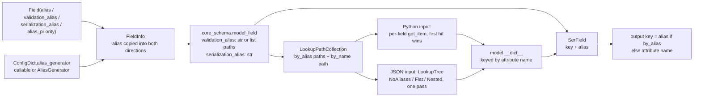

# Field Aliases in Depth: validation_alias, serialization_alias, AliasPath, AliasChoices, and AliasGenerator

> [!summary] Claim
> A Pydantic v2 field has two independent wire names - a validation alias that can be a key, a nested path, or an ordered list of either, and a serialization alias that is always one flat key - so a model is bidirectional only if every field's output key is also one of its accepted input paths, which nothing in Pydantic checks for you.

Part of [Pydantic v2 Internals and Validation](README.md) in [API Engineering](../README.md).

## TL;DR

- Mechanism: `Field(alias=...)` is copied into `validation_alias` and `serialization_alias` at `Field()` call time, and only those two reach the `CoreSchema`; `pydantic-core` compiles `validation_alias` into a `LookupPathCollection` (`by_alias` paths plus the `by_name` path) and `serialization_alias` into `SerField.alias` (`pydantic 2.14.3 pydantic/fields.py, Field`; `pydantic-core 2.50.4 src/lookup_key.rs, LookupPathCollection`).
- Contract rule: input lookup tries every alias path in declaration order, then the field name only if `validate_by_name=True` or the field has no alias; for JSON, a single pass over the object keys picks the highest-priority match, so `AliasChoices("b", "c")` takes `b` from `{"c": 1, "b": 2}` (`pydantic-core 2.50.4 src/validators/shared/lookup_tree.rs, LookupFieldPriority::is_higher_priority_than`).
- Trap: the defaults are asymmetric - `validate_by_alias=True` but `serialize_by_alias=False` - so `model_dump()` emits attribute names while FastAPI's `response_model_by_alias=True` emits aliases, and an `AliasPath`-only field cannot round-trip at all because serialization is always flat (`pydantic 2.14.3 pydantic/_internal/_config.py, config_defaults`; `fastapi 0.162.0 fastapi/routing.py, serialize_response`).
- Portability fact: the lab's 13 tests passed unchanged on CPython `3.12.13`, `3.13.18`, `3.14.6`, `3.14.10`, `3.15.2`, and free-threaded `3.14.6t` and `3.15.0b3t` with `pydantic 2.14.3` / `pydantic-core 2.50.4`; alias resolution is version-sensitive in Pydantic itself, not in CPython (`validate_by_alias`, `validate_by_name`, and `serialize_by_alias` arrived in `2.11`, per `pydantic 2.14.3 pydantic/config.py`).
- When not to use it: once inbound and outbound contracts differ by more than renames (different shapes, optionality, or authorization per field), stop stacking aliases on one class and write separate request and response models; aliases are a rename layer, not a mapping engine.

## Mental model



At class creation, `Field()` and the model's `alias_generator` settle three alias slots and one priority on each `FieldInfo`, and `GenerateSchema` forwards only `validation_alias` (flattened by `_convert_to_aliases` into a string, a list path, or a list of list paths) and `serialization_alias` into the `model-fields` `CoreSchema`.
`ModelFieldsValidator::build` turns each validation alias into a `LookupPathCollection` and precomputes one `LookupTree` for the whole model, while the model serializer stores each serialization alias on a `SerField`.
At validation time, Python dicts and objects are probed field by field, and JSON objects parsed by `jiter` are walked key by key against the `LookupTree`; either way the validated value is stored under the attribute name, so aliases exist only at the edges.
At serialization time, `SerField::get_key` picks the alias or the attribute name per call, which is why the output side can never express a nested path or a choice.

## How it works

### Stage 1: `Field()` and `FieldInfo` normalize the three alias slots

`Field()` validates that `validation_alias` is a `str`, `AliasChoices`, or `AliasPath` and otherwise raises `TypeError('Invalid validation_alias type...')`, then copies a string `alias` into `serialization_alias` and into `validation_alias` when those are unset (`pydantic 2.14.3 pydantic/fields.py, Field`).
`FieldInfo.__init__` then sets `alias_priority = (alias_priority or 2) if alias_is_set else None`, where `alias_is_set` is true if any of the three slots is non-`None` (`pydantic 2.14.3 pydantic/fields.py, FieldInfo.__init__`).
So `Field(alias="b")` yields `alias="b"`, `validation_alias="b"`, `serialization_alias="b"`, `alias_priority=2`, which the lab's probe printed on CPython `3.14.6`.
`AliasPath(first_arg: str, *args: str | int)` stores `self.path = [first_arg] + list(args)`, and `AliasChoices(first_choice, *choices)` stores `self.choices = [first_choice] + list(choices)`, a non-empty list of `str | AliasPath`; both are `@dataclasses.dataclass(slots=True)` (`pydantic 2.14.3 pydantic/aliases.py, AliasPath`, `AliasChoices`).
`_convert_to_aliases` lowers them for the core schema: a string stays a string, `AliasPath("order", "lines", 0)` becomes `["order", "lines", 0]`, and `AliasChoices("orderId", AliasPath("order", "header", "id"))` becomes `[["orderId"], ["order", "header", "id"]]` (`pydantic 2.14.3 pydantic/_internal/_generate_schema.py, _convert_to_aliases`).
`GenerateSchema._generate_md_field_schema`, `_generate_td_field_schema`, and `_generate_dc_field_schema` pass exactly `validation_alias` and `serialization_alias` to `core_schema.model_field`, `typed_dict_field`, and `dataclass_field`; the plain `alias` attribute never reaches Rust (`pydantic 2.14.3 pydantic/_internal/_generate_schema.py, GenerateSchema._generate_md_field_schema`).

### Stage 2: `alias_generator` and `alias_priority`

`update_field_from_config` calls `_apply_alias_generator_to_field_info` for every field when `ConfigDict.alias_generator` is set (`pydantic 2.14.3 pydantic/_internal/_fields.py, update_field_from_config`).
The generator runs if `alias_priority` is `None` or `<= 1`, or if any of `alias`, `validation_alias`, or `serialization_alias` is still `None` (`pydantic 2.14.3 pydantic/_internal/_fields.py, _apply_alias_generator_to_field_info`).
A plain callable must return `str` or the function raises `TypeError`; an `AliasGenerator` calls its three optional callables through `AliasGenerator.generate_aliases`, which type-checks `alias` and `serialization_alias` as `str` and `validation_alias` as `str | AliasChoices | AliasPath` (`pydantic 2.14.3 pydantic/aliases.py, AliasGenerator._generate_alias`).
If the priority was unset or `<= 1`, it becomes `1`, and at priority `1` all three slots are overwritten: `serialization_alias = get_first_not_none(serialization_alias, alias)`, `validation_alias = get_first_not_none(validation_alias, alias)` (the right-hand names are the generated values), `alias = generated_alias`.
At priority `2`, explicit slots survive and only the `None` slots are filled, which has a non-obvious consequence measured in the lab: with `alias_generator=to_camel`, `legacy: int = Field(validation_alias="LEGACY")` ends with `alias="legacy"`, `validation_alias="LEGACY"`, `serialization_alias="legacy"`, and `low: int = Field(alias="lowPri", alias_priority=1)` ends with all three set to `"low"` (the generator overrode the explicit alias).
The documented rule "the same precedence applies to `validation_alias` and `serialization_alias`" (`pydantic 2.14.3 docs/concepts/alias.md, Alias Priority`) is therefore per slot: an explicit `validation_alias` does not stop the generator from inventing a `serialization_alias`, which is exactly what `OrderView` in the lab relies on (`order_id` gets `serialization_alias="orderId"` with `alias=None` and priority `2`).
Generation happens once per field when the class is built, so a subclass with a different `alias_generator` regenerates aliases for inherited fields whose priority is `1`, the case the source comment calls out ("the alias_generator from a child class is used to generate an alias for a field in a parent class").

The built-in generators are regex rewrites, not invertible codecs (`pydantic 2.14.3 pydantic/alias_generators.py, to_camel`, `to_snake`, `to_pascal`).
`to_camel` returns its input unchanged if it matches `^[a-z]+[A-Za-z0-9]*$` and has no digit followed by a lowercase letter, otherwise it applies `str.title()`, joins underscores before digits or capitals, and lowercases the first letter.
`str.title()` lowercases inner capitals, so `get_HTTP_code` becomes `getHttpCode`, and `to_snake` splits letters from digits, so `to_snake(to_camel("sha256_hash"))` is `sha_256_hash`, not the original (lab test `test_to_camel_is_not_invertible`).

### Stage 3: `ConfigDict` alias switches and their effective values

The defaults are `validate_by_alias=True`, `validate_by_name=False`, `serialize_by_alias=False`, `loc_by_alias=True`, `alias_generator=None` (`pydantic 2.14.3 pydantic/_internal/_config.py, config_defaults`).
`_build_effective_config` maps the legacy `populate_by_name=X` to `validate_by_alias=True, validate_by_name=X` when `validate_by_name` is not given, forces `validate_by_name=True` if only `validate_by_alias=False` was set, and raises `PydanticUserError` code `validate-by-alias-and-name-false` if both end up false (`pydantic 2.14.3 pydantic/_internal/_config.py, _build_effective_config`).
`validate_by_alias`, `validate_by_name`, `serialize_by_alias`, and `loc_by_alias` are forwarded to the core config by `_config_dict_to_core_config_key` (`pydantic 2.14.3 pydantic/_internal/_config.py, _config_dict_to_core_config_key`), and `validate_by_name` is also forwarded into `arguments_schema` for `@validate_call` (`pydantic 2.14.3 pydantic/_internal/_generate_schema.py, GenerateSchema._arguments_schema`).
Per call, `model_validate`, `model_validate_json`, and `model_validate_strings` accept `by_alias` and `by_name`; `by_alias=False` without `by_name=True` raises the same `validate-by-alias-and-name-false` user error before Rust runs (`pydantic 2.14.3 pydantic/main.py, BaseModel.model_validate`).
In Rust, the two booleans become a bit set `LookupType { Name = 1, Alias = 2, Both = 3 }` (`#[repr(u8)]`), built by `LookupType::from_bools`, and `matches` is a single `&` of the two tags (`pydantic-core 2.50.4 src/lookup_key.rs, LookupType`).
Per-call flags override the schema's config through `state.validate_by_alias_or(self.validate_by_alias)` (`pydantic-core 2.50.4 src/validators/model_fields.rs, ModelFieldsValidator::validate_fields`), and on the output side `Extra::serialize_by_alias_or` returns `self.by_alias.or(serialize_by_alias).unwrap_or(false)`, so a call-level `by_alias` beats `serialize_by_alias`, which beats the `False` default (`pydantic-core 2.50.4 src/serializers/extra.rs, Extra::serialize_by_alias_or`).

### Stage 4: `LookupPath` and `LookupPathCollection`

`ValidationAlias` is a PyO3 `FromPyObject` enum with variants `Str(PyBackedStr)`, `AliasPath(LookupPath)` from `list[int | str]`, and `AliasChoices(SmallVec<[LookupPath; 1]>)` from `list[list[int | str]]` (`pydantic-core 2.50.4 src/lookup_key.rs, ValidationAlias`).
A `LookupPath` is `{ first_item: PathItemString, rest: Vec<PathItem> }`; `LookupPath::from_list` rejects an empty list with a schema error ("Each alias path should have at least one element") and a non-string first element with `TypeError` ("The first item in an alias path should be a string"), which the lab probe hit as a `SchemaError` for `AliasPath(0, "x")` at class creation (`pydantic-core 2.50.4 src/lookup_key.rs, LookupPath::from_list`).
`PathItem::from_py` classifies later elements as `S(str)`, `Pos(usize)`, or `Neg(usize)` for negative integers, and anything else raises "Item in an alias path should be a string or int" (`pydantic-core 2.50.4 src/lookup_key.rs, PathItem::from_py`).
`LookupPathCollection::new` stores `by_name` (the attribute name as a one-element path) and `by_alias` (zero or more paths), and `lookup_paths(lookup_type)` yields the alias paths in declaration order when `Alias` is enabled, then the name path when `Name` is enabled or when the field has no alias at all ("always use the name if no alias is defined") (`pydantic-core 2.50.4 src/lookup_key.rs, LookupPathCollection::lookup_paths`).
That last clause is why an unaliased field is always found by its name even under `validate_by_name=False`.

Path traversal differs by input kind:

- Python `dict`: the first step is `dict.get_item(first_key)`, then each `PathItem` calls `PathItem::py_get_item`, which returns `None` for any `str` receiver ("we definitely don't want to index strings") and otherwise calls Python `__getitem__` with the string or integer, so a negative index works on `list` and `tuple`, and an integer key works on `dict[int, ...]` (`pydantic-core 2.50.4 src/lookup_key.rs, PathItem::py_get_item`).
- JSON: `LookupPath::json_get` and `PathItem::json_get` index `JsonValue::Array` by position (negative indexes via `len.checked_sub`) and `JsonValue::Object` by string only, so `AliasPath("m", 7)` finds `{7: "seven"}` in Python but reports `missing` for JSON `{"m": {"7": "seven"}}` (lab probe, CPython `3.14.6`) (`pydantic-core 2.50.4 src/lookup_key.rs, PathItem::json_get`).
- `from_attributes=True`: `PathItemString::py_get_attrs` uses `get_item` when the current object is a `dict` (exact or subclass) and `getattr` otherwise, so an `AliasPath("meta", "id")` can walk `obj.meta["id"]` on an ORM row (`pydantic-core 2.50.4 src/lookup_key.rs, PathItemString::py_get_attrs`); see [[ORM-Mode-From-Attributes-and-Preventing-Accidental-Lazy-Loads]].

The pure-Python twin `AliasPath.search_dict_for_path` (used only by `model_construct`) catches `KeyError`, `IndexError`, and `TypeError` and also refuses to index into `str` (`pydantic 2.14.3 pydantic/aliases.py, AliasPath.search_dict_for_path`).

### Stage 5: Python input - field-by-field lookup

`ModelFieldsValidator::validate_by_get_item` loops over fields, and for each one runs `lookup_paths(...).find_map(...)`, taking the first path that exists in the input (`pydantic-core 2.50.4 src/validators/model_fields.rs, ModelFieldsValidator::validate_by_get_item`).
Dict lookups are `O(1)`, so cost is `O(fields x paths-per-field)`, and when `extra="ignore"` (the default) the input is never iterated.
When `extra` is `"forbid"` or `"allow"`, every successful path inserts its first key into an `AHashSet<&str>` named `used_keys`, and a second pass over the input treats every key not in `used_keys` as extra.
Two consequences follow directly from that design, and the lab pins both:

1. Only the first key of a path is recorded, so `AliasPath("order", "header", "id")` marks all of `"order"` as used, and `extra="forbid"` never sees an unexpected key nested under `"order"` (`test_name_and_alias_conflict_and_aliaspath_root_consumption`).
2. With `validate_by_name=True`, if both `"a"` (name) and `"b"` (alias) are sent, the alias wins and `"a"` is left unused, so it becomes `extra_forbidden` under `extra="forbid"` or lands in `model_extra` under `extra="allow"`, where it is re-serialized next to the field: for `{"a": 1, "b": 2}` a probe on CPython `3.14.6` got `a == 2` but `model_dump() == {"a": 1}` (the stale extra shadows the validated value) and `model_dump_json() == '{"a":2,"a":1}'`.

### Stage 6: JSON input - one pass over keys with `LookupTree`

`jiter` represents a JSON object as an ordered list of key/value pairs without deduplication ("jiter doesn't deduplicate keys, so duplicate keys in JSON will appear multiple times") (`pydantic-core 2.50.4 src/input/input_json.rs, JsonValue::as_kwargs`).
So instead of probing per field, `ModelFieldsValidator::validate_json_by_iteration` walks the object once against a `LookupTree` built at schema-compile time by `LookupTree::from_fields`, which picks the simplest of three representations (`pydantic-core 2.50.4 src/validators/shared/lookup_tree.rs, LookupTree::from_fields`):

| Variant | Built when | Per-key work | Why |
|---|---|---|---|
| `NoAliases` | no field has an alias | one hash lookup key -> field index | the common case stays a plain `AHashMap` |
| `Flat` | some aliases, none is a multi-step `AliasPath` | hash lookup -> `SmallVec<[LookupFieldInfo; 1]>` of candidate fields | the best match can be chosen as keys stream by |
| `Nested` | at least one `AliasPath` with `rest` non-empty | descend a tree of object keys and array indexes | every match must be retained until the end, because a later duplicate key can replace the parent |

Each candidate carries a `LookupFieldPriority { lookup_type, alias_index }`, and `is_higher_priority_than` says a name never beats anything, any alias beats a name, and among aliases the lower `alias_index` wins (`pydantic-core 2.50.4 src/validators/shared/lookup_tree.rs, LookupFieldPriority::is_higher_priority_than`).
`offer_field_input` replaces a field's current input unless the existing one has strictly higher priority, which gives two orderings that matter: across different paths, declaration order in `AliasChoices` decides regardless of input order, and for the same path, the last occurrence wins (`{"orderId": 1, "orderId": 2}` validates to `2` in the lab).
For a `Nested` tree, `NestedLookupNode::enter` keeps a `visited` bitset in `u64` words and, when an already-visited branch node is entered again, clears every candidate in its subtree ("Replacement invalidates descendants even if the new value has no matching paths") (`pydantic-core 2.50.4 src/validators/shared/lookup_tree.rs, NestedLookupNode::enter`).
That is why the lab's input `{"order": {...full order...}, "order": 7}` produces five `missing` errors plus `extra_forbidden` at `("order",)`: the second `"order"` erased every nested candidate, and since no field consumed `"order"`, it is left over as an extra key.
Per-field inputs live in `SmallVec<[Option<(LookupFieldInfo, &JsonValue)>; 16]>`, inline for models with at most `16` fields and on the heap beyond that (`pydantic-core 2.50.4 src/validators/model_fields.rs, validate_json_by_iteration`).
The doc comment states the design goal explicitly: the result is the same as `validate_by_get_item`, the iteration order is just better suited to an unindexed JSON object.

Not every validator got the tree: `TypedDictValidator` and `DataclassArgsValidator` also hold a `LookupPathCollection` per field, but for JSON they resolve each field's paths one at a time (`lookup_paths` in `TypedDictValidator`, `LookupPathCollection::try_lookup` in `DataclassArgsValidator`) through `LookupPath::json_get`, a reverse linear scan of the object's pairs that carries the source comment "FIXME: use of find_map in here probably leads to quadratic complexity" (`pydantic-core 2.50.4 src/validators/typed_dict.rs, TypedDictValidator`; `src/validators/dataclass.rs, DataclassArgsValidator`; `src/lookup_key.rs, LookupPath::json_get`).
The reverse scan preserves the same "last duplicate wins" behavior, but the cost is `O(fields x keys)` rather than `O(keys)`.

### Stage 7: error locations

When a value is found but fails validation, `LookupPath::apply_error_loc` prefixes the error with the path that matched (every `rest` item, then the first key) if `loc_by_alias=True`, or with the attribute name if `loc_by_alias=False` (`pydantic-core 2.50.4 src/lookup_key.rs, LookupPath::apply_error_loc`).
When nothing is found, `LookupPathCollection::error_loc` reports the first alias path when `loc_by_alias=True` and alias lookup is enabled (otherwise the attribute name), not the path the client was probably using (`pydantic-core 2.50.4 src/lookup_key.rs, LookupPathCollection::error_loc`).
So for `AliasChoices("orderId", AliasPath("order", "header", "id"))`, a bad nested value reports `("order", "header", "id")`, while a missing value reports `("orderId",)` even to a legacy client that only knows the nested shape (lab `test_error_loc_is_matched_path_or_first_alias`).
FastAPI prepends `"body"`, so the same nested type error arrives as `["body", "order", "header", "id"]` in the `422` `detail` (lab `test_fastapi_import_endpoint_answers_in_camel_case`); see [[Mapping-Pydantic-Validation-Errors-to-RFC-9457-Problem-Details]].

### Stage 8: serialization is flat by construction

`SerField` holds `key`, `alias: Option<PyBackedStr>`, and `serialize_by_alias: Option<bool>`, and `SerField::get_key` returns the alias when `extra.serialize_by_alias_or(self.serialize_by_alias)` is true and an alias exists, else the attribute name (`pydantic-core 2.50.4 src/serializers/fields.rs, SerField::get_key`).
There is no path and no choice on this side: `AliasPath` and `AliasChoices` are validation-only types, so a field whose only alias is an `AliasPath` serializes under its attribute name, and the model's input and output contracts diverge silently.
`get_key` is computed per field with no uniqueness check, so two fields that map to the same output key overwrite each other in `model_dump()` (a Python `dict`) and produce duplicate member names in `model_dump_json()`; the lab captured `{"b":1,"b":2,"nested_id":3}` for a model with `a: int = Field(serialization_alias="b")` next to `b: int`.
RFC 8259 says object names "SHOULD be unique" and that with duplicates "the behavior of software that receives such an object is unpredictable" (RFC 8259 Section 4).

### Stage 9: everything else that reads aliases

- JSON Schema: `GenerateJsonSchema._get_alias_name` uses `validation_alias` in `mode="validation"` (subject to `validate_by_alias` when `by_alias` is `None`) and `serialization_alias` in `mode="serialization"`; for a list alias it picks the first single-element string path and otherwise keeps the attribute name (`pydantic 2.14.3 pydantic/json_schema.py, GenerateJsonSchema._get_alias_name`).
  So `AliasChoices("orderId", AliasPath(...))` documents `orderId`, a bare `AliasPath("meta", "id")` documents the attribute name `nested_id` (which the validator does not accept unless `validate_by_name=True`), and the generated `title` is derived from the chosen key, giving `"Orderid"` for `orderId` in both modes (lab probe); see [[JSON-Schema-Generation-Internals-and-GenerateJsonSchema]].
- `__init__` signature: when `validate_by_alias` is true, `_field_name_for_signature` uses `alias` if it is a valid identifier, then a string `validation_alias` if it is a valid identifier, else the attribute name, so `Field(alias="the-a")` and any `AliasPath` show up as the attribute name in `inspect.signature` (`pydantic 2.14.3 pydantic/_internal/_signature.py, _field_name_for_signature`).
  Static checkers follow `(PEP 681)`, whose field specifier `alias` parameter "provides an alternative name for the field" used in the synthesized `__init__`; the PEP defines no equivalent for `validation_alias`, and a runtime `alias_generator` callable is invisible to a static checker.
- `model_construct`: pure Python, it tries `field.alias`, then each `AliasChoices` entry (`str` by `in`, `AliasPath` by `search_dict_for_path`), then the attribute name, ignoring `validate_by_alias` and `validate_by_name` (`pydantic 2.14.3 pydantic/main.py, BaseModel.model_construct`).
- `validate_assignment`: assignment always uses the attribute name; `m.b = 3` where `b` is only an alias raises `ValidationError` with type `no_such_attribute` at `("b",)` (probe, CPython `3.14.6`).
- FastAPI: `Query`, `Header`, `Body`, and friends accept `validation_alias` and fall back to `alias` (`fastapi 0.162.0 fastapi/params.py, Param.__init__`, `Body.__init__`), and every route serializes its response with `by_alias=response_model_by_alias`, default `True`: with the default response class `get_request_handler` sets `use_dump_json` and `serialize_response` calls `ModelField.serialize_json` -> `TypeAdapter.dump_json(..., by_alias=by_alias)`, and with a custom `response_class` it calls `ModelField.serialize` -> `TypeAdapter.dump_python(..., by_alias=by_alias)` (`fastapi 0.162.0 fastapi/routing.py, serialize_response`; `fastapi/_compat/v2.py, ModelField.serialize_json`, `ModelField.serialize`).
  Before serializing, FastAPI validates the endpoint's return value with `validate_python(value, from_attributes=True)` (`fastapi 0.162.0 fastapi/_compat/v2.py, ModelField.validate`), so returning a model instance passes, but returning a `dict` keyed by output aliases fails response validation if those keys are not accepted input paths.

## Numbers and limits

| Quantity | Value | Source or measurement condition |
|---|---|---|
| `alias_priority` set by `Field()` when any alias is given | `2` (`1` when set by a generator, `None` when no alias) | `pydantic 2.14.3 pydantic/fields.py, FieldInfo.__init__`; `pydantic/_internal/_fields.py, _apply_alias_generator_to_field_info` |
| Config defaults | `validate_by_alias=True`, `validate_by_name=False`, `serialize_by_alias=False`, `loc_by_alias=True` | `pydantic 2.14.3 pydantic/_internal/_config.py, config_defaults` |
| FastAPI default for response keys | `response_model_by_alias=True` | `fastapi 0.162.0 fastapi/routing.py, APIRoute.__init__`, `get_request_handler`, and `serialize_response` |
| `LookupType` encoding | `Name=1`, `Alias=2`, `Both=3`, `#[repr(u8)]` | `pydantic-core 2.50.4 src/lookup_key.rs, LookupType` |
| Inline alias path capacity per field | `1` path (`SmallVec<[LookupPath; 1]>`), heap beyond | `pydantic-core 2.50.4 src/lookup_key.rs, LookupPathCollection` |
| Inline per-field JSON input slots | `16` fields (`SmallVec<[...; 16]>`), heap beyond | `pydantic-core 2.50.4 src/validators/model_fields.rs, validate_json_by_iteration` |
| Nested lookup replacement tracking | bitset in `u64` words, one bit per branch node | `pydantic-core 2.50.4 src/validators/shared/lookup_tree.rs, NestedLookupNode::enter` |
| JSON lookup complexity, `BaseModel` | one pass, `O(keys)` hash probes | `validate_json_by_iteration` with `LookupTree` |
| JSON lookup complexity, `TypedDict` and dataclass | `O(fields x keys)` reverse scans (source `FIXME`) | `pydantic-core 2.50.4 src/lookup_key.rs, LookupPath::json_get` |
| `OrderView.model_validate_json`, legacy nested input (`170` bytes, 5 `AliasPath` hits) | `1522` ns | Middle of three runs, each the median of `timeit.repeat(number=5000, repeat=15)`, run as `uv run --frozen python -I <bench script>` from `labs/`, CPython `3.14.6`, macOS `27.3` arm64 (`uname -r` `27.3.0`), `pydantic 2.14.3`, `pydantic-core 2.50.4`; runs `1463`-`1564` ns (as of 2026-11) |
| `OrderView.model_validate_json`, flat camelCase input (`111` bytes) | `993` ns | Same conditions; runs `968`-`1025` ns; same model, so still the `Nested` tree |
| Same 5 fields and constraint, no aliases, flat snake_case input (`116` bytes) | `718` ns | Same conditions; runs `695`-`740` ns; `NoAliases` tree |
| `model_dump_json()`, `OrderView` by alias vs no-alias twin | `675` ns vs `689` ns | Same conditions; within run-to-run noise, because the output side of an alias is one pointer choice in `SerField::get_key` |

The three validation figures compare different input shapes, so the `~530` ns gap between legacy and camel input mixes nested traversal with `59` extra bytes and more `jiter` objects; only the `~275` ns gap between camel input on `OrderView` and the no-alias twin isolates the model's lookup structure for this shape, and it is not a general per-alias cost.

## Portability

All rows except the last three ran `uv run --frozen pytest tests/f09_pydantic_v2_internals_and_validation/test_aliases_aliaspath_aliaschoices_and_bidirectional_field_mapping.py -q` on macOS `27.3` arm64 and printed `13 passed`.
The independent fact-check re-ran only the workspace `3.14.6` row (`13 passed in 0.50s`), because lab matrix runs were paused on 2026-11-11; the other rows are the drafter's runs, and the fact-check confirmed that `3.12.13`, `3.13.18`, `3.14.10`, `3.15.2`, `3.14.6t`, and `3.15.0b3t` are the interpreter versions installed at the listed paths.

| Runtime or component | Behavior | Verification |
|---|---|---|
| CPython `3.12.13` | Identical results; the lab's `type WirePath = ...` statement needs `3.12+` `(PEP 695)` | `UV_PROJECT_ENVIRONMENT=<temp venv> uv run --frozen --python ~/.local/bin/python3.12 pytest <module> -q`: `13 passed` |
| CPython `3.13.18` | Identical | Same command with `/opt/homebrew/bin/python3.13`: `13 passed` |
| CPython `3.14.6` (workspace) and `3.14.10` | Identical | Workspace `uv run --frozen pytest <module> -q` on `3.14.6`; temp venv on `/opt/homebrew/bin/python3.14` (`3.14.10`): both `13 passed` |
| CPython `3.15.2` | Identical | Temp venv on `/opt/homebrew/bin/python3.15`: `13 passed` |
| Free-threaded `3.14.6t` and `3.15.0b3t` `(PEP 703)` | Identical; `sys._is_gil_enabled()` was `False` after importing `pydantic_core`, and `sysconfig.get_config_var("Py_GIL_DISABLED")` was `1` | The locked workspace does not install on free-threaded builds (see [[Pydantic-v2-Architecture-CoreSchema-and-Rust-Pydantic-Core]]), so these ran in a `uv venv` holding the lock's pins of `pydantic`, `pydantic-core`, `fastapi`, `starlette`, `httpx`, `anyio`, `pytest`, `pytest-asyncio`, with `PYTHONPATH=src`: both `13 passed` |
| CPython `3.12.16` and free-threaded `3.15.2t` | Not run: neither interpreter is installed on this machine | - |
| Debian Trixie and Alpine containers | Not run (lab container checks paused for this job, 2026-11-11) | - |
| `pydantic < 2.11` | No `validate_by_alias`, `validate_by_name`, or `serialize_by_alias`; `populate_by_name` was the only switch, and `_build_effective_config` still maps it in `2.14.3` | `pydantic 2.14.3 pydantic/config.py` docstrings (`version-added v2.11`, "`populate_by_name` usage is not recommended in v2.11+ and will be deprecated in v3"); not run on older releases |
| `pydantic` v3 (future) | `serialize_by_alias` default "is expected to change to `True`" | `pydantic 2.14.3 pydantic/config.py, ConfigDict.serialize_by_alias`; `pydantic/pydantic#8379` (open as of 2026-11) |
| ASGI servers (Uvicorn, Hypercorn, Granian) and HTTP/1.1, HTTP/2, HTTP/3 | Alias resolution runs on the request body bytes after the server has reassembled them, so it is transport-independent | In-process `httpx.ASGITransport` only; not run over real servers or HTTP/2 and HTTP/3 for this note |

## Worked example

The lab models a legacy order system that sends a deeply nested document, and a new contract that is flat and camelCase in both directions.
`OrderView` accepts either shape on input through `AliasChoices` (new camelCase key first, legacy `AliasPath` second), generates only the output aliases with `AliasGenerator(serialization_alias=to_camel)`, and turns on `serialize_by_alias=True` so `model_dump()` and FastAPI agree.
`one_way_fields` and `output_key_collisions` are the two audits Pydantic does not run: a field is one-way if its output key is not an accepted input path, and a collision is two fields claiming the same output key.

The [implementation](../labs/src/api_labs/f09_pydantic_v2_internals_and_validation/field_alias_mapping.py):

```python
"""Flatten nested legacy JSON with AliasPath and AliasChoices; emit camelCase via AliasGenerator."""

from __future__ import annotations

from collections import defaultdict
from typing import TYPE_CHECKING

from fastapi import FastAPI
from pydantic import AliasChoices, AliasGenerator, AliasPath, BaseModel, ConfigDict, Field
from pydantic.alias_generators import to_camel

if TYPE_CHECKING:
    from pydantic.fields import FieldInfo

type WirePath = tuple[str | int, ...]


class OrderView(BaseModel):
    """Flat domain model: legacy nested keys or camelCase keys in, camelCase keys out."""

    model_config = ConfigDict(
        alias_generator=AliasGenerator(serialization_alias=to_camel),
        serialize_by_alias=True,
        extra="forbid",
        frozen=True,
    )

    order_id: int = Field(
        validation_alias=AliasChoices("orderId", AliasPath("order", "header", "id")),
    )
    customer_email: str = Field(
        validation_alias=AliasChoices(
            "customerEmail",
            "cust_email",
            AliasPath("order", "customer", "email"),
        ),
    )
    first_sku: str = Field(
        validation_alias=AliasChoices("firstSku", AliasPath("order", "lines", 0, "sku")),
    )
    last_sku: str = Field(
        validation_alias=AliasChoices("lastSku", AliasPath("order", "lines", -1, "sku")),
    )
    total_cents: int = Field(
        ge=0,
        validation_alias=AliasChoices("totalCents", AliasPath("order", "totals", "grand_cents")),
    )


def parse_legacy_order(raw: bytes) -> OrderView:
    """Validate legacy or camelCase JSON bytes in one pass (jiter -> LookupTree::Nested)."""
    return OrderView.model_validate_json(raw)


def accepted_paths(field_info: FieldInfo) -> list[WirePath]:
    """Return the input paths a field's validation_alias accepts, in priority order."""
    alias = field_info.validation_alias
    if alias is None:
        return []
    choices = alias.choices if isinstance(alias, AliasChoices) else [alias]
    return [
        tuple(choice.convert_to_aliases()) if isinstance(choice, AliasPath) else (choice,)
        for choice in choices
    ]


def output_key(name: str, field_info: FieldInfo) -> str:
    """Return the key a field is serialized under when serializing by alias."""
    return field_info.serialization_alias or name


def one_way_fields(model_cls: type[BaseModel]) -> list[str]:
    """List fields whose by-alias output key is not accepted back on input (no round trip)."""
    by_name = bool(model_cls.model_config.get("validate_by_name", False))
    broken: list[str] = []
    for name, info in model_cls.model_fields.items():
        paths = accepted_paths(info)
        if not paths or by_name:
            paths = [*paths, (name,)]
        if (output_key(name, info),) not in paths:
            broken.append(name)
    return broken


def output_key_collisions(model_cls: type[BaseModel]) -> dict[str, list[str]]:
    """Map each by-alias output key claimed by more than one field to those fields."""
    claims: defaultdict[str, list[str]] = defaultdict(list)
    for name, info in model_cls.model_fields.items():
        claims[output_key(name, info)].append(name)
    return {key: names for key, names in claims.items() if len(names) > 1}


def build_order_import_app() -> FastAPI:
    """ASGI app that ingests legacy order JSON and answers in camelCase."""
    app = FastAPI()

    @app.post("/v2/orders:import")
    async def import_order(order: OrderView) -> OrderView:
        return order

    return app
```

The [test](../labs/tests/f09_pydantic_v2_internals_and_validation/test_aliases_aliaspath_aliaschoices_and_bidirectional_field_mapping.py):

```python
"""Unit tests for validation_alias, serialization_alias, AliasPath, AliasChoices, AliasGenerator."""

from __future__ import annotations

import json
from typing import Any

import httpx
import pytest
from pydantic import AliasPath, BaseModel, ConfigDict, Field, ValidationError
from pydantic.alias_generators import to_camel, to_snake

from api_labs.f09_pydantic_v2_internals_and_validation.field_alias_mapping import (
    OrderView,
    build_order_import_app,
    one_way_fields,
    output_key_collisions,
    parse_legacy_order,
)

LEGACY: dict[str, Any] = {
    "order": {
        "header": {"id": 4711},
        "customer": {"email": "ops@example.com"},
        "lines": [{"sku": "A-1"}, {"sku": "B-2"}, {"sku": "C-3"}],
        "totals": {"grand_cents": 12999},
    }
}
CAMEL = {
    "orderId": 4711,
    "customerEmail": "ops@example.com",
    "firstSku": "A-1",
    "lastSku": "C-3",
    "totalCents": 12999,
}


def _errors(exc: ValidationError) -> list[tuple[str, tuple[int | str, ...]]]:
    return [(e["type"], e["loc"]) for e in exc.errors(include_url=False)]


@pytest.mark.unit
def test_aliaspath_and_aliaschoices_flatten_legacy_json() -> None:
    from_json = parse_legacy_order(json.dumps(LEGACY).encode())
    from_python = OrderView.model_validate(LEGACY)
    assert from_json == from_python
    assert from_json.order_id == 4711
    assert from_json.first_sku == "A-1"
    assert from_json.last_sku == "C-3"  # AliasPath(..., -1, ...) indexes from the end

    both = {**LEGACY, "cust_email": "flat@example.com"}
    # Choice order, not input order, decides: "cust_email" is listed before the nested path.
    assert parse_legacy_order(json.dumps(both).encode()).customer_email == "flat@example.com"
    assert OrderView.model_validate(both).customer_email == "flat@example.com"


@pytest.mark.unit
def test_serialize_by_alias_emits_camel_case_and_round_trips() -> None:
    view = OrderView.model_validate(LEGACY)
    assert view.model_dump() == CAMEL
    assert view.model_dump(by_alias=False)["order_id"] == 4711
    assert OrderView.model_validate_json(view.model_dump_json()) == view
    assert one_way_fields(OrderView) == []
    assert output_key_collisions(OrderView) == {}


@pytest.mark.unit
def test_error_loc_is_matched_path_or_first_alias() -> None:
    bad_type: dict[str, Any] = json.loads(json.dumps(LEGACY))
    bad_type["order"]["header"]["id"] = "x"
    bad_type["order"]["totals"]["grand_cents"] = -1
    with pytest.raises(ValidationError) as info:
        parse_legacy_order(json.dumps(bad_type).encode())
    assert _errors(info.value) == [
        ("int_parsing", ("order", "header", "id")),
        ("greater_than_equal", ("order", "totals", "grand_cents")),
    ]

    missing = {k: v for k, v in CAMEL.items() if k != "orderId"}
    with pytest.raises(ValidationError) as info:
        OrderView.model_validate(missing)
    assert _errors(info.value) == [("missing", ("orderId",))]


@pytest.mark.unit
def test_duplicate_json_keys_last_wins_and_replace_nested_parent() -> None:
    dup = b'{"orderId": 1, "orderId": 2, "customerEmail": "a@example.com",'
    dup += b' "firstSku": "A", "lastSku": "Z", "totalCents": 5}'
    assert parse_legacy_order(dup).order_id == 2

    replaced = json.dumps(LEGACY)[:-1] + ', "order": 7}'
    with pytest.raises(ValidationError) as info:
        parse_legacy_order(replaced.encode())
    assert _errors(info.value) == [
        ("missing", ("orderId",)),
        ("missing", ("customerEmail",)),
        ("missing", ("firstSku",)),
        ("missing", ("lastSku",)),
        ("missing", ("totalCents",)),
        ("extra_forbidden", ("order",)),
    ]


@pytest.mark.unit
def test_alias_generator_respects_alias_priority() -> None:
    class Generated(BaseModel):
        model_config = ConfigDict(alias_generator=to_camel)
        order_id: int
        note: str = Field(alias="comment")
        legacy: int = Field(validation_alias="LEGACY")
        low: int = Field(alias="lowPri", alias_priority=1)

    def summary(model: type[BaseModel]) -> dict[str, tuple[object, ...]]:
        return {
            n: (f.alias, f.validation_alias, f.serialization_alias, f.alias_priority)
            for n, f in model.model_fields.items()
        }

    assert summary(Generated) == {
        "order_id": ("orderId", "orderId", "orderId", 1),
        "note": ("comment", "comment", "comment", 2),
        "legacy": ("legacy", "LEGACY", "legacy", 2),
        "low": ("low", "low", "low", 1),
    }
    order_id = OrderView.model_fields["order_id"]
    assert (order_id.alias, order_id.serialization_alias, order_id.alias_priority) == (
        None,
        "orderId",
        2,
    )


@pytest.mark.unit
@pytest.mark.parametrize(
    ("field_name", "camel", "back"),
    [
        ("http_response_code", "httpResponseCode", "http_response_code"),
        ("sha256_hash", "sha256Hash", "sha_256_hash"),
        ("a_1b", "a1B", "a_1_b"),
        ("userId", "userId", "user_id"),
    ],
    ids=["round-trips", "digit-split", "digit-letter", "camel-passthrough"],
)
def test_to_camel_is_not_invertible(field_name: str, camel: str, back: str) -> None:
    assert to_camel(field_name) == camel
    assert to_snake(camel) == back


@pytest.mark.unit
def test_audit_finds_one_way_and_colliding_fields() -> None:
    class Lossy(BaseModel):
        model_config = ConfigDict(serialize_by_alias=True)
        a: int = Field(serialization_alias="b")
        b: int
        nested_id: int = Field(validation_alias=AliasPath("meta", "id"))

    assert one_way_fields(Lossy) == ["a", "nested_id"]
    assert output_key_collisions(Lossy) == {"b": ["a", "b"]}
    m = Lossy.model_validate({"a": 1, "b": 2, "meta": {"id": 3}})
    assert m.model_dump() == {"b": 2, "nested_id": 3}  # field a silently lost
    assert m.model_dump_json() == '{"b":1,"b":2,"nested_id":3}'  # duplicate JSON names
    assert list(Lossy.model_json_schema(mode="validation")["properties"]) == [
        "a",
        "b",
        "nested_id",  # documents the attribute name, but the wire needs meta.id
    ]


@pytest.mark.unit
def test_name_and_alias_conflict_and_aliaspath_root_consumption() -> None:
    class Both(BaseModel):
        model_config = ConfigDict(validate_by_name=True, extra="forbid")
        a: int = Field(alias="b")

    with pytest.raises(ValidationError) as info:
        Both.model_validate({"a": 1, "b": 2})
    assert _errors(info.value) == [("extra_forbidden", ("a",))]

    smuggled: dict[str, Any] = json.loads(json.dumps(LEGACY))
    smuggled["order"]["internal_discount_cents"] = 12999
    # extra="forbid" only polices top-level keys; "order" is consumed by AliasPath roots.
    assert parse_legacy_order(json.dumps(smuggled).encode()).total_cents == 12999


@pytest.mark.unit
def test_json_schema_names_follow_mode_and_first_single_key_choice() -> None:
    for mode in ("validation", "serialization"):
        schema = OrderView.model_json_schema(mode=mode)
        assert list(schema["properties"]) == list(CAMEL)
        assert schema["required"] == list(CAMEL)


@pytest.mark.unit
@pytest.mark.asyncio
async def test_fastapi_import_endpoint_answers_in_camel_case() -> None:
    transport = httpx.ASGITransport(app=build_order_import_app())
    async with httpx.AsyncClient(transport=transport, base_url="http://test") as client:
        ok = await client.post("/v2/orders:import", json=LEGACY)
        assert ok.status_code == 200
        assert ok.json() == CAMEL

        bad: dict[str, Any] = json.loads(json.dumps(LEGACY))
        bad["order"]["header"]["id"] = "x"
        resp = await client.post("/v2/orders:import", json=bad)
        assert resp.status_code == 422
        detail = resp.json()["detail"]
        assert [(d["type"], d["loc"]) for d in detail] == [
            ("int_parsing", ["body", "order", "header", "id"]),
        ]
```

Captured with `uv run --frozen pytest tests/f09_pydantic_v2_internals_and_validation/test_aliases_aliaspath_aliaschoices_and_bidirectional_field_mapping.py -q` from `labs/` on CPython `3.14.6`, macOS `27.3` arm64 (`macOS-27.3-arm64-arm-64bit-Mach-O`), `pydantic 2.14.3`, `pydantic-core 2.50.4`:

```text
.............                                                            [100%]
13 passed in 0.50s
```

What each test proves:

- `test_aliaspath_and_aliaschoices_flatten_legacy_json`: Python and JSON paths agree, a negative index reads the last line, and choice order (not input order) picks `cust_email` over the nested email.
- `test_serialize_by_alias_emits_camel_case_and_round_trips`: `model_dump()` is camelCase because of `serialize_by_alias=True`, the JSON output validates back to an equal model, and both audits are clean.
- `test_error_loc_is_matched_path_or_first_alias`: a bad value reports the matched nested path, a missing value reports the first alias.
- `test_duplicate_json_keys_last_wins_and_replace_nested_parent`: last duplicate wins for a flat key, and a later scalar `"order"` erases every nested candidate.
- `test_alias_generator_respects_alias_priority`: the per-slot gap filling and the `alias_priority=1` override.
- `test_to_camel_is_not_invertible`: four cases of `to_camel` and `to_snake`, including the passthrough of an already camelCase name.
- `test_audit_finds_one_way_and_colliding_fields`: a collision loses data in `model_dump()`, emits duplicate names in `model_dump_json()`, and the validation JSON Schema documents a key the validator rejects.
- `test_name_and_alias_conflict_and_aliaspath_root_consumption`: name-plus-alias input under `extra="forbid"`, and a smuggled nested key that `extra="forbid"` cannot see.
- `test_json_schema_names_follow_mode_and_first_single_key_choice`: putting the camelCase key first in each `AliasChoices` makes both schema modes document the same names.
- `test_fastapi_import_endpoint_answers_in_camel_case`: the real `422` `loc` and the camelCase `200` body through `httpx.ASGITransport`.

## Pitfalls

> [!warning] Asymmetric defaults: validation by alias, serialization by name
> - Trigger: a model with aliases and the default `serialize_by_alias=False`, dumped both by internal code (`model_dump()` to a queue, cache, or log) and by FastAPI.
> - Symptom: the HTTP response uses aliases (FastAPI passes `by_alias=True`) while the queue message uses attribute names, and a consumer that re-validates the queue message with the same model fails with `missing` errors because `validate_by_name` defaults to `False`.
> The maintainers acknowledge the inconsistency: `serialize_by_alias` was added in `2.11` to answer `pydantic/pydantic#8379` ("More consistent and intuitive `alias` behavior for validation and serialization", opened 2023-12-15, still open as of 2026-11); the docs call the default "notably inconsistent" and say "We anticipate changing this default in V3" (`pydantic 2.14.3 docs/concepts/alias.md`, Serialization), and the `ConfigDict.serialize_by_alias` docstring says it "is expected to change to `True`" (`pydantic 2.14.3 pydantic/config.py, ConfigDict.serialize_by_alias`).
> - Fix: set `serialize_by_alias=True` on every boundary model (or on a shared base), and keep a test that `Model.model_validate_json(m.model_dump_json()) == m`.

> [!warning] Output-key collisions lose data silently
> - Trigger: `alias_generator=to_camel` on a model that already has a camelCase attribute (`to_camel("userId")` returns `"userId"`), or an explicit `serialization_alias` equal to another field's name.
> - Symptom: no error at class creation or at dump time; `model_dump()` keeps only the last field for that key and `model_dump_json()` emits duplicate names such as `{"userId":5,"userId":5}` (lab probe) or `{"b":1,"b":2}` (lab test), which RFC 8259 Section 4 calls unpredictable for receivers.
> - Fix: run an `output_key_collisions`-style audit over every exported model in CI; it is a dictionary inversion over `model_fields`, cheap enough for a unit test.

> [!warning] `AliasPath`-only fields are one-way, and the docs lie about them
> - Trigger: `Field(validation_alias=AliasPath("meta", "id"))` with no string choice.
> - Symptom: the field serializes under the attribute name (`nested_id`), which the same model rejects on input, and `model_json_schema(mode="validation")` documents `nested_id` too, because `_get_alias_name` only uses single-element string paths; OpenAPI clients generated from that schema send a key the server ignores or rejects.
> - Fix: wrap every path in `AliasChoices("<outputKey>", AliasPath(...))` with the output key first, so the round trip works and both schema modes agree (the lab's `OrderView` pattern).

> [!warning] An explicit `validation_alias` does not stop the generator
> - Trigger: a model-wide `alias_generator` plus a hand-written `Field(validation_alias="LEGACY")`.
> - Symptom: the generator still fills `alias` and `serialization_alias` (to `"legacy"` with `to_camel`), and a field with `alias_priority=1` has its explicit alias replaced; the output key is not what the author typed.
> - Fix: when a field's output name matters, set `serialization_alias` explicitly (priority `2` protects it), and assert `model_fields[name].serialization_alias` in a test.

> [!warning] Missing-field errors name a key the client never used
> - Trigger: `AliasChoices("orderId", AliasPath("order", "header", "id"))` and a legacy client that omits the nested id.
> - Symptom: the `422` says `loc: ["body", "orderId"]`, the new name the legacy client does not know, because `LookupPathCollection::error_loc` always reports the first alias.
> - Fix: decide which audience the first choice serves, document every accepted path in the API reference, and if legacy clients dominate, translate `missing` errors in an exception handler; see [[Mapping-Pydantic-Validation-Errors-to-RFC-9457-Problem-Details]].

> [!warning] Name and alias both present
> - Trigger: `validate_by_name=True` (or the legacy `populate_by_name=True`) and a client that sends both `"a"` and `"b"` for `a: int = Field(alias="b")`.
> - Symptom: the alias value wins, and the name key becomes `extra_forbidden` under `extra="forbid"`, or survives in `model_extra` and is re-emitted on dump under `extra="allow"` (probe: `{'a': 1}` in `model_extra`, `model_dump()` returned `{'a': 1}` although `m.a == 2`, and `model_dump_json()` returned `{"a":2,"a":1}`).
> - Fix: enable `validate_by_name` only on internal models, never on public request models whose clients you do not control.

## Security and robustness

- Parser differentials on duplicate keys: `pydantic-core` takes the last occurrence of a key, matching CPython `json.loads`, but other parsers in the same request path may take the first; Bishop Fox's research shows a cart where a Python service validated `qty` from the last duplicate and a Go service charged from the first (Bishop Fox, "An Exploration of JSON Interoperability Vulnerabilities", 2021-02-25).
  `AliasChoices` adds a second, Pydantic-specific differential: a gateway or WAF that inspects `cust_email` and a model that prefers `customerEmail` disagree about which field is the email whenever a client sends both.
  Defend by rejecting duplicate keys at the edge, by authorizing on the validated model rather than on raw JSON, and by keeping `AliasChoices` lists short and documented.
- `AliasPath` roots are blind spots for `extra="forbid"` (`API3:2023 Broken Object Property Level Authorization`): only the first key of a matched path is recorded as used, so `{"order": {..., "internal_discount_cents": 12999}}` passes a forbid model (lab test).
  That is harmless for the model itself, which drops the key, but dangerous when the raw body is also forwarded or persisted, the mass-assignment pattern OWASP API3:2023 warns about ("avoid using functions that automatically bind a client's input into code variables, internal objects, or object properties").
  Validate the nested legacy shape with its own nested models and `extra="forbid"` when the subtree must be policed, and forward only `model_dump()` output, never the raw body.
- Every alias is an input channel: an `AliasChoices` with four spellings is four ways to set the field, and with `validate_by_name=True` the attribute name is a fifth; review them like routes, and remove legacy spellings on a published schedule ([[Additive-Schema-Evolution-and-Tolerant-Reader-Patterns]]).
- Index robustness: `AliasPath` never indexes into a `str` (Rust `PathItem::py_get_item` and Python `search_dict_for_path` both refuse), a negative index past the start returns `missing` instead of wrapping (`checked_sub` in `PathItem::json_get`), and integer path items cannot match JSON object keys, so a `{"7": ...}` object needs the string `"7"` in the path.
- Error echo: `ValidationError` includes the `input` at the matched path; with nested legacy documents that can be a whole subtree containing personal data, so set `hide_input_in_errors=True` on boundary models whose inputs are sensitive.

## The principal's view

Aliases are the cheapest anti-corruption layer in a Python service: domain code reads `order.total_cents` forever while the wire spelling changes in one declarative place, and the `LookupTree` keeps the cost to a few hundred nanoseconds per object on this shape (see Numbers and limits).
The decision a staff-plus engineer has to make is where that layer stops.
One model with `AliasChoices` for input and `AliasGenerator` for output is right when the two contracts are the same set of fields with different spellings, and it is wrong as soon as the request and response differ in membership, optionality, or authorization, because one class then has to encode two contracts and its JSON Schema can only describe one of them per mode.

Three organizational rules make the single-model approach safe at scale:

1. Put `serialize_by_alias=True`, `extra="forbid"`, and the generator on one shared boundary base class, so the asymmetric defaults are fixed once instead of per team.
2. Treat the two audits in the lab (`one_way_fields`, `output_key_collisions`) as CI invariants over every exported model; Pydantic will never raise for either failure, and both fail silently in production.
3. Order every `AliasChoices` as "current contract first, legacy paths after", because that order decides precedence, the `missing` error location, and the JSON Schema name all at once; give each legacy path a removal date.

Choose something other than aliases when the mapping is computational (unit conversion, merging fields, splitting a string) - that belongs in a `mode="before"` model validator or an explicit translation function ([[Functional-Validators-Before-After-Wrap-and-Plain]], [[Model-Validators-ValidationInfo-Context-and-Cross-Field-Invariants]]), or when output needs nesting, which only a custom serializer can produce ([[Custom-Serialization-Field-Model-and-Wrap-Serializers]]).
The cost of that choice is the loss of declarative JSON Schema for the mapped fields and a Python call on every request.

## Interview questions

> [!question] L5: What is the difference between `alias`, `validation_alias`, and `serialization_alias`, and which of them does `pydantic-core` actually see?
>
> > [!success]- Answer
> > `alias` is a convenience that `Field()` copies into `validation_alias` and `serialization_alias` when those are unset, and it sets `alias_priority=2`.
> > `validation_alias` may be a string, an `AliasPath`, or an `AliasChoices`, and controls input lookup only.
> > `serialization_alias` is always one string and controls the output key only, and only when serializing by alias.
> > `GenerateSchema` passes only `validation_alias` (lowered by `_convert_to_aliases` to a string or list paths) and `serialization_alias` into `core_schema.model_field`, so Rust never sees `alias`.
> >
> > Follow-up: Which Python-level features still read `alias` directly instead of the two derived slots?

> [!question] L5: A model has `user_id: int = Field(alias="userId")`; `m.model_dump()` returns `{"user_id": 1}` but the FastAPI endpoint returning `m` responds with `{"userId": 1}`.
> Why?
>
> > [!success]- Answer
> > `serialize_by_alias` defaults to `False`, so `SerField::get_key` returns the attribute name unless the call passes `by_alias=True`.
> > FastAPI passes `by_alias=response_model_by_alias`, which defaults to `True`, through `ModelField.serialize_json` to `TypeAdapter.dump_json` (or `ModelField.serialize` to `TypeAdapter.dump_python` when a custom `response_class` is set).
> > The call-level flag wins over the config because `Extra::serialize_by_alias_or` evaluates `self.by_alias.or(config).unwrap_or(false)`.
> >
> > Follow-up: What breaks if a background worker re-validates the `model_dump()` output with the same model?

> [!question] L6 (Predict the output): What does this print under `pydantic 2.14.3`?
> ```python
> from pydantic import AliasChoices, AliasPath, BaseModel, Field
>
> class M(BaseModel):
>     a: int = Field(validation_alias=AliasChoices("b", "c"))
>     d: int = Field(validation_alias=AliasPath("x", "y"))
>
> print(M.model_validate_json('{"c": 1, "b": 2, "x": {"y": 3}, "x": {"y": 4}}'))
> ```
>
> > [!success]- Answer
> > It prints `a=2 d=4`.
> > `b` is listed before `c` in the `AliasChoices`, so `LookupFieldPriority::is_higher_priority_than` keeps `b` regardless of input order.
> > For the same path, `offer_field_input` lets the later occurrence replace the earlier one, and the second `"x"` also resets the nested subtree before its `"y"` is offered, so `d` gets `4`.
> > A probe on CPython `3.14.6` printed `a=2 d=4`; the lab test `test_aliaspath_and_aliaschoices_flatten_legacy_json` pins the choice-order rule on both Python and JSON input, and `test_duplicate_json_keys_last_wins_and_replace_nested_parent` pins last-wins and nested replacement.
> >
> > Follow-up: What does the same model report if the second `"x"` is `2` instead of `{"y": 4}`?

> [!question] L6: Why can a field declared with only `validation_alias=AliasPath("meta", "id")` never round-trip, and what does its JSON Schema say?
>
> > [!success]- Answer
> > Serialization is flat: `SerField` holds one optional string alias, so the field is emitted under `serialization_alias` or the attribute name, never as `{"meta": {"id": ...}}`.
> > Without a `serialization_alias`, the output key is `nested_id`, and the validator only accepts `meta.id` unless `validate_by_name=True`.
> > `GenerateJsonSchema._get_alias_name` picks the first single-element string path from a list alias and otherwise keeps the attribute name, so the validation schema documents `nested_id`, a key the validator rejects.
> > Fix it with `AliasChoices("nestedId", AliasPath("meta", "id"))` plus a matching serialization alias.
> >
> > Follow-up: How would you detect this class of bug across 300 models without writing per-model tests?

> [!question] L6 (Debug this API): After a platform team adds `alias_generator=to_camel` to the shared base model, a mobile client starts reading stale `userId` values from one endpoint, and nothing in the logs shows an error.
> The response model has fields `user_id` (current) and `userId` (kept for an old client).
> Find the cause.
>
> > [!success]- Answer
> > `to_camel("userId")` returns `"userId"` unchanged because it already matches `^[a-z]+[A-Za-z0-9]*$`, and `to_camel("user_id")` is also `"userId"`, so both fields get `serialization_alias="userId"`.
> > `SerField::get_key` has no uniqueness check, so `model_dump_json(by_alias=True)` writes the member twice (the probe printed `{"userId":5,"userId":5}`, and with different values both appear).
> > RFC 8259 Section 4 makes duplicate names unpredictable for receivers, and the mobile JSON parser keeps a different occurrence than the server's tests assumed.
> > The fix is an explicit `serialization_alias` on the legacy field, or removing it, plus a CI audit that inverts `model_fields` by output key and fails on any key claimed twice.
> >
> > Follow-up: Why does `model_dump()` (a Python `dict`) hide this bug from a unit test that compares dictionaries?

> [!question] L6: With `extra="forbid"`, why does `{"order": {"header": {"id": 1}, "is_admin": true}}` pass a model whose only field is `Field(validation_alias=AliasPath("order", "header", "id"))`?
>
> > [!success]- Answer
> > The forbid check is a second pass over top-level keys that skips every key in `used_keys`.
> > `validate_by_get_item` inserts only `path.first_key()` into `used_keys`, so the whole `"order"` subtree counts as used once any path under it matches.
> > For JSON, `validate_json_by_iteration` marks the matched path's first key as consumed in `possible_extra`, with the same effect.
> > Nested keys are therefore invisible to `extra="forbid"`; police the subtree with its own nested model if it must be strict.
> >
> > Follow-up: What happens to `"order"` if none of the paths under it match?

> [!question] L7+: Explain why `pydantic-core` has three `LookupTree` variants and why the `Nested` variant cannot discard lower-priority matches early.
>
> > [!success]- Answer
> > `jiter` gives an unindexed, non-deduplicated list of key/value pairs, so the validator walks keys once and asks which fields want each key, instead of probing per field.
> > `NoAliases` is a key -> field-index map, the fastest case; `Flat` maps keys to candidate `LookupFieldInfo`s and can keep only the best candidate per field as keys stream by, because a later key can only beat an earlier one by priority or by being the same path again.
> > With nested paths, a later duplicate of a parent key can invalidate a descendant match that was the best so far (`{"a": {"b": 1}, "a": 2}`), so `NestedLookupNode::enter` uses a `u64` visited bitset to detect re-entry and clears the subtree's candidates.
> > The result is defined to equal the per-field Python path, which makes the optimization invisible except in cost; `TypedDict` and dataclasses still use the per-field reverse scan the source marks as potentially quadratic.
> >
> > Follow-up: How would you benchmark whether a wide `TypedDict` with aliases is paying the `O(fields x keys)` cost in your service?

> [!question] L7+: You own the contract migration from a nested legacy order format to a flat camelCase one across 40 services that share one Pydantic model package.
> Design the rollout.
>
> > [!success]- Answer
> > Use one boundary base with `serialize_by_alias=True`, `extra="forbid"`, and `AliasGenerator(serialization_alias=to_camel)`, and give every field `AliasChoices("<camelKey>", AliasPath(<legacy path>))` with the new key first.
> > That makes outputs camelCase immediately, keeps legacy inputs working, and makes JSON Schema and `missing` locations show the new names.
> > Add CI audits for one-way fields and output-key collisions, and a round-trip test per model.
> > Measure which spelling each client uses at the edge (on success `validate_field` keeps no record of which path matched; it uses the path only for error locations), publish a removal date per legacy path, and remove choices one at a time so each removal is a reviewed, reversible change.
> > The trade-off is a period where every field has two input channels, which widens the parser-differential surface; reject duplicate keys at the gateway during that window.
> >
> > Follow-up: When would you abandon the shared model and give each direction its own class instead?

> [!question] L7+: A gateway authorizes requests by reading `customer_email` from the raw JSON, and the service validates with `Field(validation_alias=AliasChoices("customerEmail", "customer_email"))`.
> Describe the attack and two independent fixes.
>
> > [!success]- Answer
> > The attacker sends both keys: the gateway checks `customer_email` (their own address), while Pydantic prefers `customerEmail` because it is the first choice, so the service acts on a different customer.
> > This is a parser differential of the kind Bishop Fox documented for duplicate keys, created here by alias precedence rather than by parser bugs.
> > Fix one: authorize inside the service on the validated model value, never on raw JSON at the edge.
> > Fix two: make the input unambiguous, either by rejecting requests that contain more than one accepted spelling in a `mode="before"` model validator, or by dropping the legacy spelling.
> >
> > Follow-up: Which OWASP API Security 2023 category would you file this under, and why?

## Related

Prerequisites: [[Model-Validators-ValidationInfo-Context-and-Cross-Field-Invariants]]

Next: [[Discriminated-Unions-Tag-and-Callable-Discriminator-Dispatch]]

See also: [[02-Programming-Languages/Python/Python-Backend-Interview-Prep/04-FastAPI]], [[Pydantic-v2-Architecture-CoreSchema-and-Rust-Pydantic-Core]], [[Single-Pass-JSON-Validation-Model-Validate-JSON-vs-JSON-Loads]], [[JSON-Schema-Generation-Internals-and-GenerateJsonSchema]], [[Custom-Serialization-Field-Model-and-Wrap-Serializers]], [[Functional-Validators-Before-After-Wrap-and-Plain]], [[ORM-Mode-From-Attributes-and-Preventing-Accidental-Lazy-Loads]], [[Pydantic-Settings-Environment-Secret-Files-and-Source-Priority]], [[Migrating-Large-Codebases-from-Pydantic-v1-to-v2]], [[Mapping-Pydantic-Validation-Errors-to-RFC-9457-Problem-Details]], [[Additive-Schema-Evolution-and-Tolerant-Reader-Patterns]], [[Anatomy-of-Breaking-Changes-in-HTTP-and-JSON-APIs]], [[Generating-Pydantic-v2-Models-from-OpenAPI-with-Datamodel-Code-Generator]]

- Lab: `labs/tests/f09_pydantic_v2_internals_and_validation/test_aliases_aliaspath_aliaschoices_and_bidirectional_field_mapping.py`

## Further reading

- [pydantic-core 2.50.4 `src/lookup_key.rs`](https://raw.githubusercontent.com/pydantic/pydantic/v2.14.3/pydantic-core/src/lookup_key.rs) - `ValidationAlias`, `LookupPath`, `LookupPathCollection`, and `LookupType`: the whole input-side alias model and its error locations.
- [pydantic-core 2.50.4 `src/validators/shared/lookup_tree.rs`](https://raw.githubusercontent.com/pydantic/pydantic/v2.14.3/pydantic-core/src/validators/shared/lookup_tree.rs) - the three `LookupTree` variants, `LookupFieldPriority`, and nested replacement tracking for one-pass JSON.
- [pydantic-core 2.50.4 `src/validators/model_fields.rs`](https://raw.githubusercontent.com/pydantic/pydantic/v2.14.3/pydantic-core/src/validators/model_fields.rs) - `validate_by_get_item` and `validate_json_by_iteration`, with doc comments that work the name-versus-alias examples.
- [pydantic-core 2.50.4 `src/serializers/fields.rs`](https://raw.githubusercontent.com/pydantic/pydantic/v2.14.3/pydantic-core/src/serializers/fields.rs) - `SerField::get_key`, the single flat output-key decision.
- [pydantic 2.14.3 `pydantic/_internal/_fields.py`](https://raw.githubusercontent.com/pydantic/pydantic/v2.14.3/pydantic/_internal/_fields.py) - `_apply_alias_generator_to_field_info`, the exact per-slot priority rules.
- [pydantic 2.14.3 `pydantic/aliases.py`](https://raw.githubusercontent.com/pydantic/pydantic/v2.14.3/pydantic/aliases.py) - `AliasPath`, `AliasChoices`, `AliasGenerator`, and their lowering to lists.
- [pydantic 2.14.3 `docs/concepts/alias.md`](https://raw.githubusercontent.com/pydantic/pydantic/v2.14.3/docs/concepts/alias.md) - maintainer documentation for precedence, priority, config, and runtime flags.
- [pydantic/pydantic#8379](https://github.com/pydantic/pydantic/issues/8379) - the open issue behind `serialize_by_alias` and the planned v3 default change.
- [RFC 8259 Section 4](https://www.rfc-editor.org/rfc/rfc8259.html) - why duplicate object names, produced by alias collisions, are unpredictable for receivers.
- [PEP 681](https://peps.python.org/pep-0681/) - the `alias` field specifier parameter that static type checkers use for synthesized `__init__` signatures.
- [OWASP API3:2023 Broken Object Property Level Authorization](https://owasp.org/API-Security/editions/2023/en/0xa3-broken-object-property-level-authorization/) - the mass-assignment risk behind the `AliasPath` blind spot in `extra="forbid"`.
- [Bishop Fox, An Exploration of JSON Interoperability Vulnerabilities](https://bishopfox.com/blog/json-interoperability-vulnerabilities) - original research on duplicate-key parser differentials across services.
