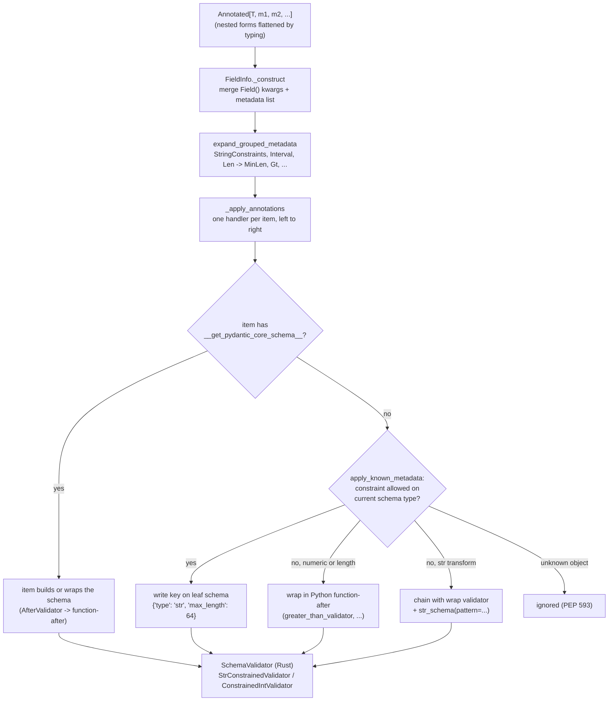

# Composable Type Constraints with typing.Annotated, Field(), StringConstraints, and Reusable Domain Types

> [!summary] Claim
> In Pydantic `2.14.3`, a constraint written as `Annotated` metadata runs in Rust only when `GenerateSchema` can write it as a key on a leaf `CoreSchema` (`str`, `int`, `decimal`, `list`), so a reusable domain type stays callback-free only while every constraint is known, sits before any function validator, and targets a type that owns that key; anything else silently becomes a Python after-validator with a different error type, a different JSON Schema, and sometimes a `TypeError` instead of a `ValidationError`.

Part of [Pydantic v2 Internals and Validation](README.md) in [API Engineering](../README.md).

## TL;DR

- Mechanism: `typing` flattens nested `Annotated` (innermost metadata first), `FieldInfo._construct` merges `Field()` instances, `expand_grouped_metadata` unrolls `StringConstraints`, `Interval`, and `Len`, and `apply_known_metadata` writes each constraint as a key on the leaf `CoreSchema` that `StrConstrainedValidator` or `ConstrainedIntValidator` enforces in Rust (`pydantic 2.14.3 pydantic/_internal/_known_annotated_metadata.py, apply_known_metadata`).
- Contract rule: metadata is applied left to right and a later value for the same key overwrites an earlier one, so `Annotated[PositiveInt, Field(gt=-5)]` accepts `-1`; a reusable type is a contract only if nobody can append to it.
- Trap: the Rust string pipeline is fixed as strip -> `ascii_only` -> length -> `pattern` -> case fold, so `StringConstraints(to_upper=True, pattern=r"^[A-Z]{3}$")` rejects `usd`, and `max_length=1` with `to_upper=True` returns `SS` for `\u00df` (`pydantic-core 2.50.4 src/validators/string.rs, StrConstrainedValidator::validate`).
- Portability fact: the default `rust-regex` engine treats `$` as end of input and has no look-around, while `regex_engine="python-re"` lets `^[A-Z]{3}$` accept `"USD\n"` because Python `$` also matches before a trailing newline (measured on CPython `3.14.6`; Python `re` documentation).
- When not to use it: cross-field rules, I/O-backed checks, and normalizations that must run before a length check belong in validators (see [[Functional-Validators-Before-After-Wrap-and-Plain]] and [[Model-Validators-ValidationInfo-Context-and-Cross-Field-Invariants]]), and a type that needs its own Rust schema belongs in `__get_pydantic_core_schema__` (see [[Low-Level-Custom-Types-with-Get-Pydantic-Core-Schema]]).

## Mental model



Pydantic reads an `Annotated` form as an ordered list of metadata objects after `typing` has already flattened nesting, and `FieldInfo._construct` folds any `Field()` calls into one `FieldInfo` whose `metadata` list keeps the constraint objects in order.
`expand_grouped_metadata` unrolls every `GroupedMetadata` (`StringConstraints`, `Interval`, `Len`, and the constraint part of a `Field()`), and `_apply_annotations` turns the list into a chain of handlers in which each item first asks the inner handler for a schema and then modifies it, so the leftmost item touches the schema first.
An item with `__get_pydantic_core_schema__` (every functional validator and `GetPydanticSchema`, but not `Strict`, `Gt`, or `StringConstraints`) can replace or wrap the schema; anything else goes to `apply_known_metadata`, which writes the constraint as a key when the current schema type is in `CONSTRAINTS_TO_ALLOWED_SCHEMAS[constraint]`, wraps the schema in a Python after-validator or a `chain` when it is not, and ignores objects it does not recognize, as PEP 593 requires.
The Rust validator built from the final schema then enforces the keys with no Python frames, which is the whole reason to prefer this path.

## How it works

### Step 1: `typing.Annotated` is ordered, flattened, and never deduplicated

PEP 593 requires at least two arguments, a valid type first, and says a consumer that does not understand a metadata item "should just ignore it and treat annotated type as the underlying type" (PEP 593).
The `typing` documentation states that nested `Annotated` forms are flattened with the innermost metadata first, that metadata order "matters for equality checks", and that duplicates are not removed (`typing` documentation, `Annotated`).
So `Annotated[Annotated[int, Gt(0)], Lt(10)]` compares equal to `Annotated[int, Gt(0), Lt(10)]` (in the probe `==` is `True` and `is` is `False`, so it is an equal form, not the same object), and the lab-adjacent probe compiled it to `{'type': 'int', 'gt': 0, 'lt': 10}` on CPython `3.14.6`.
Flattening does not reach through a PEP 695 alias: the `typing` documentation gives `type From3To10[T] = Annotated[T, ValueRange(3, 10)]` and asserts `Annotated[From3To10[int], ctype("char")]` is not equal to the flattened form, because flattening would force evaluation of the lazily evaluated `TypeAliasType.__value__` (PEP 695 "Runtime Type Alias Class").
`get_type_hints` strips the metadata unless `include_extras=True` is passed, which is why tools that introspect hints themselves can lose every constraint without an error (`typing` documentation, `get_type_hints`).

### Step 2: `Field()` is a constraint bag plus field-only attributes

`Field(gt=0, max_length=64, pattern=...)` does not store `gt` as an attribute; `FieldInfo._collect_metadata` pops each key found in `FieldInfo.metadata_lookup` and turns it into a metadata object: `gt` -> `annotated_types.Gt`, `min_length` -> `annotated_types.MinLen`, `strict` -> `pydantic.types.Strict`, `allow_inf_nan` -> `AllowInfNan`, `fail_fast` -> `FailFast`, while keys mapped to `None` (`pattern`, `max_digits`, `decimal_places`, `union_mode`, `coerce_numbers_to_str`) are bundled into one `_PydanticGeneralMetadata` object (`pydantic 2.14.3 pydantic/fields.py, FieldInfo._collect_metadata`).
`FieldInfo._construct` walks the `Annotated` items left to right: a `FieldInfo` contributes its `metadata` list and its explicitly set attributes (`_attributes_set`), a `@deprecated` object sets `deprecated`, and every other object is appended to the merged metadata list; dict-valued `json_schema_extra` from several `Field()` calls is merged with later keys winning, and mixing a dict with a callable emits a `UserWarning` and drops the callable (`pydantic 2.14.3 pydantic/fields.py, FieldInfo._construct`).
For non-constraint attributes the last `Field()` wins: `Annotated[int, Field(description="x"), Field(description="y")]` ends with `description == "y"` (probe on CPython `3.14.6`).
When a field also has an assignment, `f: Annotated[int, Gt(5)] = Field(gt=1)`, `FieldInfo.from_annotated_attribute` prepends the assignment's metadata ("HACK 1" in the source), so the list is `[Gt(gt=1), Gt(gt=5)]` and `gt=5` from the annotation wins (`pydantic 2.14.3 pydantic/fields.py, FieldInfo.from_annotated_attribute`); the maintainers track this inconsistency as open issue `pydantic/pydantic#10507`, possibly deferred to v3.

Some `Field()` arguments describe the field, not the type: `UNSUPPORTED_STANDALONE_FIELDINFO_ATTRIBUTES` lists `alias`, `validation_alias`, `serialization_alias`, `default`, `default_factory`, `exclude`, `deprecated`, `repr`, `validate_default`, `frozen`, `init`, `init_var`, and `kw_only` (`pydantic 2.14.3 pydantic/_internal/_generate_schema.py, UNSUPPORTED_STANDALONE_FIELDINFO_ATTRIBUTES`).
When one of them reaches `_apply_single_annotation` outside a direct field annotation (a PEP 695 alias, a union member, a `TypeAdapter`), Pydantic emits `UnsupportedFieldAttributeWarning` and ignores it, except that `default` and `default_factory` are reported only while a model is being built, because a bare `TypeAdapter` can still use them (`pydantic 2.14.3 pydantic/_internal/_generate_schema.py, _get_unsupported_field_info_attributes`; probe: `TypeAdapter(Annotated[int, Field(alias="x")])` warns, `TypeAdapter(Annotated[int, Field(default=5)])` does not); the lab proves that `type DefaultedCount = Annotated[int, Field(default=5, gt=0)]` warns once and leaves the field required.
The docs state the reason: honoring field-specific metadata inside a named alias "would require eagerly inspecting the type alias's `__value__`", which would stop the alias from becoming a JSON Schema definition (`pydantic 2.14.3 docs/concepts/types.md`, "Named type aliases").
The same docs warn that `Annotated[int, Field(deprecated=True)] | None` attaches `Field()` to the `int` member only, so `deprecated` has no effect, while `Annotated[int | None, Field(deprecated=True)]` applies to the field (`pydantic 2.14.3 docs/concepts/fields.md`, "The annotated pattern").
Static type checkers synthesize `__init__` from `default`, `default_factory`, and `alias` only in the assignment form, which is why the docs recommend assignment for those three and `Annotated` for everything else.

### Step 3: grouped metadata is unrolled before lowering

`annotated_types.GroupedMetadata` is a `runtime_checkable` protocol, and Pydantic avoids the slow `isinstance` check by testing `getattr(annotation, "__is_annotated_types_grouped_metadata__", False) is True` (`pydantic 2.14.3 pydantic/_internal/_known_annotated_metadata.py, _is_grouped_metadata`).
`Interval(gt=0, le=10_000)` yields `Gt(0)` and `Le(10000)`, and `Len(2, 5)` yields `MinLen(2)` and `MaxLen(5)` (`annotated-types 0.8.0 annotated_types/__init__.py, Interval.__iter__, Len.__iter__`).
`StringConstraints` is a frozen dataclass subclassing `GroupedMetadata` whose `__iter__` yields `MinLen`, `MaxLen`, `Strict`, and one `_PydanticGeneralMetadata` carrying `strip_whitespace`, `to_upper`, `to_lower`, `pattern`, and `ascii_only`, each only when not `None` (`pydantic 2.14.3 pydantic/types.py, StringConstraints.__iter__`).
`constr()` and `conint()` simply return `Annotated[str, StringConstraints(...)]` and `Annotated[int, Strict(...), Interval(...), MultipleOf(...)]`, and their docstrings mark them "Discouraged" and slated for deprecation in Pydantic 3.0 because a call expression in an annotation is opaque to static analysis (`pydantic 2.14.3 pydantic/types.py, constr, conint`).
The named aliases are one-liners in the same file: `PositiveInt = Annotated[int, annotated_types.Gt(0)]`, `NonNegativeInt = Annotated[int, annotated_types.Ge(0)]`, `StrictInt = Annotated[int, Strict()]`, `FiniteFloat = Annotated[float, AllowInfNan(False)]` (`pydantic 2.14.3 pydantic/types.py`).

### Step 4: the handler chain decides which engine runs each constraint

`GenerateSchema._annotated_schema` unpacks `Annotated` and calls `_apply_annotations(source_type, annotations)`, which wraps a base handler once per item through `_get_wrapped_inner_schema`; each wrapper either calls the item's own `__get_pydantic_core_schema__(source, handler)` or calls the inner handler and then `_apply_single_annotation` (`pydantic 2.14.3 pydantic/_internal/_generate_schema.py, _apply_annotations, _get_wrapped_inner_schema`).
`_apply_single_annotation` recurses into a `FieldInfo`'s metadata, applies a `nullable` or `missing-sentinel` schema's metadata to its inner schema (so `Annotated[int | None, Gt(0)]` and `Annotated[int, Gt(0)] | None` both compile to `{'type': 'nullable', 'schema': {'type': 'int', 'gt': 0}}`), and, when the schema carries a `ref`, copies it under a new ref `ref + "_" + repr(metadata)` so `Annotated[Inner, Strict()]` becomes a distinct definition (`__main__.Inner:<id>_Strict(strict=True)` in the probe) (`pydantic 2.14.3 pydantic/_internal/_generate_schema.py, _apply_single_annotation`).
For a model field, `_common_field_schema` passes `field_info.metadata + validators_from_decorators`, so `@field_validator` functions always sit to the right of every `Annotated` constraint (`pydantic 2.14.3 pydantic/_internal/_generate_schema.py, _common_field_schema`).

`apply_known_metadata` is the lowering step (`pydantic 2.14.3 pydantic/_internal/_known_annotated_metadata.py, apply_known_metadata`):

- `collect_known_metadata` converts `Gt`, `Ge`, `Lt`, `Le`, `MultipleOf`, `MinLen`, `MaxLen` and every `PydanticMetadata` into a `{constraint: value}` dict and drops `None` values.
- If `schema["type"]` is in `CONSTRAINTS_TO_ALLOWED_SCHEMAS[constraint]`, the value is written straight onto the schema dict: `str` accepts `min_length`, `max_length`, `strict`, `strip_whitespace`, `to_lower`, `to_upper`, `pattern`, `coerce_numbers_to_str`, `ascii_only`; `int` accepts `gt`, `ge`, `lt`, `le`, `multiple_of`, `strict`; `float` adds `allow_inf_nan`; `decimal` adds `max_digits` and `decimal_places`; `list`, `tuple`, `set`, `dict` accept lengths, `strict`, and `fail_fast`; `date`, `time`, `datetime` accept the four inequalities and `strict`; `union` accepts only `union_mode`.
- `strict` on a `function-before`, `function-wrap`, or `function-after` schema is pushed into the wrapped schema, so `Strict()` survives being placed after a validator; no other constraint gets that treatment.
- A numeric or length constraint on a schema that does not own it becomes `no_info_after_validator_function(partial(NUMERIC_VALIDATOR_LOOKUP[c], ...), schema)`, a Python function from `pydantic/_internal/_validators.py` such as `greater_than_validator`, and records a JSON Schema update keyed by the raw constraint name (`minLength`/`maxLength`/`minItems`/`maxItems` are translated, `gt`, `ge`, `lt`, `le`, `multiple_of` are not).
- A string transform (`pattern`, `strip_whitespace`, `to_lower`, `to_upper`, `coerce_numbers_to_str`, `ascii_only`) on a non-`str` schema becomes a `chain` of the original schema and a wrap validator around `str_schema(**{constraint: value})`, which converts the inner `*_type` error into `TypeError("Unable to apply constraint ...")`; `Annotated[list[int], Field(pattern="x")]` raises that `TypeError` at validation time, not at schema build.
- `Predicate` and `Not` become Python after-validators that raise `predicate_failed` or `not_operation_failed`.
- Any other object returns `None`, and the schema is left unchanged.

The consequence is that the position of a constraint relative to a function validator chooses the engine: `Annotated[int, Field(gt=0), AfterValidator(f)]` compiles to `function-after` around `{'type': 'int', 'gt': 0}`, while `Annotated[int, AfterValidator(f), Field(gt=0)]` compiles to `function-after(greater_than_validator)` around `function-after(f)` around a bare `int` (probe on CPython `3.14.6`), and the measurement in Numbers and limits puts the second form at `5.9x` the cost of the Rust-lowered form over 1000 items.

### Step 5: what the Rust validators actually do

`StrValidator::build` returns a shared static `STRICT_STR_VALIDATOR` or `LAX_STR_VALIDATOR` when no constraint is set and `coerce_numbers_to_str` is off, and a `StrConstrainedValidator` otherwise; each field falls back to the matching `ConfigDict` key through `schema_or_config` (`str_min_length`, `str_max_length`, `str_strip_whitespace`, `str_to_lower`, `str_to_upper`, `regex_engine`), so a field-level `max_length` overrides `ConfigDict(str_max_length=...)` (`pydantic-core 2.50.4 src/validators/string.rs, StrValidator::build, StrConstrainedValidator::build`).
`StrConstrainedValidator::validate` runs a fixed pipeline: validate the input as `str` (strict or lax), `trim()` if `strip_whitespace`, reject non-ASCII if `ascii_only`, count `chars()` once if any length bound is set and compare with `min_length` then `max_length`, run `pattern.is_match`, and only then apply `to_lowercase()` (checked first) or `to_uppercase()` (`pydantic-core 2.50.4 src/validators/string.rs, StrConstrainedValidator::validate`).
Three facts follow from that code and are proven in the lab: length is counted in Unicode scalar values, so `"e\u0301"` has length `2` while `"\u00e9"` and `"\U0001f600"` have length `1`; case folding happens after the length and pattern checks, so its output is never revalidated; and when both `to_lower` and `to_upper` are set, `to_lower` wins (probe: `"Ab"` -> `"ab"`).
`strip_whitespace` uses Rust `str::trim`, which in the probe removed `\u00a0` and `\u3000` (`"\u00a0abc\u3000"` became `"abc"`) but left the zero-width space in `"\u200babc"` unchanged (CPython `3.14.6`).
`Pattern::compile` uses the Rust `regex` crate unless `regex_engine="python-re"` is configured or the pattern is an already compiled `re.Pattern`, which keeps the Python engine "so that any flags, etc. are preserved"; compiled Rust patterns are shared through a process-wide `LruCache` of `50` entries behind a `Mutex` (`pydantic-core 2.50.4 src/validators/string.rs, Pattern::compile, REGEX_CACHE`).
`Pattern::is_match` calls `Regex::is_match` or Python `re.Pattern.search`, so both engines search rather than full-match and an unanchored `[A-Z]{3}` accepts `"xxUSDxx"`; JSON Schema `pattern` is likewise "not implicitly anchored" (JSON Schema Validation 2020-12 Section 6.3.3).

`IntValidator::build` switches to `ConstrainedIntValidator` when any of `multiple_of`, `le`, `lt`, `ge`, `gt` is present, where `ConstrainedIntValidator::build` converts each bound through `validate_as_int` (a lax `validate_int`) at build time (so `Gt(0.5)` on `int` fails with `SchemaError` "`'gt' must be coercible to an integer`") and rejects `multiple_of <= 0`; at validation time it checks `multiple_of`, `le`, `lt`, `ge`, `gt` in that order and returns the first failure only, on an `Int` that is `i64` or `BigInt` (`pydantic-core 2.50.4 src/validators/int.rs, IntValidator::build, validate_as_int, ConstrainedIntValidator::build, ConstrainedIntValidator::validate`).
The float validator implements `multiple_of` as `abs(x - round(x / m) * m) <= 1e-9`, an absolute tolerance, so `0.3` is a multiple of `0.1` and `0.35` is not (`pydantic-core 2.50.4 src/validators/float.rs, ConstrainedFloatValidator::validate`).
`allow_inf_nan` defaults to `true` for `float` and `false` for `Decimal`, and a decimal schema with `allow_inf_nan=True` plus `max_digits` or `decimal_places` is a build error (`pydantic-core 2.50.4 src/validators/float.rs, FloatBuilder::build`; `src/validators/decimal.rs, DecimalValidator::build`).
The decimal validator compares digit counts both raw and with trailing zeros removed and fails only if both exceed the limit, so `Decimal("1.100")` passes `decimal_places=2` (`pydantic-core 2.50.4 src/validators/decimal.rs, DecimalValidator::validate`).

### Step 6: reuse across models, PEP 695 aliases, and JSON Schema

An implicit alias (`NonEmptyStr = Annotated[...]`) is substituted at every use and is inlined into each field's JSON Schema; a PEP 695 alias (`type Sku = Annotated[...]`) goes through `GenerateSchema._type_alias_type_schema`, which creates a `definition-ref` keyed by the alias, so the lab's `Invoice.model_json_schema()` contains one `$defs.Sku` referenced from `LineItem.sku` and `Invoice.replaces_sku` (`pydantic 2.14.3 pydantic/_internal/_generate_schema.py, _type_alias_type_schema`); the docs mark full support for named aliases as added in `v2.11` (`pydantic 2.14.3 docs/concepts/types.md`).
`GenerateJsonSchema.ValidationsMapping.numeric` maps `gt` -> `exclusiveMinimum`, `ge` -> `minimum`, `lt` -> `exclusiveMaximum`, `le` -> `maximum`, and `multiple_of` -> `multipleOf`, but only for keys that live on a numeric leaf schema (`pydantic 2.14.3 pydantic/json_schema.py, GenerateJsonSchema.ValidationsMapping`).
The Python fallback path writes `pydantic_js_updates` with the raw key, so `Annotated[int, AfterValidator(f), Field(gt=0)]` emits `{"type": "integer", "gt": 0}`, a keyword JSON Schema 2020-12 does not define, while the Rust-lowered order emits `{"type": "integer", "exclusiveMinimum": 0}` (lab test `test_constraint_after_function_validator_falls_back_to_python`); upstream tracks this as the open issue `pydantic/pydantic#11576` "Invalid JSON Schema generated when constraints and validators are involved", and the fix pull requests `#13116` and `#13417` were closed without merging (as of 2026-11).

## Numbers and limits

| Metric or parameter | Value | Source or measurement condition |
|---|---|---|
| String length unit | Unicode scalar values (`str.chars().count()`), not UTF-8 bytes, UTF-16 units, or graphemes | `pydantic-core 2.50.4 src/validators/string.rs, StrConstrainedValidator::validate`; lab `test_length_counts_unicode_code_points` |
| Compiled Rust regex cache | `50` patterns, process-wide `LruCache` behind a `Mutex` | `pydantic-core 2.50.4 src/validators/string.rs, REGEX_CACHE` |
| Rust regex worst case | `O(m * n)` per search in regex size and haystack size; no look-around or backreferences | `regex 1.13.1` crate documentation; lab `test_invalid_bound_fails_at_schema_build` sees the look-around `SchemaError` |
| Float `multiple_of` tolerance | absolute `1e-9` | `pydantic-core 2.50.4 src/validators/float.rs, ConstrainedFloatValidator::validate` |
| `allow_inf_nan` default | `true` for `float`, `false` for `Decimal` | `pydantic-core 2.50.4 src/validators/float.rs`, `src/validators/decimal.rs`; probe: `float("nan")` accepted, `Decimal("NaN")` -> `finite_number` |
| Integer bound width | arbitrary precision (`Int::I64` or `Int::Big`) | `pydantic-core 2.50.4 src/validators/int.rs`; probe: `Gt(10**30)` rejects `10**20` with `greater_than` |
| Errors per constrained `int` | `1` (first failing of `multiple_of`, `le`, `lt`, `ge`, `gt`) | `pydantic-core 2.50.4 src/validators/int.rs, ConstrainedIntValidator::validate`; probe: `20` against `Gt(0), Lt(10), MultipleOf(3)` -> only `multiple_of` |
| Lab `MAX_CENTS` bound | `10**12` | Design choice in the lab, keeps `unit_price * quantity <= 10**16` |
| `list[1000]` of trimmed bounded strings | `31.0` us (Rust `StringConstraints(strip_whitespace=True, min_length=1, max_length=200)`) vs `54.9` us (`AfterValidator` doing `strip` and a `1 <= len <= 200` check) | Re-measured by the fact-checker on 2026-11-12: three separate processes, each reporting the median of `timeit.repeat(number=200, repeat=15)` of `TypeAdapter(list[T]).validate_python(data)` with `data = [f"  item-{i}  " for i in range(1000)]`, middle value reported; launched as `uv run --frozen python bench.py` from `labs/`, Apple M3 Pro, `macOS-27.3-arm64-arm-64bit-Mach-O`, CPython `3.14.6`, `pydantic 2.14.3`, `pydantic-core 2.50.4` (as of 2026-11); the slowest of the three runs was up to `32%` above the fastest for one row, so treat the ratios, not the absolute values, as the result |
| `list[1000]` of positive ints | `17.4` us (`Field(gt=0)`) vs `26.9` us (`AfterValidator` check) vs `103.5` us (identity `AfterValidator` then `Field(gt=0)`) | Same conditions with `data = list(range(1, 1001))`; the third form runs two Python calls per item because `gt` fell back to `greater_than_validator` |
| Single scalar `validate_python` | `197.2` ns vs `234.5` ns (trimmed string `"  item-1  "`), `201.2` ns vs `316.1` ns (`^[A-Z]{3}$` on `"USD"`, Rust vs Python `re`), `189.5` ns vs `205.7` ns (`gt=0` vs an `AfterValidator` check on `5`), `208.8` ns vs `310.8` ns (`gt` before vs after an identity `AfterValidator`) | Same machine, versions, and method with `timeit.repeat(number=20000, repeat=15)`, middle of three medians; per-call `TypeAdapter` overhead dominates single scalars |

## Portability

The brief for this note paused matrix runs on 2026-11-11, so only the workspace interpreter ran the lab; every other cell cites a source and says it was not run.

| Runtime / Component | Behavior and compatibility | Verification source |
|---|---|---|
| CPython `3.14.6` (macOS `27.3` arm64) | All behaviors in this note, `12 passed` | `uv run --frozen pytest tests/f09_pydantic_v2_internals_and_validation/test_annotated_constraints_field_metadata_and_custom_types.py -q` |
| CPython `3.12.16`, `3.13.18` | Not run; the lab's `type Sku = ...` statement needs `>= 3.12` (PEP 695, `Python-Version: 3.12`), and the workspace pins `requires-python = ">=3.12,<3.16"` | PEP 695; `labs/pyproject.toml` |
| CPython `3.14.10`, `3.15.2` | Not run; `pydantic 2.14.3` declares classifiers through `3.15`, while the installed `pydantic-core 2.50.4` metadata lists classifiers through `3.14` only | `pydantic-2.14.3.dist-info/METADATA`, `pydantic_core-2.50.4.dist-info/METADATA` in the lab venv |
| Free-threaded CPython `3.15.2t` | Not run; the changelog embedded in the `pydantic 2.14.3` package metadata lists "Add experimental support for free threading" (`#11516`) and "Require test suite to pass with free threading" (`#12537`), and the shared regex cache is guarded by a `Mutex` locked through `lock_py_attached` | `pydantic-2.14.3.dist-info/METADATA`; `pydantic-core 2.50.4 src/validators/string.rs, REGEX_CACHE` |
| `regex_engine="python-re"` anchors | `$` matches before a trailing newline on every CPython; `\z` exists only from `3.14`, while `\Z` works on all versions in the matrix | Python `re` documentation ("Added in version 3.14" for `\z`); lab `test_dollar_anchor_differs_between_regex_engines` on `3.14.6` |
| `pydantic` minor versions | Named PEP 695 aliases fully supported from `v2.11`; assignment-vs-`Annotated` precedence is an open v2 bug that may change in v3 | `pydantic 2.14.3 docs/concepts/types.md`; `pydantic/pydantic#10507` |
| ASGI servers (Uvicorn, Hypercorn, Granian) and HTTP/1.1, HTTP/2, HTTP/3 | Not run; validation happens on the decoded body after the server delivers it, and the lab only uses in-process `httpx.ASGITransport` with `fastapi 0.162.0` | Lab `test_fastapi_maps_constraint_failures_to_422_and_type_error_to_500` |

## Worked example

The [implementation](../labs/src/api_labs/f09_pydantic_v2_internals_and_validation/annotated_domain_types.py) defines `NonEmptyStr`, `PositiveCents`, `CurrencyCode`, a PEP 695 `Sku`, and an `Interval`-based `Quantity`, composes them into `LineItem` and `Invoice`, and exposes a walker that lists every Python callback node in a `CoreSchema`.
The [test](../labs/tests/f09_pydantic_v2_internals_and_validation/test_annotated_constraints_field_metadata_and_custom_types.py) proves the lowering, the absence of callbacks, the string pipeline order, code-point length, the regex-engine anchor difference, last-wins overwriting, the Python fallback (error type and JSON Schema change), the union `TypeError`, build-time bound checks, alias behavior, and the `422` vs `500` split in FastAPI.

### Implementation (`labs/src/api_labs/f09_pydantic_v2_internals_and_validation/annotated_domain_types.py`)

```python
"""Reusable Annotated domain types whose constraints execute inside pydantic-core.

Every constraint below is lowered by GenerateSchema into keys on a leaf CoreSchema
(`str`, `int`), so the Rust validators StrConstrainedValidator and
ConstrainedIntValidator enforce them without calling back into Python.
"""

from __future__ import annotations

from typing import TYPE_CHECKING, Annotated, Any, cast

import annotated_types as at
from fastapi import FastAPI
from pydantic import BaseModel, ConfigDict, Field, StringConstraints

if TYPE_CHECKING:
    from collections.abc import Iterable, Iterator

MAX_CENTS = 10**12
"""Upper bound for a single monetary amount: 10 billion units of a 2-decimal currency."""

NonEmptyStr = Annotated[str, StringConstraints(strip_whitespace=True, min_length=1, max_length=200)]
"""Trimmed text; whitespace-only input fails `string_too_short` because trimming runs first."""

PositiveCents = Annotated[int, Field(strict=True, gt=0, le=MAX_CENTS)]
"""Integer minor units; strict mode rejects `"5"`, `5.0`, and `True`."""

CurrencyCode = Annotated[str, StringConstraints(strict=True, pattern=r"^[A-Z]{3}$")]
"""ISO 4217 alphabetic code shape; case-sensitive on purpose (see UPPERCASING_CURRENCY_TRAP)."""

UPPERCASING_CURRENCY_TRAP = Annotated[str, StringConstraints(to_upper=True, pattern=r"^[A-Z]{3}$")]
"""Looks like it accepts `usd`, but pydantic-core checks `pattern` before applying `to_upper`."""

type Sku = Annotated[str, StringConstraints(pattern=r"^[A-Z0-9][A-Z0-9-]{3,31}$")]
"""PEP 695 alias: one `definitions` entry in CoreSchema and one `$defs` entry in JSON Schema."""

Quantity = Annotated[int, at.Interval(gt=0, le=10_000)]
"""annotated-types GroupedMetadata, expanded into Gt and Le before lowering."""


class LineItem(BaseModel):
    """One invoice line; every field is a reusable domain type."""

    sku: Sku
    description: NonEmptyStr
    unit_price: PositiveCents
    quantity: Quantity


class Invoice(BaseModel):
    """Invoice whose list-level bounds also lower into the Rust `list` validator."""

    currency: CurrencyCode
    lines: Annotated[list[LineItem], Field(min_length=1, max_length=100)]
    tags: list[NonEmptyStr] = Field(default_factory=list)
    replaces_sku: Sku | None = None


class PythonReCurrency(BaseModel):
    """Same CurrencyCode type, but compiled with the Python `re` engine."""

    model_config = ConfigDict(regex_engine="python-re")

    currency: CurrencyCode


class UnionBoundPayload(BaseModel):
    """A bound on a union cannot lower into a member, so it becomes a Python after-validator."""

    value: Annotated[int | str, at.Gt(0)]


def iter_schema_nodes(node: Any) -> Iterator[dict[str, Any]]:
    """Yield every CoreSchema dict reachable from `node`, depth first."""
    if isinstance(node, dict):
        mapping = cast("dict[str, Any]", node)
        if isinstance(mapping.get("type"), str):
            yield mapping
        for key, value in mapping.items():
            if key != "metadata":
                yield from iter_schema_nodes(value)
    elif isinstance(node, list | tuple):
        for item in cast("Iterable[Any]", node):
            yield from iter_schema_nodes(item)


def python_callback_nodes(schema: Any) -> list[str]:
    """Return the CoreSchema node types that call a Python function during validation."""
    return [
        node["type"]
        for node in iter_schema_nodes(schema)
        if node["type"].startswith("function-") or node["type"] == "chain"
    ]


def leaf_constraints(schema: Any) -> dict[str, Any]:
    """Return a CoreSchema node without its `metadata` key, for readable comparisons."""
    return {key: value for key, value in schema.items() if key != "metadata"}


def invoice_total_cents(invoice: Invoice) -> int:
    """Sum the line totals; inputs are already bounded, so the product cannot be unbounded."""
    return sum(line.unit_price * line.quantity for line in invoice.lines)


def build_invoice_app() -> FastAPI:
    """FastAPI app: domain types yield `422` on bad input; the union bound yields `500`."""
    app = FastAPI()

    @app.post("/v1/invoices")
    async def create_invoice(invoice: Invoice) -> dict[str, int | str]:
        return {"currency": invoice.currency, "total_cents": invoice_total_cents(invoice)}

    @app.post("/v1/union-bound")
    async def union_bound(payload: UnionBoundPayload) -> dict[str, int | str]:
        return {"value": payload.value}

    return app
```

### Test (simplified excerpt of the test module)

```python
@pytest.mark.unit
def test_invoice_schema_has_no_python_callbacks() -> None:
    assert python_callback_nodes(Invoice.__pydantic_core_schema__) == []
    hybrid = TypeAdapter(Annotated[str, AfterValidator(str.strip), Field(max_length=3)])
    assert python_callback_nodes(hybrid.core_schema) == ["function-after", "function-after"]


@pytest.mark.unit
def test_rust_string_pipeline_order() -> None:
    assert TypeAdapter(NonEmptyStr).validate_python("  ab  ") == "ab"
    one_char_upper = TypeAdapter(Annotated[str, StringConstraints(max_length=1, to_upper=True)])
    assert one_char_upper.validate_python("\u00df") == "SS"
    with pytest.raises(ValidationError) as caught:
        TypeAdapter(UPPERCASING_CURRENCY_TRAP).validate_python("usd")
    assert error_summary(caught.value) == [("string_pattern_mismatch", ())]
    assert TypeAdapter(UPPERCASING_CURRENCY_TRAP).validate_python("USD") == "USD"


@pytest.mark.unit
def test_later_metadata_overwrites_earlier_bound() -> None:
    widened = TypeAdapter(Annotated[PositiveInt, Field(gt=-5)])
    assert leaf_constraints(widened.core_schema) == {"type": "int", "gt": -5}
    assert widened.validate_python(-1) == -1
    tightened = TypeAdapter(Annotated[int, at.Ge(0), at.Ge(5)])
    assert leaf_constraints(tightened.core_schema) == {"type": "int", "ge": 5}


@pytest.mark.unit
def test_constraint_after_function_validator_falls_back_to_python() -> None:
    rust_first = TypeAdapter(Annotated[str, Field(max_length=3), AfterValidator(str.strip)])
    python_after = TypeAdapter(Annotated[str, AfterValidator(str.strip), Field(max_length=3)])
    with pytest.raises(ValidationError) as rust_err:
        rust_first.validate_python("abcd")
    with pytest.raises(ValidationError) as python_err:
        python_after.validate_python("abcd")
    assert error_summary(rust_err.value) == [("string_too_long", ())]
    assert error_summary(python_err.value) == [("too_long", ())]
    gt_after = TypeAdapter(Annotated[int, AfterValidator(lambda v: v), Field(gt=0)])
    gt_first = TypeAdapter(Annotated[int, Field(gt=0), AfterValidator(lambda v: v)])
    assert gt_after.json_schema() == {"type": "integer", "gt": 0}
    assert gt_first.json_schema() == {"type": "integer", "exclusiveMinimum": 0}


@pytest.mark.unit
def test_bound_on_union_raises_type_error_not_validation_error() -> None:
    adapter = TypeAdapter(Annotated[int | str, at.Gt(0)])
    with pytest.raises(ValidationError):
        adapter.validate_python(0)
    with pytest.raises(TypeError, match="Unable to apply constraint 'gt'"):
        adapter.validate_python("abc")
```

### Captured output

Run from `labs/` on CPython `3.14.6`, `macOS-27.3-arm64-arm-64bit-Mach-O`, with `pydantic 2.14.3`, `pydantic-core 2.50.4`, and `fastapi 0.162.0` from `uv.lock`:

```text
$ uv run --frozen pytest tests/f09_pydantic_v2_internals_and_validation/test_annotated_constraints_field_metadata_and_custom_types.py -q
............                                                             [100%]
12 passed in 3.60s
```

The test asserts the `(type, loc)` pairs below for the invalid invoice body in `test_invoice_errors_carry_constraint_types_and_locations`; a separate probe run of the same body on the same interpreter printed them with their `ctx`, one error per failing leaf from one `model_validate_json` call:

```text
string_pattern_mismatch ('currency',) {'pattern': '^[A-Z]{3}$'}
string_too_short ('lines', 0, 'description') {'min_length': 1}
int_type ('lines', 0, 'unit_price') None
greater_than ('lines', 0, 'quantity') {'gt': 0}
string_too_short ('tags', 0) {'min_length': 1}
```

## Pitfalls

> [!warning] Case folding after the pattern check
> - Trigger: `Annotated[str, StringConstraints(to_upper=True, pattern=r"^[A-Z]{3}$")]` written to "accept any case and normalize", which is the shape of the `constr` example in the Pydantic `2.14.3` docstring.
> - Symptom: `usd` fails with `string_pattern_mismatch`, because `StrConstrainedValidator::validate` checks `pattern` before `to_uppercase()`; separately, `max_length=1` with `to_upper=True` returns `SS` for `\u00df`, so the stored value violates the declared bound (`pydantic-core 2.50.4 src/validators/string.rs, StrConstrainedValidator::validate`).
> - Fix: write the pattern for the pre-fold input (`^[A-Za-z]{3}$`) and re-check the folded value in an `AfterValidator`, or reject non-canonical input outright as the lab's `CurrencyCode` does.

> [!warning] Appending metadata to a reusable type silently widens it
> - Trigger: `Annotated[PositiveInt, Field(gt=-5)]`, `Annotated[Quantity, Field(le=10**9)]`, or an `f: Annotated[int, Ge(0)] = Field(ge=1)` assignment that the author expects to tighten.
> - Symptom: the later key overwrites the earlier one on the leaf schema (`{'type': 'int', 'gt': -5}` accepts `-1`), and for the assignment form the annotation wins instead, the open inconsistency `pydantic/pydantic#10507`.
> - Fix: treat domain types as closed; add a CI check that walks `model_fields[...].metadata` and fails on two values for one constraint key, and tighten with a new named type instead of stacking.

> [!warning] A constraint placed after a validator changes engine, error type, and JSON Schema
> - Trigger: `Annotated[str, AfterValidator(str.strip), Field(max_length=3)]`, or a `@field_validator` combined with an `Annotated` constraint on a schema the constraint cannot attach to.
> - Symptom: `max_length` becomes Python `max_length_validator`, the error type changes from `string_too_long` to `too_long` (breaking clients that branch on `type`), `gt` appears in JSON Schema as the non-standard key `gt`, and the measured list cost rises from `17.4` us to `103.5` us per 1000 ints.
> - Fix: put every constraint before every function validator, and assert in tests that `python_callback_nodes(Model.__pydantic_core_schema__)` is empty for hot models.

> [!warning] Constraints on unions raise `TypeError`, which FastAPI turns into `500`
> - Trigger: `Annotated[int | str, Gt(0)]`, `Annotated[str, Field(gt=0)]`, or `Annotated[list[int], Field(pattern="x")]`.
> - Symptom: `union` accepts only `union_mode`, so `gt` becomes `greater_than_validator`, which re-raises Python's comparison `TypeError` as `TypeError("Unable to apply constraint 'gt' to supplied value abc")`; it is not a `ValidationError`, so the lab's FastAPI route returns `500 Internal Server Error` for `{"value": "abc"}` while `{"value": 0}` gets `422` (`pydantic 2.14.3 pydantic/_internal/_validators.py, greater_than_validator`).
> - Fix: constrain each union member (`Annotated[int, Gt(0)] | str`), never the union; the error is attacker-triggerable, so grep for constraints on unions before shipping.

> [!warning] Unanchored patterns and engine-dependent `$`
> - Trigger: `pattern=r"[A-Z]{3}"`, or `pattern=r"^[A-Z]{3}$"` under `regex_engine="python-re"` (or a precompiled `re.Pattern`, which forces the Python engine).
> - Symptom: both engines search, so `"xxUSDxx"` passes the unanchored form; under Python `re`, `$` also matches before a trailing newline, so `"USD\n"` passes and reaches logs, SQL, or HTTP headers; the Python engine also restores backtracking, the class of bug behind `CVE-2024-3772` (ReDoS in Pydantic email validation, affected `>= 2.0.0, < 2.4.0` and `< 1.10.13`, GHSA-mr82-8j83-vxmv).
> - Fix: anchor every pattern, keep the default `rust-regex` engine, and use `\Z` (or `\z` on `3.14+`) when the Python engine is unavoidable.

> [!warning] Field-only metadata inside aliases and union members is dropped
> - Trigger: `type Price = Annotated[int, Field(default=0, alias="p")]`, or `Annotated[int, Field(deprecated=True)] | None`.
> - Symptom: `UnsupportedFieldAttributeWarning` once at class creation, then a required field with no alias; with `filterwarnings = error` in tests the class fails to import, without it the warning scrolls past.
> - Fix: keep `default`, `default_factory`, `alias`, `deprecated`, `frozen`, and `exclude` on the field (assignment form), and keep only type constraints and JSON metadata in reusable aliases.

## Security and robustness

- `API4:2023 Unrestricted Resource Consumption`: every string and collection that reaches a database or a downstream call needs an explicit upper bound (`max_length`, `Field(max_length=...)` on lists) or a global `ConfigDict(str_max_length=...)`; the bound is enforced after JSON parsing, so it limits retained work and storage, not body size, which belongs to the server or proxy.
- Trimming happens before the length check, so whitespace-only input cannot satisfy `min_length=1`, but the probe showed the zero-width space `\u200b` is not stripped and still counts toward `min_length`; identifier fields need an allow-list `pattern` or `ascii_only=True` (`string_not_ascii`), not only `strip_whitespace`.
- Length is counted in code points, so any downstream limit measured in UTF-8 bytes (a fixed byte buffer, a byte-limited header, a byte-sized column) can receive up to `4 * max_length` bytes; bound bytes separately where that matters.
- The Rust engine's `O(m * n)` bound removes regex backtracking as a DoS vector for `pattern`, and it rejects look-around at schema build, which turns a latent ReDoS into a startup failure; keep `regex_engine` at its default in shared config.
- Strict leaf types (`PositiveCents` with `strict=True`) close coercion paths: JSON `"5"`, `5.0`, and `true` are rejected with `int_type`, which matters for money where lax mode would accept `5.0` as `5` (see [[Lax-vs-Strict-Validation-Modes-and-Coercion-Tables]]).
- Defense in depth: a constraint documents a shape, not a business rule, so `CurrencyCode` proves three uppercase letters, not that the code is an active ISO 4217 currency; membership checks go in a validator with a frozen set or an `enum`.
- Never let a constraint raise `TypeError` on attacker input; constrain union members individually and treat `500` responses from validation as a bug class worth an alert.

## The principal's view

The decision is where the organization keeps the canonical definition of its value types: a shared `types` module of `Annotated` aliases is cheap, statically visible to type checkers as plain `str` and `int`, and fast because it lowers to Rust, but it is open to extension by any caller who appends metadata.
A staff engineer makes those aliases closed by policy and by test: no stacking on shared types, constraints before validators, a schema walker in CI that fails when a hot model gains a `function-*` node, and error `type` strings treated as part of the public API because clients branch on them.
Use PEP 695 `type` aliases for types that appear in more than one place in an OpenAPI document, because they become one `$defs` entry that clients can generate a named type from, and keep field-only metadata out of them.
Choose `__get_pydantic_core_schema__` ([[Low-Level-Custom-Types-with-Get-Pydantic-Core-Schema]]) when the value needs its own Python class, serialization, or a check the core cannot express; choose a functional validator when a normalization must precede a length check; choose `msgspec.Meta` or JSON Schema-first code generation when the same constraints must be shared with non-Python services and Pydantic is not the source of truth ([[Pydantic-v2-Performance-Engineering-vs-MsgSpec-and-ORJSON]]).
The trade-off is that the closed-type policy costs flexibility for local exceptions, which teams then meet by defining new named types; that proliferation is the price of having bounds you can audit.

## Interview questions

> [!question] L5: What does `Annotated[int, Field(gt=0)]` compile to, and which code enforces `gt`?
>
> > [!success]- Answer
> > `FieldInfo._collect_metadata` turns `gt=0` into `annotated_types.Gt(0)`.
> > `apply_known_metadata` sees that `gt` is allowed on an `int` schema and writes it as a key, giving `{'type': 'int', 'gt': 0}`.
> > `IntValidator::build` sees a bound and builds `ConstrainedIntValidator`, which compares the parsed `Int` in Rust and raises `greater_than` with `ctx` `{'gt': 0}`.
> >
> > Follow-up: What changes if `gt=0.5` is used on that `int`?

> [!question] L5: Why do the Pydantic docs discourage `conint()` and `constr()`?
>
> > [!success]- Answer
> > They are functions returning `Annotated[...]` forms, so a type checker sees a call expression in an annotation rather than `int` or `str`.
> > Their bodies are just `Annotated[int, Strict(...), Interval(...), MultipleOf(...)]` and `Annotated[str, StringConstraints(...)]`, so nothing is lost by writing the `Annotated` form directly.
> > The docstrings mark both as slated for deprecation in Pydantic 3.0.
> >
> > Follow-up: How does `StringConstraints` reach the core schema if it is not itself a known constraint?

> [!question] L6: Predict the output.
> ```python
> T = Annotated[str, StringConstraints(max_length=1, to_upper=True)]
> print(TypeAdapter(T).validate_python("\u00df"))
> U = Annotated[str, StringConstraints(to_upper=True, pattern=r"^[A-Z]{3}$")]
> print(TypeAdapter(U).validate_python("usd"))
> ```
>
> > [!success]- Answer
> > The first line prints `SS`: length is checked on the one-character input, and `to_uppercase()` runs last without revalidation.
> > The second call raises `ValidationError` with `string_pattern_mismatch`, because the pattern is matched against `usd` before case folding.
> > Both follow from the fixed order in `StrConstrainedValidator::validate`: strip, ASCII, length, pattern, case.
> >
> > Follow-up: How would you accept any case while still guaranteeing three uppercase letters in the stored value?

> [!question] L6: Debug this API: a FastAPI endpoint with `value: Annotated[int | str, Gt(0)]` returns `500` for `{"value": "abc"}`; why, and what is the fix?
>
> > [!success]- Answer
> > A `union` schema accepts only `union_mode`, so `gt` cannot attach to either member and is lowered into the Python `greater_than_validator` after the union.
> > The union validates `"abc"` as `str`, then `"abc" > 0` raises Python `TypeError`, which the validator re-raises as `TypeError("Unable to apply constraint 'gt' ...")`, not as a `ValidationError`.
> > FastAPI only maps `ValidationError` to `422`, so the exception escapes as `500`.
> > The fix is `Annotated[int, Gt(0)] | str`, constraining the member that has an order.
> >
> > Follow-up: How would you find every such field across a large codebase before an attacker does?

> [!question] L6: Why do `Annotated[str, Field(max_length=3), AfterValidator(f)]` and `Annotated[str, AfterValidator(f), Field(max_length=3)]` return different error types for `"abcd"`?
>
> > [!success]- Answer
> > `_apply_annotations` applies items left to right, each wrapping the schema produced so far.
> > In the first form `max_length` lands on the `str` leaf and Rust raises `string_too_long`.
> > In the second form the schema is already `function-after`, which does not own `max_length`, so Pydantic wraps it in Python `max_length_validator`, which raises `too_long` with `field_type` and `actual_length` in `ctx`.
> > The second form also adds a Python call per value; the measurement in Numbers and limits gives `17.4` us vs `103.5` us per 1000 ints for the analogous `gt` case.
> >
> > Follow-up: Which single constraint does Pydantic push through a function schema instead of wrapping it, and why?

> [!question] L6: When does a reusable `Annotated` alias appear as a `$defs` entry in OpenAPI, and what does that cost you?
>
> > [!success]- Answer
> > Only a named alias created with the PEP 695 `type` statement or `TypeAliasType` becomes a definition, because `_type_alias_type_schema` keys a `definition-ref` on the alias.
> > An implicit alias is substituted at each use and inlined into every property.
> > The cost is that Pydantic will not inspect the alias's lazily evaluated `__value__` for field-specific metadata, so `default`, `alias`, and `deprecated` inside it are ignored with `UnsupportedFieldAttributeWarning`.
> >
> > Follow-up: Why does `typing` refuse to flatten `Annotated` through a PEP 695 alias?

> [!question] L7+: Your company has a shared `types.py` of `Annotated` domain types used by 200 services; what governance do you put around it?
>
> > [!success]- Answer
> > Make the types closed: forbid stacking constraints on shared aliases, because later metadata overwrites earlier keys and can widen a bound silently.
> > Enforce it in CI with a walker over `model_fields[...].metadata` that fails on duplicate constraint keys, and a `CoreSchema` walker that fails when a hot model gains `function-*` or `chain` nodes.
> > Treat error `type` strings and JSON Schema output as public API, with snapshot tests, because reordering metadata changes `string_too_long` to `too_long` and `exclusiveMinimum` to `gt`.
> > Publish named PEP 695 aliases so clients get one generated type per domain concept.
> >
> > Follow-up: How do you roll out a tighter bound on `PositiveCents` without breaking stored data or old clients?

> [!question] L7+: A security review finds `pattern=r"^[A-Z]{3}$"` on a header-bound field and a service-wide `regex_engine="python-re"` set to support a look-ahead elsewhere; what is the risk and the remediation?
>
> > [!success]- Answer
> > Under Python `re`, `$` matches before a trailing newline, so `"USD\n"` validates and can inject a line break into logs or a downstream header.
> > The Python engine also brings backtracking back, which is the ReDoS class behind `CVE-2024-3772`, while the default Rust engine guarantees `O(m * n)` searches and rejects look-around at build time.
> > Remediate by restoring the default engine globally, scoping `python-re` to the single field that needs look-ahead via a precompiled `re.Pattern` with `\Z`, and adding a test that `"USD\n"` is rejected.
> >
> > Follow-up: What other input normalizations could make a newline reach the pattern check, and where should a body-size limit live?

> [!question] L7+: When would you not express a rule as an `Annotated` constraint at all?
>
> > [!success]- Answer
> > When the rule spans fields, needs I/O or request context, or depends on a normalization that must happen before a length or pattern check.
> > When the same contract must be enforced by non-Python services, so the source of truth should be a JSON Schema or IDL with generated code.
> > When the value needs its own class, equality, or serialization, which calls for `__get_pydantic_core_schema__`.
> >
> > Follow-up: How do you keep a validator-based rule visible in the published JSON Schema?

## Related

Prerequisites: [[TypeAdapter-for-Validating-and-Serializing-Arbitrary-Types]]

Next: [[Functional-Validators-Before-After-Wrap-and-Plain]]

See also: [[02-Programming-Languages/Python/Python-Backend-Interview-Prep/04-FastAPI]], [[Pydantic-v2-Architecture-CoreSchema-and-Rust-Pydantic-Core]], [[Lax-vs-Strict-Validation-Modes-and-Coercion-Tables]], [[Low-Level-Custom-Types-with-Get-Pydantic-Core-Schema]], [[JSON-Schema-Generation-Internals-and-GenerateJsonSchema]], [[Model-Validators-ValidationInfo-Context-and-Cross-Field-Invariants]], [[Aliases-AliasPath-AliasChoices-and-Bidirectional-Field-Mapping]], [[Pydantic-v2-Performance-Engineering-vs-MsgSpec-and-ORJSON]]

- Lab: `labs/tests/f09_pydantic_v2_internals_and_validation/test_annotated_constraints_field_metadata_and_custom_types.py`

## Further reading

- [PEP 593 - Flexible function and variable annotations](https://peps.python.org/pep-0593/) - defines `Annotated`, its argument rules, and the requirement that unknown metadata be ignored.
- [PEP 695 - Type Parameter Syntax](https://peps.python.org/pep-0695/) - the `type` statement and the lazily evaluated `TypeAliasType` that Pydantic turns into a shared definition.
- [Python `typing` documentation](https://docs.python.org/3/library/typing.html) - flattening order, equality, duplicate retention, `__metadata__`, and `include_extras`.
- [pydantic 2.14.3 `pydantic/_internal/_known_annotated_metadata.py`](https://raw.githubusercontent.com/pydantic/pydantic/v2.14.3/pydantic/_internal/_known_annotated_metadata.py) - `CONSTRAINTS_TO_ALLOWED_SCHEMAS`, `expand_grouped_metadata`, and `apply_known_metadata`, the lowering table and its Python fallbacks.
- [pydantic 2.14.3 `pydantic/_internal/_generate_schema.py`](https://raw.githubusercontent.com/pydantic/pydantic/v2.14.3/pydantic/_internal/_generate_schema.py) - `_apply_annotations`, `_apply_single_annotation`, and `UNSUPPORTED_STANDALONE_FIELDINFO_ATTRIBUTES`.
- [pydantic 2.14.3 `pydantic/fields.py`](https://raw.githubusercontent.com/pydantic/pydantic/v2.14.3/pydantic/fields.py) - `FieldInfo.metadata_lookup`, `_collect_metadata`, `_construct`, and the assignment-ordering hack.
- [pydantic-core 2.50.4 `src/validators/string.rs`](https://raw.githubusercontent.com/pydantic/pydantic/v2.14.3/pydantic-core/src/validators/string.rs) - the fixed string pipeline, regex engine selection, and the `50`-entry regex cache.
- [pydantic-core 2.50.4 `src/validators/int.rs`](https://raw.githubusercontent.com/pydantic/pydantic/v2.14.3/pydantic-core/src/validators/int.rs) - build-time bound coercion and the check order of `ConstrainedIntValidator`.
- [annotated-types 0.8.0 `annotated_types/__init__.py`](https://raw.githubusercontent.com/annotated-types/annotated-types/v0.8.0/annotated_types/__init__.py) - `BaseMetadata`, `GroupedMetadata`, `Interval`, `Len`, and `Predicate` semantics shared across libraries.
- [pydantic/pydantic#10507](https://github.com/pydantic/pydantic/issues/10507) - the open bug on `Field()` precedence depending on annotation vs assignment placement.
- [JSON Schema Validation 2020-12](https://json-schema.org/draft/2020-12/json-schema-validation) - Sections 6.2.5 and 6.3 define `exclusiveMinimum`, string length, and unanchored `pattern`.
- [regex 1.13.1 crate documentation](https://docs.rs/regex/1.13.1/regex/) - the `O(m * n)` search guarantee, the meaning of `$`, and the absence of look-around.
