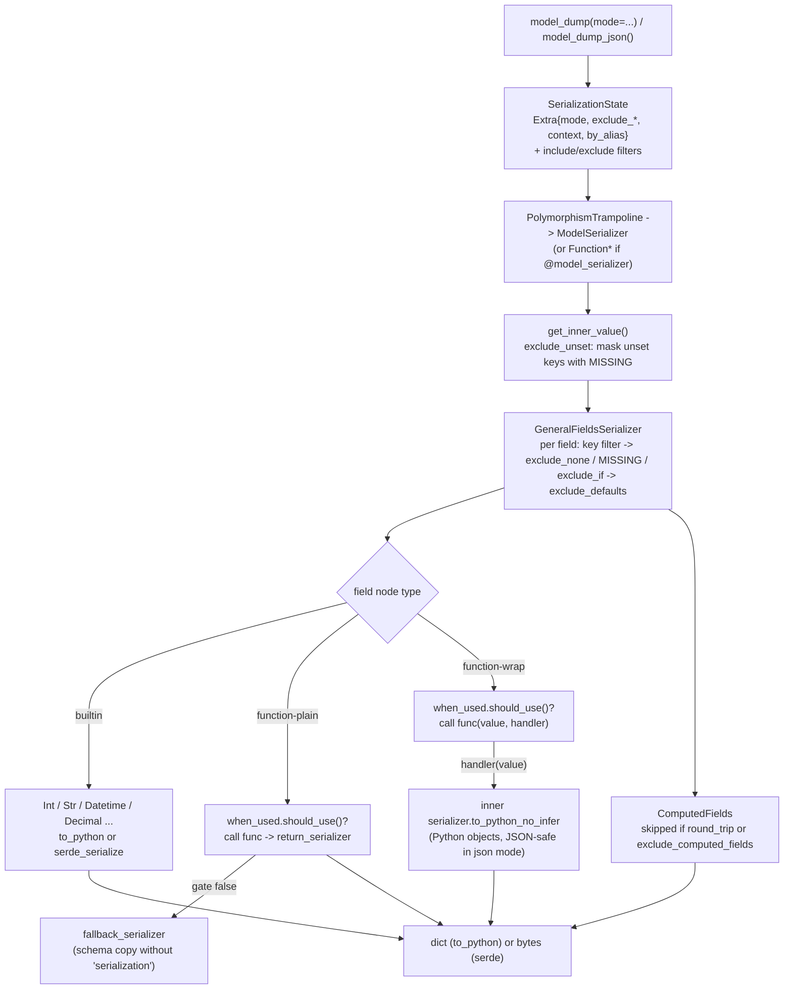

# Serialization Internals: model_dump vs model_dump_json, @field_serializer, @model_serializer, and when_used

> [!summary] Claim
> In Pydantic `2.14.3`, `model_dump` and `model_dump_json` walk the same compiled `pydantic-core` `2.50.4` `CombinedSerializer` tree through two different code paths (`to_python` builds Python objects, `serde_serialize` writes JSON bytes), and every `@field_serializer`, `@model_serializer`, `PlainSerializer`, and `WrapSerializer` is a `FunctionPlainSerializer` or `FunctionWrapSerializer` node whose `when_used` gate, filtering rules, and return-type serializer decide what actually reaches the wire.

Part of [Pydantic v2 Internals and Validation](README.md) in [API Engineering](../README.md).

## TL;DR

- Mechanism: `model_dump` calls `SchemaSerializer.to_python` and `model_dump_json` calls `SchemaSerializer.to_json`, which streams the same serializer tree into a `Vec<u8>` through `serde` and is then decoded to `str` (`pydantic 2.14.3 pydantic/main.py, BaseModel.model_dump_json`; `pydantic-core 2.50.4 src/serializers/mod.rs, SchemaSerializer::to_json`).
- Contract rule: a custom serializer replaces a node of the compiled tree, so declare `return_type` (or annotate the return) to get a compiled serializer for its output, use `mode="wrap"` when the default logic must still run, and treat `when_used="json"` as "only when the mode string is exactly `json`".
- Trap: value filters run on the raw attribute before your serializer, so `exclude_none` never sees a `None` your serializer returns and `exclude_defaults` never drops a field that has a field serializer (`pydantic/pydantic#6969`, open as of 2026-11), while a plain `@model_serializer` silently ignores `include`, `exclude`, and `exclude_unset`.
- Portability fact: the lab's 12 tests were run only on CPython `3.14.6` with `pydantic 2.14.3` / `pydantic-core 2.50.4` (macOS 27.3 arm64), and no other interpreter, free-threaded build, or container is claimed here; behavior differences come from Pydantic releases (`polymorphic_serialization` arrived in `2.13.0`, `exclude_computed_fields` in `2.12.0`), not from the interpreter.
- When not to use it: do not write a Python serializer for something a config switch or a typed field already does (`ser_json_temporal`, `ser_json_bytes`, `ser_json_inf_nan`, `Field(exclude=True)`, `serialization_alias`), because each custom serializer adds a Python call per value on a path that is otherwise pure Rust.

## Mental model



A call to `model_dump` or `model_dump_json` builds one `Extra` record (mode, `exclude_*` flags, `by_alias`, `round_trip`, `context`, `fallback`) and one `SerializationState` holding the `include`/`exclude` filters, then enters the root serializer, which for a model is always a `PolymorphismTrampoline`, wrapping a `ModelSerializer` or, if the class has a `@model_serializer`, the function serializer (`pydantic-core 2.50.4 src/serializers/shared.rs, CombinedSerializer::maybe_wrap_in_polymorphism_trampoline`, which wraps every `model` and `dataclass` schema after `_build`).
`ModelSerializer` reads the instance `__dict__`, and under `exclude_unset` copies it once and replaces every key missing from `__pydantic_fields_set__` with the `MISSING` sentinel (`pydantic-core 2.50.4 src/serializers/type_serializers/model.rs, ModelSerializer::get_inner_value`).
`GeneralFieldsSerializer` then iterates the fields, applies the key filter, the value filters, and `exclude_defaults` in that order, and only then hands the surviving value to the field's serializer node (`pydantic-core 2.50.4 src/serializers/fields.rs, GeneralFieldsSerializer::prepare_value`).
Function nodes decide with `WhenUsed::should_use` whether to call Python; a wrap node passes a `SerializationCallable` handler that re-enters the inner Rust serializer and always returns Python objects; computed fields are emitted last, after declared and extra fields (`pydantic-core 2.50.4 src/serializers/fields.rs, GeneralFieldsSerializer::serialize_iterators`).
The only difference between the two public methods is the sink: `to_python` builds `dict`/`list`/scalars, while `serde_serialize` writes bytes directly.

## How it works

### 1. One compiled tree, two traversal methods

`SchemaSerializer::py_new` compiles `__pydantic_core_schema__` into an `Arc<CombinedSerializer>` once per class, alongside the validator, and stores `expected_json_size: AtomicUsize::new(1024)` (`pydantic-core 2.50.4 src/serializers/mod.rs, SchemaSerializer::py_new`); see [[Pydantic-v2-Architecture-CoreSchema-and-Rust-Pydantic-Core]] for the compile step.
Every serializer implements the `TypeSerializer` trait, whose two core methods are `to_python(value, state) -> PyResult<Py<PyAny>>` and `serde_serialize(value, serializer, state)` (`pydantic-core 2.50.4 src/serializers/shared.rs, TypeSerializer`).
`CombinedSerializer` is an `#[enum_dispatch]` enum over all concrete serializers, so a call dispatches through a `match` rather than a vtable (`pydantic-core 2.50.4 src/serializers/shared.rs, combined_serializer!`).

`BaseModel.model_dump` forwards its keyword arguments verbatim to `self.__pydantic_serializer__.to_python(...)` (`pydantic 2.14.3 pydantic/main.py, BaseModel.model_dump`).
`SchemaSerializer::to_python` converts the `mode` string with `SerMode::from`, where `"json"` maps to `SerMode::Json`, `"python"` or `None` map to `SerMode::Python`, and any other string becomes `SerMode::Other(String)` (`pydantic-core 2.50.4 src/serializers/extra.rs, From<Option<&str>> for SerMode`).
An unknown mode string is therefore legal: it reaches your serializers as `info.mode`, but every built-in serializer and every `when_used` check treats it like Python mode, because they test `mode.is_json()` (`pydantic-core 2.50.4 src/serializers/extra.rs, SerMode::is_json`); the lab proves `model_dump(mode="audit")` keeps the `datetime` that `mode="json"` turns into an epoch.

`BaseModel.model_dump_json` calls `self.__pydantic_serializer__.to_json(...)` and then `.decode()` on the returned `bytes` (`pydantic 2.14.3 pydantic/main.py, BaseModel.model_dump_json`).
`SchemaSerializer::to_json` hardcodes `SerMode::Json`, calls `to_json_bytes`, then stores the produced length back into `expected_json_size` with `Ordering::Relaxed`, so the next call preallocates a `Vec<u8>` of the last output size (`pydantic-core 2.50.4 src/serializers/mod.rs, SchemaSerializer::to_json`).
`to_json_bytes` picks one of four `serde_json` formatters from `(indent, ensure_ascii)`: compact, `PrettyFormatter`, `EscapeNonAsciiFormatter`, or `EscapeNonAsciiPrettyFormatter` (`pydantic-core 2.50.4 src/serializers/shared.rs, to_json_bytes`).
No intermediate Python `dict` exists on this path; the cost of `model_dump_json` relative to `model_dump(mode="json")` is JSON escaping, number formatting, and the final `bytes` -> `str` decode (see Numbers and limits).
If you need bytes for an ASGI body, `Model.__pydantic_serializer__.to_json(obj)` or `TypeAdapter.dump_json` skips the decode; FastAPI `0.162.0` does exactly that (Section 7).

What JSON mode changes, concretely: in `infer_to_python_known`, `SerMode::Json` lowers `Decimal` and `Fraction` to `str`, `str` subclasses to exact `str`, `int` subclasses to `int`, sets and tuples to lists, and bytes per `ser_json_bytes` (`pydantic-core 2.50.4 src/serializers/infer.rs, infer_to_python_known`); typed serializers such as `DatetimeSerializer` do the same for their type.
The lab asserts `Decimal("9.90")` -> `"9.90"` and that a wrap handler receives a `str` for a `datetime` in JSON mode (a verification probe of a plain `datetime` field dumped `"2026-11-13T09:30:00Z"`), and asserts that `model_dump_json()` equals `json.dumps(model_dump(mode="json"), separators=(",", ":"))` for finite data.
That equality breaks in two ways, both covered in Pitfalls: non-finite floats and duplicate keys.

### 2. Where custom serializers live in the CoreSchema

A serializer is never a separate pass; it is a `serialization` key on some CoreSchema node.
For a field, `GenerateSchema._common_field_schema` applies validators, then wraps the schema in the `default` schema, then calls `_apply_field_serializers`, so the `serialization` key lands on the outermost node of that field (`pydantic 2.14.3 pydantic/_internal/_generate_schema.py, GenerateSchema._common_field_schema`).
`_apply_field_serializers` uses only `serializers[-1]` ("use the last serializer to make it easy to override a serializer set on a parent model"), resolves the return type from `serializer.info.return_type` or the function's return annotation, and emits `core_schema.plain_serializer_function_ser_schema(...)` or `core_schema.wrap_serializer_function_ser_schema(...)` with `is_field_serializer`, `info_arg`, `return_schema`, and `when_used` (`pydantic 2.14.3 pydantic/_internal/_generate_schema.py, GenerateSchema._apply_field_serializers`).
The docs state the consequence directly: only one serializer can be defined per field or model, and plain and wrap serializers cannot be combined (`pydantic 2.14.3 docs/concepts/serialization.md, Serializers`).
`PlainSerializer` and `WrapSerializer` are frozen, slotted dataclasses whose `__get_pydantic_core_schema__` calls `handler(source_type)` and then sets `schema['serialization']` on the result, so in `list[Annotated[int, PlainSerializer(f)]]` the function attaches to the item schema, not the list (`pydantic 2.14.3 pydantic/functional_serializers.py, PlainSerializer.__get_pydantic_core_schema__`).
For a model, `_apply_model_serializers` pops the model schema's `ref`, sets `serialization` on the `model` schema itself, and restores `ref` (`pydantic 2.14.3 pydantic/_internal/_generate_schema.py, GenerateSchema._apply_model_serializers`).

When Rust builds a serializer, `CombinedSerializer::_build` checks the `serialization` key before the `type` key: `function-plain` and `function-wrap` build `FunctionPlainSerializer` or `FunctionWrapSerializer` from the whole schema, `include-exclude-sequence`, `include-exclude-dict`, and `base64` fall through to the normal type, and any other `serialization` dict is built as if it were the main schema (`pydantic-core 2.50.4 src/serializers/shared.rs, CombinedSerializer::_build`).
That ordering is why a field with a field serializer is no longer a `WithDefaultSerializer` at the top: the function node replaces it, which matters for `exclude_defaults` (Section 5).
The compiled names are visible in `repr(Model.__pydantic_serializer__)`: the lab asserts `plain_function[issued_epoch]` and `wrap_function[redact_email, str]`, the format strings in `FunctionPlainSerializer::build` and `FunctionWrapSerializer::build` (`pydantic-core 2.50.4 src/serializers/type_serializers/function.rs`).

### 3. Signature inspection: `self`, `info`, and arity

`@field_serializer(field, /, *fields, mode="plain" | "wrap", return_type=..., when_used=..., check_fields=...)` raises `PydanticUserError` code `decorator-missing-arguments` when used bare and `decorator-invalid-fields` for non-string names, then wraps the function in a `PydanticDescriptorProxy` carrying a `FieldSerializerDecoratorInfo` (`pydantic 2.14.3 pydantic/functional_serializers.py, field_serializer`).
`inspect_field_serializer` decides two booleans from the signature (`pydantic 2.14.3 pydantic/_internal/_decorators.py, inspect_field_serializer`):

- `is_field_serializer` is `True` only if the first parameter is literally named `self`.
- `info_arg` comes from `_serializer_info_arg(mode, n_positional)` on the count of required positional parameters (minus one for `self`): plain accepts `1` (no info) or `2` (with info), wrap accepts `2` or `3`; anything else raises `PydanticUserError` code `field-serializer-signature` (`pydantic 2.14.3 pydantic/_internal/_decorators.py, _serializer_info_arg`).

In Rust, `FunctionPlainSerializer::call` passes `(model, value[, info])` when `is_field_serializer` is set and `(value[, info])` otherwise (`pydantic-core 2.50.4 src/serializers/type_serializers/function.rs, FunctionPlainSerializer::call`).
The trap follows mechanically: `def describe(this, value)` has two positional parameters, is not a field serializer because the first is not `self`, so it is treated as `(value, info)` and called with the field value bound to `this` and a `SerializationInfo` bound to `value`; the lab's `SignatureTrap` dumps `{"code": ("int", "SerializationInfo")}`.
`@model_serializer` is stricter: `inspect_model_serializer` raises `model-serializer-instance-method` unless the first parameter is `self` and the function is not a `staticmethod` or `classmethod`, and `model-serializer-signature` for a bad arity (`pydantic 2.14.3 pydantic/_internal/_decorators.py, inspect_model_serializer`).
`signature_no_eval` is used everywhere here, so inspection does not evaluate annotations (a `2.12.1` fix, "Do not evaluate annotations when inspecting validators and serializers", `pydantic 2.14.3 HISTORY.md`).

`SerializationInfo` exposes `include`, `exclude`, `context`, `mode`, `by_alias`, `exclude_unset`, `exclude_defaults`, `exclude_none`, `exclude_computed_fields`, `round_trip`, `serialize_as_any`, and `polymorphic_serialization`, plus `field_name` and `mode_is_json()`; `field_name` raises `AttributeError` outside a field (`pydantic-core 2.50.4 src/serializers/type_serializers/function.rs, SerializationInfo`).
In type hints, use `FieldSerializationInfo` (the `Protocol` that adds `field_name`) for field serializers and `SerializationInfo` for model serializers (`pydantic-core 2.50.4 python/pydantic_core/core_schema.py, FieldSerializationInfo`); the `SerializationInfo` Protocol does not declare `field_name`, so mypy and pyright reject `info.field_name` on it, which is why the lab's `Stamp` probe annotates `info: FieldSerializationInfo`.

### 4. Plain vs wrap, `return_type`, and `when_used`

A plain node is built from the whole field schema: `return_serializer` is `CombinedSerializer::build(return_schema)` when a return type is known, else `AnySerializer` (runtime type inference) (`pydantic-core 2.50.4 src/serializers/type_serializers/function.rs, FunctionPlainSerializer::build`).
If `when_used` is not `Always`, the builder also compiles a `fallback_serializer` from `copy_outer_schema(schema)`, a copy with the `serialization` and `ref` keys deleted, so the "not used" branch runs the ordinary serializer for the declared type.
At call time the `function_type_serializer!` macro implements all three entry points (`to_python`, `json_key`, `serde_serialize`) the same way: call the function if the gate is open and serialize its return value with `return_serializer` under `IncludeExclude::empty()` ("Filtering was done by the function"), otherwise serialize the original value with the fallback under the current filters (`pydantic-core 2.50.4 src/serializers/type_serializers/function.rs, function_type_serializer`).
So even `model_dump_json` calls your Python function and then serializes the Python object it returns; the JSON path never bypasses a custom serializer.

`return_type` is not validation.
With `-> str` on a function that returns an `int`, the `StrSerializer` sees an `int`, registers a `PydanticSerializationUnexpectedValue` warning ("Expected `str` - serialized value may not be as expected"), and falls back to inference, emitting the `int` (`pydantic-core 2.50.4 src/serializers/errors.rs`, where the message is assembled; a verification probe dumped `{'x': 1}` with that warning).
What `return_type` buys is a compiled serializer for the result: `EpochSeconds` in the lab declares `return_type=float`, so the output goes through `FloatSerializer` instead of `AnySerializer`.

A wrap node compiles an inner `serializer` from `ser_schema["schema"]` if given, else from the outer schema copy, and passes a `SerializationCallable` as the handler (`pydantic-core 2.50.4 src/serializers/type_serializers/function.rs, FunctionWrapSerializer::build`).
`SerializationCallable.__call__(value, index_key=None)` always calls `serializer.to_python_no_infer`, even when the outer call is `model_dump_json` (`pydantic-core 2.50.4 src/serializers/type_serializers/function.rs, SerializationCallable::__call__`).
In JSON mode that returns JSON-compatible Python objects (a `datetime` comes back as an ISO `str`), and in Python mode it returns the rich object; the lab's `Stamp` probe records `["python", "datetime", "at"]` vs `["json", "str", "at"]`.
The optional `index_key` applies the current include/exclude filter for a sequence index or a dict key and raises `PydanticOmit` when that element is filtered out.
For a wrap node, the "gate closed" path uses the inner serializer, so wrap needs no separate fallback.

`WhenUsed` has exactly four values, `always`, `unless-none`, `json`, `json-unless-none` (`pydantic-core 2.50.4 python/pydantic_core/core_schema.py, WhenUsed`), evaluated by `should_use(value, extra)` as `true`, `!value.is_none()`, `extra.mode.is_json()`, and `extra.mode.is_json() && !value.is_none()` (`pydantic-core 2.50.4 src/serializers/type_serializers/format.rs, WhenUsed::should_use`).
`json` means `SerMode::Json` exactly, so it fires for `model_dump(mode="json")` and `model_dump_json`, never for `mode="python"` or a custom mode string.
`unless-none` is what makes an `Optional` field with a non-`None`-safe function (`v.timestamp()`) safe: the gate closes for `None` and the fallback serializer emits `None`.

### 5. Filtering order, and why filters do not see your output

`GeneralFieldsSerializer::prepare_value` returns `None` (skip) in this order (`pydantic-core 2.50.4 src/serializers/fields.rs, GeneralFieldsSerializer::prepare_value`):

1. `field.serializer` is `None`, which is how `Field(exclude=True)` compiles (`serialization_exclude`), the cheapest exclusion (`pydantic-core 2.50.4 src/serializers/type_serializers/model.rs, ModelFieldsBuilder::build`).
2. `self.filter.key_filter(key, state)` returns `None` for a key removed by `include`/`exclude`.
3. `exclude_field_by_value`: `exclude_none && value.is_none()`, `value is MISSING`, or `serialization_exclude_if(value)` returns true.
4. `exclude_default(value, extra, serializer)`: only if `serializer.get_default()` returns `Some(default)` and `value == default`.

Every check looks at the raw attribute value; the field serializer runs only after the value survives.
Consequence one: a serializer that maps `""` to `None` still emits `{"region": None}` under `exclude_none=True`.
Consequence two: `get_default` is implemented by `WithDefaultSerializer` (`pydantic-core 2.50.4 src/serializers/type_serializers/with_default.rs, WithDefaultSerializer::get_default`) but not by the function serializers, whose macro implements only `to_python`, `json_key`, `serde_serialize`, `get_name`, and `retry_with_lax_check`; because the function node replaced the `default` node at the top of the field (Section 2), `exclude_defaults=True` cannot exclude any field with a field serializer.
The lab's `Counter().model_dump(exclude_defaults=True)` returns `{"misses": 0}`; upstream tracks this as `pydantic/pydantic#6969` (open, "considering changing in V3" per a maintainer comment on the duplicate `pydantic/pydantic#10757`) (as of 2026-11).
`WithDefaultSerializer::get_default` also returns `None` for a `default_factory` that takes validated data, so those fields never match `exclude_defaults` either; plain `default_factory=list` fields do, because the factory is called to produce the comparison value.

`exclude_unset` is not in that list because it works one level up: `ModelSerializer::get_inner_value` copies `__dict__` (only if at least one key is unset) and overwrites unset keys with `MISSING`, which step 3 then drops "so that... any user-defined serializer won't be called" (`pydantic-core 2.50.4 src/serializers/type_serializers/model.rs, ModelSerializer::get_inner_value`).
Assigning an attribute after construction adds it to `__pydantic_fields_set__`, so it then counts as set (`pydantic 2.14.3 docs/concepts/serialization.md, Excluding and including fields based on their value`).

`include`/`exclude` accept sets or nested dicts; `__all__` applies to every key or index, `...` means "the whole subtree", and `merge_all_value` merges a per-key entry with the `__all__` entry following Pydantic v1 rules (`pydantic-core 2.50.4 src/serializers/filter.rs, merge_all_value`).
The lab's probe confirms `exclude={"items": {"__all__": {"secret"}}, "owner": {"secret"}}` and index-based `include={"items": {0: {"id"}}}`.

### 6. `@model_serializer`: plain drops filters, wrap keeps them

A plain `@model_serializer` makes the model's root node a `FunctionPlainSerializer`, so the `ModelSerializer` -> `GeneralFieldsSerializer` path, where include/exclude, `exclude_unset`, `exclude_defaults`, and computed fields are implemented, never runs.
The return value is serialized with `IncludeExclude::empty()`, so the lab's `FlatEnvelope.model_dump(exclude={"body"})` and `model_dump(exclude_unset=True)` both return all four keys.
A wrap `@model_serializer` calls `handler(self)`, which runs the full fields serializer with the caller's filters, so `Envelope.model_dump(exclude={"body"})` drops `body` and keeps the added `schema_version`.
`model_dump` is annotated `-> dict[str, Any]`, but a model serializer may return any type: the lab's `Money` returns `"1234.56 EUR"` from `model_dump()` and serializes as a JSON string inside `Invoice` (`pydantic 2.14.3 docs/concepts/serialization.md, Model serializers`).
Use `SerializationInfo` (not `FieldSerializationInfo`) in model serializers; `field_name` is unset there.

### 7. Computed fields, `round_trip`, subclasses, errors, and FastAPI

`@computed_field` properties compile into `computed_fields` on the `model-fields` schema; `_computed_field_schema` requires a return annotation or `return_type` (`PydanticUserError` code `model-field-missing-annotation`), applies matching field serializers, and marks the JSON Schema `readOnly` (`pydantic 2.14.3 pydantic/_internal/_generate_schema.py, GenerateSchema._computed_field_schema`).
`ComputedFields::serialize` returns early when `round_trip` or `exclude_computed_fields` is set, otherwise applies the key filter and `exclude_field_by_value` (so `exclude_none` and `exclude_if` apply, but not `exclude_unset` or `exclude_defaults`) and calls `getattr` on every dump, re-running the property (`pydantic-core 2.50.4 src/serializers/computed_fields.rs, ComputedFields::serialize`).
`round_trip=True` exists so output re-validates: it drops computed fields (which `extra="forbid"` would reject) and makes `Json[T]` fields dump as JSON strings (`pydantic 2.14.3 pydantic/main.py, BaseModel.model_dump`, `round_trip` docstring: "dumped values should be valid as input for non-idempotent types such as Json[T]"; the computed-field drop is the early return in `computed_fields.rs` above).

A field annotated `Account` holding a `PrivilegedAccount` serializes with `Account`'s schema, so subclass-only fields are dropped; `serialize_as_any=True` (runtime flag since `2.7.0`) or `polymorphic_serialization=True` (runtime flag and `ConfigDict` key since `2.13.0`) serializes with the runtime class instead, and the lab shows both leaking `password_hash` (`pydantic 2.14.3 HISTORY.md`; `pydantic-core 2.50.4 src/serializers/polymorphism_trampoline.rs, PolymorphismTrampoline::serialize`).
`PolymorphismTrampoline` switches only when the value is a strict subclass instance (`!value.get_type().is(class) && value.is_instance(class)`) and the runtime flag, or else the class config, enables it.

Errors: any exception from your function except the two Pydantic serialization types is re-raised as ``PydanticSerializationError("Error calling function `<name>`: <exc>")`` with `__cause__` set; `RecursionError` becomes a `PydanticSerializationError` without a cause; a raised `PydanticSerializationUnexpectedValue` becomes a warning outside union checks (`pydantic-core 2.50.4 src/serializers/type_serializers/function.rs, on_error`).
`PydanticSerializationError` subclasses `ValueError` (lab assertion).
Type mismatches between the stored value and the schema produce a `UserWarning` listing every `PydanticSerializationUnexpectedValue` at the end of the call (`warnings=True`, the default), are silent with `warnings=False`, and raise `PydanticSerializationError` with `warnings="error"` (`pydantic-core 2.50.4 src/serializers/mod.rs, SchemaSerializer::to_python`, `state.warnings.final_check`).
Unknown types raise `Unable to serialize unknown type: <class ...>` in JSON mode (both `model_dump(mode="json")` and `model_dump_json`) unless `fallback=` is given, and pass through unchanged in Python mode (`pydantic-core 2.50.4 src/serializers/infer.rs`).
Cycles in inferred (`Any`) values raise `Circular reference detected (id repeated)` in JSON mode, as a bare `ValueError` from `model_dump(mode="json")` and as `PydanticSerializationError("Error serializing to JSON: ValueError: Circular reference detected (id repeated)")` from `model_dump_json`, while Python mode returns the value as-is when the recursion guard trips (`pydantic-core 2.50.4 src/serializers/infer.rs, infer_to_python_known`; `src/serializers/extra.rs, SerializationState::recursion_guard`; both messages observed in a verification probe).

FastAPI `0.162.0` chooses between the two paths per route: `use_dump_json = response_field is not None and isinstance(response_class, DefaultPlaceholder)` (`fastapi 0.162.0 fastapi/routing.py, get_request_handler`).
With the default response class it calls `ModelField.serialize_json` -> `TypeAdapter.dump_json` and wraps the bytes in a plain `Response(media_type="application/json")`; with any explicit `response_class` it calls `ModelField.serialize` -> `TypeAdapter.dump_python(mode="json")` and lets the response class render (`fastapi 0.162.0 fastapi/_compat/v2.py, ModelField.serialize_json`, `ModelField.serialize`).
Starlette `1.10.0` `JSONResponse.render` uses `json.dumps(..., allow_nan=False, separators=(",", ":"))` (`starlette 1.10.0 starlette/responses.py, JSONResponse.render`), so the same `float("nan")` returns `{"value":null}` on the default route and raises `ValueError` on `response_class=JSONResponse`; the lab asserts both.

## Numbers and limits

| Metric or parameter | Value | Source or measurement condition |
|---|---|---|
| Initial `to_json` buffer hint | `1024` bytes, then the previous output length | `AtomicUsize::new(1024)`, updated with `store(bytes.len(), Relaxed)` after each call (`pydantic-core 2.50.4 src/serializers/mod.rs, SchemaSerializer::to_json`) |
| Inline field-item buffer | `16` `(key, value)` pairs before heap spill | `SmallVec<[_; 16]>` in `dict_items` (`pydantic-core 2.50.4 src/serializers/fields.rs, dict_items`) |
| `when_used` values | `4`: `always`, `unless-none`, `json`, `json-unless-none` | `WhenUsed` (`pydantic-core 2.50.4 python/pydantic_core/core_schema.py`; `src/serializers/type_serializers/format.rs`) |
| Accepted serializer arities (excluding `self`) | plain `1` or `2`, wrap `2` or `3` positional parameters | `_serializer_info_arg` (`pydantic 2.14.3 pydantic/_internal/_decorators.py`) |
| Serializers per field or model | `1` (the last decorator wins) | `serializers[-1]` (`pydantic 2.14.3 pydantic/_internal/_generate_schema.py, GenerateSchema._apply_field_serializers`) |
| Default `ser_json_inf_nan` | `null` for model serializers; `pydantic_core.to_json` defaults `inf_nan_mode="constants"` | `pydantic 2.14.3 pydantic/config.py, ser_json_inf_nan`; `pydantic-core 2.50.4 src/serializers/mod.rs, to_json`; a verification probe observed `{"v":null}` from `model_dump_json` vs `b'NaN'` from `pydantic_core.to_json(float("nan"))` |
| Serialization latency, model `Order(id: int, customer: str, created: datetime, total: Decimal, lines: list[Line])` with 5 `Line(sku: str, qty: int, price: Decimal)` items, 280-byte JSON | `model_dump()` `1154` ns; `model_dump(mode="json")` `1724` ns; `model_dump_json()` `1791` ns; `json.dumps(model_dump(mode="json"))` `4075` ns | Re-measured in verification with a scratch script (removed after the run): middle of three runs, each the median of `timeit.repeat(number=20000, repeat=15)` per call; `uv run --frozen python -I bench.py` from `labs/`, CPython `3.14.6`, `pydantic 2.14.3`, `pydantic-core 2.50.4`, Apple M3 Pro, `macOS-27.3-arm64-arm-64bit-Mach-O` (as of 2026-11) |
| Cost of one Python field serializer / one wrap model serializer on `model_dump_json()` | `2190` ns (`+399` ns over `1791`) / `2759` ns (`+968` ns) | Same run and conditions; the field serializer formats `created` with `isoformat()`, the wrap model serializer calls `handler(self)` and adds one key |

The measured ordering says two things.
First, `json.dumps(model.model_dump(mode="json"))` costs about `2.3x` `model_dump_json()` on this shape, because it builds the Python tree and then walks it again in the stdlib encoder.
Second, a single Python field serializer adds about a fifth (`399` of `1791` ns) to the whole Rust serialization of the model, and a wrap model serializer more than half, so custom serializers belong on boundary DTOs, not on hot inner types repeated in large lists.

## Portability

| Runtime / component | Behavior | Verification |
|---|---|---|
| CPython `3.12.16`, `3.13.18`, `3.14.10`, `3.15.2` | Not run for this note; no claim | Lab matrix checks are paused (brief, 2026-11-11); the serializers are compiled Rust in `pydantic-core 2.50.4`, so interpreter differences would enter only through the Python callbacks |
| CPython `3.14.6` (workspace interpreter) | Identical: `12 passed` (re-run in verification) | `uv run --frozen pytest <module> -q` (output in Worked example) |
| Free-threaded CPython (`3.15.2t` and others, `PEP 703`) | Not run for this note; no claim | Lab matrix checks are paused (brief, 2026-11-11) |
| Debian Trixie and Alpine containers | Not run for this note | Lab container checks are paused (brief, 2026-11-11) |
| `pydantic 2.14.3` vs older releases | `polymorphic_serialization` (runtime and config) since `2.13.0`; `exclude_if` on fields since `2.12.0` and on computed fields since `2.13.0`; `exclude_computed_fields` since `2.12.0`; runtime `serialize_as_any` since `2.7.0`; `field_serializer("*")` since `2.7.0`; `2.12.0`-`2.12.4` changed `serialize_as_any` semantics with regressions fixed in `2.12.1` and `2.12.4` | `pydantic 2.14.3 HISTORY.md`; only `2.14.3` was executed here |
| FastAPI `0.162.0` / Starlette `1.10.0` | Default response class: Rust `dump_json`, `NaN` -> `null`; explicit `JSONResponse`: `dump_python(mode="json")` + `json.dumps(allow_nan=False)` -> `ValueError` | Lab test over `httpx.ASGITransport`, all legs above |
| Uvicorn, Hypercorn, Granian; HTTP/1.1, HTTP/2, HTTP/3 | Serialization finishes before the ASGI `http.response.body` event, so the bytes do not depend on server or HTTP version | Follows from FastAPI producing `content` before building the `Response` (`fastapi 0.162.0 fastapi/routing.py, get_request_handler`); not run over real servers for this note |

## Worked example

The lab [implementation](../labs/src/api_labs/f09_pydantic_v2_internals_and_validation/serialization_internals.py) and [test](../labs/tests/f09_pydantic_v2_internals_and_validation/test_custom_serialization_field_model_and_wrap_serializers.py) build an `Invoice` that uses every hook (`when_used="json"` field serializer, plain field serializer on a `set`, wrap field serializer reading `info.context`, an annotated `PlainSerializer` with `return_type` and `when_used="unless-none"`, a plain `@model_serializer` on a nested `Money`, and a `@computed_field`), and then pin each trap from How it works to an assertion.

### Implementation (`labs/src/api_labs/f09_pydantic_v2_internals_and_validation/serialization_internals.py`)

```python
"""Pydantic v2 serialization internals: modes, field and model serializers, and when_used."""

import datetime as dt
from decimal import Decimal
from typing import Annotated, Any

from fastapi import FastAPI
from fastapi.responses import JSONResponse
from pydantic import (
    BaseModel,
    Field,
    PlainSerializer,
    SerializationInfo,
    SerializerFunctionWrapHandler,
    computed_field,
    field_serializer,
    model_serializer,
)

# Reusable annotated serializer: compiled once, applied wherever the alias is used.
# `return_type=float` makes pydantic-core build a `FloatSerializer` for the result
# instead of inferring the type of whatever the lambda returns.
EpochSeconds = Annotated[
    dt.datetime,
    PlainSerializer(lambda v: v.timestamp(), return_type=float, when_used="unless-none"),
]


class Money(BaseModel):
    """A plain `@model_serializer` replaces the whole fields serializer with one Python call."""

    cents: int
    currency: str

    @model_serializer(mode="plain")
    def as_text(self) -> str:
        return f"{self.cents // 100}.{self.cents % 100:02d} {self.currency}"


class LineItem(BaseModel):
    sku: str
    qty: int
    unit_price: Decimal


class Invoice(BaseModel):
    """Exercises every serializer hook the note describes."""

    invoice_id: int
    issued_at: dt.datetime
    paid_at: EpochSeconds | None = None
    total: Money
    tags: set[str] = Field(default_factory=set[str])
    lines: list[LineItem]
    customer_email: str
    memo: str | None = None

    @field_serializer("issued_at", when_used="json")
    def issued_epoch(self, value: dt.datetime) -> int:
        # Runs only when the serializer mode is exactly "json".
        return int(value.timestamp())

    @field_serializer("tags")
    def sorted_tags(self, value: set[str]) -> list[str]:
        # Plain mode: the default `set` serializer is never called.
        return sorted(value)

    @field_serializer("customer_email", mode="wrap")
    def redact_email(
        self, value: str, handler: SerializerFunctionWrapHandler, info: SerializationInfo
    ) -> str:
        # Wrap mode: delegate to the inner `str` serializer, then post-process.
        rendered: str = handler(value)
        context: dict[str, Any] = info.context or {}
        if context.get("role") == "support":
            return rendered
        user, _, domain = rendered.partition("@")
        return f"{user[:1]}***@{domain}"

    @computed_field  # type: ignore[prop-decorator]
    @property
    def line_count(self) -> int:
        return len(self.lines)


class Envelope(BaseModel):
    """A wrap `@model_serializer` keeps include/exclude and exclude_* filtering working."""

    seq: int
    body: str
    trace_id: str | None = None

    @model_serializer(mode="wrap")
    def with_schema_version(self, handler: SerializerFunctionWrapHandler) -> dict[str, Any]:
        out: dict[str, Any] = handler(self)
        out["schema_version"] = 2
        return out


class FlatEnvelope(BaseModel):
    """The same shape with a plain `@model_serializer`: filters are silently dropped."""

    seq: int
    body: str
    trace_id: str | None = None

    @model_serializer(mode="plain")
    def as_dict(self) -> dict[str, Any]:
        return {"seq": self.seq, "body": self.body, "trace_id": self.trace_id, "schema_version": 2}


class Counter(BaseModel):
    """`exclude_defaults` cannot see the default of a field that has a field serializer."""

    hits: int = 0
    misses: int = 0

    @field_serializer("misses")
    def passthrough(self, value: int) -> int:
        return value


class Nullable(BaseModel):
    """`exclude_none` tests the raw attribute, not the serializer's return value."""

    region: str | None = "eu-west-1"

    @field_serializer("region")
    def blank_to_none(self, value: str | None) -> str | None:
        return None if value == "" else value


class Account(BaseModel):
    username: str


class PrivilegedAccount(Account):
    password_hash: str


class Session(BaseModel):
    account: Account


class SignatureTrap(BaseModel):
    """First parameter not named `self`: pydantic treats the method as a free function."""

    code: int

    @field_serializer("code")
    def describe(this, value: object) -> tuple[str, str]:  # pyright: ignore[reportSelfClsParameterName]
        return (type(this).__name__, type(value).__name__)


class AliasCollision(BaseModel):
    """A serialization alias equal to another field's name: dict and JSON outputs disagree."""

    id: int
    name: str = Field(serialization_alias="id")


class Reading(BaseModel):
    sensor: str
    value: float


def build_reading_app() -> FastAPI:
    """Two routes returning the same model: the default response class and an explicit one."""
    app = FastAPI()

    @app.get("/fast")
    async def fast() -> Reading:
        return Reading(sensor="t1", value=float("nan"))

    @app.get("/explicit", response_class=JSONResponse)
    async def explicit() -> Reading:
        return Reading(sensor="t1", value=float("nan"))

    return app
```

### Test (`labs/tests/f09_pydantic_v2_internals_and_validation/test_custom_serialization_field_model_and_wrap_serializers.py`)

```python
"""Unit tests for Pydantic v2 serialization modes, field and model serializers, and when_used."""

import datetime as dt
import json
import math
from decimal import Decimal
from typing import Any

import httpx
import pytest
from pydantic import (
    BaseModel,
    FieldSerializationInfo,
    SerializerFunctionWrapHandler,
    field_serializer,
)
from pydantic_core import PydanticSerializationError

from api_labs.f09_pydantic_v2_internals_and_validation.serialization_internals import (
    Account,
    AliasCollision,
    Counter,
    Envelope,
    FlatEnvelope,
    Invoice,
    LineItem,
    Money,
    Nullable,
    PrivilegedAccount,
    Reading,
    Session,
    SignatureTrap,
    build_reading_app,
)

ISSUED = dt.datetime(2026, 11, 13, 9, 30, tzinfo=dt.UTC)
ISSUED_EPOCH = 1794562200


def make_invoice(**overrides: Any) -> Invoice:
    fields: dict[str, Any] = {
        "invoice_id": 42,
        "issued_at": ISSUED,
        "total": Money(cents=123456, currency="EUR"),
        "lines": [LineItem(sku="A-1", qty=2, unit_price=Decimal("9.90"))],
        "customer_email": "alice@example.com",
    }
    fields.update(overrides)
    return Invoice(**fields)


@pytest.mark.unit
def test_python_mode_keeps_rich_types_and_json_mode_lowers_them() -> None:
    invoice = make_invoice(tags={"b", "a"})
    assert invoice.model_dump() == {
        "invoice_id": 42,
        "issued_at": ISSUED,
        "paid_at": None,
        "total": "1234.56 EUR",
        "tags": ["a", "b"],
        "lines": [{"sku": "A-1", "qty": 2, "unit_price": Decimal("9.90")}],
        "customer_email": "a***@example.com",
        "memo": None,
        "line_count": 1,
    }
    as_json_dict = invoice.model_dump(mode="json")
    assert as_json_dict["issued_at"] == ISSUED_EPOCH
    assert as_json_dict["lines"][0]["unit_price"] == "9.90"
    text = invoice.model_dump_json()
    assert isinstance(text, str)
    assert text == json.dumps(as_json_dict, separators=(",", ":"))
    assert isinstance(Invoice.__pydantic_serializer__.to_json(invoice), bytes)


@pytest.mark.unit
def test_when_used_selects_on_exact_mode_and_on_none() -> None:
    invoice = make_invoice()
    assert invoice.model_dump(mode="audit")["issued_at"] == ISSUED
    assert invoice.model_dump(mode="json")["issued_at"] == ISSUED_EPOCH
    paid = make_invoice(paid_at=dt.datetime(2026, 11, 14, tzinfo=dt.UTC))
    assert paid.model_dump()["paid_at"] == 1794614400.0
    assert invoice.model_dump(mode="json")["paid_at"] is None
    names = repr(Invoice.__pydantic_serializer__)
    assert 'name: "plain_function[issued_epoch]"' in names
    assert "when_used: Json" in names
    assert "when_used: UnlessNone" in names
    assert 'name: "wrap_function[redact_email, str]"' in names


@pytest.mark.unit
def test_wrap_handler_returns_mode_specific_python_objects() -> None:
    class Stamp(BaseModel):
        at: dt.datetime

        @field_serializer("at", mode="wrap")
        def probe(
            self,
            value: dt.datetime,
            handler: SerializerFunctionWrapHandler,
            info: FieldSerializationInfo,
        ) -> list[str]:
            inner = handler(value)
            return [info.mode, type(inner).__name__, info.field_name]

    stamp = Stamp(at=ISSUED)
    assert stamp.model_dump() == {"at": ["python", "datetime", "at"]}
    assert stamp.model_dump_json() == '{"at":["json","str","at"]}'


@pytest.mark.unit
def test_plain_model_serializer_drops_filters_wrap_keeps_them() -> None:
    wrapped = Envelope(seq=1, body="x")
    assert wrapped.model_dump(exclude={"body"}) == {"seq": 1, "trace_id": None, "schema_version": 2}
    assert wrapped.model_dump(exclude_unset=True) == {"seq": 1, "body": "x", "schema_version": 2}
    flat = FlatEnvelope(seq=1, body="x")
    everything = {"seq": 1, "body": "x", "trace_id": None, "schema_version": 2}
    assert flat.model_dump(exclude={"body"}) == everything
    assert flat.model_dump(exclude_unset=True) == everything
    money_dump: object = Money(cents=5, currency="USD").model_dump()
    assert money_dump == "0.05 USD"


@pytest.mark.unit
def test_value_filters_inspect_raw_value_not_serializer_output() -> None:
    assert Counter().model_dump(exclude_defaults=True) == {"misses": 0}
    assert Nullable(region="").model_dump(exclude_none=True) == {"region": None}
    assert Nullable(region=None).model_dump(exclude_none=True) == {}


@pytest.mark.unit
def test_exclude_unset_round_trip_and_computed_fields() -> None:
    invoice = make_invoice()
    assert list(invoice.model_dump(exclude_unset=True)) == [
        "invoice_id",
        "issued_at",
        "total",
        "lines",
        "customer_email",
        "line_count",
    ]
    assert "line_count" not in invoice.model_dump(round_trip=True)
    assert "line_count" not in invoice.model_dump(exclude_computed_fields=True)
    assert invoice.model_dump(exclude_none=True)["line_count"] == 1


@pytest.mark.unit
def test_context_reaches_wrap_field_serializer() -> None:
    invoice = make_invoice()
    assert invoice.model_dump()["customer_email"] == "a***@example.com"
    support = invoice.model_dump(context={"role": "support"})
    assert support["customer_email"] == "alice@example.com"


@pytest.mark.unit
def test_subclass_fields_stay_hidden_unless_polymorphic() -> None:
    privileged = PrivilegedAccount(username="u", password_hash="h")  # noqa: S106
    session = Session(account=privileged)
    assert isinstance(session.account, Account)
    assert session.model_dump() == {"account": {"username": "u"}}
    leaked = {"account": {"username": "u", "password_hash": "h"}}
    assert session.model_dump(serialize_as_any=True) == leaked
    assert session.model_dump(polymorphic_serialization=True) == leaked


@pytest.mark.unit
def test_serializer_errors_and_type_mismatch_warnings() -> None:
    class Exploding(BaseModel):
        x: int

        @field_serializer("x")
        def boom(self, value: int) -> int:
            raise ValueError("boom")

    with pytest.raises(PydanticSerializationError) as exc_info:
        Exploding(x=1).model_dump()
    assert isinstance(exc_info.value, ValueError)
    assert "Error calling function `boom`: ValueError: boom" in str(exc_info.value)
    assert isinstance(exc_info.value.__cause__, ValueError)

    reading = Reading(sensor="t1", value=1.5)
    object.__setattr__(reading, "value", "hot")
    expected_warning = "Expected `float` - serialized value may not be as expected"
    with pytest.warns(UserWarning, match=expected_warning):
        assert reading.model_dump() == {"sensor": "t1", "value": "hot"}
    with pytest.raises(PydanticSerializationError, match="Expected `float`"):
        reading.model_dump(warnings="error")


@pytest.mark.unit
def test_first_parameter_must_be_named_self() -> None:
    assert SignatureTrap(code=7).model_dump() == {"code": ("int", "SerializationInfo")}


@pytest.mark.unit
def test_nan_and_duplicate_keys_diverge_between_paths() -> None:
    reading = Reading(sensor="t1", value=float("nan"))
    assert reading.model_dump_json() == '{"sensor":"t1","value":null}'
    as_json_dict = reading.model_dump(mode="json")
    assert math.isnan(as_json_dict["value"])
    with pytest.raises(ValueError, match="not JSON compliant"):
        json.dumps(as_json_dict, allow_nan=False)

    collision = AliasCollision(id=1, name="x")
    assert collision.model_dump(by_alias=True) == {"id": "x"}
    assert collision.model_dump_json(by_alias=True) == '{"id":1,"id":"x"}'


@pytest.mark.unit
@pytest.mark.asyncio
async def test_fastapi_default_response_uses_rust_json_explicit_class_does_not() -> None:
    transport = httpx.ASGITransport(app=build_reading_app())
    async with httpx.AsyncClient(transport=transport, base_url="http://test") as client:
        fast = await client.get("/fast")
        assert fast.status_code == 200
        assert fast.content == b'{"sensor":"t1","value":null}'
        with pytest.raises(ValueError, match="not JSON compliant"):
            await client.get("/explicit")
```

### Captured execution output

Executed in verification from `labs/` with `uv run --frozen pytest tests/f09_pydantic_v2_internals_and_validation/test_custom_serialization_field_model_and_wrap_serializers.py -q -p no:cacheprovider` on CPython `3.14.6` (`macOS-27.3-arm64-arm-64bit-Mach-O`, Apple M3 Pro):

```text
............                                                             [100%]
12 passed in 0.23s
```

## Pitfalls

> [!warning] `exclude_defaults` and `exclude_none` ignore serializer output
> - Trigger: a field with any `@field_serializer`, `PlainSerializer`, or `WrapSerializer`, dumped with `exclude_defaults=True`, or a serializer that returns `None`, dumped with `exclude_none=True`.
> - Symptom: the field is still emitted (`{"misses": 0}`, `{"region": None}`); FastAPI's `response_model_exclude_defaults=True` and `response_model_exclude_none=True` inherit the same behavior because they pass straight through to `dump_json` / `dump_python`.
> - Fix: filter on the raw value with `Field(exclude_if=...)` (runs before the serializer), or do the exclusion inside a wrap `@model_serializer` after `handler(self)`; track `pydantic/pydantic#6969` (open as of 2026-11) before relying on future behavior.

> [!warning] A plain `@model_serializer` silently disables `include`, `exclude`, and `exclude_unset`
> - Trigger: `@model_serializer` (default `mode="plain"`) that builds its own dict, on a model used with `response_model_exclude=...`, `exclude_unset=True` for `PATCH` semantics, or `include` field masks.
> - Symptom: callers get every key regardless of the filter, which can resend fields a client never set or leak a field the route meant to exclude.
> - Fix: use `mode="wrap"` and post-process `handler(self)`, or read `info.exclude` and friends yourself and document that the model owns its filtering.

> [!warning] The first parameter of a field serializer method must be named `self`
> - Trigger: `@field_serializer("x") def ser(this, v)` or a renamed first parameter after a refactor.
> - Symptom: no error; the function is treated as `(value, info)`, so the field value arrives in the first parameter and a `SerializationInfo` in the second.
> - Fix: name it `self`, or make it a real `@staticmethod` taking `(value)` or `(value, info)`; a unit test that dumps one instance catches it.

> [!warning] `model_dump(mode="json")` is not "the JSON output as a dict"
> - Trigger: `json.dumps(model.model_dump(mode="json"))`, `orjson.dumps(...)` on the same dict, or a FastAPI route with an explicit `response_class`.
> - Symptom: non-finite values of a `float`-typed field stay Python `float("nan")` in `to_python` (`FloatSerializer::to_python` returns exact floats unchanged, `pydantic-core 2.50.4 src/serializers/type_serializers/float.rs`; an `Any`-typed value goes through inference instead and becomes `None` under the default `ser_json_inf_nan="null"`, `src/serializers/infer.rs, infer_to_python_known`), so `json.dumps` emits the non-standard token `NaN` that `(RFC 8259 Section 6)` forbids, or raises with `allow_nan=False` (Starlette `JSONResponse`, a `500`); separately, a `serialization_alias` equal to another field's name collapses to one key in the dict but emits a duplicate key in `model_dump_json` (`{"id":1,"id":"x"}`), which `(RFC 8259 Section 4)` says SHOULD NOT happen.
> - Fix: produce bytes with `model_dump_json` / `TypeAdapter.dump_json` and let `ser_json_inf_nan` decide (`null`, `constants`, or `strings`); keep the default response class in FastAPI so it takes the `dump_json` path; reject alias collisions in a schema lint (for example, assert unique serialized keys across `model_fields` and `model_computed_fields`).

> [!warning] Subclass instances are serialized by the declared type until a flag says otherwise
> - Trigger: `serialize_as_any=True`, `SerializeAsAny[...]`, `polymorphic_serialization=True`, or `ConfigDict(polymorphic_serialization=True)` on a base class, on a response model that can hold an internal subclass.
> - Symptom: subclass-only fields (`password_hash` in the lab) appear in the response; without the flag they are dropped, which surprises teams that expect polymorphic output.
> - Fix: keep the default for outward-facing DTOs and model polymorphism explicitly with a discriminated union of public types; see [[Discriminated-Unions-Tag-and-Callable-Discriminator-Dispatch]].

> [!warning] `return_type` documents and compiles, it does not validate
> - Trigger: a serializer annotated `-> str` that sometimes returns another type.
> - Symptom: a `UserWarning` per call ("Expected `str` - serialized value may not be as expected") and the wrong type in the payload; under `warnings="error"` the same condition raises `PydanticSerializationError`.
> - Fix: run serialization tests with `warnings="error"` (or `-W error::UserWarning`) so a contract drift fails CI instead of logging.

## Security and robustness

- `API3:2023 Broken Object Property Level Authorization`: OWASP's prevention guidance is to "cherry-pick specific object properties" and to "implement a schema-based response validation mechanism", which in Pydantic means a dedicated response model per audience, `Field(exclude=True)` for internal fields, and never `serialize_as_any` or polymorphic serialization on outward types (OWASP API Security Top 10 2023, API3); see [[Defeating-BOPLA-and-Mass-Assignment-API3-2023-Strict-Input-Output-Schemas]].
- Context-driven redaction is a policy decision executed per call: the lab's wrap serializer reveals the full email only when `context={"role": "support"}`, so the default (no context) must be the redacted form, and the context must come from the authenticated principal, never from a request parameter.
- A plain `@model_serializer` that hand-builds a dict is an allowlist only if it is written as one; reading `self.__dict__` or `vars(self)` inside it reintroduces excessive data exposure and also bypasses `Field(exclude=True)`.
- Logs are an output channel too: serialize log payloads with the same response DTOs (or `exclude=` sets) rather than `repr(model)`, which prints every field; see [[Structured-Log-Redaction-and-Preventing-PII-and-Token-Leaks]].
- `API4:2023 Unrestricted Resource Consumption`: serialization cost scales with output size and Python-function count (measured above); bound list sizes before serializing, and remember that a cycle in an `Any` field raises a `ValueError` (`PydanticSerializationError` from `model_dump_json`) in JSON mode instead of looping (recursion guard in `pydantic-core 2.50.4 src/serializers/infer.rs`).
- Interoperability is robustness: emit RFC 8259 JSON only (no `NaN`, no duplicate keys), because downstream parsers disagree on both; `ser_json_inf_nan="constants"` is an explicit opt-out of the standard and should be reserved for JavaScript-only consumers that you control.

## The principal's view

The decision is where the wire contract lives.
Pydantic lets it live in three places: the field types (compiled Rust serializers, configured by `ConfigDict` switches like `ser_json_temporal` and `ser_json_bytes`), custom serializer functions on those types, and per-call flags (`include`, `exclude_*`, `context`, `by_alias`).
A staff-level default is to keep the contract in types and a small set of shared `Annotated` aliases (`EpochSeconds`, `MoneyText`), reviewed like an API schema, because those compile once, show up in the generated JSON Schema, and run in Rust.
Per-call flags are the most dangerous layer, because they make the payload depend on the call site; an organization should forbid `serialize_as_any` and polymorphic serialization on response models by lint, and prefer separate response DTOs to `exclude=` sets scattered across routes.
Custom functions are the escape hatch, and the costs are concrete: a Python call per value (about `0.4` us for one `datetime` in the benchmark), filter semantics that differ from built-in fields (`exclude_defaults`, `exclude_none`, plain model serializers), and an upgrade surface (the `2.12` `serialize_as_any` changes and the `2.13` `polymorphic_serialization` addition both changed output).
When the payload is high-volume and the schema is stable, choose a codec that does not run Python per value, such as `msgspec` or Protocol Buffers; when it is an external, evolving JSON API, Pydantic's typed serializers plus `model_dump_json` bytes, guarded by contract tests run with `warnings="error"`, are the right trade; see [[Pydantic-v2-Performance-Engineering-vs-MsgSpec-and-ORJSON]].

## Interview questions

> [!question] L5: What is the difference between `model_dump(mode="json")` and `model_dump_json()` in Pydantic `2.14.3`?
>
> > [!success]- Answer
> > Both walk the same compiled `SchemaSerializer` with `SerMode::Json`, so types are lowered the same way (`Decimal` -> `str`, `datetime` -> ISO string, sets -> lists).
> > `model_dump(mode="json")` calls `to_python` and returns Python `dict`/`list`/scalar objects; `model_dump_json()` calls `to_json`, which writes bytes through `serde_json` and then decodes them to `str`.
> > They differ on non-finite floats (a `float` field keeps `float("nan")` in the dict, the JSON path applies `ser_json_inf_nan`, default `null`) and on duplicate serialized keys (the dict collapses them, the JSON output repeats them).
> > For an HTTP body, `to_json` bytes avoid building the Python tree; in the lab benchmark `json.dumps(model_dump(mode="json"))` cost about `2.3x` `model_dump_json()`.
> >
> > Follow-up: Why does FastAPI `0.162.0` lose that fast path when you pass `response_class=JSONResponse`?

> [!question] L5: When would you choose `mode="wrap"` over `mode="plain"` for a `@field_serializer`?
>
> > [!success]- Answer
> > Plain replaces the default serializer entirely; you get the raw value and must return the serialized form.
> > Wrap receives a `handler` that runs the default serializer for the declared type, so you can pre-process the value, post-process the default output, or skip it.
> > The handler returns Python objects in both modes, but JSON-compatible ones in JSON mode (a `datetime` comes back as `str`), so post-processing code must handle both shapes or check `info.mode`.
> > Wrap also needs no separate fallback for `when_used`, since the gate-closed path is the inner serializer.
> >
> > Follow-up: What does `handler(value, index_key)` do, and when does it raise `PydanticOmit`?

> [!question] L6 (Predict the output): What does this print under Pydantic `2.14.3`?
> ```python
> from pydantic import BaseModel, field_serializer
>
> class M(BaseModel):
>     code: int
>     hits: int = 0
>
>     @field_serializer("code")
>     def describe(this, value):
>         return (type(this).__name__, type(value).__name__)
>
>     @field_serializer("hits")
>     def keep(self, value: int) -> int:
>         return value
>
> print(M(code=7).model_dump(exclude_defaults=True))
> ```
>
> > [!success]- Answer
> > It prints `{'code': ('int', 'SerializationInfo'), 'hits': 0}`.
> > `describe` has two positional parameters and its first is not named `self`, so `inspect_field_serializer` classifies it as a non-method serializer with an `info` argument and Rust calls it as `func(value, info)`.
> > `hits` is not excluded because `exclude_defaults` asks the field's top serializer for a default, and the function serializer that replaced the `default` node does not implement `get_default` (`pydantic/pydantic#6969`).
> >
> > Follow-up: How would you exclude `hits` when it is `0` without removing the serializer?

> [!question] L6: Why does `exclude_none=True` not drop a field whose `@field_serializer` returns `None`?
>
> > [!success]- Answer
> > `GeneralFieldsSerializer::prepare_value` runs the key filter, then `exclude_field_by_value` (`exclude_none`, `MISSING`, `exclude_if`), then `exclude_default`, all on the raw attribute value.
> > The field serializer is called only after the value passes those checks, and its return value is serialized under `IncludeExclude::empty()`, so no filter sees it.
> > Use `Field(exclude_if=...)` on the raw value or drop keys in a wrap `@model_serializer`.
> >
> > Follow-up: Why does `exclude_unset` behave differently, preventing your serializer from running at all?

> [!question] L6 (Debug this API): Why does a FastAPI `0.162.0` route `@app.get("/r", response_class=JSONResponse)` returning a `Reading` model fail with a `500` and `ValueError: Out of range float values are not JSON compliant: nan` while the same model works on a route without `response_class`?
>
> > [!success]- Answer
> > The working route uses the default response class, so FastAPI sets `use_dump_json` and serializes with `TypeAdapter.dump_json`, where `ser_json_inf_nan` (default `null`) turns `NaN` into `null`.
> > The failing route has an explicit `response_class`, so FastAPI calls `dump_python(mode="json")`, which leaves `float("nan")` in the dict, and Starlette's `JSONResponse.render` calls `json.dumps(..., allow_nan=False)`.
> > Fix: remove the explicit `response_class` (or return `Response(content=Reading.__pydantic_serializer__.to_json(r), media_type="application/json")`), and decide whether `NaN` should be rejected at validation time with `allow_inf_nan=False` instead.
> >
> > Follow-up: Which RFC 8259 section makes `NaN` invalid JSON, and why does Python's `json.loads` still accept it?

> [!question] L6: What does `when_used="json"` do for `model_dump(mode="audit")`, and why?
>
> > [!success]- Answer
> > The serializer is not called; the fallback serializer for the declared type runs, exactly as in Python mode.
> > `SerMode::from` maps unknown strings to `SerMode::Other`, and `WhenUsed::Json` tests `mode.is_json()`, which is true only for `SerMode::Json`.
> > Your serializers still see `info.mode == "audit"`, so a custom mode can drive your own functions without affecting built-in serializers.
> >
> > Follow-up: What does the builder compile for the fallback path, and why does it delete the `ref` key?

> [!question] L7+: A team wants a `list[Account]` endpoint to show admin-only fields for `PrivilegedAccount` items; do you enable `polymorphic_serialization`?
>
> > [!success]- Answer
> > Not on the shared base type: the flag switches serialization to the runtime class for every route that ever holds a subclass instance, so one internal subclass can leak fields (`password_hash` in the lab), the API3:2023 failure.
> > Model the variants as public response types in a discriminated union with an explicit tag, so the schema, the OpenAPI document, and the serializer all agree, and so adding an internal subclass cannot change output.
> > If the flag is used, scope it to a dedicated response model's `ConfigDict` and add a contract test that dumps every subclass.
> >
> > Follow-up: How did the `2.12` `serialize_as_any` regressions inform the `2.13` design of `polymorphic_serialization`?

> [!question] L7+: As owner of the serialization conventions for 200 services, what do you standardize and what do you forbid?
>
> > [!success]- Answer
> > Standardize shared `Annotated` types with `PlainSerializer(..., return_type=...)` for money, timestamps, and identifiers, plus `ConfigDict` switches (`ser_json_temporal`, `ser_json_inf_nan`), so representation lives in compiled, reviewable types that also appear in JSON Schema.
> > Require bytes from `model_dump_json`/`dump_json` at HTTP boundaries, response DTOs per audience, and contract tests run with `warnings="error"`.
> > Forbid plain `@model_serializer` on models used with filters, `serialize_as_any`/polymorphic serialization on response models, and serializers whose first parameter is not `self`, enforced by a lint over `__pydantic_decorators__`.
> > The trade-off is less flexibility per team in exchange for payloads that cannot drift silently.
> >
> > Follow-up: How would you measure the fleet-wide cost of custom serializers before deciding to remove them?

> [!question] L7+: Explain the cost model of a custom serializer on the `model_dump_json` path.
>
> > [!success]- Answer
> > Without custom functions, `to_json` stays in Rust: it reads `__dict__`, dispatches each field through the `CombinedSerializer` enum, and writes bytes into a buffer preallocated to the last output size.
> > A function node forces a Python call per value (argument tuple, optional `SerializationInfo` object, the function body), then serializes the returned object with `return_serializer`, or with `AnySerializer` type inference if no return type is declared.
> > In the lab benchmark one field serializer added about `399` ns and one wrap model serializer about `968` ns to a `1791` ns dump, so the per-item cost multiplies across lists.
> >
> > Follow-up: When does declaring `return_type` change the cost, and when does it only change warnings?

## Related

Prerequisites: [[Recursive-Models-Forward-References-and-Cyclic-Reference-Guard]]

Next: [[ORM-Mode-From-Attributes-and-Preventing-Accidental-Lazy-Loads]]

See also: [[02-Programming-Languages/Python/Python-Backend-Interview-Prep/04-FastAPI]], [[Pydantic-v2-Architecture-CoreSchema-and-Rust-Pydantic-Core]], [[TypeAdapter-for-Validating-and-Serializing-Arbitrary-Types]], [[Functional-Validators-Before-After-Wrap-and-Plain]], [[Aliases-AliasPath-AliasChoices-and-Bidirectional-Field-Mapping]], [[JSON-Schema-Generation-Internals-and-GenerateJsonSchema]], [[Low-Level-Custom-Types-with-Get-Pydantic-Core-Schema]], [[Discriminated-Unions-Tag-and-Callable-Discriminator-Dispatch]], [[Pydantic-v2-Performance-Engineering-vs-MsgSpec-and-ORJSON]], [[Migrating-Large-Codebases-from-Pydantic-v1-to-v2]], [[Defeating-BOPLA-and-Mass-Assignment-API3-2023-Strict-Input-Output-Schemas]], [[Structured-Log-Redaction-and-Preventing-PII-and-Token-Leaks]]

- Lab: `labs/tests/f09_pydantic_v2_internals_and_validation/test_custom_serialization_field_model_and_wrap_serializers.py`

## Further reading

- [pydantic-core `src/serializers/type_serializers/function.rs` at v2.14.3](https://github.com/pydantic/pydantic/blob/v2.14.3/pydantic-core/src/serializers/type_serializers/function.rs): the plain and wrap serializer nodes, `SerializationCallable`, `SerializationInfo`, and error wrapping.
- [pydantic-core `src/serializers/fields.rs` at v2.14.3](https://github.com/pydantic/pydantic/blob/v2.14.3/pydantic-core/src/serializers/fields.rs): the exact field filtering order behind `exclude_none`, `exclude_defaults`, and `exclude_if`.
- [pydantic-core `src/serializers/type_serializers/model.rs` at v2.14.3](https://github.com/pydantic/pydantic/blob/v2.14.3/pydantic-core/src/serializers/type_serializers/model.rs): how `exclude_unset` masks fields with `MISSING`.
- [pydantic `_internal/_generate_schema.py` at v2.14.3](https://github.com/pydantic/pydantic/blob/v2.14.3/pydantic/_internal/_generate_schema.py): where `serialization` keys are attached to field, computed-field, and model schemas.
- [pydantic `docs/concepts/serialization.md` at v2.14.3](https://github.com/pydantic/pydantic/blob/v2.14.3/docs/concepts/serialization.md): the maintainers' description of modes, serializers, polymorphic serialization, and exclusion.
- [pydantic issue #6969](https://github.com/pydantic/pydantic/issues/6969): the open report that `exclude_*` flags do not consider custom serializer output.
- [RFC 8259](https://www.rfc-editor.org/rfc/rfc8259.html): Section 4 (object names SHOULD be unique) and Section 6 (no `Infinity` or `NaN`), the two places where the dict and JSON paths diverge.
- [OWASP API3:2023 Broken Object Property Level Authorization](https://owasp.org/API-Security/editions/2023/en/0xa3-broken-object-property-level-authorization/): why response shaping is an authorization control.
