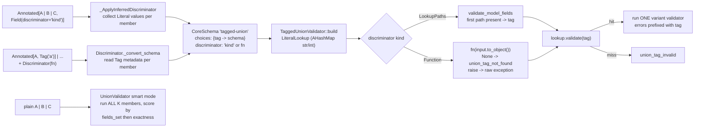

# High-Performance Polymorphism: Discriminated Unions with String Discriminators, Tag(), and Callable Discriminator()

> [!summary] Claim
> A discriminated union turns Pydantic's union validation from "try every variant and score the survivors" into "read one tag, hash it, run one validator", which makes cost and error output independent of the number of variants - but only the string discriminator gets that for free, while a callable `Discriminator()` buys flexibility with a Python call per value, a full Python materialization of JSON input, and a contract that it must never raise and must accept model instances too.

Part of [Pydantic v2 Internals and Validation](README.md) in [API Engineering](../README.md).

## TL;DR

- Mechanism: `Field(discriminator="kind")` makes Pydantic walk every union member at schema-build time, collect each member's `Literal` values for `kind`, and emit a `tagged-union` CoreSchema whose `choices` dict maps every tag to one variant; `pydantic-core` compiles that dict into a `LiteralLookup` (Rust `AHashMap` for `str` and `int` tags) so validation is one key lookup plus one variant validator (`pydantic 2.14.3 pydantic/_internal/_discriminated_union.py, _ApplyInferredDiscriminator`; `pydantic-core 2.50.4 src/validators/union.rs, TaggedUnionValidator::validate`).
- Contract rule: every variant needs the discriminator field typed as a `Literal` (or a union of `Literal`s, `None`, or a `RootModel[Literal[...]]`), with one shared alias and no tag reused; a callable `Discriminator(fn)` instead requires a `Tag("...")` on every member, receives the raw input (a `dict` on validation, the model instance on serialization), and returns `None` for "no tag".
- Trap: an untagged `A | B | C` of models runs every member on every call, even when the first one matches, because smart mode only short-circuits on an exact match that reports no fields-set count, and models always report one; the lab measures `730 ns` at `K=2` growing to `8388 ns` at `K=32` against a flat `454-482 ns` for the tagged form, with `2K-1` errors versus `1` on bad input.
- Portability fact: the lab's 22 tests passed unchanged on CPython `3.12.13`, `3.13.18`, `3.14.6`, `3.14.10`, `3.15.2`, and free-threaded `3.14.6t` and `3.15.0b3t` with `pydantic 2.14.3` / `pydantic-core 2.50.4`; what moves is Pydantic itself (`Tag` and `Discriminator` arrived in `2.5.0`, discriminator-aware serialization in `2.9.0`, the no-fallback-to-all-members serializer fix in `2.13.0b3`).
- When not to use it: if the payload has no stable type field and you cannot add one, a callable discriminator is a heuristic classifier in disguise - prefer changing the wire contract; and if you need open-world extensibility (unknown future variants), a closed tagged union rejects them with `422` unless you route them to an explicit catch-all variant.

## Mental model



Two front doors produce the same `tagged-union` CoreSchema node: the string form infers the tag map from each member's `Literal` field, and the callable form reads the map from `Tag` metadata attached to each member.
`pydantic-core` builds one validator per tag and a `LiteralLookup` over the tags, then at validation time either reads the tag through a lookup path (the string form, which also tries the field's alias) or calls the Python function on the input converted to a Python object.
A hit runs exactly one member validator and prefixes its errors with the tag; a miss is a single `union_tag_invalid` or `union_tag_not_found` error.
The plain union at the bottom has no such shortcut: smart mode runs every member and picks the best survivor, which is where the `O(K)` cost and the `2K-1` error fan-out come from.

## How it works

### 1. Two front doors, one CoreSchema node

`Field(discriminator=...)` accepts a field name or a `Discriminator` instance (`pydantic 2.14.3 pydantic/fields.py, Field`).
`Discriminator` is a frozen, slotted dataclass with four fields: `discriminator: str | Callable[[Any], Hashable]`, `custom_error_type`, `custom_error_message`, and `custom_error_context` (`pydantic 2.14.3 pydantic/types.py, Discriminator`).
When `discriminator` is a `str`, `Discriminator.__get_pydantic_core_schema__` does nothing but re-dispatch as `handler(Annotated[source_type, Field(discriminator=self.discriminator)])`, so the string form of `Discriminator` and `Field(discriminator=...)` are the same code path - and the three `custom_error_*` fields are silently discarded on that path (verified in the lab; see Pitfalls).
When it is a callable, `__get_pydantic_core_schema__` generates the plain union schema first and passes it to `Discriminator._convert_schema`.
`Tag` is a one-field frozen dataclass whose `__get_pydantic_core_schema__` only writes `metadata['pydantic_internal_union_tag_key'] = self.tag` into the member's CoreSchema (`pydantic 2.14.3 pydantic/types.py, Tag`).
`GenerateSchema._union_schema` also reads that metadata key and emits `(choice, tag)` tuples for a plain union, which is why `Tag` alone (without `Discriminator`) still changes error locations from class names to tags (`pydantic 2.14.3 pydantic/_internal/_generate_schema.py, GenerateSchema._union_schema`).

The CoreSchema contract both paths target is `TaggedUnionSchema`: `choices: dict[Any, CoreSchema]`, `discriminator: str | list[str | int] | list[list[str | int]] | Callable[[Any], Any]`, plus `custom_error_*`, `strict`, `from_attributes` (documented default `True`), `ref`, `metadata`, and `serialization` (`pydantic-core 2.50.4 python/pydantic_core/core_schema.py, TaggedUnionSchema`).
The `tagged_union_schema` docstring defines the four discriminator shapes: a `str` is an attribute name, a list of `str | int` is one lookup path, a list of lists is several paths of which "the first path that exists is used", and a callable "can return `None` to indicate that there is no matching discriminator present on the input" (`pydantic-core 2.50.4 python/pydantic_core/core_schema.py, tagged_union_schema`).

### 2. String discriminator: inference at schema-build time

`GenerateSchema._apply_discriminator_to_union` calls `_discriminated_union.apply_discriminator(schema, discriminator, self.defs._definitions)`; if a member is still an unresolved `definition-ref` it catches `MissingDefinitionForUnionRef`, stores the discriminator in `metadata['pydantic_internal_union_discriminator']`, and returns the plain union for now (`pydantic 2.14.3 pydantic/_internal/_generate_schema.py, GenerateSchema._apply_discriminator_to_union`).
`_Definitions.finalize_schema` later pops that key from every deferred schema and applies the discriminator against the resolved definitions, mutating the schema in place; this is how self-referencing and forward-referenced unions still become tagged (`pydantic 2.14.3 pydantic/_internal/_generate_schema.py, _Definitions.finalize_schema`).

`_ApplyInferredDiscriminator.apply` then rewrites the union (`pydantic 2.14.3 pydantic/_internal/_discriminated_union.py`):

- `_apply_to_root` unwraps `nullable`, `missing-sentinel`, `definitions`, and a `definition-ref` that points at a union (the PEP 695 `type Pet = Cat | Dog` case), and re-wraps a non-union schema as a one-member union "as a way to get discriminated-union-style error messages".
- The members go on a stack in declaration order; `_handle_choice` sets `_should_be_nullable` for a `None` member instead of trying to tag it, flattens nested plain unions onto the stack, and coalesces a nested `tagged-union` whose discriminator is the same field (`_is_discriminator_shared`); a nested tagged union on a different field stays a nested node.
- Only `model`, `typed-dict`, `tagged-union`, `lax-or-strict`, `dataclass`, `dataclass-args`, `definition-ref`, and function schemas with an inner schema are legal members; anything else raises `TypeError: The core schema type '<t>' is not a valid discriminated union variant`, with an extra hint when the type is `list`.
- For each member, `_infer_discriminator_values_for_field` requires the field (`discriminator-no-field`), requires its `validation_alias` to be a plain `str` (`discriminator-alias-type`), and requires every member to use the same alias (`discriminator-alias`).
- `_infer_discriminator_values_for_inner_schema` accepts `literal` (returns its `expected` list), `none`, a union of literals, `default` and `function-after` wrappers, and a `RootModel` over a literal; a `function-before`, `function-wrap`, or `function-plain` validator on the discriminator field raises `discriminator-validator`, and any other type raises `discriminator-needs-literal`.
- `_set_unique_choice_for_values` maps every value to its member and raises `TypeError: Value 'x' for discriminator 'kind' mapped to multiple choices` on a collision with a different member.

The output is `core_schema.tagged_union_schema(choices=..., discriminator=..., strict=False, from_attributes=True, custom_error_*=<copied from the original union schema>)`.
If the field has an alias that differs from its name, the discriminator becomes `[[name], [alias]]`, so pydantic-core tries the attribute name first and the alias second; the lab shows `[["state"], ["type"]]` for a field `state` with `alias="type"`.
A member with `Literal["payout.sent", "payout.sent.v2"]` contributes two keys that point at the same schema, so one variant owns several tags.

### 3. Callable discriminator: tags come from `Tag` metadata

`Discriminator._convert_schema` resolves a `definition-ref` that points at a union, re-wraps a non-union schema as a one-member union, and then iterates the choices: the tag is `metadata['pydantic_internal_union_tag_key']` (falling back to the tuple label and, for PEP 695 aliases, to the resolved definition's metadata), and a member with no tag raises `PydanticUserError` code `callable-discriminator-no-tag` (`pydantic 2.14.3 pydantic/types.py, Discriminator._convert_schema`).
It passes `self.discriminator` (the function object itself) as the `discriminator` and, unlike the string path, honors the `custom_error_*` fields, falling back to the union schema's own values.
There is no inference step, so nothing checks that the tag a function returns matches what the member would accept: in a one-off run here, a function that always returned `"b"` for an `{"kind": "a"}` payload surfaced only at runtime, as `literal_error` at `("b", "kind")`.

### 4. Rust build: `TaggedUnionValidator::build`

`Discriminator::new` turns a callable into `Discriminator::Function(Py<PyAny>)` and anything else into `Discriminator::LookupPaths(SmallVec<[LookupPath; 1]>)` via the same `ValidationAlias` machinery that field aliases use (`pydantic-core 2.50.4 src/common/union.rs, Discriminator::new`).
`Discriminator::to_string_py` formats a function as `format!("{}()", f.getattr(py, "__name__")?)`; it runs at build time to precompute `discriminator_repr`, so a `functools.partial` or a callable class instance (no `__name__`) fails schema construction with `SchemaError ... AttributeError: 'functools.partial' object has no attribute '__name__'` (lab test `test_callable_without_dunder_name_fails_at_schema_build`).
`build` then iterates the `choices` dict, builds one validator per key, precomputes `tags_repr` (the comma-separated `repr` of every tag, used in `union_tag_invalid`), and hands `(tag, validator)` pairs to `LiteralLookup::new`; `from_attributes` comes from the schema or config and defaults to `true` (`pydantic-core 2.50.4 src/validators/union.rs, TaggedUnionValidator::build`).
The validator's name, which becomes the `SchemaValidator` title, is `tagged-union[<member names>]` with one entry per tag, so the lab's event union is titled `tagged-union[CardCharged,CardRefunded,PayoutSent,PayoutSent]`.

`LiteralLookup` is a set of specialised indexes built once (`pydantic-core 2.50.4 src/validators/literal.rs, LiteralLookup::new`):

| Index | Holds | Probe at validation time |
| --- | --- | --- |
| `expected_bool` | `True` / `False` tags | `input.validate_bool(true)` (strict) |
| `expected_int` | exact `int` tags that fit `i64`, in an `AHashMap<i64, usize>` | `input.exact_int()` |
| `expected_str` | exact `str` tags, in an `AHashMap<String, usize>` | `exact_str()` for Python input; `validate_str(true, false)` for JSON input |
| `expected_py_dict` | other hashables: `Enum` members, `bytes`, ints beyond `i64` | Python `dict.get_item`, a `TypeError` from an unhashable input counts as a miss |
| `expected_py_values` | unhashable tags | linear `==` scan |
| `expected_py_primitives` | the same bool, int, and str tags again | Python hash and `==`, checked last as "almost as a lax fallback" |

The last index is why the lab sees the Python input `{"v": True}` route to a `Literal[1]` member and the JSON input `{"v": 2.0}` route to a `Literal[2]` member: they miss the exact-int index, but `hash(True) == hash(1)` and `hash(2.0) == hash(2)`, and they compare equal in the Python fallback dict (a one-off run here also routed the Python `{"v": 1.0}` to `Literal[1]`).
A `str`-subclass `Enum` tag (`class K(str, Enum)`) lands in `expected_py_dict`, so a plain string finds `K.B` through Python hashing and equality; a one-off run here routed both `{"kind": "b"}` and the JSON `{"kind":"a"}` that way, and JSON Schema emitted the enum values as mapping keys.

### 5. Rust validate: one lookup, one validator

`TaggedUnionValidator::validate` matches on the discriminator (`pydantic-core 2.50.4 src/validators/union.rs`):

- `LookupPaths`: `input.validate_model_fields(state.strict_or(false), from_attributes)` must turn the input into a dict, a mapping (lax only), or an attribute source; otherwise the error is `model_attributes_type` ("Input should be a valid dictionary or object to extract fields from"), which is what a JSON array or a bare string produces (`pydantic-core 2.50.4 src/input/input_python.rs, validate_model_fields`).
  The first path that yields a value supplies the tag; none yields `union_tag_not_found`.
- `Function`: `func.call1(py, (input.to_object(py)?,))?`; a returned `None` is `union_tag_not_found`, and the trailing `?` turns any Python exception into an internal error that propagates as the original exception, not a `ValidationError`.
  For JSON input, `to_object` is `self.py_converter().into_bound_py_any(py)` on the parsed `JsonValue`, so the function receives the whole subtree as fresh Python `dict`/`list` objects even though validation then proceeds on the JSON value (`pydantic-core 2.50.4 src/input/input_abstract.rs, Input::to_object`); the lab's recording discriminator receives `{"radius": 1.5, "meta": {"nested": [1, 2]}}` for a JSON document.
- `find_call_validator` probes the `LiteralLookup`; a hit runs that single validator and wraps any error with `err.with_outer_location(tag)`, so locations read `("card.refunded", "amount_cents")`; a miss raises `UnionTagInvalid { discriminator, tag, expected_tags }`, rendered as "Input tag '{tag}' found using {discriminator} does not match any of the expected tags: {expected_tags}" (`pydantic-core 2.50.4 src/errors/types.rs, ErrorType::UnionTagInvalid`).
- A configured custom error replaces both tag errors; errors raised inside the chosen variant are never replaced (`pydantic-core 2.50.4 src/validators/union.rs, TaggedUnionValidator::find_call_validator`).

`from_attributes=True` on the tag lookup only means the tag can be read from an object attribute; the chosen model still validates with its own config, so an arbitrary object with `kind = "cat"` reaches `Cat` and then fails `model_type` unless `Cat` itself enables `from_attributes`.

### 6. The baseline you are replacing: smart-mode `UnionValidator`

`UnionValidator::validate_smart` loops over every choice, resetting `state.exactness = Some(Exactness::Exact)` and `state.fields_set_count = None` before each attempt (`pydantic-core 2.50.4 src/validators/union.rs, UnionValidator::validate_smart`).
It returns early only when a success is `(Some(Exactness::Exact), None)`, that is, exact and with no fields-set count; the model-fields, dataclass, and `TypedDict` validators record a count through `state.add_fields_set` whenever they validate fields (`pydantic-core 2.50.4 src/validators/model_fields.rs`, `dataclass.rs`, `typed_dict.rs`), so a union of models validating `dict` input never takes the early exit and always runs all `K` members.
A later success replaces the best match only if its fields-set count is strictly larger, or, on equal or missing counts, its exactness is strictly higher, so ties go to the leftmost member.
Line errors are recorded only while no member has succeeded, and on total failure every member's errors are emitted with that member's label or name as the outer location, which is the `2K-1` fan-out in the lab.
`union_mode="left_to_right"` instead returns the first success and stops (`UnionValidator::validate_left_to_right`), which is `O(position of the match)` but makes member order part of the contract.
The docs state that the smart algorithm "may change between Pydantic minor releases" and that the fields-set metric arrived in `2.8.0` (`pydantic 2.14.3 docs/concepts/unions.md, Smart Mode`).

### 7. Serialization: the discriminator runs again, on the model

`TaggedUnionSerializer::get_discriminator_value` reads the tag from a `dict` with `py_get_dict_item` or from an object with `simple_py_get_attr`, and for a function calls `func.bind(py).call1((value,)).ok()`, so a raising function is silently treated as "no tag" (`pydantic-core 2.50.4 src/serializers/type_serializers/union.rs`).
With a tag found in its `PyHashTable`, it serializes the chosen member first at strict check level, then (in a top-level union) at lax, and if both fail it registers one warning and returns `None`, so `to_python` falls back to `infer_to_python` instead of trying the other members (`TaggedUnionSerializer::tagged_union_serialize`); in a nested union it propagates the error so the parent can retry.
That last behavior is the fix for issue #12800, where, with discriminated unions of up to 17 members, a `field_validator` that assigned a `str` to an enum field made the selected variant fail to serialize, and serializing one 17k-line entity went from `0.044` seconds to `183.207` seconds as every member was tried; PR #12825 ("No longer fall back to trying all union members when the variant selected by discriminator fails to serialize") shipped in `2.13.0b3` (`pydantic 2.14.3 HISTORY.md`).
With no tag (missing attribute, function returned `None` or raised), it emits "Defaulting to left to right union serialization - failed to get discriminator value for tagged union serialization" and runs the left-to-right `UnionChoices::serialize`.
This is why the docs tell you callable discriminators must handle both `dict` and model inputs (`pydantic 2.14.3 docs/concepts/unions.md, Discriminated Unions with callable Discriminator`), and why the lab's dict-only callable produces exactly one serializer warning per dump.

### 8. JSON Schema and the OpenAPI contract

`GenerateJsonSchema.tagged_union_schema` emits `oneOf` over the deduplicated member schemas, maps `Enum` tags to their `.value`, `bool` tags to `"true"`/`"false"`, and `None` to `"null"`, and adds `discriminator: {propertyName, mapping}` only when `_extract_discriminator` can name one property: always for a `str` discriminator, for a list of paths only if a single-key alias appears in every member's `properties`, never for a callable (`pydantic 2.14.3 pydantic/json_schema.py, GenerateJsonSchema.tagged_union_schema`).
A plain union becomes `anyOf`; the lab asserts all three shapes.
For an aliased discriminator the emitted `propertyName` is the alias (`"type"`), which is the wire name a client must send.
OpenAPI 3.1.1 Section 4.8.25 says `propertyName` is REQUIRED, the property SHOULD be required in every payload schema, `mapping` keys MUST be strings, and "discriminator MUST NOT change the validation outcome of the schema" - it is a hint for tooling, whereas Pydantic's tag is the validation (`spec.openapis.org/oas/v3.1.1 Section 4.8.25`).
The `bool` mapping-key fix (#13632, "Fix JSON schema discriminator mapping keys for `bool` discriminators") shipped in `2.14.0b2` (`pydantic 2.14.3 HISTORY.md`); a one-off run on `2.14.3` emitted `{"false": "#/$defs/F1", "true": "#/$defs/T1"}`.
Generating clients from the callable form is weaker: `oneOf` without a `discriminator` forces generators to trial-match, exactly the work you removed on the server.

### 9. At the FastAPI boundary

FastAPI decodes the body to Python and calls `self._type_adapter.validate_python(value, from_attributes=True)` inside `try: ... except ValidationError` (`fastapi 0.162.0 fastapi/_compat/v2.py, ModelField.validate`).
A tag miss therefore becomes a `422` with `union_tag_not_found` or `union_tag_invalid` in `detail`, but any other exception from a callable discriminator escapes the handler and becomes a `500`; the lab asserts both through `httpx.ASGITransport(raise_app_exceptions=False)`.
Because the body is already Python, a callable discriminator in a FastAPI body does not pay the JSON materialization cost; it does pay it under `model_validate_json` and `TypeAdapter.validate_json`.

## Numbers and limits

Re-measured once by the verifier (2026-11-12) with `uv run --frozen python -m api_labs.f09_pydantic_v2_internals_and_validation.discriminated_union_dispatch` from `labs/`, CPython `3.14.6`, macOS 27.3 arm64 (`macOS-27.3-arm64-arm-64bit-Mach-O`, `uname -r` = `27.3.0`), `pydantic 2.14.3`, `pydantic-core 2.50.4`; each cell is the median of 9 `timeit.repeat` runs of 2000 `validate_python` calls on a 4-field payload that matches the last of `K` variants.

| `K` variants | smart union (ns) | `left_to_right`, last member (ns) | `Field(discriminator=)` (ns) | callable `Discriminator` (ns) | errors, smart | errors, tagged |
| --- | --- | --- | --- | --- | --- | --- |
| 2 | 730 | 694 | 454 | 501 | 3 | 1 |
| 4 | 1196 | 1192 | 467 | 508 | 7 | 1 |
| 8 | 2191 | 2239 | 482 | 531 | 15 | 1 |
| 16 | 4353 | 4354 | 477 | 523 | 31 | 1 |
| 32 | 8388 | 8408 | 480 | 529 | 63 | 1 |

| Quantity | Value | Source |
| --- | --- | --- |
| Variant validators run per call, smart union of models | `K`, whether the match is first or last | lab `test_tagged_union_runs_one_variant_while_smart_union_runs_all_k`, `K` in `{2, 8, 32}` |
| Variant validators run per call, tagged union | `1` | same test |
| Variant validators run, `left_to_right` | index of first success + 1 | same test |
| Errors on a bad payload, smart union | `2K-1` for these variants (each wrong member fails its `Literal` and the bad field) | lab `test_benchmark_harness_reports_error_amplification_of_2k_minus_1` |
| Callable vs string discriminator, 1000-item JSON list | `577 us` vs `400 us` (+44%) | same benchmark run, `benchmark_json_list` |
| Callable vs string discriminator, same list as Python objects | `364 us` vs `319 us` (+14%) | same benchmark run |
| Inline capacity of the per-member error buffer | `SMALL_UNION_THRESHOLD = 4` (`SmallVec`), heap beyond that | defined in `pydantic-core 2.50.4 src/common/union.rs`, used by `MaybeErrors` in `src/validators/union.rs` |
| Tag lookup paths stored inline | `SmallVec<[LookupPath; 1]>`, so name plus alias spills to the heap once at build | `pydantic-core 2.50.4 src/common/union.rs, Discriminator` |
| Serialization blowup before the fix | `0.044 s` -> `183.207 s` for one 17k-line entity, unions of up to 17 members | issue #12800 (reporter's measurement, opened 2026-02-12) |
| `Tag`, `Discriminator` introduced | `2.5.0` (2023-11-13) | `pydantic 2.14.3 HISTORY.md` |
| Fields-set metric in smart mode | `2.8.0` | `pydantic 2.14.3 docs/concepts/unions.md` |
| Discriminator-aware serializer | `2.9.0` (pydantic-core#1397) | `pydantic 2.14.3 HISTORY.md` |
| No fallback to all members on serializer failure | `2.13.0b3` (#12825) | `pydantic 2.14.3 HISTORY.md` |

The tagged columns are flat within noise from `K=2` to `K=32`, which is what an `AHashMap` probe predicts; the smart column grows linearly at roughly `255 ns` per extra member for this payload shape.
The callable premium over the string form is about `40-50 ns` per value here, one Python function call; on JSON input it grows with the size of each value's subtree, because the whole subtree is converted to Python first.
These are single-machine numbers for a small flat payload; deeper members make the smart-union gap larger, because every member validates the whole payload.

## Portability

| Dimension | Behavior | Evidence |
| --- | --- | --- |
| CPython `3.12.13` | 22 passed | lab run in a temp venv from `uv.lock` (`3.12.16` not installable here); drafter's run, not re-executed in verification (lab matrix paused 2026-11-11) |
| CPython `3.13.18` | 22 passed | lab run, temp venv from `uv.lock`; drafter's run, not re-executed in verification (lab matrix paused 2026-11-11) |
| CPython `3.14.6` (workspace) and `3.14.10` | 22 passed on both | `3.14.6`: re-run by the verifier in the workspace venv, `22 passed`; `3.14.10`: temp venv; drafter's run, not re-executed in verification (lab matrix paused 2026-11-11) |
| CPython `3.15.2` | 22 passed | lab run, temp venv from `uv.lock`; drafter's run, not re-executed in verification (lab matrix paused 2026-11-11) |
| Free-threaded `3.14.6t`, `3.15.0b3t` | 22 passed, `sys._is_gil_enabled()` is `False` | lab run in a separate `uv venv` with the lock's pins for pydantic, fastapi, starlette, httpx, pytest (the full lock cannot install there: no `psycopg-binary` wheel); `3.15.2t` not available here; drafter's run, not re-executed in verification (lab matrix paused 2026-11-11) |
| Pydantic `< 2.5.0` | no `Tag` or `Discriminator`; only `Field(discriminator=str)` | `pydantic 2.14.3 HISTORY.md`, v2.5.0 entry for #7983 and #8047 |
| Pydantic `< 2.9.0` | the serializer does not use the discriminator to select a member; that was added by pydantic-core#1397 | `pydantic 2.14.3 HISTORY.md`, v2.9.0 entry |
| Pydantic `< 2.13.0b3` | a failing selected member makes serialization try every member | #12800, #12825 |
| Pydantic `< 2.14.0b2` | affected by the `bool` mapping-key bug fixed in #13632 and the callable-discriminator-with-PEP-695-alias bug fixed in #13604 | `pydantic 2.14.3 HISTORY.md`, v2.14.0b2 entry |
| Uvicorn, Hypercorn, Granian; HTTP/1.1, HTTP/2, HTTP/3 | identical: dispatch runs after the framework has the decoded body | `fastapi 0.162.0 fastapi/_compat/v2.py, ModelField.validate` calls `validate_python` on the decoded value; no server or transport code is involved |

## Worked example

The [implementation](../labs/src/api_labs/f09_pydantic_v2_internals_and_validation/discriminated_union_dispatch.py) defines a string-discriminated payment event union, a shape union routed by a callable that inspects structure, a fragile callable that shows the failure mode, a family of `K` generated variants that log every validator attempt, and a FastAPI app that puts both callables behind HTTP.
The [test](../labs/tests/f09_pydantic_v2_internals_and_validation/test_discriminated_unions_tag_and_callable_discriminator_dispatch.py) has 22 tests (with parametrization), all `@pytest.mark.unit`.

The string-discriminated union (excerpt, verbatim from the implementation):

```python
class CardCharged(BaseModel):
    kind: Literal["card.charged"]
    amount_cents: int
    currency: str


class CardRefunded(BaseModel):
    kind: Literal["card.refunded"]
    amount_cents: int
    reason: str


class PayoutSent(BaseModel):
    kind: Literal["payout.sent", "payout.sent.v2"]
    payout_id: str


Event = Annotated[CardCharged | CardRefunded | PayoutSent, Field(discriminator="kind")]
UntaggedEvent = CardCharged | CardRefunded | PayoutSent
```

The callable discriminator routes by which keys are present, accepts both a `dict` (validation) and a model instance (serialization), and returns `None` instead of raising (excerpt, verbatim):

```python
def shape_tag(value: Any) -> str | None:
    """Return the tag for a dict (validation) or a model instance (serialization); never raise."""
    if isinstance(value, dict):
        keys = cast("dict[str, Any]", value).keys()
        if "radius" in keys:
            return "circle"
        if "width" in keys and "height" in keys:
            return "rect"
        if "points" in keys:
            return "polygon"
        return None
    if isinstance(value, Circle):
        return "circle"
    if isinstance(value, Rect):
        return "rect"
    if isinstance(value, Polygon):
        return "polygon"
    return None


Shape = Annotated[
    Annotated[Circle, Tag("circle")]
    | Annotated[Rect, Tag("rect")]
    | Annotated[Polygon, Tag("polygon")],
    Discriminator(shape_tag),
]
SHAPE_ADAPTER: TypeAdapter[Circle | Rect | Polygon] = TypeAdapter(Shape)


def fragile_shape_tag(value: Any) -> str:
    """Anti-pattern: assumes a dict with a 'type' key, so it raises on anything else."""
    return cast("str", value["type"])
```

Attempt counting is deterministic, so the `O(1)` versus `O(K)` claim is asserted without timing: every generated variant inherits a `mode="before"` model validator that appends its class name to a shared log (excerpt, verbatim):

```python
def build_variant_family(size: int) -> VariantFamily:
    """Build `size` models differing only in their `kind` literal; each logs its attempts."""
    attempts: list[str] = []

    class CountingVariant(BaseModel):
        a: int

        @model_validator(mode="before")
        @classmethod
        def _log_attempt(cls, data: Any) -> Any:
            attempts.append(cls.__name__)
            return data

    # Runtime-built type forms: typed as Any because static checkers cannot follow them.
    literal: Any = Literal
    union_form: Any = Union
    annotated: Any = Annotated
    kind_types: list[Any] = [literal[f"v{i}"] for i in range(size)]
    variants: list[type[CountingVariant]] = [
        create_model(f"Variant{i}", __base__=CountingVariant, kind=(kind_type, ...))
        for i, kind_type in enumerate(kind_types)
    ]
    union: Any = union_form[tuple(variants)]
    return VariantFamily(
        size=size,
        smart=TypeAdapter(union),
        left_to_right=TypeAdapter(annotated[union, Field(union_mode="left_to_right")]),
        tagged=TypeAdapter(annotated[union, Field(discriminator="kind")]),
        attempts=attempts,
    )
```

The model-level `before` validator wraps the model schema in a function schema with an inner schema, which `_ApplyInferredDiscriminator` accepts and looks through; the discriminator field itself has no validator, so it still infers.

Two of the tests (excerpt, verbatim from the test module):

```python
@pytest.mark.unit
@pytest.mark.parametrize("size", [2, 8, 32])
def test_tagged_union_runs_one_variant_while_smart_union_runs_all_k(size: int) -> None:
    family = build_variant_family(size)
    first, last = family.payload(0), family.payload(size - 1)
    assert family.count_attempts(family.tagged, first) == 1
    assert family.count_attempts(family.tagged, last) == 1
    assert family.count_attempts(family.smart, first) == size
    assert family.count_attempts(family.smart, last) == size
    assert family.count_attempts(family.left_to_right, first) == 1
    assert family.count_attempts(family.left_to_right, last) == size


@pytest.mark.unit
def test_tagged_union_reports_one_error_under_the_tag_instead_of_one_per_variant() -> None:
    bad = {"kind": "card.refunded", "amount_cents": "ten", "reason": "dup"}
    with pytest.raises(ValidationError) as tagged:
        EVENT_ADAPTER.validate_python(bad)
    assert [(e["type"], e["loc"]) for e in tagged.value.errors()] == [
        ("int_parsing", ("card.refunded", "amount_cents"))
    ]
    with pytest.raises(ValidationError) as untagged:
        UNTAGGED_EVENT_ADAPTER.validate_python(bad)
    assert [(e["type"], e["loc"]) for e in untagged.value.errors()] == [
        ("literal_error", ("CardCharged", "kind")),
        ("int_parsing", ("CardCharged", "amount_cents")),
        ("missing", ("CardCharged", "currency")),
        ("int_parsing", ("CardRefunded", "amount_cents")),
        ("literal_error", ("PayoutSent", "kind")),
        ("missing", ("PayoutSent", "payout_id")),
    ]
```

The untagged union reports six errors for one bad field, including a `missing currency` that has nothing to do with a refund, while the tagged union reports exactly the one real error under the tag.
The rest of the module asserts tag-error types and messages, JSON duplicate-key last-wins, alias lookup order, hash-equality routing of `True` and `1.0`, structural routing for Python and JSON, the materialized `dict` a callable sees for JSON, the serializer fallback warning, the raw `KeyError`/`TypeError` escape, the `422` versus `500` split under FastAPI, custom errors honored only by the callable form, five schema-build rejections, the `__name__` requirement, nested versus coalesced discriminators, and the three JSON Schema shapes.

Captured run (finisher, 2026-11-12), from `labs/`, CPython `3.14.6` on macOS 27.3 arm64:

```text
$ uv run --frozen pytest tests/f09_pydantic_v2_internals_and_validation/test_discriminated_unions_tag_and_callable_discriminator_dispatch.py -q
......................                                                   [100%]
22 passed in 0.20s
```

## Pitfalls

> [!warning] A callable discriminator that raises turns a bad request into a 500
> Trigger: `Discriminator(lambda v: v["type"])`, and a client sends a body without `type`, a JSON array, or a scalar.
> Symptom: `TaggedUnionValidator::validate` propagates the `KeyError` or `TypeError` through `func.call1(...)?`, FastAPI's `ModelField.validate` catches only `ValidationError`, and the client gets `500 Internal Server Error` with a stack trace in your logs; the lab's `/fragile-shapes` returns `500` for `{"radius": 1}`.
> Fix: write the callable total - check `isinstance(value, dict)`, use `.get()`, return `None` for "no tag" so pydantic-core raises `union_tag_not_found` (a `422`), and unit-test it with a `list`, a scalar, and an empty `dict`.

> [!warning] A dict-only callable degrades serialization silently
> Trigger: the callable handles `dict` inputs only, then `model_dump()` or a FastAPI `response_model` serializes a model instance.
> Symptom: the serializer swallows the exception with `.ok()`, logs "Defaulting to left to right union serialization - failed to get discriminator value for tagged union serialization", and tries members left to right; output is usually correct, so the warning is the only signal, and before `2.13.0b3` a failing member could cost minutes (issue #12800: `0.044 s` -> `183.207 s`, with FastAPI blocked while serializing).
> Fix: handle model instances (`isinstance(value, Circle)` or `getattr(value, "kind", None)`), and run tests with `-W error::UserWarning` so serializer warnings fail CI.

> [!warning] `Discriminator("kind", custom_error_type=...)` drops the custom error
> Trigger: you pass `custom_error_type`, `custom_error_message`, or `custom_error_context` to a `Discriminator` whose `discriminator` is a string, expecting to hide the tag list from clients.
> Symptom: `Discriminator.__get_pydantic_core_schema__` re-dispatches as `Field(discriminator=self.discriminator)` and `apply_discriminator` unwraps it to the bare string, so the custom fields never reach the schema; clients still receive `union_tag_invalid` with every expected tag (lab `test_custom_error_is_honored_for_callable_but_dropped_for_str_discriminator`).
> Fix: use a callable discriminator (which honors them), or rewrite `union_tag_invalid` in your exception handler (see [[Mapping-Pydantic-Validation-Errors-to-RFC-9457-Problem-Details]]); no upstream issue was found for this as of 2026-11.

> [!warning] Putting the discriminator on the container instead of the union
> Trigger: `vehicles: list[Car | Truck] = Field(discriminator="type")`.
> Symptom: in `2.14.3` this raises `TypeError: The core schema type 'list' is not a valid discriminated union variant` at class creation (verified here); in the `2.6.4` report in issue #9498 the same declaration yielded errors located under `Car` and `Truck` class names, the signature of an untagged union, and the user saw irrelevant errors for every member.
> Fix: annotate the element: `list[Annotated[Car | Truck, Field(discriminator="type")]]`.

> [!warning] Partials and callable objects cannot be discriminators
> Trigger: `Discriminator(functools.partial(get_tag, "kind"))` or `Discriminator(TagPicker())`.
> Symptom: `SchemaError ... AttributeError: 'functools.partial' object has no attribute '__name__'` at import time, because `Discriminator::to_string_py` formats the function's `__name__` into the error template during build.
> Fix: use a `def`, or `functools.update_wrapper(partial_obj, original_fn)` to give it a `__name__` (the lab proves the wrapped partial works).

> [!warning] Tags match by Python equality, not by JSON type
> Trigger: integer tags such as `Literal[1]` and `Literal[2]`, or `bool` tags.
> Symptom: the Python `{"v": True}` routes to the `Literal[1]` member and the JSON `{"v": 2.0}` to the `Literal[2]` member through `LiteralLookup`'s Python-hash fallback (lab test), and in a one-off run here `{"v": 1.0}` routed to `Literal[1]` and `{"ok": 0}` to a `Literal[False]` member; the member's `Literal` validator then returns the canonical `1`, and in a one-off run here it did so even with `ConfigDict(strict=True)` on the member, while `Annotated[Literal[1], Strict()]` fails at build with `Unable to apply constraint 'strict' to schema of type 'literal'` and an `AfterValidator` only ever sees the canonical `1`.
> The contract says "integer", the service accepts a boolean, and a second parser in front of it (a gateway applying JSON Schema `const`) can disagree.
> Fix: use string tags for wire protocols; if tags must be integers, use a callable discriminator that returns `None` unless `type(tag) is int`, which turns `true` and `1.0` into `union_tag_not_found`.

> [!warning] The alias is the wire name, but the attribute name also finds the tag
> Trigger: `kind: Literal["up"] = Field(alias="type")` on every member.
> Symptom: the discriminator compiles to `[["kind"], ["type"]]`, so a payload with `kind` instead of `type` gets past tag lookup and then fails `missing` at `("up", "type")`; error text points at the member, not at the misspelled tag.
> Fix: emit and document only the alias (it is also the OpenAPI `propertyName`), and see [[Aliases-AliasPath-AliasChoices-and-Bidirectional-Field-Mapping]] for `validate_by_name`.

> [!warning] Validators on the discriminator field break inference
> Trigger: a `mode="before"` field validator that lowercases `kind`.
> Symptom: `PydanticUserError` code `discriminator-validator` at class creation; and even if allowed, the tag is read from the raw input before any member validator runs, so normalization could never affect routing.
> Fix: normalize in a callable discriminator, or reject non-canonical tags; `mode="after"` validators are allowed because they run after routing.

## Security and robustness

- OWASP API4:2023 Unrestricted Resource Consumption lists missing limits on "Number of operations to perform in a single API client request"; an untagged union of `K` models multiplies CPU per item by `K` and error output by roughly `2K`, and a `list[...]` of such items multiplies again, so one large request becomes a CPU and response-size amplifier.
  A tagged union bounds both to one member per item; combine it with `max_length` on the list and a body-size limit at the edge.
- OWASP API8:2023 Security Misconfiguration flags error messages that "expose other sensitive information"; `union_tag_invalid` echoes the full tag list in `msg` and again in `ctx`, which holds `discriminator`, `tag`, and `expected_tags` (a one-off run here on the lab's event union returned `expected_tags: "'card.charged', 'card.refunded', 'payout.sent', 'payout.sent.v2'"`), and even `union_tag_not_found` names the discriminator (the lab's `422` carries `{"discriminator": "shape_tag()"}`), which enumerates internal or unreleased event types.
  Use a callable discriminator with `custom_error_*`, or rewrite tag errors at the boundary, for public endpoints.
- Parser differentials: RFC 8259 Section 4 says object names "SHOULD be unique" and that with duplicates "the behavior of software that receives such an object is unpredictable"; pydantic-core takes the last `kind` and the last field values (lab test), so a gateway or WAF that authorizes on the first `kind` can be shown `card.charged` while the service processes `payout.sent`.
  Reject duplicate keys at the edge or make the authorizing component and the validating component the same parser.
- A callable discriminator is arbitrary code on untrusted input, invoked once per union value; keep it `O(size of the keys it inspects)`, never parse nested content, never do I/O, and remember it sees a freshly materialized Python copy of each JSON subtree, which doubles allocation for deeply nested members.
- Closed unions are a deny-list by construction: an unknown tag is a `422`, which is safe for commands but breaks consumers of event streams when the producer adds a type.
  For consumers, route unknown tags to an explicit catch-all (a callable that returns `"unknown"` for unrecognized tags mapped to a `ConfigDict(extra="allow")` model; checked in a one-off run here, not in the lab) and alert on it, rather than widening the discriminator field to `str`.
- `from_attributes=True` on the tag lookup lets an ORM object or any attribute bag supply the tag, but the member model still applies its own `from_attributes` and `strict` settings; do not mistake successful tag extraction for successful validation.

## The principal's view

The decision is not "should we use `Field(discriminator=...)`"; it is whether every polymorphic payload in the organization carries an explicit, required, string-literal type tag, because that wire-contract rule is what makes the cheap path available everywhere.
With the rule, validation is `O(1)` per value, errors are precise, OpenAPI carries a `discriminator` with a `mapping` that generators turn into real sum types, and adding a variant is an additive change on the producer side.
Without it, teams reach for smart unions (cost and correctness that silently depend on member order and field counts, and that the docs say may change between minor releases) or for callable discriminators (a hand-written classifier per union, invisible to schema tooling, and a source of `500`s if anyone forgets totality).

The organizational trade-off is that tags become a versioned public vocabulary: renaming `card.charged` is a breaking change, a `Literal` with several values (`"payout.sent", "payout.sent.v2"`) is the migration tool, and consumers need a declared policy for unknown tags (reject for commands, catch-all and alert for events) - see [[Compatibility-Taxonomy-Wire-Source-and-Semantic-Compatibility-AIP-180]].
Reserve the callable form for inputs you do not control (third-party webhooks, legacy shapes, unions mixing models and primitives) and wrap it in tests that feed it non-dicts and model instances.
If the payloads are large, hot, and fully under your control, `msgspec` (pinned here at `0.22.0`) decodes `Struct` types declared with `tag=` straight into tagged unions in C, which the sibling benchmark note compares ([[Pydantic-v2-Performance-Engineering-vs-MsgSpec-and-ORJSON]]); and if the contract crosses languages, Protocol Buffers `oneof` makes the tag a field number the schema compiler checks, rather than a string convention.

## Interview questions

> [!question] L5: What does `Field(discriminator="kind")` change about how Pydantic validates `Cat | Dog | Bird`?
>
> > [!success]- Answer
> > Without it, the union is a smart-mode `union` schema and pydantic-core runs every member, then keeps the success with the most fields set, breaking ties by exactness and then by position.
> > With it, Pydantic collects each member's `Literal` values for `kind` at schema-build time and emits a `tagged-union` schema mapping each tag to one member.
> > pydantic-core reads `kind` from the input, looks it up in a hash map, and runs only that member's validator.
> > Errors are prefixed with the tag, an unknown tag is one `union_tag_invalid` error, and a missing tag is `union_tag_not_found`.
> >
> > Follow-up: What happens at class-definition time if `Bird.kind` is typed `str` instead of `Literal["bird"]`?

> [!question] L5: When do you need `Tag()`, and what does it do on its own?
>
> > [!success]- Answer
> > `Tag("x")` is required on every member of a union governed by a callable `Discriminator`, because there is no `Literal` field to infer the tag map from; a missing tag raises `PydanticUserError` code `callable-discriminator-no-tag`.
> > Mechanically it only writes `pydantic_internal_union_tag_key` into the member's CoreSchema metadata.
> > On a plain union without a discriminator it still turns members into labelled `(schema, tag)` choices, so error locations use the tag instead of the class name.
> >
> > Follow-up: Why does a `Tag` on a model force that model to be kept as a `definitions` entry in the CoreSchema rather than inlined?

> [!question] L6: Predict the output of `TypeAdapter(Small | Big).validate_python({"x": 1, "y": 2})` for `Small(x: int)` and `Big(x: int, y: int = 0)`, with and without `Field(union_mode="left_to_right")`, and say how many member validators ran in each case.
>
> > [!success]- Answer
> > Smart mode returns `Big(x=1, y=2)`: both members succeed, `Big` sets two fields against one, and the higher fields-set count wins.
> > Both validators ran, because a model success always carries a fields-set count and smart mode only short-circuits on an exact match with no count.
> > Left-to-right returns `Small(x=1)` after running one validator, silently ignoring `y` because `Small` ignores extra keys by default.
> > A `kind` tag on each model would make the answer independent of order and of field counts.
> >
> > Follow-up: Which one would you pick for a `str | int` union, and does the early-exit rule differ there?

> [!question] L6: Your callable discriminator works in tests, but production logs fill with "Defaulting to left to right union serialization" - what is happening, and what does it cost?
>
> > [!success]- Answer
> > The tagged-union serializer calls the same function with the model instance, not a `dict`, and swallows any exception with `.ok()`.
> > A dict-only callable therefore returns nothing on every dump, and the serializer falls back to trying members left to right with a warning per value.
> > Output is usually still correct, which is why it ships; the cost is extra serialization attempts per value, and before `2.13.0b3` a failing selected member made the serializer try every member, which issue #12800 measured as `0.044 s` -> `183.207 s` for a 17-member union.
> > Fix the callable to handle model instances and make serializer warnings fail CI.
> >
> > Follow-up: How would you detect this class of regression in a load test rather than in logs?

> [!question] L6: Debug this API: a FastAPI endpoint accepts `Annotated[Annotated[Card, Tag("card")] | Annotated[Bank, Tag("bank")], Discriminator(lambda v: v["method"])]`, and clients that omit `method` get `500` instead of `422` - why, and what is the minimal fix?
>
> > [!success]- Answer
> > pydantic-core calls the function with `func.call1(...)?`, so the `KeyError` from `v["method"]` propagates as a raw Python exception instead of a `ValidationError`.
> > FastAPI's `ModelField.validate` catches only `ValidationError`, so the exception reaches Starlette's server-error handling and becomes a `500`.
> > The minimal fix is a total function: `v.get("method") if isinstance(v, dict) else getattr(v, "method", None)`, which returns `None` for a missing tag and makes pydantic-core raise `union_tag_not_found`, a `422`.
> > The lambda also has the name `<lambda>`, so the error message reads "Unable to extract tag using discriminator <lambda>()"; a named function gives clients a useful message.
> >
> > Follow-up: Why would `functools.partial(get_field, "method")` fail even earlier, at import time?

> [!question] L6: Why is a callable discriminator slower than a string discriminator on `model_validate_json`, and by how much in the lab?
>
> > [!success]- Answer
> > The string form reads the tag from the parsed JSON value inside Rust and probes a Rust hash map.
> > The callable form must call Python, and pydantic-core passes it `input.to_object(py)`, which converts the whole JSON subtree for that value into new Python objects before the member validator then validates the JSON value again.
> > In the lab, a 1000-item JSON list took `577 us` with the callable against `400 us` with the string discriminator; with Python input the gap shrank to `364 us` against `319 us`, the cost of the function call alone.
> >
> > Follow-up: Does a FastAPI JSON body pay the materialization cost, given how FastAPI calls Pydantic?

> [!question] L7+: As owner of the event schema for 40 producer teams, what contract rules do you set for polymorphic payloads, and how do you evolve them?
>
> > [!success]- Answer
> > Every polymorphic object carries a required string field with a single, organization-wide name (for example `type`), typed as a `Literal` per variant, so every service gets `O(1)` dispatch and OpenAPI gets a `discriminator` with a `mapping`.
> > Tags are a public, versioned vocabulary: never renamed, never reused, deprecated by adding a second literal to the same variant during migration.
> > Consumers declare an unknown-tag policy - reject for commands, a catch-all variant plus alerting for events - so adding a variant is additive for producers and safe for consumers.
> > CI enforces it: a schema lint that fails on `anyOf` of objects without a `discriminator`, and contract tests that replay unknown tags against each consumer.
> > Callable discriminators are an exception that needs review, because they are invisible to schema tooling and can turn bad input into `500`s.
> >
> > Follow-up: How do you roll out the rule on an existing API whose payloads have no type field today without a flag day?

> [!question] L7+: In a security review you find a gateway that authorizes webhook calls by reading `kind` from the JSON body before forwarding to a Pydantic service; what is the attack, and where do you fix it?
>
> > [!success]- Answer
> > RFC 8259 Section 4 leaves duplicate object names unpredictable, and pydantic-core takes the last occurrence for both the tag and the fields.
> > If the gateway takes the first `kind`, a body with `"kind": "card.charged"` followed by `"kind": "payout.sent"` is authorized as a charge and executed as a payout.
> > Fix it at the trust boundary: reject duplicate keys at the gateway, or move the authorization decision into the service after Pydantic has produced the typed variant, so the same parser decides both.
> > Also strip the tag list from public `union_tag_invalid` errors, since it enumerates the internal event types an attacker can try.
> >
> > Follow-up: Which other fields besides the discriminator are dangerous to authorize on before validation?

> [!question] L7+: When would you deliberately not use a Pydantic discriminated union for polymorphism?
>
> > [!success]- Answer
> > When the contract crosses languages and needs compiler-checked exhaustiveness, Protocol Buffers `oneof` makes the tag part of the schema, not a string convention.
> > When decode cost dominates and the types are fully controlled, `msgspec` tagged `Struct`s decode straight into the variant in C.
> > When the set of variants is open (plugins, third-party extensions), a closed `Literal` union forces a release per new type, and a registry keyed by tag with per-plugin validation fits better.
> > And when payloads have no stable tag and you cannot add one, a callable discriminator is a heuristic classifier; changing the wire contract is cheaper than maintaining it.
> >
> > Follow-up: How would you keep a plugin registry's error messages as precise as a tagged union's?

## Related

Prerequisites: [[Aliases-AliasPath-AliasChoices-and-Bidirectional-Field-Mapping]], [[Pydantic-v2-Architecture-CoreSchema-and-Rust-Pydantic-Core]], [[Lax-vs-Strict-Validation-Modes-and-Coercion-Tables]]

Next: [[Generic-Models-PEP-695-Syntax-and-Variance]]

See also: [[02-Programming-Languages/Python/Python-Backend-Interview-Prep/04-FastAPI]], [[Polymorphism-and-Discriminators-in-OpenAPI-and-JSON-Schema]], [[JSON-Schema-Generation-Internals-and-GenerateJsonSchema]], [[Functional-Validators-Before-After-Wrap-and-Plain]], [[Custom-Serialization-Field-Model-and-Wrap-Serializers]], [[Recursive-Models-Forward-References-and-Cyclic-Reference-Guard]], [[TypeAdapter-for-Validating-and-Serializing-Arbitrary-Types]], [[Pydantic-v2-Performance-Engineering-vs-MsgSpec-and-ORJSON]], [[Mapping-Pydantic-Validation-Errors-to-RFC-9457-Problem-Details]], [[Resource-Associations-Many-to-Many-Links-and-Polymorphism-AIP-124]], [[Compatibility-Taxonomy-Wire-Source-and-Semantic-Compatibility-AIP-180]]

- Lab: `labs/tests/f09_pydantic_v2_internals_and_validation/test_discriminated_unions_tag_and_callable_discriminator_dispatch.py`

## Further reading

- [pydantic-core `src/validators/union.rs` at v2.14.3](https://github.com/pydantic/pydantic/blob/v2.14.3/pydantic-core/src/validators/union.rs) - both union validators; the smart-mode loop and its early-exit rule, and the tagged lookup and error construction.
- [pydantic-core `src/validators/literal.rs` at v2.14.3](https://github.com/pydantic/pydantic/blob/v2.14.3/pydantic-core/src/validators/literal.rs) - `LiteralLookup`, the index order that explains which inputs match which tags.
- [pydantic-core `src/serializers/type_serializers/union.rs` at v2.14.3](https://github.com/pydantic/pydantic/blob/v2.14.3/pydantic-core/src/serializers/type_serializers/union.rs) - how the discriminator is reused on dump and when it falls back.
- [pydantic `_internal/_discriminated_union.py` at v2.14.3](https://github.com/pydantic/pydantic/blob/v2.14.3/pydantic/_internal/_discriminated_union.py) - the inference algorithm and every build-time error it can raise.
- [pydantic `types.py` at v2.14.3](https://github.com/pydantic/pydantic/blob/v2.14.3/pydantic/types.py) - `Tag`, `Discriminator`, and `_convert_schema`.
- [Pydantic unions concept docs at v2.14.3](https://github.com/pydantic/pydantic/blob/v2.14.3/docs/concepts/unions.md) - the maintainers' description of smart mode, nested discriminators, and callable design rules.
- [pydantic issue #12800](https://github.com/pydantic/pydantic/issues/12800) and [PR #12825](https://github.com/pydantic/pydantic/pull/12825) - a production-scale discriminated-union serialization blowup and its fix.
- [OpenAPI Specification 3.1.1, Section 4.8.25 Discriminator Object](https://spec.openapis.org/oas/v3.1.1.html#discriminator-object) - what `propertyName` and `mapping` promise, and that the discriminator must not change validation.
- [RFC 8259 Section 4](https://www.rfc-editor.org/rfc/rfc8259.html#section-4) - why duplicate keys make the tag ambiguous across parsers.
- [OWASP API4:2023 Unrestricted Resource Consumption](https://owasp.org/API-Security/editions/2023/en/0xa4-unrestricted-resource-consumption/) - the risk category that `O(K)` union validation feeds.
