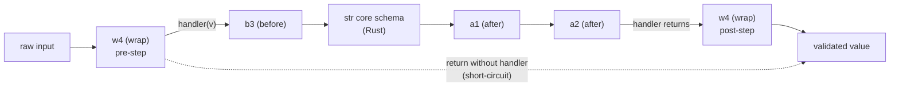

# Functional Field Validators: BeforeValidator, AfterValidator, WrapValidator, and PlainValidator Execution Order

> [!summary] Claim
> Every functional validator is a node that wraps the schema built from everything to its left in the `Annotated` metadata, so the last annotation is the outermost node: before and wrap pre-steps run right to left, after steps and wrap post-steps unwind left to right, a `PlainValidator` deletes everything to its left, and a wrap that skips `handler` deletes everything inside it.

Part of [Pydantic v2 Internals and Validation](README.md) in [API Engineering](../README.md).

## TL;DR

- Mechanism: `GenerateSchema._apply_annotations` folds the `Annotated` metadata left to right into a chain of `CallbackGetCoreSchemaHandler` closures, and each validator's `__get_pydantic_core_schema__` calls `handler(source_type)` and wraps the result in a `function-before`, `function-after`, `function-wrap`, or `function-plain` node, so annotation `n` encloses annotations `0..n-1` (`pydantic 2.14.3 pydantic/_internal/_generate_schema.py, GenerateSchema._get_wrapped_inner_schema`).
- Contract rule: read a stack outside-in from the right; `Annotated[str, AfterValidator(a1), AfterValidator(a2), BeforeValidator(b3), WrapValidator(w4)]` runs `w4.pre -> b3 -> str -> a1 -> a2 -> w4.post` (measured in the lab), and `@field_validator` decorators are appended after the metadata, so they wrap every `Annotated` validator (`pydantic 2.14.3 pydantic/_internal/_generate_schema.py, GenerateSchema._common_field_schema`).
- Trap: only `ValueError` (including its subclasses `PydanticCustomError`, `PydanticKnownError`, and `ValidationError`), `AssertionError`, `PydanticOmit`, and `PydanticUseDefault` are translated; a `TypeError` escapes as a raw exception, `assert` disappears under `python -O`, and `PydanticOmit` on a required model field silently produces an instance without that attribute (`pydantic-core 2.50.4 src/validators/function.rs, convert_err`).
- Portability fact: the ordering is decided in pure Python at schema-build time with no interpreter-version branches in the code paths above, while the four node types execute in `pydantic-core 2.50.4`, whose module declares `#[pymodule(gil_used = false)]`, so on free-threaded CPython your validator functions run concurrently without a GIL (`pydantic-core 2.50.4 src/lib.rs, _pydantic_core`); this note's lab ran on CPython `3.14.6` only (lab checks paused, see Portability).
- When not to use it: do not reach for a Python validator when a Rust-native constraint exists (`Field(gt=0)`, `pattern`, `max_length`, `Strict()`), because each function node costs about `15` ns (before or after) to `88` ns (wrap) per call on top of the core schema in the lab measurement, and a constraint placed after a function silently becomes a Python `functools.partial` validator; see [[Annotated-Constraints-Field-Metadata-and-Custom-Types]].

## Mental model



The diagram is `Annotated[str, AfterValidator(a1), AfterValidator(a2), BeforeValidator(b3), WrapValidator(w4)]`, the example from the pydantic documentation's "Ordering of validators" section.
`w4` is the last annotation, so it is the outermost node and sees the raw input first; whatever it passes to `handler` flows into `b3`, the next node inwards, which transforms the raw value before the Rust `str` validator runs.
On the way back out, the after validators run in the order they were written (`a1` is innermost, so it runs first), and only when `a2` returns does `handler` return inside `w4`, which can post-process the result.
The dotted arrow is the short-circuit: a wrap function that returns without calling `handler` skips `b3`, the `str` schema, `a1`, and `a2` entirely, and its return value becomes the validated value unchecked.

## How it works

### Phase 1: Annotated metadata becomes a handler chain at class-definition time

`typing.Annotated` attaches arbitrary metadata objects to a type without changing it, and "nested Annotated types are flattened, with metadata ordered starting with the innermost annotation" `(PEP 593 Specification, Syntax)`, so `Annotated[Annotated[str, A], B]` is indistinguishable from `Annotated[str, A, B]` by the time pydantic sees it.
For a model field, `GenerateSchema._common_field_schema` takes `field_info.metadata` (the `Annotated` items) and appends one validator object per matching `@field_validator`, converting each decorator through `_mode_to_validator = {'before': BeforeValidator, 'after': AfterValidator, 'plain': PlainValidator, 'wrap': WrapValidator}` and `_from_decorator` (`pydantic 2.14.3 pydantic/_internal/_generate_schema.py, GenerateSchema._common_field_schema`).
That list goes to `GenerateSchema._apply_annotations`, which first expands grouped metadata with `_known_annotated_metadata.expand_grouped_metadata` and then runs this fold (`pydantic 2.14.3 pydantic/_internal/_generate_schema.py, GenerateSchema._apply_annotations`):

```python
get_inner_schema = CallbackGetCoreSchemaHandler(inner_handler, self)

for annotation in annotations:
    if annotation is None:
        continue
    get_inner_schema = self._get_wrapped_inner_schema(
        get_inner_schema,
        annotation,
        pydantic_js_annotation_functions,
        check_unsupported_field_info_attributes=check_unsupported_field_info_attributes,
    )

schema = get_inner_schema(source_type)
```

(simplified excerpt of `pydantic 2.14.3 pydantic/_internal/_generate_schema.py, GenerateSchema._apply_annotations`)

Each iteration closes over the previous handler, so after the loop the final `get_inner_schema` belongs to the last annotation.
Calling it with `source_type` invokes the last annotation's `__get_pydantic_core_schema__(source, handler)`, whose `handler` is the closure for the second-to-last annotation, and so on down to `inner_handler`, which builds the bare type's schema (`pydantic 2.14.3 pydantic/_internal/_generate_schema.py, GenerateSchema._get_wrapped_inner_schema`).
The schema is therefore built inside-out but returned outside-in: the first annotation wraps the core schema, and every later annotation wraps the result of all earlier ones.
Annotations that do not define `__get_pydantic_core_schema__` (such as `annotated_types.Gt` or a `FieldInfo`) take the other branch of `new_handler`: it calls the inner handler and applies the constraint with `_apply_single_annotation`, which mutates the schema returned so far rather than wrapping it.

### Phase 2: each validator class emits one function node

The four classes are frozen, slotted dataclasses in `pydantic/functional_validators.py`, and their `__get_pydantic_core_schema__` methods differ in exactly one decision: whether the inner schema is kept as `schema=` (`pydantic 2.14.3 pydantic/functional_validators.py, AfterValidator.__get_pydantic_core_schema__`).

| Class | Calls `handler(source_type)`? | Emitted node | Inner schema in node | Function signature (no-info / with-info) |
|---|---|---|---|---|
| `BeforeValidator` | yes | `function-before` | `schema` (validated after the function) | `(value)` / `(value, info)` |
| `AfterValidator` | yes | `function-after` | `schema` (validated before the function) | `(value)` / `(value, info)` |
| `WrapValidator` | yes | `function-wrap` | `schema` (reachable only through `handler`) | `(value, handler)` / `(value, handler, info)` |
| `PlainValidator` | yes, but only for serialization | `function-plain` | none; the inner schema is not part of the validator | `(value)` / `(value, info)` |

`PlainValidator` still calls `handler(source_type)`, but only to derive a serialization schema (`schema.get('serialization', wrap_serializer_function_ser_schema(...))`), and it swallows `PydanticSchemaGenerationError` so that it can be applied to types pydantic cannot build a schema for (`pydantic 2.14.3 pydantic/functional_validators.py, PlainValidator.__get_pydantic_core_schema__`).
The emitted `function-plain` schema has no `schema` key at all (`pydantic-core 2.50.4 python/pydantic_core/core_schema.py, PlainValidatorFunctionSchema`), so every annotation to the left of a plain validator, including the type itself, contributes nothing at validation time.
In the lab, `Annotated[str, before("b1"), after("a2"), plain("p3"), before("b4"), after("a5")]` accepts the `int` `7` and returns `"7>b4>p3>a5"`: neither `b1`, `a2`, nor the `str` validator ran.

The choice between `no_info_*` and `with_info_*` is made once, at schema-build time, by `_decorators.inspect_validator`, which counts required positional parameters with `count_positional_required_params`: `2` means with-info and `1` means no-info for before, after, and plain, while `3` and `2` mean the same for wrap; any other count raises `PydanticUserError` with code `validator-signature` (`pydantic 2.14.3 pydantic/_internal/_decorators.py, inspect_validator`).
If `signature_no_eval` (pydantic's wrapper over `inspect.signature`, `pydantic 2.14.3 pydantic/_internal/_typing_extra.py, signature_no_eval`) raises `ValueError` or `TypeError`, for example on some C objects, the function is assumed to take no info argument.
The first parameter is counted even if it has a default, so `float`, whose signature is `(x=0, /)`, is accepted as a one-argument validator (`pydantic 2.14.3 pydantic/_internal/_decorators.py, count_positional_required_params`).

### Phase 3: decorators, inheritance, and defaults extend the onion

Because decorator-derived validators are appended after `field_info.metadata`, they are always outside every `Annotated` validator on the same field, which the docs state as "added last after the existing metadata for the field" (`docs/concepts/validators.md`, "Ordering of validators").
The lab's `DecoratedOrder` returns `"in>dec_b>ann_b>ann_a>dec_a"`: the decorator `mode='before'` runs before the annotated before validator, and the decorator `mode='after'` runs after the annotated after validator.
Multiple decorators on one field keep class-body definition order because `DecoratorInfos` stores them in dicts keyed by attribute name, and `DecoratorInfos.build` walks `reversed(mro(typ)[1:-1])` and calls `dict.update` for each base and then for the class itself (`pydantic 2.14.3 pydantic/_internal/_decorators.py, DecoratorInfos.build`).
The comment there, "dicts are ordered and replacement does not alter the order", is the inheritance rule: a subclass that overrides a parent validator method by name replaces the function but keeps the parent's slot, so `ChildOrder` runs `child.one` before `parent.two` (measured in the lab).
After the validators, `_common_field_schema` applies deprecated v1 `@validator` decorators through `apply_validators`, and only then wraps the whole field in a `default` node via `wrap_default` when the field is not required, with the source comment "the default validator needs to go outside of any other validators" (`pydantic 2.14.3 pydantic/_internal/_generate_schema.py, GenerateSchema._common_field_schema`).
That outermost `WithDefaultValidator` returns the stored default without running the inner validators unless `validate_default` is true (`pydantic-core 2.50.4 src/validators/with_default.rs, WithDefaultValidator::default_value`), which is why the lab's `unvalidated` field stays `1` while `validated` becomes `10`.

### Phase 4: Rust execution of the four node types

`pydantic-core` lowers each node into a `CombinedValidator` variant built by `impl_build!` (before and after) or a hand-written `BuildValidator` (wrap and plain); build also computes the validator name, for example `function-after[<lambda>(), int]` for a lambda over `int` (observed in the adapter's `repr`) (`pydantic-core 2.50.4 src/validators/function.rs, impl_build`).

- `FunctionBeforeValidator::_validate` converts the input to a Python object with `input.to_object(py)`, calls the function with `call1`, maps any exception with `convert_err`, and then calls the inner validator on the returned value (`pydantic-core 2.50.4 src/validators/function.rs, FunctionBeforeValidator::_validate`).
- `FunctionAfterValidator::_validate` calls the inner validator first (`let v = call(input, state)?;`), so an inner error propagates and the function never runs, and then calls the function on the validated object (`pydantic-core 2.50.4 src/validators/function.rs, FunctionAfterValidator::_validate`).
- `FunctionPlainValidator::validate` calls the function on `input.to_object(py)` and returns its result; there is no inner validator field in the struct (`pydantic-core 2.50.4 src/validators/function.rs, FunctionPlainValidator`).
- `FunctionWrapValidator::validate` allocates a new `ValidatorCallable` Python object around an `InternalValidator` on every call, passes it as `handler`, and after the function returns copies `exactness` and `fields_set_count` back from the handler into the outer `ValidationState` so smart-mode unions still see how exact the inner match was (`pydantic-core 2.50.4 src/validators/function.rs, FunctionWrapValidator::validate`).

`InternalValidator::new` snapshots `data`, `strict`, `extra_behavior`, `from_attributes`, `context`, `by_alias`, `by_name`, `field_name`, `self_instance`, a clone of the recursion guard, `exactness`, `fields_set_count`, the input mode, and the string cache mode (`pydantic-core 2.50.4 src/validators/generator.rs, InternalValidator::new`).
`ValidatorCallable.__call__` has the signature `(input_value, outer_location=None)`, and `InternalValidator::validate` turns an inner failure into a full `ValidationError` titled with the internal name `ValidatorCallable`, prefixed with `outer_location` if one was passed (`pydantic-core 2.50.4 src/validators/generator.rs, InternalValidator::validate`).
The lab observes both: catching the error inside the wrap shows `exc.title == "ValidatorCallable"` with `loc == ()`, and `handler(value, "inner")` on the field `port` yields `loc == ("port", "inner")`.
When that `ValidationError` propagates out of the wrap function, `convert_err` recognizes it (it subclasses `ValueError`) and re-inflates its line errors with `into_val_error`, so the original error types and locations survive instead of collapsing into one `value_error` (`pydantic-core 2.50.4 src/validators/function.rs, convert_err`).

### Phase 5: the exception contract

`convert_err` is the single translation point for all four node types, and the docstring above it states the rule: "Only `ValueError` (including `PydanticCustomError` and `ValidationError`) and `AssertionError` are considered as validation errors, `TypeError` is now considered as a runtime error to catch errors in function signatures" (`pydantic-core 2.50.4 src/validators/function.rs, convert_err`).

| Raised in the function | Result | Lab evidence |
|---|---|---|
| `ValueError("1 is odd")` | line error `type='value_error'`, `msg='Value error, 1 is odd'` | `test_exception_conversion_rules` |
| `AssertionError("too small")` | `type='assertion_error'`, `msg='Assertion failed, too small'` | same test |
| `PydanticCustomError("port_reserved", "port {port} is reserved", {"port": 1})` | `type='port_reserved'`, `msg='port 1 is reserved'` | same test |
| `PydanticKnownError` | the built-in error type it names | source only (`convert_err`) |
| `ValidationError` (from `handler` or a nested adapter) | its line errors, re-located under the current field | `test_wrap_handler_raises_validation_error_that_can_be_recovered` |
| `PydanticUseDefault` | `ValError::UseDefault`; the enclosing `default` node or model field falls back to the default | `test_use_default_and_omit` |
| `PydanticOmit` | `ValError::Omit`; drops a list item, and silently drops a model field | `test_use_default_and_omit` |
| `TypeError` or anything else | `ValError::InternalErr`; the original exception propagates, not a `ValidationError` | `test_exception_conversion_rules` |

The error's `input` is always the input to the node whose function raised (`convert_err(py, e, input)`), not the value the function was looking at.
For a `function-after` node that input is the pre-validation input of the whole node, so `Annotated[int, AfterValidator(minus_ten), Field(gt=0)]` rejects `5` with `type='greater_than'` and `input=5`, even though the rejected value was `-5` (measured in the lab).

For a model field, `ModelFieldsValidationState::validate_field` treats `UseDefault` by falling through to the default pathway, but treats `Omit` by setting `has_field_error = true` and returning `Ok(())` without writing the field or recording an error (`pydantic-core 2.50.4 src/validators/model_fields.rs, ModelFieldsValidationState::validate_field`).
The lab's `OmittedField(quota=-5)` therefore constructs successfully with `__dict__ == {"owner": "nobody"}` and `model_fields_set == set()`, and `hasattr(instance, "quota")` is `False` although `quota` is required.

### Phase 6: what the validator sees - `ValidationInfo`, input mode, and strictness

`ValidationInfo::new` is built per call from the current state and exposes `config`, `context`, `data`, `field_name`, and `mode` (`pydantic-core 2.50.4 src/validators/function.rs, ValidationInfo`); the calling node passes the state's current field name and falls back to the schema's `field_name` if the state does not have one (`pydantic-core 2.50.4 src/validators/function.rs, FunctionBeforeValidator::_validate`).
`data` is the dict of fields validated so far, in field-definition order, so the lab's `InfoProbe.second` validator sees `{'first': 1}` and never fields defined after it; cross-field invariants belong in [[Model-Validators-ValidationInfo-Context-and-Cross-Field-Invariants]].
`mode` is `'json'` under `model_validate_json` and `'python'` under `model_validate` (both measured), and FastAPI `0.162.0` validates request bodies with `self._type_adapter.validate_python(value, from_attributes=True)`, so validators behind a FastAPI body see `'python'` (`fastapi 0.162.0 fastapi/_compat/v2.py, ModelField.validate`).

The before and wrap nodes hand the inner schema a Python object, not the original JSON value: `FunctionBeforeValidator::_validate` passes `value.into_bound(py)` to the inner validator, and the wrap handler receives whatever Python object the function passes in (`pydantic-core 2.50.4 src/validators/function.rs, FunctionBeforeValidator::_validate`).
Strict mode allows some string forms only for JSON input (see [[Lax-vs-Strict-Validation-Modes-and-Coercion-Tables]]), so a before or wrap hop on a strict field strips that allowance: in the lab's `StrictEvent` (`ConfigDict(strict=True)`), `model_validate_json` accepts the ISO string `"2026-11-13T00:00:00Z"` for the bare `datetime` and the after-validated `datetime`, but rejects the same string for the before-validated and wrap-validated fields with `datetime_type`.
Upstream treated the equivalent loss in the after node as a bug: pydantic issue 7468 (a strict `datetime.date` field failing once a model validator was added) was fixed by pydantic-core PR 967, "fix function-after validator changing validation mode to Python", merged 2023-09-19, which made `FunctionAfterValidator` generic over the input so JSON mode survives.
The before and wrap nodes cannot be fixed the same way, because they must hand the user's function a Python object (`input.to_object(py)`) and then validate whatever the function returns, so the behavior follows from their contract; no upstream issue calling it a bug was found (searched pydantic and pydantic-core issues, as of 2026-11).

### Phase 7: where constraints land relative to functions

`apply_known_metadata` sets a constraint such as `gt` directly on the schema when the schema type allows it, which for a bare `int` means the Rust `ConstrainedIntValidator` enforces it (`pydantic 2.14.3 pydantic/_internal/_known_annotated_metadata.py, apply_known_metadata`).
When the schema built so far is a `function-after`, `function-before`, or `function-wrap` node, numeric constraints are instead wrapped as `cs.no_info_after_validator_function(partial(NUMERIC_VALIDATOR_LOOKUP[constraint], ...), schema)`, a Python function node, and string constraints such as `pattern` become a `chain` schema whose extra step is a wrap validator over a fresh `str_schema(pattern=...)`; only `strict` is pushed inwards into the function node's inner schema.
The lab shows both shapes: `Annotated[int, Field(gt=0), AfterValidator(minus_ten)]` compiles to `function-after:_minus_ten -> int[gt]` and returns `-5` for `5`, while `Annotated[int, AfterValidator(minus_ten), Field(gt=0)]` compiles to `function-after:partial -> function-after:_minus_ten -> int` and rejects `5`.
The semantics differ (the constraint checks the function's output, not the input) and so does the engine (Python `greater_than_validator` instead of Rust), which the Numbers table prices at about `71` ns per call.

### Phase 8: optional types, type aliases, and JSON Schema

Function validators define `__get_pydantic_core_schema__`, so they wrap whatever schema they receive, including a `nullable` schema; constraints, by contrast, are pushed into the non-null branch by `_apply_single_annotation` (`if schema['type'] == 'nullable'`) (`pydantic 2.14.3 pydantic/_internal/_generate_schema.py, GenerateSchema._apply_single_annotation`).
`Annotated[int | None, AfterValidator(f)]` therefore calls `f(None)`, while `Annotated[int, AfterValidator(f)] | None` never calls `f` for `None` (both measured in the lab's `OptionalPlacement`).
A PEP 695 alias (`type TicketCode = Annotated[str, ...]`, `(PEP 695)`) behaves as one unit on the inside of any outer annotations: `Annotated[TicketCode, before("outer_b"), after("outer_a")]` runs `outer_b -> alias_b -> str -> alias_a -> outer_a`.

For JSON Schema in `mode='validation'`, `function_before_schema`, `function_wrap_schema`, and `function_plain_schema` use `json_schema_input_schema` when present and otherwise fall back to the inner schema; `function_after_schema` always uses the inner schema, and a plain validator without an input schema is reported through `handle_invalid_for_json_schema` (`pydantic 2.14.3 pydantic/json_schema.py, GenerateJsonSchema.function_plain_schema`).
`PlainValidator.json_schema_input_type` defaults to `Any`, so a plain-validated `int` produces `{}` in validation mode and `{'type': 'integer'}` in serialization mode, while `BeforeValidator(int, json_schema_input_type=str | int)` documents `{'anyOf': [{'type': 'string'}, {'type': 'integer'}]}` (all measured); `@field_validator` raises `PydanticUserError` code `validator-input-type` if `json_schema_input_type` is combined with `mode='after'` (`pydantic 2.14.3 pydantic/functional_validators.py, field_validator`).
The JSON Schema consequences of these choices belong to [[JSON-Schema-Generation-Internals-and-GenerateJsonSchema]], and the serializer side of `PlainValidator` to [[Custom-Serialization-Field-Model-and-Wrap-Serializers]].

## Numbers and limits

Measured rows were re-measured by the fact-checker with a throwaway benchmark script (not kept in the lab) under `uv run --frozen python` in `labs/`, calling `TypeAdapter(...).validator.validate_python(5)` directly through `timeit.repeat("f(5)", number=200000, repeat=7)`, taking the minimum per run and the median of three runs, on CPython `3.14.6`, `macOS-27.3-arm64-arm-64bit-Mach-O` (`uname -r` = `27.3.0`), `pydantic 2.14.3`, `pydantic-core 2.50.4`, with identity validator functions (as of 2026-11).
The machine was shared (load average about `50` on `12` cores); a first run under that load scattered by up to `3x` and was discarded, and the stable second run is the one reported.

| Quantity | Value | Source or measurement |
|---|---|---|
| Bare `int` validation | `23.3` ns per call | measured (runs `23.2`, `23.4`, `23.3`) |
| `Annotated[int, Gt(0)]` (Rust constraint) | `31.1` ns | measured (runs `31.2`, `31.1`, `31.0`) |
| `+ AfterValidator(identity)` | `38.3` ns (`+15.0` ns over bare) | measured (runs `38.4`, `38.3`, `38.3`) |
| `+ BeforeValidator(identity)` | `37.8` ns (`+14.5` ns) | measured (runs `37.8`, `37.8`, `37.9`) |
| `+ WrapValidator(identity that calls handler)` | `110.9` ns (`+87.6` ns) | measured (runs `110.8`, `110.9`, `111.5`); attributed from the source, not profiled, to the per-call `ValidatorCallable` allocation and `InternalValidator` state copy in `FunctionWrapValidator::validate` |
| `PlainValidator(identity)` on `int` | `34.7` ns | measured (runs `34.4`, `34.7`, `34.8`); cheaper than after because the `int` validator is gone |
| `AfterValidator` then `Gt(0)` (constraint becomes Python) | `109.0` ns, `+70.7` ns over the after-only row | measured (runs `109.0`, `108.9`, `109.2`) |
| Four stacked `AfterValidator`s | `84.4` ns, about `15.4` ns per extra node | measured (runs `84.9`, `84.4`, `83.8`) |
| Required positional parameters accepted | `1` or `2` (before, after, plain), `2` or `3` (wrap) | `pydantic 2.14.3 pydantic/_internal/_decorators.py, inspect_validator` |
| Exception classes translated by `convert_err` | `4` (`ValueError`, with dedicated branches for its subclasses `PydanticCustomError`, `PydanticKnownError`, and `ValidationError`; `AssertionError`; `PydanticOmit`; `PydanticUseDefault`); everything else propagates | `pydantic-core 2.50.4 src/validators/function.rs, convert_err` |
| Errors per field | the first raising node ends that field; other fields still validate and their errors are collected | `FunctionAfterValidator::_validate` returns early on `call(input, state)?`; a one-off probe with failing validators on fields `x` and `y` returned both `('x',)` and `('y',)` errors |
| `ValidatorFunctionWrapHandler.__call__` arity | `(input_value, outer_location=None, /)` | `pydantic-core 2.50.4 python/pydantic_core/core_schema.py, ValidatorFunctionWrapHandler` |

The microbenchmark isolates node overhead with trivial functions; a real validator's own Python body (regex, DB lookups, network) dominates these numbers, and the run used one machine and no CPU pinning.

## Portability

The user paused lab checks on 2026-11-11, so the lab ran once, on the workspace interpreter only; no other leg of the matrix was executed for this note.

| Runtime / component | Behavior | Verification |
|---|---|---|
| CPython `3.14.6` (macOS `27.3` arm64) | All `17` lab tests pass; ordering, exception contract, strict-JSON loss, and `PydanticOmit` behavior as described | ran: `uv run --frozen pytest tests/f09_pydantic_v2_internals_and_validation/test_functional_validators_before_after_wrap_and_plain.py -q` |
| CPython `3.12.16`, `3.13.18`, `3.14.10`, `3.15.2` | Expected identical: the ordering lives in `_apply_annotations`, `_get_wrapped_inner_schema`, and `_common_field_schema`, which contain no `sys.version_info` branches; `functional_validators.py` branches only on `sys.version_info < (3, 11)` for the `Protocol` import, and `_typing_extra.signature_no_eval` branches on `sys.version_info >= (3, 14)` only to pass `annotation_format=Format.FORWARDREF`, which does not change the parameter count `inspect_validator` uses | not run (lab checks paused); source read in `pydantic 2.14.3` |
| PEP 695 `type` aliases in the lab | Require CPython `>= 3.12` | `(PEP 695)`; the workspace sets `requires-python = ">=3.12,<3.16"` |
| Free-threaded CPython `3.15.2t` | `_pydantic_core` is declared `gil_used = false`, so validator functions on different threads run truly in parallel; any shared mutable state inside a validator (caches, counters, closures over lists) needs its own lock | `pydantic-core 2.50.4 src/lib.rs, _pydantic_core`; not run here, and the sibling [[Pydantic-v2-Architecture-CoreSchema-and-Rust-Pydantic-Core]] records that the locked workspace cannot install on free-threaded builds |
| `pydantic 2.14.3` / `pydantic-core 2.50.4` | Behavior in this note is pinned to these releases; `PlainValidator` JSON Schema support for `mode='validation'` dates from `v2.9` per its docstring | `pydantic 2.14.3 pydantic/functional_validators.py, PlainValidator` |
| Uvicorn, Hypercorn, Granian; HTTP/1.1, HTTP/2, HTTP/3 | Transport-independent: validators run after the ASGI server has delivered the body and FastAPI calls `validate_python`; the HTTP version cannot change node order | not run for this note; `fastapi 0.162.0 fastapi/_compat/v2.py, ModelField.validate`; the sibling architecture note ran pydantic `2.14.3` over all three servers |

## Worked example

The lab [implementation](../labs/src/api_labs/f09_pydantic_v2_internals_and_validation/functional_validator_order.py) and [test](../labs/tests/f09_pydantic_v2_internals_and_validation/test_functional_validators_before_after_wrap_and_plain.py) make the value its own trace: every marker validator appends `>label` to the string it handles, so the validated output spells out the execution order with no global state.
`schema_chain` walks the compiled `CoreSchema` outermost-first, which proves the order is fixed at build time, and the `Sku` alias at the end is the production shape: normalize in a before validator, convert any inner failure into one stable `sku_invalid` error code in a wrap, let Rust enforce `pattern`, and run the checksum as an after validator.

### Implementation (`labs/src/api_labs/f09_pydantic_v2_internals_and_validation/functional_validator_order.py`)

```python
"""Trace the onion execution order of Pydantic v2 functional field validators.

Every marker validator appends its label to the value it handles, so the validated
string itself is the execution trace: no global state, no side effects.
"""

from datetime import datetime
from typing import Annotated, Any, cast

from pydantic import (
    AfterValidator,
    BaseModel,
    BeforeValidator,
    ConfigDict,
    Field,
    PlainValidator,
    TypeAdapter,
    ValidationError,
    ValidationInfo,
    ValidatorFunctionWrapHandler,
    WrapValidator,
    field_validator,
)
from pydantic_core import PydanticCustomError, PydanticOmit, PydanticUseDefault


def before(label: str) -> BeforeValidator:
    """Append `>label` to the raw input before the inner schema runs."""

    def run(value: Any) -> Any:
        return f"{value}>{label}"

    run.__name__ = f"before_{label}"
    return BeforeValidator(run)


def after(label: str) -> AfterValidator:
    """Append `>label` to the value the inner schema produced."""

    def run(value: Any) -> Any:
        return f"{value}>{label}"

    run.__name__ = f"after_{label}"
    return AfterValidator(run)


def wrap(label: str) -> WrapValidator:
    """Mark the input, call the inner schema through `handler`, then mark the result."""

    def run(value: Any, handler: ValidatorFunctionWrapHandler) -> Any:
        result = handler(f"{value}>{label}.pre")
        return f"{result}>{label}.post"

    run.__name__ = f"wrap_{label}"
    return WrapValidator(run)


def plain(label: str) -> PlainValidator:
    """Replace the inner schema entirely; nothing to the left of it runs."""

    def run(value: Any) -> Any:
        return f"{value}>{label}"

    run.__name__ = f"plain_{label}"
    return PlainValidator(run)


def schema_chain(adapter: TypeAdapter[Any]) -> list[str]:
    """Walk the compiled CoreSchema from the outermost node inwards."""
    node = cast("dict[str, Any]", adapter.core_schema)
    chain: list[str] = []
    while True:
        kind = str(node["type"])
        if not kind.startswith("function-"):
            constraints = sorted(key for key in node if key in {"gt", "ge", "lt", "le"})
            chain.append(kind + "".join(f"[{key}]" for key in constraints))
            return chain
        func = cast("dict[str, Any]", node["function"])["function"]
        chain.append(f"{kind}:{getattr(func, '__name__', type(func).__name__)}")
        if kind == "function-plain":
            return chain
        node = cast("dict[str, Any]", node["schema"])


# The ordering example from the pydantic docs ("Ordering of validators").
DOCS_ORDER: TypeAdapter[str] = TypeAdapter(
    Annotated[str, after("a1"), after("a2"), before("b3"), wrap("w4")]
)

# A wrap in the middle: its post-step runs before the outer after validator.
INTERLEAVED: TypeAdapter[str] = TypeAdapter(
    Annotated[str, before("b1"), after("a2"), wrap("w3"), before("b4"), after("a5")]
)

# A plain validator discards the str schema and every annotation to its left.
PLAIN_IN_MIDDLE: TypeAdapter[str] = TypeAdapter(
    Annotated[str, before("b1"), after("a2"), plain("p3"), before("b4"), after("a5")]
)


def _skip_on_sentinel(value: Any, handler: ValidatorFunctionWrapHandler) -> Any:
    if value == "skip":
        return {"short_circuited": True}
    return handler(value)


# A wrap that returns without calling handler skips the int schema and a1.
SHORT_CIRCUIT: TypeAdapter[Any] = TypeAdapter(
    Annotated[int, after("a1"), WrapValidator(_skip_on_sentinel)]
)


def _fallback_to_minus_one(value: Any, handler: ValidatorFunctionWrapHandler) -> Any:
    try:
        return handler(value)
    except ValidationError:
        return -1


FALLBACK: TypeAdapter[int] = TypeAdapter(Annotated[int, WrapValidator(_fallback_to_minus_one)])


def handler_error_view(value: object) -> tuple[str, list[tuple[Any, ...]]]:
    """Return the title and locs of the ValidationError a wrap handler raises."""
    seen: list[tuple[str, list[tuple[Any, ...]]]] = []

    def capture(raw: Any, handler: ValidatorFunctionWrapHandler) -> Any:
        try:
            return handler(raw)
        except ValidationError as exc:
            seen.append((exc.title, [err["loc"] for err in exc.errors()]))
            return 0

    TypeAdapter(Annotated[int, WrapValidator(capture)]).validate_python(value)
    return seen[0]


def _relocate(value: Any, handler: ValidatorFunctionWrapHandler) -> Any:
    return handler(value, "inner")


class Relocated(BaseModel):
    """`handler(value, outer_location)` prefixes inner error locations."""

    port: Annotated[int, WrapValidator(_relocate)]


class DecoratedOrder(BaseModel):
    """Decorators are appended after Annotated metadata, so they are outermost."""

    value: Annotated[str, before("ann_b"), after("ann_a")]

    @field_validator("value", mode="before")
    @classmethod
    def dec_before(cls, value: Any) -> Any:
        return f"{value}>dec_b"

    @field_validator("value", mode="after")
    @classmethod
    def dec_after(cls, value: str) -> str:
        return f"{value}>dec_a"


class ParentOrder(BaseModel):
    """Two after decorators run in definition order: one, then two."""

    value: str

    @field_validator("value")
    @classmethod
    def one(cls, value: str) -> str:
        return f"{value}>parent.one"

    @field_validator("value")
    @classmethod
    def two(cls, value: str) -> str:
        return f"{value}>parent.two"


class ChildOrder(ParentOrder):
    """Overriding `one` keeps the parent's slot in the decorator dict."""

    @field_validator("value")
    @classmethod
    def one(cls, value: str) -> str:
        return f"{value}>child.one"


def run_after(func: Any, value: object) -> Any:
    """Validate `value` as int, then run `func` as an AfterValidator."""
    return TypeAdapter(Annotated[int, AfterValidator(func)]).validate_python(value)


def reject_with_value_error(value: int) -> int:
    raise ValueError(f"{value} is odd")


def reject_with_assert(value: int) -> int:
    assert value > 5, "too small"  # noqa: S101 - demonstrates AssertionError conversion
    return value


def reject_with_custom_error(value: int) -> int:
    raise PydanticCustomError("port_reserved", "port {port} is reserved", {"port": value})


def reject_with_type_error(value: int) -> int:
    raise TypeError("signature bug, not a validation failure")


def _none_means_default(value: Any) -> Any:
    if value is None:
        raise PydanticUseDefault
    return value


class DefaultOnNone(BaseModel):
    """`PydanticUseDefault` from a before validator falls back to the field default."""

    region: Annotated[str, BeforeValidator(_none_means_default)] = "eu-west-1"


def _omit_negative(value: int) -> int:
    if value < 0:
        raise PydanticOmit
    return value


NON_NEGATIVE_ITEMS: TypeAdapter[list[int]] = TypeAdapter(
    list[Annotated[int, AfterValidator(_omit_negative)]]
)


class OmittedField(BaseModel):
    """`PydanticOmit` on a model field silently drops a *required* field."""

    quota: Annotated[int, AfterValidator(_omit_negative)]
    owner: str = "nobody"


def _minus_ten(value: int) -> int:
    return value - 10


# Constraint before the function: `gt` is a key on the Rust int schema.
GT_BEFORE_FUNC: TypeAdapter[int] = TypeAdapter(
    Annotated[int, Field(gt=0), AfterValidator(_minus_ten)]
)
# Constraint after the function: a Python `greater_than_validator` wraps the result.
GT_AFTER_FUNC: TypeAdapter[int] = TypeAdapter(
    Annotated[int, AfterValidator(_minus_ten), Field(gt=0)]
)


def _times_ten(value: int) -> int:
    return value * 10


class DefaultsAndAssignment(BaseModel):
    """Defaults skip validators unless `validate_default=True`; assignment reruns them."""

    model_config = ConfigDict(validate_assignment=True)

    unvalidated: Annotated[int, AfterValidator(_times_ten)] = 1
    validated: Annotated[int, AfterValidator(_times_ten)] = Field(default=1, validate_default=True)


def _tag_none(value: int | None) -> int:
    return -1 if value is None else value


class OptionalPlacement(BaseModel):
    """Where the validator sits relative to `| None` decides whether it sees None."""

    # The validator wraps the nullable schema, so it sees None.
    outer: Annotated[int | None, AfterValidator(_tag_none)] = 0
    # The validator wraps only the int branch, so None never reaches it.
    inner: Annotated[int, AfterValidator(_tag_none)] | None = 0


def _passthrough(value: Any) -> Any:
    return value


def _passthrough_wrap(value: Any, handler: ValidatorFunctionWrapHandler) -> Any:
    return handler(value)


class StrictEvent(BaseModel):
    """Strict JSON accepts ISO strings for datetime, until a before or wrap hop intervenes."""

    model_config = ConfigDict(strict=True)

    bare_ts: datetime
    after_ts: Annotated[datetime, AfterValidator(_passthrough)]
    before_ts: Annotated[datetime, BeforeValidator(_passthrough)]
    wrap_ts: Annotated[datetime, WrapValidator(_passthrough_wrap)]


type TicketCode = Annotated[str, before("alias_b"), after("alias_a")]
"""A PEP 695 alias carrying its own validators."""

TICKET: TypeAdapter[str] = TypeAdapter(Annotated[TicketCode, before("outer_b"), after("outer_a")])


def _describe_info(value: str, info: ValidationInfo) -> str:
    return f"{value}|{info.field_name}|{info.data}|{info.mode}|{info.context}"


class InfoProbe(BaseModel):
    """Two positional parameters select the with-info variant of a validator."""

    first: int
    second: Annotated[str, AfterValidator(_describe_info)]


def _parse_port(value: Any) -> int:
    return int(value)


PLAIN_PORT: TypeAdapter[int] = TypeAdapter(Annotated[int, PlainValidator(_parse_port)])
BEFORE_PORT_TYPED: TypeAdapter[int] = TypeAdapter(
    Annotated[int, BeforeValidator(_parse_port, json_schema_input_type=str | int)]
)


def _normalize_sku(value: Any) -> Any:
    if isinstance(value, int):
        value = f"SKU-{value:06d}"
    return value.strip().upper() if isinstance(value, str) else value


def _stable_sku_error(value: Any, handler: ValidatorFunctionWrapHandler) -> Any:
    try:
        return handler(value)
    except ValidationError as exc:
        raise PydanticCustomError(
            "sku_invalid", "invalid SKU: {reason}", {"reason": exc.errors()[0]["type"]}
        ) from exc


def _require_checksum(value: str) -> str:
    digits = value.removeprefix("SKU-")
    if sum(int(d) for d in digits) % 10 != 0:
        raise ValueError("checksum digit mismatch")
    return value


# Production shape: normalize (before) -> stable error code (wrap) -> pattern (Rust) -> checksum.
type Sku = Annotated[
    str,
    Field(pattern=r"^SKU-\d{6}$"),
    AfterValidator(_require_checksum),
    WrapValidator(_stable_sku_error),
    BeforeValidator(_normalize_sku),
]

SKU: TypeAdapter[str] = TypeAdapter(Sku)
```

### Test suite (`labs/tests/f09_pydantic_v2_internals_and_validation/test_functional_validators_before_after_wrap_and_plain.py`)

```python
"""Execution order and failure semantics of Before, After, Wrap, and Plain validators."""

from typing import Any

import pytest
from pydantic import ValidationError

from api_labs.f09_pydantic_v2_internals_and_validation.functional_validator_order import (
    BEFORE_PORT_TYPED,
    DOCS_ORDER,
    FALLBACK,
    GT_AFTER_FUNC,
    GT_BEFORE_FUNC,
    INTERLEAVED,
    NON_NEGATIVE_ITEMS,
    PLAIN_IN_MIDDLE,
    PLAIN_PORT,
    SHORT_CIRCUIT,
    SKU,
    TICKET,
    ChildOrder,
    DecoratedOrder,
    DefaultOnNone,
    DefaultsAndAssignment,
    InfoProbe,
    OmittedField,
    OptionalPlacement,
    ParentOrder,
    Relocated,
    StrictEvent,
    handler_error_view,
    reject_with_assert,
    reject_with_custom_error,
    reject_with_type_error,
    reject_with_value_error,
    run_after,
    schema_chain,
)


def _errors(exc: ValidationError) -> list[dict[str, Any]]:
    return [dict(err) for err in exc.errors(include_url=False)]


@pytest.mark.unit
def test_last_annotation_is_outermost_node() -> None:
    assert schema_chain(DOCS_ORDER) == [
        "function-wrap:wrap_w4",
        "function-before:before_b3",
        "function-after:after_a2",
        "function-after:after_a1",
        "str",
    ]
    assert DOCS_ORDER.validate_python("in") == "in>w4.pre>b3>a1>a2>w4.post"


@pytest.mark.unit
def test_wrap_post_step_runs_before_outer_after() -> None:
    assert INTERLEAVED.validate_python("in") == "in>b4>w3.pre>b1>a2>w3.post>a5"


@pytest.mark.unit
def test_plain_discards_type_and_everything_to_its_left() -> None:
    assert schema_chain(PLAIN_IN_MIDDLE) == [
        "function-after:after_a5",
        "function-before:before_b4",
        "function-plain:plain_p3",
    ]
    # An int is accepted for a `str` field: the str schema never runs, nor do b1 and a2.
    assert PLAIN_IN_MIDDLE.validate_python(7) == "7>b4>p3>a5"


@pytest.mark.unit
def test_wrap_without_handler_call_skips_inner_schema() -> None:
    assert SHORT_CIRCUIT.validate_python("skip") == {"short_circuited": True}
    assert SHORT_CIRCUIT.validate_python("12") == "12>a1"


@pytest.mark.unit
def test_wrap_handler_raises_validation_error_that_can_be_recovered() -> None:
    assert FALLBACK.validate_python("nope") == -1
    assert FALLBACK.validate_python("42") == 42
    assert handler_error_view("nope") == ("ValidatorCallable", [()])
    with pytest.raises(ValidationError) as exc_info:
        Relocated(port="eighty")  # pyright: ignore[reportArgumentType]
    assert [err["loc"] for err in _errors(exc_info.value)] == [("port", "inner")]


@pytest.mark.unit
def test_decorators_wrap_annotated_metadata() -> None:
    assert DecoratedOrder(value="in").value == "in>dec_b>ann_b>ann_a>dec_a"


@pytest.mark.unit
def test_subclass_override_keeps_parent_position() -> None:
    assert ParentOrder(value="in").value == "in>parent.one>parent.two"
    assert ChildOrder(value="in").value == "in>child.one>parent.two"


@pytest.mark.unit
def test_exception_conversion_rules() -> None:
    cases = [
        (reject_with_value_error, "value_error", "Value error, 1 is odd"),
        (reject_with_assert, "assertion_error", "Assertion failed, too small"),
        (reject_with_custom_error, "port_reserved", "port 1 is reserved"),
    ]
    for func, err_type, msg in cases:
        with pytest.raises(ValidationError) as exc_info:
            run_after(func, 1)
        err = _errors(exc_info.value)[0]
        assert (err["type"], err["msg"]) == (err_type, msg)
    with pytest.raises(TypeError, match="signature bug"):
        run_after(reject_with_type_error, 1)


@pytest.mark.unit
def test_use_default_and_omit() -> None:
    assert DefaultOnNone(region=None).region == "eu-west-1"  # pyright: ignore[reportArgumentType]
    assert DefaultOnNone(region="us-east-2").region == "us-east-2"
    assert NON_NEGATIVE_ITEMS.validate_python([1, -2, 3]) == [1, 3]
    dropped = OmittedField(quota=-5)
    assert dropped.__dict__ == {"owner": "nobody"}
    assert dropped.model_fields_set == set()
    assert not hasattr(dropped, "quota")


@pytest.mark.unit
def test_constraint_position_changes_semantics_and_engine() -> None:
    assert schema_chain(GT_BEFORE_FUNC) == ["function-after:_minus_ten", "int[gt]"]
    assert GT_BEFORE_FUNC.validate_python(5) == -5
    assert schema_chain(GT_AFTER_FUNC) == [
        "function-after:partial",
        "function-after:_minus_ten",
        "int",
    ]
    with pytest.raises(ValidationError) as exc_info:
        GT_AFTER_FUNC.validate_python(5)
    err = _errors(exc_info.value)[0]
    # The rejected value was -5, but `input` reports what entered the failing node.
    assert (err["type"], err["input"]) == ("greater_than", 5)


@pytest.mark.unit
def test_defaults_skip_validators_and_assignment_reruns_them() -> None:
    model = DefaultsAndAssignment()
    assert (model.unvalidated, model.validated) == (1, 10)
    model.unvalidated = 2
    assert model.unvalidated == 20


@pytest.mark.unit
def test_optional_placement_decides_whether_none_reaches_validator() -> None:
    nulls = OptionalPlacement(outer=None, inner=None)
    assert (nulls.outer, nulls.inner) == (-1, None)
    ints = OptionalPlacement(outer=3, inner=3)
    assert (ints.outer, ints.inner) == (3, 3)


@pytest.mark.unit
def test_before_and_wrap_lose_strict_json_string_allowance() -> None:
    ts = '"2026-11-13T00:00:00Z"'
    body = f'{{"bare_ts":{ts},"after_ts":{ts},"before_ts":{ts},"wrap_ts":{ts}}}'
    with pytest.raises(ValidationError) as exc_info:
        StrictEvent.model_validate_json(body)
    failed = {(err["loc"], err["type"]) for err in _errors(exc_info.value)}
    assert failed == {(("before_ts",), "datetime_type"), (("wrap_ts",), "datetime_type")}


@pytest.mark.unit
def test_pep695_alias_nests_inside_outer_annotations() -> None:
    assert TICKET.validate_python("in") == "in>outer_b>alias_b>alias_a>outer_a"


@pytest.mark.unit
def test_validation_info_carries_field_data_mode_and_context() -> None:
    from_json = InfoProbe.model_validate_json(
        '{"first": 1, "second": "s"}', context={"tenant": "t1"}
    )
    assert from_json.second == "s|second|{'first': 1}|json|{'tenant': 't1'}"
    from_python = InfoProbe.model_validate({"first": 1, "second": "s"})
    assert from_python.second == "s|second|{'first': 1}|python|None"


@pytest.mark.unit
def test_json_schema_input_types() -> None:
    assert PLAIN_PORT.json_schema() == {}
    assert PLAIN_PORT.json_schema(mode="serialization") == {"type": "integer"}
    assert BEFORE_PORT_TYPED.json_schema() == {"anyOf": [{"type": "string"}, {"type": "integer"}]}


@pytest.mark.unit
def test_sku_pipeline_normalizes_and_emits_stable_error_codes() -> None:
    assert SKU.validate_python(" sku-000019 ") == "SKU-000019"
    assert SKU.validate_python(19) == "SKU-000019"
    reasons: list[tuple[Any, Any]] = []
    for bad in (" sku-1 ", "SKU-000018", 3.5):
        with pytest.raises(ValidationError) as exc_info:
            SKU.validate_python(bad)
        err = _errors(exc_info.value)[0]
        assert err["type"] == "sku_invalid"
        reasons.append((err["input"], err["ctx"]["reason"]))
    assert reasons == [
        ("SKU-1", "string_pattern_mismatch"),
        ("SKU-000018", "value_error"),
        (3.5, "string_type"),
    ]
```

### Captured execution output

Executed from `labs/` with `uv run --frozen pytest tests/f09_pydantic_v2_internals_and_validation/test_functional_validators_before_after_wrap_and_plain.py -q` on CPython `3.14.6` (`macOS-27.3-arm64-arm-64bit-Mach-O`):

```text
.................                                                        [100%]
17 passed in 0.50s
```

## Pitfalls

> [!warning] A before or wrap validator turns a strict JSON field into a strict Python field
> - Trigger: `ConfigDict(strict=True)` (or `Strict()`) on a model validated with `model_validate_json`, and a `BeforeValidator` or `WrapValidator` on a `datetime`, `date`, `UUID`, or similar field whose strict JSON form is a string.
> - Symptom: the same payload that validates without the validator now fails with `datetime_type`, because the before node passes a Python `str` to the inner validator and the wrap handler receives a Python object, and strict Python mode does not accept strings for those types (`pydantic-core 2.50.4 src/validators/function.rs, FunctionBeforeValidator::_validate`); measured in `test_before_and_wrap_lose_strict_json_string_allowance`.
> - Fix: use an `AfterValidator` when the function only needs the parsed value, or parse explicitly inside the before function (`datetime.fromisoformat`), and add a strict-JSON test for every strict field that has a before or wrap validator.

> [!warning] `PydanticOmit` on a model field yields an instance missing a required attribute
> - Trigger: a shared validator that raises `PydanticOmit` to drop bad list items is reused on a scalar model field.
> - Symptom: no `ValidationError`; the instance lacks the attribute (`AttributeError` later, far from the cause), `model_fields_set` omits it, and `model_dump()` omits the key, because `validate_field` returns `Ok(())` for `ValError::Omit` without recording an error (`pydantic-core 2.50.4 src/validators/model_fields.rs, ModelFieldsValidationState::validate_field`); measured in `test_use_default_and_omit`.
> - Fix: raise `PydanticOmit` only from validators applied to collection items, and raise `PydanticUseDefault` (with a default) or `ValueError` on scalar fields.

> [!warning] A constraint written after a function validator checks the output, in Python
> - Trigger: `Annotated[int, AfterValidator(normalize), Field(gt=0)]`, or a reusable alias with a validator that is later extended with `Field(...)` constraints by an outer `Annotated`.
> - Symptom: the constraint validates the function's return value, not the input, it runs as a Python `functools.partial(greater_than_validator, gt=0)` node (`+70.7` ns per call measured), and its error reports `input` as the original input, so `input=5` appears beside `Input should be greater than 0` (`pydantic 2.14.3 pydantic/_internal/_known_annotated_metadata.py, apply_known_metadata`).
> - Fix: put input constraints first, next to the type, and assert the compiled shape in a test with a helper such as the lab's `schema_chain`.

> [!warning] `assert` validators disappear under `python -O`
> - Trigger: a validator written as `assert value > 5, "too small"`, deployed with `PYTHONOPTIMIZE=1` or `python -O`.
> - Symptom: the check is compiled out and invalid values pass silently; the pydantic docs warn that these statements "are skipped when Python is run with the -O optimization flag" (`docs/concepts/validators.md`, "Raising validation errors"), and in this lab `python -O` accepted `1` through `reject_with_assert`.
> - Fix: raise `ValueError` or `PydanticCustomError` in production validators and reserve `assert` for tests.

> [!warning] A `TypeError` inside a validator is not a validation failure
> - Trigger: a validator calls `int(value)` on a `list`, compares `None < 0`, or has a wrong signature that only fails at runtime.
> - Symptom: `convert_err` maps it to `ValError::InternalErr`, so the original `TypeError` propagates out of `model_validate`; FastAPI's body path catches only `ValidationError` (`fastapi 0.162.0 fastapi/_compat/v2.py, ModelField.validate`), so the client receives a server error instead of `422` (`pydantic-core 2.50.4 src/validators/function.rs, convert_err`).
> - Fix: type-check the input at the top of before, wrap, and plain validators and raise `ValueError` or `PydanticCustomError` for wrong types, or move the logic to an after validator where the core schema has already guaranteed the type.

> [!warning] A wrap validator that returns without calling `handler`, or a plain validator, is the whole validation
> - Trigger: a wrap that returns a cached value or a fallback, or a `PlainValidator` added to a type that already had constraints.
> - Symptom: the returned object is never type-checked; the lab's `SHORT_CIRCUIT` returns a `dict` for an `int` field and `PLAIN_IN_MIDDLE` accepts an `int` for a `str` field, and when the returned value does not match the declared type the serializer still expects that type: in a one-off probe, `SHORT_CIRCUIT.dump_python({"short_circuited": True})` emitted a `UserWarning` reading `PydanticSerializationUnexpectedValue(Expected int ...)`, while `PLAIN_IN_MIDDLE` (which happens to return a `str`) serialized without a warning.
> - Fix: in a wrap, return through `handler(...)` on every path that produces new data, and treat a `PlainValidator` as replacing the type, with its own tests for every input class.

## Security and robustness

- Input validation boundary (`API8:2023 Security Misconfiguration`, `API3:2023 Broken Object Property Level Authorization`): a short-circuiting wrap or a plain validator removes the type check for that field, so a malformed value can reach business logic or be persisted; review every `PlainValidator` and every wrap path that does not call `handler` as a trust boundary.
- Normalization before validation: canonicalize in a before validator (strip, case-fold, Unicode normalize) and check afterwards, so that the allow-list or uniqueness check sees exactly the form that is stored and compared; if the check runs first, `" Admin"` and `"admin"` are validated as different values and then stored as the same one.
- Size limits belong on the raw input: a length constraint written after a function bounds the function's output, not what the client sent.
- Resource consumption (`API4:2023 Unrestricted Resource Consumption`): a before validator runs on the raw, untyped input, before any `max_length` or type check, so expensive work there (regex on unbounded strings, decoding, I/O) is attacker-controlled; bound the input size in the before function itself or move the work to an after validator behind Rust constraints.
- Error data leakage: every line error carries `input`, and FastAPI `0.162.0` returns `jsonable_encoder(exc.errors())` in the `422` body (`fastapi 0.162.0 fastapi/exception_handlers.py, request_validation_exception_handler`), so a validator rejecting a secret echoes it; `hide_input_in_errors` is read by `FunctionWrapValidator::build` and passed to the handler's `InternalValidator` (`pydantic-core 2.50.4 src/validators/function.rs, FunctionWrapValidator::build`), and messages built with `PydanticCustomError` should never interpolate the secret.
- Side effects and concurrency: validators may run more than once or for a result that is thrown away (a wrap can call `handler` repeatedly, `validate_assignment=True` reruns them on every assignment, and in a one-off probe `Union[Annotated[float, AfterValidator(f)], int]` called `f(1.0)` for the input `1` and then returned the `int` branch's `1`), so keep them pure; on free-threaded CPython they run in parallel, so module-level caches need locks.
- Defense in depth: validators are not authorization; tenant or permission checks that depend on `ValidationInfo.context` belong in the service layer, because `model_construct` and `validate_default=False` defaults bypass every field validator.

## The principal's view

The decision is where validation logic lives, and the order rules make that decision expensive to get wrong at scale.
Put rules that describe the data in reusable `Annotated` domain types (`Sku`, `TenantId`, `Port`) with Rust constraints first and the fewest Python nodes possible, because a domain type is imported by many models and its onion is copied into each of them; put rules that describe one model's invariants in `@field_validator` or model validators on that model.
Because decorators always wrap the `Annotated` metadata, a team can add a model-specific decorator without editing the shared type, and the shared type's guarantees still hold inside it; the cost is that the effective order of a field is spread across the type alias, its outer `Annotated`, the class body, and every base class in the MRO, so a code review cannot see it from one place.
The organizational fix is a test that snapshots the compiled chain of every shared domain type (the lab's `schema_chain`), so a reordered annotation fails CI instead of changing semantics silently.
Budget function nodes like any other per-field cost: at about `15` ns per before or after node and about `88` ns per wrap node in the lab, a `10,000`-item list with two wrap validators per item adds about `1.8` ms of node overhead per request before the functions do any work (arithmetic from the measured rows, not a measured end-to-end figure).
When validation is the hot path, prefer Rust-native constraints, `msgspec` structs, or a separate parsing layer, as covered in [[Pydantic-v2-Performance-Engineering-vs-MsgSpec-and-ORJSON]]; when a type needs real control over both validation and serialization, write `__get_pydantic_core_schema__` directly, as in [[Low-Level-Custom-Types-with-Get-Pydantic-Core-Schema]].
For migrations, v1 `@validator` decorators still run, but through the deprecated `apply_validators` path after all v2 validators of the field, and `each_item=True` is only supported through the shim `apply_each_item_validators`, whose source comment says it "won't work for any Annotated types that get wrapped by a function validator" (`pydantic 2.14.3 pydantic/_internal/_generate_schema.py, GenerateSchema._common_field_schema`); see [[Migrating-Large-Codebases-from-Pydantic-v1-to-v2]].

## Interview questions

> [!question] L5: In `Annotated[str, AfterValidator(a1), AfterValidator(a2), BeforeValidator(b3), WrapValidator(w4)]`, in what order do the functions run, and why?
>
> > [!success]- Answer
> > `w4` pre-step, `b3`, the `str` validator, `a1`, `a2`, then the `w4` post-step.
> > `_apply_annotations` folds the metadata left to right, and each validator wraps the schema of everything to its left, so `w4` is the outermost node and `a1` the innermost after node.
> > Before and wrap pre-steps run on the way in, so they run right to left; after functions run on the way out, so they run left to right; the wrap's post-step runs when its `handler` returns.
> >
> > Follow-up: where does a `@field_validator(mode='before')` on the same field run relative to `w4`?

> [!question] L5: What is the difference between `BeforeValidator` and `PlainValidator`, and why does a plain validator on a `str` field accept an `int`?
>
> > [!success]- Answer
> > A before validator transforms the raw input and then the inner schema (the `str` validator and everything to the left) still runs on its return value.
> > A plain validator emits a `function-plain` node with no inner schema, so the function is the entire validation and its return value is accepted as is (`pydantic-core 2.50.4 src/validators/function.rs, FunctionPlainValidator`).
> > The type's schema is still built, but only to derive a serializer, which is why the serializer later warns when the value is not a `str`.
> >
> > Follow-up: what does a plain-validated field produce in validation-mode JSON Schema, and how do you fix it?

> [!question] L6 (Predict the output): What does this print under `pydantic 2.14.3`?
> ```python
> from typing import Annotated, Any
> from pydantic import AfterValidator, BeforeValidator, TypeAdapter, WrapValidator
>
> def b(tag): return BeforeValidator(lambda v: f"{v}>{tag}")
> def a(tag): return AfterValidator(lambda v: f"{v}>{tag}")
> def w(tag):
>     def run(v: Any, h: Any) -> Any:
>         return f"{h(f'{v}>{tag}.pre')}>{tag}.post"
>     return WrapValidator(run)
>
> print(TypeAdapter(Annotated[str, b("b1"), a("a2"), w("w3"), b("b4"), a("a5")]).validate_python("in"))
> ```
>
> > [!success]- Answer
> > It prints `in>b4>w3.pre>b1>a2>w3.post>a5`, the same value the lab's `INTERLEAVED` adapter returns.
> > `a5` is outermost, so its function runs last; inside it `b4` runs first on the raw input, then `w3` marks the input and calls `handler`, which runs `b1`, the `str` validator, and `a2`.
> > The trap is the docs' shorthand "after validators run left to right": `a2` and `a5` do run in that order, but `w3.post` runs between them because the wrap sits between them in the onion.
> >
> > Follow-up: what does the same expression return for the input `5` if `w3` is replaced by a `PlainValidator`?

> [!question] L6 (Debug this API): A strict webhook model starts rejecting valid ISO 8601 timestamps with `datetime_type` after a `BeforeValidator` is added to `created_at`.
> The payments service sets `ConfigDict(strict=True)` on its webhook model and validates with `model_validate_json`, and the teammate's change was `created_at: Annotated[datetime, BeforeValidator(strip_zulu)]`.
> What happened?
>
> > [!success]- Answer
> > Strict mode accepts ISO strings for `datetime` only for JSON input, and the before node breaks that: it converts the input to a Python object and passes the function's return value, a Python `str`, to the inner `datetime` validator (`pydantic-core 2.50.4 src/validators/function.rs, FunctionBeforeValidator::_validate`).
> > For a Python `str` the strict datetime validator raises `datetime_type`; the lab's `StrictEvent` reproduces it for both a before and a wrap validator while the bare and after-validated fields pass.
> > Fix it by moving the logic to an `AfterValidator` on the parsed `datetime`, or by returning a `datetime` from the before function (for example `datetime.fromisoformat(value)`), and add a strict-JSON regression test.
> >
> > Follow-up: FastAPI validates bodies with `validate_python`; what happens to the bare strict `created_at` field there, with or without the before validator?

> [!question] L6: Why do `Annotated[int, Field(gt=0), AfterValidator(f)]` and `Annotated[int, AfterValidator(f), Field(gt=0)]` behave and perform differently?
>
> > [!success]- Answer
> > In the first, `gt` is set on the `int` schema itself, so Rust enforces it on the input before `f` runs.
> > In the second, the schema built so far is a `function-after` node, so `apply_known_metadata` wraps it in another `function-after` node calling `functools.partial(greater_than_validator, gt=0)` in Python, which checks `f`'s output (`pydantic 2.14.3 pydantic/_internal/_known_annotated_metadata.py, apply_known_metadata`).
> > The lab measured the second shape at `+70.7` ns per call, and its error reports `input` as the original input, not the value that failed.
> >
> > Follow-up: which constraint is the exception that is pushed inside the function node, and why?

> [!question] L6: A field validator raises `PydanticOmit` for negative quotas and the model still constructs.
> What does the instance look like, and what should the validator have done?
>
> > [!success]- Answer
> > The instance has no `quota` attribute, `model_fields_set` excludes it, and no error is raised, because `ModelFieldsValidationState::validate_field` handles `ValError::Omit` by returning `Ok(())` without writing the field (`pydantic-core 2.50.4 src/validators/model_fields.rs, ModelFieldsValidationState::validate_field`).
> > `PydanticOmit` is meant for collection items, where it drops one element, as in `[1, -2, 3] -> [1, 3]`.
> > For a scalar field, raise `ValueError` to reject, or `PydanticUseDefault` to fall back to a declared default.
> >
> > Follow-up: what does `PydanticUseDefault` do if the field has no default?

> [!question] L7+: Inside a `WrapValidator` you catch the `ValidationError` raised by `handler`.
> What is its title, where do its locations point, and why does pydantic-core build a full Python exception there instead of passing an internal error value?
>
> > [!success]- Answer
> > The title is `ValidatorCallable` and the locations are relative to the wrapped node (`()` for a scalar), optionally prefixed by the `outer_location` argument of `handler(value, outer_location)` (`pydantic-core 2.50.4 src/validators/generator.rs, InternalValidator::validate`).
> > The handler is a Python-callable `ValidatorCallable` object, so the inner failure must cross back into Python as a real exception the user code can catch, inspect, retry, or translate.
> > If the wrap function lets it escape, `convert_err` recognizes the `ValidationError` and re-inflates its line errors, so the original types and nested locations reappear under the field name instead of collapsing into one `value_error`.
> > The cost is a per-call `ValidatorCallable` allocation and a state copy, which is most of the `~88` ns wrap overhead measured in the lab.
> >
> > Follow-up: how does the wrap node keep smart-mode union selection correct after running the inner validator in a separate `InternalValidator`?

> [!question] L7+: You own a shared `Sku` domain type used by 400 models across 30 services.
> How do you structure its validators, and how do you keep its semantics from drifting?
>
> > [!success]- Answer
> > Rust constraints first (`Field(pattern=...)`, length), then a checksum `AfterValidator`, then a `WrapValidator` that converts any inner failure into one stable `PydanticCustomError` code, then a `BeforeValidator` for normalization outermost, which is the lab's `Sku` shape.
> > Clients get one error code to branch on (`sku_invalid` with a `reason` in `ctx`) instead of whatever internal error happened first, and the stable code survives later internal changes.
> > Model-specific rules go in `@field_validator` decorators, which always wrap the alias, so no model can weaken the shared rule from the inside.
> > Drift is prevented by a test that snapshots the compiled chain of the type, by requiring `ValueError` or `PydanticCustomError` (never `assert` or bare `TypeError`), and by budgeting node cost, since every model pays for every node.
> >
> > Follow-up: what breaks for clients if a later change moves the pattern constraint after the checksum validator?

> [!question] L7+: What changes about functional validators on free-threaded CPython, and what would you require in code review?
>
> > [!success]- Answer
> > `_pydantic_core` declares `gil_used = false`, so on a free-threaded build two threads validating different requests can execute your validator functions at the same time (`pydantic-core 2.50.4 src/lib.rs, _pydantic_core`).
> > The node order and exception contract do not change, but any shared mutable state inside a validator, such as a dict cache, a counter, or a closure over a list, now races without the GIL's implicit serialization.
> > Require pure validators, immutable lookup tables built at import time, and explicit locks or `functools.lru_cache`-style thread-safe structures for anything that must be shared, plus a concurrency test on a `t` build before rollout.
> >
> > Follow-up: why is it still unsafe to rely on a validator running exactly once per field?

## Related

Prerequisites: [[Annotated-Constraints-Field-Metadata-and-Custom-Types]]

Next: [[Model-Validators-ValidationInfo-Context-and-Cross-Field-Invariants]]

See also: [[02-Programming-Languages/Python/Python-Backend-Interview-Prep/04-FastAPI]], [[Pydantic-v2-Architecture-CoreSchema-and-Rust-Pydantic-Core]], [[Lax-vs-Strict-Validation-Modes-and-Coercion-Tables]], [[TypeAdapter-for-Validating-and-Serializing-Arbitrary-Types]], [[Custom-Serialization-Field-Model-and-Wrap-Serializers]], [[JSON-Schema-Generation-Internals-and-GenerateJsonSchema]], [[Low-Level-Custom-Types-with-Get-Pydantic-Core-Schema]], [[Pydantic-v2-Performance-Engineering-vs-MsgSpec-and-ORJSON]], [[Migrating-Large-Codebases-from-Pydantic-v1-to-v2]]

- Lab: `labs/tests/f09_pydantic_v2_internals_and_validation/test_functional_validators_before_after_wrap_and_plain.py`

## Further reading

- [pydantic 2.14.3 `pydantic/functional_validators.py`](https://raw.githubusercontent.com/pydantic/pydantic/v2.14.3/pydantic/functional_validators.py) - the four validator classes and `field_validator`; each class's `__get_pydantic_core_schema__` is the whole build-time contract.
- [pydantic 2.14.3 `pydantic/_internal/_generate_schema.py`](https://raw.githubusercontent.com/pydantic/pydantic/v2.14.3/pydantic/_internal/_generate_schema.py) - `_apply_annotations` and `_get_wrapped_inner_schema` (the fold that creates the onion) and `_common_field_schema` (decorators appended last, default outermost).
- [pydantic 2.14.3 `pydantic/_internal/_decorators.py`](https://raw.githubusercontent.com/pydantic/pydantic/v2.14.3/pydantic/_internal/_decorators.py) - `inspect_validator` signature rules and `DecoratorInfos.build` MRO ordering.
- [pydantic 2.14.3 `pydantic/_internal/_known_annotated_metadata.py`](https://raw.githubusercontent.com/pydantic/pydantic/v2.14.3/pydantic/_internal/_known_annotated_metadata.py) - `apply_known_metadata`, which decides whether a constraint lands in Rust or becomes a Python function node.
- [pydantic-core 2.50.4 `src/validators/function.rs`](https://raw.githubusercontent.com/pydantic/pydantic/v2.14.3/pydantic-core/src/validators/function.rs) - runtime of the four node types, `ValidatorCallable`, `ValidationInfo`, and `convert_err`.
- [pydantic-core 2.50.4 `src/validators/generator.rs`](https://raw.githubusercontent.com/pydantic/pydantic/v2.14.3/pydantic-core/src/validators/generator.rs) - `InternalValidator`, the state snapshot behind every wrap `handler`.
- [pydantic-core 2.50.4 `src/validators/model_fields.rs`](https://raw.githubusercontent.com/pydantic/pydantic/v2.14.3/pydantic-core/src/validators/model_fields.rs) - per-field handling of `UseDefault`, `Omit`, and collected line errors.
- [pydantic 2.14.3 docs, Validators](https://raw.githubusercontent.com/pydantic/pydantic/v2.14.3/docs/concepts/validators.md) - the maintainers' statement of the ordering rule and the exception types.
- [PEP 593 - Flexible function and variable annotations](https://peps.python.org/pep-0593/) - `Annotated` and metadata flattening, the substrate of the annotated pattern.
- [PEP 695 - Type Parameter Syntax](https://peps.python.org/pep-0695/) - the `type` statement used for reusable validated aliases.
- [pydantic issue 7468](https://github.com/pydantic/pydantic/issues/7468) and [pydantic-core PR 967](https://github.com/pydantic/pydantic-core/pull/967) - the maintainers' report and fix for the after node changing validation mode to Python, which is the contrast case for the before and wrap strict-JSON pitfall.
- [OWASP API Security Top 10 2023](https://api-security.owasp.org/editions/2023/en/0x11-t10) - the risk taxonomy used in Security and robustness.
