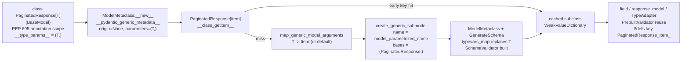

# Generic Pydantic Models: PEP 695 Type Parameter Syntax and Subclass Specialization

> [!summary] Claim
> `PaginatedResponse[Item]` is not a type alias but a real, weakly cached subclass that Pydantic `2.14.3` builds and compiles on first subscription, so specializations are runtime-invariant classes linked only through their generic origin, which governs validation, serialization, `isinstance`, pickling, and the OpenAPI component key.

Part of [Pydantic v2 Internals and Validation](README.md) in [API Engineering](../README.md).

## TL;DR

- Mechanism: `BaseModel.__class_getitem__` maps arguments onto the class's type parameters, substitutes them with `replace_types`, and calls `create_generic_submodel`, which runs `ModelMetaclass` on a new subclass named by `model_parametrized_name` and stores it in a `WeakValueDictionary` keyed by `(cls, args, union_ordering)` (`pydantic 2.14.3 pydantic/main.py, BaseModel.__class_getitem__`; `pydantic/_internal/_generics.py, create_generic_submodel`).
- Contract rule: parametrize at module scope (or subclass, `class ItemPage(PaginatedResponse[Item])`) so the specialization is built once at import, registered in module globals for pickling, and gets a stable name for `isinstance` and OpenAPI.
- Trap: an unparametrized `T` validates as `Any` (or its bound, constraints, or default), and a bound `T` serializes as `Any`, so `response_model=BoundedEnvelope` leaks subclass fields such as `promo_code` that the schema says do not exist (lab `/leaky`).
- Portability fact: `class C[T]` needs CPython `>= 3.12` `(PEP 695)`, `class C[T = X]` needs `>= 3.13` `(PEP 696)`, and Pydantic claims full support for both only from `v2.11` (`docs/concepts/models.md` at `v2.14.3`).
- When not to use it: do not subscript generics inside a request path with per-request types, and do not reach for a generic when the envelope has one or two concrete payloads; a named subclass is cheaper to reason about, name, and diff.

## Mental model



The class statement runs inside a PEP 695 annotation scope that creates `T` with `__infer_variance__ = True` and implicitly appends `typing.Generic` to the bases, and `ModelMetaclass.__new__` records `T` in `__pydantic_generic_metadata__` with no origin and no arguments.
Subscripting first tries the early cache key; on a miss it maps each parameter to an argument, filling PEP 696 defaults, and creates a brand new subclass whose single base is the generic origin.
That subclass goes through the full metaclass and schema pipeline with a `typevars_map`, so every `T` in every inherited annotation is replaced by `Item` before `pydantic-core` compiles a `SchemaValidator` for it.
The finished class is cached weakly under the early key, a single-argument variant, and a late key, and any later field, `response_model`, or `TypeAdapter` that mentions `PaginatedResponse[Item]` reuses its compiled validator and gets a JSON Schema definition derived from the origin's qualified name plus the argument names.

## How it works

### Step 1: what the PEP 695 class statement creates

`class PaginatedResponse[T](BaseModel):` is compiled into an annotation scope that allocates `T = typing.TypeVar("T")`, evaluates the class body inside it, and sets `__type_params__ = (T,)` on the class `(PEP 695, Runtime Implementation)`.
The PEP states that "Its inclusion as a base class is implied by the presence of type parameters", so `Generic` lands in `__mro__` and `__orig_bases__`, and writing `class ClassA[T](Generic[T])` is a runtime error `(PEP 695, Specification)`.
A probe of a generic Pydantic subclass, `class Bad[T](Page[T], Generic[T])`, raised `TypeError: Cannot inherit from Generic[...] multiple times.` on CPython `3.14.6`.
Bounds and constraints are lazily evaluated: `T: Item` stores a thunk and `T.__bound__` evaluates it on first access, which is why a bound can name a class defined later in the module `(PEP 695, Lazy Evaluation)`.
A tuple after the colon (`T: (int, str)`) is a constraint list; anything else is a bound, and the AST represents both identically `(PEP 695, AST Changes)`.
The qualified name of a class defined inside the annotation scope is "as if the objects were defined within the closest enclosing scope", so `PaginatedResponse.__qualname__` carries no `<generic parameters of ...>` segment, which keeps `model_type_ref` and the `$defs` keys stable `(PEP 695, Scoping Behavior)`.
Every type variable allocated by the new syntax has `__infer_variance__` set to `True`, and its `__covariant__` and `__contravariant__` are both `False`, which the lab asserts (`test_pep695_class_declares_an_inferred_variance_typevar`).
PEP 696 adds `class C[T = X]` and `TypeVar(..., default=X)`; a non-default parameter after a defaulted one is a `SyntaxError` in the new syntax and "should ideally raise a TypeError" in the old one `(PEP 696, Specification)`.

Inside `ModelMetaclass.__new__`, after `type.__new__` returns, Pydantic checks the MRO and warns with `GenericBeforeBaseModelWarning` when `Generic` precedes `BaseModel` (the old-syntax ordering mistake `class M(Generic[T], BaseModel)`), which a probe confirmed on `3.14.6` (`pydantic 2.14.3 pydantic/_internal/_model_construction.py, ModelMetaclass.__new__`).
It then sets `cls.__pydantic_generic_metadata__ = {'origin': None, 'args': (), 'parameters': parameters}`, where `parameters` comes from `typing.Generic`'s `__parameters__` or, failing that, the parent's parameters.
If a subclass introduces parameters without re-listing the parent's, the metaclass raises `TypeError` with `All parameters must be present on typing.Generic; you should inherit from typing.Generic[...]`, and `RootModel` subclasses get a dedicated message telling you to write `RootModel[T]`.
At this point the unparametrized class is complete and compiled like any other model, with each bare `T` lowered by `GenerateSchema._unsubstituted_typevar_schema` (Step 4).

### Step 2: `__class_getitem__` and the two-stage cache

`BaseModel.__class_getitem__` (`pydantic 2.14.3 pydantic/main.py, BaseModel.__class_getitem__`) runs these steps, in this order:

1. Early cache probe: `_generics.get_cached_generic_type_early(cls, typevar_values)` hashes `(cls, typevar_values, _union_orderings_key(typevar_values))` against `_GENERIC_TYPES_CACHE`, a `WeakValueDictionary` (`pydantic 2.14.3 pydantic/_internal/_generics.py, _early_cache_key`).
   Unhashable arguments make `_generic_cache_get` swallow the `TypeError` and return `None`, so such parametrizations are rebuilt on every subscription.
2. Guards: subscripting `BaseModel` itself raises `Type parameters should be placed on typing.Generic, not BaseModel`; a class with no `__parameters__` raises `cannot be parametrized because it does not inherit from typing.Generic`; a fully specialized subclass raises `<class ...> is not a generic class` (lab: `ItemPage[int]`).
3. Argument mapping: `map_generic_model_arguments` zips parameters with arguments, fills missing ones from `param.has_default()` and `param.__default__` (passed through `replace_types`, so a default may reference an earlier parameter), and raises `Too many arguments for <class ...>; actual 2, expected 1` or `Too few arguments ...; expected at least N` (`pydantic 2.14.3 pydantic/_internal/_generics.py, map_generic_model_arguments`).
   On CPython `< 3.13` a plain `typing.TypeVar` has no `has_default`, the `AttributeError` is caught, and defaults are only honored when the variable comes from `typing_extensions`.
4. Identity shortcut: if every argument is the parameter itself (`Model[T]` with the same `T`), the class returns itself and caches that.
5. Argument resolution: for a partially specialized parent, `args = tuple(replace_types(arg, typevars_map) for arg in parent_args)` composes substitutions, and `origin = cls.__pydantic_generic_metadata__['origin'] or cls` always points at the root generic.
6. Naming: `origin.model_parametrized_name(args)` returns `f'{cls.__name__}[{params_component}]'` using `_repr.display_as_type`, so arguments render as `Item`, `int`, or `dict[str, int]`, and an unsubstituted type variable renders as its class name (`display_as_type` falls back to `obj.__class__`), which is why a probe of `AuditedPage.__mro__` on `3.14.6` shows `PaginatedResponse[TypeVar]` (`pydantic 2.14.3 pydantic/main.py, BaseModel.model_parametrized_name`; `pydantic/_internal/_repr.py, display_as_type`).
7. Recursion guard: `generic_recursion_self_type(origin, args)` wraps steps 8 to 10 and keeps a `ContextVar` set of `model_type_ref` strings; seeing the same `(origin, args)` twice while building yields a `PydanticRecursiveRef` placeholder, which `__class_getitem__` returns (after the late probe misses) instead of recursing forever; see [[Recursive-Models-Forward-References-and-Cyclic-Reference-Guard]].
8. Late cache probe: `get_cached_generic_type_late` checks `(_union_orderings_key(typevar_values), origin, args)` so that a different route to the same `(origin, args)` reuses the class, then back-fills the early key.
9. Origin rebuild: `origin.model_rebuild(_types_namespace=parent_ns)` with the caller's frame namespace gives forward references a chance to resolve; `PydanticUndefinedAnnotation` is swallowed.
10. Creation and caching: `create_generic_submodel(model_name, origin, args, params)` builds the class and `set_cached_generic_type` stores it under the early key, the single-argument early key (so `Model[int]` and `Model[(int,)]` share a slot), and the late key.

The docstring of `get_cached_generic_type_early` explains the split: "_early_cache_key is optimized to be as quick to compute as possible (for repeated-access speed)", and the two-stage lookup exists "to make Model[List[T]][int] equal to Model[List[int]]" (`pydantic 2.14.3 pydantic/_internal/_generics.py, get_cached_generic_type_early`).
The docstring of `_early_cache_key` adds that the late key "should result in a cache hit _precisely_ when the inputs to __class_getitem__ would result in the same type" (same file, `_early_cache_key`).
The lab confirms that single-parameter case (`Box[list[T]][int] is Box[list[int]]` held in a probe) but also finds a gap: the late key embeds `_union_orderings_key(typevar_values)`, whose length follows the number of arguments supplied at that call, so `Pair[str, V][int]` (one value) and `Pair[str, int]` (two values) produce different late keys for the same `(origin, args)` and two distinct classes both named `Pair[str, int]` (`test_partial_specialization_misses_the_late_cache`).
Worse, `model_type_ref` derives the core schema reference from the origin and arguments only, so both classes share one `ref`, and a model with fields typed by each validates both fields into whichever class was compiled first, so the second field's annotation and its runtime type disagree (same test, `type(instance.__dict__["b"]) is full`).
This follows from the key construction quoted above and is reproduced by the lab test on `2.14.3`; four `gh search issues` queries against `pydantic/pydantic` on 2026-11-12 returned no matching report, so treat it as undocumented `2.14.3` behavior, not a contract and not a known upstream bug.

`_union_orderings_key` exists because `typing` caches `Union[int, float]` and `Union[float, int]` as equal, while Pydantic's left-to-right union validation makes order observable; the key separates top-level union orderings but, per its own docstring, cannot see orderings nested inside `List[...]` (`pydantic 2.14.3 pydantic/_internal/_generics.py, _union_orderings_key`; CPython issue 86483 cited there).
The module also defines `LimitedDict` with `_LIMITED_DICT_SIZE = 100` and a `DeepChainMap`, but the line that chained them into the cache is commented out, and the live cache is `_GENERIC_TYPES_CACHE = GenericTypesCache()`, a plain `WeakValueDictionary`.

### Step 3: `create_generic_submodel`, module registration, and pickling

`create_generic_submodel` uses `_get_caller_frame_info(depth=3)` to find the frame that subscripted the class and whether that frame is module level (`f_locals is f_globals`) (`pydantic 2.14.3 pydantic/_internal/_generics.py, create_generic_submodel`).
It sets `__module__` to the calling module if called globally, otherwise to the origin's module, forwards `__slots__` from the origin, and calls the metaclass with `__pydantic_generic_metadata__={'origin': origin, 'args': args, 'parameters': params}` and `__pydantic_reset_parent_namespace__=False`.
When called globally, it writes the class into `sys.modules[module].__dict__` under its name with `setdefault`, appending `_` until it finds a free slot, which is what makes `pickle` able to find `PaginatedResponse[Item]` by reference.
The lab shows both sides: `vars(generic_envelopes)["PaginatedResponse[Item]"]` is the cached class because `ItemPage(PaginatedResponse[Item])` subscripted it at import, while `Pair[bytes, bytes]` created inside a test function is absent and `pickle.dumps` raises `PicklingError: Can't pickle <class '...Pair[bytes, bytes]'>: it's not found as ...` (`test_module_level_specialization_is_registered_for_pickle`).
A consequence is that `__module__` of a specialization depends on who subscripted it first: in a probe, `AuditedPage[int]` subscripted from a `__main__` script reported `__module__ == "__main__"`, and the partial-specialization duplicate was registered as `Pair[str, int]_`.

### Step 4: schema generation with a `typevars_map`

The metaclass (through `set_model_fields`) and `complete_model_class` both call `get_model_typevars_map(cls)`, which returns `{}` for a class without arguments and otherwise `dict(zip(iter_contained_typevars(origin), args, strict=True))`, and pass it to `collect_model_fields` and `GenerateSchema` (`pydantic 2.14.3 pydantic/_internal/_model_construction.py, set_model_fields` and `complete_model_class`; `pydantic/_internal/_generics.py, get_model_typevars_map`).
`GenerateSchema` applies `replace_types(obj, self._typevars_map)` to every annotation after evaluating it, and `replace_types` walks `Annotated` (keeping metadata), generic aliases, PEP 604 unions, `Callable` argument lists, and nested Pydantic generics (which it re-subscripts as `type_[resolved_type_args]`) (`pydantic 2.14.3 pydantic/_internal/_generics.py, replace_types`).
Inside unions it collapses `Any | T` to `Any` and drops `Never` and `NoReturn` members, and on CPython `< 3.14` it rebuilds `types.UnionType` with `functools.reduce(operator.or_, ...)` because `X | Y` objects do not support `__getitem__`, while on `3.14+` `typing.Union` and `types.UnionType` are the same object.
A type variable that survives substitution is lowered by `_unsubstituted_typevar_schema` in this precedence: a PEP 696 default (`generate_schema(typevar.__default__)`), then constraints (`_union_schema(Union[constraints])`), then a bound (`generate_schema(bound)` with `schema['serialization'] = simple_ser_schema('any')`), else `any_schema()` (`pydantic 2.14.3 pydantic/_internal/_generate_schema.py, GenerateSchema._unsubstituted_typevar_schema`).
The bound branch is the only one that overrides serialization, which is why an unparametrized `BoundedEnvelope` dumps `promo_code` while `DefaultedEnvelope` and `BoundedEnvelope[Item]` drop it (`test_bound_validates_as_bound_but_serializes_as_any`, `test_pep696_default_drives_validation_and_serialization`).
Variadic generics are not part of this machinery: `class C[*Ts](BaseModel)` is valid grammar, but Pydantic's tracking issue `pydantic#5952` "Add support for PEP 646 (Variadic Generics)" is still open as of 2026-11-12 (`pydantic#5804` was closed in favor of it on 2025-07-23).
Treat `*Ts` parameters on models as unsupported and use fixed arity.
For `type[T]`, a separate branch emits `is_subclass_schema(bound)` or a union of `type[c]` schemas for constraints.
A PEP 695 generic `type` alias such as `type NonEmpty[X] = Annotated[list[X], Field(min_length=1)]` goes through `_type_alias_type_schema`, which evaluates `__value__` lazily, applies `get_standard_typevars_map(obj)`, and registers a definition reference, so `Batch[int]` keeps `min_length=1` and emits `$defs` key `NonEmpty_int_` (`test_type_alias_with_type_parameters_keeps_its_constraints`).

The model schema for a specialization carries `generic_origin=PaginatedResponse`, and `pydantic-core` stores it on `ModelValidator` (`pydantic-core 2.50.4 src/validators/model.rs, ModelValidator::build`).
When the input is not an instance of `cls`, `ModelValidator::validate` checks `input_as_python_instance(input, generic_origin)`; on a match it sets `force_revalidate = true` and revalidates from the instance's `__dict__`, `__pydantic_extra__`, and `__pydantic_fields_set__`, with the Rust comment noting that "cases like isinstance(SomeModel[Int], SomeModel[Any]) fail the isinstance check, but are valid" (`pydantic-core 2.50.4 src/validators/model.rs, ModelValidator::validate`).
This shipped as `pydantic-core#1489` and `pydantic#10666`, both merged 2024-10-23 and released in Pydantic `v2.10.0` on 2024-11-20, closing `pydantic#9414`, where `ResponseModel[Any]` rejected `ResponseModel[Product]` instances.

### Step 5: compiled validator reuse

A parent model that mentions `PaginatedResponse[Item]` does not recompile it: `build_validator_inner` calls `PrebuiltValidator::try_get_from_schema`, and `get_prebuilt` reads `cls.__dict__["__pydantic_complete__"]` and `__pydantic_validator__` straight from the specialized class's `__dict__` (`pydantic-core 2.50.4 src/common/prebuilt.rs, get_prebuilt`).
The same function refuses prebuilt reuse for a `dataclass` schema that has `generic_origin`, because a parametrized Pydantic dataclass is a generic alias whose `cls` is still the unparametrized class, but models are safe because each specialization is its own class with its own `__dict__`.
The lab asserts that the parent's core schema points at `cls is PaginatedResponse[Item]` and that its validator repr contains `PrebuiltValidator` (`test_parent_model_embeds_the_specialized_validator_as_prebuilt`); see [[Pydantic-v2-Architecture-CoreSchema-and-Rust-Pydantic-Core]] for the prebuilt mechanism itself.

### Step 6: variance, statically and at runtime

PEP 695 asks type checkers to infer variance by comparing an "upper" specialization (`object`) against a "lower" one (the parameter itself): if lower is assignable to upper the parameter is covariant, if the reverse holds it is contravariant, otherwise invariant `(PEP 695, Variance Inference)`.
A mutable field `items: list[T]` is both read and written, so `T` is invariant, and both `pyright 1.1.414` and `mypy 2.4.1` (with `pydantic.mypy`) reject passing `PaginatedResponse[PromoItem]` where `PaginatedResponse[Item]` is expected; the lab pins the mypy side with a `# type: ignore[arg-type]` that `warn_unused_ignores` would flag if the error disappeared (`test_type_checkers_treat_the_field_typevar_as_invariant`).
`frozen=True` does not rescue covariance on modern targets: pyright synthesizes `__replace__` for dataclass-like classes "For Python 3.13 and newer" (`pyright 1.1.414 packages/pyright-internal/src/analyzer/dataClasses.ts, synthesizeDataClassMethods`), and `__replace__` takes each field as a parameter, which puts `T` in a contravariant position.
In probes, a generic Pydantic model frozen with the class keyword (`class M[T](BaseModel, frozen=True)`) was invariant under pyright `--pythonversion 3.13` and `3.14` but covariant under `3.12`, and a frozen stdlib dataclass behaved the same way.
A model frozen through `model_config = ConfigDict(frozen=True)` was invariant under pyright on all three targets, because pyright reads the `frozen` behavior only from class keyword arguments and otherwise falls back to `frozenDefault` (`pyright 1.1.414 packages/pyright-internal/src/analyzer/dataClasses.ts, applyDataClassClassBehaviorOverrides`), so it never sees `model_config`.
mypy `2.4.1` with `pydantic.mypy` reported both frozen Pydantic forms invariant and the frozen stdlib dataclass covariant.
`object.__replace__` and `copy.replace()` are "Added in version 3.13" (Python docs, `copy` module), which is the runtime fact pyright models.
At runtime there is no variance at all: `issubclass(PaginatedResponse[PromoItem], PaginatedResponse[Item])` is `False` because both are siblings under the origin, and the only bridge is the `generic_origin` revalidation from Step 4, which creates a new `PaginatedResponse[Item]`, keeps `PromoItem` instances as-is (subclass instances pass `revalidate_instances='never'`), and then serializes them with the `Item` serializer (`test_specializations_are_invariant_but_revalidated_through_the_origin`).

### Step 7: subclass specialization

There are two ways to subclass a generic model, with different runtime shapes:

- `class ItemPage(PaginatedResponse[Item])` closes the parameter: its metadata has `parameters == ()`, it is a subclass of the cached `PaginatedResponse[Item]`, subscripting it raises `TypeError`, and its name is a normal identifier (`test_subclass_specialization_rules`).
- `class AuditedPage[T](PaginatedResponse[T])` keeps it open: the base is `PaginatedResponse[T_audited]`, a specialization keyed by `AuditedPage`'s own `T`, and `AuditedPage[int]` is a subclass of `AuditedPage` and `PaginatedResponse` but not of `PaginatedResponse[int]`.
- With the old syntax the subclass must list `Generic[TypeX]` explicitly (`class ChildClass(BaseClass[TypeX], Generic[TypeX])`), and partial replacement such as `class ChildClass(BaseClass[int, TypeY], Generic[TypeY, TypeZ])` is supported (`docs/concepts/models.md` at `v2.14.3`, Generic models).

Config, validators, serializers, and methods defined on the generic origin apply to every specialization, because each specialization is literally a subclass (`docs/concepts/models.md` at `v2.14.3`, the paragraph after the upper-bound warning under Generic models: "in the same way as when inheriting from a model class").
`collect_model_fields` suppresses the `Field name ... shadows an attribute in parent` warning when the parent is the generic origin, since re-declaring every field in the specialization is the whole mechanism (`pydantic 2.14.3 pydantic/_internal/_fields.py, collect_model_fields`).

### Step 8: JSON Schema and OpenAPI component keys

`GenerateJsonSchema.get_defs_ref` splits the core reference `module.Qualname:id[ArgName:id,...]` on `[`, `]`, and `,`, strips the `:id` suffix and module path from each component, and passes the result to `normalize_name`, which applies `re.sub(r'[^a-zA-Z0-9.\-_]', '_', name).replace('.', '__')`, so `PaginatedResponse[Item]` becomes `PaginatedResponse_Item_` and `Page[dict[str, int]]` becomes `Page_dict_str__int__` (probe on `3.14.6`) (`pydantic 2.14.3 pydantic/json_schema.py, GenerateJsonSchema.get_defs_ref` and `GenerateJsonSchema.normalize_name`).
It registers six prioritized choices (short name, short name plus mode, module-qualified name, module-qualified plus mode, and two occurrence-indexed variants) so that two different `Item` classes from different modules fall back to longer keys instead of colliding.
The core reference comes from `model_type_ref`, which uses the origin's `__qualname__` and the arguments' display names, not the specialization's `__name__` (`pydantic 2.14.3 pydantic/_internal/_type_refs.py, model_type_ref`).
Therefore overriding `model_parametrized_name` changes `__name__`, `repr`, and the schema `title`, but not the component key: the lab's `Envelope[int]` is titled `IntEnvelope` and still keyed `Envelope_int_`, and FastAPI `0.162.0` publishes exactly that under `#/components/schemas/` (`test_openapi_component_names_and_response_filtering`).
A named subclass is the reliable way to choose a component key: `ItemPage` appears as `ItemPage`; see [[OpenAPI-Generation-Internals-in-FastAPI-Get-OpenAPI-and-Separate-Schemas]].

### Step 9: response filtering in FastAPI

FastAPI's `serialize_response` calls `field.validate(response_content, ...)` on the declared `response_model` and then serializes the validated value with that field's serializer (`fastapi 0.162.0 fastapi/routing.py, serialize_response`).
With `response_model=PaginatedResponse[Item]` and a returned `PaginatedResponse[PromoItem]`, validation goes through the `generic_origin` revalidation, the `Item` serializer runs, and `promo_code` never reaches the wire (lab `/items`).
With `response_model=BoundedEnvelope` (unparametrized, bound `Item`), the returned instance is an exact instance of the class, so it passes through unchanged and the `any` serializer emits `promo_code: "LEAK"`, while the published schema still says `data` is `{"$ref": "#/components/schemas/Item"}` (lab `/leaky`).
See [[Response-Serialization-Pipeline-Response-Model-and-Double-Validation-Cost]] for the cost of that second validation pass.

## Numbers and limits

| Metric or parameter | Value | Source or measurement condition |
|---|---|---|
| Cached `PaginatedResponse[Item]` subscription | `582 ns` per lookup (best of 7 x `100000`) | Measured by the fact-checker (as of 2026-11): command in Worked example, Apple M3 Pro, macOS `27.3` arm64, CPython `3.14.6`, Pydantic `2.14.3` |
| First subscription with a new argument model | `217 us` total, of which defining the argument model alone took `58 us`, so about `160 us` for specialization and compilation (best of 7 x `500`) | Same measurement; the two figures were measured separately and subtracted |
| Lab runtime | `15 passed in 0.46s` | `uv run --frozen pytest ... -q -rA`, CPython `3.14.6`, macOS `27.3` arm64 |
| Generic type cache | `WeakValueDictionary`, no size limit | `pydantic 2.14.3 pydantic/_internal/_generics.py, _GENERIC_TYPES_CACHE` |
| `_LIMITED_DICT_SIZE` | `100`, defined but not wired into the cache | Same file; the `DeepChainMap(GenericTypesCache(), LimitedDict())` line is commented out |
| Cache keys written per new specialization | up to 3 (early, single-argument early, late) | `pydantic 2.14.3 pydantic/_internal/_generics.py, set_cached_generic_type` |
| Bare `T` validation fallback order | default, then constraints, then bound, then `Any` | `pydantic 2.14.3 pydantic/_internal/_generate_schema.py, _unsubstituted_typevar_schema` |
| Minimum CPython for `class C[T]` and `type X[T] = ...` | `3.12` | `(PEP 695)` header `Python-Version: 3.12` |
| Minimum CPython for `class C[T = X]` | `3.13` | `(PEP 696)` header `Python-Version: 3.13` |
| Minimum CPython for `object.__replace__` | `3.13` | Python docs, `copy` module, "Added in version 3.13" |
| Pydantic release with full PEP 695 and PEP 696 support | `v2.11.0` (2025-03-27) | `docs/concepts/models.md` `version-added v2.11`; release notes list PR 11189 "Properly support PEP 695 generics syntax" and PR 11332 "Properly support type variable defaults" |
| Pydantic release with cross-parametrization revalidation | `v2.10.0` (2024-11-20) | Release notes list PR 10666 |

## Portability

| Leg | `class C[T](BaseModel)` | `class C[T = X]` | `frozen=True` variance in pyright | Lab result |
|---|---|---|---|---|
| CPython `3.12.16` | Supported `(PEP 695)` | `SyntaxError`; use `typing_extensions.TypeVar(default=...)` with `Generic[...]` as the lab does `(PEP 696)` | Covariant under `--pythonversion 3.12` with the class keyword `frozen=True`, invariant with `model_config = ConfigDict(frozen=True)` (probe) | Not run: lab matrix paused (2026-11-11 instruction) |
| CPython `3.13.18` | Supported | Supported `(PEP 696)` | Invariant under `--pythonversion 3.13` (probe), `__replace__` synthesized (`dataClasses.ts`) | Not run: paused |
| CPython `3.14.10` | Supported | Supported | Invariant under `--pythonversion 3.14` (probe) | Run on the workspace interpreter, which is `3.14.6`, not `3.14.10`: 15 passed |
| CPython `3.15.2` | Supported per PEP 695 and 696 | Supported | Invariant by the same rule: pyright synthesizes `__replace__` "For Python 3.13 and newer" (`dataClasses.ts`), so no `3.15` target flips it back; not probed with a `3.15` interpreter | Not run: paused |
| CPython `3.15.2t` | Same grammar as `3.15.2` | Same | Same as `3.15.2` (static analysis does not depend on the GIL) | Not run: paused. Upstream facts only: `pydantic-core` free-threading support was planned for Pydantic `2.11` (`pydantic#10483`), `2.14.0b2` fixed races found by concurrent `TypeAdapter` construction (`pydantic#13780`, `pydantic#13785`), `tests/test_freethreaded.py` at `v2.14.3` has five tests and none subscribes a generic model, and `_generics.py` contains no lock around `_GENERIC_TYPES_CACHE`; this note therefore makes no thread-safety claim for concurrent first subscription, so subscribe at import |
| Pydantic `< 2.10` | Works | Partial | n/a | `Model[Any]` rejected `Model[Product]` instances (`pydantic#9414`) |
| Pydantic `2.10.x` | Works, revalidation via `generic_origin` | Partial | n/a | Per `v2.10.0` and `v2.11.0` release notes |
| Pydantic `>= 2.11` | Full support | Full support | n/a | Per `docs/concepts/models.md` |
| Servers (Uvicorn, Hypercorn, Granian) and HTTP/1.1, HTTP/2, HTTP/3 | Not applicable: specialization happens at import or first subscription, before any ASGI server sees a request | Same | Same | The lab drives FastAPI through `httpx.ASGITransport` only |

## Worked example

The [implementation](../labs/src/api_labs/f09_pydantic_v2_internals_and_validation/generic_envelopes.py) defines the envelopes and the FastAPI app, and the [test](../labs/tests/f09_pydantic_v2_internals_and_validation/test_generic_models_pep_695_syntax_and_variance.py) asserts each mechanism above.

```python
"""Generic Pydantic envelopes: PEP 695 type parameters, cached specialization, OpenAPI names."""

import gc
import weakref
from typing import Annotated, Any, Generic

from fastapi import FastAPI
from pydantic import BaseModel, Field
from typing_extensions import TypeVar


class Item(BaseModel):
    """Public catalogue item."""

    sku: str
    price_cents: Annotated[int, Field(ge=0)]


class PromoItem(Item):
    """Subclass carrying a field that the public `Item` contract must not expose."""

    promo_code: str


class PaginatedResponse[T](BaseModel):
    """PEP 695 generic envelope; `PaginatedResponse[X]` is a cached runtime subclass."""

    items: list[T]
    total: Annotated[int, Field(ge=0)]
    next_cursor: str | None = None


class AuditedPage[T](PaginatedResponse[T]):
    """Generic subclass: re-declares `T`, so it stays parametrizable."""

    request_id: str


class ItemPage(PaginatedResponse[Item]):
    """Non-generic specialization: a stable class name, `isinstance` target, and OpenAPI key."""


class BoundedEnvelope[T: Item](BaseModel):
    """Upper bound: unparametrized use validates as `Item` but serializes as `Any`."""

    data: T


class Scalar[T: (int, str)](BaseModel):
    """Constrained type parameter: unparametrized use validates as `int | str`."""

    value: T


# PEP 696 defaults need `class C[T = X]` syntax (CPython >= 3.13); the typing_extensions
# TypeVar keeps this module importable on 3.12 while exposing the same `has_default()` API.
DetailT = TypeVar("DetailT", default=Item)


class DefaultedEnvelope(BaseModel, Generic[DetailT]):
    """PEP 696 default: unparametrized use validates and serializes as the default."""

    data: DetailT


class Pair[K, V](BaseModel):
    """Two-parameter model used to show the partial-specialization cache gap."""

    key: K
    value: V


class Envelope[T](BaseModel):
    """Overrides `model_parametrized_name`, which renames the class but not the `$defs` key."""

    data: T

    @classmethod
    def model_parametrized_name(cls, params: tuple[Any, ...]) -> str:
        names = "".join(getattr(p, "__name__", repr(p)).capitalize() for p in params)
        return f"{names}Envelope"


type NonEmpty[X] = Annotated[list[X], Field(min_length=1)]


class Batch[T](BaseModel):
    """Field typed with a generic PEP 695 `type` alias."""

    rows: NonEmpty[T]


def transient_specialization_is_collected() -> bool:
    """Parametrize with a throwaway model, drop it, and report whether the cache let it go."""

    def build() -> weakref.ref[type[BaseModel]]:
        class Throwaway(BaseModel):
            x: int

        return weakref.ref(PaginatedResponse[Throwaway])

    ref = build()
    gc.collect()
    return ref() is None


def _promo_page() -> PaginatedResponse[PromoItem]:
    promo = PromoItem(sku="sku-1", price_cents=999, promo_code="STAFF-ONLY")
    return PaginatedResponse[PromoItem](items=[promo], total=1)


def build_app() -> FastAPI:
    """Routes whose response models exercise specialization, filtering, and naming."""
    app = FastAPI()

    @app.get("/items", response_model=PaginatedResponse[Item])
    def list_items() -> Any:
        return _promo_page()

    @app.get("/promos")
    def list_promos() -> PaginatedResponse[PromoItem]:
        return _promo_page()

    @app.get("/item-page")
    def item_page() -> ItemPage:
        return ItemPage(items=[], total=0)

    @app.get("/leaky", response_model=BoundedEnvelope)
    def leaky() -> Any:
        return BoundedEnvelope(data=PromoItem(sku="sku-2", price_cents=1, promo_code="LEAK"))

    @app.get("/safe", response_model=BoundedEnvelope[Item])
    def safe() -> Any:
        return BoundedEnvelope(data=PromoItem(sku="sku-3", price_cents=1, promo_code="KEPT"))

    @app.get("/envelope")
    def envelope() -> Envelope[int]:
        return Envelope[int](data=1)

    return app
```

The invariance and revalidation test, verbatim from the test module (excerpt):

```python
@pytest.mark.unit
def test_specializations_are_invariant_but_revalidated_through_the_origin() -> None:
    assert not issubclass(PaginatedResponse[PromoItem], _runtime(PaginatedResponse[Item]))

    class Holder(BaseModel):
        page: PaginatedResponse[Item]

    promo_page = _promo_page()
    holder = Holder.model_validate({"page": promo_page})
    assert holder.page is not promo_page
    assert type(holder.page) is PaginatedResponse[Item]
    assert type(holder.page.items[0]) is PromoItem
    assert holder.model_dump()["page"]["items"] == [{"sku": "s-1", "price_cents": 5}]
    as_any = holder.model_dump(serialize_as_any=True)["page"]["items"][0]
    assert as_any["promo_code"] == "STAFF-ONLY"

    with pytest.raises(ValidationError) as exc:
        Holder.model_validate({"page": PaginatedResponse[int](items=[1], total=1)})
    assert [(e["type"], e["loc"]) for e in exc.value.errors()] == [
        ("model_type", ("page", "items", 0)),
    ]
```

`_runtime` is a one-line `cast("type[Any]", cls)` helper, because pyright rejects `issubclass` against a parametrized generic with `Generic type with type arguments not allowed for instance or class checks`, and mypy reports `Parameterized generics cannot be used with class or instance checks`; both messages came from the first type-check pass over this file.
The test calls `Holder.model_validate({"page": promo_page})` rather than `Holder(page=promo_page)` for the same reason: pyright flagged the constructor call with `"PaginatedResponse[PromoItem]" is not assignable to "PaginatedResponse[Item]"` and `Type parameter "T@PaginatedResponse" is invariant`, which is the static half of the claim, while the runtime accepts the instance through revalidation.

Captured run, from `labs/`, CPython `3.14.6`, macOS `27.3` arm64 (Apple M3 Pro):

```text
$ uv run --frozen pytest tests/f09_pydantic_v2_internals_and_validation/test_generic_models_pep_695_syntax_and_variance.py -q -rA
PASSED test_generic_models_pep_695_syntax_and_variance.py::test_pep695_class_declares_an_inferred_variance_typevar
PASSED test_generic_models_pep_695_syntax_and_variance.py::test_specialization_is_a_cached_real_subclass
PASSED test_generic_models_pep_695_syntax_and_variance.py::test_parent_model_embeds_the_specialized_validator_as_prebuilt
PASSED test_generic_models_pep_695_syntax_and_variance.py::test_module_level_specialization_is_registered_for_pickle
PASSED test_generic_models_pep_695_syntax_and_variance.py::test_unparametrized_typevar_validates_as_any
PASSED test_generic_models_pep_695_syntax_and_variance.py::test_bound_validates_as_bound_but_serializes_as_any
PASSED test_generic_models_pep_695_syntax_and_variance.py::test_constraints_validate_as_a_union
PASSED test_generic_models_pep_695_syntax_and_variance.py::test_pep696_default_drives_validation_and_serialization
PASSED test_generic_models_pep_695_syntax_and_variance.py::test_specializations_are_invariant_but_revalidated_through_the_origin
PASSED test_generic_models_pep_695_syntax_and_variance.py::test_type_checkers_treat_the_field_typevar_as_invariant
PASSED test_generic_models_pep_695_syntax_and_variance.py::test_subclass_specialization_rules
PASSED test_generic_models_pep_695_syntax_and_variance.py::test_partial_specialization_misses_the_late_cache
PASSED test_generic_models_pep_695_syntax_and_variance.py::test_type_alias_with_type_parameters_keeps_its_constraints
PASSED test_generic_models_pep_695_syntax_and_variance.py::test_unreferenced_specialization_is_garbage_collected
PASSED test_generic_models_pep_695_syntax_and_variance.py::test_openapi_component_names_and_response_filtering
15 passed in 0.46s
```

(The `tests/f09_pydantic_v2_internals_and_validation/` prefix is trimmed from each test id, and pytest's progress line and section rules are omitted.)

The cache cost figures in Numbers and limits came from this one-off command, run once from `labs/`:

```text
$ uv run --frozen python -I -c "
import itertools, platform, timeit
from pydantic import BaseModel
from api_labs.f09_pydantic_v2_internals_and_validation.generic_envelopes import Item, PaginatedResponse
n = itertools.count(); keep = []
def model(): keep.append(type(f'M{next(n)}', (BaseModel,), {'__annotations__': {'x': int}})); return keep[-1]
def both(): PaginatedResponse[model()]
hit = min(timeit.repeat(lambda: PaginatedResponse[Item], number=100_000, repeat=7)) / 100_000 * 1e9
spec = min(timeit.repeat(both, number=500, repeat=7)) / 500 * 1e6
only = min(timeit.repeat(model, number=500, repeat=7)) / 500 * 1e6
print(platform.python_version(), platform.platform(), f'cached_hit_ns={hit:.0f} new_model_plus_specialization_us={spec:.0f} new_model_only_us={only:.0f}')
"
3.14.6 macOS-27.3-arm64-arm-64bit-Mach-O cached_hit_ns=582 new_model_plus_specialization_us=217 new_model_only_us=58
```

## Pitfalls

> [!warning] Subscribing inside the request path
> Trigger: `PaginatedResponse[dynamic_model]` or `create_model(...)` followed by a subscription per request.
> Symptom: each new argument class costs a full class creation and schema compilation (about `160 us` measured here on top of the argument model's own `58 us`), and memory churns as weakly cached classes die and are rebuilt.
> Fix: specialize at import time, or keep a strong reference in your own registry; `pydantic#6672` (closed 2023-07-25) is the upstream report of partially parametrized generics surviving `gc.collect()` in early v2, so test collection behavior on your version, as `test_unreferenced_specialization_is_garbage_collected` does.

> [!warning] Unparametrized bound generic as a response model
> Trigger: `response_model=BoundedEnvelope` where `T: Item`, returning a subclass instance.
> Symptom: subclass-only fields (`promo_code`) appear on the wire while OpenAPI documents only `Item`, an excessive data exposure that schema-diff tooling cannot see.
> Fix: always parametrize response models (`BoundedEnvelope[Item]`) or use a named subclass; the serializer for a bare bound is `any` by design (`_unsubstituted_typevar_schema`).

> [!warning] Unparametrized generic as an input model
> Trigger: `body: PaginatedResponse` with no argument.
> Symptom: `T` validates as `Any`, so `{"items": [1, "x", null]}` is accepted (`test_unparametrized_typevar_validates_as_any`), and mypy strict reports a missing type argument only if `disallow_any_generics` is on.
> Fix: parametrize every input annotation; give `T` a bound or PEP 696 default if a bare use is legitimate.

> [!warning] `isinstance` against a specialization
> Trigger: `isinstance(page, PaginatedResponse[Item])` after the page came from a revalidated or duplicate specialization.
> Symptom: `False` for data that validated fine, because siblings do not subclass each other and partial specialization can produce a second class with the same name (`test_partial_specialization_misses_the_late_cache`); the Pydantic docs "strongly advise against" this check.
> Fix: check against the origin (`isinstance(page, PaginatedResponse)`) or a named subclass (`ItemPage`).

> [!warning] Renaming components with `model_parametrized_name`
> Trigger: overriding `model_parametrized_name` to get OpenAPI keys like `IntEnvelope`.
> Symptom: the `title` changes but `#/components/schemas/Envelope_int_` does not, so any SDK generator that derives class names from component keys keeps the old name.
> Fix: subclass (`class IntEnvelope(Envelope[int])`) or override `GenerateJsonSchema.get_defs_ref`; see [[Generating-Typed-Async-SDKs-with-OpenAPI-Python-Client-and-OpenAPI-Generator]].

> [!warning] Pickling or multiprocessing a function-local specialization
> Trigger: `pickle.dumps(Pair[bytes, bytes](...))` where the first subscription happened inside a function, including worker initializers in Celery or `ProcessPoolExecutor`.
> Symptom: `PicklingError: Can't pickle <class '...Pair[bytes, bytes]'>: it's not found as ...`.
> Fix: subscribe once at module scope so `create_generic_submodel` registers the class in module globals, or use a named subclass.

> [!warning] Old-syntax base ordering
> Trigger: `class Wrong(Generic[T], BaseModel)`.
> Symptom: ``GenericBeforeBaseModelWarning: Classes should inherit from `BaseModel` before generic classes (e.g. `typing.Generic[T]`) for pydantic generics to work properly.`` (probe on `3.14.6`).
> Fix: put `BaseModel` first, or switch to `class Wrong[T](BaseModel)` where the order is implicit.

## Security and robustness

- Excessive data exposure (OWASP API3:2023 Broken Object Property Level Authorization): OWASP lists an endpoint as vulnerable when it "exposes properties of an object that are considered sensitive", and recommends "a schema-based response validation mechanism"; a parametrized `response_model` is that mechanism, and an unparametrized bound generic silently disables it (lab `/leaky` versus `/safe`); see [[Defeating-BOPLA-and-Mass-Assignment-API3-2023-Strict-Input-Output-Schemas]].
- Schema and wire drift: the `/leaky` route proves that OpenAPI can be correct while the payload is not, so contract tests must validate real responses against the published schema with `additionalProperties` closed, not only diff the spec; see [[Breaking-Change-Detection-and-Semantic-OpenAPI-Diffing]].
- Input laundering through `Any`: an unparametrized generic input field accepts arbitrary JSON (`None`, nested objects) into a field the code later treats as typed, which moves validation failures into business logic.
- Resource exhaustion: never derive the type argument from client input (for example a `type` query parameter mapped to classes and subscribed per request); each distinct argument compiles a validator, and an unhashable argument bypasses the cache completely (`_generic_cache_get` swallows the `TypeError`).
- Type confusion via revalidation: a `PaginatedResponse[PromoItem]` passed where `PaginatedResponse[Item]` is expected becomes a new object whose items are still `PromoItem` instances, so code that relies on `type(item) is Item` for authorization decisions is wrong; authorize on fields, not on classes.
- Defense in depth: set `extra="forbid"` on input item models, parametrize every envelope, keep sensitive fields out of public models entirely rather than relying on serializer filtering, and run `uv run --frozen pyright` in CI so invariance violations are caught before runtime revalidation hides them.

## The principal's view

The decision is how many distinct envelope types an API surface publishes and how they are named, because every specialization becomes a public OpenAPI component, an SDK class, and a compatibility surface.
A single `PaginatedResponse[T]` gives uniform pagination semantics across dozens of resources and one place to change cursor rules, but the component keys (`PaginatedResponse_Item_`) are derived from Python qualified names, so renaming a Python class becomes a breaking change for every generated client.
Named subclasses (`ItemPage(PaginatedResponse[Item])`) cost one line per resource and buy stable keys, pickle-safe classes, and clean `isinstance` checks; for public APIs this is the default worth enforcing in review.
Keep generics for envelopes whose shape is truly parametric (pagination, result or error wrappers, event payloads) and avoid them for models that merely share some fields, where composition or a plain base class reads better.
Teams should accept that variance is a static-only concept here: the runtime revalidates rather than subtypes, so the type checker is the only place a covariance mistake is caught, which argues for running pyright or mypy strict as a gate and not as advice.
When the envelope sits on an ultra-hot internal path, `msgspec.Struct` generics or a schema-fixed binary codec avoid per-class compilation entirely; see [[Pydantic-v2-Performance-Engineering-vs-MsgSpec-and-ORJSON]].

## Interview questions

> [!question] L5: What does `PaginatedResponse[Item]` return at runtime, and how is it different from `list[int]`?
>
> > [!success]- Answer
> > It returns a real class, a subclass of `PaginatedResponse` created by `create_generic_submodel` and cached weakly, whereas `list[int]` returns a `types.GenericAlias` that is not a class.
> > The Pydantic specialization has its own `__pydantic_validator__`, `__name__` `PaginatedResponse[Item]`, and fields with `T` replaced by `Item`.
> > That is why `isinstance(x, PaginatedResponse[Item])` works at runtime while `isinstance(x, list[int])` raises `TypeError`.
> >
> > Follow-up: Why do type checkers still reject that `isinstance` call?

> [!question] L5: How does Pydantic validate a field typed `T` when the model is used without a type argument?
>
> > [!success]- Answer
> > `_unsubstituted_typevar_schema` uses the PEP 696 default if present, otherwise the constraints as a union, otherwise the bound, otherwise `Any`.
> > A bound validates as the bound but serializes as `any`, so subclass fields survive `model_dump`.
> > A default or constraints are used for both validation and serialization.
> >
> > Follow-up: Which of these behaviors is a data-exposure risk in a `response_model`?

> [!question] L6: Predict the output.
>
> Simplified excerpt of the lab's invariance test:
>
> ```python
> class Holder(BaseModel):
>     page: PaginatedResponse[Item]
>
> promo = PaginatedResponse[PromoItem](
>     items=[PromoItem(sku="s-1", price_cents=5, promo_code="STAFF-ONLY")], total=1
> )
> h = Holder.model_validate({"page": promo})
> print(h.page is promo, type(h.page).__name__, type(h.page.items[0]).__name__)
> print(h.model_dump()["page"]["items"])
> ```
>
> > [!success]- Answer
> > `False PaginatedResponse[Item] PromoItem`, then `[{'sku': 's-1', 'price_cents': 5}]`.
> > `promo` is not an instance of `PaginatedResponse[Item]`, but it is an instance of the `generic_origin`, so `ModelValidator::validate` forces revalidation from its `__dict__`, creating a new object.
> > The items are `PromoItem` instances, which pass `Item` validation unchanged because subclass instances are not revalidated by default.
> > Serialization uses the `Item` schema, so `promo_code` is dropped; `serialize_as_any=True` would keep it.
> >
> > Follow-up: What happens if `promo` were a `PaginatedResponse[int]`?

> [!question] L6: Debug this API: why do clients receive `promo_code` when the OpenAPI spec shows `data` as `Item`?
>
> The route is `@app.get("/x", response_model=BoundedEnvelope)` with `class BoundedEnvelope[T: Item](BaseModel): data: T`, and it returns `BoundedEnvelope(data=PromoItem(...))`.
> Explain the cause and the fix.
>
> > [!success]- Answer
> > The response model is unparametrized, so `T` falls back to its bound, which `_unsubstituted_typevar_schema` validates as `Item` but marks with an `any` serializer.
> > FastAPI's `serialize_response` validates the returned instance, which is an exact instance of `BoundedEnvelope` and passes through, and then serializes with the `any` serializer, which uses the runtime type `PromoItem`.
> > The JSON Schema is generated from the validation side and says `Item`, so the spec and wire disagree.
> > Fix: `response_model=BoundedEnvelope[Item]` or a named subclass, and add a contract test that validates real responses against the spec with closed objects.
> >
> > Follow-up: How would you catch every such route in a large codebase automatically?

> [!question] L6: Why is `T` in `class PaginatedResponse[T](BaseModel): items: list[T]` invariant, and does `frozen=True` make it covariant?
>
> > [!success]- Answer
> > PEP 695 inference compares upper and lower specializations, and a mutable field is both readable and writable, so neither direction is assignable and `T` is invariant.
> > With `frozen=True`, pyright `1.1.414` synthesizes `__replace__` for Python `3.13` and newer, which takes each field as a parameter and puts `T` in a contravariant position, so it stays invariant on `3.13+` targets and becomes covariant only under a `3.12` target, and only when frozen with the class keyword (`class M[T](BaseModel, frozen=True)`); `model_config = ConfigDict(frozen=True)` is invisible to pyright and stays invariant everywhere.
> > mypy `2.4.1` reported both frozen Pydantic forms invariant in the same probe.
> >
> > Follow-up: How would you design a read-only envelope that type checkers accept as covariant?

> [!question] L6: Why does `ItemPage[int]` raise `TypeError` while `AuditedPage[int]` works?
>
> > [!success]- Answer
> > `class ItemPage(PaginatedResponse[Item])` binds the only parameter, so its `__pydantic_generic_metadata__["parameters"]` is empty and `__class_getitem__` raises `is not a generic class`.
> > `class AuditedPage[T](PaginatedResponse[T])` declares a fresh `T`, so the subclass is itself generic and subscription maps that `T`.
> > `AuditedPage[int]` subclasses `AuditedPage` and `PaginatedResponse`, but not `PaginatedResponse[int]`.
> >
> > Follow-up: What does the old-syntax equivalent of `AuditedPage` look like, and what error do you get if you forget `Generic[T]`?

> [!question] L7+: Why do Celery workers fail with `PicklingError: Can't pickle <class 'app.models.Pair[bytes, bytes]'>` for only some task types?
>
> > [!success]- Answer
> > `create_generic_submodel` registers a specialization in module globals only when the first subscription happens at module scope, using the caller frame check `f_locals is f_globals`.
> > If the first `Pair[bytes, bytes]` was created inside a function, the class exists but no module attribute named `Pair[bytes, bytes]` does, so pickle's by-reference lookup fails.
> > Which task types fail depends on whether some module-level code happened to subscribe the same arguments first.
> > Fix: subscribe or subclass at module scope in the models module, so registration is deterministic in every process.
> >
> > Follow-up: Why does the `__module__` of a specialization sometimes point at a different module than the origin?

> [!question] L7+: How can two distinct classes both named `Pair[str, int]` exist, with a field typed by the second one yielding instances of the first?
>
> Explain the mechanism and the guardrail.
>
> > [!success]- Answer
> > One route was `Pair[str, int]`, the other `Pair[str, V][int]`; the early keys differ, and the late key includes `_union_orderings_key(typevar_values)`, whose arity follows the arguments of that specific call, so it misses and a second class is created.
> > Both classes have the same `model_type_ref` (origin plus arguments), so in a model that references both, schema generation shares one definition and validates both fields into the first class.
> > This is observed `2.14.3` behavior and not a documented contract.
> > Guardrail: forbid partial specialization chains in shared models, define named subclasses for public types, and add an identity test like the lab's.
> >
> > Follow-up: What would a correct late cache key need to contain?

> [!question] L7+: What do you approve and require when a platform team proposes one `Envelope[T]` for every response in 300 services?
>
> > [!success]- Answer
> > Approve the shared envelope semantics, because pagination, error, and metadata rules belong in one place and the specialization cost is paid once per type at import.
> > Require named subclasses for public types, since component keys and generated SDK class names otherwise derive from Python qualified names and change on refactors.
> > Require parametrized annotations everywhere (no bare `Envelope`), strict type checking in CI because runtime revalidation hides variance mistakes, and contract tests that validate real responses.
> > Reject per-request specialization and any design that maps client input to type arguments.
> >
> > Follow-up: How would you migrate an existing spec whose keys are `Envelope_User_` to named keys without breaking clients?

## Related

Prerequisites: [[Discriminated-Unions-Tag-and-Callable-Discriminator-Dispatch]]

Next: [[Recursive-Models-Forward-References-and-Cyclic-Reference-Guard]]

See also: [[02-Programming-Languages/Python/Python-Backend-Interview-Prep/04-FastAPI]], [[Pydantic-v2-Architecture-CoreSchema-and-Rust-Pydantic-Core]], [[TypeAdapter-for-Validating-and-Serializing-Arbitrary-Types]], [[JSON-Schema-Generation-Internals-and-GenerateJsonSchema]], [[Custom-Serialization-Field-Model-and-Wrap-Serializers]], [[Response-Serialization-Pipeline-Response-Model-and-Double-Validation-Cost]], [[OpenAPI-Generation-Internals-in-FastAPI-Get-OpenAPI-and-Separate-Schemas]], [[Defeating-BOPLA-and-Mass-Assignment-API3-2023-Strict-Input-Output-Schemas]], [[Breaking-Change-Detection-and-Semantic-OpenAPI-Diffing]], [[Generating-Typed-Async-SDKs-with-OpenAPI-Python-Client-and-OpenAPI-Generator]], [[Pydantic-v2-Performance-Engineering-vs-MsgSpec-and-ORJSON]], [[02-Programming-Languages/Python/Python_Zero_to_Godhood/Chapter_17_Python_312_Native_Generics_PEP_695_Type_statement_]]

- Lab: `labs/tests/f09_pydantic_v2_internals_and_validation/test_generic_models_pep_695_syntax_and_variance.py`

## Further reading

- [PEP 695: Type Parameter Syntax](https://peps.python.org/pep-0695/): the grammar, annotation scopes, lazy bounds, implicit `Generic`, and the variance inference algorithm.
- [PEP 696: Type Defaults for Type Parameters](https://peps.python.org/pep-0696/): `class C[T = X]`, ordering rules, and `has_default()`.
- [Typing specification: Generics](https://typing.python.org/en/latest/spec/generics.html): the normative rules for bounds, constraints, defaults, and variance that checkers implement.
- [Pydantic `v2.14.3` docs/concepts/models.md](https://raw.githubusercontent.com/pydantic/pydantic/v2.14.3/docs/concepts/models.md): the maintainers' description of generic models, unparametrized type variables, and the revalidation note.
- [Pydantic `v2.14.3` pydantic/_internal/_generics.py](https://raw.githubusercontent.com/pydantic/pydantic/v2.14.3/pydantic/_internal/_generics.py): the cache, `replace_types`, `create_generic_submodel`, and argument mapping.
- [pydantic-core `src/validators/model.rs` at `v2.14.3`](https://raw.githubusercontent.com/pydantic/pydantic/v2.14.3/pydantic-core/src/validators/model.rs): `generic_origin` and forced revalidation.
- [pydantic-core PR 1489](https://github.com/pydantic/pydantic-core/pull/1489) and [pydantic PR 10666](https://github.com/pydantic/pydantic/pull/10666): the change that made cross-parametrization validation work.
- [pyright `1.1.414` dataClasses.ts](https://raw.githubusercontent.com/microsoft/pyright/1.1.414/packages/pyright-internal/src/analyzer/dataClasses.ts): where `__replace__` is synthesized for Python `3.13+`, which decides frozen-model variance.
- [OWASP API3:2023 Broken Object Property Level Authorization](https://owasp.org/API-Security/editions/2023/en/0xa3-broken-object-property-level-authorization/): the risk that a mis-parametrized response model reintroduces.
