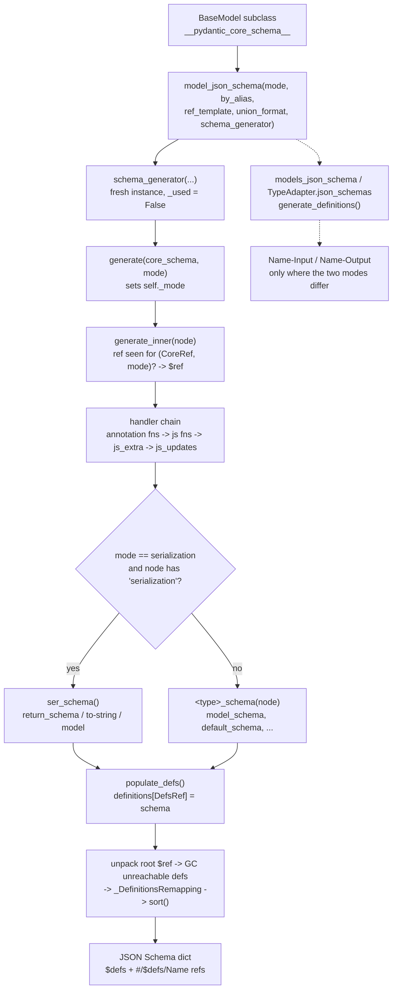

# Customizing JSON Schema Generation: model_json_schema(), validation vs serialization Mode, and Subclassing GenerateJsonSchema

> [!summary] Claim
> A Pydantic model has two JSON Schemas, not one: `mode='validation'` describes what the model accepts and `mode='serialization'` describes what it emits, both compiled from the same `__pydantic_core_schema__` by a single-use `GenerateJsonSchema` visitor whose methods are the only supported customization surface (`pydantic 2.14.3 pydantic/json_schema.py, GenerateJsonSchema`).

Part of [Pydantic v2 Internals and Validation](README.md) in [API Engineering](../README.md).

## TL;DR

- Mechanism: `model_json_schema()` instantiates `schema_generator(by_alias=..., ref_template=..., union_format=...)` and calls `generate(cls.__pydantic_core_schema__, mode=...)`, which dispatches each core schema node to a `<type>_schema` method, wraps it in the field and annotation hooks, stores every `ref`-bearing node in `definitions` under a `DefsRef` derived from `(CoreRef, mode)`, then unpacks, garbage-collects, renames, and sorts the result (`pydantic 2.14.3 pydantic/json_schema.py, GenerateJsonSchema.generate`).
- Contract rule: publish the validation schema for request bodies and the serialization schema for responses; in the lab, `Order` accepts `orderId` and an integer `placed_ms` but emits `order_ref`, a string `placed_ms`, and a `readOnly` computed `notional`, and each schema rejects the other direction's payload.
- Trap: the serialization schema uses `serialization_alias` by default, but `model_dump()` does not (`by_alias` follows `serialize_by_alias`, default `False`), so `model_dump(mode="json")` output fails its own published schema with `'order_ref' is a required property`; FastAPI hides this because `get_request_handler` defaults `response_model_by_alias=True` (`fastapi 0.162.0 fastapi/routing.py, get_request_handler`).
- Portability fact: the 13-test lab passed unchanged on CPython `3.12.13`, `3.13.18`, `3.14.6`, `3.14.10`, `3.15.2`, and free-threaded `3.14.6t` and `3.15.0b3t` on macOS arm64 with `pydantic 2.14.3` and `pydantic-core 2.50.4`; the generator is pure Python, so behavior is decided by the pydantic release, not the interpreter.
- When not to use it: do not subclass `GenerateJsonSchema` to paper over a model that means different things to different consumers; split it into explicit request and response models, and do not generate schemas per request (`Order.model_json_schema()` cost a median `211.3 us` per uncached call in the lab measurement).

## Mental model



A call to `model_json_schema()` never reuses state: it builds a new generator, so `mode` is fixed for the whole traversal unless a model's `json_schema_mode_override` pins it.
`generate_inner` first short-circuits any node whose `(CoreRef, mode)` pair already has a definition, which is how recursion terminates and how one model can have an `Input` and an `Output` definition at the same time.
Every other node passes through a stack of wrapper handlers built from the node's `metadata`, then reaches either the serializer-derived schema (serialization mode only) or the type-specific method selected from `_schema_type_to_method`.
`populate_defs` moves every node that carries a core `ref` into `definitions` and returns a `$ref` in its place.
When the traversal ends, `generate` inlines a root that is a lone single-use `$ref`, drops definitions no longer reachable, replaces long collision-proof definition keys with the shortest unambiguous ones, and sorts keys; `generate_definitions` handles many `(key, mode, schema)` inputs at once and only renames and sorts (it neither unpacks a root nor garbage-collects definitions), which is the path that produces `-Input` and `-Output` suffixes.

## How it works

### Entry points and the single-use generator

`BaseModel.model_json_schema(by_alias=None, ref_template=DEFAULT_REF_TEMPLATE, schema_generator=GenerateJsonSchema, mode='validation', *, union_format='any_of')` is a thin classmethod over the module function `pydantic.json_schema.model_json_schema` (`pydantic 2.14.3 pydantic/main.py, BaseModel.model_json_schema`).
That function instantiates `schema_generator(by_alias=by_alias, ref_template=ref_template, union_format=union_format)`, calls `rebuild()` on a `MockCoreSchema` left by `defer_build` or unresolved forward references, raises `AttributeError` if called on `BaseModel` itself, and returns `generate(cls.__pydantic_core_schema__, mode=mode)` (`pydantic 2.14.3 pydantic/json_schema.py, model_json_schema`).
You pass the generator as a class, not an instance, because the instance is single-use: `generate` and `generate_definitions` both raise `PydanticUserError` with code `json-schema-already-used` once `self._used` is `True` (`pydantic 2.14.3 pydantic/json_schema.py, GenerateJsonSchema.generate`).
The guard exists because the instance accumulates `definitions`, four ref translation maps, collision counters, and `_prioritized_defsref_choices` during a run; reusing it would leak one schema's definitions and name choices into the next.
`TypeAdapter.json_schema` follows the same path but first pushes the adapter's own `config` onto `_config_wrapper_stack`, because that config is not part of the core schema (`pydantic 2.14.3 pydantic/type_adapter.py, TypeAdapter.json_schema`).
Nothing is cached: two calls return different dict objects (`Order.model_json_schema() is Order.model_json_schema()` printed `False`), and each call re-walks the core schema.

`GenerateJsonSchema.__init__` resolves `by_alias` into two attributes: `_by_alias` keeps the caller's tri-state value and `by_alias = by_alias is not False`, so the default `None` means "use aliases" unless the configuration says otherwise (`pydantic 2.14.3 pydantic/json_schema.py, GenerateJsonSchema.__init__`).
It also calls `build_schema_type_to_method()`, which enumerates every literal in `CoreSchemaOrFieldType` and binds `getattr(self, key.replace('-', '_') + '_schema')`; a missing method raises `TypeError` at construction unless the private environment variable `PYDANTIC_PRIVATE_ALLOW_UNHANDLED_SCHEMA_TYPES` is set (`pydantic 2.14.3 pydantic/json_schema.py, GenerateJsonSchema.build_schema_type_to_method`).
This dispatch table is why subclassing works: a core schema of type `nullable` always calls `self.nullable_schema`, so overriding that one method changes every nullable node in every model.

### `generate_inner`: the ref short-circuit and the handler chain

`generate_inner(schema)` starts with a cache check: if the node has a `ref` and `(core_ref, self.mode)` already maps to a populated definition, it returns `{'$ref': ...}` immediately (`pydantic 2.14.3 pydantic/json_schema.py, GenerateJsonSchema.generate_inner`).
The source comment states the assumption this relies on: the same `CoreRef` is never used for types that should have different JSON Schemas within one mode.
Keying on the mode is what lets one generator hold `Order` in validation mode and `Order` in serialization mode as two different definitions.

The inner `handler_func` decides between two schema sources.
In serialization mode, a node carrying a `serialization` key is rendered by `ser_schema`, which uses the serializer's `return_schema` for `function-plain` and `function-wrap`, a plain string schema for `format` and `to-string`, and the inner schema for `model`; if `ser_schema` returns `None` (no `return_schema`), generation falls back to the validation-side type method (`pydantic 2.14.3 pydantic/json_schema.py, GenerateJsonSchema.ser_schema`).
If the serializer uses `when_used='unless-none'` or `'json-unless-none'` on a nullable node, the result is unioned with `{'type': 'null'}`, because `None` bypasses the serializer.
Otherwise the method from `_schema_type_to_method[schema['type']]` runs.

Around that core, `generate_inner` builds a chain of `GenerateJsonSchemaHandler` wrappers from the node's `metadata`, each closing over the previous handler (`pydantic 2.14.3 pydantic/_internal/_schema_generation_shared.py, GenerateJsonSchemaHandler`):

1. `pydantic_js_updates` merges a static dict over the result; `Field(title=..., description=..., deprecated=..., examples=...)` lands here through `_extract_json_schema_info_from_field_info`, and computed fields get `{'readOnly': True}` here (`pydantic 2.14.3 pydantic/_internal/_generate_schema.py, GenerateSchema._computed_field_schema`).
2. `pydantic_js_extra` applies `Field(json_schema_extra=...)`: a dict is merged after `to_jsonable_python`, a callable mutates the schema in place.
3. `pydantic_js_functions` runs type-level `__get_pydantic_json_schema__` hooks; after each one, `populate_defs` registers the result and any non-`$ref` keys the hook returned are merged into the referenced definition, not left as `$ref` siblings.
4. `pydantic_js_annotation_functions` runs `Annotated` metadata hooks such as `WithJsonSchema` and `Examples`, outermost, with no ref resolution, so they can replace the schema wholesale.

Because each wrapper is built on top of the previous one, the last group registered runs first and has the final say over its node.
Precedence across nodes follows nesting instead: a top-level field's `Field()` title and description live in `pydantic_js_updates` on the outer `model-field` node (`pydantic 2.14.3 pydantic/_internal/_generate_schema.py, GenerateSchema._common_field_schema`), while `WithJsonSchema` sits in `pydantic_js_annotation_functions` on the inner type node, so the field-level updates are applied over it; on an inner `Annotated` type there is no outer field update, so `WithJsonSchema` replaces the schema unconditionally, as the `WithJsonSchema` docstring documents (`pydantic 2.14.3 pydantic/json_schema.py, WithJsonSchema`).
Writing `__get_pydantic_json_schema__` hooks is the subject of [[Low-Level-Custom-Types-with-Get-Pydantic-Core-Schema]]; this note treats them only as one layer of the chain.

### What `mode` changes, node by node

`GenerateJsonSchema.mode` is a property, not a field: it returns `self._config.json_schema_mode_override` when the config on top of `_config_wrapper_stack` sets one, otherwise the `_mode` set by `generate` (`pydantic 2.14.3 pydantic/json_schema.py, GenerateJsonSchema.mode`).
`model_schema` pushes `cls.model_config` before visiting a model's fields, so an override is scoped to that model and its descendants that do not push their own config (`pydantic 2.14.3 pydantic/json_schema.py, GenerateJsonSchema.model_schema`).

| Concern | `mode='validation'` | `mode='serialization'` | Source symbol (`pydantic 2.14.3 pydantic/json_schema.py`) |
|---|---|---|---|
| Property name | `validation_alias` when `by_alias` is `None` and `validate_by_alias` is `True`, or `by_alias=True`; else the attribute name | `serialization_alias` whenever `self.by_alias` is truthy; `serialize_by_alias` config is not consulted | `GenerateJsonSchema._get_alias_name`, `_named_required_fields_schema` |
| `AliasPath` / `AliasChoices` | first single-element string path in the alias list, else the attribute name | not applicable | `GenerateJsonSchema._get_alias_name` |
| Field presence | every field | fields with `serialization_exclude` (`Field(exclude=True)`) are dropped | `GenerateJsonSchema.field_is_present` |
| Computed fields | absent | appended, `readOnly: true`, required unless `exclude_if` is set | `GenerateJsonSchema.model_fields_schema`, `_name_required_computed_fields` |
| `required` | fields whose schema is not `default` | same, minus fields with `exclude_if`; with `json_schema_serialization_defaults_required=True`, every field without `exclude_if` | `GenerateJsonSchema.field_is_required` |
| Serializer return type | ignored | `PlainSerializer(..., return_type=str)` makes the property `{"type": "string"}` | `GenerateJsonSchema.ser_schema` |
| Defaults | raw default, encoded | default passed through a plain, no-info serializer first (`0` -> `"0"`); on exception, warn `non-serializable-default` and omit | `GenerateJsonSchema.default_schema` |
| `Decimal` | `anyOf: [number, string]` | `string` | `GenerateJsonSchema.decimal_schema` |
| `Fraction` | `anyOf: [number, string(format=fraction)]` | `string(format=fraction)` | `GenerateJsonSchema.fraction_schema` |
| `datetime` with `ser_json_temporal='milliseconds'` | `string(format=date-time)` | `number` | `GenerateJsonSchema._common_temporal_schema` |
| `Json[int]` | `string` with `contentMediaType: application/json` and `contentSchema` | the inner `integer` | `GenerateJsonSchema.json_schema` |
| Before, wrap, plain validators | `json_schema_input_type` when given; `PlainValidator` defaults it to `Any`, giving `{}` | the wrapped type; for `PlainValidator`, the source type (its own `serialization`, or a wrap serializer whose `return_schema` is the source type) | `function_before_schema`, `function_wrap_schema`, `function_plain_schema` |
| `chain` | first step | last step | `GenerateJsonSchema.chain_schema` |
| Decimal `pattern` (opt-in) | accepts every `Decimal()` string syntax; constraints apply only to non-exponent strings | exactly the strings `str(decimal)` produces | `GenerateJsonSchema.build_decimal_pattern` |

The rule behind every row is the docstring of `JsonSchemaMode`: the inputs to validation differ from the outputs of serialization, so a schema that claims to describe both is wrong for at least one direction (`pydantic 2.14.3 pydantic/json_schema.py, JsonSchemaMode`).
Alias mechanics themselves (`AliasPath`, `AliasChoices`, `AliasGenerator`, `validate_by_name`) are covered in [[Aliases-AliasPath-AliasChoices-and-Bidirectional-Field-Mapping]]; serializer semantics (`when_used`, wrap serializers) in [[Custom-Serialization-Field-Model-and-Wrap-Serializers]].

### Defaults: what is encoded, what is dropped

`default_schema` calls `get_default_value`, which returns `schema.get('default', NoDefault)`, so `default_factory` is never evaluated and a field such as `tags: list[str] = Field(default_factory=list)` gets no `default` and is not required (`pydantic 2.14.3 pydantic/json_schema.py, GenerateJsonSchema.get_default_value`).
The docstring invites overriding `get_default_value` to call the factory; doing so with a non-deterministic factory (`uuid4`, `datetime.now`) makes the schema differ on every build and defeats schema diffing.
Set and frozenset defaults with more than one element are sorted for determinism, then `encode_default` dumps the value through `TypeAdapter(Any if _type_has_config(type(dft)) else type(dft), config=config).dump_python(dft, by_alias=self.by_alias, mode='json')` (types with their own config, such as models, are dumped as `Any`), stripping `ser_json_temporal` and `ser_json_timedelta` in validation mode so a validation schema does not advertise a serialization format (`pydantic 2.14.3 pydantic/json_schema.py, GenerateJsonSchema.encode_default`).
Any failure becomes a `PydanticSerializationError`, which `default_schema` converts into a `PydanticJsonSchemaWarning` and a schema with no `default`; the lab shows a `marker: object = Field(default=object())` field losing its default with one warning and no error.

### Definitions: three kinds of ref and how names are chosen

The module defines three distinct string types: `CoreRef` (the core schema `ref`, for a model `module.qualname:id`), `DefsRef` (the key inside `$defs`), and `JsonRef` (the `$ref` value, `ref_template.format(model=defs_ref)`) (`pydantic 2.14.3 pydantic/json_schema.py, CoreRef`).
`get_defs_ref((core_ref, mode))` strips the `:id` suffixes, shortens dotted paths to the last component, normalizes with `re.sub(r'[^a-zA-Z0-9.\-_]', '_', name).replace('.', '__')`, and registers six candidates from shortest to most specific: `Name`, `Name-Input` or `Name-Output`, `module__qualname`, the same with the mode suffix, `module__qualname__N`, and the same with the mode suffix; it returns the last, which is collision-proof (`pydantic 2.14.3 pydantic/json_schema.py, GenerateJsonSchema.get_defs_ref`).
The mode suffix comes from `_MODE_TITLE_MAPPING = {'validation': 'Input', 'serialization': 'Output'}`.

At the end of a run, `_DefinitionsRemapping.from_prioritized_choices` picks, for each definition, the first candidate that maps to exactly one distinct schema, rewrites every `$ref`, and repeats until the `$defs` dict stops changing, because simplifying an inner name can make two outer definitions identical (`pydantic 2.14.3 pydantic/json_schema.py, _DefinitionsRemapping.from_prioritized_choices`).
The loop is capped at `100` iterations and raises `PydanticInvalidForJsonSchema('Failed to simplify the JSON schema definitions')` if it does not converge.
This fixed point is the whole explanation for the `-Input` and `-Output` suffixes: when `Order` validation and `Order` serialization render to the same dict, both candidates collapse to `Order`; when they differ, `Order` is ambiguous and the next candidate, `Order-Input` or `Order-Output`, wins.
In the lab, `models_json_schema([(Order, "validation"), (Order, "serialization")])` produced `Fill`, `Order-Input`, and `Order-Output`: `Fill` is identical in both modes, so it keeps one unsuffixed name even though it was reached from two differently-named parents.
Measured naming of other shapes on the same build: `Page[int]` becomes `Page_int_`, and two classes both named `A` (one module-level, one defined inside `mk()`) become `__main____A` and `__main____mk___locals___A`, because their short names collide.

`generate` additionally unpacks the root: if the top-level result is exactly `{'$ref': ...}`, that ref is used once, and its definition exists, the definition is copied to the root and dropped from `$defs` (`pydantic 2.14.3 pydantic/json_schema.py, GenerateJsonSchema.generate`).
`_garbage_collect_definitions` then walks reachable `$ref`s from the root and deletes everything else, skipping `examples` lists so example payloads that happen to contain `$ref` keys are not treated as references (`pydantic 2.14.3 pydantic/json_schema.py, _get_all_json_refs`).
`sort` orders keys alphabetically at every level except directly under `properties` and `default`, so field declaration order survives (`pydantic 2.14.3 pydantic/json_schema.py, GenerateJsonSchema.sort`).
The comment in `generate` notes that `$schema` is deliberately not emitted and suggests adding `self.schema_dialect` in an override, which is what the lab's `ContractGenerateJsonSchema` does.

### `ref_template` formats references, it does not move definitions

`DEFAULT_REF_TEMPLATE = '#/$defs/{model}'` (`pydantic 2.14.3 pydantic/json_schema.py, DEFAULT_REF_TEMPLATE`).
Passing `ref_template="#/components/schemas/{model}"` to `model_json_schema` rewrites every `$ref` but still returns the definitions under the root `$defs` key, so the document's own references no longer resolve; the lab's `dangling_refs` finds exactly `{'#/components/schemas/Fill'}`.
The template is meant for `models_json_schema` and `TypeAdapter.json_schemas`, which return the definitions separately so the caller places them where the template points; FastAPI uses `REF_TEMPLATE = "#/components/schemas/{model}"` and copies the returned definitions to `components.schemas` (`fastapi 0.162.0 fastapi/openapi/constants.py, REF_TEMPLATE`).

### `$ref` siblings: why the generator removes redundant ones

JSON Schema 2020-12 allows other keywords alongside `$ref` and evaluates them (JSON Schema 2020-12 Core Section 8.2.3.1), whereas draft-07 required that all other properties in a `$ref` object be ignored (draft-handrews-json-schema-01 Section 8.3), and an OpenAPI 3.0 Reference Object "cannot be extended with additional properties and any properties added SHALL be ignored" (OpenAPI 3.0.3 Section 4.7.23.1).
Pydantic targets 2020-12 (`schema_dialect = 'https://json-schema.org/draft/2020-12/schema'`), so it may emit siblings such as a field `title` next to `$ref`, but `handle_ref_overrides` deletes any sibling whose value equals the referenced definition's value (`pydantic 2.14.3 pydantic/json_schema.py, GenerateJsonSchema.handle_ref_overrides`).
`field_title_should_be_set` returns `False` for schemas with a `ref` and for `definition-ref` nodes, which is why `fill: Fill | None` has no `title` in the lab output while `qty` gets `Qty` (`pydantic 2.14.3 pydantic/json_schema.py, GenerateJsonSchema.field_title_should_be_set`).

### Subclassing `GenerateJsonSchema`: the override surface

Every public method is a hook, and `schema_generator=` accepts any subclass on `model_json_schema`, `models_json_schema`, `TypeAdapter.json_schema`, and `TypeAdapter.json_schemas`.

| Hook | Default behavior (`pydantic 2.14.3`) | Typical override |
|---|---|---|
| `generate(schema, mode)` | no `$schema`; returns sorted dict | add `$schema`, a custom `title`, or post-process the whole document |
| `<type>_schema(schema)` | one method per core schema type, for example `nullable_schema`, `bytes_schema`, `decimal_schema` | change one type everywhere, such as OpenAPI 3.0 `nullable` |
| `get_defs_ref(core_mode_ref)`, `normalize_name(name)` | six-candidate naming above | stable, namespaced component names |
| `get_title_from_name(name)`, `field_title_should_be_set(schema)` | `name.title().replace('_', ' ').strip()`; titles on scalar fields | drop auto-generated titles that bloat generated SDKs |
| `field_is_present(field)`, `field_is_required(field, total)` | exclusion and required rules above | treat defaults as required, or keep excluded fields documented |
| `get_default_value(schema)`, `encode_default(dft)` | static default only | evaluate deterministic factories |
| `get_decimal_pattern(schema)`, `build_decimal_pattern(schema)` | no pattern | return `build_decimal_pattern(schema)` to publish `max_digits` and `decimal_places` |
| `sort(value, parent_key)` | alphabetical except `properties` and `default` | no sorting, or full sorting for byte-stable diffs |
| `emit_warning(kind, detail)`, `render_warning_message(kind, detail)`, `ignored_warning_kinds` | warn with `PydanticJsonSchemaWarning`; ignore `skipped-choice` | fail closed in CI |
| `handle_invalid_for_json_schema(schema, error_info)` | raise `PydanticInvalidForJsonSchema` | emit `{}` or a placeholder for types with no schema |
| `ValidationsMapping` | core constraint names to JSON Schema keywords, for example `le` -> `maximum`, `min_length` -> `minItems` for arrays | rename constraint keywords for a non-standard consumer |

The three warning kinds are `skipped-choice`, `non-serializable-default`, and `skipped-discriminator` (`pydantic 2.14.3 pydantic/json_schema.py, JsonSchemaWarningKind`); `skipped-choice` is ignored by default, which means a union member that cannot be rendered disappears from `anyOf` silently (`GenerateJsonSchema.union_schema`).
The constructor argument `union_format='primitive_type_array'` is not a subclass hook but changes `get_union_of_schemas`: a union of bare primitive schemas becomes `{'type': ['integer', 'string', 'null']}`, falling back to `anyOf` as soon as one member has constraints, metadata, or a `$ref` (`pydantic 2.14.3 pydantic/json_schema.py, GenerateJsonSchema.get_union_of_schemas`).
FastAPI itself ships a subclass, `fastapi._compat.v2.GenerateJsonSchema`, overriding only `bytes_schema` to emit `contentMediaType: application/octet-stream` and mode-dependent `contentEncoding: base64`, with a TODO to remove it once pydantic PR `#12841` or an equivalent lands (`fastapi 0.162.0 fastapi/_compat/v2.py, GenerateJsonSchema`); that PR was closed without being merged (as of 2026-11).

Three rules keep a subclass correct.
Call `super()` and edit the result instead of re-deriving it, because the base methods also maintain `definitions` and the ref maps.
Keep per-run state on `self` (set in `__init__`), never on the class, because the class is shared and the instance is created per call.
Remember the generator only sees core schemas, not Python types: to change one type, find its core schema `type` (or attach a `__get_pydantic_json_schema__` to it), not its Python class.

### FastAPI: where the two modes meet in one document

FastAPI builds every OpenAPI document with one `GenerateJsonSchema(ref_template=REF_TEMPLATE)` instance and one `generate_definitions` call whose inputs are each route's request fields in `validation` mode and response fields in `serialization` mode, plus the flattened nested models (`fastapi 0.162.0 fastapi/_compat/v2.py, get_definitions`).
That single shared generator is why the `_DefinitionsRemapping` rule above decides whether you see `Order` or `Order-Input` and `Order-Output` in `components.schemas`; the lab's FastAPI test shows the request body pointing at `#/components/schemas/Order-Input` and the `200` response at `#/components/schemas/Order-Output`.
`FastAPI(separate_input_output_schemas=False)` maps every field to `validation` mode, except fields whose core schema has `computed_fields`, which keep their own mode (`fastapi 0.162.0 fastapi/_compat/v2.py, _has_computed_fields`); in the lab a model with a computed field still produced `Priced-Input` and `Priced-Output` with the flag set to `False`.
FastAPI also truncates each definition `description` at the first form feed (`\f`), so a docstring can keep internal notes after `\f` out of the published schema (`fastapi 0.162.0 fastapi/_compat/v2.py, get_definitions`).
Because `get_definitions` hard-codes FastAPI's own subclass, there is no `schema_generator` parameter on `FastAPI`; changing generation means overriding `app.openapi` or post-processing its result.
`FastAPI.openapi` caches the document in `self.openapi_schema` and rebuilds only when `self.router._get_routes_version()` changes (`fastapi 0.162.0 fastapi/applications.py, FastAPI.openapi`), and `openapi_version` defaults to `"3.1.0"`; setting it to `"3.0.2"` changes the version string but not the 2020-12 shapes pydantic emits.
The FastAPI pipeline end to end is covered in [[OpenAPI-Generation-Internals-in-FastAPI-Get-OpenAPI-and-Separate-Schemas]].

## Numbers and limits

Measured values were re-measured by the independent fact-check on an Apple M3 Pro, macOS `27.3` arm64 (`uname -r` = `27.3.0`), CPython `3.14.6`, `pydantic 2.14.3`, `pydantic-core 2.50.4`, `fastapi 0.162.0`, with a one-off `timeit.repeat` script run from `labs/` through `uv run --frozen python` against the lab module (median of 5 repeats of `n` calls each, reported per call; the script is not part of the lab), on 2026-11-12.
These are single-machine, single-session numbers; read them as orders of magnitude, not as a benchmark.

| Quantity | Value | Source |
|---|---|---|
| Schema modes | `2`: `validation`, `serialization` | `pydantic 2.14.3 pydantic/json_schema.py, JsonSchemaMode` |
| Default dialect | `https://json-schema.org/draft/2020-12/schema`, not emitted as `$schema` | `pydantic 2.14.3 pydantic/json_schema.py, GenerateJsonSchema.schema_dialect` |
| Default `ref_template` | `#/$defs/{model}` | `pydantic 2.14.3 pydantic/json_schema.py, DEFAULT_REF_TEMPLATE` |
| FastAPI `REF_TEMPLATE` | `#/components/schemas/{model}` | `fastapi 0.162.0 fastapi/openapi/constants.py` |
| Definition name candidates per ref | `6` | `pydantic 2.14.3 pydantic/json_schema.py, GenerateJsonSchema.get_defs_ref` |
| Remapping fixed-point cap | `100` iterations, then `PydanticInvalidForJsonSchema` | `pydantic 2.14.3 pydantic/json_schema.py, _DefinitionsRemapping.from_prioritized_choices` |
| Warning kinds | `3`; `1` (`skipped-choice`) ignored by default | `pydantic 2.14.3 pydantic/json_schema.py, JsonSchemaWarningKind`, `ignored_warning_kinds` |
| `generate` calls per generator instance | `1`; the second raises code `json-schema-already-used` | lab test `test_generator_instance_is_single_use` |
| `Order.model_json_schema()` validation | median `211.3 us` (min `210.2`, max `211.8`), `n=2000` | measured |
| `Order.model_json_schema(mode="serialization")` | median `224.3 us` (min `219.4`, max `229.6`), `n=2000` | measured |
| `models_json_schema` for `Order` in both modes | median `552.8 us` (min `549.9`, max `559.3`), `n=2000` | measured (`component_schemas([Order])`) |
| `ContractGenerateJsonSchema` validation | median `229.7 us` (min `217.0`, max `449.5`), `n=2000` | measured |
| New FastAPI app plus first `app.openapi()` | median `3149.2 us` (min `2573.8`, max `3779.9`), `n=200`, after one warm-up build; an earlier run in the same session without the warm-up gave median `9295.1 us` (min `6087.3`, max `12063.7`) | measured (`build_order_app().openapi()`) |
| Cached `app.openapi()` | median `0.3 us` (min `0.3`, max `0.6`), `n=20000` | measured |
| Result caching in pydantic | none; two calls return distinct objects | measured (`is` printed `False`) |

## Portability

Every CPython row ran `pytest tests/f09_pydantic_v2_internals_and_validation/test_json_schema_generation_internals_and_generatejsonschema.py -q` once on macOS `27.3` arm64 and printed `13 passed`, with `pydantic 2.14.3` and `pydantic-core 2.50.4` confirmed at import.
No Linux, Alpine, or container leg was run for this note, and no `3.15.2t` interpreter was available locally, so the free-threaded `3.15` leg used `3.15.0b3t`.
The CPython rows are the drafter's runs on 2026-11-12; the independent fact-check re-ran only the workspace leg (CPython `3.14.6`, `13 passed`), because lab matrix runs were paused for this review.

| Runtime or component | Behavior | Verification |
|---|---|---|
| CPython `3.12.13` | identical schemas; the lab's `from typing import override` imports cleanly | `UV_PROJECT_ENVIRONMENT=<temp venv> uv run --frozen --python <uv cpython-3.12.13> pytest <module> -q`: `13 passed` |
| CPython `3.13.18` | identical | same command with `/opt/homebrew/bin/python3.13`: `13 passed` |
| CPython `3.14.6` (workspace) and `3.14.10` | identical | `uv run --frozen pytest <module> -q` on `3.14.6`; `--python /opt/homebrew/bin/python3.14` on `3.14.10`; both `13 passed` |
| CPython `3.15.2` | identical | `--python /opt/homebrew/bin/python3.15`: `13 passed` |
| Free-threaded `3.14.6t` and `3.15.0b3t` | identical; `sysconfig.get_config_var('Py_GIL_DISABLED')` was `1` and `sys._is_gil_enabled()` `False` after importing `pydantic` and `pydantic_core` | separate venv (`uv venv --python <3.14t or 3.15t>`, `uv pip install -c <uv export of the lock>` of `pydantic`, `pydantic-core`, `fastapi`, `starlette`, `httpx`, `anyio`, `jsonschema`, `pytest`, `pytest-asyncio`, editable lab with `--no-deps`): `13 passed` on both; the locked workspace itself was not tried on free-threaded builds |
| `json_schema_serialization_defaults_required` | added in pydantic `v2.4` | `pydantic 2.14.3 pydantic/config.py, ConfigDict.json_schema_serialization_defaults_required` (`version-added` marker); the defaults-required split it controls traces to `pydantic/pydantic#7209` |
| `Examples` with a `dict` | deprecated since `v2.9`, removal planned for `v3.0` | `pydantic 2.14.3 pydantic/json_schema.py, Examples.__init__` |
| FastAPI `separate_input_output_schemas` | added in FastAPI `0.102.0` | FastAPI how-to "Separate OpenAPI Schemas for Input and Output or Not" |
| FastAPI docs example vs `fastapi 0.162.0` | the docs show `Item-Input` and `Item-Output` for a model whose only difference is a defaulted field; on `fastapi 0.162.0` with `pydantic 2.14.3` that model produced one `Item` component, because defaults are no longer required in serialization mode unless configured | one-off script building `FastAPI()` apps and reading `app.openapi()` on CPython `3.14.6`; `pydantic 2.14.3 pydantic/json_schema.py, GenerateJsonSchema.field_is_required` |
| OpenAPI 3.1 consumers | the 2020-12 output is valid Schema Object content; OpenAPI 3.1 Schema Objects are "a superset of the JSON Schema Specification Draft 2020-12" and default to the `https://spec.openapis.org/oas/3.1/dialect/base` dialect | OpenAPI 3.1.1 Sections 4.4 and 4.8.24.1 |
| OpenAPI 3.0 consumers | `{"type": "null"}` branches and `union_format='primitive_type_array'` output are not valid OpenAPI 3.0: `null` is not a type there, `nullable` is the alternative, and `type` "MUST be a string" | OpenAPI 3.0.3 Sections 4.4, 4.7.24.1, and 4.7.24.2; lab `OpenAPI30GenerateJsonSchema` |
| ASGI servers and HTTP versions | schema generation happens in-process before any byte is sent; the transport only carries the resulting `/openapi.json` | only `httpx.ASGITransport` was exercised; no Uvicorn, Hypercorn, or Granian leg and no HTTP/2 or HTTP/3 leg was run for this note |

## Worked example

The lab [implementation](../labs/src/api_labs/f09_pydantic_v2_internals_and_validation/json_schema_generation.py) defines one model, `Order`, whose two schemas diverge on purpose (aliases, a serializer that rewrites a default, a `Decimal`, a nested optional model, and a computed field), two generator subclasses, and helpers that validate payloads against the generated schemas with `jsonschema 4.26.0` `Draft202012Validator`.
The [test](../labs/tests/f09_pydantic_v2_internals_and_validation/test_json_schema_generation_internals_and_generatejsonschema.py) proves that each schema accepts only its own direction, that `-Input` and `-Output` appear only for definitions that diverge, that the generator is single-use, that the subclasses change exactly what they claim, and that FastAPI wires the split components into the request and the response.

### Implementation (`labs/src/api_labs/f09_pydantic_v2_internals_and_validation/json_schema_generation.py`)

```python
"""Mode-aware JSON Schema generation and GenerateJsonSchema subclasses (pydantic 2.14.3)."""

from __future__ import annotations

from dataclasses import dataclass
from decimal import Decimal  # noqa: TC003 - pydantic resolves field annotations at runtime
from typing import TYPE_CHECKING, Annotated, Any, Protocol, cast, override

from fastapi import FastAPI
from jsonschema import Draft202012Validator  # type: ignore[import-untyped]
from pydantic import BaseModel, ConfigDict, Field, PlainSerializer, computed_field
from pydantic.json_schema import (
    GenerateJsonSchema,
    JsonSchemaMode,
    JsonSchemaValue,
    JsonSchemaWarningKind,
    models_json_schema,
)

if TYPE_CHECKING:
    from collections.abc import Sequence

    from pydantic_core import CoreSchema, core_schema

COMPONENTS_REF_TEMPLATE = "#/components/schemas/{model}"


class Fill(BaseModel):
    """Identical in both modes, so it keeps one unsuffixed definition."""

    venue: str
    qty: int


class Order(BaseModel):
    """Diverges between modes: aliases, a serializer-rewritten default, a computed field."""

    order_id: int = Field(validation_alias="orderId", serialization_alias="order_ref")
    price: Decimal = Field(max_digits=12, decimal_places=4)
    qty: int = 1
    placed_ms: Annotated[int, PlainSerializer(str, return_type=str)] = 0
    fill: Fill | None = None

    @computed_field  # type: ignore[prop-decorator]
    @property
    def notional(self) -> Decimal:
        """Server-derived, so it appears only in the serialization schema."""
        return self.price * self.qty


class PinnedOrder(Order):
    """Forces one schema for both modes, whatever mode the caller asks for."""

    model_config = ConfigDict(json_schema_mode_override="validation")


class OutputDefaultsRequired(BaseModel):
    """Marks defaulted fields required in serialization mode (they are always dumped)."""

    model_config = ConfigDict(json_schema_serialization_defaults_required=True)

    qty: int = 1


class SchemaContractError(RuntimeError):
    """Raised when a contract generator refuses to emit a lossy schema."""


class ContractGenerateJsonSchema(GenerateJsonSchema):
    """Declares the dialect, fails closed on dropped defaults, and pins decimal syntax."""

    @override
    def generate(self, schema: CoreSchema, mode: JsonSchemaMode = "validation") -> JsonSchemaValue:
        json_schema = super().generate(schema, mode=mode)
        json_schema["$schema"] = self.schema_dialect
        return json_schema

    @override
    def emit_warning(self, kind: JsonSchemaWarningKind, detail: str) -> None:
        if kind == "non-serializable-default":
            raise SchemaContractError(f"{detail} [{kind}]")
        super().emit_warning(kind, detail)

    @override
    def get_decimal_pattern(self, schema: core_schema.DecimalSchema) -> str | None:
        return self.build_decimal_pattern(schema)


class OpenAPI30GenerateJsonSchema(GenerateJsonSchema):
    """Emits OpenAPI 3.0 `nullable` instead of a JSON Schema `{"type": "null"}` branch."""

    @override
    def nullable_schema(self, schema: core_schema.NullableSchema) -> JsonSchemaValue:
        inner = self.generate_inner(schema["schema"])
        if "$ref" in inner:
            # OpenAPI 3.0 ignores siblings of a Reference Object, so wrap the $ref.
            return {"allOf": [inner], "nullable": True}
        return {**inner, "nullable": True}


@dataclass(frozen=True, slots=True)
class SchemaPair:
    """The two JSON Schemas pydantic derives from one model."""

    validation: JsonSchemaValue
    serialization: JsonSchemaValue

    def property_names(self, mode: JsonSchemaMode) -> tuple[str, ...]:
        schema = self.validation if mode == "validation" else self.serialization
        return tuple(schema["properties"])

    def required(self, mode: JsonSchemaMode) -> tuple[str, ...]:
        schema = self.validation if mode == "validation" else self.serialization
        return tuple(schema.get("required", ()))


def schema_pair(
    model: type[BaseModel], generator: type[GenerateJsonSchema] = GenerateJsonSchema
) -> SchemaPair:
    """Generate the validation and serialization schemas with fresh generator instances."""
    return SchemaPair(
        validation=model.model_json_schema(mode="validation", schema_generator=generator),
        serialization=model.model_json_schema(mode="serialization", schema_generator=generator),
    )


class _Validator(Protocol):
    def iter_errors(self, instance: Any) -> Any: ...


def contract_errors(schema: JsonSchemaValue, instance: Any) -> list[str]:
    """Validate `instance` against a draft 2020-12 schema; return sorted error messages."""
    validator = cast("_Validator", Draft202012Validator(schema))
    return sorted(str(error.message) for error in validator.iter_errors(instance))


def component_schemas(
    models: Sequence[type[BaseModel]],
    generator: type[GenerateJsonSchema] = GenerateJsonSchema,
) -> tuple[dict[str, str], dict[str, JsonSchemaValue]]:
    """Build OpenAPI-style components for each model in both modes from one generator.

    Returns `{"<Model>:<mode>": "$ref"}` and the shared definitions, keyed by component name.
    """
    inputs: list[tuple[type[BaseModel], JsonSchemaMode]] = [
        (model, mode) for model in models for mode in ("validation", "serialization")
    ]
    refs, top = models_json_schema(
        inputs, ref_template=COMPONENTS_REF_TEMPLATE, schema_generator=generator
    )
    ref_map = {
        f"{model.__name__}:{mode}": str(schema["$ref"]) for (model, mode), schema in refs.items()
    }
    return ref_map, dict(top.get("$defs", {}))


def dangling_refs(schema: JsonSchemaValue) -> set[str]:
    """Return local `$ref` targets that do not resolve inside `schema` itself."""
    refs: set[str] = set()
    stack: list[Any] = [schema]
    while stack:
        node = stack.pop()
        if isinstance(node, dict):
            for key, value in node.items():  # pyright: ignore[reportUnknownVariableType]
                if key == "$ref" and isinstance(value, str):
                    refs.add(value)
                else:
                    stack.append(value)
        elif isinstance(node, list):
            stack.extend(node)  # pyright: ignore[reportUnknownArgumentType]
    unresolved: set[str] = set()
    for ref in refs:
        target: object = schema
        for part in ref.removeprefix("#/").split("/"):
            target = (
                cast("dict[str, object]", target).get(part) if isinstance(target, dict) else None
            )
        if target is None:
            unresolved.add(ref)
    return unresolved


def build_order_app() -> FastAPI:
    """One route whose request and response share `Order`, so OpenAPI needs both modes."""
    app = FastAPI()

    @app.post("/v1/orders")
    async def create_order(order: Order) -> Order:  # pyright: ignore[reportUnusedFunction]
        return order

    return app
```

### Test suite (`labs/tests/f09_pydantic_v2_internals_and_validation/test_json_schema_generation_internals_and_generatejsonschema.py`)

```python
"""Unit tests for mode-aware JSON Schema generation and GenerateJsonSchema subclassing."""

from __future__ import annotations

import warnings

import httpx
import pytest
from pydantic import BaseModel, Field, PydanticUserError
from pydantic.json_schema import GenerateJsonSchema, PydanticJsonSchemaWarning

from api_labs.f09_pydantic_v2_internals_and_validation.json_schema_generation import (
    COMPONENTS_REF_TEMPLATE,
    ContractGenerateJsonSchema,
    OpenAPI30GenerateJsonSchema,
    Order,
    OutputDefaultsRequired,
    PinnedOrder,
    SchemaContractError,
    build_order_app,
    component_schemas,
    contract_errors,
    dangling_refs,
    schema_pair,
)

INBOUND = {"orderId": 7, "price": "101.25", "qty": 3}


class Unencodable(BaseModel):
    marker: object = Field(default=object())


@pytest.mark.unit
def test_modes_pick_different_aliases_and_computed_fields() -> None:
    pair = schema_pair(Order)
    assert pair.property_names("validation") == ("orderId", "price", "qty", "placed_ms", "fill")
    assert pair.property_names("serialization") == (
        "order_ref",
        "price",
        "qty",
        "placed_ms",
        "fill",
        "notional",
    )
    assert pair.required("validation") == ("orderId", "price")
    assert pair.required("serialization") == ("order_ref", "price", "notional")
    assert pair.serialization["properties"]["notional"]["readOnly"] is True


@pytest.mark.unit
def test_types_and_defaults_follow_the_serializer_only_in_serialization_mode() -> None:
    pair = schema_pair(Order)
    assert pair.validation["properties"]["price"]["anyOf"] == [
        {"type": "number"},
        {"type": "string"},
    ]
    assert pair.serialization["properties"]["price"]["type"] == "string"
    placed_in = pair.validation["properties"]["placed_ms"]
    placed_out = pair.serialization["properties"]["placed_ms"]
    assert (placed_in["type"], placed_in["default"]) == ("integer", 0)
    assert (placed_out["type"], placed_out["default"]) == ("string", "0")


@pytest.mark.unit
def test_each_schema_accepts_only_its_own_direction() -> None:
    pair = schema_pair(Order)
    dumped = Order.model_validate(INBOUND).model_dump(mode="json", by_alias=True)
    assert contract_errors(pair.validation, INBOUND) == []
    assert contract_errors(pair.serialization, dumped) == []
    assert contract_errors(pair.serialization, INBOUND) == [
        "'notional' is a required property",
        "'order_ref' is a required property",
    ]
    assert contract_errors(pair.validation, dumped) == [
        "'0' is not of type 'integer'",
        "'orderId' is a required property",
    ]


@pytest.mark.unit
def test_dump_without_by_alias_breaks_the_serialization_schema() -> None:
    pair = schema_pair(Order)
    dumped = Order.model_validate(INBOUND).model_dump(mode="json")
    assert "order_id" in dumped
    assert contract_errors(pair.serialization, dumped) == ["'order_ref' is a required property"]


@pytest.mark.unit
def test_defaults_are_required_in_output_only_when_configured() -> None:
    assert schema_pair(Order).required("serialization") == ("order_ref", "price", "notional")
    configured = schema_pair(OutputDefaultsRequired)
    assert configured.required("validation") == ()
    assert configured.required("serialization") == ("qty",)


@pytest.mark.unit
def test_mode_override_pins_the_validation_shape() -> None:
    pinned = schema_pair(PinnedOrder)
    assert pinned.serialization == pinned.validation
    assert "notional" not in pinned.property_names("serialization")


@pytest.mark.unit
def test_models_json_schema_suffixes_only_divergent_definitions() -> None:
    refs, defs = component_schemas([Order])
    assert refs == {
        "Order:validation": "#/components/schemas/Order-Input",
        "Order:serialization": "#/components/schemas/Order-Output",
    }
    assert sorted(defs) == ["Fill", "Order-Input", "Order-Output"]
    assert defs["Order-Input"]["title"] == defs["Order-Output"]["title"] == "Order"


@pytest.mark.unit
def test_generator_instance_is_single_use() -> None:
    generator = GenerateJsonSchema()
    generator.generate(Order.__pydantic_core_schema__)
    with pytest.raises(PydanticUserError) as excinfo:
        generator.generate(Order.__pydantic_core_schema__)
    assert excinfo.value.code == "json-schema-already-used"


@pytest.mark.unit
def test_contract_generator_declares_dialect_and_pins_decimal_syntax() -> None:
    pair = schema_pair(Order, ContractGenerateJsonSchema)
    assert pair.validation["$schema"] == "https://json-schema.org/draft/2020-12/schema"
    assert "$schema" not in schema_pair(Order).validation
    out_pattern = pair.serialization["properties"]["price"]["pattern"]
    in_pattern = pair.validation["properties"]["price"]["anyOf"][1]["pattern"]
    assert out_pattern != in_pattern
    assert contract_errors(pair.validation, {"orderId": 1, "price": "1.2345"}) == []
    assert contract_errors(pair.validation, {"orderId": 1, "price": "1.23456"}) == [
        "'1.23456' is not valid under any of the given schemas"
    ]


@pytest.mark.unit
def test_contract_generator_fails_closed_where_default_generator_warns() -> None:
    with warnings.catch_warnings(record=True) as caught:
        warnings.simplefilter("always")
        schema = Unencodable.model_json_schema()
    assert "default" not in schema["properties"]["marker"]
    assert [type(w.message) for w in caught] == [PydanticJsonSchemaWarning]
    with pytest.raises(SchemaContractError, match=r"\[non-serializable-default\]$"):
        Unencodable.model_json_schema(schema_generator=ContractGenerateJsonSchema)


@pytest.mark.unit
def test_openapi30_generator_rewrites_null_branches() -> None:
    default_fill = schema_pair(Order).validation["properties"]["fill"]
    assert default_fill["anyOf"] == [{"$ref": "#/$defs/Fill"}, {"type": "null"}]
    fill = schema_pair(Order, OpenAPI30GenerateJsonSchema).validation["properties"]["fill"]
    assert fill == {"allOf": [{"$ref": "#/$defs/Fill"}], "default": None, "nullable": True}


@pytest.mark.unit
def test_ref_template_alone_leaves_refs_dangling() -> None:
    assert dangling_refs(Order.model_json_schema()) == set()
    relocated = Order.model_json_schema(ref_template=COMPONENTS_REF_TEMPLATE)
    assert sorted(relocated["$defs"]) == ["Fill"]
    assert dangling_refs(relocated) == {"#/components/schemas/Fill"}


@pytest.mark.unit
@pytest.mark.asyncio
async def test_fastapi_openapi_points_request_and_response_at_split_components() -> None:
    app = build_order_app()
    transport = httpx.ASGITransport(app=app)
    async with httpx.AsyncClient(transport=transport, base_url="http://test") as client:
        response = await client.get("/openapi.json")
    assert response.status_code == 200
    document = response.json()
    operation = document["paths"]["/v1/orders"]["post"]
    request_ref = operation["requestBody"]["content"]["application/json"]["schema"]["$ref"]
    response_ref = operation["responses"]["200"]["content"]["application/json"]["schema"]["$ref"]
    assert request_ref == "#/components/schemas/Order-Input"
    assert response_ref == "#/components/schemas/Order-Output"
    components = document["components"]["schemas"]
    assert {"Fill", "Order-Input", "Order-Output"} <= set(components)
    assert dangling_refs(document) == set()
```

### The two schemas the lab compares

Output of `json.dumps(schema_pair(Order).validation)` and `.serialization` from a one-off script run from `labs/` on CPython `3.14.6`, reformatted for reading; key order is pydantic's (sorted, except under `properties`), and the leading `$defs` block for `Fill` is identical in both and omitted here.

```json
{"description": "Diverges between modes: aliases, a serializer-rewritten default, a computed field.",
 "properties": {
   "orderId":   {"title": "Orderid", "type": "integer"},
   "price":     {"anyOf": [{"type": "number"}, {"type": "string"}], "title": "Price"},
   "qty":       {"default": 1, "title": "Qty", "type": "integer"},
   "placed_ms": {"default": 0, "title": "Placed Ms", "type": "integer"},
   "fill":      {"anyOf": [{"$ref": "#/$defs/Fill"}, {"type": "null"}], "default": null}},
 "required": ["orderId", "price"], "title": "Order", "type": "object"}
```

```json
{"description": "Diverges between modes: aliases, a serializer-rewritten default, a computed field.",
 "properties": {
   "order_ref": {"title": "Order Ref", "type": "integer"},
   "price":     {"title": "Price", "type": "string"},
   "qty":       {"default": 1, "title": "Qty", "type": "integer"},
   "placed_ms": {"default": "0", "title": "Placed Ms", "type": "string"},
   "fill":      {"anyOf": [{"$ref": "#/$defs/Fill"}, {"type": "null"}], "default": null},
   "notional":  {"description": "Server-derived, so it appears only in the serialization schema.",
                 "readOnly": true, "title": "Notional", "type": "string"}},
 "required": ["order_ref", "price", "notional"], "title": "Order", "type": "object"}
```

The title `Orderid` is `get_title_from_name("orderId")`, which title-cases the alias, not the attribute name.
With `ContractGenerateJsonSchema`, `price` in validation mode carries the pattern `^[+-]?(?:0*[0-9]{1,8}(?:\.[0-9]{0,4}0*)?|0*[0-9]{0,8}\.[0-9]{1,4}0*|(?:[0-9]+\.?[0-9]*|\.[0-9]+)[eE][+-]?[0-9]+)$` and in serialization mode `^-?(?:(?:0|[1-9][0-9]{0,7})(?:\.[0-9]{1,4}0*)?|0E[+-][1-9][0-9]*|[1-9](?:\.[0-9]+)?E\+[1-7])$`, both derived from `max_digits=12, decimal_places=4`.

### Captured execution output

Command run from `labs/` on CPython `3.14.6`, macOS `27.3` arm64 (`macOS-27.3-arm64-arm-64bit-Mach-O`):

```text
$ uv run --frozen pytest tests/f09_pydantic_v2_internals_and_validation/test_json_schema_generation_internals_and_generatejsonschema.py -q
.............                                                            [100%]
13 passed in 0.53s
```

## Pitfalls

> [!warning] One schema for both directions renames components and breaks generated clients
> Trigger: a framework starts emitting serialization-mode schemas for responses while requests keep validation mode, so models that differ between modes split into `Name-Input` and `Name-Output`.
> Symptom: `pydantic/pydantic#7209` reports that when FastAPI `0.101` began using serialization mode for response models, the definitions were renamed and the serialization schema marked defaulted fields required, which changed generated client code and broke existing clients.
> Fix: pydantic resolved it in PR `#7275` by no longer treating defaulted fields as required in serialization mode unless `json_schema_serialization_defaults_required=True`; on your side, gate the OpenAPI document in CI so a component rename is a reviewed change, and use `separate_input_output_schemas=False` or `json_schema_mode_override` only as a deliberate, documented compromise.

> [!warning] `model_dump()` output fails the schema you published for it
> Trigger: a field has `serialization_alias`, and code outside FastAPI serializes with `model_dump(mode="json")` or `model_dump_json()` without `by_alias=True`.
> Symptom: the serialization schema requires `order_ref`, the payload carries `order_id`; the lab's `test_dump_without_by_alias_breaks_the_serialization_schema` reports `'order_ref' is a required property`.
> Fix: set `ConfigDict(serialize_by_alias=True)` on models whose serialization schema you publish (the lab confirmed it makes `model_dump()` emit `order_ref`), or always pass `by_alias=True`; FastAPI already defaults `response_model_by_alias=True` (`fastapi 0.162.0 fastapi/routing.py, get_request_handler`).

> [!warning] `ref_template` alone produces a document whose `$ref`s do not resolve
> Trigger: `Model.model_json_schema(ref_template="#/components/schemas/{model}")` pasted into an OpenAPI document or validated on its own.
> Symptom: references point at `#/components/schemas/Fill` while the definition sits at `#/$defs/Fill`; validators raise unresolvable-reference errors and the lab's `dangling_refs` returns `{'#/components/schemas/Fill'}`.
> Fix: use `models_json_schema` or `TypeAdapter.json_schemas`, which return the definitions separately, and place them exactly where the template points.

> [!warning] Reusing a generator instance
> Trigger: constructing `GenerateJsonSchema()` once and calling `generate` in a loop, or passing an instance where a class is expected.
> Symptom: `PydanticUserError` with code `json-schema-already-used` on the second call.
> Fix: pass the class via `schema_generator=` and let pydantic instantiate it per call; batch many models through one `generate_definitions` call instead.

> [!warning] Defaults that silently disappear
> Trigger: a default that cannot be JSON-encoded (`object()`, an open file, a custom class without a serializer) or a plain serializer that raises on the default, such as `ByteSize` with the string default `'1MB'` named in the `default_schema` comment.
> Symptom: the property loses its `default` and only a `PydanticJsonSchemaWarning` tagged `[non-serializable-default]` is emitted, easy to miss in CI logs.
> Fix: subclass `emit_warning` to raise for `non-serializable-default`, as `ContractGenerateJsonSchema` does, so a lossy contract fails the build.

> [!warning] `default_factory` is invisible in the schema
> Trigger: `tags: list[str] = Field(default_factory=list)`.
> Symptom: the property has no `default` and is not required, so client generators cannot tell what the server fills in.
> Fix: document the default in `description` or `json_schema_extra`, or override `get_default_value` only for deterministic factories; non-deterministic factories make every build differ.

> [!warning] Validators that make the input schema lie
> Trigger: `Annotated[int, PlainValidator(parse)]` or `BeforeValidator(parse)` that accepts strings.
> Symptom: `PlainValidator` defaults `json_schema_input_type=Any`, so the validation schema is `{}` (accepts anything); a `BeforeValidator` without `json_schema_input_type` publishes the post-coercion type (`integer`) and clients never learn that strings are accepted.
> Fix: pass `json_schema_input_type=` to the validator (the lab run showed `BeforeValidator(..., json_schema_input_type=str)` publishing `string` in validation mode and `integer` in serialization mode); validator mechanics are in [[Functional-Validators-Before-After-Wrap-and-Plain]].

> [!warning] OpenAPI 3.0 tooling and 2020-12 nulls
> Trigger: `openapi_version="3.0.2"` on a FastAPI app, or feeding pydantic output to a 3.0-only code generator.
> Symptom: optional fields render as `anyOf: [..., {"type": "null"}]`, which OpenAPI 3.0 does not allow because `null` is not a type there (OpenAPI 3.0.3 Section 4.4).
> Fix: generate with a subclass that rewrites `nullable_schema`, wrapping `$ref` members in `allOf` because Reference Object siblings are ignored in 3.0 (OpenAPI 3.0.3 Section 4.7.23.1); the lab's `OpenAPI30GenerateJsonSchema` yields `{"allOf": [{"$ref": "#/$defs/Fill"}], "default": null, "nullable": true}`.
> Caveat: OpenAPI 3.0.3 Section 4.7.24.2 says `nullable: true` adds `null` "only if type is explicitly defined within the same Schema Object", so a strict 3.0.3 consumer does not treat the lab's `allOf` wrapper as nullable; for strict tooling also emit the referenced definition's `type` (here `"type": "object"`) next to `nullable`, and test the result in the consumer's own generator.

> [!warning] Python regular expressions published as ECMA-262 patterns
> Trigger: `Field(pattern=...)` or `StringConstraints(pattern=...)` using Python-only syntax, copied verbatim into `pattern` by `str_schema`.
> Symptom: JSON Schema says `pattern` SHOULD be a valid ECMA-262 regular expression (JSON Schema 2020-12 Validation Section 6.3.3), so browser and Node.js validators may reject the schema or match differently; pydantic's own decimal patterns use `[0-9]` instead of `\d` for this reason, per the comment above `_repeat` in `pydantic 2.14.3 pydantic/json_schema.py`.
> Fix: restrict published patterns to the ECMA-262 and Python common subset, and test them in the consumer's engine.

## Security and robustness

- OWASP API3:2023 Broken Object Property Level Authorization: the serialization schema enumerates every property a response can carry, including computed fields; a field you hide from the docs but still return is a leak, and a field you return but omit from the docs escapes review, so drive both from the same `Field(exclude=True)` or `exclude_if` declaration, which removes the property from the serialization schema and from the output together (`GenerateJsonSchema.field_is_present`).
- `readOnly` and `writeOnly` are annotations, not enforcement: JSON Schema 2020-12 Validation Section 9.4 defines them as metadata, and OpenAPI 3.1.1 Section 4.8.24.3.2 says they are annotations whose validation depends on direction; the server must reject client-supplied `notional` itself (pydantic ignores unknown input under the default `extra='ignore'`).
- `SecretStr` advertises `{"type": "string", "format": "password", "writeOnly": true}` in both modes (`pydantic 2.14.3 pydantic/types.py, _SecretField.__get_pydantic_core_schema__`), yet a serialization schema that includes it tells clients a masked string will come back; if a secret must never be emitted, exclude it.
- `format` is an annotation by default; JSON Schema 2020-12 Validation Section 7.2.1 says format assertion "MUST be disabled by default", so a consumer validating with the published schema does not check `date-time` or `uuid` unless it opts in, and server-side validation remains the boundary.
- OWASP API9:2023 Improper Inventory Management: the published document is the inventory; regenerate it in CI from the same generator subclass the service uses, diff it against the committed copy, and fail on drift (see [[Design-First-vs-Code-First-OpenAPI-and-CI-Drift-Gates]] and [[Breaking-Change-Detection-and-Semantic-OpenAPI-Diffing]]).
- OWASP API8:2023 Security Misconfiguration: model docstrings become `description` (`GenerateJsonSchema._update_class_schema` uses `inspect.cleandoc(cls.__doc__)`), so internal notes ship in `/openapi.json`; keep them after a `\f` (FastAPI truncates there) or disable docs routes in production.
- OWASP API4:2023 Unrestricted Resource Consumption: uncached generation costs hundreds of microseconds per model in the lab measurement, so never call `model_json_schema()` per request; FastAPI caches `openapi()` (`0.3 us` cached versus about `3.1 ms` for a fresh app plus first build in the lab measurement).
- Callables in `json_schema_extra` and `model_title_generator` run at generation time with the partial schema; keep them pure and deterministic, because they execute whenever any tool asks for the schema.

## The principal's view

The decision is whether a model is one contract or two.
Pydantic's answer is mechanical: one class, two generated schemas, and the generator decides per definition whether they are distinct; that is efficient for teams that share request and response shapes, but it couples the published names (`Order` versus `Order-Input` and `Order-Output`) to incidental details such as whether any field has a computed sibling or a serializer.
At staff level, set the policy in one place: a shared `GenerateJsonSchema` subclass owned by the platform team that declares `$schema`, fails closed on lossy defaults, normalizes names, and targets the consumers you actually have (OpenAPI 3.1, or a 3.0 rewrite), and a CI gate that regenerates the document and fails on any diff that a human did not approve.
The organizational trade-off is that a central generator becomes a compatibility surface: changing `get_defs_ref` or `field_title_should_be_set` renames or retitles every component across every service and every generated SDK, so treat its output like a public API with versioned rollout.
Where request and response genuinely differ (server-assigned IDs, audit fields, computed values), define separate `OrderCreate` and `OrderView` models; explicit names survive refactors that the automatic suffixing does not.
Choose design-first contracts (OpenAPI written by hand, models generated with [[Generating-Pydantic-v2-Models-from-OpenAPI-with-Datamodel-Code-Generator]]) when the API has external consumers and slow release cycles; code-first with a generator subclass fits internal APIs with fast, coordinated releases.
For high-throughput internal RPC where the schema is a build artifact rather than documentation, `msgspec` (`0.22.0` exposes `msgspec.json.schema` and `msgspec.json.schema_components`) or Protocol Buffers give a contract without a Python-level visitor; see [[Pydantic-v2-Performance-Engineering-vs-MsgSpec-and-ORJSON]].

## Interview questions

> [!question] L5: Why does `model_json_schema()` take a `mode` argument at all?
>
> > [!success]- Answer
> > Because validation inputs and serialization outputs differ: aliases, computed fields, serializer return types, `Decimal`, temporal formats, and `Json[T]` all change shape between directions.
> > `mode='validation'` describes what `model_validate` accepts and is the right schema for request bodies.
> > `mode='serialization'` describes what `model_dump(mode='json')` produces and is the right schema for responses.
> > The generator picks the alias, presence, required set, and type of each property from the mode, per node.
> >
> > Follow-up: Which config key forces one mode regardless of the argument, and what does it cost you?

> [!question] L5: Predict the output: given `placed_ms: Annotated[int, PlainSerializer(str, return_type=str)] = 0`, what are the property schemas in each mode?
>
> > [!success]- Answer
> > Validation mode: `{"default": 0, "title": "Placed Ms", "type": "integer"}`.
> > Serialization mode: `{"default": "0", "title": "Placed Ms", "type": "string"}`.
> > In serialization mode `handler_func` uses `ser_schema`, which renders the serializer's `return_schema`, and `default_schema` runs the plain, no-info serializer on the default.
> > If the serializer raised on the default, the default would be dropped with a `non-serializable-default` warning.
> >
> > Follow-up: What changes if the serializer takes an `info` argument?

> [!question] L6: Why do some components appear as `Order-Input` and `Order-Output` while `Fill` stays `Fill`, in the same document?
>
> > [!success]- Answer
> > `get_defs_ref` registers six candidate names per `(CoreRef, mode)`, from `Name` up to a collision-proof `module__qualname-Mode__N`.
> > `_DefinitionsRemapping.from_prioritized_choices` picks the first candidate that maps to exactly one distinct schema and iterates to a fixed point, capped at 100 rounds.
> > `Fill` renders identically in both modes, so both entries collapse to `Fill`.
> > `Order` differs (aliases, computed field), so `Order` is ambiguous and the mode-suffixed candidate wins.
> >
> > Follow-up: A teammate adds a `@computed_field` to `Fill`; what changes in every generated client?

> [!question] L6: Debug this API: a service publishes `Order.model_json_schema(mode="serialization")` as its event contract, sends `producer.send(order.model_dump_json())`, and the consumer rejects every event with `'order_ref' is a required property`; what is wrong?
>
> > [!success]- Answer
> > The serialization schema uses `serialization_alias` whenever `by_alias` is not `False`, independent of the `serialize_by_alias` config.
> > `model_dump_json()` uses `serialize_by_alias`, which defaults to `False`, so it emits `order_id`.
> > Fix it at the model with `ConfigDict(serialize_by_alias=True)` or at the call with `by_alias=True`, then add a test that validates a dumped instance against the published schema, as the lab does with `Draft202012Validator`.
> > FastAPI responses do not hit this because `response_model_by_alias` defaults to `True`.
> >
> > Follow-up: How would you make this class of mismatch impossible to merge?

> [!question] L6: When you override `nullable_schema` in a `GenerateJsonSchema` subclass to emit `nullable: true`, why must a `$ref` member be wrapped in `allOf`?
>
> > [!success]- Answer
> > The target is OpenAPI 3.0, where a Reference Object "cannot be extended with additional properties and any properties added SHALL be ignored" (Section 4.7.23.1).
> > `{"$ref": "...", "nullable": true}` would silently lose `nullable` there, and draft-07 tools likewise ignore `$ref` siblings (Section 8.3).
> > `{"allOf": [{"$ref": "..."}], "nullable": true}` keeps the flag on a plain Schema Object.
> > Under OpenAPI 3.0.3 Section 4.7.24.2, `nullable` only takes effect when `type` is defined in that same Schema Object, so a strictly conforming output also carries the referenced type, for example `{"type": "object", "allOf": [{"$ref": "..."}], "nullable": true}`.
> > JSON Schema 2020-12 evaluates siblings of `$ref` (Core Section 8.2.3.1), which is why pydantic's default output can use them.
> >
> > Follow-up: Which other 2020-12 constructs in pydantic output would a 3.0 consumer reject?

> [!question] L6: Why is `GenerateJsonSchema` single-use, and how do you generate schemas for 200 models efficiently?
>
> > [!success]- Answer
> > The instance accumulates `definitions`, the core, defs, and JSON ref maps, collision counters, and prioritized name choices during a run.
> > Reusing it would leak names and definitions between schemas, so `generate` raises `json-schema-already-used`.
> > For many models, call `models_json_schema` or `TypeAdapter.json_schemas`, which make one `generate_definitions` pass over all inputs and share definitions, and cache the result as a build artifact.
> > In the lab measurement, one model in both modes cost about `553 us` uncached, so per-request generation is a real cost.
> >
> > Follow-up: Where does FastAPI cache its document, and what invalidates the cache?

> [!question] L7+: Your platform's shared `GenerateJsonSchema` subclass is used by 60 services, and a team asks to change `get_defs_ref` to prefix component names with the service name; how do you roll it out?
>
> > [!success]- Answer
> > Treat the generator output as a public interface: renaming every component changes every generated SDK type name, which is a source-breaking change for every client.
> > Ship it behind an opt-in flag or a new subclass, regenerate every service's document in CI, and diff to quantify the blast radius.
> > Pair it with consumer-side aliases or SDK major versions, and migrate services one at a time with the drift gate approving each rename.
> > Reject it if the motivation is only collisions, because the default already falls back to `module__qualname` when short names collide.
> >
> > Follow-up: What invariant would you test to prove the new names are stable across builds?

> [!question] L7+: When would you refuse code-first schema generation and require separate request and response models or a design-first contract?
>
> > [!success]- Answer
> > When the two directions differ in meaning, not just in shape: server-assigned identifiers, audit fields, and computed values belong to a view model, not to the create model.
> > When external consumers with slow release cycles depend on component names, because automatic `-Input` and `-Output` suffixes change with incidental model edits.
> > When the consumer stack is OpenAPI 3.0 or another dialect that a generator subclass can only approximate.
> > Code-first stays right for internal APIs whose producers and consumers deploy together and whose CI regenerates and diffs the document.
> >
> > Follow-up: What would you put in the CI gate so a code-first team cannot ship an unreviewed contract change?

> [!question] L7+: Given `marker: object = Field(default=object())`, what does each generation layer do, and what would you change?
>
> > [!success]- Answer
> > `default_schema` calls `encode_default`, which tries `TypeAdapter(object).dump_python(..., mode='json')` and fails.
> > The failure becomes `PydanticSerializationError`, then `emit_warning('non-serializable-default', ...)`, and the schema is returned without `default`.
> > The default generator only warns, so the published contract silently omits server behavior.
> > Override `emit_warning` to raise for that kind in the CI generator, and fix the model so its default is representable.
> >
> > Follow-up: Which warning kind is ignored by default, and why is that riskier for unions?

## Related

Prerequisites: [[ORM-Mode-From-Attributes-and-Preventing-Accidental-Lazy-Loads]]

Next: [[Low-Level-Custom-Types-with-Get-Pydantic-Core-Schema]]

See also: [[02-Programming-Languages/Python/Python-Backend-Interview-Prep/04-FastAPI]], [[Pydantic-v2-Architecture-CoreSchema-and-Rust-Pydantic-Core]], [[Aliases-AliasPath-AliasChoices-and-Bidirectional-Field-Mapping]], [[Custom-Serialization-Field-Model-and-Wrap-Serializers]], [[Functional-Validators-Before-After-Wrap-and-Plain]], [[TypeAdapter-for-Validating-and-Serializing-Arbitrary-Types]], [[Recursive-Models-Forward-References-and-Cyclic-Reference-Guard]], [[Generic-Models-PEP-695-Syntax-and-Variance]], [[Discriminated-Unions-Tag-and-Callable-Discriminator-Dispatch]], [[OpenAPI-Generation-Internals-in-FastAPI-Get-OpenAPI-and-Separate-Schemas]], [[JSON-Schema-2020-12-Core-and-Validation-Vocabularies]], [[OpenAPI-3-1-Architecture-and-JSON-Schema-Alignment]], [[Design-First-vs-Code-First-OpenAPI-and-CI-Drift-Gates]], [[Breaking-Change-Detection-and-Semantic-OpenAPI-Diffing]], [[Response-Schema-Conformance-Enforcement-in-Test-Suites]], [[Generating-Pydantic-v2-Models-from-OpenAPI-with-Datamodel-Code-Generator]], [[Pydantic-v2-Performance-Engineering-vs-MsgSpec-and-ORJSON]]

- Lab: `labs/tests/f09_pydantic_v2_internals_and_validation/test_json_schema_generation_internals_and_generatejsonschema.py`

## Further reading

- [pydantic 2.14.3 `pydantic/json_schema.py`](https://raw.githubusercontent.com/pydantic/pydantic/v2.14.3/pydantic/json_schema.py): the whole generator, including `generate_inner`, `get_defs_ref`, and `_DefinitionsRemapping`; read it before overriding anything.
- [pydantic 2.14.3 `pydantic/_internal/_generate_schema.py`](https://raw.githubusercontent.com/pydantic/pydantic/v2.14.3/pydantic/_internal/_generate_schema.py): where `Field` metadata and computed fields become the `pydantic_js_*` metadata the generator consumes.
- [JSON Schema 2020-12 Core](https://json-schema.org/draft/2020-12/json-schema-core): `$defs` (Section 8.2.4), `$ref` with siblings (Section 8.2.3.1), and `$schema` (Section 8.1.1).
- [JSON Schema 2020-12 Validation](https://json-schema.org/draft/2020-12/json-schema-validation): `readOnly` and `writeOnly` (Section 9.4), `format` as annotation (Section 7.2.1), and the ECMA-262 `pattern` dialect (Section 6.3.3).
- [JSON Schema draft-07 Core (draft-handrews-json-schema-01)](https://json-schema.org/draft-07/draft-handrews-json-schema-01): Section 8.3, the old rule that `$ref` siblings are ignored.
- [OpenAPI 3.1.1](https://spec.openapis.org/oas/v3.1.1.html): Schema Object as a 2020-12 superset and the base dialect (Sections 4.4 and 4.8.24.1).
- [OpenAPI 3.0.3](https://spec.openapis.org/oas/v3.0.3.html): `nullable`, `readOnly`, `writeOnly` (Section 4.7.24.2) and the Reference Object sibling rule (Section 4.7.23.1).
- [pydantic issue #7209](https://github.com/pydantic/pydantic/issues/7209): the primary record of how serialization-mode schemas renamed FastAPI components and why `json_schema_serialization_defaults_required` exists.
- [fastapi 0.162.0 `fastapi/_compat/v2.py`](https://raw.githubusercontent.com/fastapi/fastapi/0.162.0/fastapi/_compat/v2.py): `get_definitions` and `_has_computed_fields`, the code that decides the split in every FastAPI document.
