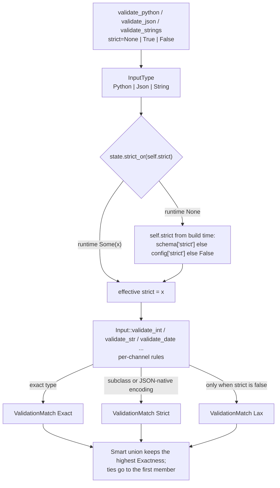

# Validation Modes in Pydantic v2: Lax Coercion vs Strict Mode (strict=True, StrictInt, StrictStr) and ConfigDict

> [!summary] Claim
> Strictness in Pydantic v2 is a single boolean that `pydantic-core` resolves per validator as "runtime argument, else the schema node's `strict` key, else the owning model's config", and each `Input` implementation (Python object, parsed JSON, or string mapping) interprets that boolean differently, so `strict=True` rejects `"2026-11-13"` for a `date` from `model_validate` but accepts it from `model_validate_json`.

Part of [Pydantic v2 Internals and Validation](README.md) in [API Engineering](../README.md).

## TL;DR

- Mechanism: every leaf validator calls an `Input::validate_<type>(strict)` method whose body differs per input channel, and returns a `ValidationMatch` tagged `Exact`, `Strict`, or `Lax` that smart unions use to pick a winner (`pydantic-core 2.50.4 src/input/input_abstract.rs, Input`; `src/validators/validation_state.rs, Exactness`).
- Contract rule: the effective flag is `state.strict_or(self.strict)`, which means a runtime `strict=` argument overrides `StrictInt`, `Field(strict=True)`, and `ConfigDict(strict=True)` in both directions (`pydantic-core 2.50.4 src/validators/validation_state.rs, ValidationState::strict_or`).
- Trap: FastAPI `0.162.0` parses a JSON body with `json.loads` and then calls `validate_python`, so a strict body model rejects every ISO date, UUID, and decimal string a client sends (`fastapi 0.162.0 fastapi/_compat/v2.py, ModelField.validate`).
- Portability fact: the coercion rules live in the compiled `pydantic-core` wheel, not in CPython, so the matrix in this note is a property of `pydantic-core 2.50.4`; the lab ran once, on CPython `3.14.6` on macOS arm64, and every other interpreter leg is recorded as not run.
- When not to use it: do not set `strict=True` on models fed from query strings, headers, environment variables, or `json.loads` output where everything arrives as `str`; use lax mode, `model_validate_strings`, or `model_validate_json` instead, and reserve strict mode for in-process Python boundaries and JSON validated in a single pass.

## Mental model



A validation call enters Rust with an optional `strict` argument and an `InputType` fixed by the entry point: `validate_python` is `Python`, `validate_json` is `Json`, and `validate_strings` is `String` (`pydantic-core 2.50.4 src/validators/mod.rs, SchemaValidator::validate_strings`).
Each validator node then computes its effective flag with `state.strict_or(self.strict)`, where `self.strict` was frozen at schema build time by `is_strict`, which reads the node's own `strict` key and falls back to the config dictionary passed to the builder (`pydantic-core 2.50.4 src/build_tools.rs, is_strict`).
The flag is handed to the input's `validate_*` method, which first tries an exact match, then a subclass or a JSON-native encoding (both tagged `Strict`), and only if the flag is false tries the lax conversions (tagged `Lax`).
Unions run every member with a fresh `Exact` state and keep the result whose exactness is highest, so the same tags that gate strict mode also decide which union member wins in lax mode.

## How it works

### Three exactness levels, two modes

`pydantic-core` defines `enum Exactness { Lax, Strict, Exact }` with derived `Ord`, so `Lax < Strict < Exact` (`pydantic-core 2.50.4 src/validators/validation_state.rs, Exactness`).
The `Input` trait documents the convention: "all types have three methods: `validate_*`, `strict_*`, `lax_*`", and a type either implements `strict_*` and `lax_*` separately or a single `validate_*` that takes the flag (`pydantic-core 2.50.4 src/input/input_abstract.rs, Input`).
A `ValidationMatch` carries the converted value plus its exactness (`pydantic-core 2.50.4 src/input/return_enums.rs, ValidationMatch`), and `floor_exactness` only ever lowers the running exactness, never raises it (`pydantic-core 2.50.4 src/validators/validation_state.rs, ValidationState::floor_exactness`).
Strict mode is therefore not a separate validator tree: the same `IntValidator` object runs, and the flag only prunes the lax branch of the input method.
For the common unconstrained case, `IntValidator::build` returns one of two process-wide singletons, `STRICT_INT_VALIDATOR` or `LAX_INT_VALIDATOR`, both `LazyLock<Arc<CombinedValidator>>` (`pydantic-core 2.50.4 src/validators/int.rs, IntValidator::build`).

### How strictness is resolved

There are four places to set strictness, and they collapse into two storage slots.

1. `StrictInt`, `StrictStr`, `StrictBool`, `StrictBytes`, and `StrictFloat` are plain aliases: `StrictInt = Annotated[int, Strict()]`, `StrictFloat = Annotated[float, Strict(True)]` (`pydantic 2.14.3 pydantic/types.py, StrictInt`, `StrictFloat`).
2. `Field(strict=True)` is translated through `FieldInfo.metadata_lookup`, which maps the `strict` keyword to `types.Strict`, so it produces the same metadata object as the alias (`pydantic 2.14.3 pydantic/fields.py, FieldInfo.metadata_lookup`).
3. `apply_known_metadata` writes that metadata into the core schema node as `schema['strict'] = True` when the node type is in `CONSTRAINTS_TO_ALLOWED_SCHEMAS['strict']`, which at runtime holds `28` schema types: `bool`, `bytes`, `complex`, `counter`, `date`, `datetime`, `decimal`, `deque`, `dict`, `enum`, `float`, `fraction`, `frozendict`, `frozenset`, `int`, `lax-or-strict`, `list`, `model`, `multi-host-url`, `ordered-dict`, `set`, `str`, `time`, `timedelta`, `tuple`, `typed-dict`, `url`, and `uuid` (`pydantic 2.14.3 pydantic/_internal/_known_annotated_metadata.py, constraint_schema_pairings`).
   For a `function-before`, `function-wrap`, or `function-after` node, `strict` is pushed into the inner `schema` rather than applied to the function node, which is why `Annotated[int, BeforeValidator(int), Strict()]` compiles to `{'type': 'function-before', ..., 'schema': {'type': 'int', 'strict': True}}` (`pydantic 2.14.3 pydantic/_internal/_known_annotated_metadata.py, apply_known_metadata`).
4. `ConfigDict(strict=True)` is copied into the `CoreConfig` by `ConfigWrapper.core_config`, which keeps only keys listed in `_config_dict_to_core_config_key`, where `'strict': 'strict'` maps straight through (`pydantic 2.14.3 pydantic/_internal/_config.py, ConfigWrapper.core_config`); the result is attached to the model schema as `config`, which the lab read back as `{'strict': True, 'title': ...}`.

At build time `is_strict(schema, config)` returns `schema['strict']` if the key is present, else `config['strict']`, else `False` (`pydantic-core 2.50.4 src/build_tools.rs, schema_or_config`).
That gives field-over-config precedence, which is how `Field(strict=False)` opts one field out of `ConfigDict(strict=True)`.
At run time the validator calls `state.strict_or(self.strict)`, whose body is `self.extra.strict.unwrap_or(default)` (`pydantic-core 2.50.4 src/validators/validation_state.rs, ValidationState::strict_or`).
The runtime value is an `Option<bool>` from the `strict=` keyword of `SchemaValidator::validate_python`, `validate_json`, and `validate_assignment` (`pydantic-core 2.50.4 src/validators/mod.rs, SchemaValidator::validate_python`), forwarded unchanged by `BaseModel.model_validate(obj, *, strict: bool | None = None, ...)` (`pydantic 2.14.3 pydantic/main.py, BaseModel.model_validate`).
The consequence, proven in the lab, is that `strict=False` at the call site re-enables coercion on a `StrictInt` field, and `strict=True` forces strict mode on every node in the tree, including nested models whose own config is lax.

### Config scope: which nodes a model's `strict` reaches

`ModelValidator::build` ignores the parent config and builds its fields with the config stored on its own schema; the source comment reads "models ignore the parent config and always use the config from this model" (`pydantic-core 2.50.4 src/validators/model.rs, ModelValidator::build`).
A nested `BaseModel` or Pydantic dataclass therefore keeps its own (default lax) config, while a `TypedDict` without `__pydantic_config__` has no config of its own and is built with the parent's, so it inherits `strict=True`.
The lab's `StrictTicket` shows exactly this split: under `strict=None`, only `td_leg.qty` rejects `"1"`; under runtime `strict=True`, all four fields fail.

Strict mode also treats nested containers differently.
`ModelFieldsValidator` calls `input.validate_model_fields(strict, from_attributes)`, which for Python input in strict mode accepts an exact `dict` or a `dict` subclass and rejects any other `Mapping` with `dict_type` (`pydantic-core 2.50.4 src/input/input_python.rs, strict_dict`), an error `ModelFieldsValidator` rewrites to `model_type` (`pydantic-core 2.50.4 src/validators/model_fields.rs, ModelFieldsValidator::validate_fields`), so a nested `BaseModel` accepts a plain `dict` even in strict mode.
`DataclassValidator::validate` instead has an explicit branch: if `state.strict_or(self.strict)` and the input type is `InputType::Python`, any non-instance raises `dataclass_exact_type` ("Input should be an instance of {class_name}") (`pydantic-core 2.50.4 src/validators/dataclass.rs, DataclassValidator::validate`).
The comment in `ModelValidator::validate` still says "if we're in strict mode, we require an exact instance of the class", but the code below it has no strict check: the lab shows a plain `dict` accepted for a nested model under runtime `strict=True` (the error lands on `model_leg.qty`, not on `model_leg`), and a probe run here showed a subclass instance accepted for a nested field of a `ConfigDict(strict=True)` model; treat the comment as stale.

### Python input: the per-type rules

All rules below are read from `pydantic-core 2.50.4 src/input/input_python.rs`, `impl Input for Bound<PyAny>`, and each example value was observed either in the lab tests or in probe scripts run against the lab environment on CPython `3.14.6`.

- `validate_int`: an exact `int` is `Exact`; an `int` subclass is upcast and tagged `Strict`, except `bool`, which is an error in strict mode and `Lax` otherwise.
  So `StrictInt` accepts `IntEnum` members and returns a plain `int`, and rejects `True`.
  Lax mode then tries, in order, `str` or UTF-8 `bytes` (`str_as_int`), an exact `float` (`float_as_int`), `Decimal` (`decimal_as_int`), `Fraction`, any object with `__float__`, and finally an `Enum` member's `.value`.
- `validate_float`: an exact `float` is `Exact`; lax mode parses `str` and `bytes` first; then any object that `extract::<f64>()` succeeds on is accepted as `Strict` in both modes, except `bool`.
  This is why `StrictFloat` accepts `1` and `Decimal("1.5")` from Python, matching the docs row `float, Any, strict=True ... Must implement __float__() or __index__()` (`pydantic 2.14.3 docs/plugins/conversion_table.py`).
- `validate_str`: an exact `str` is `Exact`; a `str` subclass is converted to a Rust string and tagged `Strict`, so `StrictStr` accepts a `StrEnum` member and returns a plain `str`.
  Lax mode adds `bytes` and `bytearray` (UTF-8, `string_unicode` on failure), numbers only when `coerce_numbers_to_str` is on (never `bool`), and `Enum` members via `.value`.
- `validate_bool`: only a real `bool` is accepted in strict mode; lax mode accepts the strings matched by `str_as_bool` (`"0"`, `"f"`, `"n"`, `"no"`, `"off"`, `"false"`, `"1"`, `"t"`, `"y"`, `"on"`, `"yes"`, `"true"`, ASCII case-insensitive, no whitespace trimming), the integers `0` and `1`, and floats that are exactly `0.0` or `1.0` (`pydantic-core 2.50.4 src/input/shared.rs, str_as_bool`, `int_as_bool`).
- `validate_bytes`: exact `bytes` or a subclass in strict mode; lax adds `bytearray` and `str`, which is decoded with the validator's `ValBytesMode`, built by `ValBytesMode::from_config` from the `val_json_bytes` key, so a `base64` setting also changes how Python `str` input is decoded (`pydantic-core 2.50.4 src/validators/bytes.rs, BytesValidator::build`; `src/validators/config.rs, ValBytesMode`).
- `validate_decimal`: strict accepts only `Decimal` instances and errors with `is_instance_of`; lax accepts `str`, non-`bool` `int`, `float` (via `str(float)`, so `1.1` becomes `Decimal('1.1')`, not the binary expansion), and a three-tuple `(sign, digits, exponent)`.
- `validate_date`: an exact `date` is `Exact`, a `datetime` instance is rejected at this layer (because `datetime` subclasses `date`, the next `PyDate` cast would accept it, and the source comment says "we don't want to return a datetime now"), and a `date` subclass is `Strict`; lax mode parses `str` and `bytes`.
  On any lax failure, `DateValidator::validate` floors exactness to `Lax` and retries through `date_from_datetime`, which validates the input as a lax `datetime` and accepts it only at exactly midnight (`pydantic-core 2.50.4 src/validators/date.rs, DateValidator::validate`, `date_from_datetime`); that is why `datetime(2026, 1, 1)` and the timestamp `0` become dates while `1700000000` fails with `date_from_datetime_inexact`.
- `validate_datetime` and `validate_time`: lax accepts `str`, `bytes`, `int`, and `float`, and explicitly rejects `bool`; for `datetime` a number is a Unix timestamp (seconds or milliseconds per `val_temporal_unit`) and a `date` is also accepted, while for `time` a number is seconds into the day, so `3600` becomes `time(1, 0, tzinfo=TzInfo(0))` in a probe run here.
- `validate_list`, `validate_tuple`, `validate_set`, `validate_frozenset`, `validate_deque`: strict accepts the container type or a subclass of it (the source uses `cast`, not `cast_exact`, so a `tuple` subclass passes strict `tuple` and comes out as a plain `tuple`), but never a different container (strict `set` rejects a `frozenset` with `set_type`); lax goes through `extract_sequence_iterable`, which accepts `list`, `tuple`, `set`, `frozenset`, and any iterable except `str`, `bytes`, `bytearray`, `dict`, and `Mapping`, so a generator is consumed into a list but `"ab"` is rejected with `list_type`.
- `strict_dict` versus `lax_dict`: strict accepts `dict` and `dict` subclasses, lax accepts any `Mapping`.

### Numeric string parsing details

`str_as_int` first tries `jiter`'s `NumberInt::try_from` on the raw bytes; on failure it runs `clean_int_str`, which trims whitespace, strips one leading `+`, strips leading zeros, removes a trailing `.0+` fractional part textually (so `"42.000"` is `42` without a lossy float round trip), and removes single underscores between digits, rejecting leading, trailing, or doubled underscores (`pydantic-core 2.50.4 src/input/shared.rs, clean_int_str`, `strip_underscores`).
Hex (`"0x2a"`) and exponent (`"1e3"`) strings fail with `int_parsing` from Python input, while the JSON number `1e3` is parsed by `jiter` as a float and then accepted by `float_as_int` as `1000`.
`float_as_int` rejects NaN and infinity with `finite_number`, any fractional part with `int_from_float`, and any magnitude outside the open interval `(i64::MIN as f64, i64::MAX as f64)` with `int_parsing_size`, so the exactly integral float `1e20` is rejected even though Python's `int(1e20)` succeeds (`pydantic-core 2.50.4 src/input/shared.rs, float_as_int`).
The source comment on `str_as_int` states that "max length of the input is 4300 which is checked by jiter", matching CPython's default `sys.int_info.default_max_str_digits` of `4300` (Python docs, "Integer string conversion length limitation"); the lab confirmed `4300` digits accepted and `4301` rejected with `int_parsing_size` from a Python string and `json_invalid` ("number out of range") from JSON.
`str_as_float` calls Rust's `str::trim().parse::<f64>()`, which accepts `"inf"`, `"nan"`, and `"infinity"`, then retries with underscores stripped (`pydantic-core 2.50.4 src/input/shared.rs, str_as_float`).

### JSON input: strict mode is looser by design

JSON has six value kinds (RFC 8259 Section 3), so a strict JSON validator that demanded "an instance of `date`" could never succeed.
`impl Input for JsonValue` therefore treats the JSON-native encoding of each type as a `Strict` match regardless of the flag (`pydantic-core 2.50.4 src/input/input_json.rs, impl Input for JsonValue`):

- `validate_date`, `validate_datetime`, `validate_time`, and `validate_timedelta` accept a JSON string in strict mode; the numeric timestamp forms are lax only.
- `validate_decimal` accepts a JSON string, integer, or float in strict mode (the float via its shortest `to_string()`, so `1.10` becomes `Decimal('1.1')` and `"1.10"` keeps `Decimal('1.10')`).
- `validate_bytes` ignores the flag (`_strict`) and decodes a JSON string per `val_json_bytes` (`utf8`, `base64`, or `hex`, default `utf8`) (`pydantic 2.14.3 pydantic/config.py, ConfigDict.val_json_bytes`).
- `validate_tuple`, `validate_set`, `validate_frozenset`, and `validate_deque` accept a JSON array in strict mode, each with a comment such as "we allow a list here since otherwise it would be impossible to create a set from JSON"; `validate_dict` ignores the flag entirely.
- `UUID` accepts a JSON string in strict mode; enums accept their JSON value in strict mode but not a string spelling of an integer value (`"1"` for an `IntEnum` fails with `enum`).
- `validate_float` accepts JSON integers as `Strict`, and `jiter` accepts the non-RFC tokens `NaN` and `Infinity`, which pass strict `float` unless `allow_inf_nan=False` (default `True`) (`pydantic-core 2.50.4 src/validators/float.rs, FloatValidator`), even though RFC 8259 Section 6 says such values "are not permitted".
- `validate_int` rejects JSON `true` and `42.0` in strict mode; `validate_str` rejects JSON numbers in strict mode even with `coerce_numbers_to_str`.

JSON `validate_str` returns `Strict`, not `Exact`, with the comment "in JSON strings can also represent other datatypes such as UUID and date more exactly, so string is a converting input" and a `TODO` for v3.
That one tag has a visible effect on unions: for JSON `"2026-01-01"`, both `str` and `date` match at `Strict`, the smart union keeps the first strictly better result, and so `date | str` yields a `date` while `str | date` yields a `str`; from Python the `str` member is `Exact` and wins in both orders (`pydantic-core 2.50.4 src/validators/union.rs, UnionValidator::validate_smart`).

### String input and the `lax-or-strict` and `json-or-python` nodes

`validate_strings` builds a `StringMapping` input whose `validate_int`, `validate_bool`, and `validate_str` ignore the flag (`_strict`) and return `Strict` matches via `str_as_int` and `str_as_bool` (`pydantic-core 2.50.4 src/input/input_string.rs, impl Input for StringMapping`).
`model_validate_strings({"qty": "5"}, strict=True)` therefore succeeds on a `StrictInt` field, which makes it the correct entry point for query strings, headers, and environment variables.
Two schema nodes let a type pick different validators per mode or per channel.
`LaxOrStrictValidator` holds a `lax_validator` and a `strict_validator`, dispatches on `state.strict_or(self.strict)`, and, inside a smart union, tries the strict validator first even in lax mode and floors exactness to `Lax` if it fails (`pydantic-core 2.50.4 src/validators/lax_or_strict.rs, LaxOrStrictValidator::validate`).
`JsonOrPython` dispatches on `state.extra().input_type`, sending `InputType::Python` to one validator and everything else, including `String`, to the JSON one (`pydantic-core 2.50.4 src/validators/json_or_python.rs, JsonOrPython::validate`); custom types use these through `core_schema.lax_or_strict_schema` and `core_schema.json_or_python_schema`, covered in [[Low-Level-Custom-Types-with-Get-Pydantic-Core-Schema]].

### The HTTP edge: FastAPI feeds Python objects

In FastAPI `0.162.0`, `get_request_handler` reads `await request.body()`, and if the `Content-Type` is `application/json` or `application/*+json` it calls `await request.json()` (`fastapi 0.162.0 fastapi/routing.py, get_request_handler`), which Starlette implements as `json.loads(body)` (`starlette 1.10.0 starlette/requests.py, Request.json`).
The decoded `dict` is validated by `ModelField.validate`, which calls `self._type_adapter.validate_python(value, from_attributes=True)` (`fastapi 0.162.0 fastapi/_compat/v2.py, ModelField.validate`).
The body is thus `InputType::Python`, and every JSON-only strict allowance above is lost: the lab's strict `StrictTrade` body returns `422` with `date_type` at `["body", "trade_date"]` for a well-formed ISO date, while a route that calls `StrictTrade.model_validate_json(await request.body())` accepts the same bytes.
The single-pass route also skips building the intermediate `dict`, which [[Single-Pass-JSON-Validation-Model-Validate-JSON-vs-JSON-Loads]] measures.

## Numbers and limits

| Metric or parameter | Value | Source or measurement condition |
|---|---|---|
| Exactness levels | `3` (`Lax < Strict < Exact`) | `pydantic-core 2.50.4 src/validators/validation_state.rs, Exactness` |
| Places strictness is stored | `2` at build time (schema node `strict`, then config `strict`) plus `1` runtime `Option<bool>` that overrides both | `pydantic-core 2.50.4 src/build_tools.rs, schema_or_config`; `src/validators/validation_state.rs, ValidationState::strict_or` |
| Core schema types that accept a `strict` key directly | `28` | `len(CONSTRAINTS_TO_ALLOWED_SCHEMAS['strict'])` printed `28` in the lab venv (`pydantic 2.14.3 pydantic/_internal/_known_annotated_metadata.py, constraint_schema_pairings`); any other node type gets `strict` pushed into an inner schema or a wrapping validator |
| Lax `bool` string spellings | `12` (`6` false, `6` true), ASCII case-insensitive, no whitespace trim | `pydantic-core 2.50.4 src/input/shared.rs, str_as_bool`; lab: `"  true"` gives `bool_parsing` |
| Lax `int` from string, max digits | `4300` accepted, `4301` rejected (`int_parsing_size` from Python, `json_invalid` from JSON) | Lab run on CPython `3.14.6`, macOS `27.3` arm64, `pydantic 2.14.3`; CPython default `sys.int_info.default_max_str_digits == 4300`, minimum configurable `640` (Python docs, as of 2026-11) |
| Lax `int` from float, magnitude bound | open interval `(i64::MIN as f64, i64::MAX as f64)`, about `9.22e18`; `1e20` gives `int_parsing_size` | `pydantic-core 2.50.4 src/input/shared.rs, float_as_int`; lab |
| JSON interoperable integer range | `[-(2**53)+1, (2**53)-1]` | RFC 8259 Section 6 |
| CPython quadratic `int(str)` cost that motivated the digit cap | `50` ms for `100,000` digits, `5` s for `1,000,000` digits; CVSS 3.1 `7.5` | GHSA-6jr7-xr67-mgxw (CVE-2020-10735), as quoted in the advisory |
| Pydantic v1 lax date parsing of `"infinity"` | infinite loop at `100%` of one CPU; fixed in `1.8.2`, `1.7.4`, `1.6.2`; CVSS 3.1 `3.3` | GHSA-5jqp-qgf6-3pvh (CVE-2021-29510) |
| Lab test module runtime | `8 passed in 0.38s` (one verifier run; the drafter's run reported `0.49s`) | `uv run --frozen pytest tests/f09_pydantic_v2_internals_and_validation/test_lax_vs_strict_validation_modes_and_coercion_tables.py -q`, CPython `3.14.6`, macOS `27.3` arm64 (`uname -r` `27.3.0`) (as of 2026-11) |

## Portability

The lab ran once, on the workspace interpreter; per the job instructions no other leg was executed, so every other row cites a source and says "not run".

| Runtime / Component | Behavior and compatibility | Verification source |
|---|---|---|
| CPython `3.14.6` (macOS `27.3` arm64) | All `8` lab tests pass; the full coercion matrix in the Worked example is this run's output | Ran: `uv run --frozen pytest <module> -q` -> `8 passed in 0.38s` |
| CPython `3.12.16`, `3.13.18`, `3.14.10`, `3.15.2` | Expected identical: the coercion code is compiled Rust in `pydantic-core`, and `pydantic 2.14.3` declares `Requires-Python: >=3.10` with classifiers through `3.15` | Not run; `pydantic-2.14.3.dist-info/METADATA` |
| Free-threaded `3.15.2t` | `pydantic 2.14.3` changelog lists "Add experimental support for free threading" (`#11516`) and "Fix race conditions in freethreaded build" (`#13785`); the validators in this note hold no mutable shared state beyond the `LazyLock` singletons | Not run; `pydantic-2.14.3.dist-info/METADATA`; `pydantic-core 2.50.4 src/validators/int.rs, STRICT_INT_VALIDATOR` |
| `pydantic-core` classifiers | `pydantic_core 2.50.4` lists Python classifiers `3.10` through `3.14` only, while `pydantic 2.14.3` lists through `3.15`; the installed wheel tag here is `cp314-cp314-macosx_11_0_arm64` | Read from the installed `dist-info` files |
| `enum.StrEnum` in the lab | The lab's `Side` uses `enum.StrEnum`, which does not exist on CPython `3.10` | Python docs, `enum.StrEnum`: "Added in version 3.11"; the matrix floor (`3.12`) is unaffected |
| FastAPI `0.162.0`, Starlette `1.10.0` | JSON bodies reach Pydantic as Python objects via `json.loads`, so strict-mode JSON allowances never apply to body parameters | `fastapi 0.162.0 fastapi/routing.py, get_request_handler`; `fastapi/_compat/v2.py, ModelField.validate`; lab test over `httpx.ASGITransport` |
| HTTP/1.1, HTTP/2, HTTP/3; Uvicorn, Hypercorn, Granian | Transport-independent: validation runs after the ASGI app has buffered the full body | Not run; follows from `await request.body()` preceding validation in `get_request_handler` |

## Worked example

The lab [implementation](../labs/src/api_labs/f09_pydantic_v2_internals_and_validation/coercion_matrix.py) builds a fourteen-row coercion matrix by validating the same logical value as a Python object and as a JSON document, each in lax (`strict=None`) and strict (`strict=True`) mode.
It also defines the models that prove precedence (`FieldStrictOrder`), config scope (`StrictTicket`), the before-validator escape hatch (`ParsedQty`), and the FastAPI edge (`build_trade_app`).
The [test](../labs/tests/f09_pydantic_v2_internals_and_validation/test_lax_vs_strict_validation_modes_and_coercion_tables.py) asserts every cell.

### Implementation (`labs/src/api_labs/f09_pydantic_v2_internals_and_validation/coercion_matrix.py`)

```python
"""Measure Pydantic v2 lax versus strict coercion across Python and JSON input."""

from __future__ import annotations

import enum
from dataclasses import dataclass
from datetime import date
from decimal import Decimal
from typing import Annotated, Any, Final, TypedDict
from uuid import UUID

from fastapi import FastAPI, Request
from fastapi.exceptions import RequestValidationError
from pydantic import (
    BaseModel,
    BeforeValidator,
    ConfigDict,
    Field,
    Strict,
    StrictInt,
    StrictStr,
    TypeAdapter,
    ValidationError,
)
from pydantic.dataclasses import dataclass as pydantic_dataclass

ORDER_ID: Final = "12345678-1234-5678-1234-567812345678"


def outcome(adapter: TypeAdapter[Any], value: Any, *, json_input: bool, strict: bool | None) -> str:
    """Return `type:repr` on success or `!error_type` for the first error."""
    try:
        if json_input:
            result = adapter.validate_json(value, strict=strict)
        else:
            result = adapter.validate_python(value, strict=strict)
    except ValidationError as exc:
        return "!" + str(exc.errors(include_url=False)[0]["type"])
    return f"{type(result).__name__}:{result!r}"


@dataclass(frozen=True, slots=True)
class MatrixRow:
    """One target type and input fed through both input channels in both modes."""

    python_lax: str
    python_strict: str
    json_lax: str
    json_strict: str


def coercion_row(target: Any, python_value: Any, json_text: str) -> MatrixRow:
    """Validate the same logical value as a Python object and as a JSON document."""
    adapter: TypeAdapter[Any] = TypeAdapter(target)
    return MatrixRow(
        python_lax=outcome(adapter, python_value, json_input=False, strict=None),
        python_strict=outcome(adapter, python_value, json_input=False, strict=True),
        json_lax=outcome(adapter, json_text, json_input=True, strict=None),
        json_strict=outcome(adapter, json_text, json_input=True, strict=True),
    )


COERCION_CASES: Final[dict[str, tuple[Any, Any, str]]] = {
    "int <- '42'": (int, "42", '"42"'),
    "int <- 42.0": (int, 42.0, "42.0"),
    "int <- 42.5": (int, 42.5, "42.5"),
    "int <- True": (int, True, "true"),
    "float <- 1": (float, 1, "1"),
    "float <- '1.5'": (float, "1.5", '"1.5"'),
    "str <- 42": (str, 42, "42"),
    "bool <- 'yes'": (bool, "yes", '"yes"'),
    "bool <- 2": (bool, 2, "2"),
    "date <- '2026-11-13'": (date, "2026-11-13", '"2026-11-13"'),
    "UUID <- str": (UUID, ORDER_ID, f'"{ORDER_ID}"'),
    "Decimal <- '1.10'": (Decimal, "1.10", '"1.10"'),
    "bytes <- 'abc'": (bytes, "abc", '"abc"'),
    "tuple <- list": (tuple[int, ...], [1, 2], "[1,2]"),
}


def build_matrix() -> dict[str, MatrixRow]:
    """Compute the four-cell coercion row for every case in `COERCION_CASES`."""
    return {name: coercion_row(*case) for name, case in COERCION_CASES.items()}


class Venue(enum.IntEnum):
    """An `int` subclass: strict `int` accepts it because it passes `isinstance(v, int)`."""

    NASDAQ = 1


class Side(enum.StrEnum):
    """A `str` subclass: strict `str` accepts it and returns a plain `str`."""

    BUY = "buy"


class FieldStrictOrder(BaseModel):
    """Field-level strictness via `StrictInt`, `StrictStr`, and `Field(strict=True)`."""

    qty: StrictInt
    symbol: StrictStr
    limit_ticks: int = Field(default=0, strict=True)


def model_outcome(
    model_cls: type[BaseModel], data: Any, *, strict: bool | None
) -> dict[str, Any] | list[tuple[tuple[int | str, ...], str]]:
    """Return `model_dump()` on success, else `(loc, type)` pairs for every error."""
    try:
        return model_cls.model_validate(data, strict=strict).model_dump()
    except ValidationError as exc:
        return [(err["loc"], err["type"]) for err in exc.errors(include_url=False)]


class LegDict(TypedDict):
    """A TypedDict has no config of its own, so it inherits the parent's `strict`."""

    qty: int


class LegModel(BaseModel):
    """A nested BaseModel keeps its own (lax) config."""

    qty: int


@pydantic_dataclass
class LegDataclass:
    """A Pydantic dataclass keeps its own (lax) config."""

    qty: int


class StrictTicket(BaseModel):
    """`ConfigDict(strict=True)` reaches only the fields this model's config governs."""

    model_config = ConfigDict(strict=True)

    td_leg: LegDict
    model_leg: LegModel
    dc_leg: LegDataclass
    override: int = Field(default=0, strict=False)


ParsedQty = Annotated[int, BeforeValidator(int), Strict()]
"""Strict is applied to the inner `int` schema; the before-validator runs first."""


class StrictTrade(BaseModel):
    """A strict body whose `date` field only accepts strings from JSON input."""

    model_config = ConfigDict(strict=True)

    trade_date: date
    qty: int


def build_trade_app() -> FastAPI:
    """Two routes: FastAPI's `json.loads` path and a single-pass `model_validate_json` path."""
    app = FastAPI()

    @app.post("/v1/trades/parsed")
    async def parsed(trade: StrictTrade) -> dict[str, str]:
        return {"trade_date": trade.trade_date.isoformat()}

    @app.post("/v1/trades/raw")
    async def raw(request: Request) -> dict[str, str]:
        try:
            trade = StrictTrade.model_validate_json(await request.body())
        except ValidationError as exc:
            raise RequestValidationError(exc.errors(include_url=False)) from exc
        return {"trade_date": trade.trade_date.isoformat()}

    return app
```

### The measured matrix

Each cell is `type:repr` on success or `!error_type`, exactly as the lab's `outcome` function prints it.

| Case | Python lax | Python strict | JSON lax | JSON strict |
|---|---|---|---|---|
| `int <- '42'` | `int:42` | `!int_type` | `int:42` | `!int_type` |
| `int <- 42.0` | `int:42` | `!int_type` | `int:42` | `!int_type` |
| `int <- 42.5` | `!int_from_float` | `!int_type` | `!int_from_float` | `!int_type` |
| `int <- True` | `int:1` | `!int_type` | `int:1` | `!int_type` |
| `float <- 1` | `float:1.0` | `float:1.0` | `float:1.0` | `float:1.0` |
| `float <- '1.5'` | `float:1.5` | `!float_type` | `float:1.5` | `!float_type` |
| `str <- 42` | `!string_type` | `!string_type` | `!string_type` | `!string_type` |
| `bool <- 'yes'` | `bool:True` | `!bool_type` | `bool:True` | `!bool_type` |
| `bool <- 2` | `!bool_parsing` | `!bool_type` | `!bool_parsing` | `!bool_type` |
| `date <- '2026-11-13'` | `date:datetime.date(2026, 11, 13)` | `!date_type` | `date:datetime.date(2026, 11, 13)` | `date:datetime.date(2026, 11, 13)` |
| `UUID <- str` | `UUID:UUID('1234...5678')` | `!is_instance_of` | `UUID:UUID('1234...5678')` | `UUID:UUID('1234...5678')` |
| `Decimal <- '1.10'` | `Decimal:Decimal('1.10')` | `!is_instance_of` | `Decimal:Decimal('1.10')` | `Decimal:Decimal('1.10')` |
| `bytes <- 'abc'` | `bytes:b'abc'` | `!bytes_type` | `bytes:b'abc'` | `bytes:b'abc'` |
| `tuple <- list` | `tuple:(1, 2)` | `!tuple_type` | `tuple:(1, 2)` | `tuple:(1, 2)` |

The UUID cells are shortened here; the test asserts the full `12345678-1234-5678-1234-567812345678`.
The five rows where Python strict fails but JSON strict succeeds (`Decimal`, `UUID`, `bytes`, `date`, `tuple`) are exactly the types whose JSON encoding is a string or an array, and the test asserts that set.

### Test (simplified excerpt)

```python
@pytest.mark.unit
def test_runtime_strict_argument_overrides_field_strictness_both_ways() -> None:
    data = {"qty": "5", "symbol": b"AAPL", "limit_ticks": "3"}
    assert model_outcome(FieldStrictOrder, data, strict=None) == [
        (("qty",), "int_type"),
        (("symbol",), "string_type"),
        (("limit_ticks",), "int_type"),
    ]
    assert model_outcome(FieldStrictOrder, data, strict=False) == {
        "qty": 5,
        "symbol": "AAPL",
        "limit_ticks": 3,
    }


@pytest.mark.unit
def test_config_strict_scope_versus_runtime_strict() -> None:
    data = {"td_leg": {"qty": "1"}, "model_leg": {"qty": "1"}, "dc_leg": {"qty": "1"}, "override": "5"}
    assert model_outcome(StrictTicket, data, strict=None) == [(("td_leg", "qty"), "int_type")]
    assert model_outcome(StrictTicket, data, strict=True) == [
        (("td_leg", "qty"), "int_type"),
        (("model_leg", "qty"), "int_type"),
        (("dc_leg",), "dataclass_exact_type"),
        (("override",), "int_type"),
    ]


@pytest.mark.unit
@pytest.mark.asyncio
async def test_fastapi_body_is_python_input_so_strict_date_rejects_iso_string() -> None:
    app = build_trade_app()
    transport = httpx.ASGITransport(app=app)
    async with httpx.AsyncClient(transport=transport, base_url="http://test") as client:
        body = {"trade_date": "2026-11-13", "qty": 3}
        parsed = await client.post("/v1/trades/parsed", json=body)
        assert parsed.status_code == 422
        detail = parsed.json()["detail"][0]
        assert (detail["type"], detail["loc"]) == ("date_type", ["body", "trade_date"])

        raw = await client.post("/v1/trades/raw", json=body)
        assert (raw.status_code, raw.json()) == (200, {"trade_date": "2026-11-13"})
```

The full module also covers the subclass rules (`IntEnum` -> `int`, `StrEnum` -> `str`, `True` rejected), the numeric edges (`" 42 "`, `"4_2"`, `"042"`, `"42.000"` accepted; `"0x2a"`, `"1e3"`, `1e20`, `inf`, and `4301` digits rejected), the JSON union order effect, `model_validate_strings` under `strict=True`, and the `BeforeValidator` escape hatch.

### Captured run

Command from `labs/`, CPython `3.14.6` (`3.14.6 (main, Jun 23 2026, 15:46:31) [Clang 22.1.3 ]`), `macOS-27.3-arm64-arm-64bit-Mach-O`, `pydantic 2.14.3`, `pydantic-core 2.50.4`, `fastapi 0.162.0`, `starlette 1.10.0`:

```text
$ uv run --frozen pytest tests/f09_pydantic_v2_internals_and_validation/test_lax_vs_strict_validation_modes_and_coercion_tables.py -q
........                                                                 [100%]
8 passed in 0.38s
```

## Pitfalls

> [!warning] A call-site `strict=False` silently disables `StrictInt`
> Trigger: a shared helper such as `def parse(model, data, strict=False): return model.model_validate(data, strict=strict)` is used for a model whose money or quantity fields are `StrictInt`.
> Symptom: `"5"` and `True` are accepted as `5` and `1`, because `state.strict_or(self.strict)` prefers the runtime `Some(false)` over the field's `strict=True` (`pydantic-core 2.50.4 src/validators/validation_state.rs, ValidationState::strict_or`).
> Fix: default wrappers to `strict: bool | None = None`, never `False`, and grep for `strict=False` at call sites; the lab's `test_runtime_strict_argument_overrides_field_strictness_both_ways` pins the behavior.

> [!warning] Strict body models reject every ISO date, UUID, and decimal string in FastAPI
> Trigger: `model_config = ConfigDict(strict=True)` on a request body model with `date`, `datetime`, `UUID`, or `Decimal` fields, served by FastAPI `0.162.0`.
> Symptom: every request returns `422` with `date_type`, `is_instance_of`, or `datetime_type`, because the body was decoded by `json.loads` and validated with `validate_python` (`fastapi 0.162.0 fastapi/_compat/v2.py, ModelField.validate`).
> Fix: keep the body model lax and mark only the fields that must not coerce with `StrictInt` or `StrictBool`, or accept `Request` and call `model_validate_json(await request.body())`, converting `ValidationError` into `RequestValidationError` as the lab's `/v1/trades/raw` route does.

> [!warning] `ConfigDict(strict=True)` does not reach nested models or dataclasses
> Trigger: a strict parent model with fields typed as other `BaseModel` classes or Pydantic dataclasses that do not set `strict` themselves.
> Symptom: `{"model_leg": {"qty": "1"}}` validates with `qty == 1` inside a "strict" model, while a `TypedDict` field in the same model rejects the same input (`pydantic-core 2.50.4 src/validators/model.rs, ModelValidator::build`).
> Fix: put `strict=True` on a shared base model's config, or validate with a runtime `strict=True`, and test one nested field per model in CI.

> [!warning] JSON smart unions of `str` and a string-encoded type depend on member order
> Trigger: `field: date | str` or `UUID | str` validated from JSON.
> Symptom: JSON `"2026-01-01"` becomes a `date` with `date | str` but a `str` with `str | date`, while Python input yields `str` in both orders, because JSON strings are tagged `Strict`, not `Exact` (`pydantic-core 2.50.4 src/input/input_json.rs, validate_str`).
> Fix: use a discriminated union or `Field(union_mode="left_to_right")` to make the order explicit; see [[Discriminated-Unions-Tag-and-Callable-Discriminator-Dispatch]].

> [!warning] "Strict" is not "exact type"
> Trigger: relying on `StrictInt` or `StrictStr` to keep enum members out of a field.
> Symptom: `IntEnum` and `StrEnum` members pass because they are `int` and `str` subclasses, and they come out as plain `int` and `str`, losing the enum identity (`pydantic-core 2.50.4 src/input/input_python.rs, validate_int`, `validate_str`).
> Fix: if the exact type matters, add an `AfterValidator` that checks `type(v) is int`, or type the field as the enum.

> [!warning] A `BeforeValidator` runs ahead of `Strict()`
> Trigger: `Annotated[int, BeforeValidator(int), Strict()]` or a `@field_validator(mode="before")` that normalizes input.
> Symptom: `"7"` is accepted because `apply_known_metadata` pushes `strict` into the inner schema of the `function-before` node, and the before function has already produced an `int` (`pydantic 2.14.3 pydantic/_internal/_known_annotated_metadata.py, apply_known_metadata`).
> Fix: this is the intended escape hatch for one field; do not mistake it for strict validation of the raw input, and see [[Functional-Validators-Before-After-Wrap-and-Plain]].

> [!warning] Lax temporal parsing is an attack surface with a CVE history
> Trigger: Pydantic v1 `date` or `datetime` fields receiving `"infinity"`, `"inf"`, or `float("inf")`.
> Symptom: validation ran forever at `100%` of one CPU (GHSA-5jqp-qgf6-3pvh, CVE-2021-29510, fixed in `1.8.2`, `1.7.4`, and `1.6.2`).
> Fix: on v2, lax `float_as_int` rejects non-finite input with `finite_number`, and in a probe run here on `pydantic 2.14.3` the `date` and `datetime` validators rejected `"infinity"`, `"inf"`, and `float("inf")` promptly with `date_from_datetime_parsing`, `datetime_from_date_parsing`, or `datetime_parsing`; still treat every lax conversion path as parser code reachable by untrusted input and keep `pydantic` current.

## Security and robustness

- Threat model: lax coercion is a parser that runs on attacker-controlled input; every conversion it adds (string to number, number to bool, timestamp to date) is extra reachable code and extra ambiguity between layers.
- Type confusion across layers: a lax model accepts `"1"`, `1`, `1.0`, `True`, and `Decimal("1")` as the same `int`, but a cache key, idempotency key, or signature computed over the raw body sees five different values; canonicalize after validation, never before.
- Resource consumption (OWASP API4:2023 Unrestricted Resource Consumption): the `4300`-digit cap on integer strings inherits CPython's defense against CVE-2020-10735, whose advisory quotes `5` s to parse `1,000,000` digits; also cap request body size at the server, because the cap applies per number, not per document.
- Non-standard JSON: `jiter` accepts `NaN` and `Infinity`, which RFC 8259 Section 6 says "are not permitted", and they pass even strict `float`; set `allow_inf_nan=False` on money and measurement fields, which the lab's probe showed raises `finite_number`.
- Duplicate keys: RFC 8259 Section 4 says names "SHOULD be unique"; `model_validate_json('{"a":1,"a":2}')` on a strict model returned `a=2` in a probe run here, so the last value wins and strict mode does not detect duplicates.
- Mass assignment (OWASP API3:2023 Broken Object Property Level Authorization): strictness controls value types, not which keys are accepted; pair it with `extra="forbid"`, covered in [[Defeating-BOPLA-and-Mass-Assignment-API3-2023-Strict-Input-Output-Schemas]].
- Unsafe consumption (OWASP API10:2023 Unsafe Consumption of APIs): validating upstream responses in lax mode hides contract drift such as a provider switching an `id` from number to string; validate upstream JSON with `model_validate_json(..., strict=True)` so drift fails loudly.
- Defense in depth: lax at the edge for strings you cannot control (query, headers, env), strict for internal Python boundaries and single-pass JSON, and explicit after-validators for domain invariants that types cannot express.

## The principal's view

The decision is not "strict or lax" globally; it is where in the system each input channel is converted, and who owns the conversion table.
Lax mode is a published, versioned coercion table owned by `pydantic-core`; adopting it means accepting that a minor release can change what your API accepts, so pin `pydantic-core` and keep a coercion-matrix test like this lab's in CI to make such changes visible in a diff.
Strict mode moves the conversion responsibility to the caller, which is right for internal service-to-service contracts and wrong for public endpoints whose clients send strings for everything.
Because the runtime `strict` argument overrides every declaration, the real control point is the call site, so platform teams should own one validation wrapper per channel (HTTP body via `model_validate_json`, query and headers via `model_validate_strings`, internal calls via `model_validate(..., strict=True)`) instead of letting each team set flags ad hoc.
The organizational trade-off is migration cost: turning on strict mode for an existing API rejects traffic that worked yesterday, and the Pydantic docs themselves warn that "inputs that were being quietly coerced will start failing" (`pydantic 2.14.3 docs/concepts/strict_mode.md`); roll it out by logging lax-only matches first.
Choose a different tool when the contract should be the wire schema itself: `msgspec` and Protocol Buffers decode into a fixed schema with no Python-object input channel to reconcile, which removes the Python-versus-JSON asymmetry entirely; see [[Pydantic-v2-Performance-Engineering-vs-MsgSpec-and-ORJSON]].

## Interview questions

> [!question] L5: What is the difference between `StrictInt` and `int` with `ConfigDict(strict=True)`?
>
> > [!success]- Answer
> > `StrictInt` writes `strict: True` into that field's `int` schema node, while `ConfigDict(strict=True)` sets `strict` in the model's core config.
> > `pydantic-core` reads the node key first and falls back to the config, so a field-level `Field(strict=False)` can opt out of a strict config.
> > Both are overridden by a runtime `strict=` argument.
> >
> > Follow-up: Which nested field types inherit a parent model's `ConfigDict(strict=True)`, and which do not?

> [!question] L5: Predict the output: `TypeAdapter(date).validate_python("2026-11-13", strict=True)` and `TypeAdapter(date).validate_json('"2026-11-13"', strict=True)`.
>
> > [!success]- Answer
> > The first raises `ValidationError` with type `date_type`.
> > The second returns `datetime.date(2026, 11, 13)`.
> > The JSON `Input` implementation treats a JSON string as the native, `Strict`-level encoding of a date because JSON has no date type.
> >
> > Follow-up: What does `TypeAdapter(Decimal).validate_json("1.10", strict=True)` return, and why does it differ from `'"1.10"'`?

> [!question] L5: Which strings does lax `bool` accept, and does it trim whitespace?
>
> > [!success]- Answer
> > It accepts `"0"`, `"f"`, `"n"`, `"no"`, `"off"`, `"false"` as `False` and `"1"`, `"t"`, `"y"`, `"on"`, `"yes"`, `"true"` as `True`, ASCII case-insensitive.
> > It does not trim, so `"  true"` fails with `bool_parsing`.
> > Integers `0` and `1` and floats `0.0` and `1.0` are also accepted; `2` fails with `bool_parsing`.
> >
> > Follow-up: Why might `"off"` being `False` surprise someone validating a feature-flag query parameter?

> [!question] L6: Debug this API: why does a FastAPI endpoint with a strict body model return `422` `date_type` for `{"trade_date": "2026-11-13"}` when `Model.model_validate_json` on the same bytes succeeds in a unit test, and what are the fixes?
>
> > [!success]- Answer
> > FastAPI `0.162.0` decodes the body with `json.loads` and calls `TypeAdapter.validate_python`, so the input channel is Python, where strict `date` requires a `date` instance.
> > The unit test used the JSON channel, where a string is the strict encoding of a date.
> > Fix by keeping the model lax and using `StrictInt`-style annotations only on fields that must not coerce, or by reading `Request.body()` and calling `model_validate_json`, re-raising failures as `RequestValidationError`.
> >
> > Follow-up: What else do you gain from the single-pass `model_validate_json` route besides correct strict semantics?

> [!question] L6: A helper calls `model.model_validate(data, strict=False)` on a model that declares `qty: StrictInt`; what happens with `{"qty": "5"}`?
>
> > [!success]- Answer
> > It validates to `qty=5`.
> > Each validator computes `state.strict_or(self.strict)`, which is `runtime.unwrap_or(build_time)`, so a runtime `Some(false)` beats the field's `strict=True`.
> > The helper should default to `strict=None` so declarations apply.
> >
> > Follow-up: Which entry point ignores `strict` entirely, and when is that the right choice?

> [!question] L6: Why does `float_as_int` reject `1e20` even though it is an integral float?
>
> > [!success]- Answer
> > `float_as_int` only converts floats strictly inside `(i64::MIN as f64, i64::MAX as f64)` and returns `int_parsing_size` otherwise.
> > The bound is the `i64` fast path: the integral float is cast with `float as i64`, so anything outside that range is refused rather than saturated, which makes it an implementation limit, not a mathematical one.
> > Floats lose integer precision well before that: above `2**53` they cannot represent consecutive integers, so `9.2e18` is accepted but may not be the integer the sender wrote.
> > RFC 8259 Section 6 only promises interoperable integers in `[-(2**53)+1, (2**53)-1]`.
> >
> > Follow-up: How would you accept a 20-digit integer from JSON safely?

> [!question] L7+: In lax mode, how does a smart union of `int | str` choose a member for Python input `"1"`, and why does `date | str` behave differently for JSON input?
>
> > [!success]- Answer
> > Each member runs with exactness reset to `Exact`; `int` succeeds with `Lax` and `str` succeeds with `Exact`, and an `Exact` success with no fields-set count returns immediately, so the result is `"1"`.
> > For JSON, `str` is tagged `Strict`, not `Exact`, and `date` from a JSON string is also `Strict`.
> > Ties keep the earlier member because the comparison is strictly greater, so member order decides.
> >
> > Follow-up: How does `LaxOrStrictValidator` participate in this exactness protocol when the union itself is in lax mode?

> [!question] L7+: As the owner of the platform validation layer for 200 services, how do you introduce strict mode without breaking clients?
>
> > [!success]- Answer
> > Define one wrapper per input channel so the runtime `strict` argument is set centrally, because it overrides every declaration.
> > First deploy in observe mode: validate strictly in a shadow path, log the lax-only matches by field and client, and keep serving the lax result.
> > Then flip internal JSON and Python boundaries to strict, keep query, header, and env channels on `model_validate_strings`, and keep a pinned coercion-matrix test so `pydantic-core` upgrades show up as diffs.
> >
> > Follow-up: What would make you choose a schema-first decoder like `msgspec` or Protocol Buffers instead?

> [!question] L7+: Why is a nested `BaseModel` allowed to receive a `dict` under strict mode while a Pydantic dataclass is not?
>
> > [!success]- Answer
> > `ModelFieldsValidator` uses `validate_model_fields`, whose strict branch accepts `dict` and `dict` subclasses, so the model is built from a mapping.
> > `DataclassValidator::validate` has an explicit branch that, in strict mode with Python input, rejects any non-instance with `dataclass_exact_type`.
> > The comment in `ModelValidator::validate` claims strict requires an exact instance, but the code and the lab show otherwise.
> >
> > Follow-up: What does strict mode do with a `collections.UserDict` passed to a model, and why?

## Related

Prerequisites: [[Pydantic-v2-Architecture-CoreSchema-and-Rust-Pydantic-Core]]

Next: [[Single-Pass-JSON-Validation-Model-Validate-JSON-vs-JSON-Loads]]

See also: [[02-Programming-Languages/Python/Python-Backend-Interview-Prep/04-FastAPI]], [[TypeAdapter-for-Validating-and-Serializing-Arbitrary-Types]], [[Functional-Validators-Before-After-Wrap-and-Plain]], [[Discriminated-Unions-Tag-and-Callable-Discriminator-Dispatch]], [[Low-Level-Custom-Types-with-Get-Pydantic-Core-Schema]], [[Pydantic-Settings-Environment-Secret-Files-and-Source-Priority]], [[Migrating-Large-Codebases-from-Pydantic-v1-to-v2]], [[Request-Parameter-Validation-Path-Query-Header-Cookie-and-Body-Models]], [[Exception-Handling-in-FastAPI-HTTPException-vs-RequestValidationError]], [[Defeating-BOPLA-and-Mass-Assignment-API3-2023-Strict-Input-Output-Schemas]], [[OWASP-API-Security-Top-10-2023-Complete-Threat-Model]]

- Lab: `labs/tests/f09_pydantic_v2_internals_and_validation/test_lax_vs_strict_validation_modes_and_coercion_tables.py`

## Further reading

- [pydantic-core `input_python.rs` at v2.14.3](https://github.com/pydantic/pydantic/blob/v2.14.3/pydantic-core/src/input/input_python.rs): the authoritative per-type lax and strict rules for Python input.
- [pydantic-core `input_json.rs` at v2.14.3](https://github.com/pydantic/pydantic/blob/v2.14.3/pydantic-core/src/input/input_json.rs): why strict JSON accepts strings for dates, UUIDs, decimals, and arrays for tuples and sets.
- [pydantic-core `validation_state.rs` at v2.14.3](https://github.com/pydantic/pydantic/blob/v2.14.3/pydantic-core/src/validators/validation_state.rs): `Exactness` and `strict_or`, the two primitives behind precedence and union selection.
- [pydantic-core `union.rs` at v2.14.3](https://github.com/pydantic/pydantic/blob/v2.14.3/pydantic-core/src/validators/union.rs): smart-union selection by exactness and fields-set count.
- [Pydantic strict mode documentation at v2.14.3](https://github.com/pydantic/pydantic/blob/v2.14.3/docs/concepts/strict_mode.md): the maintainers' description of the three ways it lists to enable strict mode (validation parameter, field level, config level).
- [Pydantic conversion table source at v2.14.3](https://github.com/pydantic/pydantic/blob/v2.14.3/docs/plugins/conversion_table.py): the documented coercion matrix this note's lab cross-checks.
- [RFC 8259](https://www.rfc-editor.org/rfc/rfc8259.html): JSON's value kinds, the `NaN`/`Infinity` exclusion, and the interoperable integer range.
- [CPython integer string conversion length limitation](https://docs.python.org/3/library/stdtypes.html#integer-string-conversion-length-limitation): the `4300`-digit default that `pydantic-core` mirrors.
- [GHSA-5jqp-qgf6-3pvh](https://github.com/advisories/GHSA-5jqp-qgf6-3pvh): the Pydantic v1 infinite loop from lax parsing of `"infinity"` into dates.
- [GHSA-6jr7-xr67-mgxw](https://github.com/advisories/GHSA-6jr7-xr67-mgxw): CVE-2020-10735, the quadratic `int(str)` denial of service behind the digit cap.
