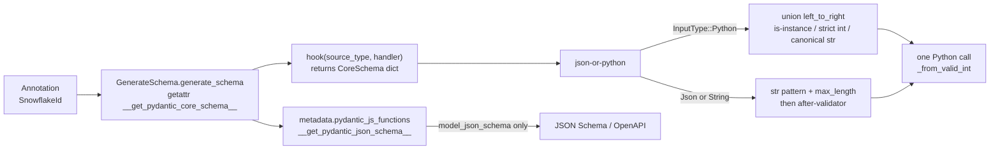

# Authoring Zero-Overhead Custom Types with __get_pydantic_core_schema__ and __get_pydantic_json_schema__

> [!summary] Claim
> `__get_pydantic_core_schema__` runs once per annotation occurrence at schema-build time and returns a `CoreSchema` dict, so a custom type costs nothing at runtime beyond the Python callables you put in that dict: build it from native `pydantic-core` nodes (`json-or-python`, `is-instance`, constrained `str`/`int`, `to-string`) and call Python only to construct the final object.

Part of [Pydantic v2 Internals and Validation](README.md) in [API Engineering](../README.md).

## TL;DR

- Mechanism: `GenerateSchema` looks up `__get_pydantic_core_schema__` with `getattr` on any annotation that has no `typing` origin and is not one of the exact built-in types in `_SIMPLE_SCHEMA_TYPES`, calls it with `(source_type, handler)`, and hands the returned dict to the Rust `SchemaValidator` and `SchemaSerializer`; `__get_pydantic_json_schema__` is stored as a `pydantic_js_functions` metadata callback and runs only when a JSON Schema is generated (`pydantic 2.14.3 pydantic/_internal/_generate_schema.py, GenerateSchema._generate_schema_from_get_schema_method`).
- Contract rule: pick a schema node per input kind with `core_schema.json_or_python_schema` (JSON goes to `json_schema`, Python objects to `python_schema`; `validate_strings` input also takes the JSON branch), push every check you can into native constrained nodes, and raise only `ValueError`, `AssertionError`, or `PydanticCustomError` from your callables (`pydantic-core 2.50.4 src/validators/function.rs, convert_err`).
- Trap: a single `no_info_plain_validator_function` swallows the whole input: it ignores `strict`, makes `model_json_schema()` raise `PydanticInvalidForJsonSchema`, leaves `model_dump_json()` unable to serialize the object, and lets a `TypeError` escape as a raw exception, not a `ValidationError` (all four shown in the lab).
- Portability fact: in the drafter's matrix run (verification re-ran only the `3.14.6` leg) the lab passed `11 passed` unchanged on CPython `3.12.13`, `3.13.18`, `3.14.6`, `3.14.10`, `3.15.2`, and free-threaded `3.14.6t` and `3.15.0b3t` with `pydantic 2.14.3` and `pydantic-core 2.50.4`; the hook API has been stable since 2.0, with `handler.field_name` since 2.4, `json_schema_input_type` on `PlainValidator` since 2.9, and the deprecation of overriding `BaseModel.__get_pydantic_core_schema__` since 2.11.
- When not to use it: if the type is "a `str` or `int` with constraints plus an after-check", `Annotated[..., StringConstraints(...), AfterValidator(...)]` produces the same schema with less code (see [[Annotated-Constraints-Field-Metadata-and-Custom-Types]]); write the hook only when you own a real class, need different JSON and Python input rules, or need custom serialization and JSON Schema in one place.

## Mental model



At class-definition time `GenerateSchema` finds the hook on the annotation, calls it once for that occurrence, and receives a plain dict that describes a validator tree; it also records `__get_pydantic_json_schema__` as metadata on that dict without calling it.
`SchemaValidator` compiles the dict into Rust nodes, so at request time `JsonOrPython::validate` branches on the input type of the current call: Python objects go through a left-to-right union whose first arm is a pure Rust `isinstance` check, and JSON or string input goes through a Rust regex and length check.
Only after the input has passed those native checks does Rust call back into Python, once, to build the object.
The JSON Schema callback runs only when someone asks for a schema, for example FastAPI building `/openapi.json`.

## How it works

### 1. Where the hook is looked up, and what bypasses it

`GenerateSchema.generate_schema(obj)` first checks `_is_simple_schema_type(obj)`, which is `obj is None or (type(obj) is type and obj in _SIMPLE_SCHEMA_TYPES)`; the set holds exact built-ins such as `str`, `int`, `bool`, `float`, `bytes`, `datetime.datetime`, `Decimal`, and `ZoneInfo`, and those go straight to the built-in handler without any hook lookup (`pydantic 2.14.3 pydantic/_internal/_generate_schema.py, _SIMPLE_SCHEMA_TYPES`).
A subclass of `str` is not in the set, so `class Username(str)` with a hook is honoured.
If `get_origin(obj)` is `None` (a plain class, not `list[int]` or `Annotated[...]`), `_generate_schema_from_get_schema_method(obj, obj)` runs `getattr(obj, '__get_pydantic_core_schema__', None)`.
Because it is `getattr`, a subclass inherits its parent's hook, and the hook receives the subclass as `source_type` (and as `cls`, if it is a `classmethod`); the lab's `CountingId(SnowflakeId)` test shows the inherited hook building `is-instance[CountingId]` and constructing `CountingId`.
`BaseModel.__get_pydantic_core_schema__` is special-cased by comparing `__func__` so the default model hook is never called during generation; overriding it on a model emits `PydanticDeprecatedSince211` if you call `super()` (`pydantic 2.14.3 pydantic/main.py, BaseModel.__get_pydantic_core_schema__`).
If there is no hook but there is a v1 `__get_validators__`, the generator wraps each yielded function in `with_info_plain_validator_function`, chains them, and emits `PydanticDeprecatedSince20` (lab: `test_v1_hooks_warn_or_fail`).

Before calling the hook, the method enters `self.defs.get_definition_ref_schema(ref=_type_refs.any_type_ref(obj, get_origin(obj)))`, but that `with` block closes (and discards the ref from `_recursively_seen`) before the hook is invoked, so it only reuses an already-registered definition whose ref string is `f'{module_name}.{qualname}:{id(tp)}{_args_ref(get_args(type_))}'`; it is not a recursion guard (`pydantic 2.14.3 pydantic/_internal/_type_refs.py, any_type_ref`; `pydantic 2.14.3 pydantic/_internal/_generate_schema.py, _Definitions.get_definition_ref_schema`).
The hook is therefore called once per occurrence: the lab's `Pair` model with two `CountingId` fields and one `dict[CountingId, int]` key records exactly three calls at class creation and still three after 100 validations.
If the returned schema carries a `ref`, the generator stores it in `defs` and returns a `definition-ref`, so the validator is shared, but the hook still runs per occurrence.

### 2. The handler: `handler(...)` versus `handler.generate_schema(...)`

The `handler` argument is a `CallbackGetCoreSchemaHandler` (`pydantic 2.14.3 pydantic/_internal/_schema_generation_shared.py, CallbackGetCoreSchemaHandler`).
For a hook found on the type itself, `ref_mode='unpack'`: `handler(tp)` calls `GenerateSchema._generate_schema_inner(tp, ...)`, which skips the hook lookup and goes straight to `match_type`, then resolves any `definition-ref` back to the concrete schema.
That is why `handler(cls)` inside a class's own hook raises `PydanticSchemaGenerationError` from `_unknown_type_schema`: `match_type` has no rule for an arbitrary class, and the error text itself tells you to call `handler.generate_schema(<some type>)` instead (`pydantic 2.14.3 pydantic/_internal/_generate_schema.py, GenerateSchema._unknown_type_schema`).
`handler.generate_schema(tp)` re-enters the full `GenerateSchema.generate_schema`, including the hook lookup; calling it on your own class recurses until `RecursionError`, because, as above, the definitions check does not mark the type as in progress (lab: `test_handler_misuse_fails_at_schema_build_time`).
The rule: call `handler(other_type)` for the type you wrap (`handler(str)` in a `str` subclass), and `handler.generate_schema(arg)` for type parameters of a generic container, so that `Annotated` metadata meant for the container is not applied to its items (docs `concepts/types.md`, "Handling custom generic classes").
`handler.resolve_ref_schema(schema)` turns a `definition-ref` into its definition and raises `LookupError` inside a recursive model whose definition is not complete yet.
`handler.field_name` returns the top of `field_name_stack`, so a hook can bake the field name into a `with_info_*` validator; it was re-added in 2.4 (docs `concepts/types.md`, "Access to field name").

### 3. Hooks on `Annotated` metadata

For `Annotated[T, m1, m2]`, `GenerateSchema._apply_annotations` builds a chain of `CallbackGetCoreSchemaHandler` objects, one per metadata item, left to right; each `_get_wrapped_inner_schema` closure calls `m.__get_pydantic_core_schema__(source, get_inner_schema)` if the item has one, so `m2` wraps `m1`, which wraps `T`'s own schema (`pydantic 2.14.3 pydantic/_internal/_generate_schema.py, GenerateSchema._get_wrapped_inner_schema`).
`T`'s own hook still runs at the bottom through `inner_handler`, which repeats the `_generate_schema_from_get_schema_method` lookup.
The lab's `MintedAfter(cutoff_ms)` marker is an instance hook (`self`, not `cls`) that returns `no_info_after_validator_function(self._check, handler(source_type))`, so it adds one check on top of everything `SnowflakeId` already does.
A marker's `__get_pydantic_json_schema__` is collected into `pydantic_js_annotation_functions` and runs after the type's own `pydantic_js_functions`, which is why the lab's `x-minted-after-ms` key lands on top of the `SnowflakeId` schema.
`pydantic.GetPydanticSchema(get_pydantic_core_schema=..., get_pydantic_json_schema=...)` is the same mechanism without a class: its `__getattr__` returns the stored callables under the dunder names (`pydantic 2.14.3 pydantic/types.py, GetPydanticSchema.__getattr__`).
The docs make the lab's marker `frozen` because "Without this, a union such as `Username | None` will raise an error" (docs `concepts/types.md` at `v2.14.3`); the drafter built `Union[Annotated[int, U()], None]` with `U.__hash__ = None` on CPython `3.12.13`, `3.13.18`, `3.14.6`, and `3.15.0b3` with no `TypeError`, and verification re-ran it on `3.14.6` in both the `Union[...]` and the `Annotated[int, U()] | None` spelling, both of which built and validated, so `frozen=True` is good hygiene for a value object rather than a hard requirement in `2.14.3`.

### 4. The building blocks and what each costs at runtime

| `core_schema` helper | Rust node | Calls Python per value? | Notes |
|---|---|---|---|
| `json_or_python_schema(json_schema, python_schema)` | `JsonOrPython` | No | `match state.extra().input_type { InputType::Python => python, _ => json }`, so `validate_strings` uses the JSON branch (`pydantic-core 2.50.4 src/validators/json_or_python.rs, JsonOrPython::validate`) |
| `is_instance_schema(cls)` | `IsInstanceValidator` | No | pyo3 `obj.is_instance(cls)` (`PyObject_IsInstance`) on Python input; on JSON input `input.as_python()` is `None` and it fails with `needs_python_object`, which is why it belongs only in the Python branch (`pydantic-core 2.50.4 src/validators/is_instance.rs, IsInstanceValidator::validate`) |
| `str_schema(pattern=..., max_length=..., strict=True)` | constrained `str` | No | `pattern` uses the Rust `regex` crate (`rust-regex`, the default) unless `regex_engine='python-re'` or the pattern is a compiled `re.Pattern` (`pydantic-core 2.50.4 src/validators/string.rs, Pattern::compile`) |
| `int_schema(ge=..., le=..., strict=True)` | constrained `int` | No | `strict=True` rejects `True`, `1.0`, and `"1"` |
| `union_schema(choices, mode='left_to_right', custom_error_type=...)` | `UnionValidator` | No | first success wins; `custom_error_type` replaces all branch errors with one error (`pydantic-core 2.50.4 src/validators/union.rs, MaybeErrors`) |
| `no_info_after_validator_function(f, inner)` | `FunctionAfterValidator` | Yes, once, only after `inner` succeeded | its serializer is the inner schema's serializer (`pydantic-core 2.50.4 src/serializers/type_serializers/function.rs, FunctionAfterSerializerBuilder`) |
| `no_info_plain_validator_function(f)` | `FunctionPlainValidator` | Yes, on every raw input | `self.func.call1(py, (input.to_object(py)?,))` with no prior check (`pydantic-core 2.50.4 src/validators/function.rs, FunctionPlainValidator::validate`) |
| `to_string_ser_schema(when_used='json-unless-none')` | `ToStringSerializer` | Only `str(value)` | default `when_used` is `json-unless-none` (`pydantic-core 2.50.4 python/pydantic_core/core_schema.py, to_string_ser_schema`) |
| `plain_serializer_function_ser_schema(f, return_schema=..., when_used=...)` | `FunctionPlainSerializer` | Yes | default `when_used='always'`; without `return_schema` the result goes through `AnySerializer` |

The Python callables are called through `convert_err`, which maps exceptions as follows: `ValueError` becomes `value_error` unless it is a `PydanticCustomError`, `PydanticKnownError`, or nested `ValidationError` (kept as is), `AssertionError` becomes `assertion_error`, `PydanticOmit` and `PydanticUseDefault` become control-flow signals, and anything else, `TypeError` included, propagates as an internal error; the source comment says `TypeError` "is now considered as a runtime error to catch errors in function signatures" (`pydantic-core 2.50.4 src/validators/function.rs, convert_err`).
`CustomError::build` rejects a `custom_error_message` when `custom_error_type` names a known error type, so a union can either reuse a built-in error type or define a new one with a message, not both (`pydantic-core 2.50.4 src/validators/custom_error.rs, CustomError::build`).

### 5. Serialization: the `serialization` key wins

`CombinedSerializer::_build` reads `schema["serialization"]` before `schema["type"]`; `function-plain` and `function-wrap` serializer types get the whole schema, and any other type (such as `to-string`) is built as if it were the main schema (`pydantic-core 2.50.4 src/serializers/shared.rs, CombinedSerializer::_build`).
`WhenUsed::should_use` returns `true` for `always`, `!value.is_none()` for `unless-none`, `extra.mode.is_json()` for `json`, and both for `json-unless-none` (`pydantic-core 2.50.4 src/serializers/type_serializers/format.rs, WhenUsed::should_use`).
So the lab's `to_string_ser_schema(when_used="json-unless-none")` leaves `SnowflakeId` instances untouched in `model_dump()`, emits `"175928847299117063"` in `model_dump_json()` and `model_dump(mode="json")`, and emits `null` for `None`.
Dictionary keys go through `json_key`, which calls `str()` as well, so `dict[SnowflakeId, int]` dumps to `{"7":2}`.
When `when_used` is not `always`, `FunctionPlainSerializer::build` also builds a fallback serializer from a copy of the outer schema for values the function skips, and errors raised inside the function become `PydanticSerializationError("Error calling function ...")`, except that a `PydanticSerializationUnexpectedValue` becomes a warning (or is re-raised when serialization checking is enabled) and a `PydanticSerializationError` is re-raised with its own message (`pydantic-core 2.50.4 src/serializers/type_serializers/function.rs, on_error`).
A plain validator with no `serialization` key has no idea what it returned, so `dump_json` fails with `PydanticSerializationError: Unable to serialize unknown type` (lab).

### 6. `__get_pydantic_json_schema__` and the mode-specific inner schema

`GenerateSchema.generate_schema` calls `_extract_get_pydantic_json_schema(tp)` and appends the method to `metadata['pydantic_js_functions']` of the resolved schema, without calling it (`pydantic 2.14.3 pydantic/_internal/_generate_schema.py, GenerateSchema._add_js_function`).
The same helper raises `PydanticUserError(code='custom-json-schema')` if a v1 `__modify_schema__` exists without a custom v2 hook.
At generation time `GenerateJsonSchema.generate_inner` wraps the base `handler_func` in one `GenerateJsonSchemaHandler` per `pydantic_js_functions` entry, then per `pydantic_js_annotation_functions` entry; calling `handler(schema)` runs the next layer down (`pydantic 2.14.3 pydantic/json_schema.py, GenerateJsonSchema.generate_inner`).
The base `handler_func` consults `schema['serialization']` first when `mode == 'serialization'`, so your hook sees a different inner result per mode.
For the lab type, validation mode reaches `json_or_python_schema`, which returns the JSON branch (`pydantic 2.14.3 pydantic/json_schema.py, GenerateJsonSchema.json_or_python_schema`), yielding `type`, `pattern`, and `maxLength`; serialization mode reaches `ser_schema` for `to-string`, which returns a bare `{"type": "string"}`.
After-validators are transparent (`function_after_schema` returns the inner schema), but `function_plain_schema` raises `PydanticInvalidForJsonSchema` unless it is in validation mode and has `json_schema_input_schema`; in serialization mode it raises even then (`pydantic 2.14.3 pydantic/json_schema.py, GenerateJsonSchema.function_plain_schema`).
`handler.resolve_ref_schema(json_schema)` replaces a `{"$ref": ...}` with the stored definition so that you mutate the definition rather than a sibling of the `$ref`; the lab calls it unconditionally because it is a no-op on non-ref schemas.
For dictionary keys, `_common_dict_schema` moves the key schema's `pattern` into `patternProperties` and puts the remaining key constraints into `propertyNames` without `type` (`pydantic 2.14.3 pydantic/json_schema.py, GenerateJsonSchema._common_dict_schema`).

### 7. Why the wire form is a string

RFC 8259 lets implementations limit numeric range and precision and states that integers in `[-(2**53)+1, (2**53)-1]` are interoperable, because IEEE 754 binary64 is the common denominator (RFC 8259 Section 6).
A 63-bit identifier exceeds that range, and the lab asserts `float(2**53 + 1) == float(2**53)`, which is exactly how a JavaScript or binary64-based client would silently change the id.
So the JSON branch accepts only a canonical decimal string (`^(0|[1-9][0-9]{0,18})$`, at most 19 characters), rejects JSON numbers with `string_type`, and serializes back to a string; canonical means one string per id (no `"007"`), which keeps cache keys, ETags, and log searches unambiguous.

## Numbers and limits

| Quantity | Value | Source or measurement |
|---|---|---|
| Largest `SnowflakeId` | `2**63 - 1` = `9223372036854775807` (19 digits) | Lab layout: 41-bit timestamp, 10-bit worker, 12-bit sequence; `test_bit_layout_exceeds_json_safe_integers_and_instances_are_immutable` |
| Largest interoperable JSON integer | `2**53 - 1` | RFC 8259 Section 6 |
| Hook invocations for 3 annotation occurrences | `3`, and `0` more after 100 validations | `test_hook_runs_once_per_occurrence_at_build_time_never_per_validation` |
| `TypeAdapter(SnowflakeId)` build time | `15.2` us (second run `15.4`) | Re-measured in verification with a one-off `timeit` script (not part of the lab, deleted after the run), run twice via `uv run --frozen python <script>` from `labs/`: median of 15 repeats of 200 builds; CPython `3.14.6`, macOS `27.3` arm64 (`uname -r` `27.3.0`), `pydantic 2.14.3`, `pydantic-core 2.50.4` (as of 2026-11) |
| `TypeAdapter(int).validate_json(b"175928847299117063")` | `165` ns (second run `161`) | Same script: median of 15 repeats of `timeit(number=20000)`; every input is pre-warmed with one call |
| `TypeAdapter(Annotated[str, StringConstraints(pattern=..., max_length=19, strict=True)])` `validate_json`, no Python call | `193` ns (second run `193`) | Separate one-off script, same method; the bare `SchemaValidator` for the same `str_schema` measured `84`-`85` ns, so about `110` ns of every `TypeAdapter` row is the Python `TypeAdapter.validate_json` wrapper |
| `SnowflakeId` `validate_json` (regex, length, two Python frames) | `376` ns (second run `387`) | Same script |
| `PlainSnowflakeId` `validate_json` (one Python frame, no checks) | `271` ns (second run `286`) | Same script |
| `SnowflakeId` `validate_python(instance)` (`is-instance` arm, no Python call) | `157` ns (second run `164`) | Same script |
| `PlainSnowflakeId` `validate_python(instance)` | `182` ns (second run `186`) | Same script |
| `SnowflakeId` `validate_python(int)` | `321` ns (second run `333`) | Same script |
| `SnowflakeId` `dump_json` (`to-string`) | `422` ns (second run `415`) | Same script |
| Variant: same JSON branch as `SnowflakeId` but one Python frame (`int()`, range check, and construction in one after-validator) | `355` ns (second run `356`) | Same script |
| Variant: one Python frame, no regex (`max_length=19` only) | `334` ns (second run `326`) | Same script |

Reading the numbers honestly: on the happy path the minimal plain validator is about `100` ns faster than the native composition (`271` versus `376` ns, `286` versus `387` ns), because it checks nothing and runs one Python frame instead of a regex plus two frames.
What the native composition removes is Python on the already-typed path (`157`-`164` ns versus `161`-`165` ns for a bare `int`, equal within run-to-run noise) and Python on every rejected input (a 20-digit string fails `max_length` before any callable runs); what it adds over a bare constrained `str` (`193` ns) is the constructor call, of which merging the two frames into one saves about `20`-`30` ns.
These are single-machine medians from one session, not a benchmark suite; see [[Pydantic-v2-Performance-Engineering-vs-MsgSpec-and-ORJSON]] for method.

## Portability

| Runtime or component | Behavior | Proof |
|---|---|---|
| CPython `3.12.13` (macOS) | Lab passes: `11 passed in 0.43s` (drafter's run; not re-run in verification, lab matrix paused) | `UV_PROJECT_ENVIRONMENT=<temp venv> uv run --frozen --python ~/.local/bin/python3.12 pytest <module> -q`; `3.12.16` is not installed here |
| CPython `3.13.18` (macOS) | `11 passed in 0.42s` (drafter's run; not re-run in verification) | Same command with `/opt/homebrew/bin/python3.13` |
| CPython `3.14.6` (workspace default) and `3.14.10` (macOS) | `11 passed in 0.48s` (verification re-run) and `11 passed in 0.42s` (drafter's run) | `uv run --frozen pytest <module> -q -p no:cacheprovider`, and the temp-venv command with `/opt/homebrew/bin/python3.14` |
| CPython `3.15.2` (macOS) | `11 passed in 0.40s` (drafter's run; not re-run in verification) | Temp-venv command with `/opt/homebrew/bin/python3.15` |
| Free-threaded `3.14.6t` and `3.15.0b3t` (macOS) | `11 passed in 0.42s` each (drafter's run; not re-run in verification); `Py_GIL_DISABLED` `1` and `sys._is_gil_enabled()` `False` after importing `pydantic_core` | Separate `uv venv` with the lock's pins of `pydantic`, `pydantic-core`, `fastapi`, `starlette`, `httpx`, `anyio`, `pytest`, `pytest-asyncio`, and typing helpers (transitive deps resolved by `uv pip`); `3.15.2t` is not installed and was not run |
| Free-threading and your callables | Rust calls your constructor and validators from whichever thread validates, without a lock; keep them pure | `FunctionAfterValidator` and `FunctionPlainValidator` call `self.func.call1` directly (`pydantic-core 2.50.4 src/validators/function.rs`) |
| Debian Trixie (glibc) and Alpine (musl) containers | Not run for this note (lab checks paused) | - |
| `pydantic` `2.0` -> `2.14.3` | Hook signature unchanged; `handler.field_name` from 2.4; `PlainValidator(json_schema_input_type=...)` from 2.9 (docstring note "Before v2.9"); overriding `BaseModel.__get_pydantic_core_schema__` deprecated with `PydanticDeprecatedSince211` | `docs/concepts/types.md` at `v2.14.3`; `pydantic 2.14.3 pydantic/functional_validators.py, PlainValidator`; `pydantic 2.14.3 pydantic/main.py, BaseModel.__get_pydantic_core_schema__` |
| Unhashable `Annotated` metadata in a union | No `TypeError` on CPython `3.12.13`, `3.13.18`, `3.14.6`, `3.15.0b3` (drafter); `3.14.6` re-run in verification with both `Union[...]` and `\|` spellings | `uv run --no-project --python <v> python -c` building `Union[Annotated[int, U()], None]` with `U.__hash__ = None`; contradicts the docs' "will raise an error" note for `2.14.3` |
| FastAPI `0.162.0` / Starlette `1.10.0` | Path parameters are validated with `TypeAdapter.validate_python(value, from_attributes=True)`, so a path segment is a Python `str` and takes the `python_schema` branch | `fastapi 0.162.0 fastapi/_compat/v2.py, ModelField.validate`; lab `test_fastapi_path_parameter_uses_python_branch_and_openapi_hook` |
| Uvicorn, Hypercorn, Granian; HTTP/1.1, HTTP/2, HTTP/3 | Not run. The ASGI spec fixes what the app receives for every server: `scope["path"]` is a decoded Unicode string and the `http.request` `body` is a byte string, and the spec "covers HTTP/1.0, HTTP/1.1, HTTP/2 and HTTP/3" with version differences "largely at the transport level", so a path parameter reaches FastAPI as a Python `str` (`python_schema` branch) and a JSON body as bytes (JSON branch) whichever server and HTTP version carried them | ASGI HTTP connection scope specification (fetched 2026-11-12); a cited-spec argument, not a run of each server |

## Worked example

The [implementation](../labs/src/api_labs/f09_pydantic_v2_internals_and_validation/snowflake_custom_type.py) defines `SnowflakeId`, the `MintedAfter` marker, the `PlainSnowflakeId` anti-pattern, an `Event` model, and a FastAPI app; the [test](../labs/tests/f09_pydantic_v2_internals_and_validation/test_low_level_custom_types_with_get_pydantic_core_schema.py) has eleven tests covering both JSON and Python branches, the hook call count, serialization in both modes, JSON Schema in both modes, the marker, the plain-validator failures, handler misuse, v1 hooks, and FastAPI path parameters and OpenAPI.

### Implementation (`labs/src/api_labs/f09_pydantic_v2_internals_and_validation/snowflake_custom_type.py`)

```python
"""SnowflakeId: a custom type validated in pydantic-core except for one constructor call."""

from __future__ import annotations

from dataclasses import dataclass
from typing import TYPE_CHECKING, Annotated, Any, Final

from fastapi import FastAPI
from pydantic import BaseModel, ConfigDict, Field, GetCoreSchemaHandler, GetJsonSchemaHandler
from pydantic_core import PydanticCustomError, core_schema

if TYPE_CHECKING:
    from pydantic.json_schema import JsonSchemaValue

# Lab-defined 63-bit layout: 41-bit millisecond timestamp | 10-bit worker | 12-bit sequence.
TIMESTAMP_BITS: Final = 41
WORKER_BITS: Final = 10
SEQUENCE_BITS: Final = 12
MAX_SNOWFLAKE: Final = (1 << (TIMESTAMP_BITS + WORKER_BITS + SEQUENCE_BITS)) - 1
JSON_SAFE_INTEGER_MAX: Final = (1 << 53) - 1
# Canonical decimal: no sign, no leading zeros, at most 19 digits (len(str(2**63 - 1)) == 19).
CANONICAL_DECIMAL: Final = r"^(0|[1-9][0-9]{0,18})$"


class SnowflakeId:
    """Immutable 63-bit identifier that crosses JSON as a decimal string, never as a number."""

    __slots__ = ("_value",)
    _value: int

    def __init__(self, value: int) -> None:
        if type(value) is not int or not 0 <= value <= MAX_SNOWFLAKE:
            msg = f"SnowflakeId needs an int in [0, {MAX_SNOWFLAKE}], got {value!r}"
            raise ValueError(msg)
        object.__setattr__(self, "_value", value)

    @classmethod
    def compose(cls, timestamp_ms: int, worker: int, sequence: int) -> SnowflakeId:
        """Pack the three fields; each must fit its bit width."""
        if not 0 <= timestamp_ms < (1 << TIMESTAMP_BITS):
            raise ValueError("timestamp_ms out of range")
        if not 0 <= worker < (1 << WORKER_BITS):
            raise ValueError("worker out of range")
        if not 0 <= sequence < (1 << SEQUENCE_BITS):
            raise ValueError("sequence out of range")
        packed = (timestamp_ms << (WORKER_BITS + SEQUENCE_BITS)) | (worker << SEQUENCE_BITS)
        return cls(packed | sequence)

    @property
    def timestamp_ms(self) -> int:
        return self._value >> (WORKER_BITS + SEQUENCE_BITS)

    @property
    def worker(self) -> int:
        return (self._value >> SEQUENCE_BITS) & ((1 << WORKER_BITS) - 1)

    @property
    def sequence(self) -> int:
        return self._value & ((1 << SEQUENCE_BITS) - 1)

    def __int__(self) -> int:
        return self._value

    def __str__(self) -> str:
        return str(self._value)

    def __repr__(self) -> str:
        return f"SnowflakeId({self._value})"

    def __eq__(self, other: object) -> bool:
        return isinstance(other, SnowflakeId) and other._value == self._value

    def __lt__(self, other: SnowflakeId) -> bool:
        return self._value < other._value

    def __hash__(self) -> int:
        return hash(self._value)

    def __setattr__(self, name: str, value: object) -> None:
        raise AttributeError("SnowflakeId is immutable")

    @classmethod
    def _from_valid_int(cls, value: int) -> SnowflakeId:
        # pydantic-core already enforced strict int and 0 <= value <= MAX_SNOWFLAKE.
        instance = object.__new__(cls)
        object.__setattr__(instance, "_value", value)
        return instance

    @classmethod
    def _from_canonical_decimal(cls, text: str) -> SnowflakeId:
        # pydantic-core already enforced the canonical-decimal pattern; only the
        # 19-digit range [2**63, 10**19 - 1] can still be out of bounds here.
        value = int(text)
        if value > MAX_SNOWFLAKE:
            raise PydanticCustomError(
                "snowflake_out_of_range",
                "SnowflakeId must be <= {max_value}",
                {"max_value": MAX_SNOWFLAKE},
            )
        return cls._from_valid_int(value)

    @classmethod
    def __get_pydantic_core_schema__(
        cls, source_type: Any, handler: GetCoreSchemaHandler
    ) -> core_schema.CoreSchema:
        from_decimal = core_schema.no_info_after_validator_function(
            cls._from_canonical_decimal,
            core_schema.str_schema(pattern=CANONICAL_DECIMAL, max_length=19, strict=True),
        )
        from_int = core_schema.no_info_after_validator_function(
            cls._from_valid_int,
            core_schema.int_schema(ge=0, le=MAX_SNOWFLAKE, strict=True),
        )
        python_side = core_schema.union_schema(
            [core_schema.is_instance_schema(cls), from_int, from_decimal],
            mode="left_to_right",
            custom_error_type="snowflake_id_type",
            custom_error_message=(
                "Input should be a SnowflakeId, an int, or a canonical decimal string"
            ),
        )
        return core_schema.json_or_python_schema(
            json_schema=from_decimal,
            python_schema=python_side,
            serialization=core_schema.to_string_ser_schema(when_used="json-unless-none"),
        )

    @classmethod
    def __get_pydantic_json_schema__(
        cls, schema: core_schema.CoreSchema, handler: GetJsonSchemaHandler
    ) -> JsonSchemaValue:
        json_schema = handler.resolve_ref_schema(handler(schema))
        json_schema["format"] = "snowflake-id"
        json_schema["description"] = "63-bit id as a decimal string (exceeds 2**53 - 1)"
        json_schema["examples"] = [str(MAX_SNOWFLAKE)]
        return json_schema


@dataclass(frozen=True, slots=True)
class MintedAfter:
    """Annotated marker: wraps the inner schema and rejects ids minted before a cutoff."""

    cutoff_ms: int

    def __get_pydantic_core_schema__(
        self, source_type: Any, handler: GetCoreSchemaHandler
    ) -> core_schema.CoreSchema:
        return core_schema.no_info_after_validator_function(self._check, handler(source_type))

    def __get_pydantic_json_schema__(
        self, schema: core_schema.CoreSchema, handler: GetJsonSchemaHandler
    ) -> JsonSchemaValue:
        json_schema = handler(schema)
        json_schema["x-minted-after-ms"] = self.cutoff_ms
        return json_schema

    def _check(self, value: SnowflakeId) -> SnowflakeId:
        if value.timestamp_ms < self.cutoff_ms:
            raise PydanticCustomError(
                "snowflake_too_old",
                "SnowflakeId minted at {minted_ms} ms, before {cutoff_ms} ms",
                {"minted_ms": value.timestamp_ms, "cutoff_ms": self.cutoff_ms},
            )
        return value


class PlainSnowflakeId:
    """Anti-pattern: one Python plain validator owns every input; pydantic-core does nothing."""

    __slots__ = ("value",)

    def __init__(self, value: int) -> None:
        self.value = value

    @classmethod
    def _coerce(cls, raw: Any) -> PlainSnowflakeId:
        if isinstance(raw, cls):
            return raw
        return cls(int(raw))

    @classmethod
    def __get_pydantic_core_schema__(
        cls, source_type: Any, handler: GetCoreSchemaHandler
    ) -> core_schema.CoreSchema:
        return core_schema.no_info_plain_validator_function(cls._coerce)


RECENT_CUTOFF_MS: Final = 1_000_000


class Event(BaseModel):
    """Wire model: SnowflakeId fields validate natively from JSON strings and Python instances."""

    model_config = ConfigDict(frozen=True)

    id: SnowflakeId
    parent_id: SnowflakeId | None = None
    replay_of: Annotated[SnowflakeId, MintedAfter(RECENT_CUTOFF_MS)] | None = None
    shard_counts: dict[SnowflakeId, int] = Field(default_factory=dict[SnowflakeId, int])


def build_event_app() -> FastAPI:
    """Path parameters arrive as Python str, so they exercise the python_schema branch."""
    app = FastAPI()

    @app.get("/v1/events/{event_id}")
    async def get_event(event_id: SnowflakeId) -> Event:
        return Event(id=event_id, parent_id=SnowflakeId(int(event_id) - 1))

    return app
```

### Test (simplified excerpt: three of the eleven tests, copied verbatim)

```python
@pytest.mark.unit
def test_json_branch_accepts_only_canonical_decimal_strings() -> None:
    assert ADAPTER.validate_json('"0"') == SnowflakeId(0)
    assert int(ADAPTER.validate_json(f'"{MAX_SNOWFLAKE}"')) == MAX_SNOWFLAKE

    cases = {
        f'"{MAX_SNOWFLAKE + 1}"': "snowflake_out_of_range",
        '"01"': "string_pattern_mismatch",
        '"-1"': "string_pattern_mismatch",
        "1": "string_type",
        '"99999999999999999999"': "string_too_long",
    }
    for raw, expected in cases.items():
        with pytest.raises(ValidationError) as err_info:
            ADAPTER.validate_json(raw)
        assert _error_types(err_info.value) == [expected], raw

    with pytest.raises(ValidationError) as err_info:
        ADAPTER.validate_json(f'"{MAX_SNOWFLAKE + 1}"')
    ctx = err_info.value.errors(include_url=False)[0].get("ctx")
    assert ctx == {"max_value": MAX_SNOWFLAKE}


@pytest.mark.unit
def test_hook_runs_once_per_occurrence_at_build_time_never_per_validation() -> None:
    class CountingId(SnowflakeId):
        __slots__ = ()
        calls: ClassVar[list[Any]] = []

        @classmethod
        def __get_pydantic_core_schema__(
            cls, source_type: Any, handler: GetCoreSchemaHandler
        ) -> core_schema.CoreSchema:
            cls.calls.append(source_type)
            return super().__get_pydantic_core_schema__(source_type, handler)

    class Pair(BaseModel):
        left: CountingId
        right: CountingId
        by_key: dict[CountingId, int]

    assert CountingId.calls == [CountingId, CountingId, CountingId]
    payload = '{"left":"1","right":"2","by_key":{"3":4}}'
    pair = Pair.model_validate_json(payload)
    for _ in range(100):
        Pair.model_validate_json(payload)
    assert len(CountingId.calls) == 3
    # The inherited hook built is-instance[CountingId] and constructed the subclass.
    assert type(pair.left) is CountingId


@pytest.mark.unit
def test_plain_validator_anti_pattern_loses_json_schema_strictness_and_serialization() -> None:
    adapter = TypeAdapter(PlainSnowflakeId)
    with pytest.raises(PydanticInvalidForJsonSchema, match="PlainValidatorFunctionSchema"):
        adapter.json_schema()

    strict_adapter = TypeAdapter(PlainSnowflakeId, config=ConfigDict(strict=True))
    assert strict_adapter.validate_python("5").value == 5

    with pytest.raises(ValidationError) as err_info:
        adapter.validate_python("abc")
    assert _error_types(err_info.value) == ["value_error"]
    # TypeError is not converted to a ValidationError: it escapes as a 500-class bug.
    with pytest.raises(TypeError):
        adapter.validate_python([1])

    with pytest.raises(PydanticSerializationError, match="Unable to serialize unknown type"):
        adapter.dump_json(PlainSnowflakeId(1))
```

### Captured execution output

Executed from `labs/` with `uv run --frozen pytest tests/f09_pydantic_v2_internals_and_validation/test_low_level_custom_types_with_get_pydantic_core_schema.py -q -p no:cacheprovider` on CPython `3.14.6` (`macOS-27.3-arm64-arm-64bit-Mach-O`):

```text
...........                                                              [100%]
11 passed in 0.48s
```

Representative values printed by an exploratory script against the same module on CPython `3.14.6` (re-captured in verification; identical to the drafter's capture):

```text
"9223372036854775808" -> [('snowflake_out_of_range', 'SnowflakeId must be <= 9223372036854775807', {'max_value': 9223372036854775807})]
"01" -> [('string_pattern_mismatch', "String should match pattern '^(0|[1-9][0-9]{0,18})$'", {'pattern': '^(0|[1-9][0-9]{0,18})$'})]
1 -> [('string_type', 'Input should be a valid string', None)]
200 {"id":"9223372036854775807","parent_id":"9223372036854775806","replay_of":null,"shard_counts":{}}
422 {"detail":[{"type":"snowflake_id_type","loc":["path","event_id"],"msg":"Input should be a SnowflakeId, an int, or a canonical decimal string","input":"007"}]}
```

## Pitfalls

> [!warning] A plain validator that owns the whole input
> - Trigger: `return core_schema.no_info_plain_validator_function(cls._coerce)` as the entire schema.
> - Symptom: `model_json_schema()` and FastAPI's `/openapi.json` raise `PydanticInvalidForJsonSchema` (`pydantic 2.14.3 pydantic/json_schema.py, GenerateJsonSchema.function_plain_schema`); `ConfigDict(strict=True)` has no effect (`"5"` still validates); `dump_json` fails with `Unable to serialize unknown type`; all shown in `test_plain_validator_anti_pattern_loses_json_schema_strictness_and_serialization`.
> - Fix: put native nodes in front (`json_or_python_schema`, constrained `str`/`int`, `is_instance_schema`) and use an after-validator for construction; if you must keep a plain validator, pass `json_schema_input_schema=` and a `serialization=` schema.

> [!warning] `TypeError` in a validator becomes a 500, not a 422
> - Trigger: a callable that does `int(raw)` on arbitrary input, reached with a list or `None`.
> - Symptom: `convert_err` maps only `ValueError`, `AssertionError`, and the Pydantic error classes; `TypeError` escapes as itself (`pydantic-core 2.50.4 src/validators/function.rs, convert_err`), so FastAPI's `RequestValidationError` handler never sees it; a scratch run on FastAPI `0.162.0` with `httpx.ASGITransport(raise_app_exceptions=False)` returned `500 Internal Server Error` for `{"customer": [1]}` and `422` with `value_error` for `{"customer": "abc"}` (reproduced in verification on CPython `3.14.6`).
> - Fix: never call a Python function on unchecked input; narrow the type with a native node first, or catch and re-raise as `PydanticCustomError`.

> [!warning] `handler(cls)` or `handler.generate_schema(cls)` inside your own hook
> - Trigger: copying the `Username(str)` docs example but passing the class itself to the handler.
> - Symptom: `handler(cls)` raises `PydanticSchemaGenerationError` ("Unable to generate pydantic-core schema for ..."); `handler.generate_schema(cls)` re-enters the hook and dies with `RecursionError` at import time.
> - Fix: pass the underlying type (`handler(str)`), or build the schema directly from `core_schema` helpers as the lab does.

> [!warning] `custom_error_type` on a union hides the precise error
> - Trigger: collapsing the Python-branch union into one `snowflake_id_type` error for readable 422s.
> - Symptom: in Python mode an out-of-range decimal string reports `snowflake_id_type`, while the JSON branch (no union) reports the precise `snowflake_out_of_range` with `ctx.max_value`; the lab asserts both.
> - Fix: accept the trade-off deliberately, or skip `custom_error_type` and let the per-arm errors through (three errors per field, each with a branch tag in `loc`, which is noisy).

> [!warning] `when_used="json"` serializers and `model_dump()`
> - Trigger: `to_string_ser_schema()` (default `json-unless-none`) or `when_used="json"`, then `json.dumps(model.model_dump())`.
> - Symptom: `model_dump()` keeps `SnowflakeId` instances (lab), so `json.dumps` raises `TypeError` on them.
> - Fix: use `model_dump_json()` or `model_dump(mode="json")`; pick `when_used="always"` only if Python callers should also see strings.

> [!warning] A hand-written backtracking regex on a public field
> - Trigger: `str_schema(pattern=re.compile(...))` or `regex_engine='python-re'` with a nested-quantifier pattern, reachable from unauthenticated input.
> - Symptom: one crafted string pins a worker's CPU.
>   Pydantic itself shipped this class of bug: GitHub advisory GHSA-mr82-8j83-vxmv (CVE-2024-3772, CWE-1333, published 2024-04-15) is a regular expression denial of service triggered by a crafted email string, affecting `pydantic` `>= 2.0.0, < 2.4.0` and `< 1.10.13`, fixed in `2.4.0` and `1.10.13`.
> - Fix: keep the default Rust `regex` engine, which has no backtracking, anchor the pattern, and bound `max_length` so even a slow engine sees a short input; the lab's `^(0|[1-9][0-9]{0,18})$` has no nested quantifier and a 19-character cap.

> [!warning] Mutating the returned JSON Schema without `resolve_ref_schema`
> - Trigger: the type's schema has a `ref`, so `handler(schema)` returns `{"$ref": "#/$defs/..."}`, and the hook writes `format` into that dict.
> - Symptom: the keyword sits next to the `$ref` instead of inside the definition.
> - Fix: `json_schema = handler.resolve_ref_schema(handler(schema))` before mutating, as the docs example and the lab do.

## Security and robustness

- Bound the input before any Python code runs (`API4:2023 Unrestricted Resource Consumption`): `max_length=19` and the anchored pattern reject a megabyte-long digit string in Rust, before `int()` sees it; that also sidesteps CPython's integer-string conversion limit (`sys.int_info.default_max_str_digits`, 4300 digits), which would otherwise raise `ValueError` deep inside your callable (see [[Unrestricted-Resource-Consumption-API4-2023-Payload-Depth-and-Limit-Guards]]).
- Regex engine: `str_schema(pattern=...)` defaults to the Rust `regex` crate, which does not backtrack; setting `regex_engine='python-re'` or passing a compiled `re.Pattern` brings back the backtracking risk, and the ReDoS history is real: CVE-2024-3772 (GHSA-mr82-8j83-vxmv) hit Pydantic's own email validation before `2.4.0` and `1.10.13` (see [[Pydantic-v2-Architecture-CoreSchema-and-Rust-Pydantic-Core]]).
- Canonical form as a security property: rejecting `"007"` and `"+7"` means one id has one string, so an authorization check, cache key, or rate-limit key computed on the raw string cannot be bypassed by an alias of the same id (compare [[Defeating-BOLA-API1-2023-Tenant-Scoped-Queries-and-PostgreSQL-RLS]]).
- Error echo: every `ValidationError` carries `input`, and FastAPI returns it in the 422 body (the lab shows `"input":"007"`); for secret-bearing custom types set `ConfigDict(hide_input_in_errors=True)` and keep secrets out of `ctx` (see [[Structured-Log-Redaction-and-Preventing-PII-and-Token-Leaks]]).
- Exceptions as a trust boundary: only `ValueError`-family and `AssertionError` become client errors; a `TypeError` or `KeyError` from your callable is a server fault and, worse, a probe oracle, so treat every callable in a schema as reachable by hostile input.
- Precision as integrity: an id that crosses JSON as a number can be rounded by a binary64 client and written back as a different, valid id (RFC 8259 Section 6), a silent cross-record write; the string wire form removes that class of bug.

## The principal's view

The decision is where a domain type's rules live.
`__get_pydantic_core_schema__` lets one class own its validation, serialization, and OpenAPI contract, which is the right unit for ids, money, and tenant-scoped references used across hundreds of models.
The cost is coupling: the hook builds a dict against `pydantic_core.core_schema`, which the docs call "one of the areas most likely to be tweaked in the future", so a platform team that ships such types needs the lab-style tests (both modes, both JSON Schema modes, the error types) as a contract suite that runs on every Pydantic upgrade.
Prefer the `Annotated` route ([[Annotated-Constraints-Field-Metadata-and-Custom-Types]], [[Functional-Validators-Before-After-Wrap-and-Plain]]) when the value should stay a plain `str` or `int` in Python; prefer the hook when the value deserves its own class with methods, ordering, and hashing.
Measure before claiming speed: in this lab the native composition was slower per call than a careless plain validator and bought correctness, not latency; the latency wins are on instance passthrough and on rejecting bad input without Python.
If ids cross many languages, define the wire form (decimal string, pattern, max length) in the API contract first and generate the Pydantic type from it, not the other way round; if the hot path is internal and schema-fixed, `msgspec` or Protocol Buffers avoid the per-object Python constructor entirely.

## Interview questions

> [!question] L5: When does `__get_pydantic_core_schema__` run, and how many times for a model with two `SnowflakeId` fields?
>
> > [!success]- Answer
> > It runs during schema generation, which for a `BaseModel` happens at class creation (or on first use with `defer_build=True`), never during validation.
> > `GenerateSchema` calls it once per annotation occurrence, so two fields mean two calls, and a `dict[SnowflakeId, int]` key adds a third (the lab counts exactly `3`).
> > The returned dict is compiled into Rust nodes; at request time only the Python callables you embedded in it run.
> >
> > Follow-up: What changes if the returned schema includes a `ref`?

> [!question] L5: Why does the lab put `is_instance_schema(cls)` only in the `python_schema` branch?
>
> > [!success]- Answer
> > `IsInstanceValidator::validate` needs a real Python object; for JSON input `input.as_python()` is `None` and it fails with `needs_python_object` (`pydantic-core 2.50.4 src/validators/is_instance.rs`).
> > JSON can never contain a `SnowflakeId` instance anyway, so the JSON branch only needs the string parser.
> > In the Python branch it is the first arm of a left-to-right union, so already-typed values pass with no Python call and keep their identity.
> >
> > Follow-up: Which branch does `TypeAdapter.validate_strings` take, and why?

> [!question] L6: What is the difference between `handler(source_type)` and `handler.generate_schema(source_type)`?
>
> > [!success]- Answer
> > `handler(tp)` calls the next layer: for a type-level hook that is `_generate_schema_inner`, which skips the hook lookup; for `Annotated` metadata it is the next marker in the chain.
> > `handler.generate_schema(tp)` re-enters `GenerateSchema.generate_schema` from scratch, with hook lookup and no `Annotated` context.
> > Use the first for the type you wrap and the second for generic type parameters, so container constraints such as `min_length` do not leak onto items.
> > Calling either with your own class fails: `PydanticSchemaGenerationError` for the first and `RecursionError` for the second.
> >
> > Follow-up: Why is the `get_definition_ref_schema` check in `_generate_schema_from_get_schema_method` not a recursion guard?

> [!question] L6 (Predict the output): With the lab's `SnowflakeId`, what does this print?
> ```python
> ta = TypeAdapter(SnowflakeId)
> print(ta.dump_python(SnowflakeId(7)), ta.dump_json(SnowflakeId(7)), ta.dump_python(SnowflakeId(7), mode="json"))
> try:
>     ta.validate_json("7")
> except ValidationError as e:
>     print(e.errors()[0]["type"])
> ```
>
> > [!success]- Answer
> > It prints `7 b'"7"' 7` on the first line and `string_type` on the second (run on CPython `3.14.6`).
> > `to_string_ser_schema` defaults to `when_used='json-unless-none'`, so `dump_python` returns the `SnowflakeId` instance itself, and `print` shows it through `__str__` as `7`, which hides that it is not a string.
> > `dump_json` calls `str()` in Rust and returns the bytes `b'"7"'`; `mode="json"` returns the Python string `'7'`, which `print` also shows as `7`.
> > `validate_json("7")` parses a JSON number, and the JSON branch is a strict `str_schema`, so it fails with `string_type`.
> >
> > Follow-up: Which `when_used` value would make `dump_python` return `'7'`?

> [!question] L6 (Debug this API): After adding a `CustomerRef` type with a single plain validator, `/openapi.json` returns 500, a request with `"customer": [1]` returns 500 instead of 422, and responses fail with `PydanticSerializationError`.
> Explain all three.
>
> > [!success]- Answer
> > `GenerateJsonSchema.function_plain_schema` raises `PydanticInvalidForJsonSchema` because the schema has no `json_schema_input_schema`, so OpenAPI generation fails.
> > The validator calls `int([1])`, which raises `TypeError`; `convert_err` passes `TypeError` through as an internal error, so FastAPI's 422 handler never sees a `ValidationError`.
> > The schema has no `serialization` key, so `pydantic-core` falls back to inference, and an unknown class cannot be serialized to JSON.
> > A scratch run on FastAPI `0.162.0` reproduced the first two, and verification reproduced them again on CPython `3.14.6`: `GET /openapi.json` and the list body both returned `500 Internal Server Error`.
> > The fix is a `json_or_python_schema` with native checks in front, an after-validator for construction, a `to_string_ser_schema` or `plain_serializer_function_ser_schema(..., return_schema=...)`, and optionally a `__get_pydantic_json_schema__`.
> >
> > Follow-up: Which of the three failures would `PlainValidator(json_schema_input_type=str)` fix, and in which JSON Schema mode only?

> [!question] L6: How does `__get_pydantic_json_schema__` produce different schemas for request and response models?
>
> > [!success]- Answer
> > The hook is called with the core schema and a handler; `handler(schema)` runs `GenerateJsonSchema.generate_inner`'s base handler.
> > In `mode='serialization'` the base handler uses `schema['serialization']` first, so for `to-string` it returns `{"type": "string"}`; in validation mode it reaches `json_or_python_schema`, which returns the JSON branch with `pattern` and `maxLength`.
> > The hook sees `handler.mode` and can branch on it, and FastAPI's `separate_input_output_schemas` parameter defaults to `True` (`fastapi 0.162.0 fastapi/applications.py, FastAPI.__init__`), so request and response components can differ; the lab's response-only `Event` component has no `pattern`.
> >
> > Follow-up: Where does a marker's `__get_pydantic_json_schema__` run relative to the type's own?

> [!question] L7+: Is a schema built from native nodes plus one after-validator faster than a plain validator?
> Defend your answer with numbers.
>
> > [!success]- Answer
> > Not necessarily on the happy path: in this lab on CPython `3.14.6` the native composition measured `376` ns per `validate_json` against `271` ns for a minimal plain validator in the same run, because it runs a Rust regex, a length check, and two Python frames.
> > It wins on the instance path (`157` ns, level with a bare `int` at `165` ns in the same run), on rejecting malformed or oversized input before any Python runs, and on correctness: strictness, canonical form, JSON Schema, and serialization all work.
> > The irreducible cost of a custom class is one Python constructor call per value; "zero-overhead" means nothing beyond that call, not "faster than doing less work".
> >
> > Follow-up: How would you remove the second Python frame, and what would you measure to show it mattered?

> [!question] L7+: You own a platform library of 40 custom types used by 300 services.
> How do you make Pydantic upgrades safe?
>
> > [!success]- Answer
> > Treat each type's core schema, error types, serialized forms, and both JSON Schema modes as a public contract, and pin them with tests like the lab's (exact error `type`s, `ctx`, dumped bytes, and JSON Schema dicts).
> > Run that suite against every Pydantic and `pydantic-core` pair before rollout, because `core_schema` is the area the docs flag as most likely to change, and Pydantic enforces an exact core version at import.
> > Prefer documented helpers (`json_or_python_schema`, `to_string_ser_schema`, `GetPydanticSchema`) over private imports, and keep callables pure so free-threaded builds stay safe.
> > Publish the wire contract (pattern, max length, `format`) in OpenAPI so that non-Python clients do not depend on Pydantic at all.
> >
> > Follow-up: Which changes in the schema dict are wire-breaking for clients, and which are only internal?

> [!question] L7+: Why is `json_or_python_schema` the right tool for a 63-bit id, and what breaks if you instead accept JSON numbers?
>
> > [!success]- Answer
> > JSON and Python inputs have different shapes: JSON can only send a string or a number, while Python callers already hold `SnowflakeId` instances or ints, so one schema per input kind keeps each path tight.
> > RFC 8259 Section 6 guarantees interoperability only for integers up to `2**53 - 1`; a 63-bit id sent as a number can be rounded by binary64 clients and written back as a different id.
> > Accepting numbers on input would also make the round trip asymmetric with a string output and invite clients to send numbers.
> >
> > Follow-up: How would you migrate an existing API that already returns these ids as JSON numbers?

## Related

Prerequisites: [[JSON-Schema-Generation-Internals-and-GenerateJsonSchema]]

Next: [[Pydantic-Settings-Environment-Secret-Files-and-Source-Priority]]

See also: [[Pydantic-v2-Architecture-CoreSchema-and-Rust-Pydantic-Core]], [[Annotated-Constraints-Field-Metadata-and-Custom-Types]], [[Functional-Validators-Before-After-Wrap-and-Plain]], [[Custom-Serialization-Field-Model-and-Wrap-Serializers]], [[TypeAdapter-for-Validating-and-Serializing-Arbitrary-Types]], [[Lax-vs-Strict-Validation-Modes-and-Coercion-Tables]], [[Generic-Models-PEP-695-Syntax-and-Variance]], [[Recursive-Models-Forward-References-and-Cyclic-Reference-Guard]], [[Pydantic-v2-Performance-Engineering-vs-MsgSpec-and-ORJSON]], [[Migrating-Large-Codebases-from-Pydantic-v1-to-v2]], [[Resource-Identifiers-UUIDv4-vs-UUIDv7-ULID-and-Public-IDs]], [[Request-Parameter-Validation-Path-Query-Header-Cookie-and-Body-Models]], [[OpenAPI-Generation-Internals-in-FastAPI-Get-OpenAPI-and-Separate-Schemas]], [[JSON-Schema-2020-12-Core-and-Validation-Vocabularies]]

- Lab: `labs/tests/f09_pydantic_v2_internals_and_validation/test_low_level_custom_types_with_get_pydantic_core_schema.py`

## Further reading

- [pydantic 2.14.3 `pydantic/_internal/_generate_schema.py`](https://raw.githubusercontent.com/pydantic/pydantic/v2.14.3/pydantic/_internal/_generate_schema.py) - `_generate_schema_from_get_schema_method`, `_apply_annotations`, and `_extract_get_pydantic_json_schema`: where both hooks are found and wired.
- [pydantic 2.14.3 `docs/concepts/types.md`](https://raw.githubusercontent.com/pydantic/pydantic/v2.14.3/docs/concepts/types.md) - the maintainers' guide to the hook on types and on `Annotated` metadata, generics, and `field_name`.
- [pydantic 2.14.3 `docs/concepts/json_schema.md`](https://raw.githubusercontent.com/pydantic/pydantic/v2.14.3/docs/concepts/json_schema.md) - `__get_pydantic_json_schema__`, `resolve_ref_schema`, `WithJsonSchema`, and `PydanticOmit`.
- [pydantic-core 2.50.4 `src/validators/function.rs`](https://raw.githubusercontent.com/pydantic/pydantic/v2.14.3/pydantic-core/src/validators/function.rs) - `FunctionPlainValidator` and `convert_err`, the exact exception-to-error mapping.
- [pydantic-core 2.50.4 `src/validators/json_or_python.rs`](https://raw.githubusercontent.com/pydantic/pydantic/v2.14.3/pydantic-core/src/validators/json_or_python.rs) - the 64-line validator that branches on input type.
- [pydantic-core 2.50.4 `src/serializers/type_serializers/function.rs`](https://raw.githubusercontent.com/pydantic/pydantic/v2.14.3/pydantic-core/src/serializers/type_serializers/function.rs) - plain and after serializers, `when_used` fallback, and error wrapping.
- [GitHub advisory GHSA-mr82-8j83-vxmv (CVE-2024-3772)](https://github.com/advisories/GHSA-mr82-8j83-vxmv) - the Pydantic ReDoS that motivates bounded, non-backtracking patterns in custom types.
- [ASGI HTTP connection scope specification](https://asgi.readthedocs.io/en/latest/specs/www.html) - what types (`str` path, `bytes` body) every ASGI server hands the validator, across HTTP versions.
- [RFC 8259 - The JavaScript Object Notation (JSON) Data Interchange Format](https://www.rfc-editor.org/rfc/rfc8259.html) - Section 6 sets the `2**53 - 1` interoperability bound that forces string ids.
