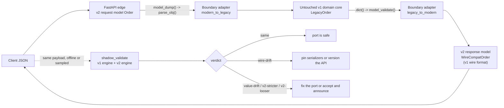

# Migrating from Pydantic v1 (1.10.27) to v2 (2.14.3): Behavioral Breaking Changes, pydantic.v1 Bridge, and Incremental Strangler Patterns

> [!summary] Claim
> A v1 -> v2 migration is a change of validation engine and wire format, not a rename of methods: run both engines on the same production payloads, classify every divergence as wire drift, value drift, stricter, or looser, and let only v2 models touch the API edge, because FastAPI 0.162.0 refuses `pydantic.v1` models outright and the two model families cannot nest.

Part of [Pydantic v2 Internals and Validation](README.md) in [API Engineering](../README.md).

## TL;DR

- Mechanism: Pydantic 2.14.3 ships the complete v1 library as `pydantic.v1` (its `VERSION` is `1.10.27`), so one interpreter can hold both engines, but a v1 model and a v2 model cannot be fields of each other, and the only safe crossing is a Python-object round trip (`legacy.dict()` -> `Modern.model_validate`).
- Contract rule: method renames (`dict` -> `model_dump`) are the cheap part; the expensive part is behavior that changes silently - `Decimal` and `timedelta` JSON encoding, smart unions, `int` and `str` coercion, `Optional` requiredness, subclass serialization, and equality.
- Trap: v1 config keys such as `orm_mode` survive in a v2 model's `model_config`, emit one `UserWarning` at import, and are never applied, so the code still imports and the failure appears later as a `model_type` error.
- Portability: the lab passed on CPython 3.12.13, 3.13.18, 3.14.6, 3.14.10, and 3.15.2; `pydantic.v1` has only "minimal support for Python 3.14" since 1.10.25 (pydantic 1.10.27 HISTORY.md), and FastAPI dropped it entirely in 0.128.0.
- When not to use the strangler: a service with a few dozen models and a full contract test suite should take one big-bang commit with bump-pydantic; the dual-engine bridge pays off only when the model graph is too large to switch atomically.

## Mental model



Requests enter through a v2 model because FastAPI 0.162.0 raises `PydanticV1NotSupportedError` for any route whose parameter or response annotation contains a `pydantic.v1.BaseModel`.
The edge hands the domain a v1 object built by the `modern_to_legacy` adapter, the untouched v1 core does its work, and `legacy_to_modern` re-validates the result into a v2 response model whose serializers are pinned to the old v1 JSON shapes.
Both adapters cross through Python objects, never through JSON, so `Decimal` precision survives the trip.
Off the request path, `shadow_validate` feeds the same captured payloads to both engines and labels each one, and the labels decide whether a model can be cut over, needs a pinned serializer, or needs an announced contract change.
The dotted branch is the strangler's safety net: each verdict is a fact about a real payload, not a guess from reading the migration guide.

## How it works

### Two engines in one process

Pydantic 2.x vendors the last v1 release under `pydantic/v1/`; in 2.14.3 `pydantic/v1/version.py` sets `VERSION = '1.10.27'` (pydantic 2.14.3 pydantic/v1/version.py, VERSION).
The v1 copy is the pure-Python 1.10 implementation: `ModelMetaclass.__new__` builds `ModelField` objects and validator lists in Python, and validation is a Python loop over those fields (pydantic 2.14.3 pydantic/v1/main.py, ModelMetaclass.__new__).
The v2 `BaseModel` instead compiles annotations into a `CoreSchema` dictionary and hands it to the Rust `SchemaValidator` and `SchemaSerializer` in `pydantic-core` 2.50.4; [[Pydantic-v2-Architecture-CoreSchema-and-Rust-Pydantic-Core]] covers that compiler.
Because the two engines share nothing but the import name, every v1 -> v2 difference below is a difference between a Python function in `pydantic/v1/validators.py` and a Rust validator, which is why the changes are behavioral and not just API renames.

From `pydantic>=1.10.17` the `pydantic.v1` namespace also exists inside the 1.x package, so a codebase can replace every `from pydantic.<module> import <object>` with `from pydantic.v1.<module> import <object>` while still on `pydantic>=1.10.17,<2`, then bump to 2.x with no further source change (Pydantic 2.14 migration guide, "Using Pydantic v1 features in a v1/v2 environment").
That one-line import rewrite is step zero of every strangler plan below: it decouples "which package version is installed" from "which engine each module uses".

### The import shim: PEP 562 `__getattr__` on the v2 package

Old import paths do not simply vanish in v2; `pydantic/_migration.py` installs a module-level `__getattr__` (PEP 562) that sorts each missing name into one of five buckets (pydantic 2.14.3 pydantic/_migration.py, getattr_migration):

| Bucket | Count in 2.14.3 | Behavior | Example |
| --- | --- | --- | --- |
| `MOVED_IN_V2` | 7 | returns the new object, warns `PydanticDeprecatedSince20` | `pydantic.utils:to_camel` -> `pydantic.alias_generators:to_pascal` |
| `DEPRECATED_MOVED_IN_V2` | 12 | returns the object from `pydantic.deprecated`, which warns on use | `pydantic:validate_arguments` |
| `REDIRECT_TO_V1` | 11 | returns the v1 object from `pydantic.v1.utils`, warns | `pydantic.utils:GetterDict` |
| `pydantic:BaseSettings` | 1 | raises `PydanticImportError` pointing at `pydantic-settings` | `from pydantic import BaseSettings` |
| `REMOVED_IN_V2` | 196 | raises `PydanticImportError` | `pydantic:ConstrainedInt`, `pydantic.errors:IntegerError` |

The counts are `len()` of each table, measured on CPython 3.14.6 against the installed 2.14.3 package, whose `_migration.py` is byte-identical to the `v2.14.3` tag on GitHub.
Note the dangerous bucket: `REDIRECT_TO_V1` hands a v2 module a v1 object without failing, so `from pydantic.utils import GetterDict` keeps importing after the upgrade while the thing it returns belongs to the other engine.

### Mixing is detected, then fails

A v1 model used as a v2 field reaches `GenerateSchema._generate_schema_from_get_schema_method`, which finds the v1 class's `__get_validators__`, warns ``Mixing V1 models and V2 models (or constructs, like `TypeAdapter`) is not supported``, and wraps the v1 validators in a `chain_schema` of plain validators (pydantic 2.14.3 pydantic/_internal/_generate_schema.py, GenerateSchema._generate_schema_from_get_schema_method).
The class definition succeeds; the first `model_validate` then raises `TypeError` because v1's `BaseModel.validate` is called with the v2 validator calling convention, which the lab captures as `TypeError: BaseModel.validate() takes 2 positional arguments but 3 were given` on 3.14.6.
In the other direction, v1's `find_validators` notices `__pydantic_core_schema__` on the type, warns `Mixing V1 and V2 models is not supported`, and raises `RuntimeError: no validator found ... see arbitrary_types_allowed` at class creation (pydantic 2.14.3 pydantic/v1/validators.py, find_validators).
So the bridge is a process-level bridge, not a model-level one: each model graph must be entirely v1 or entirely v2, and the migration unit is a connected component of the model graph, not a single class.

### Behavioral breaking changes, mechanism by mechanism

Each row below was executed in the lab or in a probe on CPython 3.14.6 with pydantic 2.14.3 and `pydantic.v1` 1.10.27; the "v1" column is what `pydantic.v1` does, the "v2" column is `pydantic.BaseModel`.

| Change | v1 1.10.27 | v2 2.14.3 | Source of the difference |
| --- | --- | --- | --- |
| `x: Optional[int]` with no default | optional, default `None` | required (`missing`), accepts `None` | migration guide, required and optional fields |
| `x: Any` with no default | optional, default `None` | required | migration guide |
| `int` field given `1.9` | `1` (silent truncation via `int(v)`) | `int_from_float` error | v1 `int_validator` calls `int(v)` |
| `int` field given `"2.0"` | `type_error.integer` (`int("2.0")` raises) | `2` | v2 lax mode accepts float-formatted strings with zero fraction |
| `int` field given `1e20` | `100000000000000000000` | `int_parsing_size` | measured; the probe also rejects `2.0**63`, see Numbers |
| `str` field given `123` or `1.5` | `"123"`, `"1.5"` | `string_type` error | v1 `str_validator` stringifies `int`, `float`, `Decimal`; v2 needs `coerce_numbers_to_str=True` |
| `Union[int, str]` given `"42"` | `42` (left to right, first success wins) | `"42"` (smart mode: exact type match wins) | v2 `union_mode='smart'` default; `Field(union_mode='left_to_right')` restores v1 |
| `dict` field given `[("a", 1)]` | `{"a": 1}` | `dict_type` error | migration guide, iterables of pairs |
| `dict` field given an `OrderedDict` | `OrderedDict` kept | plain `dict` | input types not preserved in v2 |
| `TypeError` raised in a validator | wrapped into `ValidationError` | propagates as `TypeError` | migration guide, validator changes |
| Model `==` plain `dict` | `True` if `self.dict() == other` | `False` | v1 `BaseModel.__eq__` compares `dict()`; v2 `BaseModel.__eq__` requires `BaseModel` of the same type, equal private and extra state |
| Nested field holding a subclass instance | subclass-only fields serialized | only the annotated type's fields serialized | v2 serializer is built from the annotation |
| `Decimal("1.10")` in JSON | `1.1` (a JSON number, via `float`) | `"1.10"` (a JSON string) | v2 serializes `Decimal` as string |
| `timedelta(hours=1, seconds=1.5)` in JSON | `3601.5` | `"PT1H1.5S"` | v2 `ser_json_timedelta='iso8601'` default |
| `datetime` with UTC tz in JSON | `"2026-01-01T00:00:00+00:00"` | `"2026-01-01T00:00:00Z"` | different datetime encoders |
| `AnyUrl("https://example.com")` | `str` subclass, `"https://example.com"` | not a `str`, `"https://example.com/"` | migration guide: v2 URL types no longer inherit from `str`, and an empty path gets a trailing slash |
| `dict` key `None` in JSON | `"null"` | `"None"` | v2 uses `str(key)` |
| `.json()` separators | `", "` and `": "` (stdlib `json.dumps`) | compact | v2 `model_dump_json` is written in Rust |
| `pattern` / `regex` with lookahead `(?=...)` | works (Python `re`) | `SchemaError` at class creation | v2 defaults to the Rust `regex` crate; `regex_engine='python-re'` restores |
| Error `type` strings | `value_error.missing`, `type_error.integer` | `missing`, `int_parsing`, plus `input` and `url` keys | different error model; v2 `errors()` adds `input`, `ctx`, `url` |
| JSON Schema of `Optional[int] = None` (property `title` omitted) | `{"type": "integer"}` | `{"anyOf": [{"type": "integer"}, {"type": "null"}], "default": null}` | v2 emits null explicitly; draft 2020-12 target |
| Nested model instance passed in | shallow copy (`copy_on_model_validation='shallow'`) | same object, no copy (`revalidate_instances='never'`) | v1 `BaseModel.validate` copies |

The rows split into four classes that the lab names as verdicts.
Wire drift (`Decimal`, `timedelta`, `datetime`, `AnyUrl`, `None` keys) means both engines accept the input and agree on the Python value but emit different bytes, so every API consumer sees a change while every unit test that compares Python objects passes.
Value drift (smart unions, input type preservation) means both accept but the parsed value differs, which breaks code downstream of validation.
`v2-stricter` (float truncation, number -> `str`, pairs -> `dict`, `Optional` requiredness) means a payload that v1 accepted is now a `422`; this is mostly the point of v2, because v1's `int(1.9) == 1` was silent data loss.
`v2-looser` (`"2.0"` -> `2`) is the class reviewers forget: v2 accepts inputs v1 rejected, which can widen an attack surface or break a negative contract test.

### Validators, config, and the silent no-op

`@validator` and `@root_validator` still exist in v2 as deprecated shims, but `each_item=True` is gone (annotate the item type instead), `always=True` maps to `Field(validate_default=True)`, the `values`, `field`, and `config` parameters become one `ValidationInfo`, and `@root_validator` without `skip_on_failure=True` is rejected (Pydantic 2.14 migration guide); [[Functional-Validators-Before-After-Wrap-and-Plain]] and [[Model-Validators-ValidationInfo-Context-and-Cross-Field-Invariants]] cover the replacements.
Config is where migrations fail quietly.
`check_deprecated` in `pydantic/_internal/_config.py` compares the user's config keys with `V2_RENAMED_KEYS` (10 entries, for example `orm_mode` -> `from_attributes`, `allow_population_by_field_name` -> `validate_by_name`, `validate_all` -> `validate_default`) and `V2_REMOVED_KEYS` (10 entries, for example `smart_union`, `copy_on_model_validation`, `underscore_attrs_are_private`), and its only action is `warnings.warn(message, UserWarning)` (pydantic 2.14.3 pydantic/_internal/_config.py, check_deprecated).
The key is still copied into `model_config`, so `Model.model_config == {'orm_mode': True}` and `from_attributes` stays off; the lab proves the result is a `model_type` error on the first `model_validate(orm_row)`.
Note that the source maps `allow_population_by_field_name` to `validate_by_name`, while the migration guide prose names `populate_by_name` "or `validate_by_name` in v2.11+"; trust the table in the installed source.

### Deprecated method shims and how to make them fatal

`BaseModel.dict`, `.json`, `.copy`, `.parse_obj`, `.parse_raw`, `.schema`, `.update_forward_refs`, and `__fields__` remain on the v2 class and forward to `model_dump`, `model_dump_json`, `model_copy`, `model_validate`, `model_validate_json`, `model_json_schema`, `model_rebuild`, and the model's field table, each emitting `PydanticDeprecatedSince20` (pydantic 2.14.3 pydantic/main.py, BaseModel.dict).
`.from_orm` is stricter than the others: it raises `PydanticUserError` ("You must set the config attribute `from_attributes=True` to use from_orm") unless `model_config['from_attributes']` is set, and only then calls plain `model_validate(obj)` (pydantic 2.14.3 pydantic/main.py, BaseModel.from_orm), so a model still carrying `orm_mode = True` fails here too.
`PydanticDeprecatedSince20` subclasses `PydanticDeprecationWarning`, which subclasses `DeprecationWarning` (pydantic 2.14.3 pydantic/warnings.py, PydanticDeprecatedSince20), which Python hides outside `__main__` by default, so the shims are invisible in production logs.
The lab's `test_deprecated_v1_methods_can_be_made_fatal` shows the CI lever: `warnings.simplefilter("error", PydanticDeprecatedSince20)` turns every surviving `.dict()` call into an exception, which is how a team ratchets a migrated module to "no shim calls left".
`model_copy(update=...)` (like v1 `copy(update=...)`) does not validate the update; the probe shows `P2(x=1).model_copy(update={"x": "not an int"}).x == "not an int"` in both engines, so a copy-with-update idiom carried over from v1 still bypasses validation.

### `bump-pydantic`: what the codemod does and does not do

`bump-pydantic` is the Pydantic team's codemod, run as `bump-pydantic --diff <path>` then `bump-pydantic <path>`; its ten rules are BP001 (add default `None` to `Optional[T]`, `Union[T, None]`, and `Any` fields), BP002 (`Config` -> `model_config`), BP003 (old `Field` parameters), BP004 (imports, including `BaseSettings`), BP005 (`GenericModel` -> `BaseModel`), BP006 (`__root__` -> `RootModel`), BP007 (`@validator` and `@root_validator`), BP008 (`con*` functions -> `Annotated`), BP009 (TODOs for custom-type protocol methods), and BP010 (annotations or TODOs for unannotated fields) (bump-pydantic README).
As of 2026-11 the GitHub repository page shows the project archived (read-only since 2026-05-27), so it receives no fixes for newer syntax.
Every rule is syntactic: none of them touches the wire-drift, value-drift, stricter, or looser rows above, which is exactly why the codemod output must be followed by shadow validation rather than treated as the migration.

### Python 3.14 and the end of the bridge

Python 3.14 makes annotations lazily evaluated (PEP 649 and PEP 749), so a metaclass no longer finds `__annotations__` in the class namespace (unless the module uses `from __future__ import annotations`); it must call `annotationlib.get_annotate_from_class_namespace` and `call_annotate_function(annotate, format=Format.FORWARDREF)` (Python `annotationlib` documentation, "Using annotations in a metaclass"; PEP 749, "Annotations and metaclasses", which says classes under the future import keep their `__annotations__` class-dictionary entry).
v1 1.10.24 (2025-09-25) only added a warning that "Pydantic V1 will *not* work with Python 3.14 and greater", and Pydantic 2.12.0 (2025-10-07) repeated "Pydantic V1 is not compatible with Python 3.14 and greater" (pydantic 1.10.27 HISTORY.md; pydantic 2.14.3 changelog).
v1 1.10.25 (2025-12-18) then added "minimal support for Python 3.14", and the bundled copy now branches on `sys.version_info >= (3, 14)` inside `ModelMetaclass.__new__` to read annotations through exactly that `annotationlib` path (pydantic 2.14.3 pydantic/v1/main.py, ModelMetaclass.__new__).
FastAPI's how-to page at 0.162.0 still says `pydantic.v1` "is no longer supported in Python 3.14 and above", which predates 1.10.25; the lab shows the v1 models used here working on 3.14.6, 3.14.10, and 3.15.2, but "minimal support" is the maintainers' own ceiling, so treat 3.14+ as a deadline, not a platform.

### FastAPI's window closed

FastAPI 0.119.0 (2025-10-11) temporarily allowed `pydantic.v1` and v2 models in one app, 0.126.0 (2025-12-20) dropped the Pydantic 1.x package and raised the floor to `pydantic >=2.7.0`, 0.127.0 (2025-12-21) added deprecation warnings for `pydantic.v1`, and 0.128.0 (2025-12-27) dropped `pydantic.v1` entirely (FastAPI 0.162.0 docs/en/docs/release-notes.md).
At 0.162.0, `annotation_is_pydantic_v1` walks unions and sequences looking for a `pydantic.v1.BaseModel` subclass (fastapi 0.162.0 fastapi/_compat/shared.py, annotation_is_pydantic_v1), and `create_model_field` raises `PydanticV1NotSupportedError` when it finds one (fastapi 0.162.0 fastapi/utils.py, create_model_field).
The lab's `test_fastapi_rejects_v1_models_at_route_registration` hits that error when a v1 model is merely a body parameter, at `app.post(...)` decoration time, before any request.
That is why the strangler in this note is edge-first: on current FastAPI the request and response models must be v2 on day one, and v1 can survive only behind the boundary adapters.

### The strangler fig, concretely

The strangler fig pattern migrates a system by routing traffic through a new facade and replacing the old core piece by piece; for Pydantic the facade is the set of v2 edge models, and the pieces are connected components of the model graph.
1. Rewrite imports to `from pydantic.v1.<module> import <object>` on 1.10.17+, then upgrade to 2.x with zero behavior change.
2. Port the edge (request and response models) to v2, with `WireCompat` serializers that pin the v1 JSON shapes, and put `modern_to_legacy` and `legacy_to_modern` at the boundary.
3. Capture real payloads (request logs, queue messages, fixtures) and run `shadow_validate` against each legacy and modern model pair in CI; every non-`same` verdict becomes a ticket or a documented contract change.
4. Port domain components one connected model graph at a time, moving the adapters inward; ratchet each migrated package with `PydanticDeprecatedSince20` set to `error` and a `unapplied_v1_config_keys` check.
5. Remove the `WireCompat` serializers behind an API version bump, using the deprecation workflow in [[Deprecation-Header-RFC-9745-and-Sunset-Header-RFC-8594]], and delete `pydantic.v1` imports before the interpreter moves past what 1.10.x supports.

## Numbers and limits

| Quantity | Value | Source |
| --- | --- | --- |
| v1 version bundled in pydantic 2.14.3 | `1.10.27` | pydantic 2.14.3 pydantic/v1/version.py, VERSION |
| Renamed v1 config keys v2 warns about and ignores | 10 | pydantic 2.14.3 pydantic/_internal/_config.py, V2_RENAMED_KEYS |
| Removed v1 config keys v2 warns about and ignores | 10 | pydantic 2.14.3 pydantic/_internal/_config.py, V2_REMOVED_KEYS |
| Import paths that raise `PydanticImportError` | 196 (+1 for `BaseSettings`) | `len(REMOVED_IN_V2)`, measured, CPython 3.14.6 |
| Import paths silently redirected to `pydantic.v1` | 11 | `len(REDIRECT_TO_V1)`, measured, CPython 3.14.6 |
| bump-pydantic rules | 10 (BP001 to BP010) | bump-pydantic README (as of 2026-11) |
| v1 maximum digits in an `int` string | 4,300 | pydantic 2.14.3 pydantic/v1/validators.py, max_str_int |
| CPython default `int` string digit limit | 4,300 | `sys.int_info.default_max_str_digits`, measured, CPython 3.14.6 |
| v2 `int` from 4,300-digit string / 4,301-digit string | accepted / `int_parsing_size` | measured probe, CPython 3.14.6, pydantic 2.14.3 |
| v2 `int` from float `1e20` or `2.0**63` | `int_parsing_size` (v1 accepts both) | measured probe, CPython 3.14.6 |
| FastAPI releases accepting `pydantic.v1` models | 0.119.0 to 0.127.1 (2025-10-11 to 2025-12-26) | FastAPI release notes at 0.162.0 |
| First v1 release with minimal Python 3.14 support | 1.10.25 (2025-12-18) | pydantic 1.10.27 HISTORY.md |
| v1 releases fixing the quadratic `unique_items` and duration-regex advisories | 1.10.27 (2026-10-29) | GHSA-49g6-96jj-f7r9, GHSA-jfv7-ghgv-gx4x |
| Lab runtime, 20 tests | 0.43 s (one run, so noisy) | `uv run --frozen pytest ... -q`, CPython 3.14.6, macOS 27.3 arm64 (`uname -r` `27.3.0`), 2026-11 |

No throughput number for v1 versus v2 is given here because none was measured in this lab; [[Pydantic-v2-Performance-Engineering-vs-MsgSpec-and-ORJSON]] owns benchmarking.

## Portability

| Behavior proven by the lab | 3.12.13 | 3.13.18 | 3.14.6 | 3.14.10 | 3.15.2 | 3.15t |
| --- | --- | --- | --- | --- | --- | --- |
| All 20 tests in the module | pass | pass | pass | pass | pass | not run |
| `pydantic.v1` model creation and validation | pass | pass | pass (annotationlib path) | pass (annotationlib path) | pass (annotationlib path) | not run |
| Mixing raises `TypeError` / `RuntimeError` with `UserWarning` | pass | pass | pass | pass | pass | not run |
| FastAPI 0.162.0 `PydanticV1NotSupportedError` | pass | pass | pass | pass | pass | not run |

- The 3.14.6 column is the workspace interpreter (`labs/.python-version` `3.14`) and was re-run during the independent fact-check; the other columns are the drafter's single runs, not re-run by the fact-checker because lab matrix checks were paused on 2026-11-11; they ran once each with `UV_PROJECT_ENVIRONMENT` pointing at a throwaway environment and `uv run --frozen --python <v>`.
- The free-threaded leg was not run: the only free-threaded 3.15 available here is `3.15.0b3`, and `uv` could not install the workspace because `psycopg-binary==3.3.8` has no wheel for it; this is an environment gap, not a Pydantic result.
- The matrix pins in STYLE.md (3.12.16, 3.14.10, 3.15.2) differ from what `uv` provides on this machine for 3.12; the table records the versions that actually ran.
- Library point releases: the bridge behavior is version-sensitive in three places, all cited above - `pydantic.v1` inside 1.x needs `>=1.10.17`, Python 3.14 needs v1 `>=1.10.25`, and FastAPI accepts `pydantic.v1` only in 0.119.0 to 0.127.1.
- Servers and HTTP versions: nothing in this note depends on Uvicorn, Hypercorn, Granian, or HTTP/1.1 versus HTTP/2 or HTTP/3, because validation and serialization happen inside the application before bytes reach the server; the lab runs in-process through `httpx.ASGITransport` and was not run under any server.

## Worked example

The lab is [implementation](../labs/src/api_labs/f09_pydantic_v2_internals_and_validation/v1_to_v2_migration.py) plus [test](../labs/tests/f09_pydantic_v2_internals_and_validation/test_migrating_large_codebases_from_pydantic_v1_to_v2.py).
It defines one legacy v1 `LegacyOrder`, a straight bump-pydantic-style port `Order`, and a contract-preserving port `WireCompatOrder`, then measures the difference between them with a shadow validator.

The v1 model and its two v2 ports (simplified excerpt; the line-item models are omitted):

```python
class LegacyOrder(pydantic_v1.BaseModel):
    order_id: int | str
    customer_note: str | None  # v1: implicitly optional with default None
    items: list[LegacyLineItem]
    hold_for: timedelta = timedelta(0)


class Order(BaseModel):
    order_id: int | str
    customer_note: str | None = None  # BP001: the implicit v1 default made explicit
    items: list[LineItem]
    hold_for: timedelta = timedelta(0)


V1JsonDecimal = Annotated[Decimal, PlainSerializer(float, return_type=float, when_used="json")]
V1JsonTimedelta = Annotated[
    timedelta, PlainSerializer(_seconds, return_type=float, when_used="json")
]


class WireCompatOrder(BaseModel):
    order_id: int | str = Field(union_mode="left_to_right")
    customer_note: str | None = None
    items: list[WireCompatLineItem]
    hold_for: V1JsonTimedelta = timedelta(0)
```

`WireCompatOrder` keeps the v2 engine and its stricter coercion but pins the three observable v1 behaviors a client could depend on: `Decimal` as a JSON number, `timedelta` as float seconds, and left-to-right unions.
`when_used="json"` matters: `model_dump()` in Python mode still returns `Decimal` and `timedelta`, so internal code is not downgraded to floats.

The shadow validator's classification (simplified excerpt):

```python
    @property
    def verdict(self) -> Verdict:
        if self.v1_outcome == "rejected" and self.v2_outcome == "rejected":
            return "both-rejected"
        if self.v1_outcome == "accepted" and self.v2_outcome == "rejected":
            return "v2-stricter"
        if self.v1_outcome == "rejected":
            return "v2-looser"
        if self.v1_python != self.v2_python:
            return "value-drift"
        if self.v1_wire != self.v2_wire:
            return "wire-drift"
        return "same"
```

`shadow_validate` runs `legacy.parse_obj` and `modern.model_validate` on the same payload, stores `dict()` and `model_dump()` as the Python view, and stores `json.loads(old.json())` and `json.loads(new.model_dump_json())` as the wire view, so separator differences between v1 (`", "`) and v2 (compact) never count as drift.

The boundary adapters (simplified excerpt; docstrings trimmed):

```python
def legacy_to_modern[M: BaseModel](legacy: pydantic_v1.BaseModel, modern: type[M]) -> M:
    return modern.model_validate(legacy.dict())


def modern_to_legacy[L: pydantic_v1.BaseModel](modern: BaseModel, legacy: type[L]) -> L:
    return legacy.parse_obj(modern.model_dump())
```

The test `test_adapter_preserves_decimal_where_json_bridge_corrupts_it` shows why the adapters avoid JSON: `Decimal("19.999999999999999999")` survives `legacy_to_modern` exactly, but `Order.model_validate_json(legacy.json())` yields `Decimal("20.0")`, because v1's JSON encoder turns `Decimal` into a `float` first.

What the tests prove, per verdict, against the straight port `Order`:

| Payload change | Verdict | v1 errors | v2 errors |
| --- | --- | --- | --- |
| baseline (`unit_price: "1.10"`, `hold_for: 3600`) | `wire-drift` (`1.1` vs `"1.10"`, `3600.0` vs `"PT1H"`) | none | none |
| `order_id: "42"` | `value-drift` (`42` vs `"42"`) | none | none |
| `quantity: 1.9` | `v2-stricter` | none | `int_from_float` |
| `sku: 123` | `v2-stricter` | none | `string_type` |
| `quantity: "2.0"` | `v2-looser` | `type_error.integer` | none |
| `quantity: "two"` | `both-rejected` | `type_error.integer` | `int_parsing` |

Against `WireCompatOrder`, the baseline and `order_id: "42"` both return `same`, which is the acceptance test for the contract-preserving port.
The edge app test posts `order_id: "42"` to a v2-only FastAPI route that delegates to the untouched v1 `legacy_reprice`, and gets back `{"order_id": 42, "customer_note": null, "items": [{"sku": "A-1", "quantity": 2, "unit_price": 0.99}], "hold_for": 3600.0}`: v1 wire shapes produced by a v2 edge around a v1 core.

Captured run (CPython 3.14.6, macOS 27.3 arm64, pydantic 2.14.3, `pydantic.v1` 1.10.27, FastAPI 0.162.0), from `labs/`:

```text
$ uv run --frozen pytest tests/f09_pydantic_v2_internals_and_validation/test_migrating_large_codebases_from_pydantic_v1_to_v2.py -q
....................                                                     [100%]
20 passed in 0.43s
```

## Pitfalls

> [!warning] Renamed config key silently ignored
> Trigger: a ported model keeps `class Config: orm_mode = True` or `allow_population_by_field_name = True`.
> Symptom: one `UserWarning` at import ("Valid config keys have changed in V2"), then `model_type` errors on `model_validate(orm_row)`, or aliased fields rejected by field name.
> It hides in FastAPI apps because `ModelField.validate` always passes `from_attributes=True` for response values (fastapi 0.162.0 fastapi/_compat/v2.py, ModelField.validate), so the endpoint works while the same model fails in a worker that calls `model_validate` directly.
> Fix: run `unapplied_v1_config_keys` (or `-W error::UserWarning` at import) in CI and port keys with the table in `V2_RENAMED_KEYS`.

> [!warning] Wire drift that unit tests cannot see
> Trigger: a model with `Decimal`, `timedelta`, `datetime`, or URL fields moves to v2 and its tests compare `model_dump()` Python values.
> Symptom: all tests pass; clients receive `"1.10"` instead of `1.1`, `"PT1H"` instead of `3600.0`, and `"https://example.com/"` with a new trailing slash; strictly typed clients reject the response.
> Fix: compare JSON, not Python objects (`shadow_validate` does), pin serializers with `PlainSerializer(..., when_used="json")` for the transition, and treat the eventual switch as a breaking change per [[Anatomy-of-Breaking-Changes-in-HTTP-and-JSON-APIs]].

> [!warning] Smart unions reorder your data
> Trigger: `order_id: Union[int, str]` relied on v1 trying `int` first.
> Symptom: `"42"` stays a `str` in v2, cache keys and database lookups miss, and `==` comparisons with ints fail.
> Fix: `Field(union_mode="left_to_right")` for a faithful port, or a discriminated union per [[Discriminated-Unions-Tag-and-Callable-Discriminator-Dispatch]] when the ambiguity is a design bug.

> [!warning] Nesting across engines
> Trigger: a v2 model gets a field typed with a not-yet-migrated v1 model, or the reverse.
> Symptom: v2 side: a `UserWarning` at import and `TypeError` on first validation; v1 side: `RuntimeError: no validator found` at import.
> Fix: migrate the whole connected model graph together, or convert at the boundary with `legacy_to_modern` / `modern_to_legacy`, never by nesting.

> [!warning] Bridging through JSON loses money
> Trigger: an adapter written as `Modern.model_validate_json(legacy.json())`.
> Symptom: `Decimal` values round through IEEE 754 `float`; the lab turns `19.999999999999999999` into `20.0`.
> Fix: bridge through Python objects (`legacy.dict()`), and keep money as `Decimal` or integer minor units per [[Monetary-Quantities-Timestamps-Timezones-and-Locale-Contracts]].

> [!warning] Removed `extra` behavior and validation bypasses in the bridge itself
> Trigger: keeping `pydantic.v1` dataclasses with `extra=allow`, or running a v2 release in `>=2.13.0, <2.14.2` that validates untrusted JSON into models with `extra='allow'` and a typed `__pydantic_extra__`.
> Symptom: GHSA-r49w-vh47-r4hf: a `__pydantic_initialised__` key made a v1 dataclass treat itself as already validated and skip field validation (patched in 1.10.27); GHSA-qpmf-fgh3-ff25: in JSON mode, `validate_json_by_iteration` stored extra keys without validating them against the key type declared on `__pydantic_extra__` (patched in 2.14.2; Python-mode validation was not affected).
> Separately, 2.14.2 changed JSON validation so keys that only match an unused alias or field name count as extra data, which turns some previously accepted payloads into `extra_forbidden` errors (pydantic 2.14.3 changelog, PR 13275).
> Fix: pin `pydantic>=2.14.2`, rerun shadow validation after every minor bump, and treat the bundled v1 as security-patched only as far as its maintainers choose to backport.

## Security and robustness

- Mass assignment and data exposure (OWASP API3:2023 Broken Object Property Level Authorization): v1 serialized subclass-only fields of a nested value, so returning a `StoredUser` where the response field was typed `PublicUser` leaked the extra columns; the lab's `test_subclass_fields_leak_only_in_v1` shows `tax_id` present in v1 output and absent in v2.
  The migration closes that leak; re-opening it with `serialize_as_any=True` or the 2.13 `polymorphic_serialization` option should require security review.
- Input validation: v2 rejects `1.9` for an `int` instead of truncating, rejects numbers for `str`, and refuses large floats such as `1e20` for `int`, which removes several silent-corruption paths; but v2 also accepts `"2.0"` for `int`, so negative contract tests that asserted rejection must be rerun.
- Resource exhaustion (OWASP API4:2023 Unrestricted Resource Consumption): staying on `pydantic.v1` means relying on the pure-Python validators, and 1.10.27 is the release that fixed quadratic `unique_items` checking (GHSA-49g6-96jj-f7r9, "a few hundred kilobytes takes seconds") and the quadratic ISO 8601 duration regex (GHSA-jfv7-ghgv-gx4x, "a few dozen kilobytes takes seconds"), and both advisories tell users of the bundled `pydantic.v1` namespace to upgrade to pydantic 2.14.2 or later; older v1 lines also carried CVE-2021-29510 (`"infinity"` datetime infinite loop, fixed in 1.8.2, 1.7.4, and 1.6.2) and CVE-2024-3772 (email ReDoS, fixed in 1.10.13 and 2.4.0).
- Integer parsing: v1 caps `int` strings at 4,300 characters in `int_validator`, matching CPython's own CVE-2020-10735 mitigation, and v2 rejected a 4,301-digit string with `int_parsing_size` in the probe; keep request body size limits at the edge regardless, because the cap is per field.
- Regex: the Rust `regex` crate documents that "all regex searches in this crate have worst case `O(m * n)` time complexity" and that it does not support look-around and backreferences (regex crate documentation on docs.rs), so a migrated `pattern` either fails loudly at import or becomes ReDoS-safe; switching to `regex_engine='python-re'` to silence the failure re-imports backtracking risk.
- Defense in depth: run shadow validation offline on captured payloads, not inline on the hot path of every request; dual validation doubles CPU per request and, if both results are logged, doubles the volume of potentially sensitive payload data in logs.

## The principal's view

The decision is not "v1 or v2", which the ecosystem already made, but "big bang or strangler, and where the seam goes".
A big-bang migration (bump-pydantic, fix the TODOs, one release) is right when the model graph is small, the team owns every consumer, and there is a contract test suite that compares JSON bytes; its cost is one risky release, and its failure mode is wire drift that no test was looking for.
A strangler migration is right when the model graph spans many teams or packages, because the inability to nest v1 and v2 models forces the unit of migration to be a connected component, and only a facade plus adapters lets components move independently.
Its cost is real: two engines in one process, adapter code at every seam, a shadow-validation harness, and a deadline set by others - FastAPI already refuses `pydantic.v1`, and v1 has only minimal support on Python 3.14+.
The organizational lever is to make divergence visible as data: a weekly report of `shadow_validate` verdicts per model turns "is the migration safe?" from an opinion into a burn-down chart, and it tells product owners exactly which client-visible changes need an API version per [[Compatibility-Taxonomy-Wire-Source-and-Semantic-Compatibility-AIP-180]].
Choose differently when Pydantic is the wrong tool for the hot path: if the motive for migrating is throughput on a message bus, compare with `msgspec` before paying for a v2 port ([[Pydantic-v2-Performance-Engineering-vs-MsgSpec-and-ORJSON]]); and if the API contract is the product, consider generating both the models and the clients from OpenAPI so the schema, not the library version, defines the wire ([[Generating-Pydantic-v2-Models-from-OpenAPI-with-Datamodel-Code-Generator]]).

## Interview questions

> [!question] L5: Predict the output: in v1 and in v2, what does `M(u="42").u` return for `class M(BaseModel): u: Union[int, str]`, and what about `N(i=1.9).i` for `i: int`?
>
> > [!success]- Answer
> > v1 returns `42` (an `int`), because v1 tries union members left to right and `int("42")` succeeds first.
> > v2 returns `"42"` (a `str`), because smart mode prefers an exact type match over a coercion.
> > For `i: int`, v1 returns `1`, silently truncating via `int(1.9)`, and v2 raises `ValidationError` with type `int_from_float`.
> > The lab's `test_shadow_union_order_is_value_drift` and the `float-truncation` case pin both.
> >
> > Follow-up: How do you get the v1 union behavior back for one field without changing the rest of the model?

> [!question] L5: Why does a v2 model with `x: Optional[int]` and no default reject `{}`, when the same v1 model accepted it?
>
> > [!success]- Answer
> > In v1, `Optional[T]` implied a default of `None`, so the field was optional.
> > In v2, requiredness depends only on whether a default exists, and `Optional` only means `None` is an allowed value.
> > So v2 reports `missing`, and bump-pydantic's BP001 rule adds `= None` to restore v1 behavior.
> > The same applies to `Any` without a default.
> >
> > Follow-up: When is a required-but-nullable field the right API design, and how does it appear in the JSON Schema?

> [!question] L6: Debug this API: after the v2 migration `GET /users/1` still works, but a nightly export job calling `UserOut.model_validate(orm_user)` fails with `Input should be a valid dictionary or instance of UserOut` - what happened?
>
> > [!success]- Answer
> > `UserOut` still has `class Config: orm_mode = True`.
> > v2 renamed it to `from_attributes`, and `check_deprecated` only emits a `UserWarning` while copying the dead key into `model_config`, so attribute access stays disabled.
> > The endpoint works because FastAPI's `ModelField.validate` passes `from_attributes=True` on every response validation, masking the bug.
> > The job calls `model_validate` directly, so it gets `model_type`.
> > Fix: `model_config = ConfigDict(from_attributes=True)`, and add a CI check such as `unapplied_v1_config_keys` or `-W error::UserWarning` at import.
> >
> > Follow-up: What else in the codebase might rely on a framework quietly supplying a behavior the model no longer declares?

> [!question] L6: Your v2 migration passed every unit test, yet a mobile client broke the day it shipped - which changes are most likely, and how would you have caught them?
>
> > [!success]- Answer
> > Wire drift: `Decimal` becomes a JSON string (`"1.10"` instead of `1.1`), `timedelta` becomes ISO 8601 (`"PT1H"` instead of `3600.0`), UTC datetimes end in `Z`, URLs gain a trailing slash, and `None` dict keys become `"None"`.
> > Unit tests compared `model_dump()` Python values, which are identical in both engines, so they could not see it.
> > Catch it by comparing serialized JSON from both engines on real payloads (shadow validation), or by contract tests on response bytes and OpenAPI diffs.
> >
> > Follow-up: Would you pin the old wire format with serializers or version the API, and what decides it?

> [!question] L6: Why can't you put a `pydantic.v1` model inside a v2 model during a gradual migration, and what do you do instead?
>
> > [!success]- Answer
> > The engines share no schema representation: v2 needs a `CoreSchema`, and a v1 model only offers `__get_validators__`.
> > v2 wraps those validators with a warning and then fails with `TypeError` at validation time; v1 finds `__pydantic_core_schema__`, warns, and raises `RuntimeError: no validator found` at class creation.
> > So the migration unit is a connected component of the model graph, and components meet only through adapters that go `legacy.dict()` -> `Modern.model_validate` and back.
> >
> > Follow-up: Why must that adapter not go through JSON?

> [!question] L6: Which v2 changes make validation looser rather than stricter, and why do they matter?
>
> > [!success]- Answer
> > v2 lax mode accepts float-formatted strings with a zero fraction for `int`, so `"2.0"` becomes `2`, while v1 raised `type_error.integer`.
> > Looser parsing can widen an attack surface or break negative contract tests that expected `422`.
> > The lab labels this `v2-looser`, and the fix is `strict=True` on the field or model when rejection was part of the contract.
> >
> > Follow-up: How would you find every looser case across a codebase with hundreds of models?

> [!question] L7+: Design the migration of a 600-model monorepo used by 40 services, with FastAPI at 0.162.0 and Python moving to 3.14 next quarter.
>
> > [!success]- Answer
> > Step zero: rewrite imports to `pydantic.v1` on 1.10.17+, then upgrade the package so engine choice is per module.
> > Because FastAPI 0.128.0+ rejects `pydantic.v1` at route registration, port every edge model first, with serializers pinning the v1 wire format and adapters at the seam.
> > Build the model graph, compute its connected components, and schedule them leaf-first, since components are the smallest unit that can switch engines.
> > Run shadow validation on captured payloads in CI, publish verdict counts per component, and gate each cutover on zero unexplained verdicts.
> > Ratchet migrated packages with `PydanticDeprecatedSince20` as an error and a config-key audit.
> > Treat Python 3.14 as the deadline for removing `pydantic.v1`, because v1 has only minimal support there.
> >
> > Follow-up: What would make you abandon the strangler and do a big-bang cutover instead?

> [!question] L7+: How does the migration close a data-exposure hole and open a compatibility hole at the same time, and what is the governance decision?
>
> > [!success]- Answer
> > The closed hole: v1 serialized subclass-only fields of nested values, so returning an internal subclass leaked its extra fields; v2 serializes only the annotated type's fields.
> > The opened hole: clients that consumed those accidentally exposed fields break, and teams under pressure may enable `serialize_as_any` or polymorphic serialization to restore them.
> > The governance call is to treat the leaked fields as never part of the contract, announce their removal with deprecation and sunset dates, and require security review for any polymorphic serialization flag.
> >
> > Follow-up: How would an OpenAPI diff between the v1 and v2 schemas help or fail to help here?

> [!question] L5: What does `bump-pydantic` change, and what can it never change?
>
> > [!success]- Answer
> > It rewrites syntax: `Config` to `model_config`, `Field` parameters, imports, `GenericModel`, `__root__` to `RootModel`, validator decorators, `con*` functions to `Annotated`, and adds `= None` to `Optional` fields.
> > It cannot change runtime semantics such as JSON encoding, smart unions, coercion strictness, or equality, because those are engine behaviors, not syntax.
> > It also leaves TODO comments where it cannot decide, and the repository is archived as of 2026-11.
> >
> > Follow-up: How would you verify a bump-pydantic diff before merging it?

## Related

Prerequisites: [[Pydantic-v2-Performance-Engineering-vs-MsgSpec-and-ORJSON]]

Next: [[WSGI-PEP-3333-vs-ASGI-3-0-Architectural-Shift]]

See also: [[02-Programming-Languages/Python/Python-Backend-Interview-Prep/04-FastAPI]], [[Pydantic-v2-Architecture-CoreSchema-and-Rust-Pydantic-Core]], [[Lax-vs-Strict-Validation-Modes-and-Coercion-Tables]], [[Functional-Validators-Before-After-Wrap-and-Plain]], [[Model-Validators-ValidationInfo-Context-and-Cross-Field-Invariants]], [[Custom-Serialization-Field-Model-and-Wrap-Serializers]], [[ORM-Mode-From-Attributes-and-Preventing-Accidental-Lazy-Loads]], [[Pydantic-Settings-Environment-Secret-Files-and-Source-Priority]], [[Discriminated-Unions-Tag-and-Callable-Discriminator-Dispatch]], [[Anatomy-of-Breaking-Changes-in-HTTP-and-JSON-APIs]], [[Compatibility-Taxonomy-Wire-Source-and-Semantic-Compatibility-AIP-180]], [[Monetary-Quantities-Timestamps-Timezones-and-Locale-Contracts]], [[Deprecation-Header-RFC-9745-and-Sunset-Header-RFC-8594]], [[Breaking-Change-Detection-and-Semantic-OpenAPI-Diffing]], [[Mounting-Sub-Applications-WSGI-Legacy-Strangler-and-Static-Assets]], [[Generating-Pydantic-v2-Models-from-OpenAPI-with-Datamodel-Code-Generator]]

- Lab: `labs/tests/f09_pydantic_v2_internals_and_validation/test_migrating_large_codebases_from_pydantic_v1_to_v2.py`

## Further reading

- [Pydantic 2.14 migration guide](https://pydantic.dev/docs/validation/2.14/migration/) - the maintainers' list of renamed APIs and changed behaviors; the starting checklist, not the whole story.
- [pydantic v2.14.3 pydantic/_migration.py](https://github.com/pydantic/pydantic/blob/v2.14.3/pydantic/_migration.py) - the exact moved, redirected, and removed import tables behind the PEP 562 shim.
- [pydantic v2.14.3 pydantic/_internal/_config.py](https://github.com/pydantic/pydantic/blob/v2.14.3/pydantic/_internal/_config.py) - `V2_RENAMED_KEYS`, `V2_REMOVED_KEYS`, and the warn-only `check_deprecated`.
- [pydantic v1.10.27 HISTORY.md](https://github.com/pydantic/pydantic/blob/v1.10.27/HISTORY.md) - the v1 line's Python 3.14 timeline and the 1.10.27 security fixes.
- [bump-pydantic](https://github.com/pydantic/bump-pydantic) - the ten codemod rules and their limits.
- [FastAPI release notes at 0.162.0](https://github.com/fastapi/fastapi/blob/0.162.0/docs/en/docs/release-notes.md) - the 0.119.0 to 0.128.0 window for `pydantic.v1` models.
- [FastAPI 0.162.0 fastapi/_compat/shared.py](https://github.com/fastapi/fastapi/blob/0.162.0/fastapi/_compat/shared.py) - how FastAPI detects v1 models inside unions and sequences.
- [PEP 649](https://peps.python.org/pep-0649/) and [PEP 749](https://peps.python.org/pep-0749/) - deferred annotation evaluation, the Python 3.14 change that broke v1's metaclass.
- [Python annotationlib documentation](https://docs.python.org/3/library/annotationlib.html) - the "Using annotations in a metaclass" recipe the patched v1 metaclass follows.
- [GHSA-49g6-96jj-f7r9](https://github.com/pydantic/pydantic/security/advisories/GHSA-49g6-96jj-f7r9) and [GHSA-jfv7-ghgv-gx4x](https://github.com/pydantic/pydantic/security/advisories/GHSA-jfv7-ghgv-gx4x) - quadratic-time v1 validators fixed in 1.10.27, the cost of staying on the bridge.
