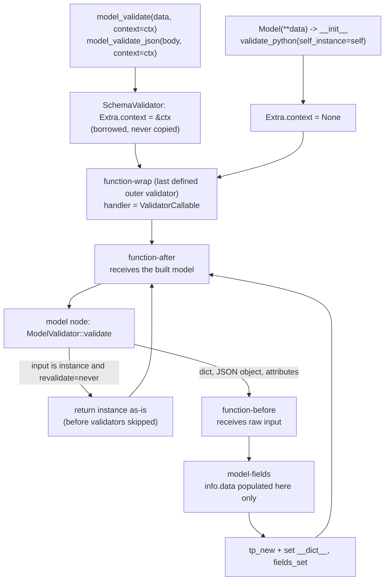

# Model-Level Validators (@model_validator mode='before'|'after'|'wrap') and Passing Runtime State via ValidationInfo.context

> [!summary] Claim
> A `@model_validator` is not a hook but a node in the compiled `CoreSchema`: `before` wraps the `model-fields` schema inside the `model` node, `after` and `wrap` wrap the `model` node from outside, and `ValidationInfo.context` is the one caller-supplied object reference that `pydantic-core` threads unchanged through every node, so context-dependent invariants are correct only if you know which entry points (`__init__`, instance inputs, `validate_assignment`, FastAPI response validation) call that chain with `context=None` or skip part of it.

Part of [Pydantic v2 Internals and Validation](README.md) in [API Engineering](../README.md).

## TL;DR

- Mechanism: `apply_model_validators(..., 'inner')` wraps `before` validators around `model-fields` inside `model_schema`, and `apply_model_validators(..., 'outer')` wraps `after` and `wrap` validators around the `model` schema, each later-defined validator wrapping the earlier ones (`pydantic 2.14.3 pydantic/_internal/_generate_schema.py, apply_model_validators`); `pydantic-core` builds a fresh `ValidationInfo` per call whose `context` is the same object passed to `model_validate(..., context=...)` (`pydantic-core 2.50.4 src/validators/function.rs, ValidationInfo::new`).
- Contract rule: a validator that needs runtime state must treat `info.context is None` as a validation failure (`PydanticCustomError`), never as a default, because `BaseModel.__init__`, FastAPI body and response validation, and `validate_assignment` all run the chain without context.
- Trap: an instance input skips `before` validators but re-runs `after` and `wrap` validators (`pydantic-core 2.50.4 src/validators/model.rs, ModelValidator::validate`), a failed `validate_assignment` leaves the rejected value written (`pydantic/pydantic#7105`, open), and overriding `__init__` to inject context makes `model_validate(context=...)` run `before` and field validators with `context=None` and the `after` validator twice (`pydantic/pydantic#10062`, open).
- Portability fact: the behavior is implemented in `pydantic-core` Rust and pinned by `pydantic 2.14.3` to `pydantic-core 2.50.4`; the lab ran only on CPython `3.14.6` (macOS `27.3` arm64) this round, so other matrix legs are cited, not proven (see Portability).
- When not to use it: do not put authorization that must also hold for database writes, background jobs, or other languages into a validator; validators only fire on Pydantic entry points, and JSON Schema cannot express context rules, so keep a context-free DTO plus an explicit policy function when the rule must be enforceable outside Pydantic.

## Mental model



A call enters the root of the compiled schema, which is the outermost `function-wrap` or `function-after` node, not the model.
Each function node that takes `info` calls `ValidationInfo::new`, which copies a reference to `Extra.context`, the `CoreConfig`, `state.data`, and the input mode into a new Python object, so every validator in one call sees the identical context object.
The `model` node decides whether to construct: an existing instance with the default `revalidate_instances='never'` is returned untouched, so control jumps straight back out to the `after` and `wrap` layers without passing through `before`.
Only on the construct path does control reach the `before` layer and then `model-fields`, the only place where `info.data` holds the partially validated field dict.
`__init__` enters the same root with `self_instance` set and `context=None`, which is why `Model(**data)` can never carry runtime state on its own.

## How it works

### Decoration: from a method to a `Decorator[ModelValidatorDecoratorInfo]`

`model_validator(*, mode)` is keyword-only and has no default; its overloads type `mode='wrap'`, `mode='before'`, and `mode='after'` separately (`pydantic 2.14.3 pydantic/functional_validators.py, model_validator`).
The returned decorator first calls `_decorators.ensure_classmethod_based_on_signature(f)`, which wraps `f` in `classmethod` when it is not already one and its first parameter is literally named `cls` (`pydantic 2.14.3 pydantic/_internal/_decorators.py, _is_classmethod_from_sig`).
For `mode='after'`, an explicit `@classmethod` now emits `PydanticDeprecatedSince212` ("Using `@model_validator` with mode='after' on a classmethod is deprecated. Instead, use an instance method."), a check first present at tag `v2.12.3` (absent at `v2.12.0` through `v2.12.2`), and the source comment says that in V3 the `cls` auto-conversion will stop for `after` validators (`pydantic 2.14.3 pydantic/functional_validators.py, model_validator`).
The function is wrapped in `PydanticDescriptorProxy(f, ModelValidatorDecoratorInfo(mode=mode))`, and `ModelMetaclass.__new__` collects all proxies into `cls.__pydantic_decorators__` through `DecoratorInfos.build` (`pydantic 2.14.3 pydantic/_internal/_decorators.py, DecoratorInfos.build`).

`DecoratorInfos.build` walks `reversed(mro(typ)[1:-1])`, so base-class validators are inserted first, then the class's own validators, into a dict keyed by method name.
Its comment states the consequence: "dicts are ordered and replacement does not alter the order", so a subclass that overrides a parent validator by name replaces the function but keeps the parent's position in the chain (`pydantic 2.14.3 pydantic/_internal/_decorators.py, DecoratorInfos.build`).
A probe run here on CPython `3.14.6` confirmed it: with parent validators `p1`, `p2` and child validators `c1` plus an override of `p1`, the `after` order was `C.p1`, `P.p2`, `C.c1`.
`Decorator.bind_to_cls` re-resolves the function with `get_attribute_from_bases(cls_, cls_var_name)`, so a subclass that redefines `p2` as a plain undecorated method still has its new `p2` called as the validator; the same probe printed `C2.p2-undecorated` from inside validation.

### Signature inspection decides the `info` argument

`apply_model_validators` calls `inspect_validator(validator.func, mode=..., type='model')`, which counts positional parameters that have no default, except that the first one always counts (`pydantic 2.14.3 pydantic/_internal/_decorators.py, count_positional_required_params`).
For `wrap`, `3` means "takes `info`" and `2` means "no `info`"; for `before` and `after`, `2` means "takes `info`" and `1` means "no `info`"; any other count raises `PydanticUserError` with code `validator-signature` (`pydantic 2.14.3 pydantic/_internal/_decorators.py, inspect_validator`).
`cls` is not counted because the inspected function is already bound to the class, while `self` is counted for `after` validators because they are looked up as plain functions.
Two silent failure modes follow from counting rather than naming.
`def check(self, info: ValidationInfo | None = None)` counts as `1`, so it is compiled as a no-info validator and `info` is always `None`, even when `context=` was passed (probe output: `D info None`).
A `before` validator written as `def check(self, data)` is not converted to a classmethod (the first parameter is not `cls`), counts as `2`, and is therefore called as `check(raw_input, info)`, so `self` receives the input dict and `data` receives the `ValidationInfo` (probe output: `S self= dict data= ValidationInfo`).

### Schema placement: inner versus outer

In `GenerateSchema._model_schema`, a regular model's field schema is built with `core_schema.model_fields_schema(...)`, legacy `@root_validator` functions are applied to it with `apply_validators`, and then `apply_model_validators(inner_schema, model_validators, 'inner')` wraps only the `before` validators around it (`pydantic 2.14.3 pydantic/_internal/_generate_schema.py, GenerateSchema._model_schema`).
That inner schema becomes the `schema` key of `core_schema.model_schema(cls, inner_schema, ...)`, model serializers are applied, and `apply_model_validators(schema, model_validators, 'outer')` wraps every non-`before` validator around the whole `model` node.
Inside the loop, `schema = core_schema.with_info_after_validator_function(function=validator.func, schema=schema)` (or the `no_info`, `before`, and `wrap` equivalents) means each validator in definition order becomes the new root, so the last-defined validator is outermost.
`apply_model_validators` also pops the model's `ref` before wrapping and re-attaches it to the outermost node, so `definition-ref` references to the model point at the full chain, not at the bare `model` node (`pydantic 2.14.3 pydantic/_internal/_generate_schema.py, apply_model_validators`).
Pydantic dataclasses use the same `inner` and `outer` split around `dataclass_args_schema` and `dataclass_schema`, while `TypedDict` uses `'all'`, so its `before` validators also sit outside the `typed-dict` node (`pydantic 2.14.3 pydantic/_internal/_generate_schema.py, GenerateSchema._dataclass_schema` and `GenerateSchema._typed_dict_schema`).

The lab's `validator_chain` walks `PaymentIntent.__pydantic_core_schema__` and asserts the resulting order, root first: `function-wrap:_audit_outcome`, `function-after:_enforce_tenant_policy`, `model`, `function-before:_stamp_tenant`, `model-fields`.
The execution order this produces is not the definition order.
A probe with two `before` validators `b1`, `b2`, one `wrap` `w1`, and two `after` validators `a1`, `a2`, all defined in that order, logged `w1-pre`, `b2`, `b1`, field validator, `w1-post`, `a1`, `a2`: `wrap` runs before any `before` validator because it is outside the `model` node, `before` validators run last-defined first, and `after` validators run first-defined first.

### Execution in `pydantic-core`

`FunctionBeforeValidator::_validate` builds `ValidationInfo` only when `info_arg` is true, calls `func(input.to_object(py), info)`, maps exceptions through `convert_err`, and then validates the returned value with the inner validator; the return value replaces the input (`pydantic-core 2.50.4 src/validators/function.rs, FunctionBeforeValidator::_validate`).
`input.to_object(py)` on Python input is the caller's own object, so a `before` validator that does `data['tenant_id'] = ...` mutates the caller's dict; a probe printed `caller dict mutated {'a': 1, 't': 'injected'}`, and the lab's `_stamp_tenant` copies with `dict(...)` before stamping.
`FunctionAfterValidator::_validate` validates first, then calls `func(validated_model, info)` and returns whatever the function returns (`pydantic-core 2.50.4 src/validators/function.rs, FunctionAfterValidator::_validate`).
There is no check that the return value is the model, so an `after` validator that forgets `return self` makes `model_validate` return `None`; the lab's `ForgetfulPolicy` proves it.
`BaseModel.__init__` discards the return value and only warns ("A custom validator is returning a value other than `self`.") when it is not `self` (`pydantic 2.14.3 pydantic/main.py, BaseModel.__init__`), so the same model behaves differently between `Model(**data)` and `Model.model_validate(data)`.
`FunctionWrapValidator::validate` creates a `ValidatorCallable` holding an `InternalValidator` that snapshots `strict`, `from_attributes`, `context`, `self_instance`, `field_name`, and a clone of the recursion guard (`pydantic-core 2.50.4 src/validators/generator.rs, InternalValidator`), passes it as `handler`, and after the function returns copies the handler's `exactness` and `fields_set_count` back into the outer state (`pydantic-core 2.50.4 src/validators/function.rs, FunctionWrapValidator::validate`).
`handler(value, outer_location=None)` may be called zero, one, or many times; a probe that caught the first `ValidationError` and called `handler({'a': 0})` returned `a=0`, and `handler(data, 'payload')` prefixed error locations to `('payload', 'a')`.
The handler cannot change the context: its `InternalValidator` already captured `context`, so a wrap validator that wants to add runtime state must do it through the input (for example a copied dict) or through a mutable context object.

`convert_err` defines which exceptions become validation errors: `ValueError` (including `PydanticCustomError`, `PydanticKnownError`, and a nested `ValidationError`) and `AssertionError` are converted; `PydanticOmit` and `PydanticUseDefault` become control-flow signals; everything else, including `TypeError` and `KeyError`, becomes `ValError::InternalErr` and propagates as the original exception (`pydantic-core 2.50.4 src/validators/function.rs, convert_err`).
The source comment states the intent: "`TypeError` is now considered as a runtime error to catch errors in function signatures".
A model-level error has `loc == ()`, and its `input` is the input of the function node, which for an `after` validator is the original input dict, not the model (lab: `missing_context` has `loc == ()`; probe: the `after` error printed `input_value={'lo': 3, 'hi': 1}`).
`AssertionError` is a validation error only while asserts exist: `python -O` removes `assert` statements (Python documentation, command line option `-O`), so an `assert` used as an invariant silently disappears in optimized deployments.

### `ValidationInfo`: what each property holds for a model validator

`ValidationInfo` is a `#[pyclass(module = "pydantic_core._pydantic_core", get_all)]` struct with `config`, `context`, `data`, `field_name`, and `mode`, and its `ValidationInfo::new` fills them from `state.extra().context`, `state.data`, the validator's own config, and `extra.input_type` (`pydantic-core 2.50.4 src/validators/function.rs, ValidationInfo`).
The Python side declares it as `class ValidationInfo(Protocol[ContextT])` with `ContextT = TypeVar('ContextT', covariant=True, default='Any | None')`, so `ValidationInfo[TenantContext]` is a valid annotation that narrows `info.context` for type checkers without any runtime check (`pydantic-core 2.50.4 python/pydantic_core/core_schema.py, ValidationInfo`).

| Property | Value inside a model validator | Source or proof |
|---|---|---|
| `info.context` | The exact object passed as `context=`; `None` when omitted | `Extra.context: Option<&'a Bound<'py, PyAny>>` is a borrow (`pydantic-core 2.50.4 src/validators/mod.rs, Extra`); probe: `id(info.context) == id(ctx)` was `True` |
| `info.data` | `None` | For a `BaseModel`, `state.data` is set only by `scoped_set_data` inside `ModelFieldsValidator::validate_fields` and its `validate_assignment` (`pydantic-core 2.50.4 src/validators/model_fields.rs`); the docs say "The `data` property is `None` for model validators" (`pydantic 2.14.3 docs/concepts/validators.md`) |
| `info.field_name` | `None` | No field scope is active at the model level; probe printed `None` |
| `info.mode` | `'python'` for `model_validate` and `__init__`, `'json'` for `model_validate_json` | Lab: `after:python` and `after:json` events |
| `info.config` | The model's `CoreConfig`, for example `{'title': 'CFT'}` for a model with no `model_config` | Probe output (CPython `3.14.6`, `pydantic 2.14.3`) |

Context propagates through nested models because `Extra` is passed down the whole validator tree; a probe showed a nested model's `after` validator receiving the outer call's `{'t': 'acme'}`, and the same nested `after` validator re-ran with the new context when an already-built nested instance was passed in.
The context object is never copied, so a mutable context is shared state across every validator of a call, which the lab uses deliberately (`TenantContext.events`) and which becomes a data race if one context object is shared across threads on free-threaded CPython.

### Entry points and which layers they run

`ModelValidator::validate` first checks `state.self_instance`; when it is set (only from `BaseModel.__init__`), it calls `validate_init`, which clears `self_instance` for nested validators, validates the inner schema, and writes attributes onto the existing object (`pydantic-core 2.50.4 src/validators/model.rs, ModelValidator::validate_init`).
Otherwise `input_as_python_instance(input, class)` decides: an instance of the class is revalidated only if `Revalidate::should_revalidate` says so (`'never'` is the default, `'always'`, or `'subclass-instances'`), and a non-revalidated instance is returned as-is; when it is revalidated, the inner schema (including `before` validators) receives the instance's own `__dict__` object when `__pydantic_extra__` is `None`, and a merged copy of `__dict__` and `__pydantic_extra__` only when extras exist (`pydantic-core 2.50.4 src/validators/model.rs, ModelValidator::validate`).
A probe with `revalidate_instances='always'` confirmed the consequence: the `before` validator's `data is instance.__dict__` was `True`, and an in-place `data['a'] = 99` changed the original instance's `a` from `1` to `99`, so a `before` validator must copy before mutating on this path too.
`validate_assignment` copies `__dict__`, sets the new value, and calls `validate_assignment` on the inner validator, so a `before` validator receives the whole merged dict on every assignment (probe printed `VB before got dict {'x': 2}`); the result is written with `force_setattr` before control returns to the outer `after` layer (`pydantic-core 2.50.4 src/validators/model.rs, ModelValidator::validate_assignment`).
When the model overrides `__init__`, `__pydantic_custom_init__` is `True` (`pydantic 2.14.3 pydantic/_internal/_model_construction.py, ModelMetaclass.__new__`) and `validate_construct` calls `self.class.call(py, (), Some(&kwargs))`, so `model_validate` re-enters the user's `__init__` and therefore the whole chain again with whatever context `__init__` supplies (`pydantic-core 2.50.4 src/validators/model.rs, ModelValidator::validate_construct`).

| Entry point | `wrap` / `after` | `before` | `info.context` | Proof |
|---|---|---|---|---|
| `Model.model_validate(dict, context=ctx)` | run | run | `ctx` | lab `test_before_wraps_model_fields_and_after_wrap_wrap_the_model` |
| `Model.model_validate_json(bytes, context=ctx)` | run | run (receives a `dict`) | `ctx`, `mode == 'json'` | lab `test_context_stamps_tenant_on_a_copy_and_reports_json_mode` |
| `Model(**data)` | run | run | `None` (no parameter exists) | `pydantic 2.14.3 pydantic/main.py, BaseModel.__init__`; lab `test_custom_init_contextvar_recipe_drops_model_validate_context` |
| `Model.model_validate(instance, context=ctx)` | run | skipped | `ctx` | lab `test_instance_input_skips_before_but_reruns_after_under_new_context` |
| `revalidate_instances='always'` with an instance | run | run (receives the instance's own `__dict__` when there are no extras) | `ctx` | probe `RA before got dict {'a': 1}`, identity with `__dict__` `True` |
| `obj.field = v` with `validate_assignment=True` | `after` runs on the mutated model | run (receives merged dict) | `None` (`validate_assignment(model, name, val)` passes no context) | `pydantic 2.14.3 pydantic/main.py, _SIMPLE_SETATTR_HANDLERS`; lab `test_validate_assignment_failure_leaves_the_mutation_but_revise_is_atomic` |
| `model_construct(...)`, `model_copy(update=...)` | not run | not run | not applicable | probe: no validator call recorded |
| FastAPI body parameter | run | run | `None` (`validate_python(value, from_attributes=True)`) | `fastapi 0.162.0 fastapi/_compat/v2.py, ModelField.validate` |
| FastAPI `response_model` / return annotation | run | skipped for an instance of the same class | `None` | `fastapi 0.162.0 fastapi/routing.py, serialize_response`; lab `test_fastapi_response_model_revalidation_runs_validators_without_context` |

### Passing runtime state: the three supported channels

1. `model_validate(data, context=...)`, `model_validate_json(data, context=...)`, `model_validate_strings(data, context=...)`, and `TypeAdapter(...).validate_python(..., context=...)` all forward `context` to `SchemaValidator.validate_*` (`pydantic 2.14.3 pydantic/main.py, BaseModel.model_validate`); this is the channel the lab uses and the only one that reaches every node.
2. `BaseModel.__init__` has signature `__init__(self, /, **data)` and calls `validate_python(data, self_instance=self)` with no context (`pydantic 2.14.3 pydantic/main.py, BaseModel.__init__`); the docs offer a recipe that overrides `__init__` and reads a `ContextVar` (`pydantic 2.14.3 docs/concepts/validators.md`, "Providing context when directly instantiating a model"), and the feature request for constructor context has been open since 2023-04-27 (`pydantic/pydantic#5623`).
3. A `ContextVar` read directly inside validators works because `contextvars` gives each asyncio task its own copy of the context (`(PEP 567)`), but it hides the dependency from the call site, it is invisible to `TypeAdapter` and FastAPI callers, and it is easy to leak between tests.
The `__init__` recipe in channel 2 has a cost the docs do not state: with a custom `__init__`, `model_validate(context=ctx)` routes construction through that `__init__`, so the lab recorded `before:none`, `after:none`, `after:acme` for one `model_validate` call, meaning `before` and field validators never see `ctx` and the `after` validator runs twice; this is the open upstream issue `pydantic/pydantic#10062` (`#11449` was closed as its duplicate on 2025-02-17).

### Designing the lab's context-dependent invariant

The lab's `PaymentIntent` encodes four classes of rule, chosen to show where each belongs.
Field-local constraints (`amount_cents > 0`, `currency` in a `Literal`, `refund_window_days` between `0` and `180`) stay in `Field(...)` and `Literal`, so they are compiled to Rust and appear in JSON Schema.
The context-free cross-field rule (`capture == 'manual'` forbids `refund_window_days > 0`) lives in the `after` validator because it needs two typed fields.
The context-dependent rules (tenant equality, the `payments:manual_capture` permission, the `refund_windows` flag, and the per-tenant `max_amount_cents`) also live in the `after` validator, because only there are all fields typed and only the `after` and `wrap` layers run for instance inputs.
The `before` validator only fills a default `tenant_id` from context on a copy; it deliberately does not enforce tenant equality, because an instance input would skip it, and the lab proves that the `after` check catches an `acme` instance revalidated under a `globex` context.
The `wrap` validator is defined last, so it is outermost and observes every outcome, including `missing_context` raised by the inner layers and field errors that prevent the `after` layer from running at all.

## Numbers and limits

| Metric or parameter | Value | Source or measurement condition |
|---|---|---|
| `model_validate` cost, 3-field model (`int`, `str`, `float`), no validator | `446` ns | Median of three runs, each the median of `timeit.repeat(number=20000, repeat=15)` of `model_validate(DATA, context=CTX)`, run as `uv run --frozen python bench.py` from `labs/`; CPython `3.14.6`, `pydantic 2.14.3`, `pydantic-core 2.50.4`, Apple M3 Pro, macOS `27.3` arm64, measured 2026-11-12 under a load average of about `54`; runs were `446`, `444`, `486` ns; three further runs in which a variant exceeded `600` ns from contention were discarded |
| Added cost of one `after` validator without `info` | `+14` ns (`460` ns) | Same measurement; runs `460`, `456`, `460` ns; a delta this small is within the run-to-run noise of this machine |
| Added cost of one `after` validator with `info` reading `info.context` | `+63` ns (`509` ns) | Same measurement; runs `509`, `501`, `511` ns; the `+49` ns over the no-info variant is one `ValidationInfo` allocation plus the attribute read |
| Added cost of one `before` validator with `info` omitted | `+56` ns (`502` ns) | Same measurement; runs `502`, `496`, `513` ns |
| Added cost of one `wrap` validator calling `handler` once | `+143` ns (`589` ns) | Same measurement; runs `591`, `572`, `589` ns; includes the `ValidatorCallable` and `InternalValidator` allocation per call |
| Positional-parameter counts that select `info` | `wrap`: `3` with, `2` without; `before` and `after`: `2` with, `1` without; anything else raises `validator-signature` | `pydantic 2.14.3 pydantic/_internal/_decorators.py, inspect_validator` |
| `loc` of an error raised in a model validator | `()` (empty tuple) | Lab `test_missing_context_is_a_validation_error_with_empty_loc`; FastAPI prefixes it to `('body',)` only if the route does so (the lab's route does) or `('response',)` for response validation |
| Exceptions converted to `ValidationError` | `ValueError` and subclasses (`PydanticCustomError`, `PydanticKnownError`, `ValidationError`), `AssertionError` | `pydantic-core 2.50.4 src/validators/function.rs, convert_err` |
| `ValidationInfo` objects per call | One per `info`-taking function node per invocation; none for no-info validators | `pydantic-core 2.50.4 src/validators/function.rs, FunctionBeforeValidator::_validate`, `FunctionAfterValidator::_validate`, `FunctionWrapValidator::_validate` |
| Copies of the context object | `0`; `Extra.context` is a borrowed `&Bound<PyAny>` and `ValidationInfo` holds a new strong reference | `pydantic-core 2.50.4 src/validators/mod.rs, Extra`; `src/validators/function.rs, ValidationInfo::new` |
| `PydanticDeprecatedSince212` | Emitted for `@model_validator(mode='after')` on a `classmethod`, since `pydantic 2.12.3` | `pydantic 2.14.3 pydantic/functional_validators.py, model_validator`; the check is absent from the same file at tags `v2.12.0`, `v2.12.1`, `v2.12.2` and present from `v2.12.3`; probe printed `['PydanticDeprecatedSince212']` |
| Age of the main open issues (as of 2026-11) | `#7105` opened 2023-08-13, `#10062` opened 2024-08-06, `#5623` opened 2023-04-27, `#6597` opened 2023-07-11, all open | GitHub issue API, read 2026-11-12 |

The per-validator costs are small next to I/O but not next to Rust validation: one `wrap` layer added `32%` to the bare `446` ns call, and a model with one validator of each kind would pay all of them on every call, including every nested instance of that model inside a list.

## Portability

The lab test module ran once, on the workspace interpreter only, because the user paused lab matrix checks on 2026-11-11; every other cell cites a source and says it was not run.

| Runtime or component | Behavior and compatibility | Verification source |
|---|---|---|
| CPython `3.14.6` (macOS `27.3` arm64) | All `13` tests pass; `info.mode`, chain order, instance skip, assignment leak, custom `__init__` double run, and FastAPI response revalidation behave as described | `uv run --frozen pytest <module> -q` -> `13 passed in 0.86s`, rerun by the fact-checker on the current lab files (this note's Worked example) |
| CPython `3.12.16`, `3.13.18`, `3.14.10` | Expected identical: the mechanism is in `pydantic-core` Rust and `pydantic` Python code with no version branch in `apply_model_validators`, `inspect_validator`, or `ValidationInfo::new`; the lab needs `typing.Self` `(PEP 673)`, available since 3.11 | Not run (matrix paused); `pydantic 2.14.3` declares `Requires-Python: >=3.10` and classifiers 3.10 through 3.15 in its installed `METADATA` |
| CPython `3.15.2` | Expected identical; `pydantic 2.14.3` lists a 3.15 classifier, `pydantic-core 2.50.4` lists classifiers only up to 3.14 | Not run; installed `METADATA` of both distributions |
| Free-threaded CPython `3.15.2t` `(PEP 703)` | `_pydantic_core` declares `#[pymodule(gil_used = false)]`; validators run concurrently on different threads, and because `context` is passed by reference, a context object shared across threads (the lab's `events` list) needs its own synchronization or one context per request | Not run; `pydantic-core 2.50.4 src/lib.rs, _pydantic_core` |
| `pydantic` releases before `2.14.3` | The `PydanticDeprecatedSince212` warning for `after` classmethods exists only from `2.12.3`; on `2.12.2` and earlier an `after` classmethod is accepted silently | Source read at tags `v2.12.0` through `v2.12.3` of `pydantic/functional_validators.py`; older releases not run |
| FastAPI `0.162.0` request body | Body parameters are validated with `validate_python(value, from_attributes=True)` and no `context`, so context-requiring validators fail on a body parameter; the lab reads `await request.body()` and calls `model_validate_json(..., context=ctx)` itself | `fastapi 0.162.0 fastapi/_compat/v2.py, ModelField.validate`; lab `test_fastapi_route_resolves_context_from_path_tenant` |
| FastAPI `0.162.0` response validation | `serialize_response` calls `field.validate(response_content, {}, loc=("response",))`, re-running `after` and `wrap` validators with `context=None` and raising `ResponseValidationError` | `fastapi 0.162.0 fastapi/routing.py, serialize_response`; lab `test_fastapi_response_model_revalidation_runs_validators_without_context` |
| ASGI servers (Uvicorn, Hypercorn, Granian) and HTTP/1.1, HTTP/2, HTTP/3 | Expected transport-independent: validation runs on the bytes returned by `await request.body()` after the server has delivered the body | Not run over real servers this round; the lab uses in-process `httpx.ASGITransport` |

## Worked example

The lab [implementation](../labs/src/api_labs/f09_pydantic_v2_internals_and_validation/tenant_context_validators.py) and [test](../labs/tests/f09_pydantic_v2_internals_and_validation/test_model_validators_validationinfo_context_and_cross_field_invariants.py) pass tenant permissions, feature flags, and a per-tenant amount ceiling through `model_validate(data, context=TenantContext(...))` into `ValidationInfo.context`, enforce context-dependent cross-field invariants in an `after` validator, audit every outcome from an outermost `wrap` validator, resolve the context from the URL path in a FastAPI route, and pin five upstream traps (instance skip, assignment leak, `KeyError` escape, missing `return self`, and the custom `__init__` context drop).

### Implementation (`labs/src/api_labs/f09_pydantic_v2_internals_and_validation/tenant_context_validators.py`)

```python
"""Context-dependent cross-field invariants with @model_validator and ValidationInfo.context."""

from __future__ import annotations

from collections.abc import Generator, Mapping
from contextlib import contextmanager
from contextvars import ContextVar
from dataclasses import dataclass, field, replace
from typing import Any, ClassVar, Literal, Self, cast

from fastapi import FastAPI, HTTPException, Request
from fastapi.exceptions import RequestValidationError
from pydantic import (
    BaseModel,
    ConfigDict,
    Field,
    ModelWrapValidatorHandler,
    ValidationError,
    ValidationInfo,
    model_validator,
)
from pydantic_core import PydanticCustomError

MANUAL_CAPTURE = "payments:manual_capture"
REFUND_WINDOWS_FLAG = "refund_windows"


@dataclass(frozen=True, slots=True)
class TenantContext:
    """Per-request runtime state passed as `context=`; never part of the payload."""

    tenant_id: str
    permissions: frozenset[str]
    flags: frozenset[str]
    max_amount_cents: int
    events: list[str] = field(default_factory=list[str])


def _tenant_context(info: ValidationInfo) -> TenantContext:
    """Return the TenantContext or fail as a ValidationError (not a crash) when it is absent."""
    ctx = info.context
    if not isinstance(ctx, TenantContext):
        raise PydanticCustomError(
            "missing_context",
            "validation requires a TenantContext, got {got}",
            {"got": type(ctx).__name__},
        )
    return ctx


class PaymentIntent(BaseModel):
    """Payment request whose invariants depend on who is asking, not only on the payload."""

    model_config = ConfigDict(extra="forbid", frozen=True)

    tenant_id: str
    amount_cents: int = Field(gt=0)
    currency: Literal["USD", "EUR", "JPY"]
    capture: Literal["automatic", "manual"] = "automatic"
    refund_window_days: int = Field(default=0, ge=0, le=180)

    @model_validator(mode="before")
    @classmethod
    def _stamp_tenant(cls, data: Any, info: ValidationInfo) -> Any:
        """Default `tenant_id` from the authenticated context, on a copy of the input."""
        ctx = _tenant_context(info)
        ctx.events.append("before")
        if not isinstance(data, Mapping):
            return data  # the model validator rejects non-mappings with `model_type`
        stamped = dict(cast("Mapping[str, object]", data))
        stamped.setdefault("tenant_id", ctx.tenant_id)
        return stamped

    @model_validator(mode="after")
    def _enforce_tenant_policy(self, info: ValidationInfo) -> Self:
        """Cross-field and context-dependent invariants over fully typed fields."""
        ctx = _tenant_context(info)
        ctx.events.append(f"after:{info.mode}")
        if self.tenant_id != ctx.tenant_id:
            raise PydanticCustomError(
                "tenant_mismatch",
                "payload tenant {claimed!r} does not match authenticated tenant {actual!r}",
                {"claimed": self.tenant_id, "actual": ctx.tenant_id},
            )
        if self.capture == "manual" and self.refund_window_days > 0:
            raise PydanticCustomError(
                "capture_refund_conflict", "manual capture cannot carry a refund window"
            )
        if self.capture == "manual" and MANUAL_CAPTURE not in ctx.permissions:
            raise PydanticCustomError(
                "permission_denied",
                "tenant {tenant} lacks {permission}",
                {"tenant": ctx.tenant_id, "permission": MANUAL_CAPTURE},
            )
        if self.refund_window_days > 0 and REFUND_WINDOWS_FLAG not in ctx.flags:
            raise PydanticCustomError(
                "feature_disabled",
                "feature {flag} is off for tenant {tenant}",
                {"flag": REFUND_WINDOWS_FLAG, "tenant": ctx.tenant_id},
            )
        if self.amount_cents > ctx.max_amount_cents:
            raise PydanticCustomError(
                "amount_over_limit",
                "amount {amount} exceeds tenant limit {limit}",
                {"amount": self.amount_cents, "limit": ctx.max_amount_cents},
            )
        return self

    @model_validator(mode="wrap")
    @classmethod
    def _audit_outcome(
        cls, data: Any, handler: ModelWrapValidatorHandler[Self], info: ValidationInfo
    ) -> Self:
        """Outermost layer: observe every outcome, including errors from inner validators."""
        ctx = _tenant_context(info)
        ctx.events.append("wrap:enter")
        try:
            result = handler(data)
        except ValidationError as exc:
            kinds = sorted({error["type"] for error in exc.errors()})
            ctx.events.append("wrap:rejected:" + ",".join(kinds))
            raise
        ctx.events.append("wrap:accepted")
        return result


def validator_chain(model_cls: type[BaseModel]) -> list[str]:
    """Walk the compiled CoreSchema from the root and name each wrapping layer."""
    chain: list[str] = []
    node: Mapping[str, Any] | None = cast("dict[str, Any]", model_cls.__pydantic_core_schema__)
    while node is not None:
        kind = str(node["type"])
        function = cast("Mapping[str, Any] | None", node.get("function"))
        chain.append(f"{kind}:{function['function'].__name__}" if function else kind)
        node = cast("Mapping[str, Any] | None", node.get("schema"))
    return chain


def revise_payment(current: PaymentIntent, ctx: TenantContext, **changes: object) -> PaymentIntent:
    """Atomic update: re-run the whole chain on a merged dict; `current` is never mutated."""
    return PaymentIntent.model_validate({**current.model_dump(), **changes}, context=ctx)


class MutableBudget(BaseModel):
    """validate_assignment plus an after validator: a rejected assignment still lands."""

    model_config = ConfigDict(validate_assignment=True)

    spent_cents: int
    limit_cents: int

    @model_validator(mode="after")
    def _within_limit(self) -> Self:
        if self.spent_cents > self.limit_cents:
            raise ValueError("spent exceeds limit")
        return self


class NaiveRefund(BaseModel):
    """A before validator that indexes raw input: KeyError escapes as a crash."""

    amount_cents: int
    refunded_cents: int

    @model_validator(mode="before")
    @classmethod
    def _refund_not_above_amount(cls, data: dict[str, int]) -> dict[str, int]:
        if data["refunded_cents"] > data["amount_cents"]:
            raise ValueError("refund exceeds amount")
        return data


class ForgetfulPolicy(BaseModel):
    """An after validator that forgets `return self`; `-> Any` hides it from type checkers."""

    amount_cents: int

    @model_validator(mode="after")
    def _positive(self) -> Any:
        if self.amount_cents <= 0:
            raise ValueError("amount must be positive")


_init_context: ContextVar[TenantContext | None] = ContextVar("_init_context", default=None)


@contextmanager
def init_context(ctx: TenantContext) -> Generator[None]:
    """Make `ctx` visible to `InitContextPayment(...)` for the duration of the block."""
    token = _init_context.set(ctx)
    try:
        yield
    finally:
        _init_context.reset(token)


def _tenant_name(info: ValidationInfo) -> str:
    ctx = info.context
    return ctx.tenant_id if isinstance(ctx, TenantContext) else "none"


class InitContextPayment(BaseModel):
    """The documented ContextVar `__init__` recipe and its model_validate side effect."""

    amount_cents: int
    observed: ClassVar[list[str]] = []

    def __init__(self, /, **data: Any) -> None:
        self.__pydantic_validator__.validate_python(
            data, self_instance=self, context=_init_context.get()
        )

    @model_validator(mode="before")
    @classmethod
    def _see_before(cls, data: Any, info: ValidationInfo) -> Any:
        cls.observed.append(f"before:{_tenant_name(info)}")
        return data

    @model_validator(mode="after")
    def _see_after(self, info: ValidationInfo) -> Self:
        type(self).observed.append(f"after:{_tenant_name(info)}")
        return self


class PaymentReceipt(BaseModel):
    """Context-free response model: safe for FastAPI to re-validate on the way out."""

    tenant_id: str
    amount_cents: int
    capture: str
    validator_events: list[str]


def build_payments_app(registry: Mapping[str, TenantContext]) -> FastAPI:
    """Resolve the tenant from the path, then validate the raw body with that context."""
    app = FastAPI()

    async def validated_intent(tenant_id: str, request: Request) -> tuple[PaymentIntent, list[str]]:
        template = registry.get(tenant_id)
        if template is None:
            raise HTTPException(status_code=404, detail="unknown tenant")
        ctx = replace(template, events=[])
        try:
            intent = PaymentIntent.model_validate_json(await request.body(), context=ctx)
        except ValidationError as exc:
            errors = exc.errors(include_url=False, include_input=False)
            raise RequestValidationError(
                [{**error, "loc": ("body", *error["loc"])} for error in errors]
            ) from exc
        return intent, ctx.events

    @app.post("/v1/tenants/{tenant_id}/payments", status_code=201)
    async def create_payment(tenant_id: str, request: Request) -> PaymentReceipt:
        intent, events = await validated_intent(tenant_id, request)
        return PaymentReceipt(
            tenant_id=intent.tenant_id,
            amount_cents=intent.amount_cents,
            capture=intent.capture,
            validator_events=events,
        )

    @app.post("/v1/tenants/{tenant_id}/payments/echo", status_code=201)
    async def echo_payment(tenant_id: str, request: Request) -> PaymentIntent:
        intent, _ = await validated_intent(tenant_id, request)
        return intent  # FastAPI re-validates this with context=None on the way out

    return app
```

### Test suite (`labs/tests/f09_pydantic_v2_internals_and_validation/test_model_validators_validationinfo_context_and_cross_field_invariants.py`)

```python
"""Unit tests for @model_validator modes, ValidationInfo.context, and cross-field invariants."""

from __future__ import annotations

from dataclasses import replace

import httpx
import pytest
from fastapi.exceptions import ResponseValidationError
from pydantic import ValidationError

from api_labs.f09_pydantic_v2_internals_and_validation.tenant_context_validators import (
    MANUAL_CAPTURE,
    REFUND_WINDOWS_FLAG,
    ForgetfulPolicy,
    InitContextPayment,
    MutableBudget,
    NaiveRefund,
    PaymentIntent,
    TenantContext,
    build_payments_app,
    init_context,
    revise_payment,
    validator_chain,
)

ACME = TenantContext(
    tenant_id="acme",
    permissions=frozenset({MANUAL_CAPTURE}),
    flags=frozenset({REFUND_WINDOWS_FLAG}),
    max_amount_cents=50_000,
)
GLOBEX = TenantContext(
    tenant_id="globex", permissions=frozenset(), flags=frozenset(), max_amount_cents=1_000
)


def fresh(template: TenantContext) -> TenantContext:
    return replace(template, events=[])


def error_types(exc: ValidationError) -> list[str]:
    return [error["type"] for error in exc.errors()]


@pytest.mark.unit
def test_before_wraps_model_fields_and_after_wrap_wrap_the_model() -> None:
    assert validator_chain(PaymentIntent) == [
        "function-wrap:_audit_outcome",
        "function-after:_enforce_tenant_policy",
        "model",
        "function-before:_stamp_tenant",
        "model-fields",
    ]
    ctx = fresh(ACME)
    PaymentIntent.model_validate({"amount_cents": 100, "currency": "USD"}, context=ctx)
    assert ctx.events == ["wrap:enter", "before", "after:python", "wrap:accepted"]


@pytest.mark.unit
def test_context_stamps_tenant_on_a_copy_and_reports_json_mode() -> None:
    payload: dict[str, object] = {"amount_cents": 100, "currency": "EUR"}
    ctx = fresh(ACME)
    intent = PaymentIntent.model_validate(payload, context=ctx)
    assert intent.tenant_id == "acme"
    assert payload == {"amount_cents": 100, "currency": "EUR"}

    json_ctx = fresh(ACME)
    PaymentIntent.model_validate_json(b'{"amount_cents": 100, "currency": "EUR"}', context=json_ctx)
    assert "after:json" in json_ctx.events


@pytest.mark.unit
def test_missing_context_is_a_validation_error_with_empty_loc() -> None:
    with pytest.raises(ValidationError) as excinfo:
        PaymentIntent.model_validate({"amount_cents": 100, "currency": "USD"})
    (error,) = excinfo.value.errors(include_url=False)
    assert error["type"] == "missing_context"
    assert error["loc"] == ()
    assert error.get("ctx") == {"got": "NoneType"}


@pytest.mark.unit
def test_same_payload_passes_or_fails_by_permission_flag_and_limit() -> None:
    manual = {"amount_cents": 900, "currency": "USD", "capture": "manual"}
    assert PaymentIntent.model_validate(manual, context=fresh(ACME)).capture == "manual"
    with pytest.raises(ValidationError) as denied:
        PaymentIntent.model_validate(manual, context=fresh(GLOBEX))
    assert error_types(denied.value) == ["permission_denied"]

    refund = {"amount_cents": 900, "currency": "USD", "refund_window_days": 30}
    assert PaymentIntent.model_validate(refund, context=fresh(ACME)).refund_window_days == 30
    with pytest.raises(ValidationError) as disabled:
        PaymentIntent.model_validate(refund, context=fresh(GLOBEX))
    assert error_types(disabled.value) == ["feature_disabled"]

    big = {"amount_cents": 5_000, "currency": "USD"}
    assert PaymentIntent.model_validate(big, context=fresh(ACME)).amount_cents == 5_000
    with pytest.raises(ValidationError) as over:
        PaymentIntent.model_validate(big, context=fresh(GLOBEX))
    assert error_types(over.value) == ["amount_over_limit"]


@pytest.mark.unit
def test_cross_tenant_payload_and_context_free_conflict_are_rejected() -> None:
    with pytest.raises(ValidationError) as mismatch:
        PaymentIntent.model_validate(
            {"tenant_id": "globex", "amount_cents": 1, "currency": "USD"}, context=fresh(ACME)
        )
    assert error_types(mismatch.value) == ["tenant_mismatch"]

    conflict = {"amount_cents": 1, "currency": "USD", "capture": "manual", "refund_window_days": 7}
    with pytest.raises(ValidationError) as excinfo:
        PaymentIntent.model_validate(conflict, context=fresh(ACME))
    assert error_types(excinfo.value) == ["capture_refund_conflict"]


@pytest.mark.unit
def test_field_errors_stop_before_after_validator_and_wrap_sees_them() -> None:
    ctx = fresh(ACME)
    with pytest.raises(ValidationError) as excinfo:
        PaymentIntent.model_validate({"amount_cents": 0, "currency": "GBP"}, context=ctx)
    assert sorted(error_types(excinfo.value)) == ["greater_than", "literal_error"]
    assert ctx.events == ["wrap:enter", "before", "wrap:rejected:greater_than,literal_error"]


@pytest.mark.unit
def test_instance_input_skips_before_but_reruns_after_under_new_context() -> None:
    acme_intent = PaymentIntent.model_validate(
        {"amount_cents": 100, "currency": "USD"}, context=fresh(ACME)
    )
    ctx = fresh(GLOBEX)
    with pytest.raises(ValidationError) as excinfo:
        PaymentIntent.model_validate(acme_intent, context=ctx)
    assert error_types(excinfo.value) == ["tenant_mismatch"]
    assert ctx.events == ["wrap:enter", "after:python", "wrap:rejected:tenant_mismatch"]


@pytest.mark.unit
def test_validate_assignment_failure_leaves_the_mutation_but_revise_is_atomic() -> None:
    budget = MutableBudget(spent_cents=10, limit_cents=100)
    with pytest.raises(ValidationError):
        budget.spent_cents = 500
    assert budget.spent_cents == 500  # pydantic#7105: the rejected value was already written

    intent = PaymentIntent.model_validate(
        {"amount_cents": 100, "currency": "USD"}, context=fresh(ACME)
    )
    with pytest.raises(ValidationError) as excinfo:
        revise_payment(intent, fresh(GLOBEX), amount_cents=200)
    assert error_types(excinfo.value) == ["tenant_mismatch"]
    revised = revise_payment(intent, fresh(ACME), amount_cents=200)
    assert (intent.amount_cents, revised.amount_cents) == (100, 200)


@pytest.mark.unit
def test_only_value_and_assertion_errors_become_validation_errors() -> None:
    with pytest.raises(KeyError):
        NaiveRefund.model_validate({"amount_cents": 100})
    with pytest.raises(ValidationError) as excinfo:
        NaiveRefund.model_validate({"amount_cents": 100, "refunded_cents": 200})
    (error,) = excinfo.value.errors(include_url=False)
    assert (error["type"], error["loc"]) == ("value_error", ())


@pytest.mark.unit
def test_after_validator_without_return_self_yields_none_from_model_validate() -> None:
    assert ForgetfulPolicy.model_validate({"amount_cents": 5}) is None


@pytest.mark.unit
def test_custom_init_contextvar_recipe_drops_model_validate_context() -> None:
    InitContextPayment.observed.clear()
    with init_context(fresh(ACME)):
        InitContextPayment(amount_cents=1)
    assert InitContextPayment.observed == ["before:acme", "after:acme"]

    InitContextPayment.observed.clear()
    InitContextPayment.model_validate({"amount_cents": 1}, context=fresh(ACME))
    assert InitContextPayment.observed == ["before:none", "after:none", "after:acme"]


@pytest.mark.unit
@pytest.mark.asyncio
async def test_fastapi_route_resolves_context_from_path_tenant() -> None:
    app = build_payments_app({"acme": ACME, "globex": GLOBEX})
    transport = httpx.ASGITransport(app=app)
    async with httpx.AsyncClient(transport=transport, base_url="http://test") as client:
        body = {"amount_cents": 900, "currency": "USD", "capture": "manual"}
        accepted = await client.post("/v1/tenants/acme/payments", json=body)
        denied = await client.post("/v1/tenants/globex/payments", json=body)
        crossed = await client.post(
            "/v1/tenants/globex/payments", json={**body, "tenant_id": "acme"}
        )
        unknown = await client.post("/v1/tenants/initech/payments", json=body)

    assert accepted.status_code == 201
    assert accepted.json() == {
        "tenant_id": "acme",
        "amount_cents": 900,
        "capture": "manual",
        "validator_events": ["wrap:enter", "before", "after:json", "wrap:accepted"],
    }
    assert denied.status_code == 422
    assert denied.json()["detail"] == [
        {
            "type": "permission_denied",
            "loc": ["body"],
            "msg": "tenant globex lacks payments:manual_capture",
            "ctx": {"tenant": "globex", "permission": MANUAL_CAPTURE},
        }
    ]
    assert crossed.json()["detail"][0]["type"] == "tenant_mismatch"
    assert unknown.status_code == 404


@pytest.mark.unit
@pytest.mark.asyncio
async def test_fastapi_response_model_revalidation_runs_validators_without_context() -> None:
    app = build_payments_app({"acme": ACME})
    transport = httpx.ASGITransport(app=app)
    async with httpx.AsyncClient(transport=transport, base_url="http://test") as client:
        with pytest.raises(ResponseValidationError) as excinfo:
            await client.post(
                "/v1/tenants/acme/payments/echo", json={"amount_cents": 1, "currency": "USD"}
            )
    (error,) = excinfo.value.errors()
    assert (error["type"], error["loc"]) == ("missing_context", ("response",))
```

### Captured execution output

Executed from `labs/` with `uv run --frozen pytest tests/f09_pydantic_v2_internals_and_validation/test_model_validators_validationinfo_context_and_cross_field_invariants.py -q` on CPython `3.14.6` (`macOS-27.3-arm64-arm-64bit-Mach-O`), `pydantic 2.14.3`, `pydantic-core 2.50.4`, `fastapi 0.162.0`:

```text
.............                                                            [100%]
13 passed in 0.86s
```

This run was made on 2026-11-12 by the fact-checker against the lab files exactly as shown above, after the drafter's three typing-only edits for `mypy` and `pyright`.

## Pitfalls

> [!warning] A rejected `validate_assignment` still writes the value (`pydantic/pydantic#7105`)
> - Trigger: `ConfigDict(validate_assignment=True)` plus an `after` model validator that rejects the new combination of fields.
> - Symptom: `obj.field = bad` raises `ValidationError`, yet `obj.field == bad` afterwards; `ModelValidator::validate_assignment` writes `__dict__` with `force_setattr` before the outer `after` function runs (`pydantic-core 2.50.4 src/validators/model.rs, ModelValidator::validate_assignment`), and the issue has been open since 2023-08-13 (as of 2026-11); the lab's `MutableBudget` reads `spent_cents == 500` after the rejected assignment.
> - Fix: make models that carry cross-field invariants `frozen=True` and update through a function that re-validates a merged dict, as `revise_payment` does, so the old instance is never observed half-updated.

> [!warning] `RecursionError` when an `after` validator assigns to `self` under `validate_assignment` (`pydantic/pydantic#6597`, `#8185`)
> - Trigger: `self.total = ...` inside `@model_validator(mode='after')` on a model with `validate_assignment=True`.
> - Symptom: each assignment re-enters the outer `after` validator through `validate_assignment`, recursing until `RecursionError` (probe output `VR RecursionError`); `#6597` is open and `#8185` was closed on 2023-11-24.
> - Fix: compute derived values in a `before` validator on a copied dict or in a `computed_field`; if the model is `frozen=True`, the assignment fails immediately with `frozen_instance` instead of recursing.

> [!warning] Overriding `__init__` to inject context silently drops `model_validate` context (`pydantic/pydantic#10062`)
> - Trigger: the documented `ContextVar` recipe that overrides `__init__`, combined with `Model.model_validate(data, context=ctx)` somewhere else, such as a FastAPI route or a message consumer.
> - Symptom: `__pydantic_custom_init__` is `True`, so `validate_construct` calls the user's `__init__`, which re-runs the whole chain with the `ContextVar` value; the lab recorded `before:none`, `after:none`, `after:acme` for one call, so `before` and field validators see `None` and side-effecting `after` validators run twice.
> - Fix: do not override `__init__` on models that need context; validate through `model_validate(..., context=...)` everywhere, or expose a `classmethod` factory that calls it.

> [!warning] Instance inputs skip `before` validators
> - Trigger: enforcing an invariant (tenant ownership, normalization, a forbidden key) only in `@model_validator(mode='before')` and later passing an already-built instance, for example as a nested field value or to `model_validate`.
> - Symptom: with the default `revalidate_instances='never'`, `ModelValidator::validate` returns the instance without entering the inner schema, while `after` and `wrap` still run (`pydantic-core 2.50.4 src/validators/model.rs, ModelValidator::validate`); the lab shows `["wrap:enter", "after:python", ...]` with no `before` event.
> - Fix: enforce invariants in `after` validators, which run on every path, and keep `before` validators for input shaping only; or set `revalidate_instances='always'` and accept the per-instance revalidation cost, remembering that the `before` validator then receives the instance's own `__dict__` (when there are no extras), so it must copy before mutating.

> [!warning] `KeyError` and `TypeError` escape as crashes, not `422`
> - Trigger: a `before` validator that indexes `data['field']` and assumes a complete dict.
> - Symptom: `convert_err` maps only `ValueError` and `AssertionError` to validation errors (`pydantic-core 2.50.4 src/validators/function.rs, convert_err`), so a missing key raises a raw `KeyError` out of `model_validate`; in a web handler that is a `500`, not a structured `422` (lab `test_only_value_and_assertion_errors_become_validation_errors`).
> - Fix: guard with `isinstance(data, Mapping)` and `.get(...)`, return unknown shapes unchanged so the field validators report them, and raise `PydanticCustomError` for deliberate rejections.

> [!warning] An `after` validator that forgets `return self`
> - Trigger: an `after` validator annotated `-> Any` (or untyped) whose happy path falls off the end.
> - Symptom: `Model.model_validate(...)` returns `None` because `FunctionAfterValidator` returns the function's result unchecked, while `Model(**data)` appears fine because `__init__` ignores the return value and only warns when it is not `self` (lab `test_after_validator_without_return_self_yields_none_from_model_validate`).
> - Fix: annotate `after` validators `-> Self` `(PEP 673)` so `mypy` and `pyright` reject the missing return, as the lab's `PaymentIntent` does.

> [!warning] `assert` as a business rule disappears under `python -O`
> - Trigger: `assert self.lo <= self.hi` inside a model validator.
> - Symptom: `-O` removes `assert` statements (Python documentation, command line option `-O`), so the invariant is silently skipped in optimized deployments while passing every test run without `-O`.
> - Fix: raise `ValueError` or `PydanticCustomError` explicitly.

> [!warning] FastAPI re-validates the returned model without context
> - Trigger: returning a context-requiring model from a route whose return annotation or `response_model` is that same model.
> - Symptom: `serialize_response` re-validates the return value with `context=None`, the `after` and `wrap` layers raise, and FastAPI raises `ResponseValidationError`, which becomes a `500` (`fastapi 0.162.0 fastapi/routing.py, serialize_response`; lab `test_fastapi_response_model_revalidation_runs_validators_without_context`).
> - Fix: return a context-free response model (`PaymentReceipt` in the lab); see [[Response-Serialization-Pipeline-Response-Model-and-Double-Validation-Cost]].

## Security and robustness

- Broken Object Level Authorization (`API1:2023`): a request body that names its own `tenant_id` is an attacker-controlled object reference; the lab never trusts it, derives the expected tenant from the path-resolved `TenantContext`, and rejects a mismatch with `tenant_mismatch` in the `after` layer so that instance inputs cannot bypass it; see [[Defeating-BOLA-API1-2023-Tenant-Scoped-Queries-and-PostgreSQL-RLS]].
A validator is only one layer: the same tenant predicate must also scope the database query, because code paths that build models with `model_construct` or write rows directly never run validators.
- Broken Function Level Authorization (`API5:2023`): `capture='manual'` is a privileged operation selected by a payload field; gating it on `MANUAL_CAPTURE in ctx.permissions` turns a field value into a function-level check, and the deny-by-default shape (missing context fails) prevents the gate from opening when a caller forgets `context=`; see [[Defeating-BFLA-API5-2023-Function-Level-Guards-and-Deny-By-Default-Routers]].
- Broken Object Property Level Authorization (`API3:2023`): `extra='forbid'` makes an undeclared property such as `"approved": true` fail with `extra_forbidden` instead of being dropped or stored, and a `before` validator that injects fields must operate on a copy so it cannot be used to smuggle properties into the caller's dict; see [[Defeating-BOPLA-and-Mass-Assignment-API3-2023-Strict-Input-Output-Schemas]].
- Fail closed on missing context: `_tenant_context` raises `PydanticCustomError('missing_context', ...)` when `info.context` is not a `TenantContext`, so every path that forgets the context (`__init__`, FastAPI body binding, response validation, a new caller) is rejected rather than silently skipping the permission checks; treating `None` as "no restrictions" is the classic fail-open bug.
- Error disclosure: model-level errors carry the whole input as `input`, so a rejected login or payment model echoes every field, including secrets, in `str(exc)`; the lab's route serializes errors with `include_input=False`, and `ConfigDict(hide_input_in_errors=True)` removes `input_value` from the string form (probe output `Value error, bad [type=value_error]` versus `input_value={'password': 'hunter2'}` without it); see [[Structured-Log-Redaction-and-Preventing-PII-and-Token-Leaks]].
- Context lifetime and sharing: the context object is passed by reference (`Extra.context`), so storing `info` or `info.context` on the model keeps request state (tokens, database sessions) alive and can leak it across requests; build one context per request (the lab's `replace(template, events=[])`) and never share a mutable context across threads on free-threaded builds.
- Unrestricted Resource Consumption (`API4:2023`): validators run in Python for every instance, including every element of a large list of nested models, and a `wrap` validator that retries `handler` multiplies the work; keep context validators on the aggregate root, not on per-item models, when payloads can contain thousands of items.

## The principal's view

The decision is where a rule that depends on who is asking should live, and `ValidationInfo.context` makes the wrong answer convenient.
Putting tenant policy into the model buys one thing that is hard to get elsewhere: rejections come back as structured `ValidationError` entries with a stable `type` (`permission_denied`, `feature_disabled`) that a client can branch on, in the same `422` envelope as field errors, from one call.
It costs three things that matter at organizational scale.
The model stops being a pure function of its input, so the same JSON is valid for one tenant and invalid for another, JSON Schema and OpenAPI cannot describe the rule, and generated clients cannot pre-validate it; see [[JSON-Schema-Generation-Internals-and-GenerateJsonSchema]].
Every entry point must remember `context=`, and this note lists five that do not (`__init__`, FastAPI body binding, FastAPI response validation, `validate_assignment`, and a custom `__init__`), so the rule's coverage depends on call-site discipline that code review rarely checks.
The validators only fire inside Pydantic, so the same invariant must still be enforced in the database and in non-Python services, and two implementations of one policy drift.

The pattern I would standardize is a split: a context-free request DTO whose constraints are all expressible in JSON Schema, a separate context-dependent validation step implemented as an `after` validator or an explicit `policy.check(dto, ctx)` function, and a context-free response model.
Choose the `after` validator form when the API needs policy errors in the validation error envelope and the team controls every entry point; choose the explicit policy function when the same rule must run from jobs, other services, or the data layer, or when the authorization model is rich enough to belong in a dedicated engine; see [[Authorization-Models-Scopes-RBAC-ABAC-and-Zanzibar-ReBAC]] and [[Where-Authorization-Lives-Gateway-Middleware-vs-Domain-and-Query-Layer]].
In either form, require the context (fail closed), make invariant-carrying models `frozen=True`, never enforce an invariant only in a `before` validator, and type `after` validators `-> Self` so the type checker enforces the return contract.
If the policy logic dominates validation time, which it can at `+56` to `+143` ns per layer per object, move it out of per-item models onto the aggregate, or use a different stack (for example `msgspec` structs plus a policy layer) where schema validation and authorization are separate by construction; see [[Pydantic-v2-Performance-Engineering-vs-MsgSpec-and-ORJSON]].

## Interview questions

> [!question] L5: What is the difference between `@model_validator(mode='before')`, `mode='after'`, and `mode='wrap'` in terms of what the function receives?
>
> > [!success]- Answer
> > A `before` validator is a classmethod that receives the raw input (usually a `dict`, but possibly an object with `from_attributes` or anything passed to `validate_python`) and returns the value that the field validators will see.
> > An `after` validator is an instance method that receives the fully built model and must return it.
> > A `wrap` validator is a classmethod that receives the raw input and a `handler`; calling `handler(data)` runs the rest of the chain and returns the model, so the function can act before, after, or instead of validation.
> > Each may take an extra `info: ValidationInfo` argument, detected by counting positional parameters (`pydantic 2.14.3 pydantic/_internal/_decorators.py, inspect_validator`).
> >
> > Follow-up: Why is `info.data` always `None` inside a model validator but populated inside a field validator?

> [!question] L5: How do you pass a tenant's permissions into a model validator, and what happens if you call `Model(**data)` instead?
>
> > [!success]- Answer
> > Pass the object as `Model.model_validate(data, context=ctx)` or `model_validate_json(body, context=ctx)` and read it from `info.context`; `pydantic-core` stores a reference in `Extra.context` and hands that same object to every validator in the call.
> > `BaseModel.__init__(self, /, **data)` has no context parameter and calls `validate_python(data, self_instance=self)`, so `info.context` is `None`.
> > A validator that needs context should raise a `PydanticCustomError` when it is `None`, so the constructor path fails closed instead of skipping the check.
> >
> > Follow-up: Which FastAPI code paths also call the model's validators with `context=None`?

> [!question] L6 (Predict the output): A model defines, in this order, `before` validators `b1` and `b2`, a `wrap` validator `w` that logs before and after calling `handler`, and `after` validators `a1` and `a2`. In what order do the logs appear for `M.model_validate({...})`, and what changes for `M.model_validate(existing_instance)`?
>
> > [!success]- Answer
> > The order is `w-pre`, `b2`, `b1`, field validators, `w-post`, `a1`, `a2`.
> > `wrap` and `after` validators wrap the `model` node from outside and `before` validators wrap `model-fields` inside it, and each later-defined validator wraps the earlier ones, so the last `before` runs first and the first `after` runs first (`pydantic 2.14.3 pydantic/_internal/_generate_schema.py, apply_model_validators`).
> > For an existing instance with `revalidate_instances='never'`, `ModelValidator::validate` returns the instance without entering the inner schema, so the output is `w-pre`, `w-post`, `a1`, `a2`, with no `before` or field validator logs.
> >
> > Follow-up: Where would a subclass's override of `a1` appear in this order, and why?

> [!question] L6: Why does raising `KeyError` in a `before` validator produce a `500` in a FastAPI app while raising `ValueError` produces a `422`?
>
> > [!success]- Answer
> > `convert_err` in `pydantic-core` converts only `ValueError` (including `PydanticCustomError` and nested `ValidationError`) and `AssertionError` into validation errors, maps `PydanticOmit` and `PydanticUseDefault` to control signals, and re-raises anything else as an internal error (`pydantic-core 2.50.4 src/validators/function.rs, convert_err`).
> > A `KeyError` therefore leaves `model_validate` as a raw `KeyError`, FastAPI does not turn it into `RequestValidationError`, and the server returns `500`.
> > The deliberate design is that `TypeError` signals a programming error such as a bad signature, not bad input.
> >
> > Follow-up: Why is `assert` a poor way to express a business invariant even though `AssertionError` is converted?

> [!question] L6 (Debug this API): A team adds a tenant check in an `after` validator, reads the tenant from `info.context`, and overrides `__init__` with the docs' `ContextVar` recipe so tests can call `Payment(**data)`. Production calls `Payment.model_validate(body, context=ctx)` and the audit log shows every payment checked twice, once with `tenant=None`. What is happening?
>
> > [!success]- Answer
> > Overriding `__init__` sets `__pydantic_custom_init__ = True`, so `ModelValidator::validate_construct` builds the instance by calling `cls(**kwargs)`, which runs the user's `__init__`, which calls `validate_python(..., self_instance=self, context=_init_context.get())` with the `ContextVar` value (`None` in production).
> > That inner call runs the `before`, field, and `after` validators with `context=None`, and then the outer `after` layer runs again with the real `ctx`; the lab records `before:none`, `after:none`, `after:acme`.
> > This is the open upstream issue `pydantic/pydantic#10062`.
> > The fix is to remove the `__init__` override and use `model_validate(..., context=...)` in tests too, or a classmethod factory that does.
> >
> > Follow-up: Why does the `after` validator run with the real context at all, if the construct path lost it?

> [!question] L6: With `validate_assignment=True`, an `after` validator rejects `budget.spent = 500`. What is the state of `budget` after the `ValidationError`, and how do you design around it?
>
> > [!success]- Answer
> > The rejected value is already written: `ModelValidator::validate_assignment` validates the field and writes `__dict__` with `force_setattr` before returning to the outer `after` function, which then raises (`pydantic/pydantic#7105`, open since 2023-08-13).
> > The lab's `MutableBudget` reads `spent_cents == 500` after the error.
> > Design around it with `frozen=True` models and an update function that re-validates `{**old.model_dump(), **changes}` into a new instance, so a failed update leaves the old object untouched.
> >
> > Follow-up: What happens instead if the `after` validator itself assigns to `self` under `validate_assignment=True`?

> [!question] L7+: Your platform has 400 Pydantic models and a proposal to move all tenant authorization into `@model_validator(mode='after')` using `ValidationInfo.context`. What is your review?
>
> > [!success]- Answer
> > The benefit is uniform, structured `422` errors with stable `type` codes and a single place to read the rule.
> > The costs are that coverage depends on every entry point passing `context=` (and `__init__`, FastAPI body binding, response validation, and `validate_assignment` do not), that JSON Schema and generated clients cannot express the rule, and that non-Python writers and `model_construct` bypass it.
> > I would accept it only with fail-closed context checks, `frozen=True` invariant models, context-free response models, a lint or test that every route validates with context, and the same predicate enforced in the data layer.
> > For rules shared with jobs and other services, I would require an explicit policy function or an authorization engine instead, with the validator only translating its decision into a validation error.
> >
> > Follow-up: How would you detect, in CI, a route that validates a context-requiring model without `context=`?

> [!question] L7+: Why does a `wrap` validator cost more than an `after` validator, and when is that cost a reason to restructure?
>
> > [!success]- Answer
> > Every `wrap` invocation allocates a `ValidatorCallable` holding an `InternalValidator` that snapshots the context, strictness, `self_instance`, and a clone of the recursion guard, then copies exactness and `fields_set_count` back after the call (`pydantic-core 2.50.4 src/validators/function.rs, FunctionWrapValidator::validate`).
> > Measured here on CPython `3.14.6`, a `wrap` layer added `143` ns to a `446` ns validation, versus `14` ns for a no-info `after` layer and `63` ns for an `after` layer that reads `info.context`.
> > The cost matters when the model is an item type validated thousands of times per request, so I would move the policy to the aggregate root or to a single post-validation pass rather than per item.
> >
> > Follow-up: What would you measure to decide whether the policy layer or JSON parsing dominates the request?

> [!question] L7+: How should runtime context interact with free-threaded CPython and asyncio?
>
> > [!success]- Answer
> > `pydantic-core 2.50.4` declares `gil_used = false`, so validations on different threads run in parallel, and because `context` is passed by reference with no copy, a single mutable context object shared across threads is a data race.
> > With asyncio, `ContextVar` values are per task `(PEP 567)`, which makes the `ContextVar` channel safe across concurrent requests but hides the dependency from call sites and from `TypeAdapter` callers.
> > The robust pattern is one immutable context per request, passed explicitly with `context=`, with any per-request mutable state (like the lab's `events`) owned by that request alone.
> >
> > Follow-up: What would you change in the lab's `TenantContext` to make it safe to share across requests?

## Related

Prerequisites: [[Functional-Validators-Before-After-Wrap-and-Plain]]

Next: [[Aliases-AliasPath-AliasChoices-and-Bidirectional-Field-Mapping]]

See also: [[02-Programming-Languages/Python/Python-Backend-Interview-Prep/04-FastAPI]], [[Pydantic-v2-Architecture-CoreSchema-and-Rust-Pydantic-Core]], [[Lax-vs-Strict-Validation-Modes-and-Coercion-Tables]], [[Custom-Serialization-Field-Model-and-Wrap-Serializers]], [[JSON-Schema-Generation-Internals-and-GenerateJsonSchema]], [[Migrating-Large-Codebases-from-Pydantic-v1-to-v2]], [[Pydantic-v2-Performance-Engineering-vs-MsgSpec-and-ORJSON]], [[Response-Serialization-Pipeline-Response-Model-and-Double-Validation-Cost]], [[Request-Parameter-Validation-Path-Query-Header-Cookie-and-Body-Models]], [[Exception-Handling-in-FastAPI-HTTPException-vs-RequestValidationError]], [[Defeating-BOLA-API1-2023-Tenant-Scoped-Queries-and-PostgreSQL-RLS]], [[Defeating-BFLA-API5-2023-Function-Level-Guards-and-Deny-By-Default-Routers]], [[Defeating-BOPLA-and-Mass-Assignment-API3-2023-Strict-Input-Output-Schemas]], [[Where-Authorization-Lives-Gateway-Middleware-vs-Domain-and-Query-Layer]], [[Authorization-Models-Scopes-RBAC-ABAC-and-Zanzibar-ReBAC]], [[Structured-Log-Redaction-and-Preventing-PII-and-Token-Leaks]]

- Lab: `labs/tests/f09_pydantic_v2_internals_and_validation/test_model_validators_validationinfo_context_and_cross_field_invariants.py`

## Further reading

- [pydantic 2.14.3 `pydantic/functional_validators.py`](https://raw.githubusercontent.com/pydantic/pydantic/v2.14.3/pydantic/functional_validators.py) - `model_validator`, its overloads and protocols, and the `PydanticDeprecatedSince212` warning for `after` classmethods.
- [pydantic 2.14.3 `pydantic/_internal/_decorators.py`](https://raw.githubusercontent.com/pydantic/pydantic/v2.14.3/pydantic/_internal/_decorators.py) - `DecoratorInfos.build` (MRO order and override-by-name), `inspect_validator`, and `count_positional_required_params`.
- [pydantic 2.14.3 `pydantic/_internal/_generate_schema.py`](https://raw.githubusercontent.com/pydantic/pydantic/v2.14.3/pydantic/_internal/_generate_schema.py) - `apply_model_validators` and the `inner` versus `outer` placement in `_model_schema`.
- [pydantic-core 2.50.4 `src/validators/function.rs`](https://raw.githubusercontent.com/pydantic/pydantic/v2.14.3/pydantic-core/src/validators/function.rs) - the before, after, and wrap function validators, `ValidationInfo`, and `convert_err`.
- [pydantic-core 2.50.4 `src/validators/model.rs`](https://raw.githubusercontent.com/pydantic/pydantic/v2.14.3/pydantic-core/src/validators/model.rs) - instance handling, `Revalidate`, `validate_init`, `validate_construct` with `custom_init`, and `validate_assignment`.
- [pydantic 2.14.3 `docs/concepts/validators.md`](https://raw.githubusercontent.com/pydantic/pydantic/v2.14.3/docs/concepts/validators.md) - maintainer documentation for model validators, inheritance, validation context, and the `ContextVar` constructor recipe.
- [pydantic/pydantic#7105](https://github.com/pydantic/pydantic/issues/7105) - open issue: a rejected `validate_assignment` still writes the value.
- [pydantic/pydantic#10062](https://github.com/pydantic/pydantic/issues/10062) - open issue: a custom `__init__` drops `context` and `strict` passed to `model_validate`.
- [pydantic/pydantic#5623](https://github.com/pydantic/pydantic/issues/5623) - open feature request for passing validation context through the constructor.
- [pydantic/pydantic#1549](https://github.com/pydantic/pydantic/issues/1549) - the original design discussion that led to validation context in v2.
- [fastapi 0.162.0 `fastapi/routing.py`](https://raw.githubusercontent.com/fastapi/fastapi/0.162.0/fastapi/routing.py) - `serialize_response`, which re-validates return values without context.
- [PEP 567 - Context Variables](https://peps.python.org/pep-0567/) - the per-task semantics behind the `ContextVar` channel.
- [PEP 673 - Self Type](https://peps.python.org/pep-0673/) - `typing.Self`, the return annotation that makes type checkers enforce `return self` in `after` validators.
- [PEP 703 - Making the Global Interpreter Lock Optional in CPython](https://peps.python.org/pep-0703/) - why a shared mutable context object needs synchronization on free-threaded builds.
- [OWASP API1:2023 Broken Object Level Authorization](https://owasp.org/API-Security/editions/2023/en/0xa1-broken-object-level-authorization/) - the threat behind the tenant equality invariant.
