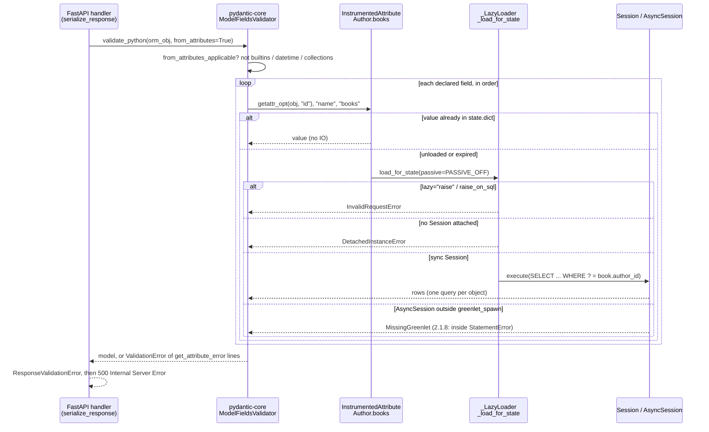

# Validating from ORM Objects (from_attributes=True) and Preventing Accidental SQLAlchemy Lazy-Load Queries During Serialization

> [!summary] Claim
> `from_attributes=True` makes pydantic-core call `getattr()` once per declared field, and on a SQLAlchemy instance that `getattr()` is a descriptor that may run SQL, so the response schema silently becomes the query plan: a sync endpoint pays one hidden `SELECT` per unloaded relationship per object, an async endpoint fails with `MissingGreenlet` wrapped in a `get_attribute_error`, and the only robust fix is to load exactly what the schema reads before validation and make every other load raise.

Part of [Pydantic v2 Internals and Validation](README.md) in [API Engineering](../README.md).

## TL;DR

- Mechanism: with `from_attributes`, pydantic-core wraps a non-dict, non-builtin input as `GenericPyMapping::GetAttr` and reads each field with `getattr_opt` in declaration order (pydantic-core 2.50.4 src/input/input_python.rs, validate_model_fields; pydantic-core 2.50.4 src/lookup_key.rs, LookupPath::simple_py_get_attr); on a mapped instance that read goes through SQLAlchemy's lazy loader, which calls `Session.execute` (SQLAlchemy 2.1.8 lib/sqlalchemy/orm/strategies.py, _LazyLoader._emit_lazyload).
- Contract rule: an `AttributeError` means "field missing" (default used or `missing` error), and any other exception becomes a `get_attribute_error` line error with the text `Error extracting attribute: {error}` (pydantic-core 2.50.4 src/lookup_key.rs, LookupPath::py_get_attr), so `MissingGreenlet`, `DetachedInstanceError`, and `lazy='raise'` all surface as `ValidationError`, never as the original exception.
- Trap: FastAPI 0.162.0 validates every `response_model` with `validate_python(value, from_attributes=True)` (fastapi/_compat/v2.py, ModelField.validate) directly on the event loop for `async def` endpoints and in the threadpool for `def` endpoints (fastapi/routing.py, serialize_response), so the same schema is a 500 in one and a silent N+1 in the other; the lab measures 1 + 3 statements for 3 authors on the `def` path.
- Portability: the behavior is identical on CPython 3.12.13, 3.13.18, 3.14.6, 3.14.10, and 3.15.2 (20 of 20 lab tests each) and on SQLAlchemy 2.0.57 and 2.1.8, except that 2.1.8 wraps `MissingGreenlet` in a `StatementError` that embeds the SQL text and parameters, and the free-threaded 3.15 leg could not run because `greenlet` 3.5.6 segfaults on 3.15.0b3t.
- When not to use it: do not validate live ORM objects at the response boundary when the endpoint is async, when the object graph is wider than the schema, or when serialization happens after the session is gone; load with `selectinload` or `joinedload`, set `lazy="raise"` (or `raiseload("*")`) as the default, and convert to the DTO inside the session or from Core rows.

## Mental model



The handler hands the returned ORM object to pydantic-core with the runtime flag `from_attributes=True`, which overrides each model's own config for the whole validation tree.
pydantic-core rejects builtins, `datetime`, and `collections` objects up front and otherwise reads fields one at a time with `getattr`, in declaration order, without iterating the object.
Each read lands on a SQLAlchemy `InstrumentedAttribute`; if the value is in the instance `__dict__` it returns immediately, otherwise the attribute's loader strategy runs.
The loader either raises (raise strategies, detached instance), emits a `SELECT` through the synchronous `Session` (the N+1 path), or, under `AsyncSession` on the event loop, reaches `await_()` outside a greenlet and raises `MissingGreenlet`.
Every non-`AttributeError` exception becomes one `get_attribute_error` line for that field, validation continues with the next field and the next object, and FastAPI turns the collected errors into `ResponseValidationError`, which no default handler catches, so the client sees `500 Internal Server Error`.

## How it works

### 1. What `from_attributes` switches on in pydantic-core

`ConfigDict(from_attributes=True)` is copied into the `CoreConfig` key of the same name (pydantic 2.14.3 pydantic/_internal/_config.py, `_config_dict_to_core_config_key`), and the Rust `ModelFieldsValidator` reads it at build time with `schema_or_config_same(schema, config, "from_attributes")`, defaulting to `false` (pydantic-core 2.50.4 src/validators/model_fields.rs, ModelFieldsValidator::build).
The runtime argument `model_validate(obj, from_attributes=...)` is forwarded unchanged to `SchemaValidator.validate_python` (pydantic 2.14.3 pydantic/main.py, BaseModel.model_validate) and stored in the per-call `Extra` struct as `from_attributes: Option<bool>` (pydantic-core 2.50.4 src/validators/mod.rs, Extra).
At validation time each model resolves `state.extra().from_attributes.unwrap_or(self.from_attributes)` (pydantic-core 2.50.4 src/validators/model_fields.rs, ModelFieldsValidator::validate_fields), so the runtime flag wins everywhere in the tree while `None` falls back to each nested model's own config.
That asymmetry is why a parent with `from_attributes=True` and a child without it fails with `model_type` ("Input should be a valid dictionary or instance of BookNoConfig") under plain `model_validate`, but succeeds when the caller passes `from_attributes=True`; the lab pins both outcomes.
Tagged unions read their discriminator the same way, with a default of `true` (pydantic-core 2.50.4 src/validators/union.rs, TaggedUnionValidator::validate), so a discriminated union of ORM-backed models also performs `getattr` on the tag field.
The v1 spelling `orm_mode` is not translated: listing it in `V2_RENAMED_KEYS` only makes `check_deprecated` emit a `UserWarning` ("'orm_mode' has been renamed to 'from_attributes'"), and the key itself is ignored (pydantic 2.14.3 pydantic/_internal/_config.py, `V2_RENAMED_KEYS` and `check_deprecated`); a scratch run on CPython 3.14.6 showed `model_config["from_attributes"]` unset and a plain object failing with `model_type`, so a half-migrated v1 schema fails at runtime rather than silently working.
Separately, `from_orm()` emits `PydanticDeprecatedSince20`, raises `PydanticUserError` unless the config flag is set, and then calls `model_validate` (pydantic 2.14.3 pydantic/main.py, BaseModel.from_orm).

### 2. How the input is classified

`Input::validate_model_fields` for a Python object tries an exact or subclass `dict` first, then (lax mode only) any `Mapping`, and only then the attribute path (pydantic-core 2.50.4 src/input/input_python.rs, validate_model_fields).
The attribute path is guarded by `from_attributes_applicable`, which looks at `type(obj).__module__` and refuses `builtins`, `datetime`, and `collections`; the source comment calls the list a best-effort check that is "mostly just to catch" builtins (same file, from_attributes_applicable).
Rejected inputs produce `model_attributes_type` ("Input should be a valid dictionary or object to extract fields from"); the lab shows `AuthorOut.model_validate(5)` failing that way and a scratch run showed `dict.items()` failing the same way because its type lives in `builtins`.
A 2-tuple `(obj, kwargs_dict)` is also accepted: the dict is consulted first and `obj` second (pydantic-core 2.50.4 src/lookup_key.rs, LookupPath::py_get_attr), which a scratch run on CPython 3.14.6 confirmed (`(O(), {"name": "kw"})` validated `name='kw'`).
`strict=True` does not disable attribute input: strict only removes the `Mapping` fallback (`else if !strict && let Ok(mapping) = self.cast::<PyMapping>()`), and a scratch run on CPython 3.14.6 validated a plain object under `strict=True`.
If the input is already an instance of the target model, `ModelValidator` returns it unchanged under the default `revalidate_instances="never"`; only when `Revalidate::should_revalidate` is true (`"always"`, or `"subclass-instances"` for a subclass) does it read `__dict__` directly, with the comment "get dict here so from_attributes logic doesn't apply" (pydantic-core 2.50.4 src/validators/model.rs, ModelValidator::validate and Revalidate::should_revalidate).

### 3. How each field is read

`ModelFieldsValidator::validate_by_get_item` loops `for field in &self.fields`, so attributes are read strictly in declaration order; each field tries its alias paths and then its name path (depending on `validate_by_alias` and `validate_by_name`) and stops at the first path that returns a value (pydantic-core 2.50.4 src/lookup_key.rs, LookupPathCollection::try_lookup).
For attribute input the lookup is `LookupPath::simple_py_get_attr`, which reads the first path segment with PyO3's `PyAnyMethods::getattr_opt` and later segments with `PathItem::py_get_attrs`: an `AttributeError` becomes `Ok(None)` and any other exception propagates (pydantic-core 2.50.4 src/lookup_key.rs, LookupPath::simple_py_get_attr).
`LookupPath::py_get_attr` converts that propagated exception into `ErrorType::GetAttributeError { error }`, whose message template is `Error extracting attribute: {error}` (pydantic-core 2.50.4 src/errors/types.rs, GetAttributeError), and the field loop records it as a line error and continues with the next field.
Three consequences follow, each pinned by the lab.
First, a broken object produces one error per bad field, not one per object: an expired, detached `Author` yields three `get_attribute_error` lines (`id`, `name`, `books`), and the FastAPI list endpoint yields three lines `("response", i, "books")` for three authors.
Second, an `AttributeError` raised inside a `@property` is indistinguishable from an absent attribute, so a field with a default silently takes the default (`books=[]`) and a required field reports `missing`.
Third, extras are never inspected for attribute input: `used_keys` is `None` when `dict.is_py_get_attr()` is true, so `extra="forbid"` accepts an object that carries undeclared attributes while still rejecting the same key in a dict.
An `AliasPath("author", "name")` walks attributes too, because every later string segment goes through `PathItemString::py_get_attrs`, which uses `getattr_opt` unless the intermediate value is a `dict` (integer segments use item access), so a flattened `author_name` field performs `getattr(book, "author")` and then `getattr(author, "name")`; the lab measures one `SELECT ... FROM author WHERE author.id = ?` for it.

### 4. What `getattr` does on a mapped instance

A mapped attribute is an `InstrumentedAttribute` descriptor; when the key is absent from the instance `__dict__`, the attribute implementation calls the strategy's loader with `PASSIVE_OFF`.
For relationships with `lazy="select"` (the default), `"raise"`, or `"raise_on_sql"`, that loader is `_LazyLoader._load_for_state` (SQLAlchemy 2.1.8 lib/sqlalchemy/orm/strategies.py; the class is `LazyLoader` without the underscore in 2.0.57).
The order of checks in `_load_for_state` is the whole story:
1. `lazy="raise"` raises `InvalidRequestError("'Author.books' is not available due to lazy='raise'")` before looking for a session, unless the load is a many-to-one `use_get` lookup performed only for history.
2. With no session, it raises `DetachedInstanceError` ("Parent instance ... is not bound to a Session; lazy load operation of attribute 'books' cannot proceed"), error code `bhk3`.
3. For a simple many-to-one (`use_get`), it looks the parent up in the identity map with `session._identity_lookup` and returns it without SQL if present.
4. Otherwise `_emit_lazyload` builds the `SELECT`, checks `raise_on_sql` immediately before executing (so `raise_on_sql` permits identity-map hits but not SQL), and calls `loading._load_on_pk_identity` for a `use_get` miss or `session.execute` for everything else.
The identity map is weak-referencing, which the lab discovered the hard way: `session.get(Author, 1)` with the result discarded leaves nothing to hit, and `raise_on_sql` still raises; keeping `parent = session.get(Author, 1)` alive makes the same validation pass.
Expired column attributes take a different path: `_AttributeImpl._fire_loader_callables` sends a key in `state.expired_attributes` to `InstanceState._load_expired`, which calls `loading._load_scalar_attributes` (SQLAlchemy 2.1.8 lib/sqlalchemy/orm/attributes.py, lib/sqlalchemy/orm/state.py, and lib/sqlalchemy/orm/loading.py); after `Session.commit()` with the default `expire_on_commit=True`, `InstanceState.unloaded` is `{"books", "id", "name"}` and the next `getattr(author, "id")` emits `SELECT author.id, author.name FROM author WHERE author.id = ?` (2.1.8 rendering) before the relationship load runs; without a session the message becomes "attribute refresh operation cannot proceed".

### 5. Why async turns the query into `MissingGreenlet`

`AsyncSession` drives a synchronous `Session` inside a greenlet started by `greenlet_spawn`; driver coroutines are awaited by `await_()`, which switches to the parent greenlet only if the current greenlet carries `__sqlalchemy_greenlet_provider__` (SQLAlchemy 2.1.8 lib/sqlalchemy/util/concurrency.py, await_).
pydantic-core runs in the caller's frame, so a validation started from an `async def` body or from FastAPI's `serialize_response` is on the event loop's main greenlet, and `await_()` raises `MissingGreenlet("greenlet_spawn has not been called; can't call await_() here. Was IO attempted in an unexpected place?")`, error code `xd2s`.
In 2.0.57 the same function is named `await_only` and the message says `await_only()` (lib/sqlalchemy/util/_concurrency_py3k.py, await_only); 2.1.8 keeps `await_only = await_` as an alias "deprecated on 2.2".
With aiosqlite under 2.1.8 the lab sees the error wrapped as `StatementError: (sqlalchemy.exc.MissingGreenlet) ...` followed by the SQL and a `[parameters: ...]` line, while 2.0.57 surfaces the bare `MissingGreenlet`; both arrive inside `get_attribute_error`.
`_safe_cancel_awaitable` closes the pending awaitable only if it is a coroutine; aiosqlite's `Connection.cursor()` awaitable is not, so CPython later warns `coroutine 'Connection.cursor' was never awaited`, which the lab filters explicitly.
The supported escape hatches all move the attribute access back inside `greenlet_spawn`: `await obj.awaitable_attrs.books` is literally `greenlet_spawn(getattr, self._instance, name)` (SQLAlchemy 2.1.8 lib/sqlalchemy/ext/asyncio/session.py, AsyncAttrs._AsyncAttrGetitem), and `await session.run_sync(fn)` runs a whole validation function with a sync `Session` inside the greenlet; the lab validates successfully both ways.

### 6. Where FastAPI runs the validation

For a non-`Response` return value, `get_request_handler` calls `serialize_response(field=response_field, ..., is_coroutine=is_coroutine, dump_json=use_dump_json)`, and `serialize_response` calls `field.validate(...)` inline when `is_coroutine` is true and `await run_in_threadpool(field.validate, ...)` otherwise (fastapi 0.162.0 fastapi/routing.py, serialize_response).
`ModelField.validate` is `self._type_adapter.validate_python(value, from_attributes=True)` (fastapi 0.162.0 fastapi/_compat/v2.py, ModelField.validate), so response models need no `from_attributes` config at all, and nested models inherit the runtime flag.
Errors become `ResponseValidationError`; with httpx's default `raise_app_exceptions=True` the test sees the exception, and with `raise_app_exceptions=False` it sees Starlette's `500` with body `Internal Server Error`.
The per-request `AsyncExitStack` pair is opened in `request_response`: `function_stack` closes after `await f(request)` returns, and `f` includes `serialize_response`, while `request_stack` closes after the response is sent (fastapi 0.162.0 fastapi/routing.py, request_response).
So even a dependency declared `Depends(get_session, scope="function")`, which the FastAPI docs describe as closing "after the path operation function returns, but before the response is sent", is still open during response validation; the lab proves it because the error is `MissingGreenlet` (session attached) rather than `DetachedInstanceError`, and the dependency's `finally` runs afterwards.
Without a `response_model`, FastAPI falls back to `jsonable_encoder`, which tries `dict(obj)` and then `vars(obj)` and drops keys starting with `_sa` (fastapi 0.162.0 fastapi/encoders.py, jsonable_encoder); that path never lazy loads, but it serializes only what happens to be in `__dict__`, which the lab shows is `{"id": 1, "name": "author-1"}` before commit and `{}` after it.

### 7. Making the load plan explicit

The SQLAlchemy loader strategies (SQLAlchemy 2.1 docs, Relationship Loading Techniques, "Summary of Relationship Loading Styles") map onto the schema as follows:
- `selectinload(Author.books)` runs one extra `SELECT ... WHERE book.author_id IN (...)` per batch of up to 500 parent keys (`_SelectInLoader._chunksize = 500`, SQLAlchemy 2.1.8 lib/sqlalchemy/orm/strategies.py), and is the docs' default recommendation for collections.
- `joinedload(Author.books)` adds a `LEFT OUTER JOIN` (by default) to the same statement; for collections, both `session.scalars(...)` and `session.execute(...).scalars()` raise "The unique() method must be invoked on this Result" until you call `.unique()` (scratch run on 2.1.8), and the bench used `execute(...).unique().scalars()`.
- `raiseload("*")` or `lazy="raise"` makes every unplanned relationship load an exception, and `raiseload(attr, sql_only=True)` / `lazy="raise_on_sql"` still allows identity-map hits; the docs note that raise strategies do not apply inside the flush process.
- `lazy="write_only"` (`WriteOnlyMapped`) never loads implicitly; the asyncio guide offers it as the IO-free collection style, at the cost that there is no built-in way to load many such collections at once.
- `expire_on_commit=False` on the (async) session factory keeps column values readable after commit, as the asyncio guide recommends.
The lab's guard, `unloaded_paths`, adds a check SQLAlchemy does not have: it walks the pydantic schema and the instance state together, reading only `InstanceState.unloaded` and `InstanceState.dict`, and reports `["books"]` or `["books.1.title"]` with zero statements emitted, so an endpoint can fail fast with a precise message before pydantic-core touches a descriptor.

## Numbers and limits

| Quantity | Value | Source |
| --- | --- | --- |
| Extra statements while validating 3 lazily loaded authors (2 books each) with `AuthorOut` | 3 (one `SELECT book.* WHERE ? = book.author_id` per author) | lab `test_lazy_relationship_emits_one_select_per_parent_during_validation`, CPython 3.14.6, SQLAlchemy 2.1.8, SQLite 3.53.1 |
| Statements for 1000 authors: lazy vs `selectinload` vs `joinedload` | 1001 vs 3 vs 1 | one-off benchmark (not a lab test), drafted and re-run in verification on 2026-11-12 with identical counts: `seed(authors=1000, books_per_author=2)` into in-memory SQLite 3.53.1, `StatementLog` counting, Apple M3 Pro, macOS 27.3, CPython 3.14.6 |
| `selectinload` batch size | 500 parent keys per `IN` | SQLAlchemy 2.1.8 lib/sqlalchemy/orm/strategies.py, `_SelectInLoader._chunksize`; bench: 1000 parents -> 2 `IN` statements |
| `AuthorOut.model_validate` per object, fully loaded ORM object vs equivalent dict | median 1.770 us vs 0.898 us (min 1.756 vs 0.893) | same bench re-run in verification on 2026-11-12, `timeit.repeat(number=20, repeat=7)` over 1000 objects with 2 books each, Apple M3 Pro, macOS 27.3 (`uname -r` 27.3.0), CPython 3.14.6 |
| Statements emitted by validating one author after `commit()` (default `expire_on_commit=True`) | 2 (row refresh, then `books`) | lab `test_expire_on_commit_turns_even_column_reads_into_io` |
| Errors from one expired, detached author | 3 `get_attribute_error` lines (every field) | same test |
| Errors from the FastAPI lazy endpoint for 3 authors | 3 lines, `("response", i, "books")` | lab `test_fastapi_async_endpoint_lazy_relationship_fails_response_validation` |
| Statements behind the `def` endpoint for 3 authors | 1 + 3, status `200` | lab `test_fastapi_sync_endpoint_hides_n_plus_one_in_the_threadpool` |
| Modules refused by `from_attributes_applicable` | 3: `builtins`, `datetime`, `collections` | pydantic-core 2.50.4 src/input/input_python.rs |
| Attribute reads per field | 1 `getattr` per lookup path tried (alias paths, then name, stopping at the first hit), in declaration order, no iteration | lab `test_fields_are_read_in_declaration_order_and_errors_accumulate`; src/validators/model_fields.rs |
| Statements emitted by the `unloaded_paths` guard | 0 | lab `test_guard_reports_unloaded_paths_without_emitting_sql` |

The timings are a single-machine microbenchmark of in-memory SQLite and show only the relative cost of descriptor reads versus dict lookups; real lazy-load cost is a network round trip per statement, which this lab does not measure.

## Portability

| Dimension | Behavior | Evidence |
| --- | --- | --- |
| CPython 3.12 | 20 of 20 pass on 3.12.13 (the matrix patch 3.12.16 is not available to uv here) | drafter's lab run, 2026-11-12, not re-run in verification (lab checks paused); `UV_PROJECT_ENVIRONMENT=... uv run --frozen --python 3.12.13 pytest ...`, macOS 27.3 arm64 |
| CPython 3.13 | 20 of 20 pass on 3.13.18 | drafter's lab run, not re-run in verification; `uv run --frozen --python 3.13.18` |
| CPython 3.14 | 20 of 20 pass on 3.14.6 (workspace `.venv`) and on 3.14.10 | 3.14.6 re-run in verification (`uv run --frozen pytest`, 20 passed); 3.14.10 is the drafter's run (`uv run --frozen --python 3.14.10`) |
| CPython 3.15 | 20 of 20 pass on 3.15.2 | drafter's lab run, not re-run in verification; `uv run --frozen --python 3.15.2` |
| CPython 3.15t free-threaded | not run on 3.15.2t, which uv cannot provide here (as of 2026-11-12); on 3.15.0b3t the full lock fails on `psycopg-binary==3.3.8` (no wheel), and a reduced install of the test's pinned imports segfaults in `greenlet` 3.5.6 (`greenlet::Greenlet::context`) on `import sqlalchemy.ext.asyncio` | drafter's throwaway venv with `PYTHONPATH=src`; recorded as not run |
| CPython 3.14t free-threaded (extra leg) | 20 of 20 pass on 3.14.6t with the GIL disabled (`sys._is_gil_enabled()` is `False`) | drafter's reduced install of the pinned imports, `PYTHONPATH=src python -m pytest`; not re-run in verification |
| SQLAlchemy 2.1.8 vs 2.0.57 | same loader semantics and identical `lazy='raise'` message; 2.1.8 wraps `MissingGreenlet` in `StatementError` with SQL and parameters, names the function `await_()`, and renders lazy and refresh selects without `AS author_id` labels; 2.0.57 raises bare `MissingGreenlet` mentioning `await_only()` | 2.1.8 behavior re-run in verification (scratch run showed the `StatementError` wrapper, SQL, and `[parameters: ...]`); 2.0.57 leg is the drafter's run (`--group sqlalchemy20` on 3.14.6, 20 of 20); rel_2_0_57 util/_concurrency_py3k.py and rel_2_1_8 util/concurrency.py |
| pydantic 2.14.3 / pydantic-core 2.50.4 | `from_attributes` semantics as described; v1 `orm_mode` only warns and is otherwise ignored; `from_orm` deprecated | pydantic 2.14.3 pydantic/_internal/_config.py and pydantic/main.py; pydantic-core source at the v2.14.3 tag |
| pydantic v1 (`orm_mode`) | the ORM exception propagated raw instead of becoming a `get_attribute_error` line | traceback in pydantic issue #2601 ending in `sqlalchemy.exc.MissingGreenlet`; not run here |
| FastAPI 0.162.0 | response validation always passes `from_attributes=True`; inline on the loop for `async def`, threadpool for `def`; `scope="function"` cleanup after serialization | fastapi/_compat/v2.py and fastapi/routing.py at 0.162.0; lab |
| Uvicorn, Hypercorn, Granian | no difference: validation completes inside the route handler before a `Response` object exists, so the ASGI server never sees the ORM object | fastapi 0.162.0 fastapi/routing.py, get_request_handler; not separately run per server |
| HTTP/1.1, HTTP/2, HTTP/3 | no difference, for the same reason; the failure is a `500` on any version | same source reading |

## Worked example

The [implementation](../labs/src/api_labs/f09_pydantic_v2_internals_and_validation/orm_from_attributes.py) maps `Author` and `Book`, defines the response schemas, a `StatementLog` on `before_cursor_execute`, the `unloaded_paths` guard, and two FastAPI apps; the [test](../labs/tests/f09_pydantic_v2_internals_and_validation/test_orm_mode_from_attributes_and_preventing_accidental_lazy_loads.py) has 20 tests.

Simplified excerpt of the mapping and schema (the relationship uses the default `lazy="select"`):

```python
class Author(Base):
    __tablename__ = "author"
    id: Mapped[int] = mapped_column(primary_key=True)
    name: Mapped[str]
    books: Mapped[list[Book]] = relationship(back_populates="author", order_by="Book.id")


class AuthorOut(BaseModel):
    model_config = ConfigDict(from_attributes=True)
    id: int
    name: str
    books: list[BookOut]
```

The N+1 hidden inside validation, exact excerpt from the test:

```python
@pytest.mark.unit
def test_lazy_relationship_emits_one_select_per_parent_during_validation(
    engine: Engine, log: StatementLog
) -> None:
    with Session(engine) as session:
        authors = session.scalars(select(Author).order_by(Author.id)).all()
        before = log.mark()
        out = [AuthorOut.model_validate(a) for a in authors]
        during = log.since(before)
    assert [len(a.books) for a in out] == [2, 2, 2]
    assert len(during) == 3
    assert all(s.startswith("SELECT book.id") and "WHERE ? = book.author_id" in s for s in during)
```

The guard that inspects instance state instead of calling descriptors, exact excerpt from the implementation:

```python
def unloaded_paths(obj: object, model: type[BaseModel], prefix: str = "") -> list[str]:
    """Dotted paths that model.model_validate(obj, from_attributes=True) would lazy load.

    Reads InstanceState.unloaded and InstanceState.dict only, so it never emits SQL.
    """
    state: InstanceState[Any] | None = inspect(obj, raiseerr=False)
    if state is None:
        return []
    unloaded = state.unloaded
    found: list[str] = []
    for name, field in model.model_fields.items():
        attr = _attribute_name(name, field.validation_alias)
        path = f"{prefix}{attr}"
        if attr in unloaded:
            found.append(path)
            continue
        nested = _nested_model(field.annotation)
        if nested is None or attr not in state.dict:
            continue
        value: object = state.dict[attr]
        children: list[object] = [value]
        if isinstance(value, list | set | tuple):
            children = [*cast("Iterable[object]", value)]
        for index, child in enumerate(children):
            found.extend(unloaded_paths(child, nested, f"{path}.{index}."))
    return found


def validate_loaded[M: BaseModel](model: type[M], obj: object) -> M:
    """model_validate(obj, from_attributes=True), but only if no attribute needs IO."""
    paths = unloaded_paths(obj, model)
    if paths:
        raise LazyLoadRefusedError(model, paths)
    return model.model_validate(obj, from_attributes=True)
```

The guard follows only the first segment of an `AliasPath` and only nested `BaseModel` fields (including inside `list`, `set`, `tuple`, and unions); it does not model `AliasChoices`, `@computed_field`, or custom validators that read further attributes.

The FastAPI failure on an `async def` endpoint whose session dependency uses `scope="function"`, exact excerpt from the test:

```python
    app = build_async_app(factory, events)
    async with _client(app) as client:
        with pytest.raises(ResponseValidationError) as excinfo:
            await client.get("/authors/lazy")
    errors = excinfo.value.errors()
    assert [(e["loc"], e["type"]) for e in errors] == [
        (("response", i, "books"), "get_attribute_error") for i in range(3)
    ]
    # MissingGreenlet, not DetachedInstanceError: the scope="function" session was still open.
    assert all("MissingGreenlet" in e["msg"] for e in errors)
    assert events == ["session-closed"]
    async with _client(app, raise_app_exceptions=False) as client:
        response = await client.get("/authors/lazy")
    assert response.status_code == 500
    assert response.text == "Internal Server Error"
```

The same endpoint with `selectinload(Author.books)` returns `200` with all six books, and the `def` variant with a sync `Session` returns `200` after 1 + 3 statements.

Output captured on 2026-11-12 (verification re-run) from `labs/` on macOS 27.3 (Apple M3 Pro, arm64) with CPython 3.14.6, pydantic 2.14.3, pydantic-core 2.50.4, SQLAlchemy 2.1.8, FastAPI 0.162.0, aiosqlite 0.22.1, and SQLite 3.53.1:

```text
$ uv run --frozen pytest tests/f09_pydantic_v2_internals_and_validation/test_orm_mode_from_attributes_and_preventing_accidental_lazy_loads.py -q
....................                                                     [100%]
20 passed in 1.52s
```

The `get_attribute_error` produced by `raiseload("*")`, as asserted by `test_raiseload_turns_the_lazy_load_into_a_get_attribute_error`:

```text
Error extracting attribute: InvalidRequestError: 'Author.books' is not available due to lazy='raise'
```

## Pitfalls

> [!warning] Async endpoint returns an ORM object whose schema reads a relationship
> Trigger: an `async def` FastAPI endpoint returns `session.scalars(select(Author))` results and `AuthorOut` declares `books`.
> Symptom: `500 Internal Server Error`; the log shows `ResponseValidationError` with one `get_attribute_error` per object containing `MissingGreenlet: greenlet_spawn has not been called`.
> The report in pydantic issue #2601 (2021, self-referencing `CategoryModel` with `orm_mode`, asyncpg, and an `AsyncSession`) is this failure on pydantic v1 and SQLAlchemy 1.4; its traceback ends in a bare `sqlalchemy.exc.MissingGreenlet` raised through pydantic v1 validation, whereas v2 wraps it in `get_attribute_error`.
> Fix: `selectinload`/`joinedload` every relationship the schema reads, set `lazy="raise"` on the mapping so the omission fails loudly in tests, or build the DTO inside `session.run_sync`.

> [!warning] The same code works in a `def` endpoint and hides an N+1
> Trigger: a sync endpoint with a sync `Session`; FastAPI validates in the threadpool, where a lazy load is legal.
> Symptom: correct responses and latency that grows linearly with page size; the lab counts 1 + 3 statements for 3 rows and the bench 1001 for 1000.
> pydantic issue #4392 (2022) asked pydantic to cooperate with `selectinload` under `orm_mode`; Samuel Colvin replied that pydantic has no special support for SQLAlchemy and asked how pydantic could know an attribute is lazy, and the issue was closed on 2022-11-14, which leaves the load plan with the query.
> Fix: assert statement counts in tests with an engine event (the lab's `StatementLog`), and make `raiseload("*")` the default on read queries.

> [!warning] `expire_on_commit=True` turns column reads into IO
> Trigger: `await session.commit()` (or `session.commit()`) and then returning or validating the object.
> Symptom: sync: one refresh `SELECT` per object before relationships load; async: `MissingGreenlet` on `id`; closed session: three `get_attribute_error` lines ending in "attribute refresh operation cannot proceed".
> Fix: `async_sessionmaker(engine, expire_on_commit=False)` as the asyncio guide recommends, or validate before commit, or `refresh()` explicitly with the attributes you need.

> [!warning] Nested model without `from_attributes` passes in the endpoint and fails in the unit test
> Trigger: `AuthorOut` has `from_attributes=True` but `BookOut` does not.
> Symptom: FastAPI responses work, because `ModelField.validate` passes the runtime flag, while `AuthorOut.model_validate(author)` in a service or test fails with `model_type` on `books.0`.
> Fix: set the flag on every response model (or on a shared base class), or always call `model_validate(obj, from_attributes=True)`; do not rely on FastAPI's override.

> [!warning] `AttributeError` inside a property or hybrid becomes "missing"
> Trigger: a `@property` or `hybrid_property` on the ORM class raises `AttributeError` internally, for example by touching `None.attr`.
> Symptom: the field silently takes its default (the lab gets `books == []`) or reports `missing`, and the original traceback is lost, because `getattr_opt` treats `AttributeError` as absence.
> Fix: never let property bodies leak `AttributeError`; raise a domain exception (which becomes a visible `get_attribute_error`) and avoid defaults on fields fed from computed attributes.

> [!warning] `extra="forbid"` does nothing for attribute input
> Trigger: relying on `extra="forbid"` to catch schema drift between the ORM class and the response model.
> Symptom: no error, because pydantic-core never iterates attributes (`used_keys` is `None` for `GetAttr`); only dict input is checked.
> Fix: catch drift with a test that compares `model_fields` to the mapper's attributes, not with `extra`.

> [!warning] `raise_on_sql` many-to-one depends on a strong reference
> Trigger: loading the parent with `session.get(Author, 1)` "to warm the identity map" and discarding the result.
> Symptom: `InvalidRequestError: 'Book.author' is not available due to lazy='raise_on_sql'` anyway, because the identity map holds weak references and the parent was collected.
> Fix: keep the loaded parents in a local variable for the lifetime of the serialization, or eager load the many-to-one.

> [!warning] `AliasPath` through a relationship is a hidden query
> Trigger: `author_name: str = Field(validation_alias=AliasPath("author", "name"))` on a book schema.
> Symptom: one `SELECT ... FROM author` per book whose author is not in the identity map, or a raise under `raise_on_sql`.
> Fix: `joinedload(Book.author)` or `selectinload(Book.author)` in the query, or select the column explicitly with Core.

> [!warning] Returning ORM objects without a `response_model`
> Trigger: an endpoint with no `response_model` and no return annotation returns an ORM object.
> Symptom: `jsonable_encoder` serializes `vars(obj)`, so relationships are absent, expired objects serialize as `{}`, and every loaded column is exposed, including ones you never meant to publish.
> Fix: always declare a response model; it is both the field allowlist and the load contract.

> [!warning] Wanting to skip a field at validation time
> Trigger: reusing one schema for list and detail endpoints and hoping to exclude the expensive relationship on the list endpoint.
> Symptom: there is no `model_validate(exclude=...)`; pydantic issue #8192 requesting it is open (as of 2026-11), and `context` does not stop the `getattr`.
> Fix: one response schema per load plan (`AuthorSummary` for lists, `AuthorOut` for detail), which also documents which query each endpoint must run.

## Security and robustness

- OWASP API3:2023 (Broken Object Property Level Authorization) recommends cherry-picking properties and "a schema-based response validation mechanism"; `from_attributes` with an explicit response model does exactly that, because pydantic-core reads only declared fields, while the `jsonable_encoder` fallback publishes every loaded column.
- The flip side: `extra="forbid"` is not enforced for attribute input, so it is not a defense against a schema that accidentally declares a sensitive field; review response models as the publication list.
- OWASP API4:2023 (Unrestricted Resource Consumption) asks for server-side limits on "the number of records to be returned"; with lazy loads, the client-controlled page size multiplies database statements (1001 for a page of 1000 in the bench), and every one is a round trip on the session's connection, which stays checked out of the pool for the whole serialization, so a missing `limit` cap becomes a database amplification vector.
- SQLAlchemy 2.1.8's `StatementError` text includes the SQL and a `[parameters: ...]` line, and pydantic copies it into the `msg` and `ctx.error` of the line error; a custom `ResponseValidationError` handler that echoes `exc.errors()` to clients would leak schema and bound values, so log them server-side only.
- `ConfigDict(hide_input_in_errors=True)` removes `input_value` from `str(ValidationError)`, but a scratch run on 2.14.3 showed the message text (including whatever the exception said) unchanged and `errors()` still carrying `input`, so it does not remove the SQL from the error.
- A lazy load inside validation runs in whatever transaction the session holds at that moment; after a `commit()` the session autobegins a new transaction, so the relationship can be read from a later snapshot than the parent row, and the response can mix states; eager loading before the commit keeps the reads in one transaction.
- In async code, the guard `unloaded_paths` gives a deterministic failure mode (an exception you choose, before IO) instead of an event-loop-thread failure inside pydantic-core, and it emits no SQL, so it is safe to run in production as an assertion.

## The principal's view

The decision is where the load plan lives: in the query layer, explicitly, next to the schema it serves.
`from_attributes` makes the response model a query plan by accident, which is fine for flat column-only DTOs and dangerous for any schema with a relationship field, because the cost of a field becomes invisible at review time.
The organizational rule I would set is: mappings default to `lazy="raise"` (or every read query carries `raiseload("*")`), every endpoint has its own response schema, and every repository function that feeds a schema eager-loads exactly that schema's relationship paths; tests assert statement counts with an engine event.
The trade-off is ceremony: more schemas, more loader options, and occasional over-fetching when a selectin batch loads a collection the client did not need; the alternative is latency and outages that appear only at production page sizes or only after moving an endpoint to `async def`.
For async services, converting ORM objects to DTOs inside `session.run_sync`, or reading Core rows with `select(...).mappings()` and validating plain dicts, removes descriptors from the serialization path entirely; in the lab's microbenchmark the validation step alone drops from 1.77 us to 0.90 us per object (the cost of building the dicts is not included).
When the object graph is client-selected (GraphQL, sparse fieldsets), schema-driven eager loading cannot be static, and a batching loader (dataloader-style) per field is the right tool instead of `from_attributes`.
When the read path dominates and the domain model adds nothing, skip the ORM for reads: a hand-written `SELECT` into `msgspec` or pydantic from dicts is simpler to reason about than any loader option.

## Interview questions

> [!question] L5: What exactly does `from_attributes=True` change when you call `model_validate` on an object?
>
> > [!success]- Answer
> > It lets pydantic-core accept a non-mapping object and read each declared field with `getattr`, in declaration order, instead of requiring a dict.
> > Builtins, `datetime`, and `collections` objects are still rejected with `model_attributes_type`.
> > An `AttributeError` means the field is missing; any other exception becomes a `get_attribute_error` line error.
> > The runtime argument overrides every nested model's config; the config value applies only to that model.
> >
> > Follow-up: why does a nested model without the config pass under FastAPI but fail in a direct `model_validate` call?

> [!question] L5: Why does the same response model work on a `def` endpoint and fail on an `async def` endpoint?
>
> > [!success]- Answer
> > FastAPI runs response validation in the threadpool for `def` and inline on the event loop for `async def`.
> > A lazy load on a sync `Session` in a worker thread is legal and just emits SQL.
> > Under `AsyncSession`, the lazy load reaches `await_()` outside `greenlet_spawn` and raises `MissingGreenlet`, which pydantic wraps as `get_attribute_error`, and FastAPI returns `500`.
> >
> > Follow-up: which of the two is the worse production outcome, and how would you detect the silent one?

> [!question] L6: Predict the output: `AuthorStrictNested` has `from_attributes=True` and `extra="forbid"`, with `books: list[BookNoConfig]` where `BookNoConfig` has no config; what do `AuthorStrictNested.model_validate(author)` with books eager loaded, `AuthorStrictNested.model_validate(author, from_attributes=True)`, and `AuthorStrictNested.model_validate(Row())` (a plain object with an extra `internal_flag` attribute and `books=[]`) return?
>
> > [!success]- Answer
> > The first fails with two `model_type` errors at `books.0` and `books.1`, because the child uses its own config.
> > The second succeeds, because the runtime flag propagates through the `Extra` state to the child.
> > The third succeeds with `{"id": 7, "name": "row", "books": []}`, because extras are never iterated for attribute input, so `extra="forbid"` is not checked.
> >
> > Follow-up: what does the same `Row` data do as a dict with an extra key?

> [!question] L6: Debug this API: after adding `books: list[BookOut]` to `AuthorOut`, `GET /authors` on an `async def` FastAPI endpoint returns `500`, and the log shows `ResponseValidationError` with entries `("response", 0, "books")`, `("response", 1, "books")`, and so on, each `Error extracting attribute: StatementError: (sqlalchemy.exc.MissingGreenlet)`; the session dependency uses `scope="function"`; what is happening and what do you change?
>
> > [!success]- Answer
> > The query loaded only `Author` rows, so `books` is unloaded and pydantic-core's `getattr` triggers the lazy loader for each author.
> > The session is still open (otherwise the error would be `DetachedInstanceError`), because FastAPI serializes inside the handler before the function-scoped exit stack closes.
> > The lazy load runs on the event loop, outside `greenlet_spawn`, so `await_()` raises `MissingGreenlet`, once per object.
> > Fix the query with `selectinload(Author.books)`, add `lazy="raise"` so the next omission fails in tests, and add a statement-count assertion.
> >
> > Follow-up: why would moving `get_session` to `scope="request"` not change anything here?

> [!question] L6: An endpoint commits and then returns the created object, and it fails only under `AsyncSession`; why?
>
> > [!success]- Answer
> > The default `expire_on_commit=True` expires every attribute at commit, so `InstanceState.unloaded` includes the columns.
> > The first `getattr` during response validation must refresh the row, which under asyncio is implicit IO and raises `MissingGreenlet`.
> > Under a sync session it works but costs an extra `SELECT` per object; with a closed session it fails with "attribute refresh operation cannot proceed".
> > Use `expire_on_commit=False`, or `await session.refresh(obj, [...])` before returning.
> >
> > Follow-up: what consistency risk does `expire_on_commit=False` introduce?

> [!question] L6: Compare `lazy="raise"`, `lazy="raise_on_sql"`, `selectinload`, and `joinedload` for a response that includes a collection and a many-to-one.
>
> > [!success]- Answer
> > `raise` refuses any unplanned load, `raise_on_sql` allows many-to-one identity-map hits but refuses SQL.
> > `selectinload` adds one `IN` query per 500 parents and keeps the parent query simple, so it is the default choice for collections.
> > `joinedload` adds a `LEFT OUTER JOIN` in the same statement, which suits many-to-one but multiplies rows for collections and needs `.unique()`.
> > The raise strategies are guards, not loaders, so they pair with an eager strategy rather than replace it.
> >
> > Follow-up: why can `raise_on_sql` pass in one test run and fail in another with the same data?

> [!question] L7+: Why does pydantic-core treat `AttributeError` as "missing" but turn other exceptions into validation errors, and what does that design cost you?
>
> > [!success]- Answer
> > Attribute input has no key set, so "absent" can only be signalled by `AttributeError`, which is how Python's own `getattr` default and `hasattr` work.
> > Converting other exceptions into `get_attribute_error` keeps validation total (all fields reported) instead of aborting on the first descriptor failure.
> > The cost is that ORM exceptions lose their type at the boundary, so callers cannot `except MissingGreenlet`, and an `AttributeError` bug inside a property silently becomes a default.
> > A boundary that must distinguish IO failures should check instance state first, as the lab's `unloaded_paths` does.
> >
> > Follow-up: how would you surface the original exception type to your error-reporting system?

> [!question] L7+: How would you guarantee, across a 200-endpoint codebase, that response serialization never performs database IO?
>
> > [!success]- Answer
> > Make the default fail closed: `lazy="raise"` on all relationships or `raiseload("*")` on every read query, and `expire_on_commit=False` on async session factories.
> > Give each endpoint its own response schema and colocate the eager-load options with the repository function that feeds it.
> > Add an engine `before_cursor_execute` listener in tests that fails if any statement is emitted after the handler returns, and a production guard that runs `unloaded_paths` in debug or canary builds.
> > Accept the cost in schemas and loader options as the price of making query cost reviewable.
> >
> > Follow-up: which of these checks catches the `def` endpoint N+1, which nothing raises on?

> [!question] L7+: When should an API not validate live ORM objects at all?
>
> > [!success]- Answer
> > When the endpoint is async and the object graph is wider than the schema, because every unplanned field is a potential `MissingGreenlet`.
> > When serialization happens after the session is gone (background tasks, streaming responses, caches), because every unloaded field is a `DetachedInstanceError`.
> > When the read path is hot: plain dict or Core row input validates about twice as fast in the lab's microbenchmark and has no descriptor side effects.
> > When the client chooses the fields (GraphQL, sparse fieldsets), where batching loaders fit better than static eager loading.
> >
> > Follow-up: what do you lose by bypassing the ORM on reads?

## Related

Prerequisites: [[Custom-Serialization-Field-Model-and-Wrap-Serializers]]

Next: [[JSON-Schema-Generation-Internals-and-GenerateJsonSchema]]

See also: [[02-Programming-Languages/Python/Python-Backend-Interview-Prep/04-FastAPI]], [[02-Programming-Languages/Python/Python-Backend-Interview-Prep/06-SQL-and-SQLAlchemy]], [[Eliminating-N-Plus-1-Queries-Selectinload-Joinedload-Subqueryload-and-Raiseload]], [[Async-SQLAlchemy-Under-the-Hood-Greenlet-Bridge-and-MissingGreenlet]], [[Session-Internals-Identity-Map-Unit-of-Work-Flush-and-Expire-On-Commit]], [[Response-Serialization-Pipeline-Response-Model-and-Double-Validation-Cost]], [[Yield-Dependencies-AsyncExitStack-Cleanup-Timing-and-Scope]], [[Async-Def-vs-Def-Endpoints-and-AnyIO-Threadpool-Limiter-Semantics]], [[Pydantic-v2-Architecture-CoreSchema-and-Rust-Pydantic-Core]], [[Aliases-AliasPath-AliasChoices-and-Bidirectional-Field-Mapping]], [[Lax-vs-Strict-Validation-Modes-and-Coercion-Tables]], [[Migrating-Large-Codebases-from-Pydantic-v1-to-v2]]

- Lab: `labs/tests/f09_pydantic_v2_internals_and_validation/test_orm_mode_from_attributes_and_preventing_accidental_lazy_loads.py`

## Further reading

- [pydantic-core src/input/input_python.rs at v2.14.3](https://raw.githubusercontent.com/pydantic/pydantic/v2.14.3/pydantic-core/src/input/input_python.rs) - `validate_model_fields` and `from_attributes_applicable`, the input classification for attribute validation.
- [pydantic-core src/lookup_key.rs at v2.14.3](https://raw.githubusercontent.com/pydantic/pydantic/v2.14.3/pydantic-core/src/lookup_key.rs) - `getattr_opt` and the conversion of non-`AttributeError` exceptions into `GetAttributeError`.
- [pydantic-core src/validators/model_fields.rs at v2.14.3](https://raw.githubusercontent.com/pydantic/pydantic/v2.14.3/pydantic-core/src/validators/model_fields.rs) - runtime versus config `from_attributes`, the per-field loop, and why extras are not iterated.
- [Pydantic docs: Models, Arbitrary class instances](https://docs.pydantic.dev/latest/concepts/models/) - the maintainers' description of `from_attributes` and nested attributes.
- [SQLAlchemy 2.1.8 lib/sqlalchemy/orm/strategies.py](https://raw.githubusercontent.com/sqlalchemy/sqlalchemy/rel_2_1_8/lib/sqlalchemy/orm/strategies.py) - `_LazyLoader._load_for_state`, `_emit_lazyload`, and `_SelectInLoader._chunksize`.
- [SQLAlchemy 2.1.8 lib/sqlalchemy/util/concurrency.py](https://raw.githubusercontent.com/sqlalchemy/sqlalchemy/rel_2_1_8/lib/sqlalchemy/util/concurrency.py) - `await_` and `greenlet_spawn`, the source of `MissingGreenlet`.
- [SQLAlchemy 2.1 asyncio guide: Preventing Implicit IO when Using AsyncSession](https://docs.sqlalchemy.org/en/21/orm/extensions/asyncio.html) - `AsyncAttrs`, `lazy="raise"`, `selectinload`, write-only collections, and `expire_on_commit=False`.
- [SQLAlchemy 2.1 Relationship Loading Techniques](https://docs.sqlalchemy.org/en/21/orm/queryguide/relationships.html) - every loader strategy, `raiseload`, and the 500-key selectin batch.
- [SQLAlchemy 2.1 error reference](https://docs.sqlalchemy.org/en/21/errors.html) - `bhk3` (detached instance) and `xd2s` (`MissingGreenlet`).
- [FastAPI 0.162.0 fastapi/routing.py](https://raw.githubusercontent.com/fastapi/fastapi/0.162.0/fastapi/routing.py) - `serialize_response`, `request_response`, and the two exit stacks.
- [FastAPI 0.162.0 fastapi/_compat/v2.py](https://raw.githubusercontent.com/fastapi/fastapi/0.162.0/fastapi/_compat/v2.py) - `ModelField.validate` passing `from_attributes=True`.
- [FastAPI docs: Dependencies with yield, Early exit and scope](https://fastapi.tiangolo.com/tutorial/dependencies/dependencies-with-yield/) - the documented `scope="function"` and `scope="request"` semantics.
- [pydantic issue #2601](https://github.com/pydantic/pydantic/issues/2601) - the canonical `orm_mode` plus `AsyncSession` failure report.
- [pydantic issue #8192](https://github.com/pydantic/pydantic/issues/8192) - the open request to exclude fields at `model_validate` time because lazy fields load inadvertently.
- [OWASP API3:2023 Broken Object Property Level Authorization](https://owasp.org/API-Security/editions/2023/en/0xa3-broken-object-property-level-authorization/) - why the response schema is the property allowlist.
- [OWASP API4:2023 Unrestricted Resource Consumption](https://owasp.org/API-Security/editions/2023/en/0xa4-unrestricted-resource-consumption/) - limits on returned records, the control that bounds N+1 amplification.
