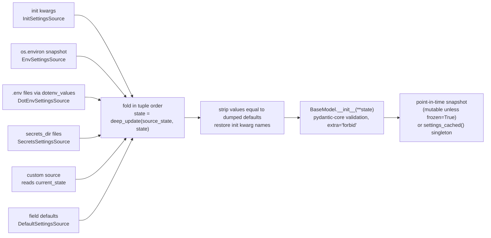

# Configuration Management with pydantic-settings (2.16.2): Env Vars, Nested Delimiters, Docker Secrets, and Custom Sources

> [!summary] Claim
> A `BaseSettings` instance is a left fold of an ordered tuple of source dictionaries through `deep_update`, followed by one ordinary Pydantic validation, so precedence is per key and recursive, every source is re-read on every construction, and anything the fold cannot see (a later source's state, a subPath secret, a mutated environment after `execve`) is invisible by design.

Part of [Pydantic v2 Internals and Validation](README.md) in [API Engineering](../README.md).

## TL;DR

- Mechanism: `BaseSettings.__init__` builds `init -> env -> dotenv -> secrets` (plus an implicit trailing `DefaultSettingsSource`), calls each source, and folds them with `state = deep_update(source_state, state)`, so the earliest source wins key by key and nested dictionaries merge across sources.
- Contract rule: the order returned by `settings_customise_sources` is the priority order, first item highest, and a custom source sees only the merged state of the sources before it through `current_state`.
- The trap: a `.env` file is validated under `extra='forbid'` (an unknown key there raises `extra_forbidden`) while an unknown environment variable is silently ignored, and secret files are looked up as `<secrets_dir>/<env_prefix><field_name>`, so a Docker secret named `db_password` is invisible when `env_prefix` is set.
- Portability: the 23-test lab passes on CPython 3.14.6 (rerun in verification), and the drafter reports it passing unchanged on 3.12.13, 3.13.18, 3.14.10, 3.15.2, and free-threaded 3.15.0b3 (GIL still disabled after importing `pydantic_core` 2.50.4); the only OS-dependent branch in the env source is Windows, where `os.environ` is case-insensitive and `case_sensitive=True` is silently downgraded.
- When not to use it: values that change while the process runs (feature flags, rotated credentials) need a reloadable store or a re-read path, because a settings object is a snapshot taken at construction time, and `settings_cached()` freezes that snapshot for the life of the process.

## Mental model



Each source on the left is called once, in the order `settings_customise_sources` returned plus the default source appended last, and each returns a plain dictionary of raw strings, decoded JSON, or init values keyed by the name Pydantic will validate.
The fold arrow is the whole precedence model: `deep_update(lower, higher)` copies the lower-priority dictionary and overwrites it with the higher-priority one, recursing only when both sides hold a `dict` at the same key, so `db.host` from the environment and `db.user` from a `.env` file combine into one `db` value.
Before each call the loop hands the source the accumulated state so far (`current_state`) and every earlier source's raw output (`settings_sources_data`), which is what lets a custom source bootstrap from a higher-priority value.
Only after the fold does validation run, once, through the normal model path, so type coercion, `extra='forbid'`, and nested model errors are reported against the merged dictionary and never against an individual source.

## How it works

### Construction: building the source tuple

`BaseSettings.__init__` accepts underscore-prefixed overrides (`_env_file`, `_secrets_dir`, `_env_prefix`, `_case_sensitive`, `_env_nested_delimiter`, and the CLI options) and forwards them, together with the remaining keyword arguments as `_init_kwargs`, to `_settings_init_sources` (pydantic-settings 2.16.2 pydantic_settings/main.py, BaseSettings.__init__).
Each override falls back to `model_config` when it is `None`; `_env_file` uses the sentinel `ENV_FILE_SENTINEL = Path()` instead, so passing `_env_file=None` explicitly disables dotenv loading (pydantic-settings 2.16.2 pydantic_settings/sources/types.py, ENV_FILE_SENTINEL).
`_settings_init_sources` constructs `DefaultSettingsSource`, `InitSettingsSource`, `EnvSettingsSource`, `DotEnvSettingsSource`, and `SecretsSettingsSource`, threading one shared `InitState` dictionary through all of them so an incomplete forward-referenced field is warned about once per resolution (pydantic-settings 2.16.2 pydantic_settings/main.py, BaseSettings._settings_init_sources).
It then calls `cls.settings_customise_sources(cls, init_settings=..., env_settings=..., dotenv_settings=..., file_secret_settings=...)` and appends `default_settings` to whatever tuple comes back, so a user cannot drop or reorder the defaults source.
The default implementation returns `init_settings, env_settings, dotenv_settings, file_secret_settings` (pydantic-settings 2.16.2 pydantic_settings/main.py, BaseSettings.settings_customise_sources).
If `cli_parse_args` is set and the returned tuple contains no `CliSettingsSource`, a CLI source is prepended, which is why the documented priority list starts with CLI arguments.
Finally `_settings_warn_unused_config_keys` emits a `UserWarning` when a `json_file*`, `yaml_file*` / `yaml_config_section`, `toml_file` / `toml_table_header`, or `pyproject_toml_*` key, or one of `secrets_dir_missing`, `secrets_dir_max_size`, `secrets_case_sensitive`, `secrets_prefix`, `secrets_nested_delimiter`, `secrets_nested_subdir`, is set in `model_config` but the matching source is absent from the tuple, because those keys do nothing without their source (pydantic-settings 2.16.2 pydantic_settings/main.py, BaseSettings._settings_warn_unused_config_keys).

Two consequences follow from construction happening inside `__init__`.
Every `Settings()` call re-reads `os.environ`, re-opens every `.env` file, and re-lists every secrets directory; `EnvSettingsSource.__init__` snapshots the environment into `self.env_vars` at that moment (pydantic-settings 2.16.2 pydantic_settings/sources/providers/env.py, EnvSettingsSource.__init__).
And the documented way to reload in place is calling `__init__` again on an existing object, which the maintainers warn mutates the object while it runs, so concurrent readers can observe partial state, whereas rebinding a reference to a freshly built instance is atomic (pydantic docs, Concepts: Settings Management, Async environments, as of 2026-11).

### The fold: `deep_update` and default stripping

`_settings_build_values` iterates the tuple; for each source it calls `_set_current_state(state)` and `_set_settings_sources_data(states)`, calls the source, records the result under the source's class name, and executes `state = deep_update(source_state, state)` (pydantic-settings 2.16.2 pydantic_settings/main.py, BaseSettings._settings_build_values).
`deep_update(mapping, *updating_mappings)` copies `mapping` and, for each key in the update, recurses only if both the existing and the new value are `dict` instances, otherwise it replaces the value (pydantic 2.14.3 pydantic/_internal/_utils.py, deep_update).
Because the accumulated higher-priority state is the updating mapping, an earlier source always wins, and a model instance (not a `dict`) passed as an init kwarg replaces the whole subtree instead of merging with it.
After the loop, any key whose value equals the value produced by `DefaultSettingsSource` is removed, so Pydantic applies the field default itself (and `validate_default=True`, set in the base `model_config`, validates it).
`_settings_restore_init_kwarg_names` then renames merged keys back to whatever spelling the caller used in the init kwargs (alias or field name), so a `populate_by_name` caller and an alias caller both validate.

`DefaultSettingsSource` normally returns an empty dictionary.
With `nested_model_default_partial_update=True` it dumps every field whose default is a model or dataclass instance into a plain `dict` (`model_dump()` or `dataclasses.asdict`) and contributes it to the fold, so `TDE_LAB_DB__PORT=6543` merges into the default `DatabaseConfig` instead of replacing it (pydantic-settings 2.16.2 pydantic_settings/sources/base.py, DefaultSettingsSource.__init__).
For a discriminated union default it also records the discriminator tags and drops the dumped default when a higher source selects another member, so a partial override cannot graft one member's fields onto another (pydantic-settings 2.16.2 pydantic_settings/sources/base.py, DefaultSettingsSource.__call__).
`InitSettingsSource` normalizes each matched init kwarg to the field's preferred alias and, under the same flag, round-trips the init kwargs through `TypeAdapter(dict[str, Any]).dump_python`, which turns model instances into dictionaries so they merge too (pydantic-settings 2.16.2 pydantic_settings/sources/base.py, InitSettingsSource.__init__ and InitSettingsSource.__call__).

### Environment variables: names, prefixes, aliases, case

`PydanticBaseEnvSettingsSource._extract_field_info` turns one field into an ordered list of candidate names `(field_key, env_name, value_is_complex)` (pydantic-settings 2.16.2 pydantic_settings/sources/base.py, PydanticBaseEnvSettingsSource._extract_field_info).
A string `validation_alias` produces one candidate; `AliasChoices` produces one per choice in declaration order; an `AliasPath` produces only its head segment, flagged complex when the path has more than one segment so the value is JSON-decoded and navigated in memory.
`env_prefix` is prepended to the field name only when `env_prefix_target` is `'variable'` (the default) or `'all'`, and to aliases only when it is `'alias'` or `'all'`; `env_prefix_target` arrived in 2.13.0 (pydantic-settings releases, v2.13.0).
The field name is a candidate only when there is no alias or `validate_by_name` (or the legacy `populate_by_name`) is enabled, which mirrors what Pydantic itself will accept.
`EnvSettingsSource.get_field_value` returns the first candidate whose name exists in the snapshot, so `AliasChoices("NEW", "OLD")` prefers `NEW` when both are set (pydantic-settings 2.16.2 pydantic_settings/sources/providers/env.py, EnvSettingsSource.get_field_value).

The snapshot is built by `parse_env_vars`, which lower-cases every key unless `case_sensitive=True`, drops empty strings when `env_ignore_empty=True`, and wraps the value equal to `env_parse_none_str` in the marker class `EnvNoneType` so it becomes `None` later (pydantic-settings 2.16.2 pydantic_settings/sources/utils.py, parse_env_vars).
Case-insensitive matching is therefore implemented by lowering both sides, not by a case-folding lookup.
On Windows, `os.environ` is an `os._Environ` that upper-cases keys, so `_load_env_vars` silently sets `self.case_sensitive = False` when `case_sensitive=True` was requested; the 2.15.0 release notes describe the bug this fixed, where every field reported "field required" (pydantic-settings 2.16.2 pydantic_settings/sources/providers/env.py, _environ_is_case_insensitive).

### Complex values: JSON first, then nested delimiters

A field is "complex" when its annotation, after resolving type aliases and `RootModel`, is a `BaseModel`, `Mapping`, `Sequence`, `AbstractSet`, `tuple`, `set`, `frozenset`, `deque`, or dataclass, excluding `str` and `bytes`; `Json` metadata and `Secret[...]` origins make it non-complex (pydantic-settings 2.16.2 pydantic_settings/sources/utils.py, _annotation_is_complex).
For a complex field the env source `json.loads` the raw value; a decode failure raises, and `PydanticBaseEnvSettingsSource.__call__` re-raises it as `SettingsError('error parsing value for field "allowed_hosts" from source "EnvSettingsSource"')`, a subclass of `ValueError`, before any validation runs.
A union containing a complex member (for example `list[str] | str`) is decoded with `allow_parse_failure=True`, so a non-JSON value falls through as a string for the scalar member (pydantic-settings 2.16.2 pydantic_settings/sources/providers/env.py, EnvSettingsSource._field_is_complex).
`NoDecode` in the field metadata skips the JSON step for that field, `enable_decoding=False` skips it for all fields, and `ForceDecode` re-enables it for one field under that config (pydantic-settings 2.16.2 pydantic_settings/sources/base.py, PydanticBaseSettingsSource.decode_complex_value).

With `env_nested_delimiter` set, `prepare_field_value` additionally calls `explode_env_vars`, and when the field also had a JSON value it merges as `deep_update(json_value, exploded)`, so the delimited variables override keys inside the JSON blob (pydantic-settings 2.16.2 pydantic_settings/sources/providers/env.py, EnvSettingsSource.prepare_field_value).
`explode_env_vars` builds the prefixes `f"{env_name}{delimiter}"` for each candidate name, strips the matching prefix before splitting (so a prefix that itself contains the delimiter is safe), and splits the remainder with `split(delimiter, maxsplit)` where `self.maxsplit = (self.env_nested_max_split or 0) - 1`.
That formula means `env_nested_max_split=None` gives `maxsplit=-1` (unlimited), and `env_nested_max_split=1` gives `maxsplit=0`, which keeps everything after the field prefix as one leaf key: with delimiter `_`, `TDE_LAB_LLM_API_KEY` becomes `{"llm": {"api_key": ...}}` instead of `{"llm": {"api": {"key": ...}}}`, which the lab proves in both directions.
Each intermediate key is resolved with `next_field`, which walks model fields, Pydantic dataclass fields, union members, and `dict` value types, so a leaf that is itself complex (a `list[int]` inside a nested model) is JSON-decoded at its own level.
The nested dictionary keys are lower-cased in the case-insensitive mode, and `_replace_field_names_case_insensitively` maps them back onto the real nested field names before validation.

### Dotenv files

`DotEnvSettingsSource` subclasses `EnvSettingsSource` and only overrides where the mapping comes from: `_load_env_vars` returns `_read_env_files()` instead of `os.environ`, so prefixes, aliases, complex decoding, and nested delimiters behave identically (pydantic-settings 2.16.2 pydantic_settings/sources/providers/dotenv.py, DotEnvSettingsSource._load_env_vars).
`env_file` may be one path or a sequence; files are read in order and merged with `dict.update`, so the last file wins, and a missing file is skipped silently (logged only under `PYDANTIC_SETTINGS_DEBUG`).
`_resolve_config_file` accepts a regular file or a FIFO and, when `env_file_depth > 0` and the path is relative, searches that many parent directories of the current working directory, which makes the result depend on where the process was started (pydantic-settings 2.16.2 pydantic_settings/sources/utils.py, _resolve_config_file).
Parsing is delegated to `python-dotenv` `dotenv_values(path, encoding=...)` with the encoding defaulting to `utf-8`; that call constructs `DotEnv(..., interpolate=True, override=True)`, so `${NAME}` and `${NAME:-default}` inside values are expanded with the file's own earlier keys taking precedence over `os.environ` (python-dotenv 1.2.4 dotenv/main.py, dotenv_values and resolve_variables).
The lab shows that in python-dotenv 1.2.4 a single-quoted value is expanded as well, unlike POSIX shells: `parse_value` decodes the quotes and `resolve_variables` interpolates every non-`None` value regardless of quoting.

The dotenv source then does something the env source never does: in `__call__` it walks every key in the file that no field claimed and adds it to the returned data.
With the default `extra='forbid'` the key is added unchanged (prefix included), so Pydantic raises `extra_forbidden` at `('tde_lab_typo_level',)`; with `extra='allow'` or `'ignore'` a key that starts with the prefix has it stripped before adding, and any other key is added unchanged (pydantic-settings 2.16.2 pydantic_settings/sources/providers/dotenv.py, DotEnvSettingsSource.__call__).
A key belongs to a complex field only when it sits exactly at the delimiter boundary (`tde_lab_db__...`), so `tde_lab_dbx_token` next to a field `db` is not swallowed.
`dotenv_filtering='only_existing'` returns only claimed fields (env-source behavior) and `'match_prefix'` adds only prefixed keys with the prefix stripped; the option was added in 2.14.0 (pydantic-settings releases, v2.14.0).

### Secret files: Docker, Kubernetes, and the nested variant

`SecretsSettingsSource` is the built-in file source and reuses the env-source name extraction, so the file name searched is the candidate env name, prefix included, lower-cased unless case-sensitive (pydantic-settings 2.16.2 pydantic_settings/sources/providers/secrets.py, SecretsSettingsSource.get_field_value).
`secrets_dir` may be a sequence; a nonexistent directory emits `warnings.warn(f'directory "{path}" does not exist')` and is skipped, while a path that exists but is not a directory raises `SettingsError`.
For each candidate name the directories are scanned in reverse, "to match the last-wins behaviour of `env_file`", and `find_case_path` iterates the directory with `iterdir()` comparing names until the first match, which costs up to one directory listing per candidate name per directory per construction.
A match that is not a regular file (after following symlinks) emits a warning and is skipped; a regular file is returned as `path.read_text(encoding='utf-8').strip()`, so trailing newlines from `echo` are removed but so are intentional leading or trailing spaces.
The explicit `utf-8` dates from 2.15.0; before it, `read_text()` used the locale encoding and could corrupt non-ASCII secrets on Windows code pages (pydantic-settings releases, v2.15.0).
The built-in source has no nested delimiter support: a complex field reads one file and JSON-decodes its whole content.

Docker mounts each secret at `/run/secrets/<secret_name>` on Linux containers, in an in-memory `tmpfs`, with a 500 KB limit, which is why `secrets_dir="/run/secrets"` is the canonical configuration (Docker docs, Manage sensitive data with Docker secrets).
Kubernetes projects a Secret volume through the kubelet `AtomicWriter`: payload files live in a timestamped directory such as `..2016_02_01_15_04_05.12345678/`, `..data` is a symlink to it, every user-visible key is a symlink `key -> ..data/key`, and an update writes a new timestamped directory, points `..data_tmp` at it, and renames `..data_tmp` over `..data` in one atomic rename (kubernetes pkg/volume/util/atomic_writer.go, AtomicWriter.Write).
`SecretsSettingsSource` handles that layout correctly because `is_file()` follows the key symlink, and `iterdir()` also lists `..data` and the timestamped directories, which never match a field name.
Each new `Settings()` observes the new generation; an existing instance keeps the old one, which the lab demonstrates by swapping the symlink between two constructions.

`NestedSecretsSettingsSource` is opt-in: wrap the built-in source in `settings_customise_sources`, as `NestedSecretsSettingsSource(file_secret_settings)`, to get nested delimiters for files (`secrets_nested_delimiter`, defaulting to `env_nested_delimiter`) or subdirectories as nesting (`secrets_nested_subdir=True`, which uses `os.sep` and is mutually exclusive with an explicit delimiter) (pydantic-settings 2.16.2 pydantic_settings/sources/providers/nested_secrets.py, NestedSecretsSettingsSource.__init__).
It validates each directory at construction: `secrets_dir_missing` chooses `'ok'`, `'warn'` (default), or `'error'`, and the summed size of all files must not exceed `secrets_dir_max_size`, default `SECRETS_DIR_MAX_SIZE = 16 * 2**20` bytes, or it raises `SettingsError('secrets_dir size is above ... bytes')`.
Since 2.14.2 (fix for GHSA-4xgf-cpjx-pc3j) both the size check and the loader share `_iter_secret_files`, which resolves every entry, descends only into directories inside the resolved root, skips files whose real path escapes it, and visits each real directory once to defeat symlink loops (pydantic-settings 2.16.2 pydantic_settings/sources/providers/nested_secrets.py, NestedSecretsSettingsSource._iter_secret_files).
In 2.16.2 an explicit `secrets_dir` argument to the wrapper takes precedence over the wrapped source's directory (pydantic-settings releases, v2.16.2), which is visible as `first_not_none(secrets_dir, getattr(file_secret_settings, 'secrets_dir', None), conf.get('secrets_dir'))`.

### Custom sources, `current_state`, and caching

A custom source subclasses `PydanticBaseSettingsSource`, implements the abstract `get_field_value` (used only by the env-style helpers) and `__call__`, and returns a dictionary keyed by the name Pydantic validates (pydantic-settings 2.16.2 pydantic_settings/sources/base.py, PydanticBaseSettingsSource).
Its position in the returned tuple is its priority, and inside `__call__` the public properties `current_state` (the folded state of every earlier source) and `settings_sources_data` (each earlier source's raw dictionary, keyed by class name) are available.
That enables the bootstrap pattern in the lab: an environment variable names a JSON file, and a source placed after `env_settings` loads it; the same path set only in `.env` is invisible to that source because `.env` is folded later.
`settings_cached()` (added in 2.16.0) stores one instance per exact class in a module-level `WeakKeyDictionary`, guarded by a global lock plus a per-class lock, and builds the instance outside the global lock so a slow cloud secret source cannot deadlock other classes; `settings_clear_cache()` removes only that class's entry (pydantic-settings 2.16.2 pydantic_settings/main.py, BaseSettings.settings_cached).
`PYDANTIC_SETTINGS_DEBUG` set to `1`, `true`, `yes`, or `on` logs every source's raw dictionary at `DEBUG` on the `pydantic_settings` logger, in priority order, before validation, so `SecretStr` masking has not happened yet (pydantic-settings 2.16.2 pydantic_settings/utils.py, _settings_debug_enabled).

## Numbers and limits

| Quantity | Value | Source |
| --- | --- | --- |
| `SECRETS_DIR_MAX_SIZE` default for `NestedSecretsSettingsSource` | `16 * 2**20` = 16,777,216 bytes | pydantic-settings 2.16.2 `sources/providers/nested_secrets.py` |
| Built-in `SecretsSettingsSource` size cap | none; each file is read whole with `read_text` | pydantic-settings 2.16.2 `sources/providers/secrets.py` |
| `env_nested_max_split` to `str.split` `maxsplit` | `(max_split or 0) - 1`: `None` -> `-1`, `1` -> `0`, `2` -> `1` | pydantic-settings 2.16.2 `sources/providers/env.py`, `EnvSettingsSource.__init__` |
| Kubernetes Secret size | 1 MiB per Secret | Kubernetes docs, Secrets (as of 2026-11) |
| Kubernetes projected file name / path length checks | `maxFileNameLength = 255`, `maxPathLength = 4096` | kubernetes master `pkg/volume/util/atomic_writer.go` (as of 2026-11) |
| Kubernetes update delay for mounted Secrets | up to kubelet sync period + cache propagation delay; subPath mounts never update | Kubernetes docs, Secrets (as of 2026-11) |
| Docker secret size | up to 500 KB, mounted in `tmpfs` at `/run/secrets/<name>` | Docker docs, swarm secrets (as of 2026-11) |
| `PrecedenceSettings()` with no files, 76 env vars in the process | 62.3 us per construction, best of `timeit.repeat(number=2000, repeat=5)` | measured in verification (2026-11): a throwaway script run with `uv run --frozen python` from `labs/`, Apple M3 Pro, macOS 27.3 arm64 (Darwin 27.3.0), CPython 3.14.6 |
| Same with one `.env` file and one secrets directory (one file each) | 224 us per construction, same method | measured, same machine and command |
| `PrecedenceSettings.settings_cached()` hit | 136 ns per call, best of `timeit.repeat(number=200000, repeat=5)` | measured, same machine and command |
| Lab suite | 23 tests, 0.21 s | measured: `uv run --frozen pytest ... -q`, same machine, CPython 3.14.6 |

The construction numbers are one run on one laptop and only show the order of magnitude: building settings costs tens to hundreds of microseconds because it re-reads the environment and the filesystem, so calling `Settings()` per request (a FastAPI dependency without caching) adds that cost to every request, while a cache hit is a dictionary lookup under a lock.

## Portability

| Dimension | Behavior | Evidence |
| --- | --- | --- |
| CPython 3.12.13 (uv build, GIL) | 23/23 pass | drafter's lab run, pinned `pydantic==2.14.3`, `pydantic-core==2.50.4`, `pydantic-settings==2.16.2`, `python-dotenv==1.2.4`; not re-run in verification (matrix paused 2026-11-11) |
| CPython 3.13.18 (Homebrew, GIL) | 23/23 pass | drafter's lab run, same pins; not re-run in verification |
| CPython 3.14.6 (workspace venv) and 3.14.10 (Homebrew) | 23/23 pass on both | 3.14.6 re-run in verification (23 passed); 3.14.10 and the drafter's clean ruff, mypy, pyright runs not re-run |
| CPython 3.15.2 (Homebrew, GIL) | 23/23 pass | drafter's lab run, same pins; not re-run in verification |
| CPython 3.15.0b3 free-threaded | 23/23 pass; `sys._is_gil_enabled()` is `False` after importing `pydantic_core` | drafter's lab run; 3.15.2t was not installed, so the free-threaded leg ran on the beta; not re-run in verification |
| CPython 3.12.16 (matrix pin) | not run; only 3.12.13 was available | recorded in report |
| Debian Trixie and Alpine musl containers | not run | no container legs were executed for this note |
| Windows | `os.environ` is case-insensitive, so `case_sensitive=True` is downgraded for env vars only; `.env` and secret files keep case; secrets are read as UTF-8 since 2.15.0 | pydantic-settings 2.16.2 `sources/providers/env.py`, `_environ_is_case_insensitive`; releases v2.15.0, v2.16.0 (not run here) |
| Linux vs macOS | no platform branch outside Windows; `secrets_nested_subdir` uses `os.sep` | source reading; lab ran on macOS arm64 only |
| pydantic-settings 2.12.0 to 2.14.1 | `NestedSecretsSettingsSource` follows symlinks out of `secrets_dir` | GHSA-4xgf-cpjx-pc3j |
| pydantic-settings < 2.16.0 | no `settings_cached()`; use `functools.lru_cache` on a factory | releases v2.16.0 |
| pydantic-settings < 2.14.0 / < 2.13.0 | no `dotenv_filtering` / no `env_prefix_target` | releases v2.14.0, v2.13.0 |
| Uvicorn, Hypercorn, Granian, Gunicorn workers | not applicable to the resolution logic: no server code path is involved, but each worker process builds and caches its own instance | source reading: the cache is a module-level `WeakKeyDictionary` in each process |
| HTTP/1.1, HTTP/2, HTTP/3 | not applicable: settings resolution performs no I/O beyond the local environment and filesystem | source reading |

## Worked example

The [implementation](../labs/src/api_labs/f09_pydantic_v2_internals_and_validation/settings_sources.py) defines one settings class per mechanism, a bootstrap custom source, a provenance probe, and a writer that reproduces the kubelet secret volume layout; the [test](../labs/tests/f09_pydantic_v2_internals_and_validation/test_pydantic_settings_environment_secret_files_and_source_priority.py) proves each behavior with 23 unit tests.

The bootstrap source reads a value set by a higher-priority source (excerpt, verbatim from the implementation):

```python
class JsonFileFromStateSource(PydanticBaseSettingsSource):
    """Bootstrap source: loads the JSON file named by `config_file` in the higher-priority state."""

    def get_field_value(self, field: FieldInfo, field_name: str) -> tuple[Any, str, bool]:
        return None, field_name, False

    def __call__(self) -> dict[str, Any]:
        config_file = self.current_state.get("config_file")
        if config_file is None:
            return {}
        raw: object = json.loads(Path(str(config_file)).read_text(encoding="utf-8"))
        if not isinstance(raw, dict):
            raise TypeError(f"{config_file} must hold a JSON object")
        document = cast("dict[str, Any]", raw)
        return {name: document[name] for name in self.settings_cls.model_fields if name in document}


class BootstrapSettings(BaseSettings):
    """init -> env -> JSON file named by an earlier source -> .env -> secrets -> defaults."""

    model_config = SettingsConfigDict(env_prefix=PREFIX)

    config_file: Path | None = None
    log_level: str = "from-default"
    region: str = "from-default"

    @classmethod
    def settings_customise_sources(
        cls,
        settings_cls: type[BaseSettings],
        init_settings: PydanticBaseSettingsSource,
        env_settings: PydanticBaseSettingsSource,
        dotenv_settings: PydanticBaseSettingsSource,
        file_secret_settings: PydanticBaseSettingsSource,
    ) -> tuple[PydanticBaseSettingsSource, ...]:
        return (
            init_settings,
            env_settings,
            JsonFileFromStateSource(settings_cls),
            dotenv_settings,
            file_secret_settings,
            ProvenanceProbe(settings_cls),
        )
```

The kubelet layout writer, used to prove that a rotated Kubernetes Secret is seen only by new instances (excerpt, verbatim):

```python
def write_kubernetes_secret_volume(root: Path, data: Mapping[str, str], generation: str) -> None:
    """Mimic the kubelet `AtomicWriter` layout: `key -> ..data/key`, `..data -> ..<generation>`.

    The new payload is written to a fresh timestamped directory, a `..data_tmp` symlink is pointed
    at it, and `os.replace` renames that symlink over `..data` in one atomic `rename(2)`.
    """
    root.mkdir(parents=True, exist_ok=True)
    payload_dir = root / f"..{generation}"
    payload_dir.mkdir()
    for key, value in data.items():
        (payload_dir / key).write_text(value, encoding="utf-8")
    staging = root / "..data_tmp"
    staging.symlink_to(payload_dir.name)
    os.replace(staging, root / "..data")
    for key in data:
        visible = root / key
        if not visible.is_symlink():
            visible.symlink_to(Path("..data") / key)
```

The precedence test peels sources off one at a time (excerpt, verbatim from the test):

```python
@pytest.mark.unit
def test_default_priority_is_init_env_dotenv_secrets_default(
    tmp_path: Path, monkeypatch: pytest.MonkeyPatch
) -> None:
    env_file = write_lines(tmp_path / ".env", "TDE_LAB_LOG_LEVEL=from-dotenv")
    secrets = tmp_path / "secrets"
    secrets.mkdir()
    (secrets / "tde_lab_log_level").write_text("from-secret\n", encoding="utf-8")
    monkeypatch.setenv("TDE_LAB_LOG_LEVEL", "from-env")

    def level(**init: str) -> str:
        return load(PrecedenceSettings, _env_file=env_file, _secrets_dir=secrets, **init).log_level

    assert level(log_level="from-init") == "from-init"
    assert level() == "from-env"
    monkeypatch.delenv("TDE_LAB_LOG_LEVEL")
    assert level() == "from-dotenv"
    env_file.write_text("", encoding="utf-8")
    assert level() == "from-secret"
    (secrets / "tde_lab_log_level").unlink()
    assert level() == "from-default"
```

The cross-source nested merge, where three sources each contribute one key of `db`:

```python
@pytest.mark.unit
def test_nested_keys_deep_merge_across_sources(
    tmp_path: Path, monkeypatch: pytest.MonkeyPatch
) -> None:
    env_file = write_lines(
        tmp_path / ".env",
        "TDE_LAB_DB__HOST=dotenv-host",
        "TDE_LAB_DB__USER=dotenv-user",
    )
    monkeypatch.setenv("TDE_LAB_DB__HOST", "env-host")
    settings = load(NestedSettings, _env_file=env_file, db={"password": "init-pw"})
    assert settings.db.host == "env-host"
    assert settings.db.user == "dotenv-user"
    assert settings.db.password.get_secret_value() == "init-pw"
    assert settings.db.port == 5432
```

The other tests cover the customised order, JSON plus delimiter merging, `nested_model_default_partial_update`, `env_nested_max_split`, JSON rejection of CSV and `NoDecode`, secret file naming and stripping, missing and multiple secrets directories, the dotenv `extra_forbidden` asymmetry, dotenv interpolation, `env_ignore_empty` and `env_parse_none_str`, alias prefixing and `AliasChoices` order, `NestedSecretsSettingsSource` symlink containment and size cap, debug-log leakage, `settings_cached`, and case sensitivity.
Every construction goes through `load(cls, **overrides)`, a one-line helper that unpacks a `dict[str, Any]`, because pyright 1.1.414 in strict mode synthesizes `__init__` from the fields via `dataclass_transform`, rejects `_env_file` and `_secrets_dir`, and reports env-supplied required fields as missing arguments (the workspace configures pyright `typeCheckingMode = "strict"` and mypy `strict = true` with the `pydantic.mypy` plugin).

Captured run (macOS 27.3 arm64, Apple M3 Pro, CPython 3.14.6, from `labs/`):

```text
$ uv run --frozen pytest tests/f09_pydantic_v2_internals_and_validation/test_pydantic_settings_environment_secret_files_and_source_priority.py -q
.......................                                                  [100%]
23 passed in 0.21s
```

## Pitfalls

> [!warning] Secret file not found because of `env_prefix`
> Trigger: `env_prefix="APP_"` and a Docker secret mounted as `/run/secrets/db_password`.
> Symptom: `ValidationError` "Field required" for `db_password`, although the file exists.
> Fix: name the secret `app_db_password` (case-insensitive by default), give the field a `validation_alias` and keep `env_prefix_target='variable'` (the default) so the alias stays unprefixed, or use `NestedSecretsSettingsSource` with `secrets_prefix=""`; the lab test `test_secret_file_needs_prefixed_name_matches_case_and_is_stripped` reproduces the miss.

> [!warning] Typo in `.env` crashes, typo in the environment is ignored
> Trigger: `TDE_LAB_TYPO_LEVEL=debug` in a `.env` file versus the same name exported in the shell.
> Symptom: the `.env` version raises `extra_forbidden` at `('tde_lab_typo_level',)`; the exported version is silently ignored, so the intended override never applies.
> Fix: treat the `.env` failure as a feature in development; for the environment, add a startup check that lists variables with your prefix that no field claimed, or set `dotenv_filtering` deliberately instead of switching `extra` to `'ignore'`.

> [!warning] Partial nested override wipes the nested default
> Trigger: `db: DatabaseConfig = DatabaseConfig(host="localhost", ...)` and only `APP_DB__PORT=6543` set.
> Symptom: `ValidationError` for missing `db.host`, `db.user`, `db.password`, because the exploded `{"port": "6543"}` replaces the default object.
> Fix: `nested_model_default_partial_update=True`, which dumps the default into the fold; `test_partial_nested_override_discards_default_unless_partial_update` shows both behaviors.

> [!warning] Single-character delimiter splits field names
> Trigger: `env_nested_delimiter="_"` with a nested field named `api_key`.
> Symptom: `APP_LLM_API_KEY` becomes `{"llm": {"api": {"key": ...}}}` and `llm.api_key` is reported missing.
> Fix: use `__`, or set `env_nested_max_split` to the nesting depth; with depth 1 the leaf key is never split.

> [!warning] Comma-separated lists in environment variables
> Trigger: `ALLOWED_HOSTS=a.example,b.example` for a `list[str]` field.
> Symptom: `SettingsError: error parsing value for field "allowed_hosts" from source "EnvSettingsSource"`, raised before validation, so it does not look like a `ValidationError`.
> Fix: pass JSON (`["a.example","b.example"]`) or annotate `Annotated[list[str], NoDecode]` with a `mode="before"` validator that splits.

> [!warning] `.env` interpolation pulls from the process environment
> Trigger: `DATABASE_URL=postgres://app:${DB_PASSWORD}@db/app` or a literal `$` sequence inside a single-quoted value.
> Symptom: the value silently embeds whatever `DB_PASSWORD` is in `os.environ` (or an empty string), and single quotes do not prevent it in python-dotenv 1.2.4.
> Fix: avoid `${...}` in `.env` values unless interpolation is intended; compose URLs in a validator from separately validated fields.

> [!warning] Kubernetes subPath mounts and env-var secrets never rotate
> Trigger: mounting a Secret key with `subPath`, or injecting it with `env.valueFrom.secretKeyRef`.
> Symptom: the file or variable keeps the old value after the Secret is updated; the Kubernetes documentation states that a subPath mount "does not receive automated Secret updates".
> Fix: mount the whole volume and read the key symlink, then rebuild settings (or restart) on rotation; remember that even a full volume updates only eventually (kubelet sync period plus cache delay).

> [!warning] Symlink escape in nested secrets (GHSA-4xgf-cpjx-pc3j)
> Trigger: pydantic-settings `>= 2.12.0, < 2.14.2`, `NestedSecretsSettingsSource` with `secrets_nested_subdir=True`, and an attacker able to place a symlink in the secrets directory.
> Symptom: files outside `secrets_dir` are read into settings and the size cap is bypassed, because the size check used `Path.glob('**/*')` (does not follow symlinked directories) while the loader used `glob.iglob(..., recursive=True)` (does); CVSS 3.1 score 5.3.
> Fix: upgrade to 2.14.2 or later; the lab test `test_nested_secrets_subdir_maps_dirs_and_skips_escaping_symlinks` shows 2.16.2 ignoring an escaping file symlink.

> [!warning] `settings_cached()` hides environment changes in tests
> Trigger: one test calls `Settings.settings_cached()`, a later test sets a different environment variable with `monkeypatch`.
> Symptom: the later test sees the first test's values.
> Fix: call `settings_clear_cache()` in a fixture before and after, and note that subclasses have separate entries that must be cleared individually.

## Security and robustness

Threat model: configuration crosses three trust boundaries (the deploy system that writes the environment and mounted files, the developer workstation that writes `.env`, and the process that reads both), and the failure modes are disclosure, substitution, and silent misconfiguration rather than injection from API clients.
Environment variables are the weakest container for secrets: on Linux `/proc/<pid>/environ` holds "the initial environment that was set when the currently executing program was started via execve(2)", readable subject to a `PTRACE_MODE_READ_FSCREDS` check, and it does not reflect later `putenv` changes, so scrubbing `os.environ` after startup does not remove the secret from that view (proc_pid_environ(5)).
Environment variables are also inherited by every child process, which is why mounted files (`tmpfs` in Docker, atomic symlink swaps in Kubernetes) are the better default for credentials; see [[Secrets-in-argv-env-and-History]].
Type secrets as `SecretStr` or `Secret[...]` so `repr`, logs of the model, and tracebacks show `**********`, and remember that `_annotation_is_complex` treats `Secret` origins as non-complex, so a `Secret[dict]` is not JSON-decoded by the env source.
`PYDANTIC_SETTINGS_DEBUG` defeats that masking: the lab captures the plaintext secret in the `pydantic_settings` debug log while `repr(settings)` stays masked, so the variable must never be set in production images, which is exactly OWASP API8:2023 Security Misconfiguration's "Unnecessary features are enabled (e.g. HTTP verbs, logging features)".
Error messages are a second leak path: a `ValidationError` from settings includes `input_value`, which for a mistyped secret is the secret itself, so log startup failures with `errors(include_input=False)` or catch and re-raise without the input.
Bound what you read: the built-in `SecretsSettingsSource` has no size limit and reads each matching file whole, while `NestedSecretsSettingsSource` enforces `secrets_dir_max_size` (16 MiB default) and refuses symlinks that escape the resolved root since 2.14.2.
Make the secrets directory read-only and owned by the deploy system; an attacker who can write there can substitute any value, and an attacker who can write `.env` can also exfiltrate other variables through `${...}` interpolation.
Fail closed: keep `extra='forbid'`, give security-relevant fields no defaults (so a missing value is a startup error, not a permissive fallback), and validate cross-field invariants (for example `debug=False` when `environment="prod"`) with a model validator, see [[Model-Validators-ValidationInfo-Context-and-Cross-Field-Invariants]].
Defense in depth for rotation: a credential read once at startup is valid until restart, so pair settings with short-lived credentials from the identity layer and a restart or re-read path, instead of assuming a mounted file update reaches a cached object.

## The principal's view

The architectural decision is not which loader to use but where configuration authority lives and how far each layer may override the next.
The twelve-factor rule defines config as "everything that is likely to vary between deploys" and treats env vars as "granular controls, each fully orthogonal to other env vars", which pydantic-settings implements literally: each field is resolved independently, and the only grouping is the nested delimiter.
A staff-plus engineer fixes the precedence order once, per organization, and encodes it in a shared base class: for services, `env` and mounted secrets usually outrank constructor kwargs (operators beat code, as in `EnvFirstSettings`), `.env` is a developer convenience disabled in production images (`_env_file=None` or no file shipped), and any remote source (the package ships AWS, Azure, and GCP secret providers) is a custom tuple entry whose position is a reviewed decision.
The organizational trade-off is debuggability versus flexibility: every extra source multiplies the number of places a value can come from, so the same base class should expose provenance (the lab's `ProvenanceProbe` pattern over `settings_sources_data`) and a startup log line listing which source set each security-relevant key, without values.
Treat the settings class as an API contract owned by the service team and versioned with it: renaming a field renames an environment variable, which is a breaking change for every deployment manifest, so use `AliasChoices("NEW", "OLD")` for a deprecation window, as the lab shows.
Choose something else when configuration must change without a restart (feature flags, per-tenant limits, kill switches): a flag service or a watched key-value store with explicit versioning is the right tool, and pydantic-settings should only carry the address of that service.
Choose something else, too, when the configuration is a large structured document shared across languages (routing tables, policies): a schema-validated YAML or JSON file with its own review process, loaded by the file sources or a `TypeAdapter`, is clearer than hundreds of `__`-delimited variables.

## Interview questions

> [!question] L5: What is the default priority order of pydantic-settings sources, and where in the code is it defined?
>
> > [!success]- Answer
> > CLI arguments (only when `cli_parse_args` is set), then init kwargs, environment variables, `.env` files, the secrets directory, and finally field defaults.
> > `settings_customise_sources` returns `init_settings, env_settings, dotenv_settings, file_secret_settings`, `_settings_init_sources` appends `DefaultSettingsSource`, and a CLI source is prepended when configured.
> > The first item in the tuple has the highest priority because the fold runs `deep_update(source_state, state)` with the accumulated state as the update.
> >
> > Follow-up: How would you make environment variables override constructor arguments, and which test would prove it?

> [!question] L5: Why does `ALLOWED_HOSTS=a,b` fail for a `list[str]` field, and what are two fixes?
>
> > [!success]- Answer
> > `list[str]` is a complex annotation, so the env source calls `json.loads` on the raw value, and `a,b` is not JSON.
> > The `ValueError` is re-raised as `SettingsError` naming the field and the source, before Pydantic validation runs.
> > Fix one: supply JSON, `["a","b"]`.
> > Fix two: annotate `Annotated[list[str], NoDecode]` and split in a `mode="before"` validator, or set `enable_decoding=False` for the whole model.
> >
> > Follow-up: Why does `list[str] | str` not raise for the same input?

> [!question] L6: Predict the output: with `env_prefix="TDE_LAB_"`, `env_nested_delimiter="__"`, `TDE_LAB_DB='{"host": "json-host", "port": 1, "user": "u", "password": "p"}'` and `TDE_LAB_DB__PORT=6543`, what are `db.host` and `db.port`?
>
> > [!success]- Answer
> > `db.host == "json-host"` and `db.port == 6543`.
> > `prepare_field_value` decodes the JSON value first and then returns `deep_update(json_value, explode_env_vars(...))`, so the delimited variable overrides the key inside the JSON blob.
> > The port arrives as the string `"6543"` and is coerced to `int` by normal lax validation.
> >
> > Follow-up: What changes if the JSON is set in `.env` and `TDE_LAB_DB__PORT` in the process environment?

> [!question] L6: Why does a field `db: DatabaseConfig = DatabaseConfig(host="localhost", user="app", password=...)` fail with three "Field required" errors when only `APP_DB__PORT` is set, and how do you fix it?
>
> > [!success]- Answer
> > The env source contributes `{"db": {"port": "6543"}}`, and `DefaultSettingsSource` contributes nothing by default, so the fold produces a `db` dictionary with only `port` and validation constructs `DatabaseConfig` from it.
> > The model default is used only when the key is absent, not merged.
> > `nested_model_default_partial_update=True` makes the default source dump the default instance into a dictionary, so `deep_update` merges `port` into it.
> >
> > Follow-up: Why does the same flag also dump init kwargs through `TypeAdapter(dict[str, Any])`?

> [!question] L6: Debug this API: a FastAPI service starts locally but crashes in staging with `extra_forbidden` at `('app_feature_x',)`, where staging uses the same image plus a `.env` file generated by the deploy tool, so what happened and how do you make it robust?
>
> > [!success]- Answer
> > The deploy tool wrote a key the settings class does not declare, and `DotEnvSettingsSource.__call__` passes unclaimed `.env` keys through to validation, unchanged when `extra='forbid'`.
> > The same key exported as an environment variable would have been ignored, which is why nobody noticed it earlier.
> > Either declare the field, remove the key from the generator, or choose `dotenv_filtering='only_existing'` deliberately; do not flip `extra` to `'ignore'` globally, because that also hides typos in init kwargs.
> > Add a startup check that reports unclaimed prefixed variables from both sources.
> >
> > Follow-up: Which part of the error message would you log, and which part must you suppress?

> [!question] L6: How does a Kubernetes Secret rotation reach a running Python service that uses `secrets_dir="/etc/secrets"`?
>
> > [!success]- Answer
> > The kubelet writes the new payload into a fresh timestamped directory and atomically renames `..data_tmp` over `..data`, so the key symlinks resolve to new content after one rename.
> > `SecretsSettingsSource` reads files only during construction, so an existing settings object, and especially one held by `settings_cached()`, keeps the old value.
> > Only a new construction (after `settings_clear_cache()` or a restart) sees it, and only if the volume is mounted whole, because subPath mounts never update.
> >
> > Follow-up: How would you rebuild settings safely without exposing half-updated state to concurrent requests?

> [!question] L7+: Design a configuration architecture for 200 services that must load from env, mounted secrets, and a central secret manager, with auditability.
>
> > [!success]- Answer
> > Ship one shared `BaseSettings` subclass that fixes the tuple order (for example `env, secret manager, mounted secrets, init, defaults`) and appends a provenance probe that records, per key, which source won, without values.
> > Make remote sources bootstrap from higher-priority state (endpoint and role from env), bound their latency and size, and fail closed on errors instead of falling back to defaults for security-relevant fields.
> > Version the settings class with the service, migrate renamed variables with `AliasChoices`, and enforce in CI that production images ship no `.env` and never set `PYDANTIC_SETTINGS_DEBUG`.
> > Keep runtime-mutable values (flags, limits) out of settings and in a flag service whose address is a setting.
> >
> > Follow-up: Where do you put the timeout for the secret manager call, and what happens to `settings_cached()` callers while it is pending?

> [!question] L7+: GHSA-4xgf-cpjx-pc3j was a disagreement between two directory walkers, so what general lesson does it teach, and how did 2.14.2 fix it?
>
> > [!success]- Answer
> > The size check and the loader enumerated the same directory with different symlink semantics (`Path.glob('**/*')` versus `glob.iglob(..., recursive=True)`), so the check validated a different set of files than the loader read.
> > The fix routes both through one iterator, `_iter_secret_files`, which resolves entries, rejects paths whose real location leaves the resolved root, and visits each real directory once.
> > The lesson is that a guard and the action it guards must share one enumeration, otherwise it is a time-of-check versus time-of-use bug even without concurrency.
> >
> > Follow-up: Does the built-in `SecretsSettingsSource` have the same exposure, and what limits does it lack?

> [!question] L5: Why does a lower-case variable `tde_lab_region` set a field on Linux, and when would it stop working?
>
> > [!success]- Answer
> > With the default `case_sensitive=False`, `parse_env_vars` lower-cases every key of the snapshot and `_extract_field_info` lower-cases candidate names, so any spelling matches.
> > With `case_sensitive=True` only the exact candidate name matches on Linux and macOS, so the lower-case variable is ignored, which the lab asserts.
> > On Windows the downgrade to case-insensitive is automatic because `os.environ` is itself case-insensitive.
> >
> > Follow-up: Which sources keep case-sensitive behavior on Windows, and why?

## Related

Prerequisites: [[Low-Level-Custom-Types-with-Get-Pydantic-Core-Schema]]

Next: [[Pydantic-v2-Performance-Engineering-vs-MsgSpec-and-ORJSON]]

See also: [[02-Programming-Languages/Python/Python-Backend-Interview-Prep/04-FastAPI]], [[02-Programming-Languages/Python/Python-Backend-Interview-Prep/07-Auth-and-Security]], [[Aliases-AliasPath-AliasChoices-and-Bidirectional-Field-Mapping]], [[Lax-vs-Strict-Validation-Modes-and-Coercion-Tables]], [[Functional-Validators-Before-After-Wrap-and-Plain]], [[Model-Validators-ValidationInfo-Context-and-Cross-Field-Invariants]], [[Discriminated-Unions-Tag-and-Callable-Discriminator-Dispatch]], [[Secrets-in-argv-env-and-History]], [[Remove-Secrets-and-Rewrite-Git-History]]

- Lab: `labs/tests/f09_pydantic_v2_internals_and_validation/test_pydantic_settings_environment_secret_files_and_source_priority.py`

## Further reading

- [pydantic-settings 2.16.2 `main.py`](https://github.com/pydantic/pydantic-settings/blob/v2.16.2/pydantic_settings/main.py): `_settings_init_sources` and `_settings_build_values`, the whole precedence model in two methods.
- [pydantic-settings 2.16.2 `sources/providers/env.py`](https://github.com/pydantic/pydantic-settings/blob/v2.16.2/pydantic_settings/sources/providers/env.py): `explode_env_vars`, the `maxsplit` formula, and JSON-then-delimiter merging.
- [pydantic-settings 2.16.2 `sources/providers/secrets.py`](https://github.com/pydantic/pydantic-settings/blob/v2.16.2/pydantic_settings/sources/providers/secrets.py): secret file lookup, reverse directory order, and `.strip()`.
- [pydantic-settings releases](https://github.com/pydantic/pydantic-settings/releases): the version history behind `env_prefix_target`, `dotenv_filtering`, `settings_cached`, and the UTF-8 and Windows fixes.
- [Pydantic documentation, Settings Management](https://pydantic.dev/docs/validation/latest/concepts/pydantic_settings/): the maintainers' statement of priority, customisation, and in-place reloading caveats.
- [GHSA-4xgf-cpjx-pc3j](https://github.com/advisories/GHSA-4xgf-cpjx-pc3j): the symlink escape in `NestedSecretsSettingsSource`, with the walker mismatch spelled out.
- [python-dotenv 1.2.4 README](https://github.com/theskumar/python-dotenv/blob/v1.2.4/README.md): variable expansion order for `dotenv_values`.
- [kubelet `atomic_writer.go`](https://github.com/kubernetes/kubernetes/blob/master/pkg/volume/util/atomic_writer.go): the `..data` symlink swap that makes Secret volume updates atomic.
- [Kubernetes Secrets](https://kubernetes.io/docs/concepts/configuration/secret/): size limits, eventual update of mounted volumes, and the subPath exception.
- [Docker secrets](https://docs.docker.com/engine/swarm/secrets/): `/run/secrets/<name>`, `tmpfs`, and the 500 KB limit.
- [proc_pid_environ(5)](https://man7.org/linux/man-pages/man5/proc_pid_environ.5.html): why environment variables are a disclosure surface for the life of the process.
- [The Twelve-Factor App, Config](https://12factor.net/config): the design principle pydantic-settings implements.
