# Pydantic v2 Architecture: How Python Type Hints Compile to __pydantic_core_schema__ and Rust SchemaValidator (pydantic-core 2.50.4)

> [!summary] Claim
> Pydantic v2 (`2.14.3`) separates Python-level type hint introspection from runtime execution by compiling annotations once at class creation time into a declarative `__pydantic_core_schema__` dictionary that `pydantic-core` (`2.50.4`) lowers into an `Arc<CombinedValidator>` enum-dispatched Rust execution graph.

Part of [Pydantic v2 Internals and Validation](README.md) in [API Engineering](../README.md).

## TL;DR

- Mechanism: `ModelMetaclass.__new__` runs `complete_model_class`, which invokes `GenerateSchema.generate_schema` and `GenerateSchema.clean_schema` to emit `__pydantic_core_schema__`, then compiles Rust `SchemaValidator` and `SchemaSerializer` state machines stored on the class (`pydantic 2.14.3 pydantic/_internal/_model_construction.py, complete_model_class`).
- Contract rule: Always define `BaseModel` subclasses and `TypeAdapter` instances at module import time so `SchemaValidator::py_new` builds the `Arc<CombinedValidator>` graph once instead of per request (`pydantic-core 2.50.4 src/validators/mod.rs, SchemaValidator::py_new`).
- Trap: Defining models with unresolved forward references inside a function and returning them before the target type is bound in `f_locals` leaves `MockValSer` unable to resolve the snapshot in `__pydantic_parent_namespace__`, raising `PydanticUserError` with code `class-not-fully-defined` at validation time (`pydantic 2.14.3 pydantic/_internal/_mock_val_ser.py, set_model_mocks`).
- Portability fact: `_pydantic_core` declares `#[pymodule(gil_used = false)]` (the `Py_mod_gil` slot of `(PEP 703)` set to `Py_MOD_GIL_NOT_USED`), and importing it leaves `sys._is_gil_enabled() == False` on free-threaded CPython `3.14.6t` and `3.15.0b3t` (`pydantic-core 2.50.4 src/lib.rs, _pydantic_core`), while enforcing a compile-time `RECURSION_GUARD_LIMIT` of `255` on non-Windows CPython release builds, `99` on Windows CPython or non-Windows PyPy, and `49` on WASM or Windows PyPy, minus a `GUARD_OFFSET` in debug builds (`pydantic-core 2.50.4 src/recursion_guard.rs, RECURSION_GUARD_LIMIT`).
- When not to use it: Do not construct dynamic `BaseModel` classes (`create_model`) or `TypeAdapter` instances inside hot request handlers, and do not use `BaseModel` on ultra-low-latency internal RPC paths where zero-copy schema-fixed binary codecs or `msgspec.Struct` avoid `PyDict` allocation altogether; see [[Pydantic-v2-Performance-Engineering-vs-MsgSpec-and-ORJSON]].

## Mental model

```mermaid
flowchart LR
    Hints["Class Definition<br/>BaseModel + Type Hints"] --> Meta["ModelMetaclass.__new__<br/>collect_model_fields()"]
    Meta --> Gen["GenerateSchema.generate_schema()<br/>+ clean_schema()"]
    Gen --> CS["cls.__pydantic_core_schema__<br/>TypedDict IR (model / definitions)"]
    CS --> Build["SchemaValidator::py_new()<br/>build_validator_inner()"]
    Build --> Graph["Arc&lt;CombinedValidator&gt;<br/>Model -> ModelFields -> Prebuilt / Leaf"]
    Graph --> Exec["Runtime Validation<br/>tp_new + PyObject_GenericSetAttr"]
```



When Python executes a `class MyModel(BaseModel):` statement, `ModelMetaclass.__new__` intercepts class creation, extracts field annotations and `FieldInfo` metadata into `__pydantic_fields__`, and calls `complete_model_class` (`pydantic 2.14.3 pydantic/_internal/_model_construction.py, ModelMetaclass.__new__`).
Inside `complete_model_class`, `GenerateSchema.generate_schema` walks the Python type hint AST and emits an intermediate representation (IR) of nested Python dictionaries conforming to `CoreSchema`, which `GenerateSchema.clean_schema` optimizes via Rust's `gather_schemas_for_cleaning` by inlining single-use `definition-ref` nodes and lifting multi-use or recursive references into a top-level `definitions` block (`pydantic 2.14.3 pydantic/_internal/_generate_schema.py, _Definitions.finalize_schema`).
That cleaned dictionary is stored at `cls.__pydantic_core_schema__` and passed across the PyO3 FFI boundary to `SchemaValidator::py_new` and `SchemaSerializer::py_new`, which recursively compile the dictionary keys into an immutable tree of `Arc<CombinedValidator>` and `Arc<CombinedSerializer>` Rust enums (`pydantic-core 2.50.4 src/validators/mod.rs, SchemaValidator::py_new`).
At request time, `model_validate` or `model_validate_json` enters Rust once, traverses the `CombinedValidator` tree without consulting Python type hints, allocates the `BaseModel` shell via the CPython type slot `tp_new`, and writes `__dict__`, `__pydantic_fields_set__`, `__pydantic_extra__`, and `__pydantic_private__` directly via `PyObject_GenericSetAttr` (`pydantic-core 2.50.4 src/validators/model.rs, ModelValidator::validate_construct`).

## How it works

### Phase 1: Metaclass field collection and namespace capture

`BaseModel` declares `ModelMetaclass` (decorated with `@dataclass_transform` per `(PEP 681)`) as its metaclass (`pydantic 2.14.3 pydantic/_internal/_model_construction.py, ModelMetaclass`).
When a subclass of `BaseModel` is defined (`if bases:`), `ModelMetaclass.__new__` performs five ordered steps before schema compilation (`pydantic 2.14.3 pydantic/_internal/_model_construction.py, ModelMetaclass.__new__`):

1. Base aggregation and config resolution: `mcs._collect_bases_data(bases)` collects inherited field names, `__class_vars__`, and `__private_attributes__`, while `ConfigWrapper.for_model(bases, namespace, kwargs)` merges inherited `model_config` dictionaries with keyword arguments passed on the class header (`class M(BaseModel, frozen=True):`).
2. Namespace inspection and decorator extraction: `inspect_namespace` partitions class attributes into `private_attributes`, `ignored_names`, and `field_candidates` (rejecting v1 `__root__` definitions with `PydanticUserError`), and `DecoratorInfos.build(cls, replace_wrapped_methods=True)` extracts `@field_validator`, `@model_validator`, `@field_serializer`, `@model_serializer`, and `@computed_field` descriptors into `cls.__pydantic_decorators__` (`pydantic 2.14.3 pydantic/_internal/_model_construction.py, inspect_namespace`).
3. Parent frame weak-reference snapshot: If `__pydantic_reset_parent_namespace__` is `True`, `ModelMetaclass.__new__` captures the enclosing lexical frame (`sys._getframe(2).f_locals`) when the class is defined inside a function and wraps each value in `_PydanticWeakRef` via `build_lenient_weakvaluedict` (`pydantic 2.14.3 pydantic/_internal/_model_construction.py, build_lenient_weakvaluedict`).
Holding weak references means the snapshot does not keep the factory function's local objects alive, and `_PydanticWeakRef` wraps `weakref.ref` instead of subclassing it to work around a `cloudpickle` failure tied to `abc.ABC` (`pydantic/pydantic#6763`) (`pydantic 2.14.3 pydantic/_internal/_model_construction.py, _PydanticWeakRef`).
4. Annotation evaluation: `set_model_fields` invokes `collect_model_fields`, which resolves annotations through `NsResolver` and populates `cls.__pydantic_fields__` (`pydantic 2.14.3 pydantic/_internal/_model_construction.py, set_model_fields`); on CPython 3.14+ the raw annotations come from `annotationlib.get_annotations(obj, format=annotationlib.Format.FORWARDREF)`, so deferred `__annotate__` functions `(PEP 649)` that reference undefined names yield forward references instead of raising `NameError` (`pydantic 2.14.3 pydantic/_internal/_typing_extra.py, safe_get_annotations`).
5. Eager versus deferred build dispatch: `ModelMetaclass.__new__` has already set `cls.__pydantic_complete__ = False`; if `config_wrapper.defer_build` is `True`, it then calls `set_model_mocks(cls)`, installing `MockCoreSchema` on `cls.__pydantic_core_schema__` and `MockValSer` on `cls.__pydantic_validator__` and `cls.__pydantic_serializer__` (`pydantic 2.14.3 pydantic/_internal/_mock_val_ser.py, set_model_mocks`).
Otherwise, it immediately invokes `complete_model_class` with `raise_errors=False`.

### Phase 2: Compiling type hints into `CoreSchema` and cleaning references

Inside `complete_model_class`, `GenerateSchema(config_wrapper, ns_resolver, typevars_map)` translates the Python class and its `FieldInfo` dictionary into a `CoreSchema` tree (`pydantic 2.14.3 pydantic/_internal/_model_construction.py, complete_model_class`):

- Model reference registration: `GenerateSchema._model_schema` computes a unique reference string `model_ref = _type_refs.model_type_ref(cls)` (of the form `f"{cls.__module__}.{cls.__qualname__}:{id(cls)}"`) and enters `self.defs.get_definition_ref_schema(ref=model_ref)` (`pydantic 2.14.3 pydantic/_internal/_generate_schema.py, GenerateSchema._model_schema`).
- Cycle breaking via `_Definitions`: `_Definitions.get_definition_ref_schema` checks whether `ref` is already in `self._recursively_seen` or `self._definitions` (`pydantic 2.14.3 pydantic/_internal/_generate_schema.py, _Definitions.get_definition_ref_schema`).
On the first visit, it adds `ref` to `_recursively_seen`; a nested model that is already complete short-circuits here by reusing its own `cls.__dict__['__pydantic_core_schema__']` (`pydantic 2.14.3 pydantic/_internal/_generate_schema.py, GenerateSchema._model_schema`); otherwise it builds the `model-fields` dictionary (`core_schema.model_fields_schema`) wrapped inside `core_schema.model_schema`, stores the resulting schema in `self._definitions[ref]`, and returns a lightweight pointer `{'type': 'definition-ref', 'schema_ref': ref}` via `create_definition_reference_schema`; see [[Recursive-Models-Forward-References-and-Cyclic-Reference-Guard]].
- Rust-accelerated reference cleaning: Once `generate_schema(cls)` returns, `complete_model_class` calls `gen_schema.clean_schema(schema)`, which delegates to `_Definitions.finalize_schema` (`pydantic 2.14.3 pydantic/_internal/_generate_schema.py, _Definitions.finalize_schema`).
`finalize_schema` invokes the Rust function `_schema_gather.gather_schemas_for_cleaning(schema, definitions)` (`pydantic-core 2.50.4 src/schema_gather.rs, gather_schemas_for_cleaning`), which performs a non-recursive depth-first traversal using an explicit work stack with an inline child buffer `SmallVec<[Bound<'py, PyAny>; 8]>` (`pydantic-core 2.50.4 src/schema_gather.rs, Children`).
- Inlining single-use definitions: If a referenced child schema (including the root model itself or a nested `BaseModel` referenced by only one field) is encountered only once across the entire graph and carries no extra serialization or metadata overrides (`_inlining_behavior(inlinable_def_ref) == 'inline'`), `finalize_schema` mutates the `definition-ref` dict in place (`inlinable_def_ref.clear(); inlinable_def_ref.update(...)`) to inline the target definition directly (`pydantic 2.14.3 pydantic/_internal/_generate_schema.py, _Definitions.finalize_schema`).
If a nested model is referenced two or more times (or recursively), `finalize_schema` keeps the `definition-ref` nodes and wraps the root dictionary in `{'type': 'definitions', 'schema': ..., 'definitions': [...]}`.

### Phase 3: Lowering `CoreSchema` to Rust `CombinedValidator` in `pydantic-core`

After `clean_schema` finishes, `complete_model_class` assigns `cls.__pydantic_core_schema__ = schema` and calls `create_schema_validator` (`pydantic 2.14.3 pydantic/plugin/_schema_validator.py, create_schema_validator`) and `SchemaSerializer(schema, core_config, _use_prebuilt=not is_force_rebuild)` (`pydantic 2.14.3 pydantic/_internal/_model_construction.py, complete_model_class`).
When no validation plugins are installed, `create_schema_validator` returns a direct `pydantic_core.SchemaValidator` instance (`pydantic 2.14.3 pydantic/plugin/_schema_validator.py, create_schema_validator`).

Inside Rust, `SchemaValidator::py_new` (`pydantic-core 2.50.4 src/validators/mod.rs, SchemaValidator::py_new`) constructs a `DefinitionsBuilder<Arc<CombinedValidator>>` and invokes `build_validator_inner` (`pydantic-core 2.50.4 src/validators/mod.rs, build_validator_inner`):

1. Prebuilt validator reuse (`PrebuiltValidator`): Before matching the `"type"` string of a schema node, `build_validator_inner` checks `if use_prebuilt` and calls `PrebuiltValidator::try_get_from_schema(type_, dict)` (`pydantic-core 2.50.4 src/validators/prebuilt.rs, PrebuiltValidator::try_get_from_schema`).
For `"model"` or non-generic `"dataclass"` schemas, `get_prebuilt` inspects `cls.__dict__` directly (calling `get_item` on the class `__dict__` mappingproxy rather than `getattr` so inherited parent validators are never mistaken for subclass validators) (`pydantic-core 2.50.4 src/common/prebuilt.rs, get_prebuilt`).
If `cls.__dict__["__pydantic_complete__"]` is `True` and the inner validator is not a `FunctionWrap` or `FunctionAfter` validator, `build_validator_inner` wraps `cls.__dict__["__pydantic_validator__"]` in `CombinedValidator::Prebuilt(PrebuiltValidator { schema_validator })`, sharing the child model's compiled `Py<SchemaValidator>` across every parent model and `TypeAdapter` that embeds it.
2. Static enum dispatch (`CombinedValidator`): If no prebuilt validator applies, `validator_match!` dispatches on `schema["type"]` to the corresponding `BuildValidator::build` implementation, returning an `Arc<CombinedValidator>` (`pydantic-core 2.50.4 src/validators/mod.rs, CombinedValidator`).
`CombinedValidator` uses `#[enum_dispatch(CombinedValidator)]` over the `Validator` trait rather than `Box<dyn Validator>` trait objects, eliminating vtable pointer indirection on every field validation while boxing oversized rare variants (`Box<union::TaggedUnionValidator>`, `Box<int::ConstrainedIntValidator>`, `Box<url::UrlValidator>`, `Box<url::MultiHostUrlValidator>`) so that `std::mem::size_of::<CombinedValidator>() <= 144` bytes, asserted by a Rust `#[test]` that runs under `cargo test` rather than at compile time (`pydantic-core 2.50.4 src/validators/mod.rs, tests::combined_validator_size`).
3. `ModelValidator` and `ModelFieldsValidator` compilation: For `"type": "model"`, `ModelValidator::build` extracts `cls`, `config`, `post_init`, `frozen`, `custom_init`, and `revalidate_instances`, and compiles the inner `"type": "model-fields"` node via `ModelFieldsValidator::build` (`pydantic-core 2.50.4 src/validators/model.rs, ModelValidator::build`).
`ModelFieldsValidator::build` compiles each field into a `Field` struct (`name: PyBackedStr`, `lookup_path_collection: LookupPathCollection`, `validator: Arc<CombinedValidator>`, `frozen: bool`) and precomputes a `LookupTree` for single-pass JSON object key matching (`pydantic-core 2.50.4 src/validators/model_fields.rs, ModelFieldsValidator::build`).
4. Cyclic definition linking: For `"type": "definitions"`, `DefinitionsValidatorBuilder::build` populates `DefinitionsBuilder` entries stored as `Arc<OnceLock<Arc<CombinedValidator>>>`, while `"type": "definition-ref"` compiles to a `DefinitionRefValidator` holding a `Weak<OnceLock<Arc<CombinedValidator>>>` (`pydantic-core 2.50.4 src/definitions.rs, DefinitionRef`).
Using `Weak` pointers inside `DefinitionRef` prevents `Arc` reference cycles in Rust while `impl_py_gc_traverse!` exposes all owned `Py<T>` handles to CPython's cyclic garbage collector via `__traverse__` (`pydantic-core 2.50.4 src/py_gc.rs, PyGcTraverse`).

### Phase 4: Runtime validation and C-API instance construction

At runtime, `SchemaValidator` exposes three primary entry points (`pydantic-core 2.50.4 src/validators/mod.rs, SchemaValidator`):

- `validate_python` (called by `BaseModel.__init__` with `self_instance=self` and by `BaseModel.model_validate` with `self_instance=None`): Validates a Python object (`InputType::Python`) (`pydantic 2.14.3 pydantic/main.py, BaseModel.__init__`).
- `validate_json` (called by `BaseModel.model_validate_json`): Validates UTF-8 JSON bytes or `str` (`(RFC 8259 Section 8.1)`) by parsing directly into a Rust `jiter::JsonValue` value tree (`jiter::JsonValue::parse_with_config`) and validating against `InputType::Json` without allocating intermediate Python `dict` or `list` containers (`pydantic-core 2.50.4 src/validators/mod.rs, SchemaValidator::_validate_json`); see [[Single-Pass-JSON-Validation-Model-Validate-JSON-vs-JSON-Loads]].
- `validate_strings` (called by `BaseModel.model_validate_strings`): Validates string-valued mappings (`InputType::String`) such as query parameters or environment variables (`pydantic-core 2.50.4 src/validators/mod.rs, SchemaValidator::validate_strings`).

When `ModelValidator::validate` constructs a new model instance (`validate_construct`), it calls `validate_inner_fields` (`pydantic-core 2.50.4 src/validators/model.rs, ModelValidator::validate_inner_fields`).
If the inner validator is a bare `CombinedValidator::ModelFields(inner)`, `validate_inner_fields` calls `inner.validate_fields(py, input, state)` directly in Rust to obtain `(model_dict, model_extra, fields_set)` without packing and unpacking a Python 3-tuple (`pydantic-core 2.50.4 src/validators/model.rs, ModelValidator::validate_inner_fields`).
Next, `create_class(self.class.bind(py))` invokes the CPython type object's raw C-API allocator `(*raw_type).tp_new(raw_type, args.as_ptr(), null_mut())` with an empty `PyTuple` and a null keyword pointer (`pydantic-core 2.50.4 src/validators/model.rs, create_class`).
`set_model_attrs` then calls `force_setattr` - a thin wrapper around `ffi::PyObject_GenericSetAttr` - four times to populate the four descriptors declared in `BaseModel.__slots__ = ('__dict__', '__pydantic_fields_set__', '__pydantic_extra__', '__pydantic_private__')` (`pydantic-core 2.50.4 src/validators/model.rs, set_model_attrs`).
Calling `PyObject_GenericSetAttr` bypasses `BaseModel.__setattr__`, allowing Rust to populate frozen models and `validate_assignment=True` models at construction time without a Python-level `__setattr__` call; Python code still runs for functional validators, a custom `__init__` (`custom_init`, which calls the class instead of `create_class`), and `model_post_init` (`pydantic-core 2.50.4 src/validators/model.rs, force_setattr`).

## Numbers and limits

| Metric or parameter | Value | Source or measurement condition |
|---|---|---|
| `CombinedValidator` Rust enum size limit | `<= 144` bytes | Enforced by the Rust unit test (`cargo test`) `assert!(std::mem::size_of::<CombinedValidator>() <= 144)` (`pydantic-core 2.50.4 src/validators/mod.rs, tests::combined_validator_size`) |
| `RECURSION_GUARD_LIMIT` (`_pydantic_core._recursion_limit`) | `255` (non-Windows CPython release build), `99` (Windows CPython or non-Windows PyPy), `49` (WASM or Windows PyPy); debug builds subtract `GUARD_OFFSET` | Depth limit in `RecursionState`; exceeding it raises `recursion_depth_exceeded`, while a repeated `(obj_id, node_id)` pair raises `recursion_loop` (`pydantic-core 2.50.4 src/recursion_guard.rs, RECURSION_GUARD_LIMIT`; `src/validators/definitions.rs, recursion_error_type`); `_recursion_limit` read as `255` on macOS `27.2` arm64 under CPython `3.12.13`, `3.13.18`, `3.14.10`, and `3.15.2` (as of 2026-11) |
| `RecursionStack::ARRAY_SIZE` inline stack buffer | `16` `(obj_id, node_id)` pairs | Stack-allocated `[MaybeUninit<RecursionKey>; 16]` before spilling to `AHashSet<RecursionKey>` (`pydantic-core 2.50.4 src/recursion_guard.rs, ARRAY_SIZE`) |
| `_schema_gather` `Children` inline stack capacity | `8` child schemas | `SmallVec<[Bound<'py, PyAny>; 8]>` holding one schema node's children during `gather_schemas_for_cleaning` (`pydantic-core 2.50.4 src/schema_gather.rs, Children`) |
| `SchemaSerializer.expected_json_size` initial hint | `1024` bytes | Initial `AtomicUsize` allocation hint for `to_json` byte buffers (`pydantic-core 2.50.4 src/serializers/mod.rs, SchemaSerializer::py_new`) |
| `MockValSer.rebuild` default frame lookup depth | `5` frames | Default `parent_namespace_depth` when auto-rebuilding an incomplete model (`pydantic 2.14.3 pydantic/_internal/_mock_val_ser.py, MockValSer.rebuild`) |
| `BaseModel` instance shallow footprint (`sys.getsizeof`) | `72` bytes (`__dict__`: `184` bytes, `__pydantic_fields_set__`: `216` bytes) | Re-measured in `labs/` (`uv run --frozen python`) on macOS `27.2` arm64 (`macOS-27.2-arm64-arm-64bit-Mach-O`), CPython `3.14.6`, a 4-field `BaseModel` (`int`, `str`, `float`, `bool`) built with all four fields set (as of 2026-11) |
| `SchemaValidator` and `SchemaSerializer` PyO3 wrapper size | `136` bytes each (`sys.getsizeof`) | Re-measured in `labs/` (`uv run --frozen python`) on macOS `27.2` arm64, CPython `3.14.6`, `pydantic-core 2.50.4` (as of 2026-11) |
| Class definition latency (4-field model, eager vs `defer_build=True`) | `91.3` us (eager) vs `46.1` us (`defer_build=True`), the middle of three runs, each the median of `200` `type("M", (BaseModel,), ...)` class creations timed with `time.perf_counter_ns` | Re-measured in `labs/` (`uv run --frozen python`) on macOS `27.2` arm64, CPython `3.14.6`, `pydantic 2.14.3`; runs spanned `90.9`-`92.5` us and `46.0`-`46.8` us (as of 2026-11) |
| Pydantic `1.10.27` vs `2.14.3` validation latency (same models, same process settings) | Nested `SingleRefBatch` dict: `2335` ns vs `622` ns (`3.8x`); nested JSON: `3246` ns vs `777` ns (`4.2x`); flat 4-field dict: `1487` ns vs `450` ns (`3.3x`); flat 4-field JSON: `2249` ns vs `558` ns (`4.0x`) | Measured as the middle of three runs, each the median of `timeit.repeat(number=5000, repeat=15)`, with `parse_obj` and `parse_raw` on `1.10.27` (Cython-compiled wheel, `pydantic.compiled` `True`) and `model_validate` and `model_validate_json` on `2.14.3`; one `uv venv` per version on CPython `3.12.13`, macOS `27.2` arm64; the lab's `MetricSample` (`min_length=1`) and `SingleRefBatch` shapes and fields `int`, `str`, `float`, `bool`; across the three runs, the spread of each figure was at most `3.4%` of its middle value (as of 2026-11) |
| Nested 2-model validation latency (`model_validate` vs `model_validate_json` vs `model_construct`) | `607` ns (`model_validate`), `751` ns (`model_validate_json`), `821` ns (`model_construct`), the middle of three runs, each the median of `timeit.repeat(number=5000, repeat=15)` per call | Re-measured in `labs/` (`uv run --frozen python`) on macOS `27.2` arm64, CPython `3.14.6`, `SingleRefBatch` with `{"batch_id": 1, "primary": {"metric": "p99", "value": 1.5}}` (as of 2026-11) |

## Portability

Every leg below ran the note's lab test module (`5 passed`) unless the cell says otherwise; macOS legs ran on `macOS-27.2-arm64-arm-64bit-Mach-O`, Linux legs in OrbStack containers on the same machine (Linux kernel `7.2.12`, `aarch64`) from the official `python` images.
Each leg printed `pydantic 2.14.3` and `pydantic-core 2.50.4`, and `_pydantic_core._recursion_limit` read `255` on all of them (as of 2026-11).
The Linux legs mounted the lab read-only, copied it to a scratch directory, ran `pip install uv`, then `uv sync --frozen --python "$(command -v python)"` and `pytest <module>` (see the command in each row).

| Runtime / Component | Behavior and compatibility | Verification source |
|---|---|---|
| CPython `3.12.13` (macOS) and `3.12.16` (Debian Trixie, glibc `2.41`; Alpine, musl libc) | Full support; annotations eagerly stored in `__annotations__` dict and resolved by `NsResolver` during `collect_model_fields` | macOS: `UV_PROJECT_ENVIRONMENT=<temp venv> uv run --frozen --python <cpython-3.12.13> pytest <module>`; Linux: `docker run --rm -v <labs>:/src:ro python:3.12-trixie sh <script>` and `python:3.12-alpine`, where the script is the `uv sync --frozen` and `pytest` sequence above; all `5 passed` |
| CPython `3.13.18` (macOS and Debian Trixie) | Full support; `_ensure_pydantic_core_version` uses `importlib.metadata.Distribution.origin` (added in 3.13) to allow editable installs (`pydantic 2.14.3 pydantic/version.py, _ensure_pydantic_core_version`) | macOS: `UV_PROJECT_ENVIRONMENT=<temp venv> uv run --frozen --python /opt/homebrew/bin/python3.13 pytest <module>`; Linux: `python:3.13-trixie`; both `5 passed` |
| CPython `3.14.6` (macOS), `3.14.10` (macOS, Debian Trixie, Alpine) | Full support; `(PEP 649)` deferred `__annotate__` functions are read with `annotationlib.get_annotations(..., format=Format.FORWARDREF)` and then resolved by `NsResolver`, without requiring `from __future__ import annotations` (`pydantic 2.14.3 pydantic/_internal/_typing_extra.py, safe_get_annotations`) | macOS: `uv run --frozen pytest <module>` on `3.14.6`, and with `--python /opt/homebrew/bin/python3.14` on `3.14.10`; Linux: `python:3.14-slim-trixie` and `python:3.14-alpine` (both `3.14.10`); all `5 passed` |
| CPython `3.15.2` (macOS and Debian Trixie) | Full support; `GenerateSchema._handlers` registers `builtins.frozendict` (`if sys.version_info >= (3, 15):` in `pydantic 2.14.3 pydantic/_internal/_generate_schema.py, GenerateSchema`) | macOS: `UV_PROJECT_ENVIRONMENT=<temp venv> uv run --frozen --python /opt/homebrew/bin/python3.15 pytest <module>`; Linux: `python:3.15-trixie`; both `5 passed` |
| Free-threaded CPython `3.14.6t` and `3.15.0b3t` (macOS), `3.15.2t` (Debian Trixie) (`PEP 703`) | `_pydantic_core` declares `#[pymodule(gil_used = false)]` (`pydantic-core 2.50.4 src/lib.rs, _pydantic_core`), keeping `sys._is_gil_enabled() == False` after import; concurrent `model_rebuild()` calls are serialized by the global `threading.RLock()` `_rebuild_lock` (`pydantic 2.14.3 pydantic/main.py, _rebuild_lock`) | The locked workspace cannot install on free-threaded builds (`psycopg-binary==3.3.8` has no wheel), so these legs ran in a separate venv holding the lock's pins of `pydantic`, `pydantic-core`, `fastapi`, `starlette`, `httpx`, `anyio`, `pytest`, and `pytest-asyncio`; `3.15.2t` came from `uv python install 3.15.2+freethreaded` inside `python:3.15-trixie` (`sysconfig.get_config_var('Py_GIL_DISABLED')` was `1`); every leg printed `5 passed` and `sys._is_gil_enabled()` `False` after importing `pydantic_core` |
| Linux libc: Debian Trixie (glibc) and Alpine (musl) | `pydantic-core 2.50.4` installs from a binary wheel on both and behaves identically for this lab | `3.12.16` and `3.14.10` ran on both libcs (`5 passed` each); Alpine was not run for `3.13.18` or `3.15.2` |
| `pydantic 2.14.3` / `pydantic-core 2.50.4` | Exact version lock enforced at import time by `_ensure_pydantic_core_version()` checking `_COMPATIBLE_PYDANTIC_CORE_VERSION == '2.50.4'`, raising `SystemError` on mismatch unless `pydantic` is an editable install on CPython 3.13+ (`pydantic 2.14.3 pydantic/version.py, _ensure_pydantic_core_version`) | Read in `pydantic 2.14.3 pydantic/version.py`; every leg above printed `2.14.3 2.50.4` |
| ASGI servers (`uvicorn 0.54.0`, `hypercorn 0.18.0`, `granian 2.8.7`) and HTTP/1.1, HTTP/2 | Transport-independent; `SchemaValidator` operates on in-memory Python objects or buffered UTF-8 request body bytes after the ASGI server delivers `http.request` body chunks | The lab test uses in-process `httpx.ASGITransport` with `fastapi 0.162.0` and `starlette 1.10.0`; a manual run of `build_telemetry_app` returned the same `200` body and `422` `loc` `["body", "primary", "metric"]` over HTTP/1.1 on all three servers and over cleartext HTTP/2 (prior knowledge) on Hypercorn and Granian |
| HTTP/3 over QUIC (`RFC 9114`) | Same `200` body and `422` `loc` as HTTP/1.1, because the ASGI server reassembles the request body before the route validates it | Hypercorn `0.18.0` with `aioquic 1.7.2` (`Config.quic_bind`) on CPython `3.14.6`, macOS, a self-signed certificate for `localhost`, and an `aioquic` HTTP/3 client sending the lab's two `POST /v1/batches` bodies: `(200, {'batch_id': 9, 'delta': 4.25, ...})` and `(422, ... 'loc': ['body', 'primary', 'metric'] ...)`; Uvicorn and Granian were not run over HTTP/3 |

## Worked example

The lab [implementation](../labs/src/api_labs/f09_pydantic_v2_internals_and_validation/core_schema_compiler.py) and [test](../labs/tests/f09_pydantic_v2_internals_and_validation/test_pydantic_v2_architecture_coreschema_and_rust_pydantic_core.py) inspect how `MetricSample`, `SingleRefBatch`, and `MultiRefBatch` compile to `__pydantic_core_schema__` and `SchemaValidator`, verify how `model_rebuild(force=True)` disables `PrebuiltValidator` reuse, exercise `ConfigDict(defer_build=True)` and unresolved forward-reference `MockValSer` guards, and verify `MultiRefBatch` validation inside a FastAPI `0.162.0` endpoint, whose route `TypeAdapter` builds its own outer `SchemaValidator` with a `Prebuilt` root that wraps `MultiRefBatch.__pydantic_validator__` (`fastapi 0.162.0 fastapi/_compat/v2.py, ModelField`).

### Implementation (`labs/src/api_labs/f09_pydantic_v2_internals_and_validation/core_schema_compiler.py`)

```python
"""Inspect Pydantic v2 CoreSchema compilation and Rust SchemaValidator internals."""

from __future__ import annotations

from dataclasses import dataclass
from typing import Any, cast

from fastapi import FastAPI
from pydantic import BaseModel, ConfigDict, Field, TypeAdapter
from pydantic._internal._mock_val_ser import MockCoreSchema, MockValSer
from pydantic_core import SchemaSerializer, SchemaValidator


class MetricSample(BaseModel):
    """Leaf model compiled into a reusable Rust SchemaValidator."""

    metric: str = Field(min_length=1)
    value: float
    unit: str = "ms"


class SingleRefBatch(BaseModel):
    """Parent model referencing MetricSample once (inlined in CoreSchema)."""

    batch_id: int
    primary: MetricSample


class MultiRefBatch(BaseModel):
    """Parent model referencing MetricSample twice (shared via definitions)."""

    batch_id: int
    primary: MetricSample
    baseline: MetricSample


@dataclass(frozen=True, slots=True)
class SchemaCompilationReport:
    """Snapshot of a BaseModel class's compiled CoreSchema and Rust validator graph."""

    model_name: str
    is_complete: bool
    root_schema_type: str
    inner_schema_type: str
    field_schema_types: dict[str, str]
    definitions_count: int
    uses_prebuilt_validator: bool
    adapter_shares_validator: bool
    validator_title: str


def inspect_model_compilation(model_cls: type[BaseModel]) -> SchemaCompilationReport:
    """Extract CoreSchema structure and SchemaValidator metadata from a completed BaseModel."""
    raw_schema = cast("dict[str, Any]", model_cls.__pydantic_core_schema__)
    root_type = str(raw_schema["type"])
    if root_type == "definitions":
        definitions = cast("list[dict[str, Any]]", raw_schema["definitions"])
        definitions_count = len(definitions)
        model_schema = cast("dict[str, Any]", raw_schema["schema"])
    else:
        definitions_count = 0
        model_schema = raw_schema

    fields_schema = cast("dict[str, Any]", model_schema["schema"])
    raw_fields = cast("dict[str, dict[str, Any]]", fields_schema["fields"])
    field_schema_types = {
        name: str(cast("dict[str, Any]", field_def["schema"])["type"])
        for name, field_def in raw_fields.items()
    }

    validator = model_cls.__pydantic_validator__
    validator_repr = repr(validator)
    adapter = TypeAdapter(model_cls)
    return SchemaCompilationReport(
        model_name=model_cls.__name__,
        is_complete=model_cls.__pydantic_complete__,
        root_schema_type=root_type,
        inner_schema_type=str(fields_schema["type"]),
        field_schema_types=field_schema_types,
        definitions_count=definitions_count,
        uses_prebuilt_validator="PrebuiltValidator" in validator_repr,
        adapter_shares_validator=adapter.validator is validator,
        validator_title=validator.title,
    )


def rebuild_without_prebuilt(model_cls: type[BaseModel]) -> SchemaCompilationReport:
    """Force-rebuild a model with _use_prebuilt=False and return its updated report."""
    model_cls.model_rebuild(force=True)
    return inspect_model_compilation(model_cls)


def verify_deferred_lifecycle() -> tuple[bool, bool, bool, bool]:
    """Return (complete_before, mocks_before, complete_after, compiled_after) for defer_build."""

    class DeferredEnvelope(BaseModel):
        model_config = ConfigDict(defer_build=True)
        envelope_id: str
        sample: MetricSample

    complete_before = DeferredEnvelope.__pydantic_complete__
    mocks_before = (
        isinstance(DeferredEnvelope.__dict__["__pydantic_core_schema__"], MockCoreSchema)
        and isinstance(DeferredEnvelope.__dict__["__pydantic_validator__"], MockValSer)
        and isinstance(DeferredEnvelope.__dict__["__pydantic_serializer__"], MockValSer)
    )

    instance = DeferredEnvelope(
        envelope_id="env-1",
        sample=MetricSample(metric="latency", value=12.5),
    )
    complete_after = DeferredEnvelope.__pydantic_complete__ and instance.sample.value == 12.5
    compiled_after = isinstance(
        DeferredEnvelope.__dict__["__pydantic_validator__"], SchemaValidator
    ) and isinstance(DeferredEnvelope.__dict__["__pydantic_serializer__"], SchemaSerializer)
    return complete_before, mocks_before, complete_after, compiled_after


def build_telemetry_app() -> FastAPI:
    """Create an ASGI app whose route ModelField reuses MultiRefBatch's SchemaValidator."""
    app = FastAPI()

    @app.post("/v1/batches")
    async def ingest_batch(batch: MultiRefBatch) -> dict[str, Any]:
        return {
            "batch_id": batch.batch_id,
            "delta": round(batch.primary.value - batch.baseline.value, 4),
            "primary_fields_set": sorted(batch.primary.model_fields_set),
            "validator_title": MultiRefBatch.__pydantic_validator__.title,
        }

    return app
```

### Test suite (`labs/tests/f09_pydantic_v2_internals_and_validation/test_pydantic_v2_architecture_coreschema_and_rust_pydantic_core.py`)

```python
"""Unit tests for Pydantic v2 CoreSchema compilation and Rust SchemaValidator execution."""

from __future__ import annotations

from typing import Any

import httpx
import pytest
from fastapi.routing import APIRoute
from pydantic import BaseModel, PydanticUserError, ValidationError

from api_labs.f09_pydantic_v2_internals_and_validation.core_schema_compiler import (
    MetricSample,
    MultiRefBatch,
    SingleRefBatch,
    build_telemetry_app,
    inspect_model_compilation,
    rebuild_without_prebuilt,
    verify_deferred_lifecycle,
)


@pytest.mark.unit
def test_leaf_and_single_ref_schema_inlining() -> None:
    leaf_report = inspect_model_compilation(MetricSample)
    assert leaf_report.is_complete is True
    assert leaf_report.root_schema_type == "model"
    assert leaf_report.inner_schema_type == "model-fields"
    assert leaf_report.field_schema_types == {
        "metric": "str",
        "value": "float",
        "unit": "default",
    }
    assert leaf_report.definitions_count == 0
    assert leaf_report.uses_prebuilt_validator is False
    assert leaf_report.adapter_shares_validator is True
    assert leaf_report.validator_title == "MetricSample"

    single_report = inspect_model_compilation(SingleRefBatch)
    assert single_report.is_complete is True
    assert single_report.root_schema_type == "model"
    assert single_report.definitions_count == 0
    assert single_report.field_schema_types == {
        "batch_id": "int",
        "primary": "model",
    }
    assert single_report.uses_prebuilt_validator is True
    assert single_report.adapter_shares_validator is True


@pytest.mark.unit
def test_multi_ref_schema_preserves_definitions_and_rebuilds_without_prebuilt() -> None:
    multi_report = inspect_model_compilation(MultiRefBatch)
    assert multi_report.root_schema_type == "definitions"
    assert multi_report.definitions_count == 1
    assert multi_report.field_schema_types == {
        "batch_id": "int",
        "primary": "definition-ref",
        "baseline": "definition-ref",
    }
    assert multi_report.uses_prebuilt_validator is True

    class LocalSample(BaseModel):
        code: str

    class DualBatch(BaseModel):
        batch_id: int
        first: LocalSample
        second: LocalSample

    initial = inspect_model_compilation(DualBatch)
    assert initial.uses_prebuilt_validator is True

    rebuilt = rebuild_without_prebuilt(DualBatch)
    assert rebuilt.root_schema_type == "definitions"
    assert rebuilt.definitions_count == 1
    assert rebuilt.uses_prebuilt_validator is False


@pytest.mark.unit
def test_defer_build_and_unresolved_forward_ref_mocks() -> None:
    complete_before, mocks_before, complete_after, compiled_after = verify_deferred_lifecycle()
    assert complete_before is False
    assert mocks_before is True
    assert complete_after is True
    assert compiled_after is True

    def make_incomplete_pair() -> tuple[type[BaseModel], type[BaseModel]]:
        class PendingEnvelope(BaseModel):
            payload: LaterPayload

        class LaterPayload(BaseModel):
            seq: int

        return PendingEnvelope, LaterPayload

    envelope_cls, payload_cls = make_incomplete_pair()
    assert envelope_cls.__pydantic_complete__ is False
    with pytest.raises(PydanticUserError) as exc_info:
        envelope_cls.model_validate({"payload": {"seq": 7}})
    assert exc_info.value.code == "class-not-fully-defined"

    assert envelope_cls.model_rebuild(_types_namespace={"LaterPayload": payload_cls}) is True
    assert envelope_cls.__pydantic_complete__ is True
    validated: Any = envelope_cls.model_validate({"payload": {"seq": 7}})
    assert validated.payload.seq == 7


@pytest.mark.unit
def test_rust_model_validator_slots_vs_model_construct() -> None:
    assert BaseModel.__slots__ == (
        "__dict__",
        "__pydantic_fields_set__",
        "__pydantic_extra__",
        "__pydantic_private__",
    )
    sample = MetricSample.model_validate_json(b'{"metric":"p99","value":"18.75"}')
    assert sample.metric == "p99"
    assert sample.value == 18.75
    assert sample.unit == "ms"
    assert sample.model_fields_set == {"metric", "value"}
    assert sample.model_extra is None

    with pytest.raises(ValidationError) as err_info:
        MetricSample.model_validate_json(b'{"metric":"","value":1.0}')
    errors = err_info.value.errors(include_url=False)
    assert errors[0]["type"] == "string_too_short"
    assert errors[0]["loc"] == ("metric",)

    unvalidated = MetricSample.model_construct(metric="", value=-1.0)
    assert unvalidated.metric == ""
    assert unvalidated.unit == "ms"
    assert unvalidated.model_fields_set == {"metric", "value"}


@pytest.mark.unit
@pytest.mark.asyncio
async def test_fastapi_route_reuses_prebuilt_validator_and_formats_422() -> None:
    app = build_telemetry_app()
    routes = [r for r in app.routes if isinstance(r, APIRoute) and r.path == "/v1/batches"]
    assert len(routes) == 1
    body_field = routes[0].body_field
    assert body_field is not None
    assert body_field.field_info.annotation is MultiRefBatch
    route_adapter: Any = vars(body_field)["_type_adapter"]
    assert route_adapter.validator is not MultiRefBatch.__pydantic_validator__
    assert repr(route_adapter.validator).startswith(
        'SchemaValidator(title="MultiRefBatch", validator=Prebuilt('
    )

    transport = httpx.ASGITransport(app=app)
    async with httpx.AsyncClient(transport=transport, base_url="http://test") as client:
        ok_resp = await client.post(
            "/v1/batches",
            json={
                "batch_id": 9,
                "primary": {"metric": "db_read", "value": 14.5},
                "baseline": {"metric": "db_read", "value": 10.25, "unit": "ms"},
            },
        )
        assert ok_resp.status_code == 200
        assert ok_resp.json() == {
            "batch_id": 9,
            "delta": 4.25,
            "primary_fields_set": ["metric", "value"],
            "validator_title": "MultiRefBatch",
        }

        bad_resp = await client.post(
            "/v1/batches",
            json={
                "batch_id": 9,
                "primary": {"metric": "", "value": 14.5},
                "baseline": {"metric": "db_read", "value": 10.25},
            },
        )
        assert bad_resp.status_code == 422
        detail = bad_resp.json()["detail"]
        assert detail[0]["type"] == "string_too_short"
        assert detail[0]["loc"] == ["body", "primary", "metric"]
```

### Captured execution output

Executed with `uv run --frozen pytest tests/f09_pydantic_v2_internals_and_validation/test_pydantic_v2_architecture_coreschema_and_rust_pydantic_core.py -q --cov=api_labs.f09_pydantic_v2_internals_and_validation --cov-report=term-missing --cov-fail-under=95` on CPython `3.14.6` (`macOS-27.2-arm64-arm-64bit-Mach-O`):

```text
.....                                                                    [100%]
================================ tests coverage ================================
_______________ coverage: platform darwin, python 3.14.6-final-0 _______________

Name                                                                            Stmts   Miss Branch BrPart  Cover   Missing
---------------------------------------------------------------------------------------------------------------------------
src/api_labs/f09_pydantic_v2_internals_and_validation/__init__.py                   0      0      0      0   100%
src/api_labs/f09_pydantic_v2_internals_and_validation/core_schema_compiler.py      65      0      2      0   100%
---------------------------------------------------------------------------------------------------------------------------
TOTAL                                                                              65      0      2      0   100%
Required test coverage of 95% reached. Total coverage: 100.00%
5 passed in 0.13s
```

## Pitfalls

> [!warning] Stale `PrebuiltValidator` / `PrebuiltSerializer` references and memory leaks on `model_rebuild(force=True)`
> - Trigger: Calling `model_rebuild(force=True)` repeatedly on mutually recursive or discriminated-union models, or mutating a child model's schema and rebuilding the child without rebuilding parent models that already embedded its `PrebuiltValidator` (`pydantic/pydantic#12446`).
> - Symptom: Before `pydantic 2.13.0` (fix `pydantic/pydantic#12689`, merged 2026-01-16, which closed `pydantic/pydantic#12446` and `pydantic/pydantic-core#1894` "RSS growth on model rebuild (GC bug) since v2.29.0"), `model_rebuild(force=True)` retained references to old prebuilt validators/serializers across rebuilds, leaking RSS on every rebuild; in `2.14.3` a forced rebuild first resets the class to mocks with `set_model_mocks(cls)` (`pydantic 2.14.3 pydantic/main.py, BaseModel.model_rebuild`) and then passes `_use_prebuilt=not is_force_rebuild` from `complete_model_class` (`pydantic 2.14.3 pydantic/_internal/_model_construction.py, complete_model_class`) to `SchemaValidator::py_new` and `SchemaSerializer::py_new` (`pydantic-core 2.50.4 src/serializers/mod.rs, SchemaSerializer::py_new`); similarly, if a child model is rebuilt in isolation, any outer model that was not rebuilt continues executing the old `Py<SchemaValidator>` held inside its `PrebuiltValidator` (`pydantic-core 2.50.4 src/validators/prebuilt.rs, PrebuiltValidator`).
> - Fix: Never call `model_rebuild(force=True)` inside request loops, and if a schema must be rebuilt after dynamic type registration at startup, rebuild the leaf models first and then call `model_rebuild(force=True)` on the root models.

> [!warning] Unresolved forward references in function-scoped models (`class-not-fully-defined`)
> - Trigger: Defining a `BaseModel` with a forward reference (`payload: "LaterModel"`) inside a function before `LaterModel` is bound in that function's locals, and returning the model class to an outer caller without calling `model_rebuild()` inside the function.
> - Symptom: `ModelMetaclass.__new__` snapshots `parent_frame_namespace()` (`f_locals`) at the exact line `class PendingEnvelope(BaseModel):` executes - before `LaterModel` exists in `f_locals` (`pydantic 2.14.3 pydantic/_internal/_model_construction.py, ModelMetaclass.__new__`).
> When the outer caller invokes `model_validate`, `MockValSer.__getattr__` attempts an automatic rebuild against the locals of the frame `5` levels up the call stack (`parent_namespace_depth=5`, a single frame, not five), fails to find `LaterModel`, and raises `PydanticUserError` with `code='class-not-fully-defined'` (`pydantic 2.14.3 pydantic/_internal/_mock_val_ser.py, MockValSer.__getattr__`).
> - Fix: Declare models at module scope so `NsResolver` resolves forward references against module globals, or explicitly call `PendingEnvelope.model_rebuild(_types_namespace={"LaterPayload": LaterPayload})` before returning from the factory function.

> [!warning] Per-request `TypeAdapter` or `create_model` instantiation starving the event loop
> - Trigger: Calling `TypeAdapter(list[Item]).validate_json(body)` or `create_model(...)` inside an `async def` FastAPI endpoint on every request instead of caching the adapter at module level.
> - Symptom: Each `TypeAdapter(...)` call runs `GenerateSchema.generate_schema`, `clean_schema` (`gather_schemas_for_cleaning`), `SchemaValidator::py_new`, and `SchemaSerializer::py_new` (~`91` us measured for a 4-field model class, see Numbers and limits; larger nested unions cost more, not measured here), which is ~`150x` the ~`607` ns measured nested `model_validate` call and blocks the single-threaded asyncio event loop.
> - Fix: Instantiate `TypeAdapter` once as a module-level constant (`ITEMS_ADAPTER = TypeAdapter(list[Item])`) and call `ITEMS_ADAPTER.validate_json(body)` at request time; see [[TypeAdapter-for-Validating-and-Serializing-Arbitrary-Types]].

## Security and robustness

- ReDoS elimination and regex engine choice (`CVE-2024-3772` / `GHSA-mr82-8j83-vxmv`): In Pydantic `>= 2.0.0, < 2.4.0` and `< 1.10.13`, a crafted email string triggered regular expression denial of service in email validation (`CVE-2024-3772`; patched in `2.4.0` and `1.10.13`).
In `pydantic-core 2.50.4`, string `pattern` constraints default to the Rust `regex` crate (`regex = "1.13.1"` in `Cargo.toml`, locked at `1.13.1`), which does not use unbounded backtracking and bounds every search at `O(m * n)` in regex size and input length (regex crate documentation) (`pydantic-core 2.50.4 python/pydantic_core/core_schema.py, str_schema`, default `'rust-regex'`).
The Python `re` engine is used instead when `regex_engine='python-re'` is configured or when the pattern is passed as an already compiled `re.Pattern` (kept on the Python engine so its flags are preserved); either way the backtracking risk returns (`pydantic-core 2.50.4 src/validators/string.rs, Pattern::compile`).
- Deeply nested JSON and cyclic Python object DoS (`API4:2023 Unrestricted Resource Consumption`): Attackers may send deeply nested JSON arrays/objects (`(RFC 8259 Section 9)`) or cyclic Python containers in in-process callers to overflow the native C/Rust call stack.
`pydantic-core` guards recursive `DefinitionRefValidator` traversal with `RecursionGuard` (`pydantic-core 2.50.4 src/recursion_guard.rs, RecursionGuard::new`), tracking `(obj_id, node_id)` pairs in `RecursionStack` (inline array of `16` entries spilling to `AHashSet`) to reject cyclic references immediately with `recursion_loop` and capping recursion depth at `RECURSION_GUARD_LIMIT` (`255` on non-Windows CPython release builds) with `recursion_depth_exceeded` (`pydantic-core 2.50.4 src/validators/definitions.rs, recursion_error_type`).
- Mass assignment and unexpected extra properties (`API3:2023 Broken Object Property Level Authorization`): By default, `ModelFieldsValidator` compiles with `ExtraBehavior::Ignore` (`extra='ignore'`), silently dropping unknown input keys (`pydantic-core 2.50.4 src/validators/model_fields.rs, ModelFieldsValidator::build`).
If a model sets `extra='allow'`, unvalidated keys are stored in `__pydantic_extra__` (`model_extra`) and serialized back out by default; security-critical write DTOs should set `model_config = ConfigDict(extra='forbid')` so `ModelFieldsValidator` rejects undeclared fields with `extra_forbidden`.
- Unvalidated internal construction (`BaseModel.model_construct`): `model_construct` bypasses `SchemaValidator` entirely and assigns raw caller kwargs into `__dict__` (`pydantic 2.14.3 pydantic/main.py, BaseModel.model_construct`).
Even when `model_config = ConfigDict(extra='forbid')` or `strict=True` is set on the class, `model_construct` never raises `ValidationError`; never pass untrusted external wire data into `model_construct`.

## The principal's view

Pydantic v2's two-stage architecture - a Python schema compiler (`GenerateSchema`) emitting a serializable dictionary IR (`CoreSchema`) consumed by a Rust execution engine (`pydantic-core`) - is the canonical blueprint for scaling dynamic language ergonomics to systems-language throughput.
In Pydantic v1 (`1.10.x`), `validate_model` loops over `model.__fields__` and calls `ModelField.validate` for each one (`pydantic 1.10.27 pydantic/main.py, validate_model`), so the per-field dispatch is Python code; the published wheels compile it with Cython (`pydantic.compiled` was `True` for `1.10.27` here), which narrows the gap but does not remove it.
Moving the execution loop into `pydantic-core` (`CombinedValidator` enum dispatch + `jiter` JSON parsing + direct `tp_new` and `PyObject_GenericSetAttr` C-API slot writes) cut validation latency by about `3.3x` to `4.2x` in a same-machine comparison (see Numbers and limits) while keeping PEP 484/593/681/695 type hint expressiveness intact in Python.

That split introduces a deliberate trade-off between import-time compilation cost and runtime execution speed:

1. Import-time memory and latency budget: Every `BaseModel` class compiles both a `SchemaValidator` and a `SchemaSerializer` at import time (`~91` us measured for a 4-field model).
At that rate, `5,000` small models add about `0.46` seconds to cold start and CLI boot time, and models with more fields or nested unions cost more (not measured here).
Setting `model_config = ConfigDict(defer_build=True)` on cold or rarely used models cuts class creation time by `~50%` (`91.3` us down to `46.1` us) by deferring `GenerateSchema` and `SchemaValidator::py_new` until first validation (`pydantic 2.14.3 pydantic/_internal/_model_construction.py, ModelMetaclass.__new__`).
2. Crossing the FFI boundary in Python functional validators: The `Arc<CombinedValidator>` graph stays entirely in Rust only as long as every validator node is a native `pydantic-core` variant (`IntValidator`, `StrConstrainedValidator`, `TaggedUnionValidator`, `ModelFieldsValidator`).
Each `@field_validator` or `@model_validator` adds a `FunctionAfterValidator`, `FunctionBeforeValidator`, or `FunctionWrapValidator` node that must acquire Python arguments, invoke a CPython callable, and convert exceptions back into `ValError`, erasing much of the Rust speedup; see [[Functional-Validators-Before-After-Wrap-and-Plain]] and [[Pydantic-v2-Performance-Engineering-vs-MsgSpec-and-ORJSON]].
3. When to choose a different tool: Keep Pydantic v2 (`2.14.3`) at external HTTP/JSON API boundaries where rich `ValidationError` reporting (`loc`, `type`, `input`, `ctx`), OpenAPI 3.1 schema generation (`GenerateJsonSchema`), and complex `Annotated` domain constraints pay for themselves.
For internal service-to-service RPC, use gRPC with Protocol Buffers (`protobuf 7.36.2`), and for ultra-high-throughput internal JSON queues where schema evolution is simple and `BaseModel` features are unnecessary, use `msgspec` (`0.22.0`), which decodes JSON directly into C-struct-backed `msgspec.Struct` instances in a single C pass.

## Interview questions

> [!question] L5: What happens under the hood when Python executes `class User(BaseModel): id: int` vs when `User(id="42")` is called at runtime?
>
> > [!success]- Answer
> > At class definition time, `ModelMetaclass.__new__` collects the `id: int` annotation into `User.__pydantic_fields__` and calls `complete_model_class` (`pydantic 2.14.3 pydantic/_internal/_model_construction.py, complete_model_class`).
> > `complete_model_class` uses `GenerateSchema` to build `User.__pydantic_core_schema__` (`{'type': 'model', 'cls': User, 'schema': {'type': 'model-fields', ...}}`) and passes it to `SchemaValidator` and `SchemaSerializer` in `pydantic-core`, which compile the dictionary into a Rust `Arc<CombinedValidator>` tree stored at `User.__pydantic_validator__`.
> > At runtime, `User(id="42")` calls `BaseModel.__init__`, which executes `self.__pydantic_validator__.validate_python({'id': '42'}, self_instance=self)` in Rust (`pydantic 2.14.3 pydantic/main.py, BaseModel.__init__`).
> > Rust validates and coerces `'42'` to `42` via `IntValidator` and writes `User`'s `__dict__` and `__pydantic_fields_set__` directly via `PyObject_GenericSetAttr` without re-reading Python type hints.
> >
> > Follow-up: How does `User.model_validate({"id": "42"})` differ in instance allocation from `User(id="42")`?

> [!question] L5: Why does `BaseModel` define `__slots__ = ('__dict__', '__pydantic_fields_set__', '__pydantic_extra__', '__pydantic_private__')` instead of storing metadata keys inside `__dict__`?
>
> > [!success]- Answer
> > Storing `__pydantic_fields_set__`, `__pydantic_extra__`, and `__pydantic_private__` in fixed C-level instance slots keeps `instance.__dict__` exclusively populated with validated model field values (`pydantic 2.14.3 pydantic/main.py, BaseModel.__slots__`).
> > This allows `ModelValidator` and `SchemaSerializer` in `pydantic-core` (`2.50.4`) to read and write `instance.__dict__` as a clean field mapping without filtering out internal Pydantic bookkeeping keys on every serialization or `model_copy` call.
> > Keeping `__dict__` in `__slots__` still allows standard attribute access (`user.id`) and `functools.cached_property` storage on the instance dictionary.
> >
> > Follow-up: Why does `set_model_attrs` in `pydantic-core/src/validators/model.rs` use `ffi::PyObject_GenericSetAttr` (`force_setattr`) to set those four slots instead of `PyObject_SetAttr`?

> [!question] L6: Why does `SingleRefBatch.__pydantic_core_schema__['type']` equal `'model'` when it embeds `MetricSample` once, whereas `MultiRefBatch.__pydantic_core_schema__['type']` equals `'definitions'` when it embeds `MetricSample` twice?
>
> > [!success]- Answer
> > During `GenerateSchema.generate_schema`, every `BaseModel` is initially registered in `self.defs._definitions` under its `model_type_ref` (`f"{cls.__module__}.{cls.__qualname__}:{id(cls)}"`) and referenced via `{'type': 'definition-ref', 'schema_ref': ref}` (`pydantic 2.14.3 pydantic/_internal/_generate_schema.py, GenerateSchema._model_schema`).
> > In `GenerateSchema.clean_schema`, `_Definitions.finalize_schema` calls the Rust function `_schema_gather.gather_schemas_for_cleaning(schema, definitions)` (`pydantic-core 2.50.4 src/schema_gather.rs, gather_schemas_for_cleaning`).
> > When a `schema_ref` is encountered only once and has no custom metadata or serialization overrides (`_inlining_behavior == 'inline'`), `finalize_schema` mutates the `definition-ref` dictionary in place to inline the target definition and removes it from `remaining_defs`.
> > When `MetricSample` is referenced twice in `MultiRefBatch`, `gather_schemas_for_cleaning` marks the reference as non-inlinable (`None`), so `finalize_schema` preserves both `definition-ref` pointers and wraps the root schema in `{'type': 'definitions', 'schema': ..., 'definitions': [...]}`.
> >
> > Follow-up: Why does `gather_schemas_for_cleaning` use an explicit Rust work stack with `SmallVec<[Bound<'py, PyAny>; 8]>` instead of recursive Python functions?

> [!question] L6 (Predict the output): What does the following code print or raise when executed under `pydantic 2.14.3`?
> ```python
> from pydantic import BaseModel, PydanticUserError
>
> def make_models():
>     class Envelope(BaseModel):
>         item: "Item"
>     class Item(BaseModel):
>         sku: str
>     return Envelope, Item
>
> Env, Itm = make_models()
> print(Env.__pydantic_complete__)
> try:
>     Env.model_validate({"item": {"sku": "A1"}})
> except PydanticUserError as exc:
>     print(exc.code)
> ```
>
> > [!success]- Answer
> > It prints `False` and then `class-not-fully-defined`.
> > When `class Envelope(BaseModel):` is created inside `make_models()`, `ModelMetaclass.__new__` snapshots the enclosing function frame's `f_locals` into `Envelope.__pydantic_parent_namespace__` before `Item` is defined on the next line (`pydantic 2.14.3 pydantic/_internal/_model_construction.py, ModelMetaclass.__new__`).
> > `ModelMetaclass.__new__` has already set `Envelope.__pydantic_complete__ = False`; because `'Item'` cannot be resolved yet, `complete_model_class` returns `False` and leaves `MockValSer` installed on `Envelope.__pydantic_validator__` (`pydantic 2.14.3 pydantic/_internal/_mock_val_ser.py, set_model_mocks`).
> > Verified on CPython `3.14.6` with `pydantic 2.14.3`: the snippet prints `False` then `class-not-fully-defined`.
> > When `Env.model_validate(...)` is called outside `make_models()`, `MockValSer.__getattr__` triggers an automatic `model_rebuild(raise_errors=False, _parent_namespace_depth=5)`, but neither the outer caller's stack frame (which binds `Itm`, not `Item`) nor the pre-`Item` snapshot in `Envelope.__pydantic_parent_namespace__` contains `'Item'`, so `MockValSer` raises `PydanticUserError` with `code='class-not-fully-defined'`.
> >
> > Follow-up: What two one-line changes (one inside `make_models` or one at the call site) make `Env.model_validate({"item": {"sku": "A1"}})` succeed?

> [!question] L6: How does `PrebuiltValidator` work in `pydantic-core 2.50.4`, and why does `TypeAdapter(MetricSample)` behave differently from `SingleRefBatch` when reusing `MetricSample.__pydantic_validator__`?
>
> > [!success]- Answer
> > When `SingleRefBatch` compiles its `SchemaValidator` in Rust, `build_validator_inner` calls `PrebuiltValidator::try_get_from_schema` (`pydantic-core 2.50.4 src/validators/prebuilt.rs, PrebuiltValidator::try_get_from_schema`) on the nested `MetricSample` schema node.
> > Because `MetricSample.__dict__["__pydantic_complete__"]` is `True`, `get_prebuilt` extracts `MetricSample.__dict__["__pydantic_validator__"]` (`pydantic-core 2.50.4 src/common/prebuilt.rs, get_prebuilt`) and wraps it in `CombinedValidator::Prebuilt(PrebuiltValidator)` inside `SingleRefBatch.__pydantic_validator__`.
> > By contrast, when `TypeAdapter(MetricSample)` is instantiated directly on an unannotated `BaseModel` subclass, `TypeAdapter._init_core_attrs` calls `_getattr_no_parents(self._type, '__pydantic_validator__')` (`pydantic 2.14.3 pydantic/type_adapter.py, TypeAdapter._init_core_attrs`) and reuses the exact `MetricSample.__pydantic_validator__` object by identity (`adapter.validator is MetricSample.__pydantic_validator__`) without even constructing an outer `SchemaValidator`.
> >
> > Follow-up: Why does `get_prebuilt` in `pydantic-core/src/common/prebuilt.rs` inspect `class.getattr("__dict__").get_item("__pydantic_validator__")` instead of calling `class.getattr("__pydantic_validator__")`?

> [!question] L6 (Debug this API): A FastAPI service dynamically reloads tenant schemas every 30 seconds by mutating field metadata on shared `BaseModel` classes and calling `RootResponse.model_rebuild(force=True)`, causing worker memory (RSS) on Pydantic `< 2.13.0` to grow until OOM and causing child models not rebuilt with `force=True` to validate against stale rules.
> Trace the root cause in `pydantic` and `pydantic-core`.
>
> > [!success]- Answer
> > There are two interacting mechanisms in `complete_model_class` and `pydantic-core`:
> > First, when a parent model `RootResponse` embeds a completed child model `ChildModel`, `build_validator_inner` and `CombinedSerializer::build` reuse `ChildModel.__dict__['__pydantic_validator__']` and `__pydantic_serializer__` via `PrebuiltValidator` and `PrebuiltSerializer` whenever `_use_prebuilt=True` (`pydantic-core 2.50.4 src/validators/prebuilt.rs, PrebuiltValidator::try_get_from_schema`).
> > If `ChildModel` is mutated in place without rebuilding `ChildModel` first, or if `RootResponse` was rebuilt while `_use_prebuilt` defaulted to `True`, the validator graph holds stale `Py<SchemaValidator>` and `Py<SchemaSerializer>` references (`pydantic/pydantic#12446`).
> > Second, in `pydantic 2.14.3`, `BaseModel.model_rebuild(force=True)` sets `is_force_rebuild=True` and passes `_use_prebuilt=not is_force_rebuild` (`False`) to both `create_schema_validator` and `SchemaSerializer` (`pydantic 2.14.3 pydantic/_internal/_model_construction.py, complete_model_class`), forcing fresh compilation of the validator and serializer trees.
> > However, `BaseModel` classes are designed as static import-time schemas; per-tenant dynamic schemas should be built with isolated `CoreSchema` / `TypeAdapter` instances cached in an `lru_cache` bounded by tenant version rather than mutating global `BaseModel` classes in place.
> >
> > Follow-up: Why does `BaseModel.model_rebuild` acquire a single global `threading.RLock()` (`_rebuild_lock`) rather than a per-class lock?

> [!question] L7+: Why did `pydantic-core` choose `#[enum_dispatch(CombinedValidator)]` over `Box<dyn Validator>` trait objects for the validator execution graph, and what invariant does `tests::combined_validator_size` enforce?
>
> > [!success]- Answer
> > In a `SchemaValidator` tree, every field, list element, union branch, and constraint traversal invokes `Validator::validate` (`pydantic-core 2.50.4 src/validators/mod.rs, Validator`).
> > Using `Box<dyn Validator>` would require a separate heap allocation per node and an indirect vtable function call that prevents the Rust compiler and CPU branch predictor from inlining trivial leaf validators like `IntValidator` or `BoolValidator`.
> > `#[enum_dispatch(CombinedValidator)]` compiles `CombinedValidator::validate` into a single contiguous `match` statement over a closed enum stored inside `Arc<CombinedValidator>` (`pydantic-core 2.50.4 src/validators/mod.rs, CombinedValidator`).
> > Because a Rust enum's byte size equals its largest variant plus tag alignment, a single oversized variant would bloat every node in every model across the process; therefore `pydantic-core` boxes rare heavy variants (`Box<TaggedUnionValidator>`, `Box<ConstrainedIntValidator>`, `Box<UrlValidator>`, `Box<MultiHostUrlValidator>`) and gates CI with `assert!(std::mem::size_of::<CombinedValidator>() <= 144)` (`pydantic-core 2.50.4 src/validators/mod.rs, tests::combined_validator_size`).
> >
> > Follow-up: How does `DefinitionRefValidator` represent cyclic schema graphs without creating `Arc<CombinedValidator>` memory leaks, and how does CPython's cyclic GC discover `Py<PyAny>` objects held inside `SchemaValidator`?

> [!question] L7+: On a flat 4-field model, why is `Model.model_validate(data)` (`~450` ns) faster than `Model.model_construct(**data)` (`~1091` ns) (re-measured as the middle of three `timeit.repeat(number=5000, repeat=15)` medians on macOS `27.2` arm64, CPython `3.14.6`, `pydantic 2.14.3`, fields `int`, `str`, `float`, `bool`, as of 2026-11), and under what conditions should a staff engineer ever approve `model_construct`?
>
> > [!success]- Answer
> > `BaseModel.model_construct` is implemented in pure Python (`pydantic 2.14.3 pydantic/main.py, BaseModel.model_construct`): it calls `cls.__new__(cls)`, iterates over `cls.__pydantic_fields__.items()` in Python bytecode, checks `field.alias` and `field.validation_alias`, populates `fields_values` and `fields_set`, and calls `object.__setattr__` four times.
> > By contrast, `Model.model_validate(data)` crosses into Rust once (`SchemaValidator::validate_python`), validates the 4 fields in compiled machine code, invokes `(*raw_type).tp_new` directly (`pydantic-core 2.50.4 src/validators/model.rs, create_class`), and writes `__dict__`, `__pydantic_fields_set__`, `__pydantic_extra__`, and `__pydantic_private__` via `ffi::PyObject_GenericSetAttr` (`set_model_attrs`).
> > `model_construct` only outperforms `model_validate` when constructing an outer envelope around already-validated large nested subtrees (where `revalidate_instances='always'` or dict conversion would otherwise re-traverse thousands of nested objects), and it must only be used on trusted internal data because it skips all type, constraint, and `extra='forbid'` checks.
> >
> > Follow-up: If an outer `BaseModel` receives an already-validated instance of a child `BaseModel` during `model_validate`, what does `Revalidate::should_revalidate` (`pydantic-core 2.50.4 src/validators/model.rs, Revalidate`) do by default?

## Related

Prerequisites: [[Response-Schema-Conformance-Enforcement-in-Test-Suites]]

Next: [[Lax-vs-Strict-Validation-Modes-and-Coercion-Tables]]

See also: [[02-Programming-Languages/Python/Python-Backend-Interview-Prep/04-FastAPI]], [[When-to-Stop-Using-Text-Tools]], [[Single-Pass-JSON-Validation-Model-Validate-JSON-vs-JSON-Loads]], [[TypeAdapter-for-Validating-and-Serializing-Arbitrary-Types]], [[Recursive-Models-Forward-References-and-Cyclic-Reference-Guard]], [[Low-Level-Custom-Types-with-Get-Pydantic-Core-Schema]], [[Pydantic-v2-Performance-Engineering-vs-MsgSpec-and-ORJSON]]

- Lab: `labs/tests/f09_pydantic_v2_internals_and_validation/test_pydantic_v2_architecture_coreschema_and_rust_pydantic_core.py`

## Further reading

- [pydantic 2.14.3 `pydantic/_internal/_model_construction.py`](https://raw.githubusercontent.com/pydantic/pydantic/v2.14.3/pydantic/_internal/_model_construction.py) - `ModelMetaclass.__new__` and `complete_model_class`, showing how Python annotations become `__pydantic_core_schema__`, `__pydantic_validator__`, and `__pydantic_serializer__`.
- [pydantic 2.14.3 `pydantic/_internal/_generate_schema.py`](https://raw.githubusercontent.com/pydantic/pydantic/v2.14.3/pydantic/_internal/_generate_schema.py) - `GenerateSchema` and `_Definitions.finalize_schema`, implementing the type-hint-to-`CoreSchema` compiler and single-reference inlining pass.
- [pydantic-core 2.50.4 `src/validators/mod.rs`](https://raw.githubusercontent.com/pydantic/pydantic/v2.14.3/pydantic-core/src/validators/mod.rs) - `SchemaValidator::py_new`, `build_validator_inner`, `CombinedValidator`, and the `<= 144` byte enum size invariant.
- [pydantic-core 2.50.4 `src/validators/model.rs`](https://raw.githubusercontent.com/pydantic/pydantic/v2.14.3/pydantic-core/src/validators/model.rs) - `ModelValidator`, `create_class` (`tp_new`), `set_model_attrs`, and `force_setattr` (`PyObject_GenericSetAttr`).
- [PEP 681 - Data Class Transforms](https://peps.python.org/pep-0681/) - Specification for `@dataclass_transform`, which gives `ModelMetaclass` static type-checker support in Mypy and Pyright.
- [PEP 649 - Deferred Evaluation Of Annotations Using Descriptors](https://peps.python.org/pep-0649/) - CPython 3.14+ `__annotate__` descriptor semantics consumed during model field collection.
- [PEP 703 - Making the Global Interpreter Lock Optional in CPython](https://peps.python.org/pep-0703/) - Specification for free-threaded CPython extension modules (`Py_MOD_GIL_NOT_USED` / `#[pymodule(gil_used = false)]`).
- [RFC 8259 - The JavaScript Object Notation (JSON) Data Interchange Format](https://www.rfc-editor.org/rfc/rfc8259.html) - Wire grammar and UTF-8 encoding rules enforced by `SchemaValidator.validate_json`.
- [RFC 9114 - HTTP/3](https://www.rfc-editor.org/rfc/rfc9114.html) - Defines HTTP/3 over QUIC; the request body is reassembled by the server before ASGI delivers it, so `SchemaValidator` is unaffected by the HTTP version.
