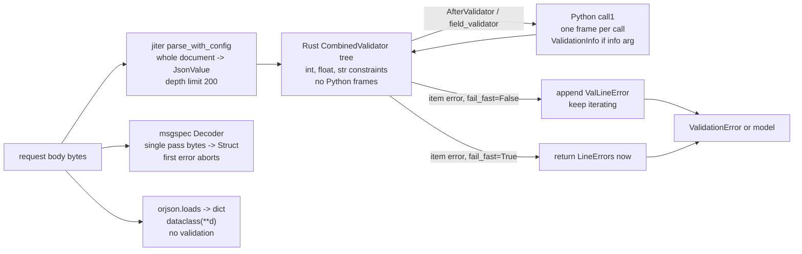

# Pydantic v2 Performance Engineering: fail_fast, Avoiding Python Validators, and Benchmarking Against msgspec (0.22.0) and orjson (3.13.0)

> [!summary] Claim
> Pydantic v2 is fast exactly as long as validation stays inside the Rust validator tree: every Python validator is a counted boundary crossing (one per field or one per item), `FailFast` bounds error collection but not JSON parsing, and a benchmark against msgspec or orjson is only honest when all contenders enforce the same contract.

Part of [Pydantic v2 Internals and Validation](README.md) in [API Engineering](../README.md).

## TL;DR

- Mechanism: `validate_json` parses the whole document with jiter into a Rust `JsonValue` tree, then walks a Rust `CombinedValidator` tree; a Python validator is a `call1` into the interpreter (`pydantic-core 2.50.4 src/validators/function.rs, FunctionAfterValidator::_validate`), so `list[Annotated[float, AfterValidator(f)]]` crosses once per element.
- Contract rule: express constraints declaratively (`Field(ge=0)`, `max_length`, `pattern`, discriminators) so they compile into the `CoreSchema`; keep Python validators for logic the schema language cannot express, and attach them at the coarsest level that is correct.
- Trap: `FailFast()` only short-circuits the item loop of `list`, `tuple`, `set`, `frozenset`, `deque`, and `dict` validators; it does not stop sibling fields, does not skip JSON parsing (10 000 invalid items still cost 40.96 us here), and raises `RuntimeError` on scalars and on `Sequence[int]`.
- Portability: the lab ran on CPython `3.14.6` only; pydantic-core and msgspec ship free-threaded `cp314t`/`cp315t` wheels, while orjson `3.13.0` ships none and its README says it "may support PEP 703 free-threading when it is stable" (as of 2026-11).
- When not to use this: if validation is not in your profile, none of it matters (the pydantic docs open with "In most cases Pydantic won't be your bottleneck"); and do not swap to `orjson.loads` plus a dataclass to "go faster", because that removes validation rather than speeding it up.

## Mental model



Bytes enter pydantic-core through `SchemaValidator::_validate_json`, which first materialises the entire document as a Rust `JsonValue` (no Python objects yet) and only then runs the validator tree over it.
Constraint checks such as `ge`, `max_length`, and `int` parsing stay in Rust; the only arrows that leave Rust are Python validators, each of which builds Python arguments and runs a Python frame before control returns.
When an item of a collection fails, the default path records a `ValLineError` with the item's location and keeps going, while `fail_fast=True` returns the error list immediately.
msgspec takes the lower path: one pass from bytes straight into `Struct` instances, constraints checked in C, and the first failure aborts decoding.
orjson plus a dataclass takes the bottom path, which is a JSON parse and a constructor call, with no type or constraint enforcement at all.

## How it works

### The two-phase JSON path in pydantic-core

`SchemaValidator::_validate_json` calls `jiter::JsonValue::parse_with_config(json_data, true, allow_partial)` and only on success calls `self._validate(..., &json_value, InputType::Json, ...)` (`pydantic-core 2.50.4 src/validators/mod.rs, SchemaValidator::_validate_json`).
Two consequences follow directly from that one line.
First, the entire document is parsed before any validator runs, so no validator setting (including `fail_fast`) can avoid the parse cost of bytes you will reject.
Second, the second argument is `allow_inf_nan = true`, so `NaN`, `Infinity`, and `-Infinity` literals are accepted by the parser even though `NaN` and `Infinity` "are not permitted" in JSON (RFC 8259 Section 6); whether a field accepts them is then decided by the float validator's `allow_inf_nan` setting.
jiter bounds nesting with `DEFAULT_RECURSION_LIMIT: u8 = 200` (`jiter 0.18.0 crates/jiter/src/errors.rs, DEFAULT_RECURSION_LIMIT`), which RFC 8259 Section 9 explicitly allows ("An implementation may set limits on the maximum depth of nesting"); the lab measured that 201 nested arrays parse and 202 fail with `recursion limit exceeded`.
jiter itself keeps duplicate keys in the object slice; a field lookup scans that slice in reverse with `.iter().rev()`, so the last duplicate wins (`pydantic-core 2.50.4 src/lookup_key.rs, LookupPath::json_get`), and the kwargs path deduplicates explicitly under the comment "jiter doesn't deduplicate keys, ... keep only the last value for each key" (`pydantic-core 2.50.4 src/input/input_json.rs, as_kwargs`).
That matches what RFC 8259 Section 4 describes as "Many implementations report the last name/value pair only".

### Why a Python validator costs what it costs

`FunctionAfterValidator::_validate` first runs the inner Rust validator (`let v = call(input, state)?`), then calls `self.func.call1(py, (v, info))` when the function takes an info argument and `self.func.call1(py, (v,))` otherwise (`pydantic-core 2.50.4 src/validators/function.rs, FunctionAfterValidator::_validate`).
With an info argument, each call also constructs a fresh `ValidationInfo` pyclass holding `config`, `context`, `data`, `field_name`, and `mode` (`pydantic-core 2.50.4 src/validators/function.rs, ValidationInfo::new`), which is one more Python allocation per call.
`FunctionBeforeValidator`, `FunctionPlainValidator`, and `FunctionWrapValidator` all call `input.to_object(py)?` before `call1`, so on JSON input they force the `JsonValue` subtree to be converted into Python objects before your function sees it.
That is why a `mode="before"` model validator on `model_validate_json` receives a real `dict` (the lab asserts `seen == [dict]`), and why the pydantic docs say `model_validate(json.loads(...))` "may be faster" when a model has a `'before'` or `'wrap'` validator (pydantic 2.14.3 `docs/concepts/performance.md`).
Wrap validators also construct a `ValidatorCallable` handler pyclass on every call and pass it as the second argument (`pydantic-core 2.50.4 src/validators/function.rs, FunctionWrapValidator::validate`); the docs' stated reason for "Wrap validators are generally slower than other validators" is that "they require that data is materialized in Python during validation" (pydantic 2.14.3 `docs/concepts/performance.md`), and the per-call handler is an additional cost on top of that.
The error contract is enforced by `convert_err`: only `ValueError` (including `PydanticCustomError`, `PydanticKnownError`, and nested `ValidationError`) and `AssertionError` become line errors, `PydanticOmit` and `PydanticUseDefault` become control flow, and any other exception, notably `TypeError`, becomes `ValError::InternalErr` and propagates raw (`pydantic-core 2.50.4 src/validators/function.rs, convert_err`).

The lab counts crossings rather than guessing them, using PEP 669 `sys.monitoring` `PY_START` events, which fire at the "Start of a Python function (occurs immediately after the call, the callee's frame will be on the stack)" (PEP 669).
Measured on CPython `3.14.6`:

| Call | Python frames started |
|---|---|
| `RustOnlyOrder.__pydantic_validator__.validate_json(payload)` | none |
| `RustOnlyOrder.model_validate_json(payload)` | `BaseModel.model_validate_json` (the classmethod wrapper itself) |
| `FieldValidatorOrder.__pydantic_validator__.validate_json(payload)` | `check_qty`, `check_prices`, and the generator expression inside `check_prices` |
| `ItemValidatorOrder.__pydantic_validator__.validate_json(payload)` | `_non_negative` exactly 100 times, once per price |

### fail_fast down to the loop

`FailFast` is a `PydanticMetadata` annotation with one field, `fail_fast: bool = True`, added in v2.8 (`pydantic 2.14.3 pydantic/types.py, FailFast`); `Field(fail_fast=...)` maps to the same class through `FieldInfo.metadata_lookup` (`'fail_fast': types.FailFast` in `pydantic 2.14.3 pydantic/fields.py, FieldInfo.metadata_lookup`).
At schema build, `_known_annotated_metadata` allows `fail_fast` only on schema types `list`, `deque`, `tuple`, `set`, `frozenset`, `dict`, `frozendict`, `ordered-dict`, and `counter` (`pydantic 2.14.3 pydantic/_internal/_known_annotated_metadata.py, constraint_schema_pairings`); everything else raises `RuntimeError: Unable to apply constraint 'fail_fast' to schema of type '<type>'`.
`SEQUENCE_CONSTRAINTS` includes `fail_fast`, yet `Annotated[Sequence[int], FailFast()]` fails because `Sequence` compiles to a `json-or-python` schema, which the lab proves.
The resulting core schema is just a flag: `{'type': 'list', 'items_schema': {'type': 'int'}, 'fail_fast': True}`, read by `ListValidator`'s `build` as `schema.get_as(pyo3::intern!(py, "fail_fast"))?.unwrap_or(false)` (`pydantic-core 2.50.4 src/validators/list.rs, ListValidator`).
The loop that honours it is `validate_iter_to_vec`: on `Err(ValError::LineErrors(line_errors))` it extends `errors` with each error prefixed by the item index and, `if fail_fast { return Err(ValError::LineErrors(errors)); }` (`pydantic-core 2.50.4 src/input/return_enums.rs, validate_iter_to_vec`).
Sets use `validate_iter_to_set` with `if fail_fast && !errors.is_empty()` after each item, dicts use a `should_fail_fast!` macro checked after each key and after each successful value, but a failed value takes a `continue` before the second check, so the loop breaks only after validating the next key (a probe for this note on `{"a": "x", "b": 1, "c": 2}` with a counting key validator saw keys `['a', 'b']` and one error) (`pydantic-core 2.50.4 src/validators/dict.rs, DictValidator`), and tuples check the same condition after every positional and variadic item (`pydantic-core 2.50.4 src/validators/tuple.rs, TupleValidator`).
`ModelFieldsValidator` has no such flag: it pushes every field's error into `state.errors` and continues (`pydantic-core 2.50.4 src/validators/model_fields.rs`), so a model with three bad fields still reports three errors even if one of them is a `FailFast` list.
What `fail_fast` saves is per-item work after the first failure: item validation, `ValLineError` construction (an `ErrorType`, a location, and the input value), and later conversion of those errors to Python dicts by `ValidationError.errors()`.

### The maintainers' checklist, and what each item changes

Beyond `FailFast` and Python validators, `docs/concepts/performance.md` lists the other levers; the table separates what the docs claim from what this note checked (pydantic 2.14.3 `docs/concepts/performance.md`).

| Tip in the docs | What the docs say it avoids | Verified here |
|---|---|---|
| Instantiate `TypeAdapter` once | "Each time a `TypeAdapter` is instantiated, it will construct a new validator and serializer" | Quote only; not timed |
| `list` or `tuple` over `Sequence`, `dict` over `Mapping` | An `isinstance(value, Sequence)` check, and trying "different types of sequences" | The lab proves the `Sequence` schema is `json-or-python` and rejects `FailFast` |
| Tagged union over plain union | Unions without a discriminator; see [[Discriminated-Unions-Tag-and-Callable-Discriminator-Dispatch]] | Not measured |
| `TypedDict` over nested models | The docs report "about ~2.5x faster" on their own benchmark | Not rerun |
| `Any` for values you do not validate | Validation of a value you do not need | Quote only |
| No subclasses of primitives that carry extra state | Extra attributes on a `str` subclass; use a model with `s: str` and `done: bool = False` | Quote only; the docs give no mechanism |
| Avoid wrap validators | "they require that data is materialized in Python during validation" | Source: `FunctionWrapValidator` calls `input.to_object(py)?` before `call1` |

msgspec has the same shape of checklist in `docs/perf-tips.rst` (msgspec 0.22.0): reuse `Encoder` and `Decoder` objects because each top-level `encode` or `decode` call "allocates some temporary internal state", prefer `Struct` over `dict` or dataclasses, decode a smaller `Struct` when you need few fields, set `omit_defaults=True` when defaults are known to the reader, use `gc=False` only when cycles are impossible, and prefer natively constructible containers (`list`, `set`, `frozenset`, fixed-size `tuple`, `dict`) because `tuple[str, ...]` and `frozendict` are built through an intermediate `list` or `dict` at `O(n*2)` cost.

### msgspec: validation fused into the decoder

msgspec's `json_decode_struct_map_inner` allocates the `Struct`, then loops over the object: it parses each key as a string view, looks it up with `StructMeta_get_field_index`, decodes the value directly with the field's `TypeNode`, and stores it with `Struct_set_index`; unknown keys are skipped with `json_skip` unless `forbid_unknown_fields` is set, and every failure is `goto error` (`msgspec 0.22.0 src/msgspec/_core.c, json_decode_struct_map_inner`).
There is no intermediate tree and no error list, so msgspec is fail-fast by construction and reports one error with a JSON path such as `` Expected `int` >= 1 - at `$.qty` ``.
Recursion is bounded by `Py_EnterRecursiveCall(" while deserializing an object")`, that is, by CPython's own recursion guard rather than a fixed constant; a probe for this note measured a maximum nesting of 24787 on this machine (the exact value moves with the caller's stack depth), and the lab only asserts that 2000 levels decode.
msgspec is strict by default (`"3"` for an `int` field fails) and lax only with `strict=False`, the opposite default from pydantic; see [[Lax-vs-Strict-Validation-Modes-and-Coercion-Tables]] for the pydantic coercion table.
Structs that reference only untracked objects are not GC-tracked (`MS_MAYBE_TRACKED` in `_core.c`), and `gc=False` disables tracking entirely at the cost of leaking any cycle (msgspec 0.22.0 `docs/structs.rst`, "Disabling Garbage Collection").

### orjson plus a dataclass: fast because it checks nothing

`orjson.loads` "deserializes to `dict`, `list`, `int`, `float`, `str`, `bool`, and `None` objects", caches map keys up to 64 bytes in a 2048-entry process-wide cache, and raises `JSONDecodeError` "if a combination of array or object recurses 1024 levels deep" (orjson 3.13.0 `README.md`, "Deserialize"); the lab shows that 1024 nested arrays still parse and 1025 fail, so the README counts one level differently.
`orjson.dumps` serializes `dataclasses.dataclass` natively, raises `JSONEncodeError` (a `TypeError` subclass) on integers beyond 64 bits, or 53 bits with `OPT_STRICT_INTEGER`, and holds the GIL for the whole call (orjson 3.13.0 `README.md`, "Serialize").
`DataclassOrder(**orjson.loads(b'{"qty": -5, ...}'))` builds an object with `qty == -5`, and with `"3"` it stores the string `"3"`; the lab asserts both, because a benchmark row that does no validation is not a competitor to one that does.

## Numbers and limits

Measured by `uv run --frozen python -m api_labs.f09_pydantic_v2_internals_and_validation.validation_cost` from `labs/` on an Apple M3 Pro, macOS 27.3 (`macOS-27.3-arm64-arm-64bit-Mach-O`), CPython `3.14.6`, pydantic `2.14.3`, pydantic-core `2.50.4`, msgspec `0.22.0`, orjson `3.13.0`, one run by the fact-checker (2026-11), minimum of 7 repetitions of 2000 calls with the GC disabled during timing.
The payload is a 596-byte order with a `sku`, a `qty`, and 100 `prices`.

| Decode and validate | us per call | vs fastest |
|---|---:|---:|
| pydantic, constraints in `CoreSchema`, `model_validate_json` | 3.01 | 2.1x |
| pydantic, two `@field_validator` functions | 4.42 | 3.1x |
| pydantic, `AfterValidator` per list item | 5.03 | 3.5x |
| pydantic, `model_validate(orjson.loads(payload))` | 2.39 | 1.7x |
| msgspec `Decoder(StructOrder).decode` | 1.60 | 1.1x |
| `orjson.loads` plus dataclass (no validation) | 1.43 | 1.0x |

| Encode | us per call | vs fastest |
|---|---:|---:|
| pydantic `model_dump_json` | 3.02 | 1.9x |
| `orjson.dumps(model.model_dump())` | 2.45 | 1.5x |
| msgspec `Encoder().encode(struct)` | 3.40 | 2.1x |
| `orjson.dumps(dataclass)` | 1.59 | 1.0x |

| 10 000 invalid `"x"` items into `list[int]` via `validate_json` (min of 5 x 20) | us per call | vs fastest |
|---|---:|---:|
| default, collect all errors | 660.30 | 16.1x |
| `FailFast()` | 40.96 | 1.0x |

What the numbers say, and what they do not:
- The per-item `AfterValidator` adds 2.02 us over 100 items, about 20 ns per crossing on this machine; that is the floor of a trivial Python function call from Rust, before your function does any work.
- The two field validators add 1.41 us over the Rust-only path; at about 20 ns per crossing the two calls themselves explain well under 0.1 us, so the crossings are not what the 1.41 us pays for (the split inside `check_prices` was not profiled, so no further attribution is made).
- For this float-heavy payload `model_validate(orjson.loads(...))` beat `model_validate_json` (2.39 vs 3.01 us); this contradicts the general guidance in pydantic's `docs/concepts/performance.md` for this one shape, and it is one machine and one run, so measure your own payloads before choosing.
  The docs themselves name only `'before'` and `'wrap'` validators as the cases where two-step is faster and say `model_validate_json` should become "always faster" once pending `pydantic-core` work lands (pydantic 2.14.3 `docs/concepts/performance.md`); this lab's payload has neither validator, and the cause of the gap was not investigated.
- msgspec encoding (3.40 us) was slower than `model_dump_json` (3.02 us) here; this is a one-machine, one-payload observation and the cause was not investigated, so do not read it as a general ranking of the two encoders.
- The residual 40.96 us under `FailFast`, about 4.1 ns per element, includes the whole-document jiter parse of 10 000 strings, which `fail_fast` cannot skip by design (`SchemaValidator::_validate_json` parses first); the remainder is the validation of the first item and one error, and the split was not measured.
- msgspec's own benchmark page (msgspec 0.22.0 `docs/benchmarks.rst`) reports msgspec "~12x faster than pydantic V2", but that figure was produced with msgspec `0.18.5` and pydantic `2.5.2`; it is not a statement about the pinned releases, and on this lab's payload the gap to pydantic's Rust-only path was 1.9x.

| Limit | Value | Source |
|---|---|---|
| pydantic JSON nesting depth | `DEFAULT_RECURSION_LIMIT = 200`; 201 nested arrays parse, 202 fail | `jiter 0.18.0 crates/jiter/src/errors.rs`; lab |
| pydantic validator recursion guard | `_pydantic_core._recursion_limit` exposes `RECURSION_GUARD_LIMIT`: 49 on wasm and Windows PyPy, 99 on other PyPy or Windows builds, 255 elsewhere, minus a `GUARD_OFFSET` that is nonzero only in debug builds; `255` read back on this machine | `pydantic-core 2.50.4 src/recursion_guard.rs`, `src/lib.rs` |
| orjson decode nesting depth | 1024 parse, 1025 fail | orjson 3.13.0 `README.md`; lab |
| orjson integer range on encode | 64-bit by default, 53-bit with `OPT_STRICT_INTEGER` | orjson 3.13.0 `README.md`; lab |
| orjson key cache | keys <= 64 bytes, 2048 entries | orjson 3.13.0 `README.md` |
| msgspec decode nesting depth | bounded by CPython's recursion guard; 24787 measured here | `msgspec 0.22.0 _core.c, Py_EnterRecursiveCall`; lab probe, not asserted |
| `ValidationError` display | each input value truncated to 50 bytes in `str(exc)` | `pydantic-core 2.50.4 src/errors/validation_exception.rs, PyLineError::pretty` |
| JSON interoperable integers | `[-(2**53)+1, (2**53)-1]` | RFC 8259 Section 6 |

## Portability

The lab ran once, under the workspace interpreter only, because lab matrix runs are paused by the user's instruction of 2026-11-11; every other cell cites a source and says so.

| Runtime / component | Behavior | Verification source |
|---|---|---|
| CPython `3.14.6`, macOS arm64 | All 17 lab tests pass; `sys.monitoring` frame counts as in the table above | Ran: `uv run --frozen pytest <module> -q` -> `17 passed in 0.24s` |
| CPython `3.12.16`, `3.13.18`, `3.15.2` | Not run; `python_frames_during` needs `sys.monitoring`, which PEP 669 added in 3.12, matching the workspace's `requires-python = ">=3.12,<3.16"`; wheels exist for each | PEP 669; `uv.lock` pins `cp312`, `cp313`, and `cp315` macOS arm64 wheels for `pydantic-core 2.50.4`, `msgspec 0.22.0`, and `orjson 3.13.0` |
| CPython `3.14.10` | Not run; the workspace venv is `3.14.6`, and `uv.lock` has the same `cp314` wheels for all three libraries | `uv.lock` |
| Free-threaded `3.14t` / `3.15.2t` | pydantic-core and msgspec have `cp314t` and `cp315t` wheels in `uv.lock`; orjson `3.13.0` has none (sdist only), and its README says it "may support PEP 703 free-threading when it is stable"; the whole workspace also cannot install there because `psycopg-binary` `3.3.8` has no `cp314t` or `cp315t` wheel and no sdist in `uv.lock` | `uv.lock`, orjson 3.13.0 `README.md` (as of 2026-11); not run |
| Python `3.15` `frozendict` | orjson `3.13.0` serializes the new built-in `frozendict` (orjson 3.13.0 `CHANGELOG.md`); msgspec decodes `frozendict[str, int]` by building a `dict` first, which its docs call `O(n*2)` (msgspec 0.22.0 `docs/perf-tips.rst`); pydantic accepts `fail_fast` on `frozendict` schemas | Sources only |
| pydantic `< 2.8` | `FailFast` and `Field(fail_fast=...)` do not exist (the docstring carries a `version-added` admonition for v2.8, and the docs say "Starting in v2.8+") | `pydantic 2.14.3 pydantic/types.py, FailFast` |
| orjson v2 vs v3 | v3 serializes dataclasses by default, and `OPT_SERIALIZE_DATACLASS` "is deprecated and has no effect in version 3" | orjson 3.13.0 `README.md` |
| PyPy, subinterpreters | orjson "does not and will not support PyPy ... or PEP 554 subinterpreters" | orjson 3.13.0 `README.md` |
| ASGI servers (Uvicorn, Hypercorn, Granian), HTTP/1.1, HTTP/2, HTTP/3 | Not exercised; validation runs on the buffered body inside the application, so these costs are independent of server and HTTP version, while the absolute request budget they sit inside is not | Not run; the claim follows from `SchemaValidator::_validate_json` taking a `bytes` buffer (`pydantic-core 2.50.4 src/validators/mod.rs`), see [[Pydantic-v2-Architecture-CoreSchema-and-Rust-Pydantic-Core]] for the server legs of the same validator |

## Worked example

The [implementation](../labs/src/api_labs/f09_pydantic_v2_internals_and_validation/validation_cost.py) defines the same order contract four ways and the [test](../labs/tests/f09_pydantic_v2_internals_and_validation/test_pydantic_v2_performance_engineering_vs_msgspec_and_orjson.py) proves where each one spends its time.

The four contracts (simplified excerpt; docstrings removed, `FieldValidatorOrder` shortened):

```python
class RustOnlyOrder(BaseModel):
    sku: Annotated[str, Field(min_length=1, max_length=32)]
    qty: Annotated[int, Field(ge=1, le=10_000)]
    prices: list[Annotated[float, Field(ge=0)]]


class FieldValidatorOrder(BaseModel):
    sku: str
    qty: int
    prices: list[float]

    @field_validator("prices")
    @classmethod
    def check_prices(cls, value: list[float]) -> list[float]:
        if any(price < 0 for price in value):
            raise ValueError("price must be >= 0")
        return value


class ItemValidatorOrder(BaseModel):
    sku: Annotated[str, Field(min_length=1, max_length=32)]
    qty: Annotated[int, Field(ge=1, le=10_000)]
    prices: list[Annotated[float, AfterValidator(_non_negative)]]


class StructOrder(msgspec.Struct, frozen=True):
    sku: Annotated[str, msgspec.Meta(min_length=1, max_length=32)]
    qty: Annotated[int, msgspec.Meta(ge=1, le=10_000)]
    prices: list[Annotated[float, msgspec.Meta(ge=0)]]
```

The crossing counter, verbatim from `validation_cost.py`:

```python
def python_frames_during(fn: Callable[[], object]) -> list[str]:
    """Return the qualnames of Python functions started while `fn` runs (PEP 669)."""
    monitoring = sys.monitoring
    tool_id = next(i for i in range(6) if monitoring.get_tool(i) is None)
    names: list[str] = []
    thunk = getattr(fn, "__code__", None)

    def on_start(code: CodeType, instruction_offset: int) -> None:
        if code is not thunk:
            names.append(code.co_qualname)

    monitoring.use_tool_id(tool_id, "validation_cost")
    try:
        monitoring.register_callback(tool_id, monitoring.events.PY_START, on_start)
        monitoring.set_events(tool_id, monitoring.events.PY_START)
        fn()
    finally:
        monitoring.set_events(tool_id, monitoring.events.NO_EVENTS)
        monitoring.register_callback(tool_id, monitoring.events.PY_START, None)
        monitoring.free_tool_id(tool_id)
    return names
```

It picks the first free tool id of the six that PEP 669 provides (ids 0 to 5), so it coexists with coverage or a profiler that already holds one, and the `finally` releases the id even if validation raises.

The tests that pin the mechanism (simplified excerpt: three test functions shown verbatim, the rest omitted):

```python
@pytest.mark.unit
def test_rust_only_validator_starts_no_python_frames() -> None:
    validator = RustOnlyOrder.__pydantic_validator__
    assert python_frames_during(lambda: validator.validate_json(PAYLOAD)) == []


@pytest.mark.unit
def test_after_validator_crosses_once_per_item() -> None:
    validator = ItemValidatorOrder.__pydantic_validator__
    frames = python_frames_during(lambda: validator.validate_json(PAYLOAD))
    assert frames == ["_non_negative"] * PRICE_COUNT


@pytest.mark.unit
def test_fail_fast_stops_at_first_invalid_item() -> None:
    items: list[object] = [0, 1, "bad", 3, 4, "bad", 6, 7]
    result = fail_fast_probe(items)
    assert result.errors_default == 2
    assert result.errors_fail_fast == 1
    assert result.item_calls_default == 6
    assert result.item_calls_fail_fast == 2
```

`fail_fast_probe` wraps each `int` item in an `AfterValidator` that counts calls; the two `"bad"` items fail `int` parsing before the counter runs, so the default path counts the six good items, while `FailFast` stops after items 0 and 1.

The contract-parity test, verbatim:

```python
@pytest.mark.unit
def test_strategies_agree_on_valid_input_but_only_two_reject_bad_input() -> None:
    results = {name: thunk() for name, thunk in decode_variants(PAYLOAD).items()}
    prices = {tuple(getattr(value, "prices")) for value in results.values()}  # noqa: B009
    assert len(prices) == 1
    assert len(next(iter(prices))) == PRICE_COUNT

    bad = b'{"sku": "SKU-1", "qty": -5, "prices": [1.0]}'
    with pytest.raises(ValidationError, match="greater than or equal to 1"):
        RustOnlyOrder.model_validate_json(bad)
    with pytest.raises(msgspec.ValidationError, match=r"Expected `int` >= 1 - at `\$\.qty`"):
        msgspec.json.decode(bad, type=StructOrder)
    assert DataclassOrder(**orjson.loads(bad)).qty == -5
```

Captured output (CPython `3.14.6`, macOS 27.3 arm64, from `labs/`):

```text
$ uv run --frozen pytest tests/f09_pydantic_v2_internals_and_validation/test_pydantic_v2_performance_engineering_vs_msgspec_and_orjson.py -q
.................                                                        [100%]
17 passed in 0.24s
```

```text
$ uv run --frozen python -m api_labs.f09_pydantic_v2_internals_and_validation.validation_cost
{'python': '3.14.6', 'msgspec': '0.22.0', 'orjson': '3.13.0'} payload=596 bytes, 100 prices
decode + validate (min of 7 x 2000):
pydantic rust-only validate_json            3.01 us     2.1x
pydantic @field_validator x2                4.42 us     3.1x
pydantic AfterValidator per item            5.03 us     3.5x
pydantic validate(orjson.loads)             2.39 us     1.7x
msgspec Decoder(Struct)                     1.60 us     1.1x
orjson.loads + dataclass (no checks)        1.43 us     1.0x
encode (min of 7 x 2000):
pydantic model_dump_json                    3.02 us     1.9x
orjson.dumps(model_dump())                  2.45 us     1.5x
msgspec Encoder.encode(Struct)              3.40 us     2.1x
orjson.dumps(dataclass)                     1.59 us     1.0x
10000 invalid items (min of 5 x 20):
list[int] collect all                     660.30 us    16.1x
FailFast list[int]                         40.96 us     1.0x
```

The two timing tests (`test_python_item_validator_is_measurably_slower`, `test_fail_fast_is_measurably_faster_on_bulk_invalid_input`) assert only wide ratios (1.5x and 5x) against measured gaps of about 1.7x and 16x, so they catch a lost mechanism without failing on scheduler noise; the frame-count and call-count tests are the exact proofs.

## Pitfalls

> [!warning] A `TypeError` inside a validator is not a validation error
> Trigger: a validator raises `TypeError` (or `KeyError`, or any non-`ValueError`) for bad input, as idiomatic Python often does.
> Symptom: `convert_err` maps it to `ValError::InternalErr`, so the raw `TypeError` escapes instead of a `ValidationError`; in a FastAPI route that is a `500` instead of a `422`.
> Fix: raise `ValueError`, `AssertionError`, or `PydanticCustomError`; the lab test `test_type_error_in_validator_escapes_validation_error` pins this (`pydantic-core 2.50.4 src/validators/function.rs, convert_err`).

> [!warning] `FailFast` on an abstract collection breaks at import time
> Trigger: `Annotated[Sequence[int], FailFast()]` or `Field(fail_fast=True)` on a scalar.
> Symptom: `RuntimeError: Unable to apply constraint 'fail_fast' to schema of type 'json-or-python'` (or `'int'`) when the class body executes, which takes the whole module, and the process, down at import.
> Fix: annotate a concrete `list`, `tuple`, `set`, `frozenset`, `deque`, or `dict`; the pydantic docs already recommend concrete `list` over `Sequence` for speed because `Sequence` adds an `isinstance` check and tries several sequence types (pydantic 2.14.3 `docs/concepts/performance.md`).

> [!warning] Expecting `FailFast` to cap request cost
> Trigger: treating `FailFast()` as a DoS defense for large JSON bodies.
> Symptom: the 10 000-item rejection still took 40.96 us here because jiter parses the whole body before validation, and memory for the `JsonValue` tree is spent anyway.
> Fix: cap body size at the server or proxy and use `max_length` on the collection; `FailFast` only bounds error construction.

> [!warning] Per-item Python validators where a constraint would do
> Trigger: `list[Annotated[float, AfterValidator(non_negative)]]` instead of `list[Annotated[float, Field(ge=0)]]`.
> Symptom: one interpreter crossing per element (100 frames for 100 prices in the lab), about 20 ns each before any work, plus a `ValidationInfo` allocation per call if the function takes `info`.
> Fix: move the check into the schema; if Python is unavoidable, validate the whole list once with a field validator so the crossing is per field, not per item.

> [!warning] A compiled `re.Pattern` silently switches the regex engine
> Trigger: `Field(pattern=re.compile(...))`.
> Symptom: pydantic uses Python `re` for that field "regardless of this setting", giving up the default `rust-regex` engine, which is "non-backtracking and therefore more DDoS resistant" (pydantic 2.14.3 `pydantic/config.py, ConfigDict.regex_engine`).
> Fix: pass the pattern as a `str` unless you need `re` flags or lookaround; this is the same class of bug as CVE-2024-3772, a regular expression denial of service via "a crafted email string" in pydantic `< 2.4.0` and `< 1.10.13` (NVD CVE-2024-3772, GHSA-mr82-8j83-vxmv).

> [!warning] Benchmarks that compare validation to no validation
> Trigger: a slide showing `orjson.loads` plus a dataclass beating pydantic.
> Symptom: the "winner" accepts `qty: -5` and `qty: "3"` (the lab asserts both), so the speedup is the cost of the checks you deleted.
> Fix: give every contender the same contract (types, bounds, strictness, unknown-field policy) and prove it with shared negative test cases before timing anything.

> [!warning] Byte-level output differs between serializers
> Trigger: swapping serializers behind a signature, cache key, or ETag.
> Symptom: `1e16` encodes as `1e+16` in orjson and pydantic but `1e16` in msgspec; `NaN` becomes `null` in orjson, msgspec, and `model_dump_json`, but `NaN` from `pydantic_core.to_json`; `2**64` fails in orjson and succeeds in the other two (all asserted in the lab).
> Fix: never hash serializer output across libraries; canonicalize explicitly (for example with RFC 8785 JCS) if bytes must be stable.

## Security and robustness

- Resource consumption (OWASP API4:2023 Unrestricted Resource Consumption): the default error path builds one `ValLineError` per bad item, each holding its input value, so a body of N bad items costs O(N) memory in errors on top of the O(N) `JsonValue` tree; `FailFast` removes the first term, a body-size limit removes both.
- Depth bombs: pydantic stops at jiter's 200-level limit and orjson at 1024, both returning errors; msgspec relies on CPython's recursion guard, so its limit moves with the interpreter version and stack configuration; keep a proxy body limit regardless.
- Non-finite numbers: pydantic's JSON parser always accepts `NaN` and `Infinity` (`allow_inf_nan = true` in `_validate_json`), and a plain `float` field keeps `nan`; set `allow_inf_nan=False` on money, quantity, and score fields, which yields the `finite_number` error.
- Duplicate keys: pydantic, orjson, and msgspec all kept the last value for `{"x": 1, "x": 2}` in the probe for this note; an upstream proxy or WAF that keeps the first value sees a different document (RFC 8259 Section 4 calls the behavior "unpredictable"), which is a request-smuggling-style parser differential.
- Integer range: orjson refuses integers beyond 64 bits on encode, and JavaScript clients lose precision beyond `2**53`; use `OPT_STRICT_INTEGER` or string IDs on public APIs (RFC 8259 Section 6).
- Error disclosure: `ValidationError` echoes the input value (truncated to 50 bytes in `str(exc)`); set `hide_input_in_errors=True` on models that receive secrets so the value never reaches logs (`pydantic 2.14.3 pydantic/config.py, hide_input_in_errors`).
- Defense in depth: server body limit, then collection `max_length`, then `FailFast` on bulk endpoints, then strict types on security-relevant fields; each layer bounds a different cost.

## The principal's view

The decision is not "pydantic or msgspec", it is where the contract lives and who pays for it.
Keep pydantic at the public edge when you need what only it gives in this stack: FastAPI integration, JSON Schema and OpenAPI generation, lax coercion for heterogeneous clients, and rich multi-error reports that clients can act on; then make that edge cheap by keeping validators declarative, so the Rust tree does the work.
Make "no Python validator without a reason" a review rule, and make the reason visible: a `sys.monitoring` crossing test like this lab's is a cheap CI guard against a well-meant `AfterValidator` that turns a 3 us route into a 30 us one at scale.
Use `FailFast` on bulk ingestion endpoints where clients cannot fix item 9 000 anyway, and keep full error lists on interactive forms where they can; that is a product decision about error UX, not a performance switch.
Choose msgspec for internal high-volume paths (queue consumers, service-to-service messages, MessagePack) where strict types are a feature, single-error reports are fine, and you control both ends; the trade-off is a second modelling layer and drift between the two definitions of the same entity, so generate one from the other or test them against shared fixtures.
Use orjson where you serialize data that is already trusted, never as a validation strategy.
If validation still dominates after all of this, the honest next step is to stop decoding what you do not need (msgspec's "view" Structs, or a smaller pydantic model), or to change the encoding (MessagePack, Protocol Buffers), not to shave nanoseconds off a boundary you have already minimised.

## Interview questions

> [!question] L5: Why does `list[Annotated[float, AfterValidator(f)]]` cost more than `list[Annotated[float, Field(ge=0)]]` even if `f` only returns its argument?
>
> > [!success]- Answer
> > The `Field(ge=0)` constraint compiles into the `float` core schema and is checked inside Rust.
> > `AfterValidator` compiles into a function-after validator that calls `func.call1` once per item, so 100 items means 100 Python frames.
> > The lab counted exactly 100 `PY_START` events for 100 prices, and measured about 20 ns per crossing on an M3 Pro with CPython 3.14.6.
> >
> > Follow-up: How would you rewrite the check if it genuinely needs Python, and what does that change about error locations?

> [!question] L5: Predict the output.
> ```python
> ta = TypeAdapter(Annotated[list[int], FailFast()])
> try:
>     ta.validate_json(b'[1, "a", 3, "b"]')
> except ValidationError as e:
>     print(e.error_count(), [x["loc"] for x in e.errors()])
> ```
>
> > [!success]- Answer
> > It prints `1 [(1,)]`.
> > `validate_iter_to_vec` records the error at index 1 and returns immediately because `fail_fast` is true, so index 3 is never validated.
> > Without `FailFast` it prints `2 [(1,), (3,)]`.
> >
> > Follow-up: Was the `"b"` at index 3 parsed?

> [!question] L6: Debug this API: a FastAPI endpoint returns `500` for some malformed bodies instead of `422`.
> ```python
> class Item(BaseModel):
>     code: str
>
>     @field_validator("code")
>     @classmethod
>     def known(cls, v: str) -> str:
>         return CODES[v]  # dict lookup
> ```
>
> > [!success]- Answer
> > An unknown code raises `KeyError`, which is not a `ValueError` or `AssertionError`.
> > pydantic-core's `convert_err` maps it to `ValError::InternalErr`, so it propagates as a raw exception and the framework returns `500`.
> > Fix it by catching the lookup failure and raising `ValueError` (or `PydanticCustomError` with a stable error type), or better, replace the lookup with a `Literal` or `Enum` so it never leaves Rust.
> >
> > Follow-up: Which exception types does `convert_err` treat as control flow rather than errors?

> [!question] L6: Does adding `FailFast()` to a bulk import endpoint stop a DoS made of 50 MB JSON arrays of junk?
>
> > [!success]- Answer
> > Only partially: it bounds error construction, not parsing.
> > `SchemaValidator::_validate_json` parses the whole document into a jiter `JsonValue` before validating, so parse time and tree memory are unchanged.
> > `FailFast` removes the per-item error objects, which was the 16x part in the lab (660 us vs 41 us for 10 000 items), but the 41 us that remains grows linearly with the body.
> > The real control is a body-size limit at the proxy or server plus `max_length` on the list.
> >
> > Follow-up: Where in the stack would you enforce the body limit, and what status code should it return?

> [!question] L6: Why can `model_validate(orjson.loads(body))` be faster than `model_validate_json(body)`, and when is it wrong to switch?
>
> > [!success]- Answer
> > The pydantic docs name `'before'` and `'wrap'` validators as cases where two-step is faster, because those validators force the `JsonValue` subtree into Python objects anyway.
> > This lab also measured two-step faster (2.39 vs 3.01 us) for a float-heavy payload with no Python validators, so the answer is payload-dependent.
> > Switching changes semantics: Python-mode validation sees Python types, so strict-mode and JSON-only coercions differ, and you add a second NaN and depth policy (orjson rejects `NaN` and allows 1024 levels; jiter accepts `NaN` and allows 200).
> >
> > Follow-up: How would you prove the two paths accept the same set of documents?

> [!question] L7+: A benchmark shows msgspec 10x faster than pydantic on your service; how do you decide whether to migrate?
>
> > [!success]- Answer
> > First make the comparison honest: same types, bounds, strictness, unknown-field policy, and error expectations, enforced by shared negative fixtures.
> > msgspec's published 12x comes from msgspec 0.18.5 against pydantic 2.5.2, and on this lab's payload the gap to pydantic's Rust-only path was 1.9x with pinned releases.
> > Then measure validation as a share of request latency under load; if it is 5% of p99, a 2x win is 2.5%.
> > If it is material, move only the hot internal paths, keep pydantic at the documented edge for OpenAPI and multi-error responses, and pay for the second model layer with generated or cross-tested definitions.
> >
> > Follow-up: What is msgspec's error-reporting model, and how does it affect client UX?

> [!question] L7+: How would you stop Python validators from creeping back into hot models over two years of feature work?
>
> > [!success]- Answer
> > Make the cost observable and gated.
> > A CI test like `python_frames_during` asserts the exact list of Python frames a model's validator may start, so any new crossing fails review with a diff that names the function.
> > Pair it with a lint rule or schema inspection that flags function validators on fields inside lists, and a benchmark budget per hot model tracked over time.
> > The organizational part is the review rule: a Python validator needs a written reason the schema language cannot express the constraint.
> >
> > Follow-up: What would make such a frame-count test flaky, and how do you avoid it?

> [!question] L7+: Why do signatures intermittently fail between two services when one serializes JSON with orjson and the other with msgspec?
>
> > [!success]- Answer
> > The serializers do not produce identical bytes for identical values.
> > The lab shows `1e16` as `1e+16` from orjson and pydantic but `1e16` from msgspec, and `NaN` as `null` in some paths and `NaN` from `pydantic_core.to_json`.
> > Key order, whitespace, and integer range also vary by option.
> > Sign a canonical form (RFC 8785 JCS) or the exact bytes on the wire, never a re-serialization.
> >
> > Follow-up: Which fields in your payloads are most likely to trigger the difference?

> [!question] L6: What does `msgspec.Struct(gc=False)` buy, and what does it risk?
>
> > [!success]- Answer
> > Structs with `gc=False` are never tracked by the cyclic garbage collector, so decoding many of them does not push allocation counts toward a collection, and long-lived ones do not add to later-generation scans.
> > The risk, in msgspec's own words, is that a cycle containing only `gc=False` structs "will never be collected", which is a memory leak.
> > It also cannot be combined with a weakref slot; setting both raises `ValueError` at class creation.
> >
> > Follow-up: Why does the lab's timing harness disable the GC, and what does that hide?

## Related

Prerequisites: [[Pydantic-Settings-Environment-Secret-Files-and-Source-Priority]]

Next: [[Migrating-Large-Codebases-from-Pydantic-v1-to-v2]]

See also: [[02-Programming-Languages/Python/Python-Backend-Interview-Prep/04-FastAPI]], [[Pydantic-v2-Architecture-CoreSchema-and-Rust-Pydantic-Core]], [[Single-Pass-JSON-Validation-Model-Validate-JSON-vs-JSON-Loads]], [[Functional-Validators-Before-After-Wrap-and-Plain]], [[Model-Validators-ValidationInfo-Context-and-Cross-Field-Invariants]], [[Lax-vs-Strict-Validation-Modes-and-Coercion-Tables]], [[Annotated-Constraints-Field-Metadata-and-Custom-Types]], [[Discriminated-Unions-Tag-and-Callable-Discriminator-Dispatch]], [[Custom-Serialization-Field-Model-and-Wrap-Serializers]], [[TypeAdapter-for-Validating-and-Serializing-Arbitrary-Types]], [[Profiling-Python-API-Services-CPU-Wall-Clock-Async-Tasks-and-Memory]], [[Latency-Histograms-Percentiles-DDSketch-and-Why-Averaging-Percentiles-Is-Wrong]]

- Lab: `labs/tests/f09_pydantic_v2_internals_and_validation/test_pydantic_v2_performance_engineering_vs_msgspec_and_orjson.py`

## Further reading

- [pydantic-core 2.50.4 `src/input/return_enums.rs`](https://raw.githubusercontent.com/pydantic/pydantic/v2.14.3/pydantic-core/src/input/return_enums.rs) - `validate_iter_to_vec` and `validate_iter_to_set`, the exact loops where `fail_fast` returns early.
- [pydantic-core 2.50.4 `src/validators/function.rs`](https://raw.githubusercontent.com/pydantic/pydantic/v2.14.3/pydantic-core/src/validators/function.rs) - the before, after, plain, and wrap validators' `call1` sites, `ValidationInfo::new`, and `convert_err`.
- [pydantic-core 2.50.4 `src/validators/mod.rs`](https://raw.githubusercontent.com/pydantic/pydantic/v2.14.3/pydantic-core/src/validators/mod.rs) - `SchemaValidator::_validate_json`, showing the whole-document jiter parse before validation.
- [jiter 0.18.0 `crates/jiter/src/errors.rs`](https://raw.githubusercontent.com/pydantic/jiter/v0.18.0/crates/jiter/src/errors.rs) - `DEFAULT_RECURSION_LIMIT`, the 200-level JSON nesting bound.
- [pydantic 2.14.3 `docs/concepts/performance.md`](https://raw.githubusercontent.com/pydantic/pydantic/v2.14.3/docs/concepts/performance.md) - the maintainers' own performance tips, including `FailFast`, wrap validators, `TypedDict`, and `Sequence` vs `list`.
- [msgspec 0.22.0 `src/msgspec/_core.c`](https://raw.githubusercontent.com/jcrist/msgspec/0.22.0/src/msgspec/_core.c) - `json_decode_struct_map_inner`, the single-pass decode-and-validate loop.
- [msgspec 0.22.0 `docs/perf-tips.rst`](https://raw.githubusercontent.com/jcrist/msgspec/0.22.0/docs/perf-tips.rst) - reusing `Decoder`/`Encoder`, `array_like`, `gc=False`, `encode_into`, and view Structs.
- [orjson 3.13.0 `README.md`](https://raw.githubusercontent.com/ijl/orjson/3.13.0/README.md) - the authoritative list of types, options, limits, and platform support.
- [RFC 8259](https://www.rfc-editor.org/rfc/rfc8259.html) - JSON grammar; Section 4 on duplicate names, Section 6 on numbers and non-finite values, Section 9 on parser limits.
- [PEP 669 - Low Impact Monitoring for CPython](https://peps.python.org/pep-0669/) - the `sys.monitoring` events the lab uses to count boundary crossings.
- [RFC 8785 - JSON Canonicalization Scheme (JCS)](https://www.rfc-editor.org/rfc/rfc8785.html) - the canonical form to sign or hash when two serializers must agree on bytes.
- [OWASP API4:2023 Unrestricted Resource Consumption](https://owasp.org/API-Security/editions/2023/en/0xa4-unrestricted-resource-consumption/) - the risk class that body limits, `max_length`, and `FailFast` each partially address.
- [GHSA-mr82-8j83-vxmv / CVE-2024-3772](https://github.com/advisories/GHSA-mr82-8j83-vxmv) - pydantic email ReDoS, the reason regex engines are a performance and security decision.
