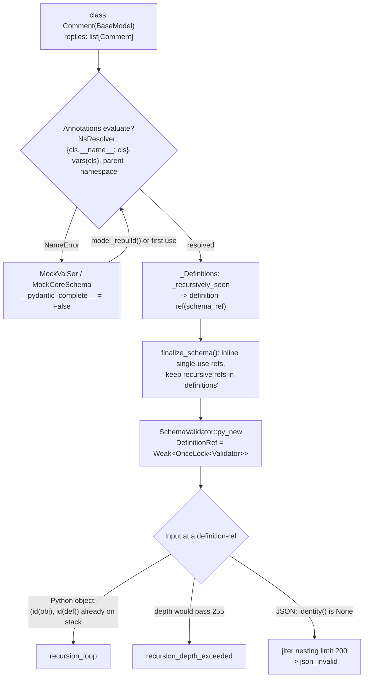

# Recursive Schemas, Forward References, model_rebuild(), and Cyclic Reference Detection in pydantic-core

> [!summary] Claim
> Pydantic `2.14.3` turns every recursive type into a `definitions` schema whose back edges are `definition-ref` nodes, and `pydantic-core` `2.50.4` guards exactly those nodes with an `(id(input), id(definition))` stack that raises `recursion_loop` on a revisited Python object and a `u8` depth counter that raises `recursion_depth_exceeded` after `255` traversals, while JSON input skips the identity check and is bounded instead by `jiter`'s nesting limit of `200`.

Part of [Pydantic v2 Internals and Validation](README.md) in [API Engineering](../README.md).

## TL;DR

- Mechanism: a model that names itself (directly, through another model, or through a PEP 695 `type` alias) compiles to `{"type": "definitions", "schema": ..., "definitions": [...]}`, and every recursive edge becomes a `DefinitionRefValidator` that holds a `Weak` pointer to a shared `OnceLock` cell and enters a `RecursionGuard` keyed on `(input.identity(), definition.id())` (`pydantic-core 2.50.4 src/validators/definitions.rs, DefinitionRefValidator::validate`).
- Contract rule: an annotation that cannot be evaluated when the class statement runs leaves the class with `MockValSer` placeholders and `__pydantic_complete__ == False`; call `Model.model_rebuild()` once, at import time, from a scope where every name resolves, and treat `True`, `None`, `False`, and a raised `PydanticUndefinedAnnotation` as four distinct outcomes (`pydantic 2.14.3 pydantic/main.py, BaseModel.model_rebuild`).
- Trap: the identity guard only sees `id()`; a `mode="before"` validator that copies its input gives each level a fresh identity, so a cyclic payload degrades from an instant `recursion_loop` into a `255`-level walk that ends in `recursion_depth_exceeded` (`pydantic/pydantic-core#143`), and a namespace captured when a model was defined inside a function silently wins over the `_types_namespace` you pass to `model_rebuild()`.
- Portability fact: CPython `3.14` evaluates annotations lazily `(PEP 649)`, so an unquoted `children: list[Node]` works without `from __future__ import annotations`, while `3.12` and `3.13` raise `NameError` in the class body; the guard limit is `255` on non-Windows CPython release builds and `99` or `49` on Windows, PyPy, and WASM (`pydantic-core 2.50.4 src/recursion_guard.rs, RECURSION_GUARD_LIMIT`).
- When not to use it: do not model an arbitrary graph with shared nodes as a recursive `BaseModel`, because validation turns a DAG into a tree of copies and rejects true cycles; send an adjacency list (`nodes` plus `edges` by id) and validate referential integrity in a `model_validator(mode="after")` instead.

## Mental model



The class statement first tries to evaluate each annotation against a stack of namespaces in which the class being created is always visible under its own name, so a direct self-reference resolves even though the module has not bound the name yet.
Any name that is still missing turns the class into a shell whose validator, serializer, and core schema are mocks that retry the build on first use or on an explicit `model_rebuild()`.
Once every name resolves, schema generation meets the class a second time while still inside its own build and emits a `definition-ref` instead of recursing, and `finalize_schema` decides which references survive as shared definitions.
At run time those surviving references are the only places where traversal can revisit itself, so they are the only places that pay for a guard: Python input is checked by object identity and depth, and JSON input, which cannot alias, is checked only by the parser's nesting limit.

## How it works

### 1. Evaluating forward references at class creation

`ModelMetaclass.__new__` snapshots the defining frame's locals with `parent_frame_namespace()` and stores them as `cls.__pydantic_parent_namespace__` through `build_lenient_weakvaluedict`, which wraps every weak-referenceable value in `_PydanticWeakRef` and keeps values that cannot be weakly referenced, such as `int` and `str` instances, as strong references (`pydantic 2.14.3 pydantic/_internal/_model_construction.py, build_lenient_weakvaluedict`).
`parent_frame_namespace()` returns `None` when the class is defined at module level (`frame.f_back is None or frame.f_code.co_name == '<module>'`), because the module globals are consulted anyway, and it skips the synthetic `<generic parameters of ...>` frame that PEP 695 generic classes introduce (`pydantic 2.14.3 pydantic/_internal/_typing_extra.py, parent_frame_namespace`).
The snapshot is a copy of the locals that exist at that instant, so a name bound later in the same function is never in it.

Annotations are read with `safe_get_annotations`, which on CPython `3.14+` calls `annotationlib.get_annotations(obj, format=annotationlib.Format.FORWARDREF)` so that an undefined name produces a `ForwardRef` instead of raising out of `__annotate__` `(PEP 649)` `(PEP 749)`, and on older versions reads `cls.__dict__['__annotations__']` (`pydantic 2.14.3 pydantic/_internal/_typing_extra.py, safe_get_annotations`).
Each annotation is then evaluated by `try_eval_type`, which returns `(_type_convert(value), False)` on `NameError` so that collection stays lenient (`pydantic 2.14.3 pydantic/_internal/_typing_extra.py, try_eval_type`).
`eval_type` adds three translations: an `ImportError` (on every version, but in practice from a lazy import `(PEP 810)` that fails on `3.15`, typically in an import cycle) is re-raised as `NameError` so the field is treated as not yet resolvable, a `RecursionError` gets a note recommending PEP 695 aliases over implicit recursive aliases such as `MyType = list['MyType']`, and on `3.14+` the vendored `_eval_type` calls `typing._eval_type(..., prefer_fwd_module=True)` (`pydantic 2.14.3 pydantic/_internal/_typing_extra.py, eval_type`, `_eval_type`).

The `globals` passed to evaluation are always the defining module's `__dict__` (`get_module_ns_of`), and the `locals` are a `LazyLocalNamespace` merged in ascending priority: the parent namespace, the outermost type on the resolver stack, the class's `__type_params__`, `vars(cls)`, and finally `{cls.__name__: cls}` (`pydantic 2.14.3 pydantic/_internal/_namespace_utils.py, NsResolver.types_namespace`).
That last entry is the whole reason `class Comment(BaseModel): replies: list[Comment]` needs no rebuild: the class object exists before `ModelMetaclass.__new__` returns, and the resolver injects it under its own name.
The same ordering means `vars(cls)` can shadow module globals, which is why the maintainers note that `f: '__doc__'` unexpectedly resolves (pydantic docs, Resolving Annotations, as of 2026-11).

### 2. The incomplete state and `MockValSer`

When `complete_model_class` cannot finish, it calls `set_model_mocks(cls, '`Author`')`, which installs a `MockCoreSchema` on `__pydantic_core_schema__` and `MockValSer` instances on `__pydantic_validator__` and `__pydantic_serializer__`, all carrying the message ``"`Thread` is not fully defined; you should define `Author`, then call `Thread.model_rebuild()`."`` and the error code `class-not-fully-defined` (`pydantic 2.14.3 pydantic/_internal/_mock_val_ser.py, set_model_mocks`).
`MockValSer.__getattr__` first runs its `attempt_rebuild` handler, which calls `cls.model_rebuild(raise_errors=False, _parent_namespace_depth=5)`, and only raises `PydanticUserError` if that rebuild returns `False` (`pydantic 2.14.3 pydantic/_internal/_mock_val_ser.py, MockValSer.__getattr__`).
So the first `model_validate` on an incomplete class is an implicit rebuild against the locals of whichever function made that call (`_parent_namespace_depth=5` counts the frames of `parent_frame_namespace`, `model_rebuild`, the handler, `MockValSer.__getattr__`, and `model_validate`), which works when the missing name happens to be visible there and fails with `class-not-fully-defined` when it is not; the lab proves the failure, and a scratch run in verification proves the success (a function that defines `Outer` with `inner: Inner`, then `Inner`, then calls `Outer.model_validate(...)` validated without an explicit rebuild).
`TypeAdapter` uses the same mechanism through `set_type_adapter_mocks` and `TypeAdapter.rebuild()`, and Pydantic dataclasses through `set_dataclass_mocks` and `rebuild_dataclass` (`pydantic 2.14.3 pydantic/_internal/_mock_val_ser.py`).

### 3. `model_rebuild()` step by step

`BaseModel.model_rebuild(*, force=False, raise_errors=True, _parent_namespace_depth=2, _types_namespace=None)` does the following (`pydantic 2.14.3 pydantic/main.py, BaseModel.model_rebuild`):

1. If `cls.__pydantic_complete__` is already `True` and `force` is `False`, return `None` without taking any lock.
2. Acquire the module-global `_rebuild_lock = threading.RLock()` and re-check completeness inside it, because another thread may have finished the rebuild while this one waited; the source comment calls out that the lock is "global (not per model class)".
3. If `force=True` on a complete class, reinstall the mocks rather than deleting the old validator, which the source notes "isn't thread-safe".
4. Build the rebuild namespace: `_types_namespace` if given, else `parent_frame_namespace(parent_depth=_parent_namespace_depth, force=True)`, which returns the caller's locals even at module level.
5. Unpack the weak parent namespace and merge `{**rebuild_ns, **parent_ns}`, so on a key collision the namespace captured at definition time overrides the one you just passed.
6. Call `complete_model_class(..., raise_errors=raise_errors, call_on_complete_hook=not already_complete, is_force_rebuild=force)`.

`complete_model_class` first re-collects fields with `rebuild_model_fields` if `__pydantic_fields_complete__` is `False`, converting a `NameError` into `PydanticUndefinedAnnotation` (code `undefined-annotation`) that it raises or swallows according to `raise_errors`, then generates and cleans the schema and compiles `create_schema_validator(..., _use_prebuilt=not is_force_rebuild)` and `SchemaSerializer(schema, core_config, _use_prebuilt=not is_force_rebuild)` (`pydantic 2.14.3 pydantic/_internal/_model_construction.py, complete_model_class`).
A forced rebuild therefore never reuses another model's compiled validator through `PrebuiltValidator`, which avoids embedding a stale child validator; see [[Pydantic-v2-Architecture-CoreSchema-and-Rust-Pydantic-Core]].
The return values form a small protocol: `None` means nothing to do, `True` means built now, `False` means `raise_errors=False` and a name is still missing.

### 4. Turning a cycle in types into a finite schema

`GenerateSchema._model_schema` computes `model_type_ref(cls)`, a string of the form `f"{module}.{qualname}:{id(cls)}"` plus a suffix for generic arguments (`pydantic 2.14.3 pydantic/_internal/_type_refs.py, model_type_ref`), and enters `self.defs.get_definition_ref_schema(ref=model_ref)` (`pydantic 2.14.3 pydantic/_internal/_generate_schema.py, GenerateSchema._model_schema`).
`_Definitions.get_definition_ref_schema` is the cycle breaker: if `ref` is in `_recursively_seen` (we are inside its own build) or already in `_definitions`, it yields `core_schema.definition_reference_schema(ref)` and generation of that branch stops; otherwise it adds `ref` to `_recursively_seen` for the duration of the build (`pydantic 2.14.3 pydantic/_internal/_generate_schema.py, _Definitions.get_definition_ref_schema`).
The docstring lists what can be named and therefore recursive: Pydantic models, Pydantic and stdlib dataclasses, `TypedDict`, `NamedTuple`, `TypeAliasType` instances, and enums.
A PEP 695 alias goes through `_type_alias_type_schema`, which keys on `type_alias_type_ref(obj)`, evaluates `origin.__value__`, and stores the result with `schema['ref'] = ref` (`pydantic 2.14.3 pydantic/_internal/_generate_schema.py, GenerateSchema._type_alias_type_schema`).
An implicit alias (`Bad = list["Bad"]`) has no identity to key on, so evaluation recurses until CPython raises `RecursionError`, which `eval_type` annotates with the PEP 695 advice; a scratch run of `TypeAdapter(Bad)` reproduced exactly that note.

`_Definitions.finalize_schema` then calls the pure-Python walker `gather_schemas_for_cleaning` (`pydantic 2.14.3 pydantic/_internal/_schema_gather.py, gather_schemas_for_cleaning`) and, for each reference, applies `_inlining_behavior`: a reference used once with no `serialization` key and no metadata is inlined in place (`inlinable_def_ref.clear(); inlinable_def_ref.update(...)`), and anything recursive or used twice stays in `remaining_defs`, which becomes the `definitions` list (`pydantic 2.14.3 pydantic/_internal/_generate_schema.py, _Definitions.finalize_schema`, `_inlining_behavior`).
For `Comment`, the lab asserts the result: the root is `definitions`, the inner schema is a bare `definition-ref` whose `schema_ref` equals the single `model` definition's `ref`, and `repr(Comment.__pydantic_validator__)` starts with `SchemaValidator(title="Comment", validator=DefinitionRef(`.

### 5. Weak references in the compiled graph

`DefinitionsBuilder::get_definition` hands out a `DefinitionRef { reference, value: Weak<OnceLock<T>>, name }`, and the strong `Arc<OnceLock<T>>` lives only in `Definitions`, owned by the `SchemaValidator` (`pydantic-core 2.50.4 src/definitions.rs, DefinitionsBuilder::get_definition`).
The source comment states the reason: "We use a weak reference to the definition to avoid a reference cycle when recursive definitions are used."
The `OnceLock` lets a reference be created before its target is built (the target is still being compiled when the back edge is met), `add_definition` fills it and rejects a second fill with `Duplicate ref`, and `finish()` fails with ``Definitions error: definition `{reference}` was never filled`` if a reference was never resolved (`pydantic-core 2.50.4 src/definitions.rs, DefinitionsBuilder::add_definition`, `DefinitionsBuilder::finish`).
`DefinitionRef::id()` is `Weak::as_ptr(&self.value) as usize`, a stable per-definition integer that the recursion guard uses as its node id, and `Debug` prints only the name so that `repr()` of a recursive validator terminates.

### 6. The recursion guard at validation time

`DefinitionRefValidator::validate` reads the target validator and, if `input.identity()` is `Some(id)`, wraps the call in `RecursionGuard::new(state, id, self.definition.id())`, mapping `RecursionError::Cyclic` to `ErrorTypeDefaults::RecursionLoop` and `RecursionError::Depth` to `ErrorTypeDefaults::RecursionDepthExceeded` (`pydantic-core 2.50.4 src/validators/definitions.rs, DefinitionRefValidator::validate`, `recursion_error_type`).
It also sets `state.allow_partial = false`, so partial (streaming) validation is disabled below any recursive edge.
Python input's identity is the object's address, `Some(self.as_ptr() as usize)`, while JSON values and JSON object keys return `None`, with the comment "depth is bounded by the JSON parser's recursion limit" (`pydantic-core 2.50.4 src/input/input_python.rs`; `src/input/input_json.rs`; `src/input/input_abstract.rs, Input::identity`).
`validate_assignment` on a recursive field guards on the model instance itself (`py_identity(obj)`).

`RecursionGuard::new` performs two checks in order: `state.insert(obj_id, node_id)` returns `false` if the pair is already active, which is a cycle, and then `state.incr_depth()` reports whether the depth limit is exceeded; `Drop` decrements depth and removes the pair, so the set holds only the current ancestor path (`pydantic-core 2.50.4 src/recursion_guard.rs, RecursionGuard::new`, `Drop for RecursionGuard`).
Because entries are removed on the way back up, the same dict reached twice through sibling branches is not a cycle: the lab validates `{"replies": [shared, shared]}` and gets two equal but distinct `Comment` objects, which also shows that validation never preserves aliasing.
The key includes the definition id, so the same object validated by two different recursive definitions is not misreported either.

The active set is a `RecursionStack` that starts as an inline array of `16` `(usize, usize)` pairs scanned linearly and spills into an `AHashSet` on the 17th insert, a size the source describes as chosen by "trial and error" because larger arrays made lookups "significantly slower" (`pydantic-core 2.50.4 src/recursion_guard.rs, ARRAY_SIZE`, `RecursionStack::insert`).
Depth is one `u8` shared by all definitions in the current validation call.
On non-Windows, non-PyPy, non-WASM release builds `incr_depth` uses `checked_add`, so the counter fails on the 256th nested entry, while the other targets use `saturating_add` against `RECURSION_GUARD_LIMIT`, which is `49` for WASM and Windows PyPy, `99` for other PyPy and Windows builds, and `255` otherwise, minus a `GUARD_OFFSET` of `100` on macOS `3.14`, `50` on Windows CPython, and `20` elsewhere in debug builds (`pydantic-core 2.50.4 src/recursion_guard.rs, RECURSION_GUARD_LIMIT`, `GUARD_OFFSET`, `RecursionState::incr_depth`).
The limit is exported as `pydantic_core._pydantic_core._recursion_limit` (`pydantic-core 2.50.4 src/lib.rs, _pydantic_core`), and the lab reads `255` from it.

The depth counter counts `definition-ref` traversals, not model levels, so the effective nesting limit depends on the cleaned schema shape:

- `Comment` crosses one reference per level, so a `255`-level chain validates and `256` fails with one `recursion_depth_exceeded` error whose `loc` has `510` items (`replies`, index, repeated).
- `BinOp` recurses through the `Expr` alias and then through `BinOp` itself, two references per level, so a left-deep tree validates at `127` levels and fails at `128`.
- A mutually recursive `A` (`b: B | None = None`, incomplete at definition) and `B` (`a: A | None = None`, complete first) keeps only `B` in `definitions` and inlines `A` inside it, and `A`'s validator reaches `B` through a `Prebuilt` copy of `B`'s own validator, whose root is itself a `DefinitionRef`; so only edges into `B` are counted, plus one extra on the first entry, and an `A`-rooted alternating chain passes at `509` levels and fails at `510`, while a `B`-rooted chain passes at `510` and fails at `511` (scratch script, CPython `3.14.6`).

The design rationale is a closed argument: a schema without `definition-ref` nodes is a finite tree, so its traversal depth is bounded by the schema itself; only a `definition-ref` can make traversal revisit a validator, so that is the only place that needs either guard, and the hot path for non-recursive models pays nothing.
The depth limit is explicitly a backup: the source comment on `incr_depth` says "see #143 this is used as a backup in case the identity check recursion guard fails", which refers to `pydantic/pydantic-core#143`, "Recursion with function before", a segmentation fault caused by a `before` function that returned a new object at every level so the identity check never matched.

### 7. JSON input and `jiter`

`SchemaValidator::validate_json` parses with `jiter::JsonValue::parse_with_config(json_data, true, allow_partial)` before validating (`pydantic-core 2.50.4 src/validators/mod.rs, SchemaValidator::_validate_json`), and `pydantic-core` pins `jiter = { version = "0.18.0", features = ["python"] }` (`pydantic-core 2.50.4 Cargo.toml`).
`parse_with_config` calls `parse_borrowed`, which passes `DEFAULT_RECURSION_LIMIT: u8 = 200` through `take_value` into the iterative `take_value_recursive`, which keeps open parent containers on a `SmallVec<[RecursedValue; 8]>` and fails with `RecursionLimitExceeded` ("recursion limit exceeded") when `recursion_stack.len() >= recursion_limit` (`jiter 0.18.0 crates/jiter/src/value.rs, parse_borrowed`, `take_value_recursive`; `crates/jiter/src/errors.rs, DEFAULT_RECURSION_LIMIT`).
Measured here with `TypeAdapter(Any).validate_json`, `201` nested arrays parse and `202` fail with `Invalid JSON: recursion limit exceeded at line 1 column 202`, and a `Comment` chain survives `100` levels and fails at `101` with `json_invalid` and, for `json.dumps(comment_chain(101))`, the message `Invalid JSON: recursion limit exceeded at line 1 column 3790`, because each level opens one object and one array.
So `model_validate_json` on a recursive model hits the parser's limit long before the `255` validation budget, and since a JSON text cannot alias, the identity check is skipped entirely; RFC 8259 explicitly permits such limits: "An implementation may set limits on the maximum depth of nesting" `(RFC 8259 Section 9)`.

### 8. The serializer side

`DefinitionRefSerializer::to_python` and `serde_serialize` call `state.recursion_guard(value, self.definition.id())`, which maps `Cyclic` to `ValueError("Circular reference detected (id repeated)")` and `Depth` to `ValueError("Maximum serialization depth exceeded")` (`pydantic-core 2.50.4 src/serializers/type_serializers/definitions.rs, DefinitionRefSerializer`; `src/serializers/extra.rs, SerializationState::recursion_guard`).
In JSON mode the error is wrapped as `PydanticSerializationError` with the text `Error serializing to JSON: ValueError: Circular reference detected (id repeated)`.
Validation does not protect serialization: with the default `revalidate_instances="never"`, `Comment.model_validate(looped)` returns `looped` itself, so a cyclic instance graph built by mutation (`looped.replies.append(looped)`) or by `model_construct` is accepted and only fails at `model_dump()`.
With `revalidate_instances="always"` the instance is walked and rejected as `recursion_loop` at `('children', 0)`, measured in a scratch run on CPython `3.14.6`.
Inferred serialization of `Any` also detects cycles in JSON mode: `TypeAdapter(dict[str, Any]).dump_json(c)` with `c["self"] = c` raised the same circular reference error, while `dump_python` returned without error in the same scratch run.

### 9. Recovering instead of rejecting

A `recursion_loop` is raised before any stack is exhausted, so it is safe to catch inside a `mode="wrap"` field validator; the lab's `GraphNode.drop_back_edges` retries each child individually and drops the ones whose only error is `recursion_loop`, turning `1 -> 2 -> 3 -> 1` into the tree `1 -> 2 -> 3` (pattern from the pydantic docs example "Cyclic references", as of 2026-11).
The ancestors stay on the guard stack while the handler retries, which is why the dropped child is exactly the back edge.
Wrap validators themselves are covered in [[Functional-Validators-Before-After-Wrap-and-Plain]].

## Numbers and limits

Measured rows ran on macOS `27.3` arm64 (`macOS-27.3-arm64-arm-64bit-Mach-O`), CPython `3.14.6`, `pydantic 2.14.3`, `pydantic-core 2.50.4`, from `labs/` with `uv run --frozen` (as of 2026-11).

| Parameter | Value | Source or measurement |
|---|---|---|
| `RECURSION_GUARD_LIMIT` | `255` (non-Windows CPython release), `99` (Windows or PyPy), `49` (WASM or Windows PyPy), minus `GUARD_OFFSET` (`100` macOS `3.14`, `50` Windows CPython, `20` other) in debug builds | `pydantic-core 2.50.4 src/recursion_guard.rs`; `_recursion_limit` read `255` in the lab |
| Python-input nesting, one reference per level (`Comment`) | `255` levels pass, `256` fail, error `loc` length `510` | Lab `test_python_input_depth_budget_counts_definition_ref_traversals` |
| Python-input nesting, two references per level (`BinOp` via `type Expr`) | `127` levels pass, `128` fail | Same lab test |
| Mutual recursion with a `Prebuilt` inner model (`A` and `B`) | `A`-rooted: `509` alternating levels pass, `510` fail; `B`-rooted: `510` pass, `511` fail | Scratch script re-run in verification (models as in How it works, section 6) |
| Identity-guard inline buffer | `16` pairs, then `AHashSet` | `pydantic-core 2.50.4 src/recursion_guard.rs, ARRAY_SIZE` |
| `jiter` nesting limit | `DEFAULT_RECURSION_LIMIT = 200`; measured `201` nested arrays pass, `202` fail | `jiter 0.18.0 crates/jiter/src/errors.rs`; `TypeAdapter(Any).validate_json("[" * n + "]" * n)` |
| JSON nesting for `Comment` (object plus array per level) | `100` levels pass, `101` fail with `json_invalid` | Lab `test_json_input_has_no_identity_and_is_bounded_by_jiter` |
| Serializer depth (`model_dump`) | `255` levels pass, `256` raise `Maximum serialization depth exceeded` | Lab `test_serializer_guard_rejects_cyclic_and_too_deep_instance_graphs` |
| `MockValSer` auto-rebuild frame depth | `5` (explicit `model_rebuild()` default `_parent_namespace_depth=2`) | `pydantic 2.14.3 pydantic/_internal/_mock_val_ser.py, MockValSer.rebuild`; `pydantic/main.py, BaseModel.model_rebuild` |
| `model_validate`, `255`-deep chain vs `255` siblings under one root | `98.4` us vs `63.7` us | Middle of three runs, each the median of `timeit.repeat(number=200, repeat=15)`; runs spanned `97.8`-`98.7` and `63.5`-`63.9` us; every node is `{"id", "body", "replies": []}` |
| `model_validate_json`, `100`-deep chain vs `100` siblings | `49.2` us vs `31.7` us | Same method; runs spanned `49.2`-`49.3` and `31.6`-`32.0` us |
| Rejecting the 3-node cycle `1 -> 2 -> 3 -> 1` | `1.20` us per call | Same method with `number=2000`; runs spanned `1.19`-`1.24` us |
| `Comment.model_rebuild(force=True)` | `43.1` us | Same method with `number=50`; runs spanned `42.0`-`43.4` us |

The deep chain costs about `1.5x` the flat tree for the same node count, which is the price of one guard insert and removal plus one list per level; rejecting a cycle costs about a microsecond because the loop is found on the first revisit.
Timings were re-measured in verification on the machine above; when the sibling dicts omit `"replies"` the flat case rose to `148.2` us in the same run, because every omitted mutable default `[]` is copied per node, so compare like-for-like payloads.

## Portability

Every CPython leg below ran the lab module once and printed `13 passed`, with `pydantic 2.14.3` and `pydantic-core 2.50.4`, on macOS `27.3` arm64 (as of 2026-11).
The independent verification re-ran only the `3.14.6` leg (`13 passed`); the other legs are the drafter's runs and were not repeated, because the user paused matrix runs on 2026-11-11.

| Runtime or component | Behavior | Verification |
|---|---|---|
| CPython `3.12.13` | Annotations evaluate eagerly, so the unquoted `children: list[Node]` compiled without the future import raises `NameError: name 'Node' is not defined`; quoted or `from __future__ import annotations` code behaves like every other leg | `UV_PROJECT_ENVIRONMENT=<temp venv> uv run --frozen --python ~/.local/bin/python3.12 pytest <module>`: `13 passed` (the `NameError` branch of `test_unquoted_self_reference_depends_on_pep_649`) |
| CPython `3.13.18` | Same as `3.12` | `uv run --frozen --python /opt/homebrew/bin/python3.13 pytest <module>` in a temp venv: `13 passed` |
| CPython `3.14.6` and `3.14.10` | Lazy annotations `(PEP 649)` read with `Format.FORWARDREF`, so unquoted self- and forward references work; `from __future__ import annotations` still produces strings, and its deprecation will happen no sooner than the first release after `3.13` reaches end of life `(PEP 749)` | `3.14.6`: `uv run --frozen pytest <module>`; `3.14.10`: temp venv with `--python /opt/homebrew/bin/python3.14`; both `13 passed` |
| CPython `3.15.2` | As `3.14`, plus lazy imports `(PEP 810)`; `eval_type` turns a failed lazy import into `NameError`, so a cyclic import leaves the model incomplete instead of crashing class creation | Temp venv with `--python /opt/homebrew/bin/python3.15`: `13 passed`; lazy-import path read in `pydantic 2.14.3 pydantic/_internal/_typing_extra.py, eval_type`, not exercised by the lab |
| Free-threaded `3.14.6t` and `3.15.0b3t` | `sys._is_gil_enabled()` stayed `False` after import; concurrent `model_rebuild()` from `8` threads returned one `True` and seven `None`, serialized by `_rebuild_lock` | The locked workspace cannot install on free-threaded builds (`psycopg-binary==3.3.8` has no wheel), so these legs used a `uv venv` with `pydantic==2.14.3`, `pydantic-core==2.50.4`, `pytest==9.2.0`, `pytest-asyncio==1.4.1.post1` and `PYTHONPATH=src`: `13 passed` each; `3.15.2t` was not run (no local build, containers out of scope for this draft) |
| Windows, PyPy, WASM | Guard limit `99` or `49`, so the lab's `255` and `256` thresholds would differ | Not run; cites `pydantic-core 2.50.4 src/recursion_guard.rs, RECURSION_GUARD_LIMIT` |
| Debian Trixie and Alpine | Not run for this note | Containers out of scope for this draft |
| ASGI servers and HTTP/1.1, HTTP/2, HTTP/3 | Transport-independent: the guards run inside `SchemaValidator` after the server has delivered the body | Not run for this note; the in-process path is shown in [[Pydantic-v2-Architecture-CoreSchema-and-Rust-Pydantic-Core]] |

## Worked example

The [implementation](../labs/src/api_labs/f09_pydantic_v2_internals_and_validation/recursive_forward_refs.py) defines a self-referential `Comment` tree, a `BinOp`/`Num` AST that recurses through the PEP 695 alias `type Expr = Num | BinOp`, factories that produce incomplete models in controlled namespaces, a cycle-tolerant `GraphNode`, and a `CopyingNode` that reproduces the identity-defeating validator from `pydantic/pydantic-core#143`.
The [test](../labs/tests/f09_pydantic_v2_internals_and_validation/test_recursive_models_forward_references_and_cyclic_reference_guard.py) asserts the compiled schema shape, every `model_rebuild()` return value, both namespace traps, the exact depth thresholds for Python and JSON input, cycle rejection, DAG acceptance, serializer guards, single-flight rebuild under threads, and the PEP 649 split.

Note the two `pyright: ignore[reportInvalidTypeForm]` comments: `Target = int` and `Ids = list[int]` are runtime locals used as annotations on purpose, because the point is how Pydantic's runtime namespace resolution treats them, which static checkers cannot model.

### Implementation (`labs/src/api_labs/f09_pydantic_v2_internals_and_validation/recursive_forward_refs.py`)

```python
"""Recursive schemas, forward references, model_rebuild(), and pydantic-core cycle guards."""

from __future__ import annotations

import importlib
import threading
from typing import Any, Literal, cast

from pydantic import (
    BaseModel,
    ValidationError,
    ValidatorFunctionWrapHandler,
    field_validator,
    model_validator,
)


class Comment(BaseModel):
    """Self-referential tree node: `replies` names the class that is still being created."""

    id: int
    body: str
    replies: list[Comment] = []


class Num(BaseModel):
    """AST leaf."""

    kind: Literal["num"] = "num"
    value: int


type Expr = Num | BinOp


class BinOp(BaseModel):
    """AST branch that recurses through the PEP 695 alias `Expr`."""

    kind: Literal["binop"] = "binop"
    op: Literal["+", "*"]
    left: Expr
    right: Expr


# `Expr.__value__` raises NameError while `BinOp` is being created (the name is not bound yet),
# so the class is left incomplete with mock validators until the explicit rebuild below.
BINOP_COMPLETE_AT_DEFINITION: bool = BinOp.__pydantic_complete__
BINOP_REBUILD_RESULT: bool | None = BinOp.model_rebuild()


def evaluate(expr: Expr) -> int:
    """Fold a validated AST."""
    if isinstance(expr, Num):
        return expr.value
    left, right = evaluate(expr.left), evaluate(expr.right)
    return left + right if expr.op == "+" else left * right


def _is_single_recursion_loop(exc: ValidationError) -> bool:
    errors = exc.errors(include_url=False)
    return len(errors) == 1 and errors[0]["type"] == "recursion_loop"


class GraphNode(BaseModel):
    """Accepts cyclic input by dropping the back edge that closes each cycle."""

    id: int
    children: list[GraphNode] = []

    @field_validator("children", mode="wrap")
    @classmethod
    def drop_back_edges(cls, value: Any, handler: ValidatorFunctionWrapHandler) -> Any:
        try:
            return handler(value)
        except ValidationError as exc:
            if not (_is_single_recursion_loop(exc) and isinstance(value, list)):
                raise
        items: list[Any] = value  # pyright: ignore[reportUnknownVariableType]
        kept: list[Any] = []
        for child in items:
            try:
                kept.extend(handler([child]))
            except ValidationError as exc:
                if not _is_single_recursion_loop(exc):
                    raise
        return kept


class CopyingNode(BaseModel):
    """A before-validator that copies children gives every level a new id()."""

    id: int
    children: list[CopyingNode] = []

    @model_validator(mode="before")
    @classmethod
    def copy_children(cls, data: Any) -> Any:
        if not isinstance(data, dict):
            return data
        fields = dict(cast("dict[str, Any]", data))
        children = cast("list[Any]", fields.get("children", []))
        fields["children"] = [
            dict(cast("dict[str, Any]", c)) if isinstance(c, dict) else c for c in children
        ]
        return fields


def recursion_guard_limit() -> int:
    """Read the compile-time RECURSION_GUARD_LIMIT that pydantic-core exports."""
    core = importlib.import_module("pydantic_core._pydantic_core")
    return int(vars(core)["_recursion_limit"])


def comment_chain(depth: int) -> dict[str, Any]:
    """Build `depth` nested comment dicts, each the single reply of its parent."""
    root: dict[str, Any] = {"id": 0, "body": "root", "replies": []}
    node = root
    for i in range(1, depth):
        child: dict[str, Any] = {"id": i, "body": f"r{i}", "replies": []}
        node["replies"].append(child)
        node = child
    return root


def comment_cycle() -> dict[str, Any]:
    """Build the cyclic dict graph 1 -> 2 -> 3 -> 1."""
    first: dict[str, Any] = {"id": 1, "body": "a", "replies": []}
    second: dict[str, Any] = {"id": 2, "body": "b", "replies": []}
    third: dict[str, Any] = {"id": 3, "body": "c", "replies": [first]}
    first["replies"].append(second)
    second["replies"].append(third)
    return first


def left_deep_expr(depth: int) -> dict[str, Any]:
    """Build ((1 + 1) + 1) ... with `depth` BinOp levels."""
    expr: dict[str, Any] = {"kind": "num", "value": 1}
    for _ in range(depth):
        expr = {"kind": "binop", "op": "+", "left": expr, "right": {"kind": "num", "value": 1}}
    return expr


def define_deferred_thread() -> tuple[type[BaseModel], type[BaseModel]]:
    """Return (Thread, Author); Thread names Author before Author exists."""

    class Thread(BaseModel):
        title: str
        author: Author
        comments: list[Comment] = []

    class Author(BaseModel):
        handle: str

    return Thread, Author


def define_shadowed_holder() -> tuple[type[BaseModel], type[BaseModel]]:
    """Return (Holder, Later); `Target` is captured in Holder's parent namespace as int."""
    Target = int

    class Holder(BaseModel):
        pair: tuple[Target, Later]  # type: ignore[valid-type]  # pyright: ignore[reportInvalidTypeForm]

    class Later(BaseModel):
        note: str

    return Holder, Later


def define_alias_holder() -> type[BaseModel]:
    """Return Batch; its parent namespace holds only a weak reference to the local alias."""
    Ids = list[int]

    class Batch(BaseModel):
        ids: Ids | Later  # pyright: ignore[reportInvalidTypeForm]

    class Later(BaseModel):
        note: str

    return Batch


def rebuild_concurrently(
    model: type[BaseModel], namespace: dict[str, Any], workers: int
) -> list[bool | None]:
    """Call model_rebuild() from `workers` threads released together by a barrier."""
    barrier = threading.Barrier(workers)
    results: list[bool | None] = []
    results_lock = threading.Lock()

    def run() -> None:
        barrier.wait()
        outcome = model.model_rebuild(_types_namespace=namespace)
        with results_lock:
            results.append(outcome)

    threads = [threading.Thread(target=run) for _ in range(workers)]
    for thread in threads:
        thread.start()
    for thread in threads:
        thread.join()
    return results


UNQUOTED_SELF_REFERENCE = (
    "from pydantic import BaseModel\n"
    "class Node(BaseModel):\n"
    "    value: int\n"
    "    children: list[Node] = []\n"
)


def define_without_future_import() -> type[BaseModel]:
    """Execute a self-referencing model compiled without `from __future__ import annotations`."""
    namespace: dict[str, Any] = {"__name__": "pep649_lab"}
    code = compile(UNQUOTED_SELF_REFERENCE, "<pep649-lab>", "exec", dont_inherit=True)
    exec(code, namespace)  # noqa: S102 - fixed, module-local source
    node_cls: type[BaseModel] = namespace["Node"]
    return node_cls
```

### Test (`labs/tests/f09_pydantic_v2_internals_and_validation/test_recursive_models_forward_references_and_cyclic_reference_guard.py`)

```python
"""Recursive schemas, forward references, model_rebuild(), and cycle detection in pydantic-core."""

from __future__ import annotations

import gc
import json
import sys
from typing import Any

import pytest
from pydantic import (
    PydanticUndefinedAnnotation,
    PydanticUserError,
    ValidationError,
)
from pydantic_core import PydanticSerializationError

from api_labs.f09_pydantic_v2_internals_and_validation.recursive_forward_refs import (
    BINOP_COMPLETE_AT_DEFINITION,
    BINOP_REBUILD_RESULT,
    BinOp,
    Comment,
    CopyingNode,
    GraphNode,
    comment_chain,
    comment_cycle,
    define_alias_holder,
    define_deferred_thread,
    define_shadowed_holder,
    define_without_future_import,
    evaluate,
    left_deep_expr,
    rebuild_concurrently,
    recursion_guard_limit,
)


def error_types(exc: ValidationError) -> set[str]:
    return {str(e["type"]) for e in exc.errors(include_url=False)}


@pytest.mark.unit
def test_self_reference_compiles_to_definitions_and_definition_ref() -> None:
    schema: Any = Comment.__pydantic_core_schema__
    assert schema["type"] == "definitions"
    assert schema["schema"]["type"] == "definition-ref"
    assert [d["type"] for d in schema["definitions"]] == ["model"]
    assert schema["schema"]["schema_ref"] == schema["definitions"][0]["ref"]
    assert repr(Comment.__pydantic_validator__).startswith(
        'SchemaValidator(title="Comment", validator=DefinitionRef('
    )

    tree = Comment.model_validate(
        {
            "id": 1,
            "body": "a",
            "replies": [{"id": 2, "body": "b", "replies": [{"id": 3, "body": "c"}]}],
        }
    )
    assert tree.replies[0].replies[0].id == 3
    assert Comment.model_validate_json(tree.model_dump_json()) == tree


@pytest.mark.unit
def test_pep695_alias_cycle_leaves_model_incomplete_until_rebuild() -> None:
    assert BINOP_COMPLETE_AT_DEFINITION is False
    assert BINOP_REBUILD_RESULT is True
    assert BinOp.__pydantic_complete__ is True
    assert BinOp.model_rebuild() is None

    expr = BinOp.model_validate(
        {
            "op": "*",
            "left": {"kind": "binop", "op": "+", "left": {"value": 1}, "right": {"value": 2}},
            "right": {"kind": "num", "value": 3},
        }
    )
    assert evaluate(expr) == 9


@pytest.mark.unit
def test_unresolved_forward_ref_mocks_and_model_rebuild_return_values() -> None:
    thread_cls, author_cls = define_deferred_thread()
    assert thread_cls.__pydantic_complete__ is False
    assert thread_cls.__pydantic_fields_complete__ is False
    assert type(thread_cls.__dict__["__pydantic_validator__"]).__name__ == "MockValSer"

    with pytest.raises(PydanticUserError) as user_err:
        thread_cls.model_validate({"title": "t", "author": {"handle": "h"}})
    assert user_err.value.code == "class-not-fully-defined"

    assert thread_cls.model_rebuild(raise_errors=False) is False
    with pytest.raises(PydanticUndefinedAnnotation) as undefined:
        thread_cls.model_rebuild()
    assert undefined.value.code == "undefined-annotation"
    assert undefined.value.name == "Author"

    assert thread_cls.model_rebuild(_types_namespace={"Author": author_cls}) is True
    assert thread_cls.model_rebuild() is None
    assert thread_cls.model_rebuild(force=True) is True
    thread: Any = thread_cls.model_validate(
        {"title": "t", "author": {"handle": "h"}, "comments": [{"id": 1, "body": "x"}]}
    )
    assert thread.author.handle == "h"
    assert isinstance(thread.comments[0], Comment)


@pytest.mark.unit
def test_captured_parent_namespace_beats_explicit_types_namespace() -> None:
    holder_cls, later_cls = define_shadowed_holder()
    assert holder_cls.__pydantic_complete__ is False
    assert holder_cls.model_rebuild(_types_namespace={"Target": str, "Later": later_cls}) is True
    assert holder_cls.model_fields["pair"].annotation == tuple[int, later_cls]  # type: ignore[valid-type]


@pytest.mark.unit
def test_weakly_captured_local_alias_dies_with_its_frame() -> None:
    batch_cls = define_alias_holder()
    gc.collect()
    with pytest.raises(PydanticUndefinedAnnotation) as undefined:
        batch_cls.model_rebuild(_types_namespace={"Later": str})
    assert undefined.value.name == "Ids"
    assert batch_cls.model_rebuild(_types_namespace={"Later": str, "Ids": list[int]}) is True


@pytest.mark.unit
def test_python_input_depth_budget_counts_definition_ref_traversals() -> None:
    assert recursion_guard_limit() == 255

    Comment.model_validate(comment_chain(255))
    with pytest.raises(ValidationError) as too_deep:
        Comment.model_validate(comment_chain(256))
    (error,) = too_deep.value.errors(include_url=False)
    assert error["type"] == "recursion_depth_exceeded"
    assert len(error["loc"]) == 2 * 255

    # Each BinOp level crosses two definition-refs (the Expr alias and BinOp itself).
    BinOp.model_validate(left_deep_expr(127))
    with pytest.raises(ValidationError) as ast_too_deep:
        BinOp.model_validate(left_deep_expr(128))
    assert "recursion_depth_exceeded" in error_types(ast_too_deep.value)


@pytest.mark.unit
def test_json_input_has_no_identity_and_is_bounded_by_jiter() -> None:
    Comment.model_validate_json(json.dumps(comment_chain(100)))
    with pytest.raises(ValidationError) as too_deep:
        Comment.model_validate_json(json.dumps(comment_chain(101)))
    (error,) = too_deep.value.errors(include_url=False)
    assert error["type"] == "json_invalid"
    assert "recursion limit exceeded" in error["msg"]


@pytest.mark.unit
def test_cyclic_python_input_raises_recursion_loop_and_dag_is_not_a_cycle() -> None:
    with pytest.raises(ValidationError) as cyclic:
        Comment.model_validate(comment_cycle())
    (error,) = cyclic.value.errors(include_url=False)
    assert error["type"] == "recursion_loop"
    assert error["loc"] == ("replies", 0, "replies", 0, "replies", 0)

    shared: dict[str, Any] = {"id": 9, "body": "shared"}
    dag = Comment.model_validate({"id": 0, "body": "root", "replies": [shared, shared]})
    assert dag.replies[0] == dag.replies[1]
    assert dag.replies[0] is not dag.replies[1]


@pytest.mark.unit
def test_identity_changing_before_validator_turns_cycle_into_depth_error() -> None:
    node: dict[str, Any] = {"id": 1, "children": []}
    node["children"].append(node)
    with pytest.raises(ValidationError) as degraded:
        CopyingNode.model_validate(node)
    (error,) = degraded.value.errors(include_url=False)
    assert error["type"] == "recursion_depth_exceeded"
    assert len(error["loc"]) == 2 * 255


@pytest.mark.unit
def test_wrap_validator_drops_back_edges() -> None:
    graph: dict[str, Any] = {"id": 1, "children": [{"id": 2, "children": [{"id": 3}]}]}
    graph["children"][0]["children"][0]["children"] = [graph]
    tree = GraphNode.model_validate(graph)
    assert tree.model_dump() == {
        "id": 1,
        "children": [{"id": 2, "children": [{"id": 3, "children": []}]}],
    }


@pytest.mark.unit
def test_serializer_guard_rejects_cyclic_and_too_deep_instance_graphs() -> None:
    looped = Comment(id=1, body="self")
    looped.replies.append(looped)
    assert Comment.model_validate(looped) is looped
    with pytest.raises(ValueError, match=r"^Circular reference detected \(id repeated\)$"):
        looped.model_dump()
    with pytest.raises(PydanticSerializationError, match="Circular reference detected"):
        looped.model_dump_json()

    def instance_chain(depth: int) -> Comment:
        root = Comment.model_construct(id=0, body="root", replies=[])
        node = root
        for i in range(1, depth):
            child = Comment.model_construct(id=i, body="r", replies=[])
            node.replies.append(child)
            node = child
        return root

    instance_chain(255).model_dump()
    with pytest.raises(ValueError, match=r"^Maximum serialization depth exceeded$"):
        instance_chain(256).model_dump()


@pytest.mark.unit
def test_concurrent_model_rebuild_completes_exactly_once() -> None:
    thread_cls, author_cls = define_deferred_thread()
    results = rebuild_concurrently(thread_cls, {"Author": author_cls}, workers=8)
    assert sorted(results, key=repr) == [None] * 7 + [True]
    assert thread_cls.__pydantic_complete__ is True


@pytest.mark.unit
def test_unquoted_self_reference_depends_on_pep_649() -> None:
    if sys.version_info >= (3, 14):
        node_cls = define_without_future_import()
        assert node_cls.__pydantic_complete__ is True
        node: Any = node_cls.model_validate({"value": 1, "children": [{"value": 2}]})
        assert node.children[0].value == 2
    else:
        with pytest.raises(NameError, match="'Node' is not defined"):
            define_without_future_import()
```

### Captured run

Command run from `labs/` on macOS `27.3` arm64 (`macOS-27.3-arm64-arm-64bit-Mach-O`), CPython `3.14.6`:

```text
$ uv run --frozen pytest tests/f09_pydantic_v2_internals_and_validation/test_recursive_models_forward_references_and_cyclic_reference_guard.py -q
.............                                                            [100%]
13 passed in 0.18s
```

The rendered error for the cyclic case, captured from the same environment with a scratch `Node(value: int, children: list[Node])` model, shows the `loc` that points at the back edge:

```text
1 validation error for Node
children.0
  Recursion error - cyclic reference detected [type=recursion_loop, input_value={'value': 1, 'children': [{...}]}, input_type=dict]
    For further information visit https://errors.pydantic.dev/2.14/v/recursion_loop
```

## Pitfalls

> [!warning] A before-validator that copies its input hides the cycle
> Trigger: a `model_validator(mode="before")` or `field_validator(mode="before")` on a recursive model that returns a new dict or list at each level, such as normalizing keys with `{**data}` or `dict(child)`.
> Symptom: a cyclic payload that would fail in about a microsecond with `recursion_loop` instead walks `255` levels, runs your Python validator `255` times, and fails with `recursion_depth_exceeded`; before the depth backup existed this exact shape segfaulted (`pydantic/pydantic-core#143`, "Recursion with function before").
> Fix: mutate and return the same object, or do the normalization in `mode="after"`, or reject cycles explicitly before copying; the lab's `CopyingNode` test pins the degraded behavior.

> [!warning] The captured parent namespace beats `_types_namespace`
> Trigger: a model defined inside a function (a test, a factory, a plugin loader) whose annotation uses a local name, rebuilt later with `model_rebuild(_types_namespace={...})` that maps the same name to something else.
> Symptom: the rebuild succeeds but the field keeps the definition-time type; the lab passes `{"Target": str}` and still gets `tuple[int, Later]`, because `model_rebuild` merges `{**rebuild_ns, **parent_ns}` (`pydantic 2.14.3 pydantic/main.py, BaseModel.model_rebuild`).
> Fix: do not shadow; pick distinct names, or define recursive models at module level where `parent_frame_namespace()` captures nothing.

> [!warning] Weakly captured locals vanish when the factory returns
> Trigger: a model defined in a function uses a local alias such as `Ids = list[int]` and also an unresolved name, so it must be rebuilt after the function returns.
> Symptom: `model_rebuild(_types_namespace={"Later": str})` raises `PydanticUndefinedAnnotation` for `Ids`, because the snapshot held only a `_PydanticWeakRef` to the `types.GenericAlias` and nothing else kept it alive; the pydantic docs show the same failure for `A = list[int]` (Resolving Annotations footnote, as of 2026-11).
> Fix: pass every name the annotation uses in `_types_namespace`, or keep the alias alive at module scope.

> [!warning] Cyclic imports and `TYPE_CHECKING` leave a model incomplete in production
> Trigger: `a.py` imports `B` only under `if TYPE_CHECKING:` to break an import cycle, so at run time `B` is not in `a`'s globals.
> Symptom: `A` is incomplete; the first `A.model_validate` attempts an implicit rebuild against the namespace of whichever function made the call, which may succeed in tests and fail in production with `class-not-fully-defined`, and each successful first use pays a rebuild under the global lock.
> Fix: the pydantic docs prescribe importing both models in the package `__init__.py` and calling `A.model_rebuild()` there; on `3.15`, `lazy from .b import B` `(PEP 810)` is supported (Forward Annotations, Cyclic imports, as of 2026-11).

> [!warning] A PEP 695 alias that names a later model makes the earlier model incomplete
> Trigger: `type Expr = Num | BinOp` defined before `class BinOp`, with `BinOp` fields typed `Expr`.
> Symptom: `BinOp.__pydantic_complete__` is `False` right after the class statement, because evaluating `Expr.__value__` raises `NameError` while `BinOp` is not yet bound in the module, and the first request pays the rebuild.
> Fix: call `BinOp.model_rebuild()` at the bottom of the module, as the lab does, and assert the return value is `True` in a test so a regression fails at import rather than under load.

> [!warning] Implicit recursive aliases raise `RecursionError`
> Trigger: `Json = dict[str, "Json"] | list["Json"] | str | int | None` written as a plain assignment.
> Symptom: `TypeAdapter(Json)` recurses in annotation evaluation and raises `RecursionError` with a note pointing at PEP 695 aliases (`pydantic 2.14.3 pydantic/_internal/_typing_extra.py, eval_type`).
> Fix: `type Json = dict[str, Json] | list[Json] | str | int | float | bool | None`, which gets its own `definition-ref`; on a cyclic list it reports `recursion_loop` among the union branch errors.

> [!warning] Validation does not deduplicate and does not protect serialization
> Trigger: an input DAG with shared subtrees, or a cyclic instance graph built by mutation or `model_construct`.
> Symptom: shared subtrees are validated once per path and become distinct objects, so a diamond of depth `d` costs `2^d` validations; a cyclic instance passes `model_validate` unchanged under `revalidate_instances="never"` and then fails at `model_dump()` with `ValueError: Circular reference detected (id repeated)`.
> Fix: model shared structure as ids plus a lookup table, and validate instance graphs with `revalidate_instances="always"` at trust boundaries.

## Security and robustness

- Threat model: recursive request schemas are the canonical input for OWASP API4:2023 Unrestricted Resource Consumption, whose prevention guidance is to "define and enforce a maximum size of data on all incoming parameters and payloads, such as maximum length for strings, maximum number of elements in arrays"; see [[Unrestricted-Resource-Consumption-API4-2023-Payload-Depth-and-Limit-Guards]].
- Depth is already bounded: `200` open JSON containers in the parser, `255` reference traversals in the validator, and `255` in the serializer, so nesting alone cannot make traversal of a recursive schema unbounded; Python validators you attach still run once per level and add their own frames.
- Breadth is not bounded: a `100`-level tree with fan-out has no node limit, so enforce `Field(max_length=...)` on every recursive `list` field, cap request body size at the server or gateway, and, if you need a total node budget, count nodes in a wrap validator using `ValidationInfo.context`; see [[Model-Validators-ValidationInfo-Context-and-Cross-Field-Invariants]].
- Cycles arrive through non-JSON decoders: `yaml.safe_load('&a {id: 1, body: x, replies: [*a]}')` from PyYAML `6.0.3` returned a dict whose `replies[0] is` the dict itself, and `Comment.model_validate` rejected it with `recursion_loop`, measured in `labs/`; `pickle` and in-process Python callers can also hand you aliased graphs.
- Error payloads can be large: a `recursion_depth_exceeded` error carries a `loc` of `510` items for a `Comment` chain, so cap or truncate `loc` before echoing errors to clients or logs.
- Free-threaded builds: `model_rebuild()` is serialized by a single process-wide `RLock`, so lazy rebuilds triggered by first requests contend across all models; complete every model at import time.
- Defense in depth for GraphQL-style recursive selections is a separate layer; see [[GraphQL-Security-Query-Depth-Complexity-Cost-Analysis-and-Batch-Limits]].

## The principal's view

The decision is whether recursion lives in the wire contract at all.
A recursive `BaseModel` is the right shape for genuinely tree-shaped documents with modest depth, such as ASTs, comment threads, and nested filters, because the schema, the OpenAPI document, and the generated clients stay honest about the structure.
It is the wrong shape for graphs: the validator copies shared nodes and rejects cycles by design, so a team that models an org chart or a dependency graph as nested objects ends up with exponential payloads or with wrap validators that quietly drop edges.
For graphs, publish a flat adjacency list and validate referential integrity after parsing, which also bounds work linearly in payload size.

The organizational trade-off is import-time discipline versus convenience.
Requiring every recursive or cross-module model to be completed with an explicit `model_rebuild()` in a known place, plus a test that asserts `__pydantic_complete__` for every exported model, costs a few lines per package and removes a whole class of first-request failures, lock contention on free-threaded builds, and environment-dependent namespace resolution.
Platform teams should make that a lint or a startup check rather than a code review comment.

Choose something else when the depth limits are part of the product: if a legitimate document can exceed `100` JSON levels of a recursive model (deep ASTs from code generators, long linked chains), Pydantic will reject it with `json_invalid`, and a streaming parser with an explicit, configurable depth or a schema-fixed binary format is the better tool; see [[Pydantic-v2-Performance-Engineering-vs-MsgSpec-and-ORJSON]].

## Interview questions

> [!question] L5: Why does `class Comment(BaseModel): replies: list[Comment]` work without `model_rebuild()`, when `Comment` is not yet bound in the module?
>
> > [!success]- Answer
> > The class object exists before `ModelMetaclass.__new__` returns, and Pydantic evaluates annotations itself rather than through `typing.get_type_hints`.
> > `NsResolver.types_namespace` always puts `{cls.__name__: cls}` into the locals at the highest priority, so the self-reference resolves.
> > Schema generation then meets `Comment` again while `Comment`'s ref is in `_recursively_seen` and emits a `definition-ref` instead of recursing.
> >
> > Follow-up: what changes if `Comment` references `Reply`, which is defined below it?

> [!question] L5: What are the four outcomes of `Model.model_rebuild()` and what does each mean?
>
> > [!success]- Answer
> > `None` means the model was already complete and `force` was `False`.
> > `True` means a build happened now and succeeded.
> > `False` means `raise_errors=False` and a name is still missing.
> > A raised `PydanticUndefinedAnnotation` with code `undefined-annotation` is the default when a name is still missing.
> >
> > Follow-up: why does `force=True` pass `_use_prebuilt=False` to the new `SchemaValidator`?

> [!question] L6: Predict the output.
> `def f(): Target = int` then `class Holder(BaseModel): pair: tuple[Target, Later]` then `class Later(BaseModel): note: str` then `return Holder, Later`; outside, `H, L = f(); H.model_rebuild(_types_namespace={"Target": str, "Later": L}); print(H.model_fields["pair"].annotation)`.
>
> > [!success]- Answer
> > It prints `tuple[int, Later]`, with `Later` being the local class.
> > `Holder` was incomplete because `Later` was unbound when the class statement ran, but its parent namespace captured `Target` as a weak reference to `int`, which stays alive because `builtins` holds it.
> > `model_rebuild` merges `{**rebuild_ns, **parent_ns}`, so the captured `Target` overrides the `str` you passed.
> >
> > Follow-up: what would happen if `Target` were `list[int]` instead of `int`?

> [!question] L6: How does `pydantic-core` detect a cycle in Python input, and why does it not flag the same dict appearing twice as siblings?
>
> > [!success]- Answer
> > At each `definition-ref`, `RecursionGuard::new` inserts `(id(input), definition id)` into the active set and fails with `recursion_loop` if the pair is already present.
> > `Drop` removes the pair when that subtree finishes, so the set holds only the current ancestor path.
> > A shared sibling is visited twice but never while it is its own ancestor, so it validates twice and produces two distinct instances.
> >
> > Follow-up: why is the definition id part of the key rather than just `id(input)`?

> [!question] L6: Why does `model_validate_json` reject a `100`-level-deep recursive document at `101` levels when the validation guard allows `255`?
>
> > [!success]- Answer
> > JSON values have no identity, so `DefinitionRefValidator` skips the guard for them and relies on the parser.
> > `jiter 0.18.0` fails with `recursion limit exceeded` once nesting passes its `DEFAULT_RECURSION_LIMIT` of `200` (measured: `201` nested arrays parse, `202` fail), and a `Comment` level opens an object and an array.
> > The error type is `json_invalid`, not `recursion_depth_exceeded`, because it happens before validation starts.
> >
> > Follow-up: how would you raise this limit, and should you?

> [!question] L6: Debug this API.
> A recursive `Category` model with a `model_validator(mode="before")` that lowercases keys via `{k.lower(): v for k, v in data.items()}` is slow and returns `recursion_depth_exceeded` on a malicious payload that other services reject in microseconds as `recursion_loop`.
> What is happening?
>
> > [!success]- Answer
> > The comprehension builds a new dict at every level, so the guard sees a new `id()` each time and never matches the cycle.
> > Only the `255`-traversal depth backup stops it, after running the Python validator `255` times.
> > This is the scenario of `pydantic/pydantic-core#143`, which once segfaulted and is why the depth limit exists.
> > Fix it by mutating in place, moving normalization to `mode="after"`, or rejecting cycles explicitly before copying.
> >
> > Follow-up: what does the error `loc` look like, and why is that itself a concern for error responses?

> [!question] L7+: Your monorepo has `500` Pydantic models across `40` packages with cross-package references, and the service now runs on free-threaded CPython.
> What policy do you set for forward references and rebuilds?
>
> > [!success]- Answer
> > Every model must be complete at import time, enforced by a startup check or test that iterates exported models and asserts `__pydantic_complete__`.
> > Cross-package cycles are broken with `TYPE_CHECKING` imports plus one `model_rebuild()` per incomplete model in the package `__init__`, or with `lazy` imports on `3.15`.
> > Lazy first-use rebuilds are banned in services because they walk caller frames, depend on call site, and contend on the single process-wide `_rebuild_lock`.
> > Models are never defined inside functions in production code, which removes both parent-namespace traps.
> >
> > Follow-up: how would you measure the import-time cost of this policy and keep it bounded?

> [!question] L7+: A product team wants to accept arbitrary workflow graphs (nodes with `next: list[Node]`) in a public API.
> What do you advise?
>
> > [!success]- Answer
> > Do not use a recursive model: Pydantic copies shared nodes, so diamonds grow exponentially, and real cycles are rejected as `recursion_loop`.
> > Accept `nodes: list[NodeSpec]` and `edges: list[Edge]` with ids, bounded by `max_length`, and check ids, reachability, and acyclicity in an after-validator in linear time.
> > This keeps the OpenAPI schema flat, the client generators simple, and the work proportional to payload size, which is the OWASP API4 posture.
> >
> > Follow-up: where do you enforce the total node budget, at the gateway or in the model?

> [!question] L7+: Why does `pydantic-core` hold definitions through `Weak` pointers, and what would break if it used `Arc` everywhere?
>
> > [!success]- Answer
> > A recursive definition contains a reference to itself, so `Arc` everywhere would form a strong cycle that Rust never frees, leaking every recursive validator.
> > `Definitions` owns one `Arc<OnceLock<T>>` per ref and every `DefinitionRef` holds a `Weak`, so dropping the `SchemaValidator` frees the graph.
> > The `OnceLock` also lets a back edge be built before its target is finished, and `finish()` rejects any ref left unfilled.
> >
> > Follow-up: how does `impl_py_gc_traverse!` interact with Python objects held inside these validators?

## Related

Prerequisites: [[Generic-Models-PEP-695-Syntax-and-Variance]]

Next: [[Custom-Serialization-Field-Model-and-Wrap-Serializers]]

See also: [[Pydantic-v2-Architecture-CoreSchema-and-Rust-Pydantic-Core]], [[Single-Pass-JSON-Validation-Model-Validate-JSON-vs-JSON-Loads]], [[Functional-Validators-Before-After-Wrap-and-Plain]], [[Model-Validators-ValidationInfo-Context-and-Cross-Field-Invariants]], [[TypeAdapter-for-Validating-and-Serializing-Arbitrary-Types]], [[JSON-Schema-Generation-Internals-and-GenerateJsonSchema]], [[Discriminated-Unions-Tag-and-Callable-Discriminator-Dispatch]], [[Migrating-Large-Codebases-from-Pydantic-v1-to-v2]], [[Unrestricted-Resource-Consumption-API4-2023-Payload-Depth-and-Limit-Guards]], [[GraphQL-Security-Query-Depth-Complexity-Cost-Analysis-and-Batch-Limits]], [[Python-Free-Threaded-Wheels-and-Wheel-Variants]], [[Garbage-Collection]]

- Lab: `labs/tests/f09_pydantic_v2_internals_and_validation/test_recursive_models_forward_references_and_cyclic_reference_guard.py`

## Further reading

- (PEP 649) Deferred Evaluation Of Annotations Using Descriptors: why `3.14` resolves unquoted forward references lazily.
- (PEP 749) Implementing PEP 649: `annotationlib`, the `FORWARDREF` format Pydantic reads, and the deprecation plan for `from __future__ import annotations`.
- (PEP 563) Postponed Evaluation of Annotations: the string-annotation model that most Pydantic code still uses, now superseded.
- (PEP 695) Type Parameter Syntax: the `type` statement whose `TypeAliasType` objects give recursive aliases an identity.
- (PEP 810) Explicit lazy imports: the `3.15` tool for breaking model import cycles without `TYPE_CHECKING`.
- `pydantic-core 2.50.4 src/recursion_guard.rs`: the identity stack, depth counter, and per-platform limits in under `250` lines.
- `pydantic-core 2.50.4 src/definitions.rs`: the `Weak<OnceLock<T>>` design for cyclic validator graphs.
- `pydantic 2.14.3 pydantic/_internal/_generate_schema.py, _Definitions`: how cycles in types become `definition-ref` nodes and when they are inlined.
- `pydantic/pydantic-core#143`, "Recursion with function before": the segfault that motivated the depth backup.
- pydantic docs, Resolving Annotations: the maintainers' description of namespace priority and its known inconsistencies.
- (RFC 8259 Section 9) Parsers: the permission for JSON implementations to limit nesting depth.
