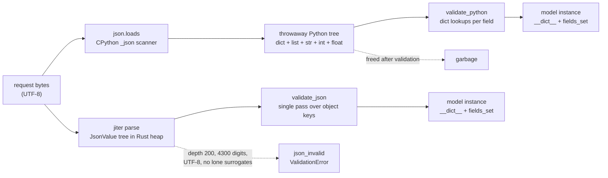

# Why model_validate_json Is Faster and Safer Than model_validate(json.loads()): Zero Intermediate Python Dicts in Rust

> [!summary] Claim
> `Model.model_validate_json(raw)` parses bytes into a Rust `JsonValue` tree and validates it in place, so no throwaway Python `dict`/`list`/`str` tree is built, JSON-only coercions such as strict `str -> date` work, and the parser enforces depth, digit, and UTF-8 limits before any Python object exists; one `mode='before'` model validator, a framework that calls `json.loads` for you, or a `Decimal` that arrives as a JSON number quietly gives part of that back.

Part of [Pydantic v2 Internals and Validation](README.md) in [API Engineering](../README.md).

## TL;DR

- Mechanism: `model_validate_json` hands the bytes to jiter, which builds a Rust `JsonValue` tree (strings borrowed from the input when unescaped), and the compiled validator tree reads that tree directly; Python objects are created only for validated outputs, not for the parse.
- Contract rule: in JSON mode a JSON string is a *strict* match for `date`, `datetime`, `UUID`, `bytes`, `Decimal`, and a JSON array is a strict match for `tuple` and `set`, so `strict=True` models accept wire-format JSON only through `validate_json`.
- Trap: FastAPI 0.162.0 still parses bodies with Starlette's `json.loads` and then calls `TypeAdapter.validate_python`, so a `strict=True` body model rejects `"2026-11-12"` with `date_type` and `422`; a single `@model_validator(mode="before")` also forces the whole object back into a Python `dict`.
- Portability: the jiter limits (200 nesting levels, 4300 integer digits, UTF-8 only, no lone surrogates) are compiled into pydantic-core 2.50.4 and are the same on every CPython it ships wheels for (3.12 to 3.15 and the `t` free-threaded builds); `json.loads` differs on every one of those boundaries.
- When not to use it: when you need the raw document anyway (signature verification over canonical bytes, logging the full body, `json.loads(parse_float=Decimal)` for exact decimals), or when a `before`/`wrap` model validator will rebuild the `dict` regardless, measure before switching.

## Mental model



Both arrows start from the same bytes and end in the same model instance.
The top path allocates a complete Python object graph for the document (every object, array, key, and scalar becomes a refcounted `PyObject`), walks it once to validate, builds a second graph for the model, and then frees the first.
The bottom path allocates the document graph in Rust (`Arc<Vec<...>>` nodes, borrowed `&str` slices into the input), validates against it, and only creates the Python objects that end up in the model's `__dict__`.
The dashed edge from jiter is the safety half of the claim: limits are enforced during the parse, before any validator or Python allocation runs, and every failure surfaces as one `ValidationError` with error type `json_invalid` rather than a `json.JSONDecodeError`, `RecursionError`, `ValueError`, or `UnicodeDecodeError`.

## How it works

### The Python entry point is a one-liner

`BaseModel.model_validate_json` checks the `by_alias`/`by_name` combination and then calls `cls.__pydantic_validator__.validate_json(json_data, strict=..., extra=..., context=..., by_alias=..., by_name=...)` (pydantic 2.14.3 pydantic/main.py, BaseModel.model_validate_json).
Its signature accepts `str | bytes | bytearray`; the stub for `SchemaValidator.validate_json` says it "should be significantly faster than `validate_python(json.loads(json_data))` as it avoids the need to create intermediate Python objects" and that it "handles constructing the correct Python type even in strict mode, where `validate_python(json.loads(json_data))` would fail validation" (pydantic-core 2.50.4 python/pydantic_core/_pydantic_core/__init__.pyi, SchemaValidator.validate_json).
At the 2.14.3 tag the pydantic-core sources live in the pydantic monorepo under `pydantic-core/`, with `version = "2.50.4"` and `jiter = { version = "0.18.0", features = ["python"] }` (pydantic-core 2.50.4 Cargo.toml); there is no `v2.50.4` tag in the old `pydantic/pydantic-core` repository, whose newest tag is `v2.41.5` (as of 2026-11).
The move landed in the pydantic 2.13 cycle: `pydantic-core/Cargo.toml` is absent at the pydantic tag `v2.12.5` and present from `v2.13.0b1` (GitHub contents API at both tags, as of 2026-11).

### Step 1: get a byte slice without copying

`SchemaValidator.validate_json` first calls `json::validate_json_bytes(input)`, which reuses the bytes validator in non-strict UTF-8 mode and rewrites a `bytes_type` failure into `json_type` ("JSON input should be string, bytes or bytearray") (pydantic-core 2.50.4 src/validators/json.rs, validate_json_bytes and map_bytes_error).
For exact `bytes` the slice is borrowed; for `str` it calls `py_string_str`, which is PyO3's `to_str()` over `PyUnicode_AsUTF8AndSize`, and a Python `str` that cannot be encoded as UTF-8 (one containing a lone surrogate) fails with `string_unicode`; for `bytearray` it calls `to_vec()`, a full copy (pydantic-core 2.50.4 src/input/input_python.rs, validate_bytes; src/input/return_enums.rs, py_string_str).
Passing a `dict` (a common mistake when callers already parsed the body) fails immediately with `json_type`, which the lab asserts.

### Step 2: jiter builds a Rust tree, not a Python one

`_validate_json` calls `jiter::JsonValue::parse_with_config(json_data, true, allow_partial)` and then runs the ordinary validator tree with the resulting `JsonValue` as input and `InputType::Json` (pydantic-core 2.50.4 src/validators/mod.rs, SchemaValidator._validate_json).
The second argument is `allow_inf_nan = true`: the parser always accepts `NaN`, `Infinity`, and `-Infinity`, and rejection is left to the float validator's `allow_inf_nan` setting, which defaults to `True` (pydantic 2.14.3 pydantic/config.py, ConfigDict.allow_inf_nan; pydantic-core 2.50.4 src/validators/float.rs, `if !self.allow_inf_nan && !either_float.as_f64().is_finite()`).
`JsonValue<'s>` is an enum of `Null`, `Bool(bool)`, `Int(i64)`, `BigInt(BigInt)`, `Float(f64)`, `Str(Cow<'s, str>)`, `Array(JsonArray)`, and `Object(JsonObject)`, where `JsonArray = Arc<Vec<JsonValue>>` and `JsonObject = Arc<Vec<(Cow<str>, JsonValue)>>`, documented as not deduplicating keys (jiter 0.18.0 src/value.rs, JsonValue, JsonArray, JsonObject).
`parse_with_config` goes through `parse_borrowed`, whose string callback turns `StringOutputType::Data(&str)` (no escapes) into `Cow::Borrowed` pointing into the request bytes and `StringOutputType::Tape(&str)` (escapes decoded into a scratch tape) into an owned `String` (jiter 0.18.0 src/value.rs, parse_borrowed; src/string_decoder.rs, `From<StringOutput> for Cow<str>`).
So the Rust tree costs one enum per value plus one `Vec` per container, and unescaped string bytes are not copied at all.
It is not streaming: the whole tree exists before validation starts, and `parser.finish()` rejects trailing bytes (`trailing characters at line 1 column 15` for the lab's `{"text": "x"} trailing`).

### Step 3: validators read `JsonValue` through the `Input` trait

Every validator is generic over `Input<'py>`, and `impl Input for JsonValue` decides what each JSON shape means (pydantic-core 2.50.4 src/input/input_json.rs, `impl<'py, 'data> Input<'py> for JsonValue<'data>`).
The JSON impl is where the strict-mode differences live, because it labels matches as `exact`, `strict`, or `lax`:

| Target type | JSON input accepted | Match level in JSON mode | Same value via `json.loads` then `validate_python(strict=True)` |
|---|---|---|---|
| `int` | `Int`, `BigInt` | exact | accepted |
| `float` | `Float` exact, `Int`/`BigInt` | strict | accepted (`1`) |
| `str` | `Str` | strict (comment: JSON strings can represent UUID and date "more exactly") | accepted |
| `date`, `datetime`, `time`, `timedelta` | `Str` parsed by speedate | strict | `date_type`, `datetime_type`, `time_type`, `time_delta_type` |
| `UUID` | `Str` | strict | `is_instance_of` |
| `bytes` | `Str` decoded per `val_json_bytes` | strict | `bytes_type` |
| `Decimal` | `Float` via `f64.to_string()`, `Str`, `Int`, `BigInt` | strict | `is_instance_of` for both `1.5` and `"1.5"` |
| `tuple`, `set`, `frozenset`, `deque` | `Array` | strict | `tuple_type`, `set_type`, `frozen_set_type`, `deque_type` |
| `dict`, `OrderedDict`, `Counter` | `Object` | strict | `dict` accepted; `ordered_dict_type`, `counter_type` |

The middle columns come from `validate_int`, `validate_float`, `validate_str`, `validate_date`, `validate_datetime`, `validate_time`, `validate_timedelta`, `validate_decimal`, `validate_tuple`, `validate_set`, `validate_frozenset`, `validate_deque`, `strict_ordered_dict`, and `strict_counter` in that impl.
The `UUID` row is the exception: `UuidValidator.validate` reads a JSON string through `validate_str` and raises `is_instance_of` only when strict and `input_type == InputType::Python` (pydantic-core 2.50.4 src/validators/uuid.rs, UuidValidator.validate).
The right column was measured with `TypeAdapter(tp).validate_json(..., strict=True)` (all accepted) against `validate_python(json.loads(...), strict=True)` in a one-off probe on CPython 3.14.6, rerun by the verifier with identical results; the lab pins the `date` and `UUID` rows (`date_type`, `is_instance_of`).
The full lax table belongs to [[Lax-vs-Strict-Validation-Modes-and-Coercion-Tables]].

### Step 4: models walk the JSON object once, by key

`ModelFieldsValidator.validate_fields` branches on `input.as_json()`: Python input goes to `validate_by_get_item` (one `dict` lookup per field, then a second pass over the input only when `extra` is not `ignore`), JSON input goes to `validate_json_by_iteration` (pydantic-core 2.50.4 src/validators/model_fields.rs, ModelFieldsValidator.validate_fields).
The doc comment explains why: "a parsed JSON object is represented by jiter as a list of key/value pairs without an index", so it iterates the pairs once and resolves each key through a precomputed `LookupTree` into a `SmallVec<[Option<...>; 16]>` of field inputs, inline for models of at most 16 fields (pydantic-core 2.50.4 src/validators/model_fields.rs, validate_json_by_iteration).
`LookupTree` has three shapes: `NoAliases(AHashMap<PathItemString, usize>)`, `Flat` for plain aliases, and `Nested` for `AliasPath`, which must retain all matches until the end because "a later duplicate key can replace the parent of the preferred match" (pydantic-core 2.50.4 src/validators/shared/lookup_tree.rs, LookupTree).
Later keys overwrite earlier ones for the same path, so `{"a": 1, "a": 2}` validates `a = 2`, the same last-wins answer `json.loads` gives; the lab asserts both.
Validators without that tree, such as `TypedDict`, dataclass arguments, and function arguments, look keys up through `ValidatedDict::get_item` / `KeywordArgs::get_item`, which call `LookupPath::json_get`, a reverse linear scan of the pair list per field that the source marks `// FIXME: use of find_map in here probably leads to quadratic complexity` (pydantic-core 2.50.4 src/lookup_key.rs, LookupPath::json_get; src/input/input_json.rs, `ValidatedDict for &JsonObject`).
Output keys are the validator's own field names (`Field.name: PyBackedStr`, inserted with `self.model_dict.set_item(&field.name, value)`), so JSON keys never become Python `str` objects unless they land in `model_extra` (`extra='allow'`).

### Step 5: Python objects appear only at the leaves you keep

String outputs go through `new_py_string(py, s, cache_str)`, which uses jiter's `cached_py_string` when `cache_strings` is `True`/`'all'` (the default) (pydantic-core 2.50.4 src/tools.rs, new_py_string; src/validators/mod.rs, `unwrap_or(StringCacheMode::All)`).
The cache is a 16384-entry table probed over up to 5 contiguous slots, caches strings whose UTF-8 length is in `2..64`, keeps a reference to every cached `PyString`, and lives in a pool of `POOL_SLOTS = 8` caches so overlapping parses on free-threaded builds take different slots (jiter 0.18.0 src/py_string_cache.rs, PyStringCache, CAPACITY, POOL_SLOTS, cached_py_string_maybe_ascii).
The docs say "Only strings where `len(string) < 64` are cached"; the code also skips 0- and 1-byte strings with the comment "from tests, 0 and 1 character strings are faster not cached" (pydantic 2.14.3 docs/concepts/json.md, Caching Strings; jiter 0.18.0 src/py_string_cache.rs, cached_py_string_maybe_ascii).
Observable consequence: two separate `model_validate_json` calls return the *same* `str` object for an equal short value, while two `json.loads` calls do not; the lab asserts `is` for both, and `cache_strings=False` restores distinct objects.

### What `json.loads` does instead

`json.loads(bytes)` first decodes with `s.decode(detect_encoding(s), 'surrogatepass')`, so it accepts UTF-16 and UTF-32 input, then runs the C scanner (CPython 3.14.6 Lib/json/__init__.py, loads).
The scanner creates one Python object per JSON value and memoizes object keys in a per-call `memo` dict via `PyDict_SetDefaultRef(memo, key, key, &memokey)`, so repeated keys inside one document share a `str`, but values never do (CPython 3.14.6 Modules/_json.c, _parse_object_unicode and scanner_call).
`validate_python` then reads that graph, and every container in it becomes garbage once the model exists; the work is two full traversals plus one full Python allocation of the document that nobody keeps.

### Where the zero-intermediate guarantee stops

`FunctionBeforeValidator`, `FunctionPlainValidator`, and `FunctionWrapValidator` all call `self.func.call1(py, (input.to_object(py)?, ...))`, converting the `JsonValue` subtree they guard into Python objects (pydantic-core 2.50.4 src/validators/function.rs, FunctionBeforeValidator, FunctionPlainValidator, FunctionWrapValidator).
On a model, `@model_validator(mode="before")` therefore receives a full Python `dict` even from `model_validate_json`; the lab records `["dict", "dict"]` for both paths.
On a field, a `before` validator receives only that field's subtree (a `list` in the probe), so the cost is proportional to the guarded subtree.
`Any`, `dict[str, Any]`, and `list[Any]` fields necessarily materialize their subtree as Python objects, because that is the output.
The pydantic performance page states the consequence directly: with a `'before'` or `'wrap'` validator on a model, "validation may be faster with the two step method" (pydantic 2.14.3 docs/concepts/performance.md).

### How FastAPI 0.162.0 parses a body

`get_request_handler` reads `await request.body()`, checks that the `Content-Type` main type is `application` and the subtype is `json` or ends in `+json`, and then calls `await request.json()` (fastapi 0.162.0 fastapi/routing.py, get_request_handler).
With no `Content-Type` header it calls `request.json()` only when `strict_content_type=False`; under the default `True` the raw bytes reach validation and fail with `model_attributes_type` (verifier probe, `422`).
Starlette's `Request.json` is `self._json = json.loads(body)` (starlette 1.10.0 starlette/requests.py, Request.json).
The body field is then validated with `self._type_adapter.validate_python(value, from_attributes=True)` (fastapi 0.162.0 fastapi/_compat/v2.py, ModelField.validate).
A malformed body becomes a hand-built `RequestValidationError` with `"type": "json_invalid"` and `"loc": ("body", e.pos)` from the `json.JSONDecodeError` (fastapi 0.162.0 fastapi/routing.py, get_request_handler).
Every FastAPI JSON body therefore takes the two-pass path with Python-mode strictness; the request-side mechanics are in [[Request-Parameter-Validation-Path-Query-Header-Cookie-and-Body-Models]] and [[Starlette-Request-Internals-Stream-Consumption-and-Body-Caching]].

## Numbers and limits

| Quantity | Value | Source |
|---|---|---|
| Single-pass speedup, 10-line order (603 B) | `6.5 us -> 4.1 us`, 1.58x | `uv run --frozen python -m api_labs.f09_pydantic_v2_internals_and_validation.single_pass_json` in `labs/`, Apple M3 Pro, macOS 27.3 (Darwin 27.3.0) arm64, CPython 3.14.6, best of 7 x 20 loops, one run on 2026-11-12 |
| Single-pass speedup, 1000 lines (50178 B) | `702.0 us -> 414.8 us`, 1.69x | same run |
| Single-pass speedup, 10000 lines (510678 B) | `8174.0 us -> 5854.4 us`, 1.40x | same run |
| tracemalloc peak, 1000 lines | `758150 B -> 511578 B` (0.67x) | same run; Python allocator only |
| tracemalloc peak, 10000 lines | `7719470 B -> 5297233 B` (0.69x) | same run |
| Gap between the two peaks | 1000 lines: `246572 B` gap vs `253580 B` `json.loads` tree (0.97x); the test asserts 0.5x to 2x | same run; `test_single_pass_skips_the_python_dict_tree` |
| Peak RSS growth, 100000 lines (5205678 B) | two-pass `88.3 MB`, single-pass `91.9 MB` to `92.6 MB`, `json.loads` alone `34.8 MB` to `35.0 MB` | verifier probe: `ru_maxrss` delta in a fresh process per mode, payload read from a file, 3 runs each, same machine and CPython |
| jiter nesting limit | `DEFAULT_RECURSION_LIMIT: u8 = 200`; lab: 200 arrays inside the root object pass, 201 fail with `recursion limit exceeded` | jiter 0.18.0 src/errors.rs; lab |
| jiter integer digits | 4300; the 4301st digit fails with `number out of range` | jiter 0.18.0 src/number_decoder.rs, NumberAny::decode; lab |
| CPython int digits | `sys.int_info.default_max_str_digits` 4300, `ValueError` beyond | Python docs, int_max_str_digits (CVE-2020-10735); lab |
| CPython `json.loads` depth | no fixed limit; `RecursionError` on `[` x 200000 | lab, CPython 3.14.6 |
| String cache | 16384 entries, 5-slot probe, UTF-8 length 2 to 63, 8 pooled caches | jiter 0.18.0 src/py_string_cache.rs |
| Model field scratch | inline for <= 16 fields, heap above | pydantic-core 2.50.4 src/validators/model_fields.rs |
| JSON float precision | IEEE 754 binary64 in both parsers; `Decimal` from a JSON number goes through `f64` | RFC 8259 Section 6; pydantic-core 2.50.4 src/input/input_json.rs, validate_decimal; lab |

The speedups are one run on one machine and are not asserted in tests; they are noisy (the drafter's run of the same command gave 1.56x, 1.45x, and 1.55x), and the payload is scalar-heavy (`str`, `int`, `float` leaves), which is the case the Rust path helps most.
tracemalloc sees only `PyMem`/`PyObject` allocations, so jiter's Rust tree (allocated through the Rust global allocator, no custom one is declared in pydantic-core 2.50.4) is invisible to it; the peak column measures Python object churn, not RSS.
The RSS probe shows why that matters: on this payload the single-pass path grew peak RSS about 4% more than the two-pass path, so the Rust `JsonValue` tree (24-byte `Cow<str>` keys plus one enum per value, held until validation ends) is not smaller than the Python tree it replaces; the win is CPU time and Python-heap churn, not peak memory.

## Portability

| Dimension | Behavior | Evidence |
|---|---|---|
| CPython 3.14.6 (macOS arm64) | all 12 lab tests pass | lab, rerun once by the verifier on 2026-11-12 |
| CPython 3.12, 3.13, 3.15 | same compiled jiter limits; wheels `cp312`, `cp313`, `cp315` exist for pydantic-core 2.50.4 | `labs/uv.lock` wheel list; not run, lab checks paused 2026-11-11 |
| CPython 3.14t, 3.15t free-threaded | module declared `#[pymodule(gil_used = false)]`; string cache pool gives overlapping parses separate caches | pydantic-core 2.50.4 src/lib.rs; jiter 0.18.0 src/py_string_cache.rs; wheels `cp314t`, `cp315t` in `uv.lock`; not run |
| `json.loads` across CPython versions | int digit limit added by CVE-2020-10735 fixes; deep-nesting error text and stack limit vary by version | Python docs int_max_str_digits; lab saw `Stack overflow (used 8144 kB)` only on 3.14.6 |
| pydantic 2.14.3 / pydantic-core 2.50.4 | JSON models validated by key iteration (`validate_json_by_iteration`) | source at tag; earlier releases not read |
| FastAPI 0.162.0 / Starlette 1.10.0 | bodies are `json.loads` + `validate_python` | source at tag; lab `test_fastapi_body_param_is_two_pass_and_breaks_strict_models` |
| Uvicorn, Hypercorn, Granian; HTTP/1.1, HTTP/2, HTTP/3 | no effect: the server delivers the body to the app as bytes and parsing happens in the app | ASGI HTTP spec, `http.request` event: `body` is a byte string, chunked decoding done by the server; not separately tested |

## Worked example

The lab compares both paths on the same models and pins every boundary where they diverge: [implementation](../labs/src/api_labs/f09_pydantic_v2_internals_and_validation/single_pass_json.py) and [test](../labs/tests/f09_pydantic_v2_internals_and_validation/test_single_pass_json_validation_model_validate_json_vs_json_loads.py).

The two paths and the allocation probe, simplified excerpt:

```python
def validate_two_pass(raw: bytes) -> Order:
    """CPython json scanner builds dicts/lists/strs, then pydantic-core walks them."""
    return Order.model_validate(json.loads(raw))


def validate_single_pass(raw: bytes) -> Order:
    """jiter parses into a Rust JsonValue tree; only validated outputs become Python objects."""
    return Order.model_validate_json(raw)


def traced_peak_bytes(fn: Callable[[bytes], Order], raw: bytes) -> int:
    fn(raw)  # warm up: import-time caches and the jiter string cache
    tracemalloc.start()
    try:
        tracemalloc.reset_peak()
        baseline, _ = tracemalloc.get_traced_memory()
        result = fn(raw)
        _, peak = tracemalloc.get_traced_memory()
    finally:
        tracemalloc.stop()
    del result
    return peak - baseline
```

The FastAPI comparison, simplified excerpt:

```python
@app.post("/orders/framework")
async def framework_body(order: StrictOrder) -> dict[str, str]:
    # FastAPI 0.162.0: request.json() (json.loads) then TypeAdapter.validate_python.
    return {"placed_on": order.placed_on.isoformat()}

@app.post("/orders/raw")
async def raw_body(request: Request) -> JSONResponse:
    try:
        order = StrictOrder.model_validate_json(await request.body())
    except ValidationError as exc:
        return JSONResponse(
            status_code=422,
            content={"detail": exc.errors(include_url=False, include_input=False)},
        )
    return JSONResponse({"placed_on": order.placed_on.isoformat()})
```

Two of the tests, verbatim from the test module:

```python
@pytest.mark.unit
def test_single_pass_skips_the_python_dict_tree() -> None:
    raw = make_payload(1_000)
    two_pass = traced_peak_bytes(validate_two_pass, raw)
    single_pass = traced_peak_bytes(validate_single_pass, raw)
    tree = traced_intermediate_tree_bytes(raw)
    assert single_pass < 0.85 * two_pass
    # The gap is the throwaway json.loads tree, within a factor of two.
    assert 0.5 * tree < two_pass - single_pass < 2.0 * tree
```

```python
@pytest.mark.unit
def test_strict_mode_accepts_json_strings_only_from_json() -> None:
    order = StrictOrder.model_validate_json(STRICT_BODY)
    assert order.placed_on.isoformat() == "2026-11-12"
    with pytest.raises(ValidationError) as excinfo:
        StrictOrder.model_validate(json.loads(STRICT_BODY))
    assert sorted(str(e["type"]) for e in excinfo.value.errors()) == [
        "date_type",
        "is_instance_of",
    ]
```

Captured on Apple M3 Pro, macOS 27.3, CPython 3.14.6, from `labs/`:

```text
$ uv run --frozen pytest tests/f09_pydantic_v2_internals_and_validation/test_single_pass_json_validation_model_validate_json_vs_json_loads.py -q
............                                                             [100%]
12 passed in 0.83s
```

The benchmark figures in Numbers and limits come from one run of the module entry point on the same machine:

```text
$ uv run --frozen python -m api_labs.f09_pydantic_v2_internals_and_validation.single_pass_json
python 3.14.6 Darwin arm64
lines=10 bytes=603 two_pass_us=6.5 single_pass_us=4.1 speedup=1.58x traced_peak_two=4914 traced_peak_single=3668 loads_tree=1246
lines=1000 bytes=50178 two_pass_us=702.0 single_pass_us=414.8 speedup=1.69x traced_peak_two=758150 traced_peak_single=511578 loads_tree=253580
lines=10000 bytes=510678 two_pass_us=8174.0 single_pass_us=5854.4 speedup=1.40x traced_peak_two=7719470 traced_peak_single=5297233 loads_tree=2678900
```

## Pitfalls

> [!warning] Strict body models behind FastAPI
> Trigger: `model_config = ConfigDict(strict=True)` on a FastAPI body model with `date`, `datetime`, `UUID`, `bytes`, `Decimal`, or `tuple` fields.
> Symptom: every valid request fails with `422` and `date_type` / `is_instance_of` / `tuple_type`, because FastAPI 0.162.0 runs `validate_python` on the `json.loads` output, where a `str` is not a `date`.
> Fix: read `await request.body()` and call `Model.model_validate_json`, or keep the model lax and use per-field `Strict` only where the Python-mode table is what you want; the lab's `/orders/raw` route returns `200` for the body `/orders/framework` rejects.

> [!warning] A `before` model validator undoes the optimization
> Trigger: `@model_validator(mode="before")` or `mode="wrap"` on a hot request model, often added to normalize legacy field names.
> Symptom: `model_validate_json` is no faster than the two-pass path, because `FunctionBeforeValidator` calls `input.to_object(py)` and builds the full `dict` anyway.
> Fix: express the normalization as `validation_alias=AliasChoices(...)` or a field-level `after` validator, which stay in Rust on the JSON tree; see [[Aliases-AliasPath-AliasChoices-and-Bidirectional-Field-Mapping]] and [[Model-Validators-ValidationInfo-Context-and-Cross-Field-Invariants]].

> [!warning] Money as a JSON number
> Trigger: `amount: Decimal` fed `{"amount": 0.1000000000000000055511151231257827}`.
> Symptom: both `model_validate_json` and `model_validate(json.loads(...))` produce `Decimal("0.1")`, because jiter stores `JsonValue::Float(f64)` and `validate_decimal` calls `f.to_string()`; digits beyond binary64 are lost silently (RFC 8259 Section 6 warns that `3.141592653589793238462643383279` signals interoperability problems).
> Fix: put decimals on the wire as JSON strings (`"0.1000000000000000055511151231257827"` round-trips exactly through `model_validate_json`), or use `json.loads(raw, parse_float=Decimal)` and accept the two-pass cost.

> [!warning] Parser differentials on duplicate keys
> Trigger: two components parse the same JSON with different duplicate-key rules, for example an authorization check and the persistence layer.
> Symptom: CVE-2017-12635 in Apache CouchDB before 1.7.0 and 2.x before 2.1.1: the Erlang parser and the JavaScript parser disagreed on duplicate `roles` keys, so "the second one will be used for authorising the document write, but the first 'roles' key is used for subsequent authorization", letting non-admin users grant themselves `_admin` (CVE record).
> Fix: validate once and pass the validated model, never the raw body, to every later stage; pydantic-core and `json.loads` both take the last value, but RFC 8259 Section 4 says behavior with non-unique names is "unpredictable", so a proxy, WAF, or signature checker may not.

> [!warning] Assuming tracemalloc shows the whole cost
> Trigger: profiling `model_validate_json` memory with tracemalloc or a Python-heap profiler.
> Symptom: the Rust `JsonValue` tree is missing from the report, so the single-pass path looks cheaper in memory than it is (0.67x the tracemalloc peak, but about 4% more peak RSS on a 5.2 MB body in the probe above).
> Fix: measure RSS (`resource.getrusage`, `/proc/self/status`) for memory claims; use tracemalloc only for the Python-object churn it can see, as this lab does.

> [!warning] Validating twice
> Trigger: `body = await request.json()` for logging or routing, then `Model.model_validate_json(json.dumps(body))`.
> Symptom: three passes (parse, serialize, parse) and the slowest of both worlds.
> Fix: keep `raw = await request.body()` as the single source; Starlette 1.10.0 `Request.body` caches the joined chunks on `self._body`, so reading it twice is free.

## Security and robustness

Threat model: an unauthenticated client controls every byte of a JSON body and wants to exhaust CPU, memory, or stack (OWASP API4:2023 Unrestricted Resource Consumption), or to smuggle a value past one parser that a second parser reads differently.
jiter enforces, before any validator runs, the limits RFC 8259 Section 9 explicitly permits ("An implementation may set limits on the maximum depth of nesting... on the range and precision of numbers"): 200 levels of nesting, 4300 integer digits, and strict UTF-8.
`json.loads` has the 4300-digit limit only because CPython added `sys.set_int_max_str_digits` for CVE-2020-10735 (quadratic `int("text")` conversion: "5s for 1,000,000 digits"), and its depth limit is the C stack, which the lab hits as `RecursionError` at 200000 levels on 3.14.6.
In FastAPI 0.162.0 only `json.JSONDecodeError` becomes a `422 json_invalid`; `RecursionError`, the digit-limit `ValueError`, and `UnicodeDecodeError` fall through to `except Exception` and become `HTTPException(status_code=400, detail="There was an error parsing the body")` (fastapi 0.162.0 fastapi/routing.py, get_request_handler; a verifier probe got exactly that `400` for 200000 nested arrays, a 4301-digit integer, and a `\xff` byte, and `422 json_invalid` with `loc` `["body", 6]` for a truncated body), so the error contract depends on which exception the parser happened to raise.
Extra keys are still parsed: the lab's 4301-digit value sits under a key `n` that `Label` ignores, and validation still fails with `json_invalid`, so `extra='ignore'` is not a parsing defense; size limits belong in front of the parse (see [[Unrestricted-Resource-Consumption-API4-2023-Payload-Depth-and-Limit-Guards]]).
Encoding: RFC 8259 Section 8.1 says JSON text exchanged between systems that are not part of a closed ecosystem "MUST be encoded using UTF-8"; jiter rejects invalid UTF-8 and UTF-16 input as `json_invalid` (a UTF-16 BOM gives `expected value at line 1 column 1`), while `json.loads(bytes)` auto-detects UTF-16/32 and raises `UnicodeDecodeError` (not `JSONDecodeError`) on invalid UTF-8.
Lone surrogates: RFC 8259 Section 8.2 warns that `"\uDEAD"` may make implementations "suffer fatal runtime exceptions"; jiter rejects `"\ud800"` at parse time (`unexpected end of hex escape`, because it expects a low-surrogate escape next), while `json.loads` returns a `str` containing U+D800 that later fails in `.encode("utf-8")`, typically inside a database driver or the response serializer, far from the input boundary.
`NaN` and `Infinity` are not JSON (RFC 8259 Section 6, "are not permitted"), yet both parsers accept them by default; set `allow_inf_nan=False` on numeric models, which the probe confirmed produces `finite_number`.
Error echo: `ValidationError.errors()` includes `input` by default, which for `json_invalid` is the whole document; return `exc.errors(include_input=False)` (as the lab's raw route does) or set `hide_input_in_errors=True`, and route full bodies only to access-controlled logs (see [[Exception-Handling-in-FastAPI-HTTPException-vs-RequestValidationError]]).
Defense in depth: body-size limit at the proxy or ASGI layer, then the parser limits above, then strict field constraints, then business invariants after validation.

## The principal's view

The decision is not "call `model_validate_json`"; it is where the parse boundary of the service lives and who owns it.
If the framework owns it (FastAPI's default), you inherit `json.loads` semantics: Python-mode strictness, UTF-16 acceptance, unbounded depth up to the C stack, and one extra full-document allocation per request; for most CRUD services that is fine, because the measured gain here is 1.4x to 1.7x on a validation step that is rarely the dominant cost of a request.
If the service owns it (raw bytes in, `model_validate_json` or `TypeAdapter.validate_json` out), you get one parser with one documented set of limits for every route, JSON-mode strictness that matches the wire format, and roughly a third less Python allocation per body (but not lower peak RSS, which the probe measured about 4% higher), at the cost of opting out of FastAPI's automatic body parameter and writing the `422` mapping and OpenAPI request-body schema yourself (`openapi_extra` or a custom `APIRoute`).
Choose the service-owned boundary for high-volume ingest (telemetry, webhooks, event APIs), for strict contracts, and anywhere two components parse the same body; keep the framework default where developer ergonomics and the generated OpenAPI matter more than a sub-millisecond per request.
Organizationally, the boundary should be a shared library function or route class, not a per-handler habit, because a single `mode="before"` validator added by another team silently turns the single pass back into two.
When validation itself is the bottleneck, the next step is a schema-specialized decoder (`msgspec.json.Decoder`) or moving validation off the request path, which [[Pydantic-v2-Performance-Engineering-vs-MsgSpec-and-ORJSON]] measures; when the body is not JSON at all, protobuf or MessagePack removes the text parse entirely.

## Interview questions

> [!question] L5: Why is `Model.model_validate_json(raw)` usually faster than `Model.model_validate(json.loads(raw))` for the same model?
>
> > [!success]- Answer
> > The two-pass path allocates a Python object for every JSON value, validates by walking that graph, and then throws it away.
> > `model_validate_json` parses into a Rust `JsonValue` tree with borrowed strings and validates it directly, so only the outputs become Python objects.
> > The lab measured 1.40x to 1.69x on CPython 3.14.6 and a 0.67x to 0.69x tracemalloc peak, while peak RSS was about 4% higher because the Rust tree is invisible to tracemalloc.
> >
> > Follow-up: Why does the tracemalloc peak not prove the total memory saving?

> [!question] L5: What exception does each path raise for the truncated body `{"s": ` and how would an API return it?
>
> > [!success]- Answer
> > `json.loads` raises `json.JSONDecodeError` ("Expecting value: line 1 column 7 (char 6)"), which FastAPI 0.162.0 converts into a `RequestValidationError` with type `json_invalid` and `loc` `("body", 6)`.
> > `model_validate_json` raises `ValidationError` with one error of type `json_invalid` and message `Invalid JSON: EOF while parsing a value at line 1 column 6`.
> > Either becomes a `422`; with raw-body validation you map `exc.errors(include_input=False)` yourself.
> >
> > Follow-up: Which other exception types can `json.loads` raise on hostile input?

> [!question] L5: Predict the output.
> ```python
> class Label(BaseModel):
>     text: str
> a = Label.model_validate_json('{"text": "hello world"}').text
> b = Label.model_validate_json('{"text": "hello world"}').text
> c = json.loads('{"text": "hello world"}')["text"]
> d = json.loads('{"text": "hello world"}')["text"]
> print(a is b, c is d)
> ```
>
> > [!success]- Answer
> > `True False`.
> > pydantic-core builds output strings through jiter's string cache (default `cache_strings=True`), which keeps the `PyString` for strings of 2 to 63 UTF-8 bytes across calls.
> > `json.loads` memoizes only keys and only within one call, so the two values are distinct objects.
> > With `ConfigDict(cache_strings=False)` the first result is also `False`.
> >
> > Follow-up: What memory does the cache pin, and when would you turn it off?

> [!question] L6: Debug this API. Every valid request returns `422` with `date_type`.
> ```python
> class Booking(BaseModel):
>     model_config = ConfigDict(strict=True)
>     day: date
>
> @app.post("/bookings")
> async def create(booking: Booking) -> dict[str, str]:
>     return {"day": booking.day.isoformat()}
> ```
> The client sends `{"day": "2026-11-12"}` with `Content-Type: application/json`.
>
> > [!success]- Answer
> > FastAPI 0.162.0 parses the body with Starlette's `json.loads` and validates with `TypeAdapter.validate_python(value, from_attributes=True)`.
> > In Python mode, strict `date` requires a `date` instance, so the `str` fails with `date_type`.
> > In JSON mode a JSON string is a strict match for `date`, so `Booking.model_validate_json(await request.body())` accepts it.
> > Fix by validating raw bytes, or by dropping model-wide strict and using `Strict` per field where Python-mode semantics are intended.
> >
> > Follow-up: How do you keep the OpenAPI request-body schema once the handler takes `Request` instead of `Booking`?

> [!question] L6: A team adds `@model_validator(mode="before")` to rename legacy keys and the p99 of the ingest endpoint rises even though they use `model_validate_json`. Why?
>
> > [!success]- Answer
> > `FunctionBeforeValidator` calls `input.to_object(py)`, converting the whole JSON object into a Python `dict` before the validator runs.
> > The request now pays for the Rust tree and the Python tree, so it can be slower than the two-pass path, as the pydantic performance docs warn.
> > Replace the rename with `validation_alias=AliasChoices("new", "old")`, which the JSON lookup tree resolves in Rust.
> >
> > Follow-up: Which field types force the same materialization without any validator?

> [!question] L6: A `Decimal` price field loses digits for some clients but not others. What is different about those clients?
>
> > [!success]- Answer
> > They send the price as a JSON number; jiter stores it as `f64` and `validate_decimal` builds the `Decimal` from `f64.to_string()`, so digits beyond binary64 are gone.
> > Clients sending a JSON string keep every digit.
> > `json.loads` without `parse_float=Decimal` loses the same digits, so switching paths does not fix it; the contract must say decimals travel as strings.
> >
> > Follow-up: How would you make the API reject numeric prices instead of silently rounding them?

> [!question] L6: How does pydantic-core find field values in a JSON object, and what is its complexity compared to the Python-dict path?
>
> > [!success]- Answer
> > jiter represents an object as a `Vec` of key/value pairs with no index.
> > `validate_json_by_iteration` walks the pairs once and maps each key through a precomputed hash map (`LookupTree`) to a field slot, so it is O(keys) plus O(fields).
> > The Python path does one `dict` lookup per field and a second pass over the input only when `extra` is not `ignore`.
> > `TypedDict`, dataclass, and function-argument validators still use `LookupPath::json_get`, a reverse linear scan per field that the source marks as possibly quadratic.
> >
> > Follow-up: How are duplicate keys resolved, and why does that matter for security?

> [!question] L7+: You own the platform library for 200 FastAPI services. Do you mandate raw-body `model_validate_json`?
>
> > [!success]- Answer
> > Not universally: the measured gain is 1.4x to 1.7x on validation, with no peak-memory saving, which is rarely the dominant cost of a CRUD request, and opting out of the body parameter costs OpenAPI generation and familiar ergonomics.
> > Mandate it where it changes correctness or capacity: strict contracts, high-volume ingest, and any body also parsed by another component.
> > Ship it as a custom `APIRoute` or dependency that keeps the schema in OpenAPI, maps `ValidationError` to the standard `422` envelope without echoing input, and enforces body-size limits first.
> > Add a lint or test that flags `mode="before"` model validators on models used by that route, since they silently restore the two-pass cost.
> >
> > Follow-up: What evidence would you collect before and after rollout to show it mattered?

> [!question] L7+: An auditor asks which JSON a service accepts. Compare the accepted language of `json.loads` and jiter as configured by pydantic-core 2.50.4.
>
> > [!success]- Answer
> > Both accept `NaN` and `Infinity` (not RFC 8259) unless `allow_inf_nan=False`, take the last duplicate key, and cap integers at 4300 digits.
> > `json.loads` also accepts UTF-16/32 bytes and lone surrogate escapes and nests until the C stack overflows.
> > jiter accepts only UTF-8, rejects lone surrogates, and stops at 200 levels.
> > The accepted language is therefore a property of whichever parser runs first, which is why one parse boundary per service matters.
> >
> > Follow-up: Where else in the request path could a third JSON parser appear?

## Related

Prerequisites: [[Lax-vs-Strict-Validation-Modes-and-Coercion-Tables]]

Next: [[TypeAdapter-for-Validating-and-Serializing-Arbitrary-Types]]

See also: [[02-Programming-Languages/Python/Python-Backend-Interview-Prep/04-FastAPI]], [[Pydantic-v2-Architecture-CoreSchema-and-Rust-Pydantic-Core]], [[Pydantic-v2-Performance-Engineering-vs-MsgSpec-and-ORJSON]], [[Functional-Validators-Before-After-Wrap-and-Plain]], [[Model-Validators-ValidationInfo-Context-and-Cross-Field-Invariants]], [[Aliases-AliasPath-AliasChoices-and-Bidirectional-Field-Mapping]], [[Streaming-Partial-JSON-Validation-in-Pydantic-v2-Experimental-Allow-Partial]], [[Request-Parameter-Validation-Path-Query-Header-Cookie-and-Body-Models]], [[Starlette-Request-Internals-Stream-Consumption-and-Body-Caching]], [[Unrestricted-Resource-Consumption-API4-2023-Payload-Depth-and-Limit-Guards]], [[Exception-Handling-in-FastAPI-HTTPException-vs-RequestValidationError]]

- Lab: `labs/tests/f09_pydantic_v2_internals_and_validation/test_single_pass_json_validation_model_validate_json_vs_json_loads.py`

## Further reading

- [RFC 8259](https://www.rfc-editor.org/rfc/rfc8259.html): Sections 4, 6, 8.1, 8.2, and 9 define duplicate names, number precision, UTF-8, unpaired surrogates, and the limits a parser may impose.
- [pydantic-core 2.50.4 src/validators/mod.rs](https://github.com/pydantic/pydantic/blob/v2.14.3/pydantic-core/src/validators/mod.rs): `validate_json` and `_validate_json`, the whole entry path in 30 lines.
- [pydantic-core 2.50.4 src/input/input_json.rs](https://github.com/pydantic/pydantic/blob/v2.14.3/pydantic-core/src/input/input_json.rs): the JSON `Input` impl that defines which JSON shapes are exact, strict, or lax for each type.
- [pydantic-core 2.50.4 src/validators/model_fields.rs](https://github.com/pydantic/pydantic/blob/v2.14.3/pydantic-core/src/validators/model_fields.rs): `validate_json_by_iteration` and its comments on key priority and duplicate keys.
- [jiter 0.18.0 source](https://static.crates.io/crates/jiter/jiter-0.18.0.crate): `src/value.rs` for `JsonValue`, `src/py_string_cache.rs` for the string cache, `src/number_decoder.rs` for the 4300-digit guard.
- [CPython 3.14.6 Modules/_json.c](https://github.com/python/cpython/blob/v3.14.6/Modules/_json.c): the scanner and its per-call key memo that the two-pass path relies on.
- [pydantic 2.14.3 docs/concepts/performance.md](https://github.com/pydantic/pydantic/blob/v2.14.3/docs/concepts/performance.md): the maintainers' statement of when the two-step method can be faster.
- [CVE-2017-12635](https://www.cve.org/CVERecord?id=CVE-2017-12635): the CouchDB duplicate-key parser differential that turned a JSON ambiguity into privilege escalation.
- [CVE-2020-10735](https://www.cve.org/CVERecord?id=CVE-2020-10735): the quadratic integer-parsing DoS behind the 4300-digit limit both parsers now share.
