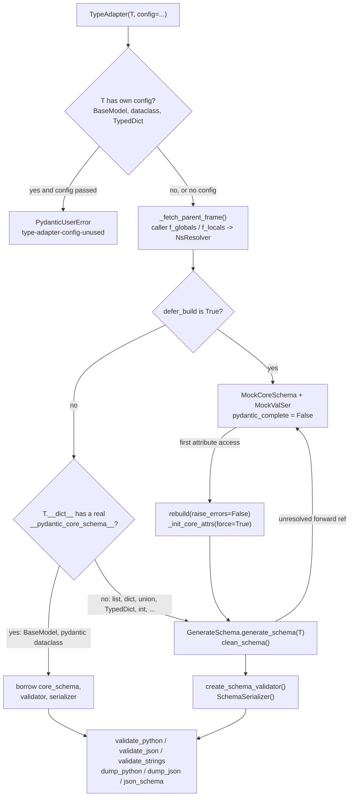

# TypeAdapter: Validating and Serializing Lists, TypedDicts, Unions, and Primitives Without a BaseModel Wrapper

> [!summary] Claim
> `TypeAdapter(T)` compiles any Pydantic-compatible type into its own Rust `SchemaValidator` and `SchemaSerializer` at construction time, so it must be built once at import time and reused; building it per request recompiled the schema on every call and cost 5.0x (model payload) to 28x (`TypedDict` payload) the cached validation in this note's lab.

Part of [Pydantic v2 Internals and Validation](README.md) in [API Engineering](../README.md).

## TL;DR

- Mechanism: `TypeAdapter.__init__` resolves forward references from the caller's stack frame, runs `GenerateSchema.generate_schema` on the type, and hands the cleaned `CoreSchema` to `create_schema_validator` and `SchemaSerializer`; the instance then only forwards calls to those two Rust objects.
- Contract rule: one adapter per type, created at module scope (or once per process in a registry), never inside a handler, loop, or dependency; a `BaseModel` or Pydantic dataclass passed directly is borrowed (its `__pydantic_validator__` is reused), everything else is compiled fresh per adapter.
- Trap: the defaults are permissive in ways a `BaseModel` user does not expect: `int | str` returns `"1"` for `"1"`, a `TypedDict` silently drops unknown keys and returns a plain `dict`, and `dump_json` of a wrongly typed value emits it with only a `UserWarning`.
- Portability: the API is pure Python over `pydantic-core`, which declares `#[pymodule(gil_used = false)]` and ships `cp315t` wheels for 2.50.4, so it is intended to load on free-threaded 3.15t without re-enabling the GIL; only CPython 3.14.6 was run here.
- When not to use it: if the type is already a `BaseModel`, call its own methods; if you need a field annotation for a root value, use `RootModel`; if the hot path is pure decode with no coercion, `msgspec` is the comparison point ([[Pydantic-v2-Performance-Engineering-vs-MsgSpec-and-ORJSON]]).

## Mental model



Construction is where all the work happens.
The adapter first refuses a `config` for types that carry their own, then captures the namespace of the frame that called it, because a bare `list["Item"]` has no `__module__` to resolve `"Item"` against.
If `defer_build` is set, or a forward reference cannot be resolved yet, it installs mock objects that raise or retry on first use instead of failing at import.
Otherwise it either borrows the compiled artifacts already stored on a `BaseModel` or Pydantic dataclass, or walks the type with `GenerateSchema` and compiles a new Rust validator and serializer.
After that, every `validate_*` and `dump_*` call is a thin Python wrapper around one Rust call.

## How it works

### What TypeAdapter is, and what it is not

`TypeAdapter` is a `@final` generic class, `TypeAdapter(Generic[T])`, with four public attributes: `core_schema`, `validator`, `serializer`, and `pydantic_complete` (pydantic 2.14.3 pydantic/type_adapter.py, TypeAdapter).
Its docstring states that instances "are not types, and cannot be used as type annotations for fields"; the documented alternative for a field-shaped root value is `RootModel`.
The type parameter is a `TypeForm[T]` (from `typing_extensions`), so a type checker infers `TypeAdapter[list[OrderItem]]` and `validate_json` returns `list[OrderItem]`.
`TypeAdapter[list[int]](list[int])` also works: `_fetch_parent_frame` detects that the subscripted alias added a `typing` frame and steps back one frame (pydantic 2.14.3 pydantic/type_adapter.py, TypeAdapter._fetch_parent_frame).
`repr` is `TypeAdapter(list[int])`, and the compiled validator's title, which appears as the first line of every `ValidationError`, is `str(T)` (for example `1 validation error for list[int]`), because `_init_core_attrs` passes `schema_type_name=str(self._type)`.

### Construction, step by step

1. Config check.
   `_type_has_config(type)` unwraps `Annotated` and returns `True` for a `BaseModel` subclass, a dataclass, or a `TypedDict`; if `config` is also passed, `__init__` raises `PydanticUserError` with code `type-adapter-config-unused` (pydantic 2.14.3 pydantic/type_adapter.py, _type_has_config).
   The lab proves this for `TypeAdapter(OrderItem, config=ConfigDict(strict=True))`; a probe also confirmed that `Annotated[OrderItem, ...]` and a `TypedDict` decorated with `@with_config` raise the same code.
   For a `TypedDict`, configuration goes on the class with `@with_config(ConfigDict(extra="forbid"))`.
2. Namespace capture.
   `_fetch_parent_frame` calls `sys._getframe(self._parent_depth)` with the default `_parent_depth=2`, the frame that called `TypeAdapter(...)`.
   For a non-function type, `globalns` is that frame's `f_globals` and `localns` is its `f_locals` unless the adapter is created at module level, in which case `localns` is `{}`.
   For a function, `ns_for_function` resolves against the function's own module instead.
   The docstring warns that this differs from `BaseModel`, which resolves against its own `__module__`: if `a.py` defines `OuterDict = dict[str, "IntList"]` and `b.py` rebinds `IntList` before `TypeAdapter(OuterDict)`, the adapter resolves `"IntList"` in `b.py`.
3. Deferral.
   If `config` (or the type's own `model_config` / `__pydantic_config__`) has `defer_build=True`, `_init_core_attrs` calls `set_type_adapter_mocks`, which installs a `MockCoreSchema` and two `MockValSer` objects, and then sets `pydantic_complete = False` (pydantic 2.14.3 pydantic/_internal/_mock_val_ser.py, set_type_adapter_mocks).
   `MockValSer.__getattr__` calls the rebuild hook on first attribute access, which runs `adapter.rebuild(raise_errors=False, _parent_namespace_depth=5)`, so `adapter.validate_python(...)` transparently builds the real validator; the lab shows `type(adapter.validator).__name__` change from `MockValSer` to `SchemaValidator`.
4. Borrow or build.
   `_init_core_attrs` first tries `_getattr_no_parents(T, "__pydantic_core_schema__")` and the matching validator and serializer, reading only `T.__dict__` (or `__slots__`) so that a subclass never inherits its parent's compiled schema.
   For a completed `BaseModel` or Pydantic dataclass this succeeds and the adapter shares the very same objects: `TypeAdapter(OrderItem).validator is OrderItem.__pydantic_validator__` is `True` in the lab.
   Otherwise it builds a `ConfigWrapper(self._config)`, a `GenerateSchema` with the captured `NsResolver`, calls `generate_schema(T)`, then `clean_schema` (which delegates to `self.defs.finalize_schema` to resolve the collected definitions), then `create_schema_validator(..., schema_kind="TypeAdapter")` and `SchemaSerializer(core_schema, core_config)`.
   `create_schema_validator` returns a plain `SchemaValidator`, or a `PluggableSchemaValidator` if a Pydantic plugin is installed (pydantic 2.14.3 pydantic/plugin/_schema_validator.py, create_schema_validator).
5. Failure handling.
   A `PydanticUndefinedAnnotation` (unresolvable forward reference) or an `InvalidSchemaError` does not raise from `__init__`; it installs mocks and leaves `pydantic_complete = False`.
   The first `validate_*` call then raises `PydanticUserError` code `class-not-fully-defined` with the message ``TypeAdapter[list['LateLine']]` is not fully defined; you should define ... then call `.rebuild()` on the instance``.
   `rebuild()` returns `None` if the adapter is already complete, `True` on a successful rebuild, and `False` (or raises, with the default `raise_errors=True`) on failure; it resolves names from the frame that calls `rebuild()` (pydantic 2.14.3 pydantic/type_adapter.py, TypeAdapter.rebuild).
   The pydantic docs mark `rebuild()` as new in v2.10.

There is no cache keyed by type anywhere in this path: two `TypeAdapter(list[OrderItem])` calls produce equal `core_schema` dictionaries but distinct `validator` and `serializer` objects, which the lab asserts.
The pydantic performance guide says it directly: "Each time a `TypeAdapter` is instantiated, it will construct a new validator and serializer."

### Why a list of models is cheaper to adapt than a list of TypedDicts

`GenerateSchema._model_schema` looks up `cls.__dict__.get("__pydantic_core_schema__")` and, when it is a real schema, returns it (or a definition reference to it) instead of walking the fields again (pydantic 2.14.3 pydantic/_internal/_generate_schema.py, GenerateSchema._model_schema).
When the resulting list schema is compiled, pydantic-core's `PrebuiltValidator::try_get_from_schema` reads the class's `__pydantic_validator__` and wraps the already-built Rust validator instead of compiling a second copy (pydantic-core 2.50.4 src/validators/prebuilt.rs, PrebuiltValidator).
The lab's `repr(ORDER_ITEMS.validator)` contains `PrebuiltValidator`; `repr(ORDER_LINES.validator)` for `list[OrderLine]` does not.
A `TypedDict` has no stored schema, so `GenerateSchema._typed_dict_schema` re-reads its annotations, `__orig_bases__`, and decorators every time an adapter mentions it.
That is the mechanism behind the 16.8 us versus 84.1 us construction costs in Numbers and limits.
The `_typed_dict_schema` docstring also records that pydantic needs `__orig_bases__`, added to `typing.TypedDict` in Python 3.12, which is why older interpreters had to use `typing_extensions.TypedDict`.

### The validation entry points

All three forward to the same Rust validator with `strict`, `extra`, `context`, `by_alias`, `by_name`, and `experimental_allow_partial`; each first raises `PydanticUserError` code `validate-by-alias-and-name-false` if `by_alias=False` and `by_name` is not `True`.

| Method | Input | What changes | Lab evidence |
| --- | --- | --- | --- |
| `validate_python(obj)` | Python objects | full lax coercion; also takes `from_attributes` | `TypeAdapter(list[int]).validate_python(["1", 2.0]) == [1, 2]` |
| `validate_json(data)` | `str`, `bytes`, `bytearray` | parsed by jiter inside Rust, no intermediate `dict` (see [[Single-Pass-JSON-Validation-Model-Validate-JSON-vs-JSON-Loads]]) | `ORDER_LINES.validate_json(...)` coerces `"2"` -> `2` and `"1.50"` -> `Decimal("1.50")` |
| `validate_strings(obj)` | a `str`, or a `dict` whose keys are `str` and values are `str` or nested `dict` | leaves are parsed as if they were JSON scalars; any other Python object, including a `list` or `tuple`, fails `string_type` | `dict[str, int]` accepts `{"limit": "10"}`; `list[int]` given `["1"]` fails `string_type` |
| `get_default_value()` | none | returns `Some(value)` or `None` | `TypeAdapter(Annotated[int, Field(default=3)])` -> `Some(3)` (probe) |

`validate_strings` is the right tool for query strings, headers, and environment variables that arrive as text.
Its failure on `list[int]` with `["1"]` is surprising until you read the input wrapper: `StringMapping::new_value` accepts only a Python `str` or `dict` and raises `string_type` for anything else, so the list is rejected before the list validator sees it (pydantic-core 2.50.4 src/input/input_string.rs, StringMapping::new_value).
The same probe shows `dict[str, list[int]]` given `{"a": ["1"]}` also fails `string_type`, so `validate_strings` is for string-keyed mappings of text, not for lists.
Partial validation (`experimental_allow_partial`) is a `TypeAdapter`-only feature; the docs state it is not yet available through `BaseModel` and is limited to `list`, `set`, `frozenset`, `dict[X, Y]`, and `TypedDict`.

### Unions: smart mode and left-to-right

`int | str` compiles to a `union` schema, and pydantic-core 2.50.4 dispatches it to `UnionValidator::validate_smart` by default (pydantic-core 2.50.4 src/validators/union.rs, UnionValidator::validate).
For each member, `validate_smart` resets the state's `exactness` to `Exact` and `fields_set_count` to `None`, validates, and returns immediately if the result is still `Exact` with no field count ("exact match with no fields set data, return immediately").
Otherwise it keeps a `best_match`: a candidate with a higher `fields_set_count` wins when both have one, else the higher `exactness` wins, with a missing exactness treated as `Lax`.
Line errors are collected per member only while no member has succeeded, and each error is prefixed with the member's label, which is why `ID_OR_SLUG.validate_python([1])` reports locations `("int",)` and `("str",)`.
The docs add that the `fields_set_count` rule for models, dataclasses, and TypedDicts arrived in v2.8.0.
Consequence: `"1"` against `int | str` is an exact `str` match and comes back as `"1"`; `Field(union_mode="left_to_right")` makes `int` win by lax coercion and returns `1`.
Order matters less in smart mode (it only breaks ties between equally good matches, since members are still tried left to right) and completely in left-to-right mode.
For object unions keyed by a field, use a discriminator instead: [[Discriminated-Unions-Tag-and-Callable-Discriminator-Dispatch]].

### TypedDicts as payload shapes

`TypeAdapter(OrderLine)` compiles to a `typed-dict` core schema.
Validation returns a plain `dict` (the lab asserts `type(lines[0]) is dict`); there is no instance, no `model_fields_set`, and no attribute access, which is precisely why it is cheaper.
`NotRequired[str]` keys are simply absent when not sent, `total=False` makes every key optional, and a missing required key produces `("missing", (0, "quantity"))`.
The default `extra` behavior is ignore: unknown keys (`"debug": true` in the lab) are dropped silently.
`dump_python` and `dump_json` also drop keys that are not declared (a probe returned `{"id": 1, "note": "n"}` for an input that also had `"zz": 3`), so a `TypedDict` adapter is an allow-list in both directions.

### Serialization

`dump_python(instance, mode="python")` returns Python objects, `mode="json"` returns JSON-compatible Python objects, and `dump_json` returns `bytes` (not `str` as `BaseModel.model_dump_json` does), all through the one `SchemaSerializer` (pydantic 2.14.3 pydantic/type_adapter.py, TypeAdapter.dump_json).
The serializer trusts that `instance` already has type `T`: it does not validate.
For a value that does not match, it emits a `UserWarning` whose text starts `Pydantic serializer warnings:` and contains `PydanticSerializationUnexpectedValue(Expected int ...)`, then serializes the value anyway (`b'["x",1]'` in the lab); `warnings="error"` turns that into `PydanticSerializationError`.
Serialization follows the declared type, not the runtime type: `TypeAdapter(list[Base]).dump_json([Sub(a=1, internal_cost=7)])` is `b'[{"a":1}]'`, and only `serialize_as_any=True` emits the subclass field.
The 2.14.3 signature also has `polymorphic_serialization`, documented as model and dataclass polymorphic serialization per call; it was not exercised here.
Other measured defaults: `datetime` with UTC -> `"2026-11-12T10:00:00Z"`, `Decimal("1.10")` -> `"1.10"`, `float("inf")` -> `null` (default `ser_json_inf_nan="null"`), `dict[int, str]` keys -> JSON strings, and `bytes` with the default `ser_json_bytes="utf8"` fails with `invalid utf-8 sequence` for `b"\xff"`, while `ser_json_bytes="base64"` produces the URL-safe `"_w=="`.
Per-field serializers and `when_used` belong to [[Custom-Serialization-Field-Model-and-Wrap-Serializers]].

### JSON Schema

`json_schema(mode="validation" | "serialization")` runs `GenerateJsonSchema.generate` on `core_schema`, pushing the adapter's `config` onto the generator's config stack because it is not stored inside the core schema (pydantic 2.14.3 pydantic/type_adapter.py, TypeAdapter.json_schema).
`TypeAdapter.json_schemas([(key, mode, adapter), ...])` produces one shared `$defs` block for many adapters, which is how you publish several request and response shapes in one document.
The lab shows that when the same model appears in both modes and its schemas differ, the definitions split: `OrderItem` has `unit_price` as `anyOf: [number, string]` for input and `string` for output, so `$defs` holds `OrderItem-Input` and `OrderItem-Output`.
With both entries in `validation` mode the same call yields a single `OrderItem`.
Generator customization belongs to [[JSON-Schema-Generation-Internals-and-GenerateJsonSchema]].

### Who else constructs TypeAdapters

FastAPI 0.162.0 builds one `TypeAdapter(Annotated[annotation, *metadata, Field(...)], config=...)` per route parameter and response field, in `ModelField.__post_init__`, at route registration time (fastapi 0.162.0 fastapi/_compat/v2.py, ModelField.__post_init__).
`ModelField.validate` calls `validate_python(value, from_attributes=True)`, and `get_request_handler` in `fastapi/routing.py` uses the adapter's `dump_json` as a fast path when no custom response class is set.
So FastAPI already follows the build-once rule; the per-request trap appears in code that calls `TypeAdapter(...)` inside an endpoint, a dependency, a Celery task, or a loop body.

## Numbers and limits

Measured with `uv run --frozen python -m api_labs.f09_pydantic_v2_internals_and_validation.type_adapter_registry` from `labs/`, one run, median of 2000 rounds after 200 warm-up calls, payload of 10 order lines, on macOS 27.3 arm64 (Apple silicon), CPython 3.14.6, pydantic 2.14.3, pydantic-core 2.50.4.

| Quantity | Value | Source |
| --- | --- | --- |
| Construct `TypeAdapter(list[OrderItem])` (model, prebuilt validator reused) | 16,792 ns | lab, measured |
| Construct `TypeAdapter(list[OrderLine])` (TypedDict, recompiled) | 84,062 ns | lab, measured |
| `validate_json`, cached adapter, `list[OrderItem]` | 4,625 ns | lab, measured |
| `validate_json`, rebuilt per call, `list[OrderItem]` | 23,125 ns (5.0x cached) | lab, measured |
| `validate_json`, cached adapter, `list[OrderLine]` | 3,209 ns | lab, measured |
| `validate_json`, rebuilt per call, `list[OrderLine]` | 89,291 ns (28x cached) | lab, measured |
| Validator constructions per call, cached vs rebuilt | 0 vs 1 (100 for 100 calls) | lab, `count_validator_builds` spy |
| Pydantic's own TypedDict vs nested-model figure | "about ~2.5x faster" | pydantic performance docs (as of 2026-11) |
| String cache for JSON parsing | strings with `len < 64` | pydantic JSON docs, `cache_strings` (as of 2026-11) |
| JSON integer `1` followed by 30 zeros | parsed to an exact Python `int` | probe, CPython 3.14.6 |
| `TypeAdapter(int).validate_python("1" * 5000)` | `int_parsing_size` error | probe, CPython 3.14.6 |
| Resident memory per `TypeAdapter(list[OrderLine])` kept alive | about 5.7 KB (5,702 B at N=2000, 5,718 B at N=5000) | probe via `ru_maxrss`, CPython 3.14.6, macOS 27.3 arm64 |

The timings are one machine and one run; read them as ratios, not budgets.
The 5.0x and 28x ratios are the cost of construction relative to a 10-item validation, so they grow as payloads shrink and fall as payloads grow.
Memory per adapter is measured by RSS rather than `tracemalloc`, because the Rust validator tree is allocated outside `tracemalloc`'s view.
The probe (a throwaway script, not part of the lab) warms 50 adapters, then keeps N more `TypeAdapter(list[OrderLine])` objects alive and reads `resource.getrusage(RUSAGE_SELF).ru_maxrss` before and after.
Two runs on CPython 3.14.6, macOS 27.3 arm64, pydantic 2.14.3 gave 5,702 B per adapter at N=2000 and 5,718 B at N=5000, so budget roughly 6 KB per `TypedDict` adapter of this size.
`ru_maxrss` is a high-water mark and the footprint grows with schema size, so treat the figure as an order of magnitude for a 4-field `TypedDict`, not a constant.

## Portability

| Dimension | Behavior | Evidence |
| --- | --- | --- |
| CPython 3.12.16 | API and wheels available; `typing.TypedDict` is supported from 3.12 because pydantic needs `__orig_bases__` | `uv.lock` lists `pydantic_core-2.50.4-cp312-cp312` wheels; `_generate_schema.py` `_typed_dict_schema` docstring; lab not run on 3.12 (checks paused 2026-11-11) |
| CPython 3.13.18 | same | `uv.lock` `cp313-cp313` wheels; lab not run |
| CPython 3.14.10 | same; ran on 3.14.6, not the 3.14.10 pin | lab: 15 passed on CPython 3.14.6, macOS 27.3 arm64 |
| CPython 3.15.2 | wheels available | `uv.lock` `cp315-cp315` wheels; lab not run |
| CPython 3.15.2t free-threaded | extension declares it does not need the GIL; wheels available | pydantic-core 2.50.4 src/lib.rs `#[pymodule(gil_used = false)]`; `uv.lock` `cp315-cp315t` wheels; lab not run; concurrent first use of a `defer_build` adapter is not serialized by pydantic, since `type_adapter.py` and `_internal/_mock_val_ser.py` in 2.14.3 contain no lock around `rebuild` (read in site-packages and at tag v2.14.3), so warm deferred adapters before serving threads; behavior under 3.15t was not run |
| pydantic < 2.10 | no `rebuild()`, no `experimental_allow_partial` | pydantic docs: both marked new in v2.10 |
| pydantic < 2.8 | smart unions ignore `fields_set_count` | pydantic unions docs: added in v2.8.0 |
| pydantic < 2.9 | no `val_json_bytes` | pydantic 2.14.3 pydantic/config.py: `version-added v2.9` |
| pydantic 2.12+ | `TypeAdapter(Annotated[int, Field(alias=...)])` warns `UnsupportedFieldAttributeWarning` | fastapi 0.162.0 fastapi/_compat/v2.py comment suppressing it for Pydantic >= 2.12 |
| Uvicorn, Hypercorn, Granian | not applicable: validation runs in-process after the server has buffered the body | the adapter never sees the ASGI server |
| HTTP/1.1, HTTP/2, HTTP/3 | not applicable for the same reason; framing and body limits are upstream of the adapter | see [[Single-Pass-JSON-Validation-Model-Validate-JSON-vs-JSON-Loads]] |

## Worked example

The [implementation](../labs/src/api_labs/f09_pydantic_v2_internals_and_validation/type_adapter_registry.py) defines a model, a `TypedDict`, six import-time adapters, cached and rebuilt parse functions, a spy that counts Rust validator constructions, a timing harness, and a FastAPI endpoint that validates and re-serializes a raw body.
The [test](../labs/tests/f09_pydantic_v2_internals_and_validation/test_typeadapter_for_validating_and_serializing_arbitrary_types.py) has 15 unit tests, one per claim in this note.

Simplified excerpt of the implementation (lines 19-73, unchanged except that docstrings and the `parse_lines_cached` / `parse_lines_rebuilt` pair are omitted):

```python
class OrderItem(BaseModel):
    sku: str = Field(min_length=1, max_length=32)
    quantity: int = Field(gt=0)
    unit_price: Decimal
    currency: str = "USD"


class OrderLine(TypedDict):
    sku: str
    quantity: int
    unit_price: Decimal
    note: NotRequired[str]


# Built once at import time; every request reuses the same Rust validator and serializer.
ORDER_ITEMS: Final = TypeAdapter(list[OrderItem])
ORDER_LINES: Final = TypeAdapter(list[OrderLine])
ID_OR_SLUG: Final = TypeAdapter(int | str)
ID_OR_SLUG_LTR: Final = TypeAdapter(Annotated[int | str, Field(union_mode="left_to_right")])
STRICT_IDS: Final = TypeAdapter(list[int], config=ConfigDict(strict=True))
QUERY_FILTERS: Final = TypeAdapter(dict[str, int])


def parse_items_cached(body: bytes) -> list[OrderItem]:
    return ORDER_ITEMS.validate_json(body)


def parse_items_rebuilt(body: bytes) -> list[OrderItem]:
    return TypeAdapter(list[OrderItem]).validate_json(body)


@contextmanager
def count_validator_builds() -> Generator[mock.MagicMock]:
    # TypeAdapter._init_core_attrs looks this name up in pydantic.type_adapter's globals.
    with mock.patch(
        "pydantic.type_adapter.create_schema_validator", wraps=create_schema_validator
    ) as spy:
        yield spy
```

The spy is the discriminating mechanism: `_init_core_attrs` calls `create_schema_validator` exactly once per compiled adapter, and never when it borrows a model's validator or when an existing adapter validates.
Simplified excerpt of the two core tests:

```python
@pytest.mark.unit
def test_cached_adapter_builds_no_validator_per_call_and_rebuilt_builds_one_each() -> None:
    with count_validator_builds() as spy:
        for _ in range(50):
            parse_items_cached(BODY)
            parse_lines_cached(BODY)
    assert spy.call_count == 0

    with count_validator_builds() as spy:
        for _ in range(50):
            parse_items_rebuilt(BODY)
            parse_lines_rebuilt(BODY)
    assert spy.call_count == 100


@pytest.mark.unit
@pytest.mark.asyncio
async def test_endpoint_validates_and_reserializes_with_zero_validator_builds() -> None:
    app = build_orders_app()
    transport = httpx.ASGITransport(app=app)
    with count_validator_builds() as spy:
        async with httpx.AsyncClient(transport=transport, base_url="http://test") as client:
            ok = await client.post(
                "/v1/order-lines",
                content=b'[{"sku": "A", "quantity": "2", "unit_price": "1.5", "x": 0}]',
            )
            bad = await client.post("/v1/order-lines", content=b'[{"sku": "A"}]')
    assert ok.status_code == 200
    assert ok.content == b'[{"sku":"A","quantity":2,"unit_price":"1.5"}]'
    assert bad.status_code == 422
    assert [tuple(e["loc"]) for e in bad.json()["detail"]] == [
        (0, "quantity"),
        (0, "unit_price"),
    ]
    assert spy.call_count == 0
```

The endpoint test shows the round trip a `TypedDict` adapter gives an API: `"2"` becomes `2`, the unknown key `"x"` is dropped, `Decimal` comes back as the string `"1.5"`, and the error body lists every missing key at once.

Captured output, from `labs/`, CPython 3.14.6, macOS 27.3 arm64:

```text
$ uv run --frozen pytest tests/f09_pydantic_v2_internals_and_validation/test_typeadapter_for_validating_and_serializing_arbitrary_types.py -q
...............                                                          [100%]
15 passed in 0.23s
$ uv run --frozen python -m api_labs.f09_pydantic_v2_internals_and_validation.type_adapter_registry
construct TypeAdapter(list[OrderItem])         16792 ns
construct TypeAdapter(list[OrderLine])         84062 ns
validate_json cached list[OrderItem]            4625 ns
validate_json rebuilt list[OrderItem]          23125 ns
validate_json cached list[OrderLine]            3209 ns
validate_json rebuilt list[OrderLine]          89291 ns
```

## Pitfalls

> [!warning] Constructing the adapter inside the handler
> Trigger: `return TypeAdapter(list[OrderLine]).validate_json(body)` in an endpoint, dependency, or loop.
> Symptom: every call recompiles the schema and the Rust validator; in the lab that is 89.3 us instead of 3.2 us for a 10-item TypedDict list, and CPU time scales with request rate rather than payload size.
> Fix: bind the adapter at module scope (`ORDER_LINES: Final = TypeAdapter(...)`), or behind `functools.cache` keyed by the type if the type is only known at runtime; assert zero builds per request with a spy like `count_validator_builds`.

> [!warning] Passing config to a type that owns its config
> Trigger: `TypeAdapter(OrderItem, config=ConfigDict(strict=True))`, including through `Annotated[OrderItem, ...]` or a `TypedDict`.
> Symptom: `PydanticUserError` code `type-adapter-config-unused` at import time.
> Fix: put the config on the model (`model_config`), on the dataclass, or on the `TypedDict` with `@with_config`, or pass `strict=True` per call to `validate_python`.

> [!warning] Smart union picks the string
> Trigger: an ID field typed `int | str` fed JSON `"1"` or a query string.
> Symptom: the value stays `"1"`, so a later `cache[id]` lookup keyed by `int` misses and equality checks fail.
> Fix: decide the canonical type; use `int` alone, `Field(union_mode="left_to_right")` with the preferred type first, or a discriminated union for objects.

> [!warning] TypedDict extras disappear silently
> Trigger: a client sends `"quantity_ordered"` instead of `"quantity"` with a `NotRequired` field, or a new field the server has not deployed yet.
> Symptom: no error, the value is dropped, and the request is processed with a default.
> Fix: `@with_config(ConfigDict(extra="forbid"))` on the `TypedDict`, or `extra="forbid"` per call, for inbound contracts where typos must fail.

> [!warning] Forward references resolve against the wrong frame
> Trigger: `TypeAdapter(SomeAlias)` where the alias contains string references and the adapter is built in a different module, or inside a factory function.
> Symptom: `class-not-fully-defined` on first use, or worse, a different symbol with the same name is picked up, as in the `a.py` / `b.py` example in the `TypeAdapter` docstring.
> Fix: build adapters in the module that defines the types, or call `rebuild()` from a frame that has the names; never rely on the private `_parent_depth`, which the docstring says may be deprecated.

> [!warning] Eager adapters at import time inflate cold start
> Trigger: hundreds of `TypeAdapter(...)` objects built at import, as FastAPI does for every route parameter and response field.
> Symptom: slow process start; pydantic PR #8939 (merged 2024-04-28) was motivated by a FastAPI application whose startup the author reported as dropping from about 40 s to about 10 s once `defer_build` was honored for `TypeAdapter`, while stating that it does not reduce the cost of schema generation itself (pydantic/pydantic PR #8939, as read 2026-11).
> Fix: measure startup first; where it matters, set `defer_build=True` and warm the adapters in a readiness hook, because otherwise the first request pays the compile and concurrent first requests are not serialized by pydantic (`MockValSer` holds no lock).

> [!warning] Dumping is not validating
> Trigger: `ADAPTER.dump_json(obj)` on data that came from an ORM, a cache, or another service without validating it first.
> Symptom: the wrong value is emitted with only a `UserWarning` (`b'["x",1]'` for `list[int]`), and logs fill with `PydanticSerializationUnexpectedValue`.
> Fix: validate at the boundary, and run tests with `warnings="error"` or `-W error::UserWarning` so mismatches fail CI.

> [!warning] Partial JSON drops a bad trailing element without an error
> Trigger: `experimental_allow_partial=True` on a stream of LLM or log output.
> Symptom: `[1, 2, "x"` validates to `[1, 2]` with no error, because the docs state that an error in the last field of a partial input is ignored.
> Fix: use partial mode only for progressive display, then validate the complete document normally before acting on it.

> [!warning] Non-UTF-8 bytes break dump_json
> Trigger: a `bytes` field holding a hash, signature, or image with the default `ser_json_bytes="utf8"`.
> Symptom: `PydanticSerializationError: Error serializing to JSON: invalid utf-8 sequence`.
> Fix: set `ser_json_bytes` and `val_json_bytes` to `"base64"` (URL-safe alphabet) or `"hex"` together so the round trip is symmetric.

## Security and robustness

- API4:2023 Unrestricted Resource Consumption: an adapter for `list[X]` has no length bound, and `validate_json` parses the whole body before item validation; the probe with `Annotated[list[int], Field(max_length=3)]` reported only `too_long` with `actual_length: 6`, so the bound limits accepted data, not parse work.
  Enforce a body size limit at the proxy or ASGI layer first, then bound collections with `max_length`, and consider `FailFast` for sequences (pydantic performance docs) to stop at the first item error.
- API3:2023 Broken Object Property Level Authorization: on input, a `TypedDict` adapter is an allow-list (unknown keys dropped or, with `extra="forbid"`, rejected), which blocks mass assignment of fields like `is_admin`; on output, `list[Base]` serializes only `Base` fields even when given a subclass, so internal fields stay private unless someone adds `serialize_as_any=True`.
  Treat `serialize_as_any=True` and `polymorphic_serialization=True` on public responses as a review flag.
- Error bodies: `ValidationError.json()` includes the rejected `input` by default; the lab uses `include_input=False` and `include_url=False` so that secrets sent in the wrong field are not echoed back to the client or into logs.
- Large numbers: the probe showed a 31-digit JSON integer parses to an exact Python `int`, and a 5000-character numeric string fails with `int_parsing_size`; downstream code that assumes 64-bit integers needs its own `le` / `ge` constraints.
- Known CVE in the validation path: CVE-2024-3772 (GHSA-mr82-8j83-vxmv) is a regular-expression denial of service in email validation affecting pydantic `>= 2.0.0, < 2.4.0` and `< 1.10.13`, patched in 2.4.0 and 1.10.13; a `TypeAdapter(EmailStr)` on an affected version is exposed exactly like a model field.
- Defense in depth: keep strict typing at the boundary (`strict=True` per call or in `config` for non-model types), keep adapters immutable module globals so a test cannot monkeypatch one per request, and put `count_validator_builds`-style tests in CI to catch regressions.

## The principal's view

The decision is not "TypeAdapter or BaseModel" but "which payload shapes deserve a class".
A `BaseModel` buys identity, methods, `model_fields_set`, and a schema that is compiled once at class creation; a `TypeAdapter` over a `TypedDict` or a container buys a cheaper, allocation-light plain `dict` and lets the same API validate lists, unions, and scalars without wrapper models such as `class Items(BaseModel): items: list[Item]` that leak into the wire format and the OpenAPI document.
The organizational rule that scales is a registry: one module per bounded context that owns its adapters as `Final` globals, so construction cost is paid at import, reviewers can grep for `TypeAdapter(` outside those modules, and CI can assert zero builds per request.
The trade-off is coupling: a registry imported at startup lengthens cold start (each TypedDict adapter cost about 84 us here and about 6 KB of resident memory, so a few hundred adapters add tens of milliseconds and a couple of megabytes; the large startup wins reported upstream come from big schema graphs, see pydantic PR #8939) and can create import cycles, which is the reason `defer_build=True` exists; defer only where cold start is measured to matter, because a deferred adapter moves the compile onto the first unlucky request.
Choose something else when the shape is fixed and the hot path is decode-only at high volume (`msgspec.Struct` decodes into typed objects with less overhead, see [[Pydantic-v2-Performance-Engineering-vs-MsgSpec-and-ORJSON]]), when the contract is cross-language (generate from Protobuf or JSON Schema and validate there), or when the team needs behavior on the object, which is what a model is for.

## Interview questions

> [!question] L5: What does `TypeAdapter` do that `BaseModel.model_validate` cannot, and what does it cost?
>
> > [!success]- Answer
> > It validates, serializes, and produces JSON Schema for any Pydantic-compatible type, such as `list[Item]`, `dict[str, int]`, `int | str`, a `TypedDict`, or a stdlib dataclass, without a wrapper model.
> > The cost is paid at construction: it builds a `CoreSchema`, a Rust `SchemaValidator`, and a `SchemaSerializer`.
> > After that each call is one Rust call, so the adapter must be built once and reused.
> >
> > Follow-up: Which return type does `dump_json` have on an adapter, and how does it differ from `model_dump_json`?

> [!question] L5: Predict the output.
> ```python
> from typing import Annotated
> from pydantic import Field, TypeAdapter
> print(repr(TypeAdapter(int | str).validate_python("1")))
> print(repr(TypeAdapter(Annotated[int | str, Field(union_mode="left_to_right")]).validate_python("1")))
> print(TypeAdapter(list[int]).validate_python(["1", 2.0]))
> ```
>
> > [!success]- Answer
> > `'1'`, then `1`, then `[1, 2]`.
> > Smart mode returns `str` because it is an exact match and smart mode returns the first exact match immediately.
> > Left-to-right mode accepts the first member that succeeds, and `int` succeeds in lax mode.
> > Lax `int` accepts the numeric string `"1"` and the float `2.0` because it has no fractional part; `2.5` would fail with `int_from_float`.
> >
> > Follow-up: What changes if you pass `strict=True` to the first call?

> [!question] L6: Debug this API: latency on `POST /v1/order-lines` grows with traffic, and a flame graph shows `GenerateSchema` and `_typed_dict_schema` frames under the handler.
> ```python
> @app.post("/v1/order-lines")
> async def ingest(request: Request) -> Response:
>     lines = TypeAdapter(list[OrderLine]).validate_json(await request.body())
>     return Response(TypeAdapter(list[OrderLine]).dump_json(lines), media_type="application/json")
> ```
>
> > [!success]- Answer
> > Each request builds two adapters, and each one walks the `TypedDict`, compiles a new Rust validator or serializer, and throws it away.
> > In the lab one rebuild-and-validate took about 89 us against 3 us for the cached adapter on a 10-item payload.
> > Move the adapter to module scope as a `Final` global and reuse it for both calls.
> > Prove it with a spy on `pydantic.type_adapter.create_schema_validator` asserting zero calls across requests.
> >
> > Follow-up: Why would the same mistake with `list[OrderItem]` (a `BaseModel`) cost less per request?

> [!question] L6: Why does `TypeAdapter(list[OrderItem])` construct about 5x faster than `TypeAdapter(list[OrderLine])` when both describe the same fields?
>
> > [!success]- Answer
> > `GenerateSchema._model_schema` reuses the model's stored `__pydantic_core_schema__`, and pydantic-core wraps the model's existing `__pydantic_validator__` in a `PrebuiltValidator` instead of compiling it again.
> > A `TypedDict` has no stored schema, so every adapter that mentions it re-reads its annotations and compiles its fields.
> > At validation time the relationship flips: the TypedDict path was faster because it builds a plain `dict` instead of a model instance.
> >
> > Follow-up: When does `PrebuiltValidator::try_get_from_schema` decline to reuse a validator?

> [!question] L6: A teammate writes `TypeAdapter(Order, config=ConfigDict(extra="forbid"))` where `Order` is a `TypedDict`. What happens and what is the right fix?
>
> > [!success]- Answer
> > The constructor raises `PydanticUserError` with code `type-adapter-config-unused`, because `TypedDict`, `BaseModel`, and dataclasses own their config and the adapter cannot override it.
> > Put the config on the type with `@with_config(ConfigDict(extra="forbid"))`, or pass `extra="forbid"` to the individual `validate_*` call.
> > Config passed to an adapter only applies to types without their own config, such as `list[int]`.
> >
> > Follow-up: Does an adapter for `list[Order]` accept the `config` argument, and which part of the schema would it affect?

> [!question] L6: How does a `TypeAdapter` resolve `list["Shipment"]`, and how can that go wrong?
>
> > [!success]- Answer
> > It captures the globals and locals of the frame that called `TypeAdapter(...)` and resolves `"Shipment"` there, because a generic alias has no `__module__`.
> > If the name is not defined yet, construction does not raise; it installs mocks, `pydantic_complete` is `False`, and the first use raises `class-not-fully-defined` unless `rebuild()` succeeds.
> > If a different object with the same name exists in the calling module, it silently resolves to that one, which the `TypeAdapter` docstring demonstrates.
> >
> > Follow-up: Which frame does `rebuild()` use to look up names, and what does it return when the adapter is already complete?

> [!question] L7+: Design the `TypeAdapter` policy for a platform of hundreds of Pydantic services, including cold start and testing.
>
> > [!success]- Answer
> > Adapters live in per-context registry modules as `Final` globals; constructing `TypeAdapter(` anywhere else is a lint error with a reviewed allowlist for runtime-keyed caches.
> > Startup cost is measured per service; only services whose cold start breaches a budget use `defer_build=True`, and they warm the adapters in a readiness hook so no user request pays the compile.
> > CI runs a request-level test that spies on `create_schema_validator` and asserts zero calls, and runs the suite with serializer warnings as errors.
> > Public responses are typed by base classes and `serialize_as_any` requires security review.
> > The downside is a central module that many teams touch, so ownership and import-cycle rules must be explicit.
> >
> > Follow-up: How would you detect a per-request construction in production without a code change?

> [!question] L7+: When would you choose `TypeAdapter` over `msgspec`, and when the reverse?
>
> > [!success]- Answer
> > Choose `TypeAdapter` when the service already uses Pydantic models and FastAPI, needs lax coercion, rich error lists, validators, and JSON Schema from the same type, or must validate unions and `TypedDict` shapes consistently with its models.
> > Choose `msgspec` for a fixed, internal, decode-heavy contract where typed structs and minimal overhead matter more than coercion and Pydantic's ecosystem.
> > Either way, measure on the real payload, because the ratio depends on payload size and on how much coercion and custom validation the schema carries.
> >
> > Follow-up: Which parts of an API contract break if you swap one for the other behind an existing OpenAPI document?

> [!question] L7+: Why is `experimental_allow_partial` only on `TypeAdapter`, and would you let it near a write path?
>
> > [!success]- Answer
> > The docs scope it to `TypeAdapter` methods and to a subset of collection validators (`list`, `set`, `frozenset`, `dict`, `TypedDict`), because only those know how to accept a truncated tail.
> > It accepts some invalid but complete JSON and ignores any error in the last field, so `[1, 2, "x"` validates to `[1, 2]`.
> > That is fine for progressive rendering of streamed output and wrong for anything that persists or acts on data; the write path must validate the final complete document.
> >
> > Follow-up: What does `"trailing-strings"` change, and why is it riskier?

## Related

Prerequisites: [[Single-Pass-JSON-Validation-Model-Validate-JSON-vs-JSON-Loads]], [[Pydantic-v2-Architecture-CoreSchema-and-Rust-Pydantic-Core]], [[Lax-vs-Strict-Validation-Modes-and-Coercion-Tables]]

Next: [[Annotated-Constraints-Field-Metadata-and-Custom-Types]]

See also: [[02-Programming-Languages/Python/Python-Backend-Interview-Prep/04-FastAPI]], [[Discriminated-Unions-Tag-and-Callable-Discriminator-Dispatch]], [[Custom-Serialization-Field-Model-and-Wrap-Serializers]], [[JSON-Schema-Generation-Internals-and-GenerateJsonSchema]], [[Recursive-Models-Forward-References-and-Cyclic-Reference-Guard]], [[Pydantic-v2-Performance-Engineering-vs-MsgSpec-and-ORJSON]], [[ORM-Mode-From-Attributes-and-Preventing-Accidental-Lazy-Loads]]

- Lab: `labs/tests/f09_pydantic_v2_internals_and_validation/test_typeadapter_for_validating_and_serializing_arbitrary_types.py`

## Further reading

- [pydantic 2.14.3 pydantic/type_adapter.py](https://raw.githubusercontent.com/pydantic/pydantic/v2.14.3/pydantic/type_adapter.py): the whole class, including the namespace-management notes in its docstring.
- [pydantic-core 2.50.4 src/validators/union.rs](https://raw.githubusercontent.com/pydantic/pydantic/v2.14.3/pydantic-core/src/validators/union.rs): `validate_smart` and `validate_left_to_right`, the exactness and field-count rules.
- [pydantic-core 2.50.4 src/validators/prebuilt.rs](https://raw.githubusercontent.com/pydantic/pydantic/v2.14.3/pydantic-core/src/validators/prebuilt.rs): how a list of models reuses the model's compiled validator.
- [pydantic-core 2.50.4 src/lib.rs](https://raw.githubusercontent.com/pydantic/pydantic/v2.14.3/pydantic-core/src/lib.rs): the `gil_used = false` module declaration relevant to free-threaded builds.
- [Pydantic docs: Type Adapter](https://pydantic.dev/docs/validation/latest/concepts/type_adapter/): the maintainers' statement of scope, `defer_build`, and `rebuild()`.
- [Pydantic docs: Performance](https://pydantic.dev/docs/validation/latest/concepts/performance/): build-once guidance, TypedDict versus nested models, and `FailFast`.
- [Pydantic docs: Unions](https://pydantic.dev/docs/validation/latest/concepts/unions/): smart and left-to-right modes in prose.
- [Pydantic docs: Experimental](https://pydantic.dev/docs/validation/latest/concepts/experimental/): partial validation and its limits.
- [pydantic/pydantic PR #8939 "Fix TypeAdapter to respect defer_build"](https://github.com/pydantic/pydantic/pull/8939): the upstream rationale and trade-off for deferring adapter compilation.
- [GHSA-mr82-8j83-vxmv / CVE-2024-3772](https://github.com/advisories/GHSA-mr82-8j83-vxmv): the email-validation ReDoS and its fixed versions.
- [OWASP API Security Top 10 2023](https://api-security.owasp.org/editions/2023/en/0x11-t10): the risk names used in Security and robustness.
