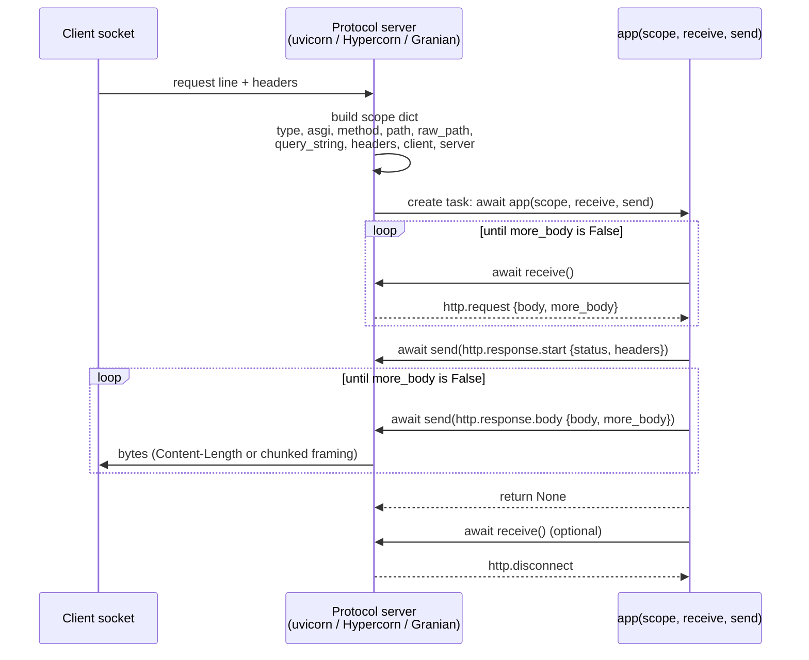

# The ASGI 3.0 Callable Contract: scope Dictionary, receive() Awaitable, and send() Event State Machine

> [!summary] Claim
> An ASGI 3.0 application is one `async` callable invoked once per connection as `await app(scope, receive, send)`, where `scope` is an immutable-by-convention dictionary of connection metadata, `receive()` is a pull stream of event dictionaries that the app must drain until `more_body` is `False`, and `send()` is a server-owned state machine (`http.response.start` -> `http.response.body`* -> optional `http.response.trailers`* -> complete) whose violations each server punishes differently: uvicorn `0.54.0` raises `RuntimeError`, Hypercorn `0.18.0` raises `UnexpectedMessageError`, Granian `2.8.7` raises `RuntimeError("ASGI flow error: ...")`, and `httpx.ASGITransport` (`0.28.1`) fails an `assert`.

Part of [ASGI and Starlette Internals](README.md) in [API Engineering](../README.md).

## TL;DR

- Mechanism: the server builds one `scope` dict per HTTP request (or per WebSocket connection), creates a task that awaits `app(scope, receive, send)`, feeds request bytes into `receive()` as `http.request` events, and turns `send()` events into wire bytes (ASGI 3.0 `specs/asgi.rst`, Applications).
- Contract rule: loop on `receive()` until an `http.request` arrives with `more_body` `False` (or `http.disconnect`), then send exactly one `http.response.start` followed by `http.response.body` events until one has `more_body` `False` (`specs/www.rst`, Response Start and Response Body); the spec says later messages "will be ignored", but uvicorn, Hypercorn, and `httpx.ASGITransport` raise on them, so treat anything after that as an error.
- Trap: request chunk boundaries are a server artifact, not a protocol fact: uvicorn coalesces everything its parser buffered into one `http.request` (`uvicorn 0.54.0 uvicorn/protocols/http/httptools_impl.py, RequestResponseCycle.receive`) while `httpx.ASGITransport` and Hypercorn emit one event per chunk, so code that reads only the first event passes under uvicorn tests and truncates bodies elsewhere.
- Portability fact: servers advertise different `scope["asgi"]["spec_version"]` values (uvicorn `"2.3"`, Granian `"2.3"`, Hypercorn `"2.1"`, `httpx.ASGITransport` none, which the spec says means `"2.0"`), and they detect "is this ASGI 3?" with `inspect.iscoroutinefunction`, so a plain `def` wrapper returning a coroutine is classified ASGI 2 by uvicorn and WSGI by Hypercorn (measured in the lab).
- When not to use it: do not write business endpoints against raw `scope`, `receive`, and `send`; use a framework (Starlette, FastAPI) and drop to raw ASGI only for middleware, protocol adapters, and hot paths, and choose Granian's RSGI or a non-Python gateway when per-event dict allocation itself is the bottleneck (see [[Granian-Internals-Rust-Tokio-Hyper-Engine-and-RSGI-vs-ASGI]]).

## Mental model



The server, not the application, owns the socket: it parses the request head, materializes every piece of connection metadata into the `scope` dict, and then spawns one task per request that awaits the application coroutine.
The first loop is a pull: the application asks for body events with `receive()`, and the server answers with `http.request` messages whose `body` fields must be concatenated until `more_body` is `False`; the server is free to slice the body into any number of events.
The second loop is a push into a state machine the server enforces: one `http.response.start` carries the status and headers, then one or more `http.response.body` messages carry bytes, and the server chooses the wire framing (a declared `content-length` or `Transfer-Encoding: chunked` on HTTP/1.1, `DATA` frames on HTTP/2 and HTTP/3).
When the application returns, the server checks that the state machine reached a terminal state; any later `receive()` reports `http.disconnect`.

## How it works

### The callable and its three arguments

The ASGI 3.0 specification (`Version: 3.0 (2019-03-20)` in its header, `3.0 (2019-03-04)` in its own version history, which disagree) defines the application as `coroutine application(scope, receive, send)` (asgiref 3.13.0 `specs/asgi.rst`, Applications).
`scope` must be a `dict`, always carries `scope["type"]`, and carries `scope["asgi"]["version"]`, which defaults to `"2.0"` when missing; a protocol sub-specification may add `scope["asgi"]["spec_version"]` (asgiref 3.13.0 `specs/asgi.rst`, Applications).
`receive` is "an awaitable callable that will yield a new event dictionary when one is available", and `send` is "an awaitable callable taking a single event dictionary as a positional argument that will return once the send has been completed or the connection has been closed" (asgiref 3.13.0 `specs/asgi.rst`, Applications).
The application is called once per connection, and for HTTP a connection means one request, even when the TCP socket stays open for keep-alive or carries many HTTP/2 streams (asgiref 3.13.0 `specs/www.rst`, HTTP Connection Scope).

The typed form lives in asgiref: `ASGI3Application = Callable[[Scope, ASGIReceiveCallable, ASGISendCallable], Awaitable[None]]`, where `ASGIReceiveCallable = Callable[[], Awaitable[ASGIReceiveEvent]]` and `ASGISendCallable = Callable[[ASGISendEvent], Awaitable[None]]` (asgiref 3.13.0 `asgiref/typing.py`, `ASGI3Application`).
Starlette deliberately types the same contract loosely, `Scope = MutableMapping[str, Any]`, `Message = MutableMapping[str, Any]`, and `ASGIApp = Callable[[Scope, Receive, Send], Awaitable[None]]` (starlette 1.10.0 `starlette/types.py`, `ASGIApp`), which is why Starlette code can add keys such as `scope["app"]` without fighting a `TypedDict`.

The return value is part of the contract: the coroutine must return `None`.
uvicorn logs `ASGI callable should return None, but returned '%s'.` and closes the transport when it does not (uvicorn 0.54.0 `uvicorn/protocols/http/httptools_impl.py`, `RequestResponseCycle.run_asgi`).

### Why one callable replaced two

ASGI 2.0 applications were a synchronous `application(scope)` that returned an awaitable `application_instance(receive, send)` (asgiref 3.13.0 `specs/asgi.rst`, Legacy Applications).
Version 3.0 collapsed this because "the two-callable layout was deemed unnecessary": the instance object existed only to close over `scope`, which a coroutine's local variables already do.
The compatibility shim is three lines: `double_to_single_callable` returns `async def new_application(scope, receive, send): instance = application(scope); return await instance(receive, send)` (asgiref 3.13.0 `asgiref/compatibility.py`, `double_to_single_callable`).

Servers must guess which style they were handed, and the guesses differ:

- asgiref's `is_double_callable` honors `_asgi_single_callable` and `_asgi_double_callable` hint attributes first, treats any class as double, treats an instance as single if its `__call__` is a coroutine function, and otherwise returns `not iscoroutinefunction(application)` (asgiref 3.13.0 `asgiref/compatibility.py`, `is_double_callable`).
- uvicorn with `interface="auto"` treats a class as ASGI 3 only if it has `__await__`, a function as ASGI 3 only if `iscoroutinefunction` says so, and any other object by its `__call__`; ASGI 2 apps are wrapped in `ASGI2Middleware` (uvicorn 0.54.0 `uvicorn/config.py`, `Config.load`).
- Hypercorn has no ASGI 2 path at all: when no mode is given, `is_asgi` returns `True` for a coroutine function or an object whose `__call__` is one, and everything else is served as WSGI; the caller can force the mode with an `asgi:` or `wsgi:` prefix on the application path or `serve(app, config, mode="asgi")` (hypercorn 0.18.0 `hypercorn/utils.py`, `is_asgi`, `wrap_app`, and `load_application`; `hypercorn/asyncio/__init__.py`, `serve`).
- Granian calls `callback(scope, proto.receive, proto.send)` directly, so it only speaks the single-callable form (granian 2.8.7 `granian/asgi.py`, `_callback_wrapper`).

The lab measures the consequences on CPython `3.14.6`: a legacy ASGI 2 class is `double` to asgiref and `asgi2` to uvicorn but `asgi` to Hypercorn (the class's own `async def __call__` is found by attribute lookup), and a plain `def` wrapper that returns the inner coroutine is `double`, `asgi2`, and `wsgi` respectively, while the same wrapper passed through `inspect.markcoroutinefunction` is `single`, `asgi3`, and `asgi`.

### The `http` scope

The HTTP sub-specification is at version `2.5` (2024-06-05) in asgiref 3.13.0, with history `2.0` initial, `2.1` WebSocket accept `headers`, `2.2` `None` allowed as the `server` port, `2.3` WebSocket close `reason`, `2.4` "Calling `send()` on a closed connection should raise an error", and `2.5` WebSocket disconnect `reason` (asgiref 3.13.0 `specs/www.rst`, Spec Versions).
The keys an `http` scope carries, and the trap in each:

| Key | Type | Rule | Trap |
|---|---|---|---|
| `type` | `str` | `"http"` | The same app is also called with `"lifespan"` and `"websocket"`; the spec says reject protocols you do not understand "with an `Exception` (of any type)" so the server does not wait for a lifespan reply that never comes (`specs/asgi.rst`, Protocol Specifications) |
| `asgi` | `dict` | `version` and optional `spec_version` (default `"2.0"`) | Feature-detect with `spec_version`, never with the server name |
| `http_version` | `str` | `"1.0"`, `"1.1"`, `"2"`, or `"3"` | Granian `2.8.7` emits `"1"` for HTTP/1.0 (granian 2.8.7 `src/asgi/utils.rs`, `build_scope_common`) |
| `method` | `str` | Uppercased | Compare exact strings |
| `scheme` | `str` | Optional, default `"http"`, never empty | Behind a TLS-terminating proxy it is the proxy hop's scheme unless proxy headers are trusted |
| `path` | `str` | Percent-decoded and UTF-8-decoded | uvicorn decodes with `urllib.parse.unquote`, which replaces invalid UTF-8 with `U+FFFD`, so `path` is lossy; route on it, never sign or authorize on it |
| `raw_path` | `bytes` or `None` | Original bytes, excluding the query | Optional; uvicorn, Hypercorn, Granian, and `httpx.ASGITransport` all set it, and uvicorn prefixes `root_path` onto both `path` and `raw_path` (uvicorn 0.54.0 `httptools_impl.py`, `HttpToolsProtocol.on_headers_complete`) |
| `query_string` | `bytes` | Still percent-encoded | Decoding is the framework's job |
| `root_path` | `str` | Mount prefix, the WSGI `SCRIPT_NAME` | uvicorn includes it in `path`; Granian sets `root_path` from `url_path_prefix` but does not prefix `path` (granian 2.8.7 `granian/asgi.py`, `_callback_wrapper`) |
| `headers` | iterable of `[bytes, bytes]` | Value order preserved, duplicates preserved, names "should be lowercased", pseudo headers removed and `:authority` turned into `host` | Granian builds the list from a `hyper` `HeaderMap`, which groups values by name; the spec allows that because "order of header names is not important" |
| `client` | `[str, int]` or `None` | Remote address | Granian sets the port as a string (`$client.port().to_string()` in `build_scope_common`, and the same for `server`); behind proxies it is the proxy unless `ProxyHeadersMiddleware` rewrites it |
| `server` | `[str, int or None]` or `None` | Listen address, or `[path, None]` for a UNIX socket | `httpx.ASGITransport` passes `(host, port)` from the URL, and `httpx.URL.port` is `None` for the scheme's default port |
| `state` | `dict` | Shallow copy of the lifespan namespace | Optional; see [[ASGI-Lifespan-Protocol-Startup-Shutdown-and-Scope-State]] |
| `extensions` | `dict` | Server capabilities | Absent means none; Hypercorn adds `http.response.trailers`, `http.response.push`, and `http.response.early_hint` only for HTTP/2 and HTTP/3 (hypercorn 0.18.0 `hypercorn/protocol/http_stream.py`, `HTTPStream.handle`); Granian always adds `http.response.pathsend` and `websocket.http.response` |

Messages and scopes may contain only byte strings, Unicode strings, integers within the signed 64-bit range, finite IEEE 754 doubles, lists, dicts with string keys, booleans, and `None`, because the original design allowed events to cross process boundaries (asgiref 3.13.0 `specs/asgi.rst`, Events).
A server that receives a malformed event "should raise an exception out of the `send` awaitable", an application that receives one should raise, and in both directions extra keys "should not raise an exception", which is how the specification adds keys like `trailers` without a version bump (asgiref 3.13.0 `specs/asgi.rst`, Error Handling).

Middleware that changes `scope` should copy it first, because "changes may leak upstream otherwise", and should not keep a reference and mutate it after calling the child (asgiref 3.13.0 `specs/asgi.rst`, Middleware); the wrapping patterns are in [[Pure-ASGI-Middleware-Onion-Architecture-and-Send-Receive-Wrapping]].

### `receive()`: a pull stream with server-chosen chunking

`http.request` carries `body` (default `b""`) and `more_body` (default `False`); when `more_body` is `True` the app "should wait until it gets a chunk with this set to `False`" (asgiref 3.13.0 `specs/www.rst`, Request).
The server de-chunks `Transfer-Encoding: chunked` request bodies (RFC 9112 Section 7.1), so the app sees plain bytes, but the number of events is an implementation detail:

- uvicorn appends every parser `on_body` callback into one `bytearray` (`self.cycle.body += body`), pauses reading once it exceeds `HIGH_WATER_LIMIT` (`65536` bytes), and each `receive()` returns everything buffered so far as one event and resets the buffer (uvicorn 0.54.0 `httptools_impl.py`, `HttpToolsProtocol.on_body` and `RequestResponseCycle.receive`); `receive()` also resumes reading, so an app that never calls it applies backpressure to the client.
- uvicorn writes `HTTP/1.1 100 Continue` lazily, on the first `receive()` call of a request that sent `Expect: 100-continue`, so an app that rejects a request from its headers alone never invites the body, and the client either sends it anyway after its own wait or gives up (uvicorn 0.54.0 `httptools_impl.py`, `RequestResponseCycle.receive`); see [[100-Continue-Expect-Header-and-Large-Upload-Admission]].
- Hypercorn turns each `Body` protocol event into one `http.request` with `more_body` `True` and the `EndBody` event into a final empty event, and its `receive` is literally `asyncio.Queue(config.max_app_queue_size).get` with `max_app_queue_size = 10` (hypercorn 0.18.0 `hypercorn/protocol/http_stream.py`, `HTTPStream.handle`; `hypercorn/asyncio/task_group.py`, `TaskGroup.spawn_app`; `hypercorn/config.py`, `max_app_queue_size`).
- Granian pulls one `hyper` body frame per `receive()`, marks the stream exhausted after the final frame, and thereafter answers `receive()` by waiting until the response is sent or the client disconnects, then returning `http.disconnect` (granian 2.8.7 `src/asgi/io.rs`, `ASGIHTTPProtocol::receive`).
- `httpx.ASGITransport` returns one event per item of the request stream, then a final `{"body": b"", "more_body": False}`, and on later calls waits for the response to complete and returns `http.disconnect` (httpx 0.28.1 `httpx/_transports/asgi.py`, `ASGITransport.handle_async_request`).

The lab proves the divergence: the same three chunks `b"ab"`, `b"cd"`, `b"ef"` reach the app as one event through uvicorn's `RequestResponseCycle`, and a three-chunk streamed `POST` through `httpx.ASGITransport` reaches it as four events.

After the response, `receive()` returns `http.disconnect`: uvicorn returns it for every later call once `disconnected` or `response_complete` is set (uvicorn 0.54.0 `httptools_impl.py`, `RequestResponseCycle.receive`), whereas Hypercorn enqueues exactly one `http.disconnect` when the stream closes (`HTTPStream.handle`, `StreamClosed` branch), so from reading the source a second `receive()` after that disconnect waits on an empty queue (not exercised in the lab).
Disconnect-driven cancellation is the subject of [[ASGI-HTTP-and-Disconnect-Event-Lifecycle]].

### `send()`: the response state machine

The specification's rules (asgiref 3.13.0 `specs/www.rst`, Response Start and Response Body):

1. `http.response.start` carries `status` (int), `headers` (lowercased byte pairs, order preserved, no pseudo headers, default empty), and `trailers` (default `False`), and "needs to be followed by at least one response content message".
2. Servers "need not flush" the start event until the first body event, which lets them replace the response with an error if the app fails in between.
3. A `Transfer-Encoding` header from the app must be ignored; the server picks the framing, and may chunk when there is no `Content-Length`.
4. `http.response.body` carries `body` and `more_body`; the server "must flush any data passed to them into the send buffer before returning from a send call", and `more_body` `False` completes the response unless trailers are expected.
5. With `trailers` `True`, the response ends only with an `http.response.trailers` message whose `more_trailers` is `False`, and only servers that advertise the `http.response.trailers` extension accept it (asgiref 3.13.0 `docs/extensions.rst`, HTTP Trailers).

uvicorn's implementation is three branches on two booleans (uvicorn 0.54.0 `httptools_impl.py`, `RequestResponseCycle.send`):

- Not started: anything but `http.response.start` raises `RuntimeError("Expected ASGI message 'http.response.start', but got '...'.")`; otherwise it prepends `default_headers`, validates each name against `HEADER_RE` and each value against `HEADER_VALUE_RE = re.compile(b"[\x00-\x08\x0a-\x1f\x7f]")` (control characters except `HTAB`), records `content-length`, adds `connection: close` when keep-alive is off, adds `transfer-encoding: chunked` when neither length nor chunking is set (unless `HEAD`, `204`, or `304`), and writes the head immediately; the status line comes from `STATUS_LINE`, a dict prebuilt for codes `100` to `599`, so any other code raises `KeyError`.
- Started, not complete: anything but `http.response.body` raises; chunked bodies are written as `b"%x\r\n" % len(body)`, the bytes, and `b"\r\n"`, with `b"0\r\n\r\n"` on the final event (the RFC 9112 Section 7.1 `chunk` and `last-chunk` grammar); fixed-length bodies raise `Response content longer than Content-Length` or `Response content shorter than Content-Length`.
- Complete: every message raises `RuntimeError("Unexpected ASGI message '...' sent, after response already completed.")`.
- Before all three, `if self.disconnected: return` makes `send()` a silent no-op after the client has gone, which matches the `spec_version` `"2.3"` uvicorn advertises and not the `2.4` rule that a server "should raise a server-specific subclass of `OSError`" (asgiref 3.13.0 `specs/www.rst`, Disconnected Client).

Hypercorn uses one `HTTPStream` class for HTTP/1.1, HTTP/2, and HTTP/3 (`hypercorn/protocol/h11.py`, `h2.py`, and `h3.py` all import it), with an explicit `ASGIHTTPState` enum of `REQUEST`, `RESPONSE`, `TRAILERS`, and `CLOSED`; any message that matches no transition raises `UnexpectedMessageError(self.state, message["type"])`, whose text is `Unexpected message type, <type> given the state <state>` (hypercorn 0.18.0 `hypercorn/protocol/http_stream.py`, `HTTPStream.app_send`; `hypercorn/utils.py`, `UnexpectedMessageError`).
`build_and_validate_headers` rejects names starting with `:` and strips whitespace from names and values, and `suppress_body` drops body bytes for `HEAD`, `1xx`, `204`, and `304` (hypercorn 0.18.0 `hypercorn/utils.py`).

Granian keeps the start event in `response_intent` and builds the `hyper` response only on the first body event, so a single `more_body=False` body becomes one `Full` body and anything else becomes a streamed body over an `mpsc` channel of capacity `4`; the exception is a `content-type` starting with `text/event-stream`, which starts streaming at once (granian 2.8.7 `src/asgi/io.rs`, `ASGIHTTPProtocol::send`).
Its flow errors surface as `RuntimeError("ASGI flow error: Response already started")`, `"... Response already finished"` (a body after a single-body response), `"... Transport not initialized or closed"` (a body after a streamed response finished), and `"... Response not started"`, and an unknown message type or an `http.response.start` without a `headers` key raises `RuntimeError("Unsupported ASGI message")` (granian 2.8.7 `src/asgi/errors.rs`; `src/asgi/io.rs`, `adapt_message_type` and `adapt_headers`).
That last point is a divergence from the specification, which says `headers` defaults to an empty list; from the same source, a `body` value that is not extractable as bytes falls back to `b""` (`unwrap_or(EMPTY_BYTES)` in `adapt_body`) instead of raising (both read from source, not exercised in the lab).

### What the server does when the app ends

uvicorn's `run_asgi` is the reference for "terminal state" checks (uvicorn 0.54.0 `httptools_impl.py`, `RequestResponseCycle.run_asgi`):

| App outcome | uvicorn `0.54.0` action |
|---|---|
| Raised before `http.response.start` | Logs `Exception in ASGI application`, sends `500` with body `Internal Server Error` and `connection: close` |
| Raised after the start | Logs and closes the transport, because the status line is already on the wire |
| Returned without starting | Logs `ASGI callable returned without starting response.` and sends `500` |
| Returned with the body incomplete | Logs `ASGI callable returned without completing response.` and closes |
| Returned a non-`None` value | Logs and closes |

Hypercorn's `_handle` catches `Exception`, logs `Error in ASGI Framework`, and in `finally` calls `send(None)`, which sends a `500` if the state is still `REQUEST` and otherwise just closes the stream (hypercorn 0.18.0 `hypercorn/asyncio/task_group.py`, `_handle`; `http_stream.py`, `HTTPStream.app_send`).
Why a mid-stream exception can never become a `500` is covered in [[Starlette-Exception-Hierarchy-ServerErrorMiddleware-vs-ExceptionMiddleware]].

## Numbers and limits

| Quantity | Value | Source or measurement |
|---|---|---|
| ASGI core version | `3.0`, header date `2019-03-20`, history date `2019-03-04` | asgiref 3.13.0 `specs/asgi.rst` (as of 2026-11) |
| HTTP and WebSocket sub-spec version | `2.5` (2024-06-05); `send()` on a closed connection raises from `2.4` | asgiref 3.13.0 `specs/www.rst`, Spec Versions (as of 2026-11) |
| Integer range allowed in events | Signed 64-bit | asgiref 3.13.0 `specs/asgi.rst`, Events |
| Valid HTTP status codes | `100` to `599` inclusive; `1xx` is interim only | (RFC 9110 Section 15), (RFC 9110 Section 15.2) |
| uvicorn status lines prebuilt | `500` entries, codes `100` to `599` | uvicorn 0.54.0 `httptools_impl.py`, `STATUS_LINE` |
| uvicorn request buffer high-water mark | `65536` bytes, then `pause_reading()` | uvicorn 0.54.0 `uvicorn/protocols/http/flow_control.py`, `HIGH_WATER_LIMIT` |
| uvicorn advertised `spec_version` | `"2.3"` in all four HTTP implementations (`httptools`, `h11`, `zttp`, `zttp` HTTP/2) | uvicorn 0.54.0 `uvicorn/protocols/http/*_impl.py` |
| Hypercorn advertised `spec_version` | `"2.1"` | hypercorn 0.18.0 `http_stream.py`, `HTTPStream.handle` |
| Granian advertised `spec_version` | `"2.3"` | granian 2.8.7 `src/asgi/utils.rs`, `build_scope_common` |
| Hypercorn per-request receive queue | `10` events (`max_app_queue_size`) | hypercorn 0.18.0 `hypercorn/config.py` |
| Granian streamed-body channel | Capacity `4` frames | granian 2.8.7 `src/asgi/io.rs`, `ResponseBodyStream::new` |
| Granian `http.response.pathsend` read buffer | `131072` bytes | granian 2.8.7 `src/asgi/io.rs`, `ReaderStream::with_capacity` |
| uvicorn fallback `500` body | `Internal Server Error`, `content-length: 21` | uvicorn 0.54.0 `RequestResponseCycle.send_500_response` |
| uvicorn `limit_concurrency` overflow | `503` from the `service_unavailable` ASGI app, body `Service Unavailable` (`19` bytes) | uvicorn 0.54.0 `flow_control.py`, `service_unavailable` |
| Lab runtime | `23 passed in 0.32s` | `uv run --frozen pytest <module> -q` on CPython `3.14.6`, macOS `27.3` arm64 (`macOS-27.3-arm64-arm-64bit-Mach-O`) (as of 2026-11) |

## Portability

Only one leg ran in this verification: the lab module under the workspace interpreter, CPython `3.14.6` on macOS `27.3` arm64, `23 passed`.
The other CPython legs were not run because lab checks were paused for this batch (2026-11-11); their cells cite source instead.

| Runtime or component | Behavior | Verification |
|---|---|---|
| CPython `3.14.6` | Every lab claim holds: scope keys, coalescing, wire bytes, three servers' error texts, interface detection | Ran: `uv run --frozen pytest tests/f10_asgi_and_starlette_internals/test_asgi_3_0_callable_contract_scope_receive_and_send.py -q`, `23 passed` |
| CPython `3.12.16`, `3.13.18` | `inspect.markcoroutinefunction` exists from 3.12, so the fix in the lab works; uvicorn uses `asyncio.iscoroutinefunction` below 3.14 and `inspect.iscoroutinefunction` from 3.14 (uvicorn 0.54.0 `uvicorn/_compat.py`) | Not run (paused); `hasattr(inspect, "markcoroutinefunction")` printed `True` on local `3.12.13` and `3.13.18` |
| CPython `3.14.10` | `asyncio.iscoroutinefunction` emits `DeprecationWarning` "slated for removal in Python 3.16", which is why uvicorn and asgiref switch to `inspect` | Observed with `warnings.simplefilter("error")` on Homebrew `3.14.10`; lab not run on it |
| CPython `3.15.2`, `3.15.2t` | No ASGI-specific change found; `requires-python` is `>=3.12,<3.16` | Not run (paused) |
| uvicorn `0.54.0` | `spec_version` `"2.3"`; `RuntimeError` on order violations; silent `send()` after disconnect; HTTP/2 only with `http="zttp"` (`Config.load` raises `ValueError` otherwise) | Lab drives `RequestResponseCycle` in-process; `zttp` is not installed in the workspace, so HTTP/2 was not run |
| Hypercorn `0.18.0` | `spec_version` `"2.1"`; `UnexpectedMessageError`; one `HTTPStream` for HTTP/1.1, HTTP/2, HTTP/3; no ASGI 2 support | Lab drives `HTTPStream.app_send` in-process; HTTP/2 and HTTP/3 legs read from source |
| Granian `2.8.7` | `spec_version` `"2.3"`; `RuntimeError("ASGI flow error: ...")`; string ports; `http_version` `"1"` for HTTP/1.0; `headers` key required | Source only (`src/asgi/io.rs`, `src/asgi/utils.rs`); not run |
| `httpx.ASGITransport` `0.28.1` | No `spec_version`, `http_version` always `"1.1"`, one event per request-stream chunk, `AssertionError` on order violations, whole response buffered | Lab runs it; see [[In-Process-Testing-of-ASGI-Apps-with-HTTPX-ASGITransport]] |
| HTTP/1.1 | Server chooses `content-length` or chunked framing (RFC 9112 Section 7.1) | Lab asserts uvicorn's exact chunked bytes |
| HTTP/2 and HTTP/3 | Same ASGI events; framing becomes `DATA` frames; pseudo headers removed from `headers` and `:authority` becomes `host` (`specs/www.rst`); uppercase field names are malformed on HTTP/2 (RFC 9113 Section 8.2.1) | Source and specification only |

## Worked example

The lab [implementation](../labs/src/api_labs/f10_asgi_and_starlette_internals/asgi_callable_contract.py) is a framework-free ASGI 3.0 application plus three drivers that run it against real server internals without sockets, and the [test](../labs/tests/f10_asgi_and_starlette_internals/test_asgi_3_0_callable_contract_scope_receive_and_send.py) has 23 cases.
`contract_echo_app` rejects non-`http` scopes, drains `http.request` events, reports what it saw in the scope, and answers with one start and two body events; `ContractCheckingSend` is the send-side state machine; `drive_uvicorn_cycle` feeds the app to uvicorn's `RequestResponseCycle` with a recording `asyncio.Transport`; and `drive_hypercorn_stream` feeds it to Hypercorn's `HTTPStream.app_send`.

The receive loop and the app (simplified excerpt; the full file adds the remaining summary fields and docstrings):

```python
async def read_body(receive: Receive) -> tuple[bytes, int] | None:
    chunks: list[bytes] = []
    events = 0
    while True:
        message = await receive()
        if message["type"] == "http.disconnect":
            return None
        if message["type"] != "http.request":
            raise ASGIContractError(f"unexpected receive event {message['type']!r}")
        events += 1
        chunks.append(message.get("body", b""))
        if not message.get("more_body", False):
            return b"".join(chunks), events


async def contract_echo_app(scope: Scope, receive: Receive, send: Send) -> None:
    if scope["type"] != "http":
        raise ValueError(f"unsupported ASGI scope type {scope['type']!r}")
    received = await read_body(receive)
    if received is None:
        return
    body, request_events = received
    asgi: dict[str, str] = scope.get("asgi", {})
    summary: dict[str, object] = {
        "asgi_version": asgi.get("version", "2.0"),
        "spec_version": asgi.get("spec_version", "2.0"),
        "path": scope["path"],
        "request_events": request_events,
        "body": body.decode("utf-8", "replace"),
    }
    payload = json.dumps(summary, sort_keys=True).encode("ascii")
    half = len(payload) // 2
    await send(
        {
            "type": "http.response.start",
            "status": 200,
            "headers": [
                (b"content-type", b"application/json"),
                (b"content-length", str(len(payload)).encode("ascii")),
            ],
        }
    )
    await send({"type": "http.response.body", "body": payload[:half], "more_body": True})
    await send({"type": "http.response.body", "body": payload[half:], "more_body": False})
```

The send-side state machine (simplified excerpt; the full class also forwards to an optional `downstream` send and keeps the collected headers, body, and trailers):

```python
async def __call__(self, message: Message) -> None:
    kind = message.get("type")
    if self.state is SendState.AWAITING_START:
        if kind != "http.response.start":
            raise ASGIContractError(f"expected 'http.response.start' first, got {kind!r}")
        status = message.get("status")
        if type(status) is not int or not 200 <= status <= 599:
            raise ASGIContractError(f"final status must be an int in 200..599, got {status!r}")
        self.headers = _validate_headers(message.get("headers", []))
        self.trailers_expected = bool(message.get("trailers", False))
        self.state = SendState.STREAMING_BODY
    elif self.state is SendState.STREAMING_BODY:
        if kind != "http.response.body":
            raise ASGIContractError(f"expected 'http.response.body', got {kind!r}")
        body = message.get("body", b"")
        if not isinstance(body, bytes):
            raise ASGIContractError(f"'body' must be bytes, got {type(body).__name__}")
        self.body += body
        if not message.get("more_body", False):
            self.state = (
                SendState.AWAITING_TRAILERS if self.trailers_expected else SendState.COMPLETE
            )
    elif self.state is SendState.AWAITING_TRAILERS:
        if kind != "http.response.trailers":
            raise ASGIContractError(f"expected 'http.response.trailers', got {kind!r}")
        if not message.get("more_trailers", False):
            self.state = SendState.COMPLETE
    else:
        raise ASGIContractError(f"{kind!r} sent after the response completed")
```

Three of the tests, verbatim from the test module, show the server-level facts the note relies on:

```python
@pytest.mark.unit
@pytest.mark.asyncio
async def test_uvicorn_chunk_encodes_a_response_without_content_length() -> None:
    run = await drive_uvicorn_cycle(chunked_stream_app)
    assert run.error is None
    assert run.output == (
        b"HTTP/1.1 200 OK\r\n"
        b"content-type: text/plain\r\n"
        b"transfer-encoding: chunked\r\n"
        b"\r\n"
        b"5\r\nhello\r\n"
        b"5\r\nworld\r\n"
        b"0\r\n\r\n"
    )


@pytest.mark.unit
@pytest.mark.asyncio
async def test_hypercorn_raises_unexpected_message_error_on_send_after_complete() -> None:
    run = await drive_hypercorn_stream(send_after_complete_app)
    assert run.events == ("Response", "Body", "EndBody", "StreamClosed")
    assert run.error == (
        "Unexpected message type, http.response.body given the state ASGIHTTPState.CLOSED"
    )


@pytest.mark.unit
def test_interface_detection_across_asgiref_uvicorn_and_hypercorn() -> None:
    assert classify_interface(contract_echo_app) == {
        "asgiref": "single",
        "uvicorn": "asgi3",
        "hypercorn": "asgi",
    }
    assert classify_interface(LegacyASGI2App) == {
        "asgiref": "double",
        "uvicorn": "asgi2",
        "hypercorn": "asgi",
    }
    assert classify_interface(sync_wrapped(contract_echo_app)) == {
        "asgiref": "double",
        "uvicorn": "asgi2",
        "hypercorn": "wsgi",
    }
    assert classify_interface(marked_sync_wrapped(contract_echo_app)) == {
        "asgiref": "single",
        "uvicorn": "asgi3",
        "hypercorn": "asgi",
    }
```

Captured output, run once from `labs/` on CPython `3.14.6` (`3.14.6 (main, Jun 23 2026, 15:46:31) [Clang 22.1.3 ]`), macOS `27.3` arm64:

```text
$ uv run --frozen pytest tests/f10_asgi_and_starlette_internals/test_asgi_3_0_callable_contract_scope_receive_and_send.py -q
.......................                                                  [100%]
23 passed in 0.32s
```

What the 23 cases establish:

- Through `httpx.ASGITransport`, a `POST /caf%C3%A9/items?q=a%20b` with a three-chunk body arrives with `path` `"/caf\u00e9/items"`, `raw_path` `"/caf%C3%A9/items"`, `query_string` `"q=a%20b"`, no `spec_version` (so the app falls back to `"2.0"`), lowercase header names including `transfer-encoding`, and `4` `http.request` events.
- Through uvicorn's `RequestResponseCycle`, the same body split as three parser chunks arrives as `1` event, and a response with `content-length` is written without chunking.
- uvicorn writes the exact chunked bytes above, raises `Unexpected ASGI message 'http.response.body' sent, after response already completed.` without writing the late bytes, and raises `Expected ASGI message 'http.response.start', but got 'http.response.body'.` with nothing written.
- Hypercorn emits `Response`, `Body`, `EndBody`, `StreamClosed`, then raises `UnexpectedMessageError`; `httpx.ASGITransport` raises `AssertionError` for the same bug.
- `ContractCheckingSend` rejects uppercase names, CR or LF in values, pseudo headers, `str` headers, statuses `103`, `True`, and `"200"`, and `str` bodies, and inserts the trailers state only when `trailers` is `True`.
- A lifespan scope is rejected with `ValueError`, an immediate `http.disconnect` produces no send at all, the misdetected sync wrapper fails inside uvicorn's `ASGI2Middleware` with `TypeError` (`missing 2 required positional arguments`), and `guarantee_single_callable(LegacyASGI2App)` completes a response.

## Pitfalls

> [!warning] A decorator that is not `async def` silently changes the protocol
> Trigger: `def timed(app): def wrapper(scope, receive, send): return app(scope, receive, send); return wrapper`, which is a perfectly valid ASGI 3 callable at runtime.
> Symptom: uvicorn with `interface="auto"` classifies it as ASGI 2 and wraps it in `ASGI2Middleware`, so every request fails with `TypeError: ... missing 2 required positional arguments`; Hypercorn `0.18.0` classifies it as WSGI and serves it through `WSGIWrapper` (classification measured in the lab via `Config.load` and `is_asgi`; `WSGIWrapper` read in hypercorn 0.18.0 `hypercorn/app_wrappers.py`).
> Fix: write wrappers as `async def`, or apply `inspect.markcoroutinefunction` (CPython 3.12+), or force the interface: `--interface asgi3` for uvicorn, and for Hypercorn an `asgi:` prefix on the application path (`asgi:module:app`) or `serve(app, config, mode="asgi")` (hypercorn 0.18.0 `hypercorn/utils.py`, `load_application`).

> [!warning] Reading one `http.request` and assuming it is the body
> Trigger: `message = await receive(); body = message["body"]` in middleware or a raw endpoint.
> Symptom: correct under uvicorn for small bodies, because uvicorn coalesces whatever the parser buffered, and truncated under `httpx.ASGITransport`, Hypercorn, Granian, and under uvicorn itself whenever the body arrives after the first `receive()` or exceeds the `65536`-byte high-water mark (lab test `test_uvicorn_coalesces_parser_chunks_into_one_request_event` versus `test_httpx_transport_scope_and_streamed_request_events`).
> Fix: always loop until `more_body` is `False`, as `read_body` does and as Starlette's `Request.stream` does (starlette 1.10.0 `starlette/requests.py`, `Request.stream`); see [[Starlette-Request-Internals-Stream-Consumption-and-Body-Caching]].

> [!warning] Catching one server's exception type for protocol bugs
> Trigger: tests or middleware that `except RuntimeError` to detect "response already sent".
> Symptom: the handler works under uvicorn and Granian (`RuntimeError`) but not Hypercorn (`UnexpectedMessageError`, an `Exception` subclass) or `httpx.ASGITransport` (`AssertionError`), all measured or read above.
> Fix: never rely on `send()` raising for your own ordering bugs; track `response_started` yourself in middleware, the way Starlette's `ServerErrorMiddleware` does (starlette 1.10.0 `starlette/middleware/errors.py`, `ServerErrorMiddleware.__call__`), and treat any exception from `send()` as fatal for the request.

> [!warning] Expecting `send()` to fail after the client disconnects
> Trigger: a streaming loop that relies on `send()` raising `OSError` to stop (spec `2.4` behavior).
> Symptom: uvicorn `0.54.0` advertises `spec_version` `"2.3"` and returns silently from `send()` once `disconnected` is set, so the generator keeps computing and serializing for a client that is gone; Granian's `send_body` does not raise when its channel send fails: it logs `ASGI transport error` at info level, or nothing at all if it already saw the disconnect (granian 2.8.7 `src/asgi/io.rs`, `ASGIHTTPProtocol::send_body`).
> Fix: check `scope["asgi"].get("spec_version", "2.0")` before relying on the `2.4` rule, and watch `receive()` for `http.disconnect` in a concurrent task; see [[ASGI-HTTP-and-Disconnect-Event-Lifecycle]].

> [!warning] Header values built from user input (CVE-2020-7695)
> Trigger: copying a query parameter or redirect target into a response header.
> Symptom: uvicorn before `0.11.7` did not escape CRLF in header values, enabling HTTP response splitting: "Attackers can exploit this to add arbitrary headers to HTTP responses, or even return an arbitrary response body" (NVD CVE-2020-7695).
> Fix: current uvicorn raises `RuntimeError("Invalid HTTP header value.")` on control characters, but defense belongs in the app too: reject CR, LF, and NUL as (RFC 9110 Section 5.5) requires, as `ContractCheckingSend` does.

> [!warning] Logging the decoded `path` (CVE-2020-7694)
> Trigger: access logs that print `scope["path"]`, which the server has already passed through `urllib.parse.unquote`.
> Symptom: NVD records that uvicorn's request logger logged URLs "after it's been processed with urllib.parse.unquote", so `%1b` sequences became raw ANSI escapes that could "Pollute uvicorn's access logs" and drive the terminal displaying them (NVD CVE-2020-7694).
> Fix: log `raw_path` and `query_string` bytes with non-printables escaped, never the decoded `path`.

> [!warning] Mutating `scope` in place
> Trigger: middleware that does `scope["path"] = new_path` before calling the child.
> Symptom: the change leaks to outer middleware and to the server's own access log, which reads the same dict (asgiref 3.13.0 `specs/asgi.rst`, Middleware).
> Fix: `scope = dict(scope, path=new_path)` before delegating; see [[Pure-ASGI-Middleware-Onion-Architecture-and-Send-Receive-Wrapping]].

> [!warning] Assuming scope value types from one server
> Trigger: `port: int = scope["client"][1]` or `if scope["http_version"] == "1.0":`.
> Symptom: under Granian `2.8.7` the port is a string and HTTP/1.0 is reported as `"1"` (granian 2.8.7 `src/asgi/utils.rs`, `build_scope_common`; read from source).
> Fix: normalize scope fields at one boundary (`int(port)`, a `http_version` set lookup), and add a Granian leg to CI if it is a deployment target.

## Security and robustness

- Threat model: every scope string except `type`, `asgi`, and `root_path` is attacker-controlled, and `path` is attacker-controlled after two decodings; authorization, signing, and cache keys must use `raw_path` and `query_string` bytes, or a canonical form of them, never the lossy decoded `path`.
- Resource consumption (OWASP API4:2023 Unrestricted Resource Consumption): ASGI itself sets no body limit, so the receive loop must count bytes and stop with `413` before buffering, and it must do so before the server's own buffer (`65536` bytes per read pause in uvicorn) becomes the only brake; the lab's `read_body` deliberately has no limit and is not production code.
- Header integrity: the response side must reject CR, LF, and NUL (RFC 9110 Section 5.5), uppercase names on HTTP/2 (RFC 9113 Section 8.2.1), and pseudo headers (asgiref 3.13.0 `specs/www.rst`, Response Start); uvicorn and Hypercorn check some of this, Granian relies on `hyper`'s `HeaderName::from_bytes` and `HeaderValue::from_bytes`, so the cheapest portable defense is one validating `send` wrapper in your own middleware stack.
- Client identity: uvicorn defaults to `proxy_headers=True` with `forwarded_allow_ips` from `FORWARDED_ALLOW_IPS` or `"127.0.0.1,::1"` (uvicorn 0.54.0 `uvicorn/config.py`, `Config.__init__`), so `scope["client"]` is only as trustworthy as that list; see [[Forwarded-Header-RFC-7239-and-X-Forwarded-For-Spoofing]].
- Request framing: the server de-chunks requests, so request smuggling defenses live in the server's parser (`httptools`, `h11`, `hyper`), not in the app; see [[HTTP-Request-Smuggling-CL-TE-and-Desync-Mechanics]].
- Failure containment: the spec requires servers to "terminate the application instance and its associated connection" when an exception escapes (asgiref 3.13.0 `specs/asgi.rst`, Error Handling), so an app that raises mid-stream produces a truncated response, not a `500`; clients must treat a short body or a missing `last-chunk` as failure.
- Unknown protocols: raising on an unexpected `scope["type"]` is a correctness requirement, because a silent return for `lifespan` makes some servers believe the app supports it and wait for startup messages (asgiref 3.13.0 `specs/asgi.rst`, Protocol Specifications).

## The principal's view

The decision is not "which framework" but where the ASGI contract is enforced and tested in your organization.
Every server enforces a slightly different subset (advertised `spec_version`, exception types, scope value types, disconnect semantics, ASGI 2 support), so a fleet that tests only under `httpx.ASGITransport` and deploys under uvicorn, Hypercorn, or Granian is testing a fourth implementation.
The staff-plus move is to own three small artifacts: a validating `send` and `receive` wrapper that runs in every test and in staging (the lab's `ContractCheckingSend` is the shape), a scope-normalization middleware at the outermost layer, and a CI matrix that runs one smoke test under each server you actually deploy.
The trade-off is a few microseconds of Python per event and one more layer in the onion, against an entire class of production-only bugs; keep the validator out of the hot path in production if profiling says so, but never out of CI.
Choose a different interface when the contract itself is the cost: per-event dict allocation and `await` hops dominate small-response microservices, which is the case Granian's RSGI, a compiled gateway, or gRPC exist for; choose WSGI when the app is synchronous and needs neither streaming, WebSockets, nor lifespan, because ASGI buys nothing there (see [[WSGI-PEP-3333-vs-ASGI-3-0-Architectural-Shift]]).

## Interview questions

> [!question] L5: Why must an ASGI HTTP app loop on `receive()` instead of reading one event?
>
> > [!success]- Answer
> > The body may be split across any number of `http.request` events, and only the one with `more_body` `False` ends it.
> > The split is chosen by the server: uvicorn coalesces buffered parser chunks into one event, while `httpx.ASGITransport` and Hypercorn emit one event per chunk.
> > Reading one event therefore truncates bodies on some servers and passes on others, which is the worst kind of bug.
> >
> > Follow-up: What should the loop do on `http.disconnect`, and why must it also count bytes?

> [!question] L5: What are the minimum keys an `http.response.start` message needs, and what happens to a `Transfer-Encoding` header the app sets?
>
> > [!success]- Answer
> > `type` and `status` are required; `headers` defaults to an empty list and `trailers` to `False` per the specification.
> > The server must ignore an app-supplied `Transfer-Encoding` and choose framing itself.
> > Granian `2.8.7` is stricter than the spec and raises `Unsupported ASGI message` when `headers` is missing, so always send it.
> >
> > Follow-up: Why may a server delay flushing the start event until the first body event?

> [!question] L5 (predict the output): An app sends `http.response.start` with only `content-type: text/plain`, then bodies `b"hello"` (`more_body=True`), `b"world"` (`more_body=True`), and `b""` (`more_body=False`) to uvicorn `0.54.0` over HTTP/1.1 `GET`; what bytes hit the socket?
>
> > [!success]- Answer
> > `HTTP/1.1 200 OK\r\ncontent-type: text/plain\r\ntransfer-encoding: chunked\r\n\r\n5\r\nhello\r\n5\r\nworld\r\n0\r\n\r\n`.
> > uvicorn adds `transfer-encoding: chunked` because neither length nor chunking was declared and the method is not `HEAD`.
> > Each body becomes a hex size line, the bytes, and CRLF, and the empty final body writes only the `last-chunk` and terminating CRLF.
> > The lab asserts these exact bytes.
> >
> > Follow-up: What changes if the method is `HEAD` or the status is `204`?

> [!question] L6 (debug this API): A team wraps their ASGI app with `def instrument(app): def wrapper(scope, receive, send): return app(scope, receive, send); return wrapper`; it works in pytest with `httpx.ASGITransport`, fails every request under uvicorn with a `TypeError`, and under Hypercorn behaves like a WSGI app; why?
>
> > [!success]- Answer
> > Servers decide ASGI 3 versus legacy by `inspect.iscoroutinefunction`, and a plain `def` returning a coroutine is not a coroutine function.
> > uvicorn's `Config.load` therefore picks `asgi2` and calls `wrapper(scope)`, which raises `missing 2 required positional arguments`.
> > Hypercorn's `is_asgi` returns `False` and serves it as WSGI, while `httpx.ASGITransport` never inspects the app and just awaits the call, hiding the bug.
> > Fix it with `async def wrapper`, `inspect.markcoroutinefunction`, or by forcing the interface (uvicorn's `--interface asgi3`, Hypercorn's `asgi:module:app` path).
> >
> > Follow-up: How would you add a CI check that catches this before deployment?

> [!question] L6: What does `send()` do after the client disconnects, and how do you write code that is correct on every server?
>
> > [!success]- Answer
> > Spec `2.4` says the server should raise a server-specific `OSError` subclass, but it is not guaranteed on older servers.
> > uvicorn `0.54.0` advertises `2.3` and returns silently once `disconnected` is set, so a streaming loop keeps running.
> > Portable code watches `receive()` for `http.disconnect` in a concurrent task and cancels the producer, and treats `send()` exceptions as a second signal.
> >
> > Follow-up: Why can `send()` fail slightly before `http.disconnect` is delivered?

> [!question] L6: Why does uvicorn write `100 Continue` inside `receive()` rather than when it parses the request head?
>
> > [!success]- Answer
> > Calling `receive()` is the app's signal that it wants the body.
> > An app that rejects the request from headers alone, for example with `401` or `413`, sends its response without ever calling `receive()`, so a client that honors `Expect: 100-continue` never needs to upload the body.
> > The same pull design gives backpressure: `receive()` resumes reading, and the buffer pauses reading above `65536` bytes.
> >
> > Follow-up: What does that imply for middleware that eagerly reads the body for logging?

> [!question] L7+: You run 200 services on a mix of uvicorn, Hypercorn, and Granian; how do you make the ASGI contract an enforced platform property rather than tribal knowledge?
>
> > [!success]- Answer
> > Ship a platform middleware with a validating `send` (state machine, header rules, status range) and a scope normalizer (port types, `http_version`, `root_path` semantics).
> > Run it always in CI and staging, and in production only where measured overhead is acceptable.
> > Add a per-server smoke matrix to the shared CI template because each server diverges: exception types, advertised `spec_version`, disconnect semantics, ASGI 2 support.
> > Pin servers and review their changelogs as API changes, since the contract is partly defined by implementation behavior.
> >
> > Follow-up: Which of these divergences would you push upstream instead of absorbing?

> [!question] L7+: Why are ASGI events plain dicts of a restricted type set rather than typed objects, and what does that cost?
>
> > [!success]- Answer
> > The original design allowed events to cross process boundaries, so they must be serializable: bytes, strings, signed 64-bit ints, finite floats, lists, dicts, booleans, and `None`.
> > Dicts also make the protocol extensible: unknown keys must be ignored, so `trailers` and new extensions arrive without version bumps.
> > The cost is per-event allocation, string-keyed lookups, and validation that every server reimplements differently, which is the gap Granian's RSGI targets.
> >
> > Follow-up: When would you accept that cost, and when would you move a service off ASGI?

> [!question] L7+: What breaks when middleware mutates `scope` in place, and how does that interact with routing and `root_path`?
>
> > [!success]- Answer
> > The spec says changes "may leak upstream", because outer layers and the server hold the same dict, so access logs and outer middleware see the rewritten values.
> > Routing that strips a mount prefix must produce a new scope with an adjusted `root_path`, or `url_for` and redirects generated downstream are wrong.
> > Servers disagree on whether `path` already includes `root_path` (uvicorn prefixes it, Granian does not), so the platform must normalize once at the edge.
> >
> > Follow-up: How does Starlette's `Mount` compute the child scope?

## Related

Prerequisites: [[WSGI-PEP-3333-vs-ASGI-3-0-Architectural-Shift]]

Next: [[ASGI-HTTP-and-Disconnect-Event-Lifecycle]]

See also: [[02-Programming-Languages/Python/Python-Backend-Interview-Prep/04-FastAPI]], [[ASGI-Lifespan-Protocol-Startup-Shutdown-and-Scope-State]], [[ASGI-WebSockets-Lifecycle-Subprotocols-and-Backpressure]], [[Pure-ASGI-Middleware-Onion-Architecture-and-Send-Receive-Wrapping]], [[In-Process-Testing-of-ASGI-Apps-with-HTTPX-ASGITransport]], [[Starlette-Request-Internals-Stream-Consumption-and-Body-Caching]], [[Starlette-Exception-Hierarchy-ServerErrorMiddleware-vs-ExceptionMiddleware]], [[Uvicorn-Internals-Server-Lifecycle-Protocols-and-Flow-Control]], [[Hypercorn-Internals-HTTP-2-HTTP-3-QUIC-and-AnyIO-Trio-Workers]], [[Granian-Internals-Rust-Tokio-Hyper-Engine-and-RSGI-vs-ASGI]], [[End-to-End-Backpressure-TCP-Windows-ASGI-Send-Await-and-Bounded-Queues]], [[HTTP-1-1-Framing-Keep-Alive-and-Chunked-Encoding]], [[100-Continue-Expect-Header-and-Large-Upload-Admission]]

- Lab: `labs/tests/f10_asgi_and_starlette_internals/test_asgi_3_0_callable_contract_scope_receive_and_send.py`

## Further reading

- [ASGI 3.0 core specification](https://raw.githubusercontent.com/django/asgiref/3.13.0/specs/asgi.rst): the callable, scope, events, legacy two-callable form, middleware, and error-handling rules.
- [ASGI HTTP and WebSocket message format 2.5](https://raw.githubusercontent.com/django/asgiref/3.13.0/specs/www.rst): every scope key and event key, and the spec-version history including the `2.4` disconnect rule.
- [ASGI extensions](https://raw.githubusercontent.com/django/asgiref/3.13.0/docs/extensions.rst): trailers, early hints, zero-copy send, path send, server push, and WebSocket denial responses.
- [RFC 9110](https://www.rfc-editor.org/rfc/rfc9110.html): Section 5.5 for field-value validity and Section 15 for the status-code range the start event must respect.
- [RFC 9112](https://www.rfc-editor.org/rfc/rfc9112.html): Section 7.1 for the chunked grammar servers emit when the app omits `Content-Length`.
- [RFC 9113](https://www.rfc-editor.org/rfc/rfc9113.html): Section 8.2.1 for the HTTP/2 field-name rules that make lowercase ASGI header names mandatory.
- [Granian 2.8.7 ASGI I/O](https://raw.githubusercontent.com/emmett-framework/granian/v2.8.7/src/asgi/io.rs): a Rust implementation of the same state machine, useful for seeing which rules a non-Python server relaxes.
- [NVD CVE-2020-7695](https://nvd.nist.gov/vuln/detail/CVE-2020-7695): the uvicorn response-splitting record that motivates header validation in `send()`.
