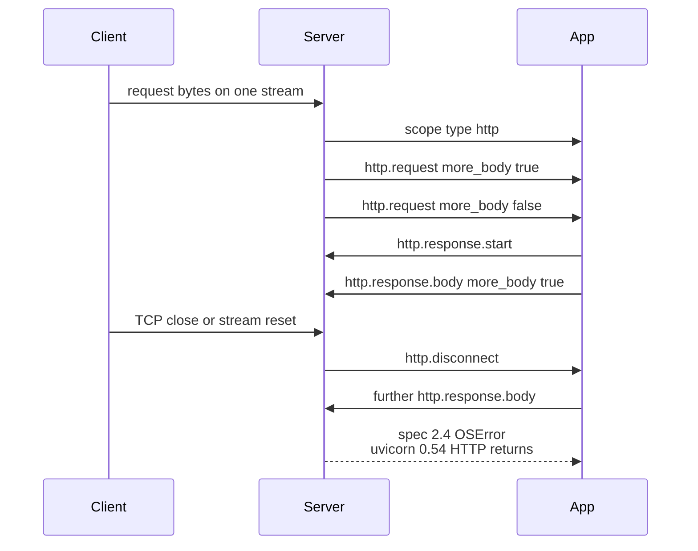

# ASGI HTTP Message Format (v2.4): Request Streaming, Response Chunks, Early Client Disconnect (http.disconnect), and Zero-Copy Extensions

> [!summary] Claim
> An ASGI HTTP app never sees chunked framing: it reads `http.request` byte chunks until `more_body` is false or `http.disconnect` arrives, then writes `http.response.start` plus `http.response.body` chunks, and on spec version 2.4 a later `send()` on a closed connection is supposed to raise `OSError`, which uvicorn 0.54.0 HTTP still does not do.

Part of [ASGI and Starlette Internals](README.md) in [API Engineering](../README.md).

## TL;DR

The protocol server decodes HTTP/1.1 chunking, HTTP/2 `DATA` frames, or HTTP/3 `DATA` frames into `http.request` dicts, and the app sends `http.response.start` then one or more `http.response.body` dicts.
`more_body` defaults to false, so a missing key ends the body, and `receive()` after the response is finished, or after the connection closes, returns `{"type": "http.disconnect"}`.
Spec version 2.4 says `send()` on that closed connection should raise a server-specific `OSError`, but uvicorn 0.54.0 and Granian 2.8.7 still advertise `"2.3"` and return from `send()` without raising.
Starlette 1.10.0 therefore keeps a concurrent `receive()` task only when `spec_version` is below `(2, 4)`; on a server that both advertises 2.4 and fails to raise, a blocked stream never notices the client left.
Use one-shot `Content-Length` responses for small bodies, and use `http.response.pathsend` only for a whole local file the server process can open.

## Mental model



The server owns the socket and the HTTP parser, and the app owns only this request's scope.
Each arrow into the app is one `await receive()`, and each arrow out is one `await send()`.
A client abort is not an exception inside `receive()`.
It is a normal event, `http.disconnect`, and the 2.4 rule moves the failure onto the next `send()`.
Pinned servers disagree on that last arrow, which is why a stream that only waits on its producer can outlive the client.

## How it works

### Two version numbers, and what 2.4 actually changed

`scope["asgi"]["version"]` is the ASGI callable version, `"3.0"` on a current server.
`scope["asgi"]["spec_version"]` is the HTTP and WebSocket message-format version, and it is optional.
If it is missing, applications are told to assume `"2.0"`.
The document fetched for this note is message-format version 2.5, dated 2024-06-05.
Its own history lists 2.0 as the first non-channel-layer spec, 2.1 as `headers` on `websocket.accept`, 2.2 as allowing `None` for the port half of a Unix-socket `server` value, 2.3 as `reason` on `websocket.close`, 2.4 as "`send()` on a closed connection should raise an error", and 2.5 as `reason` on `websocket.disconnect`.
Version 2.4 did not add an HTTP message key.
It added a failure mode for `send()` after `http.disconnect` or `websocket.disconnect`.
The HTTP `type` string stays `"http"` for HTTP/1.0, HTTP/1.1, HTTP/2, and HTTP/3.
`http_version` is `"1.0"`, `"1.1"`, `"2"`, or `"3"`, and a server must hand each HTTP/2 or HTTP/3 stream its own scope.

### What is already in the scope

The connection scope is one request, even when the TCP connection stays open for the next request.
Holding the response open for long-polling keeps that same scope until one side finishes.
Required and usual keys, from the spec text, are `type` (`"http"`), `method` (uppercased), `scheme` (default `"http"`), `path` (percent-decoding and UTF-8 already applied), `query_string` (raw bytes, still percent-encoded), `headers`, and usually `client`, `server`, `root_path`, and `raw_path`.
`raw_path` is optional and defaults to `None` when the server cannot provide the original path bytes.
`root_path` defaults to `""` and is the WSGI `SCRIPT_NAME` equivalent.
`headers` is an iterable of `[name, value]` byte pairs.
Order of values for one name is significant, order of different names is not, duplicates are preserved, names should be lowercased but servers are told to keep case on a best-effort basis, and pseudo-headers are removed.
If `:authority` was present, its value is inserted as `host` at the start of the iterable or replaces an existing `host`.
`client` is `[host, port]` or missing (`None`).
`server` is `[host, port]` or `[unix_path, None]`.
`state`, when present, is a copy of the lifespan namespace for this request.
Lifespan delivery of that dict is [[ASGI-Lifespan-Protocol-Startup-Shutdown-and-Scope-State]].
The callable contract around `scope`, `receive`, and `send` is [[ASGI-3-0-Callable-Contract-Scope-Receive-and-Send]].

Header encoding is deliberate.
The spec text says `Set-Cookie` may be repeated and must not be comma-joined, on every HTTP version it covers.
It says `Cookie` on HTTP/1.0 and HTTP/1.1 is one field joined by the two octets `0x3b 0x20` (`"; "`), while HTTP/2 and HTTP/3 may repeat `Cookie` or use that same join, and it points at RFC 7230, RFC 6265, RFC 9113, and RFC 9114 for those rules.
This note did not re-read those four documents, so the join rule is cited here as the ASGI spec's design decision: transport the raw list, and let the application decode.
Response headers on `http.response.start` must use lowercased names, must not contain pseudo-headers, and default to an empty list.

### Request streaming

Almost all of the request is in the scope.
`http.request` exists to carry the body and to be the signal that the application should run.
Keys are `type` (`"http.request"`), `body` (bytes, default `b""`), and `more_body` (bool, default false).
`more_body: true` means another `http.request` is coming and the application concatenates `body`.
`more_body: false` means the request is complete.
One message with neither key is a complete empty body.
The server, not the app, undoes `Transfer-Encoding: chunked`.
The spec says `http.request` carries the decoded chunk contents only.
That matches RFC 9112 Section 7.1: the chunked body is a series of chunks (hex size, optional extensions, CRLF, data, CRLF), then the `0` last-chunk, then an optional trailer section and a final CRLF, and the content after decoding does not include the sizes.
RFC 9112 Section 6.3 is the length algorithm the server already applied before the first `http.request`: after the bodyless (`HEAD`, `1xx`, `204`, `304`) and `CONNECT` cases, `Transfer-Encoding` overrides `Content-Length`, chunked is read when it is the final transfer coding (a request whose final coding is not chunked gets `400` and a close), else a valid `Content-Length`, else a request body of length zero, else (for a response without a declared length) read until close.
RFC 9112 Section 6.1 says a server that sees both `Content-Length` and `Transfer-Encoding` may reject the request or honor `Transfer-Encoding` alone, and either way it must close the connection afterward.
The application never chooses that branch.

Uvicorn 0.54.0 coalesces parser events into one bytearray per `receive()` wakeup.
In `uvicorn/protocols/http/httptools_impl.py`, `HttpToolsProtocol.on_body` does `self.cycle.body += body`, pauses reading when `len(self.cycle.body) > HIGH_WATER_LIMIT`, and sets `message_event`.
`on_message_complete` sets `more_body = False` and wakes the same event.
`RequestResponseCycle.receive` then returns one `http.request` with `bytes(self.body)` and the current `more_body`, and clears the buffer.
`H11Protocol.handle_events` does the same with `h11.Data` and `h11.EndOfMessage`.
A single `data_received` that contains both the last bytes and end-of-message can therefore surface as one ASGI message whose `body` is non-empty and whose `more_body` is false.
Hypercorn 0.18.0 does the opposite split.
`hypercorn/protocol/http_stream.py` `HTTPStream.handle` turns each `Body` into `{"type": "http.request", "body": bytes(event.data), "more_body": True}` and turns `EndBody` into a following `{"type": "http.request", "body": b"", "more_body": False}`.
An application that treats "empty `body`" as "ignore this message" still terminates, because `more_body` is false.
An application that treats "empty `body`" as "the body is finished" without reading `more_body` happens to work on Hypercorn's terminator, but it stops early on an empty intermediate chunk with `more_body` true, which the spec allows even though neither pinned server's code read here emits one.
Starlette 1.10.0 `Request.stream` only yields a chunk when `body` is non-empty, and it yields a final `b""` after `more_body` becomes false.
Caching of that concatenation, and the `RuntimeError("Stream consumed")` on a second read, live in [[Starlette-Request-Internals-Stream-Consumption-and-Body-Caching]].

Backpressure is the high-water mark, not a window the app sets.
`uvicorn/protocols/http/flow_control.py` sets `HIGH_WATER_LIMIT = 65536`.
The pause condition is strict `>`, so one read may leave the buffer larger than 65536 bytes.
`receive()` calls `flow.resume_reading()` when the app is ready for another message and the response is not finished.
If the app never calls `receive()`, the socket stays paused once the buffer crosses that line, and the client blocks in its send.
That is the ASGI form of "read the body or stop the peer".
h11 0.16.0 separately caps an incomplete event at `DEFAULT_MAX_INCOMPLETE_EVENT_SIZE = 16 * 1024` in `h11/_connection.py`.
Uvicorn's `H11Protocol` uses `config.h11_max_incomplete_event_size` when set, otherwise that default.
A request line or header block that never completes fails inside h11 before any `http.request`.

`Expect: 100-continue` is also server-side.
`RequestResponseCycle.receive` in the uvicorn h11, httptools, and zttp HTTP/1.1 implementations writes `100 Continue` when `waiting_for_100_continue` is set, then delivers body events.
The application does not see an ASGI event for that informational response.
Wire-level admission is [[100-Continue-Expect-Header-and-Large-Upload-Admission]].

Method casing is a real split against the spec's "uppercased" rule.
Uvicorn 0.54.0 `httptools_impl.py` sets `scope["method"]` from `parser.get_method().decode("ascii")` with no `.upper()`, and `h11_impl.py` uses `event.method.decode("ascii")` the same way.
`zttp_impl.py` and `zttp_h2_impl.py` likewise set `scope["method"]` from `event.method.decode("ascii")` with no `.upper()`.
Hypercorn 0.18.0 `h11.py`, `h2.py`, and `h3.py` decode and then call `.upper()` before `HTTPStream.handle`.
The gap only matters where the parser accepts a lowercase method.
Measured here on uvicorn 0.54.0 (CPython 3.14.6, macOS 27.3 arm64, one raw socket request `get /lower HTTP/1.1`): `--http h11` ran the app with `scope["method"] == "get"`, while `--http httptools` answered `400 Bad Request` and logged `Invalid HTTP request received.` before any scope existed.
An application that compares `scope["method"] == "POST"` matches Hypercorn and a spec-compliant server, and misses a lowercase method on the uvicorn h11 path.

### Response start, response chunks, and who frames them

`http.response.start` carries `type`, `status` (int), `headers` (default `[]`), and `trailers` (bool, default false).
The spec says servers need not flush the start event until the first `http.response.body`.
The delay exists so a server can still replace the response if it fails before any body byte.
Uvicorn 0.54.0 does not use that permission.
`H11Protocol`'s `RequestResponseCycle.send` builds an `h11.Response` and `transport.write`s it before `send()` returns.
`HttpToolsProtocol`'s `send` writes the status line and headers in the same place.
Once that `await send(start)` returns, the status line has been handed to `transport.write`, so the server can no longer replace it.
`run_asgi` then branches on `response_started`: an exception before start becomes a generated `500` via `send_500_response`, and an exception after start closes the transport.
That is why a mid-stream failure cannot turn into `500` on this server.
The Starlette middleware side of the same fact is [[Starlette-Exception-Hierarchy-ServerErrorMiddleware-vs-ExceptionMiddleware]].

`http.response.body` carries `body` (default `b""`) and `more_body` (default false).
The server must flush those bytes into the send buffer before `send()` returns.
`more_body: false` completes the response unless `trailers` was true on the start message, in which case the server waits for `http.response.trailers`.
Further messages after completion are ignored by the spec text.
Uvicorn's httptools path, when `chunked_encoding` is true, writes `b"%x\r\n" % len(body)`, the body, and `b"\r\n"`, and on the final chunk appends `b"0\r\n\r\n"`.
An empty intermediate chunk writes nothing, because of `if body:`.
The final empty `http.response.body` is what emits the zero chunk.
If the application set `content-length`, httptools checks the running total and raises `RuntimeError("Response content longer than Content-Length")` or, on completion, `RuntimeError("Response content shorter than Content-Length")`.
`HEAD`, `204`, and `304` skip the automatic chunked upgrade.
Otherwise, if the app set neither `content-length` nor `transfer-encoding: chunked`, httptools appends `transfer-encoding: chunked` itself.
The spec says an application may send `Transfer-Encoding` and the server must ignore it, because `Content-Encoding` is the app's compression signal and transfer coding is the server's.
Uvicorn's httptools implementation does not ignore it: `name == b"transfer-encoding" and value.lower() == b"chunked"` forces chunked mode.
h11 0.16.0 `normalize_and_validate` in `h11/_headers.py` also keeps `transfer-encoding` when the value is exactly `b"chunked"` after lowercasing, rejects any other value with `LocalProtocolError` and status hint 501, rejects a second `transfer-encoding` header, and rejects conflicting `content-length` values.
`CONTENT_LENGTH_MAX_DIGITS = 20` there.
So both pinned HTTP/1.1 stacks will emit a `Transfer-Encoding` the application supplied, which is a spec divergence, and a value other than `chunked` fails inside h11 rather than being stripped.

`HEAD` is the other framing special case.
Uvicorn's httptools `send` forces `expected_content_length = 0` and writes no body bytes when `method == "HEAD"`.
The h11 path sends `h11.Data(data=b"" if method == "HEAD" else body)`.
The application can still pass a body in the ASGI message.
The server deletes it on the wire.
Starlette `FileResponse` takes a different route for `HEAD`: `send_header_only` sends `http.response.body` with `b""` and `more_body` false, and it does not use pathsend.

### http.disconnect

The spec's disconnect section is one key: `type` = `"http.disconnect"`.
There is no close code and no reason on the HTTP event.
WebSocket `reason` arrived in spec 2.5 and does not apply here.
The event is sent when `receive()` is called after the response has been sent, or after the HTTP connection has closed.
The stated purpose is long-polling cleanup.
The same paragraph says that after this event, later `send()` calls should raise, and that a highly concurrent app may see `send()` fail slightly before `receive()` observes the event.
That race is the whole design of spec 2.4.

Uvicorn 0.54.0 implements the receive half and not the send half.
`connection_lost` sets `cycle.disconnected = True` only when `cycle` exists and `response_complete` is still false, then sets `message_event` so a parked `receive()` wakes.
`receive()` returns `{"type": "http.disconnect"}` when `disconnected or response_complete`.
So a finished response produces `http.disconnect` on the next `receive()` even if the TCP connection is still in keep-alive.
That matches the spec sentence "after a response has been sent".
It also means a disconnect listener parked in `receive()` during a stream will sit until either the client dies or the response completes.
`send()` first awaits `flow.drain()` if writing is paused, then does `if self.disconnected: return`.
No `OSError`.
The message is dropped.
Measured here with uvicorn 0.54.0 `--http h11` and `--http httptools` (CPython 3.14.6, macOS 27.3 arm64): after the client closed the socket the app received `http.disconnect`, and every later `http.response.body` `send()` returned without raising.
If the response is already complete and the client has not been marked disconnected, a further `send()` hits the final branch and raises `RuntimeError("Unexpected ASGI message ... sent, after response already completed.")`.
The `disconnected` check comes first, so it wins whenever it is set.
This is why HTTP `spec_version` in `h11_impl.py`, `httptools_impl.py`, `zttp_impl.py`, and `zttp_h2_impl.py` is the string `"2.3"`.
Uvicorn PR 2221 (merged 2024-01-20) bumped the spec version for WebSocket only; the description says HTTP still did not support the 2.4 rule.
PR 2220 (merged 2024-02-12) then raised `ClientDisconnected` from HTTP `send()` and bumped `h11_impl.py` and `httptools_impl.py` to `"2.4"`.
PR 2276 (merged 2024-03-19) reverted 2220's raise.
PR 2513 (merged 2024-11-20) dropped the HTTP spec version back to 2.3 because 2276 had left the advertised version ahead of the code.
The tree pinned here is the result of that revert.
`ZttpH2Protocol` in `uvicorn/protocols/http/zttp_h2_impl.py` is the optional HTTP/2 implementation, and `Config.load` selects `AutoZttpProtocol` only when `http2` is true and `http` is `"zttp"`.
The `zttp` package is not pinned in this lab, so that class was read from the uvicorn 0.54.0 tree and was not imported or run.
`handle_request` sets `http_version` to `"2"` and `extensions` to `http.response.early_hint` plus `http.response.trailers` only.
`handle_rst_stream` sets `disconnected` and wakes `receive()` when the response is not yet complete, and it does not close the connection, so an HTTP/2 `RST_STREAM` becomes `http.disconnect` while the TCP connection can stay up.
Before `response_started`, an `http.response.early_hint` calls `stream.send_informational` with status `103`.
After the body, trailers are written only when a request header has `name == b"te"` and `value.lower().strip() == b"trailers"`.
`HEAD`, status `204`, status `304`, and any status below `200` are treated as bodyless on that path.
The HTTP/1.1 scopes in `h11_impl.py`, `httptools_impl.py`, and `zttp_impl.py` omit `extensions` entirely.

Hypercorn 0.18.0 advertises `"2.1"` in `HTTPStream.handle`, and on `StreamClosed` it sets `closed`, writes an access-log line only when the state is not already `ASGIHTTPState.CLOSED`, and then pushes `{"type": "http.disconnect"}` whenever the app queue exists, whatever the state.
Its `app_send` has no `OSError` path for a closed HTTP stream in the code read for this note.
A bad message type raises `UnexpectedMessageError` instead.

Granian 2.8.7 was run here, not just read: a probe app under `granian --interface asgi --http 1` and `--http 2` (h2c prior knowledge, `h2` 4.4.1 client), CPython 3.14.6, macOS 27.3 arm64.
Both scopes carried `asgi` `{"version": "3.0", "spec_version": "2.3"}` and `extensions` `http.response.pathsend` plus `websocket.http.response`.
An HTTP/1.1 socket close and an HTTP/2 `RST_STREAM` with the TCP connection held open each produced `http.disconnect` in a concurrent `receive()`, and every later `http.response.body` `send()` returned without raising.

Starlette 1.10.0 `StreamingResponse.__call__` parses `scope["asgi"]["spec_version"]` with `tuple(map(int, ....split(".")))` and defaults a missing version to `"2.0"`.
When the tuple is `>= (2, 4)`, it `await`s `stream_response(send)` and turns any `OSError` into `ClientDisconnect`.
Otherwise it starts `stream_response` and `listen_for_disconnect` in `create_collapsing_task_group`, and whichever finishes cancels the group.
`listen_for_disconnect` loops on `receive()` until `type == "http.disconnect"`.
`stream_response` sends start, then every iterator chunk as `http.response.body` with `more_body` true, then `b""` with `more_body` false.
`ClientDisconnect` is `class ClientDisconnect(Exception): pass` in `starlette/requests.py`.
It is not an `OSError`, so an `except OSError` around user code will not see it.
Under uvicorn 0.54.0 the advertised version is `(2, 3)`, so Starlette takes the task-group path.
Cancellation of that group is what stops a generator blocked on `await queue.get()` between chunks.
On a server that advertises `>= (2, 4)`, Starlette does not run `listen_for_disconnect`.
The generator stays blocked until it next calls `send()`, and it only stops if that `send()` raises `OSError`.
A server that advertises 2.4 and then returns from `send()` the way uvicorn's and Granian's HTTP code does will stream until the producer finishes.
Discussion [#2979](https://github.com/Kludex/starlette/discussions/2979) records the matching product bug: background tasks run after a disconnect on the pre-2.4 path, and they are skipped when the 2.4 path raises `ClientDisconnect` before `if self.background`.
The code in `StreamingResponse.__call__` places that `if` after both branches, so an exception from the `try` skips it.
PR [#839](https://github.com/Kludex/starlette/pull/839) is the older fix that added the listener because streams otherwise kept producing after the client left.
`create_collapsing_task_group` in `starlette/_utils.py` unwraps a one-exception `BaseExceptionGroup` and re-raises that single exception.
AnyIO's cancel of the group's own scope, when the local `wrap` helper calls `task_group.cancel_scope.cancel()` after either `listen_for_disconnect` or `stream_response` returns, is how the pre-2.4 path ends without a `ClientDisconnect`.

`Request.is_disconnected` is a different, easy-to-misuse probe.
It enters `anyio.CancelScope`, calls `cancel()` immediately, then `await self._receive()`.
AnyIO's `CancelScope.__exit__` in `anyio/_backends/_asyncio.py` swallows an AnyIO `CancelledError` that belongs to that scope.
If `receive()` has to wait, the cancelled scope absorbs the wait and `message` stays `{}`.
If a message is already queued, `receive()` returns it before the cancel checkpoint, and the probe sees it.
A queued `http.request` is consumed and then ignored, because only `type == "http.disconnect"` sets `_is_disconnected`.
The body chunk is gone.
`Request.stream` is the path that treats disconnect as failure: it sets `_is_disconnected` and raises `ClientDisconnect`.

`FileResponse` repeats the version split.
`chunk_size` is `64 * 1024`, which is the same integer as uvicorn's high-water mark and a different knob.
`max_ranges` is 100.
For a normal `GET` with no usable `Range`, and when `http.response.pathsend` is in `scope["extensions"]`, `_handle_simple` sends start and then `{"type": "http.response.pathsend", "path": str(self.path)}`.
A single range or a multipart range sets `send_pathsend = False` and reads the file in `chunk_size` pieces.
The disconnect listener is skipped when the scope is not `http`, when the method is `HEAD`, when pathsend is in use, or when `spec_version >= (2, 4)`.
Issue [#1301](https://github.com/Kludex/starlette/issues/1301) is the earlier report that `FileResponse` kept reading after the client aborted, which is the same hole `StreamingResponse` had already closed.
On uvicorn 0.54.0 HTTP/1.1 the scope has no `extensions` key, and the HTTP/2 scope still omits `http.response.pathsend`, so `FileResponse` does not select pathsend.
Both scopes advertise `spec_version` `"2.3"`, so the disconnect listener runs.
On Granian 2.8.7 the measured scope advertises pathsend, so a plain `GET` `FileResponse` sends `http.response.pathsend` and skips the listener, leaving abort handling to the server.

httpx 0.28.1 `ASGITransport` is a third behavior, and it is the one in-process tests see.
`handle_async_request` sets `asgi` to `{"version": "3.0"}` and does not set `spec_version`.
Starlette therefore assumes 2.0 and takes the listener path.
`receive()` yields each request chunk as `http.request` with `more_body` true, then one `{"type": "http.request", "body": b"", "more_body": False}` when the stream iterator ends.
Only after `request_complete` does a further `receive()` wait for `response_complete` and return `http.disconnect`.
The transport never injects an early disconnect.
A test that needs a mid-body `http.disconnect` has to script `receive()` itself.
Default `client` is `("127.0.0.1", 123)`.
Deeper transport notes are [[In-Process-Testing-of-ASGI-Apps-with-HTTPX-ASGITransport]].

### Zero-copy extensions, and the messages that sit beside them

Extensions are advertised by presence in `scope["extensions"]`, mapped to an empty dict.
They are not feature flags inside the core messages.

`http.response.pathsend` is one terminal message: `type` and `path`, an absolute path string in the server's filesystem.
The spec says it may be sent only after `http.response.start`, it cannot be mixed with `http.response.body`, and it can be used once.
The application sends `Content-Type` and `Content-Length` itself.
The server opens the path.
Granian 2.8.7's published feature list (its `METADATA` README) includes this extension, and the scope measured above advertises it on HTTP/1.1 and HTTP/2.
Maintainer issue [#93](https://github.com/emmett-framework/granian/issues/93) tracks it as the file-path extension.
Uvicorn 0.54.0 and Hypercorn 0.18.0 do not put `http.response.pathsend` in the scope; neither string occurs anywhere in either installed package.
Starlette prefers it over the 64 KiB read loop, and refuses it for ranges.

`http.response.zerocopysend` is the file-descriptor form.
Keys are `type`, `file` (an object whose fd can be passed to `os.sendfile`, explicitly not a `BytesIO`), optional `offset`, optional `count`, and `more_body` (default false).
It may be mixed with `http.response.body`, it may be repeated, and it must sit after start and before the final body message.
The application closes the fd.
The server does not.
The spec does not say when `send()` returns relative to the copy, so closing the fd before the server's `os.sendfile` finishes would be a use-after-close on the application's side; that is an inference from the spec text, not an observed failure.
None of the Python servers read for this note implement the extension, so their completion timing was not observed.
Granian's extensions issue states that zero-copy send is "not applicable to Granian as involving unsharable file descriptors between Python and Rust".
That is a process-boundary constraint, not a missing `if` in the app.

`http.response.early_hint` may be sent any number of times before `http.response.start`.
The key `links` is an iterable of raw `Link` field values.
The server is told to try a `103` with those values as `Link` headers, and it may ignore the message.
RFC 8297 Section 2 defines `103` (Early Hints) as hints, not as the final headers.
RFC 8297 Section 3 says an HTTP/1.1 client that treats the informational response as the final response can splice later responses on that connection into the first one, which is a cross-origin disclosure if the connection is reused across origins, so a server may skip `103` on HTTP/1.1.
Hypercorn implements that caution in code: `EARLY_HINTS_VERSIONS = {"2", "3"}`, and `http.response.early_hint` is only added to `extensions` for those `http_version` values.
Hypercorn's `app_send` emits `InformationalResponse` with status `103` and one `(b"link", bytes(link).strip())` per entry, and only while the state is still `ASGIHTTPState.REQUEST`.
Uvicorn sends the same `103` only from `ZttpH2Protocol`, which is already HTTP/2 and still advertises spec `"2.3"`.
Its `send` calls `stream.send_informational(103, ...)` with one `(b"link", link)` per entry, unstripped, only while `response_started` is false.
Starlette `Request.send_early_hints` checks the extension, encodes the strings as `latin-1`, and sends `{"type": "http.response.early_hint", "links": raw_links}`.

`http.response.trailers` is the extension that carries fields.
The core start message's `trailers: true` is what tells the server to wait.
Header pairs are lowercased names, no pseudo-headers, and `more_trailers` defaults to false.
The application is responsible for the `Trailer` header that names them.
The server is not supposed to validate that list.
The extension text says the server sends the trailer block only when the request included `TE: trailers`.
That lines up with RFC 9110 Section 6.5.1: a sender must not emit a trailer field unless the field definition allows trailers, intermediaries often drop them, and a server should not put anything the user agent must see into a trailer.
RFC 9112 Section 7.1.2 is the HTTP/1.1 trailer section after the zero chunk.
RFC 9112 Section 7.4 says `TE` negotiates transfer codings other than chunked, and that `chunked` itself is always acceptable on HTTP/1.1 and must not be listed in `TE`.
Hypercorn adds `http.response.trailers` to `extensions` only for `http_version` in `{"2", "3"}`.
Its send path forwards the trailer headers only when some request header is exactly `name == b"te"` and `value == b"trailers"`.
A `TE` value of `trailers, deflate` does not match that equality.
Uvicorn's HTTP/2 gate is `value.lower().strip() == b"trailers"`, so surrounding whitespace matches and `trailers, deflate` still does not.
Hypercorn also has a branch that accepts `http.response.trailers` while the state is still `ASGIHTTPState.REQUEST` and, on that exact `TE` match, synthesizes an `http.response.start` of status 200.
Callers should send start with `trailers` true, then body with `more_body` false, then trailers, which is the `ASGIHTTPState.TRAILERS` branch.
On uvicorn's HTTP/2 path, a trailer message without the `TE` match still ends the stream, and the trailer fields are silently dropped.

`http.response.push` is the HTTP/2 push-promise extension.
Hypercorn advertises it for versions 2 and 3 and builds a new `Request` with method `GET`, copying `:authority` from the parent `host`.
The same Granian issue says push is not supported because Hyper does not implement it.
Chrome 106 disabled HTTP/2 push by default (Chrome developer blog, "Removing HTTP/2 Server Push from Chrome"), so this message is a compatibility hook, not a design to start from.
Starlette `Request.send_push_promise` sends it only when the extension is present.

`http.response.debug` is specified as a test-only message, once, before start, and servers are told not to implement it.
Do not ship behavior that depends on it.

### What the lab models

The lab does not open a socket and does not pretend to be uvicorn.
`ScriptedHTTPCycle` queues `http.request` and `http.disconnect`, records `send` calls, and on `raise_on_send_after_close=True` raises `ConnectionClosed`, an `OSError` subclass, which is the 2.4 rule.
With the flag false, `send()` after close returns and records nothing, which is the uvicorn 0.54.0 HTTP shape.
`read_request_body` honors the default `more_body` of false.
`stream_with_disconnect` sends no response if disconnect arrives during the request body, and with `poll_between_chunks` it `await`s `receive()` after each body chunk and leaves the rest of `Downstream` unpulled.
`zero_copy_or_body` emits `http.response.pathsend` only for an absolute path when that extension is advertised, otherwise `http.response.zerocopysend` only when `fileno()` returns a non-negative int, otherwise one `http.response.body`.
`BytesIO.fileno` raises `io.UnsupportedOperation`, so a memory buffer becomes a copied body even if zerocopy is advertised.
One simplification: with the flag true, the script also raises `ConnectionClosed` for a `send()` after a completed response on a live connection, where the spec says further messages are ignored and uvicorn raises `RuntimeError`.

## Numbers and limits

| Bound | Value | Where it was read |
| --- | --- | --- |
| Message-format document | version 2.5, dated 2024-06-05 | ASGI `www.html` history |
| HTTP `spec_version` that requires `OSError` on `send()` after close | `"2.4"` | ASGI `www.html` version list |
| uvicorn 0.54.0 HTTP `spec_version` | `"2.3"` in `h11_impl.py`, `httptools_impl.py`, `zttp_impl.py`, and `zttp_h2_impl.py` | installed uvicorn 0.54.0 tree |
| Hypercorn 0.18.0 HTTP `spec_version` | `"2.1"` | `hypercorn/protocol/http_stream.py`, `HTTPStream.handle` |
| Granian 2.8.7 HTTP `spec_version` | `"2.3"` on HTTP/1.1 and HTTP/2 | measured scope, CPython 3.14.6, macOS 27.3 arm64, 2026-11-14 |
| Granian 2.8.7 HTTP/2 `RST_STREAM` before `http.response.start` -> `http.disconnect` | `1.0` s after a reset sent 1 s into the request | measured, same machine, issue #925 reproduction shape |
| Request-body pause in uvicorn | buffer length `>` `65536` | `HIGH_WATER_LIMIT` in `flow_control.py` |
| h11 incomplete event cap | `16 * 1024` bytes | `DEFAULT_MAX_INCOMPLETE_EVENT_SIZE` |
| h11 `Content-Length` digit cap | `20` | `CONTENT_LENGTH_MAX_DIGITS` |
| Starlette `FileResponse.chunk_size` | `64 * 1024` | `starlette/responses.py` |
| Starlette `FileResponse.max_ranges` | `100` | `starlette/responses.py` |
| httpx `ASGITransport` default client | `("127.0.0.1", 123)` | `httpx/_transports/asgi.py` |
| RFC 9112 minimum request-line length everyone should accept | `8000` octets | RFC 9112 Section 3 |
| Lab run | `12 passed in 0.45s` | one `pytest` on CPython 3.14.6, macOS 27.3 arm64, fact-check run 2026-11-14 |

No throughput number in this note was measured here.
Granian pathsend speedups are not cited, because this job did not benchmark them.

## Portability

The CPython matrix in the vault style guide is 3.12.16, 3.13.18, 3.14.10, 3.15.2, and 3.15.2t.
This job ran the lab once, on the workspace interpreter, and did not re-run it on those other builds.
The messages themselves are dicts, bytes, and awaitables.
Nothing in the spec depends on a CPython patch release.
The one executed cell is CPython `3.14.6 (main, Jun 23 2026, 15:46:31) [Clang 22.1.3 ]` on `macOS-27.3-arm64-arm-64bit-Mach-O`, `12 passed in 0.45s`.

| Surface | What decides disconnect and framing | Basis |
| --- | --- | --- |
| CPython 3.12.16, 3.13.18, 3.14.10, 3.15.2, 3.15.2t | Same ASGI dict contract, and not executed on these builds in this job | ASGI `www.html`; lab matrix paused |
| CPython 3.14.6, this workspace | Lab above | one `pytest` run |
| Starlette 1.10.0 | Listener task when `spec_version < (2, 4)`, otherwise `OSError` becomes `ClientDisconnect` | `StreamingResponse.__call__` |
| uvicorn 0.54.0 HTTP/1.1 | Advertises `"2.3"`, returns from `send()` when `disconnected`, yields `http.disconnect` after close or after the response completes, and sets no `extensions` key | `h11_impl.py`, `httptools_impl.py`, `zttp_impl.py`, `flow_control.py`; h11 and httptools probed once on this machine |
| uvicorn 0.54.0 HTTP/2 | `ZttpH2Protocol` also advertises `"2.3"` and drops `send()` when `disconnected`, maps `RST_STREAM` to `http.disconnect` without closing the connection, and advertises only early-hint and trailer extensions | `zttp_h2_impl.py` and `Config.load`; not executed, because `zttp` is not a lab dependency |
| Hypercorn 0.18.0 | Advertises `"2.1"`, emits `EndBody` as its own empty `http.request`, and enables trailers, push, and early hints only for `http_version` `"2"` and `"3"` | `http_stream.py`, `h2.py`, `h3.py` |
| Granian 2.8.7 | Advertises `"2.3"` and `http.response.pathsend` on HTTP/1.1 and HTTP/2, returns from `send()` after disconnect without raising, and issue #93 says zerocopy does not apply across the Rust boundary | measured probe on this machine; PyPI granian 2.8.7 page; issue #93 |
| Granian HTTP/2 reset | Issue #925 reported on 2.8.3 that an HTTP/2 `RST_STREAM` before `http.response.start` never produced `http.disconnect`; PR #926 (merged 2026-09-28, two days before the 2.8.4 release was published) closed it, and 2.8.7 delivered `http.disconnect` both before and after start in the probe | issue #925; PR #926; measured h2c probe |
| httpx 0.28.1 `ASGITransport` | Omits `spec_version`, and returns `http.disconnect` only after the response completes | `httpx/_transports/asgi.py`; lab test |
| h11 0.16.0 | Keeps `Transfer-Encoding: chunked` and rejects other transfer codings | `h11/_headers.py` |
| HTTP/1.1 | The server de-chunks before `http.request`, httptools may re-chunk the response, and `103` is a security special case | RFC 9112 Sections 6.3 and 7.1; RFC 8297 Section 3; httptools `send` |
| HTTP/2 | One scope per stream, with Hypercorn `http_version` `"2"` enabling trailers, push, and early hints, and with uvicorn `ZttpH2Protocol` enabling early hints and trailers only | ASGI `www.html`; `hypercorn/protocol/h2.py`; `zttp_h2_impl.py` |
| HTTP/3 | Spec `http_version` is `"3"`, Hypercorn `h3.py` sets that string and shares `{"2", "3"}`, and the uvicorn 0.54.0 modules read here implement no HTTP/3 | ASGI `www.html`; `hypercorn/protocol/h3.py` |

## Worked example

Implementation: [implementation](../labs/src/api_labs/f10_asgi_and_starlette_internals/asgi_http_and_disconnect_event_lifecycle.py).
Test: [test](../labs/tests/f10_asgi_and_starlette_internals/test_asgi_http_and_disconnect_event_lifecycle.py).

Simplified excerpt of the disconnect loop:

```python
stopped = "complete"
for chunk in downstream:
    try:
        await send({"type": "http.response.body", "body": chunk, "more_body": True})
    except OSError:
        stopped = "send_oserror"
        break
    if poll_between_chunks:
        probe = await receive()
        if probe.get("type") == "http.disconnect":
            stopped = "http.disconnect"
            break
else:
    try:
        await send({"type": "http.response.body", "body": b"", "more_body": False})
    except OSError:
        stopped = "send_oserror"
return StreamOutcome(body, downstream.pulled, stopped)
```

Simplified excerpt of the test that fails if the app keeps pulling after `http.disconnect`:

```python
cycle = ScriptedHTTPCycle(
    [
        {"type": "http.request", "body": b"", "more_body": False},
        {"type": "http.disconnect"},
    ]
)
downstream = Downstream((b"one", b"two", b"three"))
outcome = await stream_with_disconnect(
    cycle.receive,
    cycle.send,
    downstream,
    poll_between_chunks=True,
)
assert outcome.chunks_pulled == 1
assert outcome.stopped_on == "http.disconnect"
```

Captured from `labs/` with `uv run --frozen pytest tests/f10_asgi_and_starlette_internals/test_asgi_http_and_disconnect_event_lifecycle.py -q`.
The interpreter was `labs/.venv/bin/python`, `3.14.6 (main, Jun 23 2026, 15:46:31) [Clang 22.1.3 ]`, on `macOS-27.3-arm64-arm-64bit-Mach-O`.

```text
............                                                             [100%]
12 passed in 0.45s
```

That is the fact-check rerun on 2026-11-14 with `CI` unset; the drafter's earlier run reported `12 passed in 0.09s`, and wall time varies run to run.
Mutations, ruff, mypy, pyright, and the other CPython builds were not run, because lab checks are paused (user instruction, 2026-11-11).

## Pitfalls

> [!warning] Spec 2.4 advertised, OSError never raised
> Trigger: the app or Starlette 1.10.0 sees `spec_version >= (2, 4)` and stops calling `receive()` during the stream.
> Symptom: a generator blocked before the next `send()` keeps running after the client closes, and a `send()` that returns without error does not stop it.
> Fix: for any response that waits between chunks, keep a concurrent `receive()` and cancel the producer on `http.disconnect`.
> Treat `OSError` from `send()` as a second signal, not the only one.
> uvicorn 0.54.0 avoids the trap by advertising `"2.3"`, which is why Starlette still starts the listener there.

> [!warning] `is_disconnected` eats a queued body chunk
> Trigger: `await request.is_disconnected()` while an `http.request` is already waiting in `receive()`.
> Symptom: the probe returns false, and `Request.body` or `Request.stream` never sees that chunk.
> The pre-cancelled `CancelScope` only skips the call when `receive()` actually waits.
> Fix: do not probe before the body is finished.
> Let `Request.stream` raise `ClientDisconnect`, or read disconnect from a dedicated task that is the only consumer of `receive()` after the request body is done.

> [!warning] Background work skipped, or logged as an application error
> Trigger: Starlette's `spec_version >= (2, 4)` branch converts `OSError` into `ClientDisconnect` and raises it before `self.background`.
> Symptom: cleanup scheduled as a background task does not run, which is the report in Starlette discussion #2979.
> If that exception then leaves the app, uvicorn `run_asgi` logs `Exception in ASGI application` for any `BaseException`.
> The spec says the server should not log the `OSError` it raised itself.
> A wrapped `ClientDisconnect` is a different object, so the log line comes back.
> Fix: put required cleanup in a `finally` that does not depend on `BackgroundTask`, and do not let client abort look like a `500` in the error budget.

> [!warning] `pathsend` of a request-controlled path
> Trigger: the app copies a user path into `http.response.pathsend` or into `FileResponse`.
> Symptom: the server process opens that path and writes it to the client.
> The extension gives the server a local absolute path, not a URL.
> Fix: pathsend only a path the application constructed under a root it controls.
> Reject ranges on that message.
> Starlette already drops pathsend when `Range` parsed into one or more ranges.
> A worker whose filesystem is not the app's filesystem, or whose cwd differs, will open the wrong file or fail the open.

> [!warning] Responding while the request body is still on the wire
> Trigger: the app sends a complete response, often a `401` or `413`, without reading `http.request` to `more_body` false.
> Symptom: RFC 9112 Section 9.3 says a server must read the rest of the request body or close the connection, or the leftover bytes are parsed as the next request.
> uvicorn's httptools `on_body` returns immediately once `response_complete` is true, so those bytes are not appended to the ASGI buffer.
> That is not the same as a reviewed proof that every parser state stays aligned.
> Fix: either drain `receive()` until `more_body` is false or `http.disconnect`, or send `connection: close`.
> Do not leave a keep-alive socket half-read.

> [!warning] Empty chunk versus end of body
> Trigger: code treats `body == b""` as "the request is finished".
> Symptom: Hypercorn's `EndBody` is an empty `http.request` with `more_body` false, which happens to work, but an intermediate empty chunk with `more_body` true is legal and is not the end.
> A missing `more_body` key means false, so the opposite bug is waiting forever for a chunk the server will never send.
> Fix: terminate only on `more_body` false or on `http.disconnect`.

## Security and robustness

The threat on this surface is resource consumption and response confusion, not a single CVE number this note can point at.
This is API4:2023 Unrestricted Resource Consumption in the OWASP API Security Top 10 (2023 edition): an unread or unbounded `http.request` sequence, and a response generator that ignores `http.disconnect`.
Put a byte cap in front of `read_request_body`, and cancel producers when the disconnect event arrives.
A client that abandons an expensive call, an LLM completion behind an h2c proxy in the report, is the case Granian issue #925 describes for an HTTP/2 reset before `http.response.start` on 2.8.3.
If the server does not deliver `http.disconnect` for a stream reset while the TCP connection stays up, the cap and the cancel never run.
Granian 2.8.7 does deliver it in the probe on this machine (1.0 s after the reset, HTTP/2 h2c), so pin at or after the fix and keep a test for it.

Header injection rides out on `http.response.start`.
Uvicorn httptools rejects header names that match `HEADER_RE = re.compile(b'[\x00-\x1f\x7f()<>@,;:\\[\\]={} \t\\\\"]')` and values that match `HEADER_VALUE_RE = re.compile(b"[\x00-\x08\x0a-\x1f\x7f]")`, both with `RuntimeError`.
h11 rejects illegal names and values inside `normalize_and_validate`.
Those checks are the last line.
The application should still emit only bytes it constructed, with names already lowercased, and should refuse CR or LF in values before calling `send()`.
RFC 9112 Section 6.1's `Content-Length` plus `Transfer-Encoding` case is a smuggling input.
The app does not parse it.
The app also must not re-introduce it by setting `Transfer-Encoding` itself, because the pinned servers do not ignore that header the way the ASGI spec requires.

`103` on HTTP/1.1 is the RFC 8297 Section 3 disclosure.
Prefer to emit `http.response.early_hint` only when the extension is present, which on Hypercorn 0.18.0 already means HTTP/2 or HTTP/3.
Do not put authorization, cookies, or framing fields in `http.response.trailers`.
RFC 9110 Section 6.5.1 says a server should not generate a trailer the user agent must receive, because intermediaries drop trailers.
`http.response.pathsend` and `http.response.zerocopysend` are file read primitives.
A path or fd taken from the request is an arbitrary-file read as the server user.
Keep them behind an allowlist, and close zerocopy fds in a `finally` after `send()` returns.

Defense in depth for a streaming endpoint is four checks that do not share one bug: a max body size while reading `http.request`, a response header allowlist, a disconnect task that cancels the producer, and `connection: close` when the body was not drained.
Pure ASGI middleware can do the first and third by wrapping `receive` and `send` without buffering the whole body.
`BaseHTTPMiddleware` is the wrong layer for that, for reasons owned by [[Why-BaseHTTPMiddleware-Hurts-Performance-Streaming-and-ContextVars]].
How to wrap the channels is [[Pure-ASGI-Middleware-Onion-Architecture-and-Send-Receive-Wrapping]].

## The principal's view

Pick one streaming policy and put it in the platform library.
Every long response, SSE included, runs a disconnect `receive()` concurrently with the producer and cancels that producer on `http.disconnect`, and it also treats `OSError` from `send()` as disconnect.
Do not branch that policy on `spec_version` alone.
Starlette 1.10.0's branch is faithful to the spec text and wrong for the servers this vault pins, because uvicorn 0.54.0, Hypercorn 0.18.0, and Granian 2.8.7 do not implement the 2.4 raise on HTTP.
The organizational cost is one shared helper and a test that scripts `http.disconnect` between chunks.
The cost of skipping it is work, and sometimes GPU time, spent after the caller is gone, plus error-budget noise when `ClientDisconnect` is logged as an application failure.

Use `http.response.pathsend` for a whole regular file that this process can open, with `Content-Length` set from `stat`, and keep range requests on the explicit chunk path.
Do not adopt `http.response.zerocopysend` until the server you run advertises it and documents when `send()` returns relative to `os.sendfile`.
Granian's maintainer position is that the fd cannot cross into Rust, so the portable zero-copy tool on that server is pathsend.
Serve static files from the proxy when the app does not need to authorize each byte.

Leave ASGI chunking for bodies whose size is not known up front.
A small JSON response should be one `http.response.body` with `more_body` false and a `content-length`, so intermediaries and clients are not in chunked mode for no reason.
If the client must be able to cancel work that sits behind a multiplexed proxy, confirm on that server version that a stream reset becomes `http.disconnect` without waiting for the TCP connection to die.
A design that only watches connection close will not see an HTTP/2 or HTTP/3 abort.
Uvicorn 0.54.0 `ZttpH2Protocol.handle_rst_stream` does that delivery for HTTP/2 in the source read here, and this job did not execute it because `zttp` is not installed in the lab.
SSE framing on top of these chunks is [[Server-Sent-Events-SSE-Protocol-Last-Event-ID-and-SSE-Starlette]].

## Interview questions

> [!question] L5: What does a missing `more_body` key mean on `http.request` and on `http.response.body`?
>
> > [!success]- Answer
> > The ASGI HTTP spec says `more_body` is optional and defaults to false on both messages.
> > False means the body is finished.
> > A message that is only `{"type": "http.request"}` is a complete empty request body.
> > Terminating on `body == b""` is a different condition and will misfire on an intermediate empty chunk.
> >
> > Follow-up: What does a correct reader do with Hypercorn's end-of-body message, an empty `http.request` of its own?

> [!question] L5: Why does the application not see `Transfer-Encoding: chunked` chunk boundaries?
>
> > [!success]- Answer
> > The ASGI spec makes the server undo chunked transfer coding and put the decoded bytes in `http.request`.
> > RFC 9112 Section 7.1 framing, including the hex size and the zero chunk, stays in the server.
> > On the way out, uvicorn's httptools implementation adds `transfer-encoding: chunked` when the app set neither `content-length` nor chunked transfer encoding, except for `HEAD`, `204`, and `304`.
> >
> > Follow-up: What does uvicorn 0.54.0 httptools do with a `Transfer-Encoding` header on `http.response.start`, which the spec says the server must ignore?

> [!question] L5: Predict what `read_request_body` returns when given `{"type": "http.request", "body": b"ab", "more_body": True}` and then `{"type": "http.request", "body": b"cd"}`.
>
> > [!success]- Answer
> > It returns `(b"abcd", False)`.
> > The second message omits `more_body`, and the default is false, so the request is complete and no disconnect was seen.
> > The chunks are concatenated in arrival order, not sorted.
> >
> > Follow-up: What changes if the second message is `{"type": "http.disconnect"}` instead?

> [!question] L6: What did HTTP message-format 2.4 change, and which half does uvicorn 0.54.0 implement?
>
> > [!success]- Answer
> > Spec 2.4 says `send()` on a closed connection should raise a server-specific subclass of `OSError`, and the server should not log that error.
> > It did not add a new HTTP message type.
> > uvicorn 0.54.0 `receive()` returns `{"type": "http.disconnect"}` when the client is gone or the response is already complete.
> > Its HTTP `send()` returns immediately when `self.disconnected` is true, and the scope advertises `spec_version` `"2.3"` because the raise added in PR 2220 was reverted in PR 2276 and the version was dropped back in PR 2513.
> >
> > Follow-up: Why is the WebSocket scope in the same server allowed to say 2.4 while HTTP says 2.3?

> [!question] L6: Debug this API, where a `POST` handler calls `disconnected = await request.is_disconnected()` and then `payload = await request.body()`, and under load the first body chunk is sometimes missing while `disconnected` is false, so where did the bytes go?
>
> > [!success]- Answer
> > `Request.is_disconnected` awaits `receive()` inside a `CancelScope` that is already cancelled.
> > If an `http.request` is already queued, `receive()` returns it before the cancel bites, and the method drops any message whose type is not `http.disconnect`.
> > That chunk never reaches `Request.stream`.
> > If no message is waiting, AnyIO swallows the cancellation and the probe returns false, which is why the bug is intermittent.
> > Remove the probe and let `stream()` raise `ClientDisconnect`, or dedicate one task to `receive()` after the body is fully read.
> >
> > Follow-up: Why can the same call observe `http.disconnect` without waiting, given uvicorn only queues that event from `connection_lost`?

> [!question] L6: What does Starlette 1.10.0 `StreamingResponse` branch on when a blocked generator is sometimes cancelled on client disconnect and sometimes not?
>
> > [!success]- Answer
> > It parses `scope["asgi"]["spec_version"]`, defaulting to `"2.0"`, and compares the int tuple with `(2, 4)`.
> > Below 2.4 it runs `stream_response` and `listen_for_disconnect` in one collapsing task group, so `http.disconnect` cancels the generator even while it is blocked before `send()`.
> > At 2.4 or above it only `await`s `stream_response` and converts `OSError` from `send()` into `ClientDisconnect`.
> > A generator that is not inside `send()` is not cancelled on that path.
> > uvicorn 0.54.0 advertises `"2.3"`, so the listener still runs.
> > httpx `ASGITransport` omits `spec_version`, so Starlette also takes the listener path there, but that transport will not deliver an early disconnect.
> >
> > Follow-up: On the 2.4 path, does `BackgroundTask` run after `OSError`, and where in `__call__` is that decided?

> [!question] L7: Design the cancel path for an SSE or token stream that runs on uvicorn 0.54.0 today and might move to a server that advertises 2.4.
>
> > [!success]- Answer
> > Always run `receive()` in a sibling task after the request body is finished, and cancel the producer on `http.disconnect`.
> > Also treat `OSError` from `send()` as the same cancel, because spec 2.4 allows that exception to win the race.
> > Do not use Starlette's version check as the architecture.
> > Confirm on the chosen server that an HTTP/2 or HTTP/3 stream reset becomes `http.disconnect` while the connection stays up.
> > A report against Granian 2.8.3 (issue #925) said an HTTP/2 `RST_STREAM` before `http.response.start` did not, and on 2.8.7 a probe on this machine saw `http.disconnect` 1.0 s after the reset.
> > uvicorn 0.54.0 `ZttpH2Protocol` source does map `RST_STREAM` to `http.disconnect` without closing the connection, and that path was read, not run.
> > Bound the producer's work with a timeout even after cancel, and put mandatory cleanup in `finally` rather than in `BackgroundTask`.
> >
> > Follow-up: What do you log, given the spec says the server should not log the `OSError`, and uvicorn logs any exception that escapes the app?

> [!question] L7: When is `http.response.pathsend` the wrong optimization, even on a server that advertises it?
>
> > [!success]- Answer
> > It is one terminal message after `http.response.start`, and it cannot be mixed with `http.response.body`, so a `Range` response cannot use it without an extension the current spec does not define.
> > Starlette 1.10.0 therefore forces the chunk loop for one range and for multiple ranges.
> > The path is a local filesystem path the server opens, so a user-controlled path is an arbitrary file read, and a path that is not absolute is already rejected by a careful helper.
> > `http.response.zerocopysend` is the fd-shaped alternative, and it may be mixed with body chunks, but the app must close the fd and none of uvicorn 0.54.0, Hypercorn 0.18.0, or Granian 2.8.7 advertises it.
> > Granian's stated reason is that a Python fd is not shareable with the Rust process.
> >
> > Follow-up: When `FileResponse` skips its disconnect listener because pathsend is selected, what must the server's `send()` do for a client abort to still stop work?

## Related

Prerequisites: [[ASGI-3-0-Callable-Contract-Scope-Receive-and-Send]]

Next: [[ASGI-Lifespan-Protocol-Startup-Shutdown-and-Scope-State]]

See also: [[02-Programming-Languages/Python/Python-Backend-Interview-Prep/04-FastAPI]], [[02-Programming-Languages/Python/Python-Backend-Interview-Prep/16-Asyncio-Deep-Dive]]

Also: [[Starlette-Request-Internals-Stream-Consumption-and-Body-Caching]], [[Starlette-Responses-StreamingResponse-FileResponse-and-Background-Execution]], [[Why-BaseHTTPMiddleware-Hurts-Performance-Streaming-and-ContextVars]], [[Pure-ASGI-Middleware-Onion-Architecture-and-Send-Receive-Wrapping]], [[In-Process-Testing-of-ASGI-Apps-with-HTTPX-ASGITransport]], [[Server-Sent-Events-SSE-Protocol-Last-Event-ID-and-SSE-Starlette]], [[Starlette-Exception-Hierarchy-ServerErrorMiddleware-vs-ExceptionMiddleware]], [[100-Continue-Expect-Header-and-Large-Upload-Admission]]

Also: [[ASGI-WebSockets-Lifecycle-Subprotocols-and-Backpressure]], [[ASGI-State-Isolation-and-ContextVars-Across-Request-Lifecycle]], [[Starlette-AuthenticationMiddleware-SessionMiddleware-and-TrustedHost]], [[Starlette-Routing-Internals-Regex-Compilation-and-Mount-Dispatch]], [[WSGI-PEP-3333-vs-ASGI-3-0-Architectural-Shift]]

- Lab: `labs/tests/f10_asgi_and_starlette_internals/test_asgi_http_and_disconnect_event_lifecycle.py`

## Further reading

- [HTTP and WebSocket ASGI message format, version 2.5](https://asgi.readthedocs.io/en/latest/specs/www.html) is the source for scope keys, `http.request`, `http.response.start`, `http.response.body`, `http.disconnect`, and the spec 2.4 `OSError` rule.
- [ASGI extensions](https://asgi.readthedocs.io/en/latest/extensions.html) defines `http.response.pathsend`, `http.response.zerocopysend`, `http.response.early_hint`, `http.response.trailers`, `http.response.push`, and `http.response.debug`.
- [RFC 9112](https://www.rfc-editor.org/rfc/rfc9112.html) Sections 6.1, 6.3, 7.1, 7.1.2, 7.4, and 9.3 are the HTTP/1.1 framing, chunking, trailers, `TE`, and "read the body or close" rules the server applies before ASGI.
- [RFC 9110](https://www.rfc-editor.org/rfc/rfc9110.html) Section 6.5 is the trailer-field model, including the rule that a server should not put mandatory data in trailers.
- [RFC 8297](https://www.rfc-editor.org/rfc/rfc8297.html) Sections 2 and 3 define `103` (Early Hints) and the HTTP/1.1 informational-response hazard.
- [uvicorn PR 2513](https://github.com/encode/uvicorn/pull/2513) records why HTTP `spec_version` went back to 2.3 after the `send()` raise was reverted in PR 2276.
- [Starlette discussion 2979](https://github.com/Kludex/starlette/discussions/2979) records that background tasks and `ClientDisconnect` diverge across the `spec_version` 2.4 branch.
- [Granian issue 93](https://github.com/emmett-framework/granian/issues/93) is the maintainer's extension matrix, including pathsend and the zerocopy non-goal.
