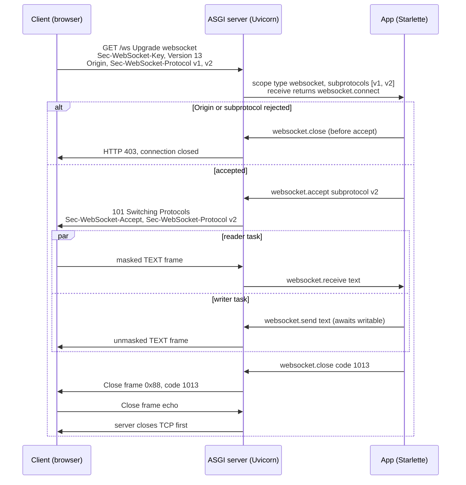

# WebSockets in ASGI and Starlette: Handshake, Subprotocol Negotiation, Close Codes (RFC 6455), and Concurrent Send/Receive Loops

> [!summary] Claim
> An ASGI WebSocket is two independent byte streams glued to one `receive`/`send` pair, so a correct endpoint validates `Origin` and the subprotocol before `websocket.accept`, runs exactly one reader task and one writer task under a task group, bounds every per-connection outbox, and treats close codes as a contract the server may rewrite, drop, or never deliver.

Part of [ASGI and Starlette Internals](README.md) in [API Engineering](../README.md).

## TL;DR

- Mechanism: the client sends an HTTP/1.1 `GET` with `Upgrade: websocket`, a 16-byte base64 `Sec-WebSocket-Key`, and `Sec-WebSocket-Version: 13`; the server holds the `101 Switching Protocols` until the app answers `websocket.connect` with `websocket.accept` (optionally naming one `subprotocol`), `websocket.close` (which becomes HTTP `403`), or a `websocket.http.response.start` denial (RFC 6455 Section 4.2.2; ASGI WebSocket spec; ASGI Websocket Denial Response extension).
- Contract rule: the accepted subprotocol must be one the client offered, no `Sec-WebSocket-Protocol` header is sent when none is chosen, and only codes `1000`-`1003`, `1007`-`1014`, and `3000`-`4999` may appear in a Close frame, because `1005`, `1006`, and `1015` are local-only (RFC 6455 Sections 4.2.2, 7.4.1, 7.4.2; IANA WebSocket Close Code registry).
- The trap: a handler that only `await`s `receive()` never pushes, a handler that only drains a queue never sees the disconnect, and a broadcast loop that `await`s each `send` lets one slow phone stall every subscriber, because Uvicorn's `send` blocks on the transport's 64 KiB high-water mark (uvicorn 0.54.0 `uvicorn/protocols/websockets/websockets_sansio_impl.py`, `WebSocketsSansIOProtocol.send`; CPython 3.14 `asyncio/transports.py`, `_FlowControlMixin._set_write_buffer_limits`).
- Portability: servers disagree on almost every edge: Starlette passes an unoffered subprotocol through, Uvicorn's default `websockets-sansio` stack and Granian 2.8.7 send it, `wsproto` raises inside the app's `accept`, Hypercorn raises `Exception("Invalid Subprotocol")`; Uvicorn reports TCP loss as `1005` while Hypercorn reports only `1000` or `1006`; only Hypercorn speaks WebSockets over HTTP/2 and HTTP/3 (RFC 8441, RFC 9220); the lab passed 28 of 28 tests on CPython 3.14.6 only.
- When not to use it: if traffic is server-to-client only, Server-Sent Events keep HTTP semantics, caching, and automatic resumption; if the client is a backend service, gRPC streaming gives typed, flow-controlled streams with deadlines.

## Mental model



The client's `GET` carries everything the server needs to decide, but RFC 6455 lets the server defer the decision, and ASGI uses that window: Uvicorn parses the request, builds the `websocket` scope with the comma-split `subprotocols` list, queues `websocket.connect`, and sends nothing until the app replies.
A `websocket.close` in that window never becomes a WebSocket close code; it becomes an HTTP `403` response, which a browser surfaces as a failed connection.
After `websocket.accept` the server writes `101` with `Sec-WebSocket-Accept` and, if the app named one, `Sec-WebSocket-Protocol`, and from then on the two directions are independent: inbound frames become `websocket.receive` events on one queue, and outbound `websocket.send` events become frames on a transport that may refuse to take more bytes.
The `par` block is the whole point of the design: one task owns `receive`, one task owns `send`, and either can end the session by cancelling the other.
A close starts with one Close frame, completes when the peer echoes it, and ends with the server closing TCP so that the server, not the client, holds `TIME_WAIT` (RFC 6455 Section 7.1.1).

## How it works

### The opening handshake on the wire

The client request must be a `GET` over HTTP/1.1 or higher with `Host`, `Upgrade: websocket`, a `Connection` header containing `Upgrade`, a `Sec-WebSocket-Key` that base64-decodes to 16 bytes, and `Sec-WebSocket-Version: 13`; `Origin` is required from browsers, and `Sec-WebSocket-Protocol` and `Sec-WebSocket-Extensions` are optional (RFC 6455 Section 4.1, items 1 to 11; Section 4.2.1).
The server proves it understood the WebSocket handshake by returning `Sec-WebSocket-Accept`, the base64 of the SHA-1 of the key concatenated with the fixed GUID `258EAFA5-E914-47DA-95CA-C5AB0DC85B11` (RFC 6455 Section 4.2.2, step 5.4).
The RFC's own example maps the key `dGhlIHNhbXBsZSBub25jZQ==` to `s3pPLMBiTxaQ9kYGzzhZRbK+xOo=`, and the lab checks that its `accept_key` matches that value and both `websockets.utils.accept_key` and `wsproto.utilities.generate_accept_token` (`test_accept_key_matches_rfc_6455_example_and_both_libraries`).
The SHA-1 is not a security mechanism: it only shows that the responder is a WebSocket server and not an HTTP server replaying a cached response, and RFC 6455 Section 10.8 says as much.

The `websockets` library maps each handshake failure to a distinct HTTP status before the app ever runs: a non-`GET` method returns `405` with `Allow: GET`, a request that is not HTTP/1.1 returns `505`, a missing or wrong `Upgrade` or `Connection` returns `426` with `Upgrade: websocket`, a bad key or version returns `400`, and a rejected `Origin` returns `403` (websockets 17.4 `src/websockets/server.py`, `ServerProtocol.accept` and `ServerProtocol.process_request`).
RFC 6455 Section 4.2.2 suggests `426 Upgrade Required` with a `Sec-WebSocket-Version` header for an unsupported version; `websockets` 17.4 returns `400` for a wrong version instead, because `InvalidHeaderValue("Sec-WebSocket-Version", ...)` falls into the generic `InvalidHandshake` branch (same functions).

Uvicorn starts every connection as HTTP: when `h11` sees `Upgrade: websocket` it re-serializes the request line and headers, constructs the configured WebSocket protocol, feeds it those bytes with `data_received`, and swaps it in with `transport.set_protocol` (uvicorn 0.54.0 `uvicorn/protocols/http/h11_impl.py`, `H11Protocol.handle_websocket_upgrade`).
`--ws auto` resolves to `WebSocketsSansIOProtocol` when `websockets` imports, falls back to `WSProtocol` (wsproto), and otherwise disables WebSockets (uvicorn 0.54.0 `uvicorn/protocols/websockets/auto.py`); the older `--ws websockets` implementation emits a `UvicornDeprecationWarning` on import (uvicorn 0.54.0 `uvicorn/protocols/websockets/websockets_impl.py`).
With `h11`, the whole request head must fit in `h11`'s default 16 KiB incomplete-event buffer unless `--h11-max-incomplete-event-size` raises it (h11 0.16.0 `h11/_connection.py`, `DEFAULT_MAX_INCOMPLETE_EVENT_SIZE`; uvicorn 0.54.0 `uvicorn/protocols/http/h11_impl.py`).

### How the handshake becomes ASGI events

The ASGI WebSocket scope carries `path`, `raw_path`, `query_string`, `headers`, `client`, `server`, `scheme` (`ws` or `wss`), `http_version`, `subprotocols` ("Subprotocols the client advertised"), and `state` (ASGI WebSocket spec, Websocket Connection Scope).
Uvicorn's `handle_connect` builds `subprotocols` by splitting every `Sec-WebSocket-Protocol` header value on `,` and stripping whitespace, which implements the RFC rule that repeated request headers are one logical list (RFC 6455 Section 11.3.4), then queues `{"type": "websocket.connect"}` and starts the app task (uvicorn 0.54.0 `websockets_sansio_impl.py`, `WebSocketsSansIOProtocol.handle_connect`).
At that point `self.response = self.conn.accept(event)` has already produced a `101` response object, but nothing is written until the app sends `websocket.accept`, at which point Uvicorn deletes the precomputed `Date`, adds `server_state.default_headers`, the app's `headers`, and `Sec-WebSocket-Protocol` if a subprotocol was named, writes the response, and starts the keepalive timer (same file, `WebSocketsSansIOProtocol.send`).

The ASGI spec gives the app exactly three legal first sends (ASGI WebSocket spec, Connect, Accept, and Close events; Websocket Denial Response extension):

| First `send` | What the server does | Uvicorn 0.54.0 `websockets-sansio` detail |
|---|---|---|
| `websocket.accept` | completes the handshake with `101` (HTTP/1.1) or `200` (HTTP/2, HTTP/3) | writes the `101`, calls `start_keepalive()` |
| `websocket.close` | "must close the connection with a HTTP 403 error code (Forbidden)"; the `code` is never sent | `conn.reject(HTTPStatus.FORBIDDEN, "")`, queues `websocket.disconnect` with `1006` |
| `websocket.http.response.start` then `.body` | sends the app's own HTTP response, only if the scope lists the `websocket.http.response` extension | buffers the body until `more_body` is false, defaults `Content-Type: text/plain; charset=utf-8` and `Connection: close` |

If the app returns without any of these, or raises, Uvicorn logs the error and sends a `500` (`WebSocketsSansIOProtocol.run_asgi`, `send_500_response`).
Starlette's `WebSocket.send_denial_response` checks the extension, then runs an ordinary `Response` whose `send` is wrapped to prefix `websocket.` onto `http.response.start` and `http.response.body` (starlette 1.10.0 `starlette/websockets.py`, `WebSocket.send_denial_response`; `starlette/responses.py`, `Response._wrap_websocket_denial_send`).
The lab uses that path for "no common subprotocol" and falls back to `websocket.close` when the extension is absent (`test_no_common_subprotocol_uses_the_denial_response_extension`, `test_no_common_subprotocol_without_the_extension_falls_back_to_close`).

Starlette routes WebSocket scopes with the same `Router` as HTTP, but a miss is not a `404`: `Router.not_found` and `BaseRoute.__call__` send `WebSocketClose()`, a pre-accept `websocket.close` with code `1000`, which the server turns into `403` (starlette 1.10.0 `starlette/routing.py`, `Router.not_found`, `BaseRoute.__call__`; `starlette/websockets.py`, `WebSocketClose`).
The reverse also holds: `WebSocketRoute` never matches an `http` scope, so a plain `GET /ws` reaches `not_found` and becomes `404 Not Found`, which is also all `httpx.ASGITransport` can ever produce for a WebSocket route because it only builds `"type": "http"` scopes (httpx 0.28.1 `httpx/_transports/asgi.py`, `ASGITransport.handle_async_request`; lab `test_httpx_asgi_transport_reaches_a_websocket_route_only_as_http_404`).

### Subprotocol negotiation

The client lists subprotocols in `Sec-WebSocket-Protocol` "ordered by preference"; each must be a unique, non-empty token (RFC 6455 Section 4.1, item 10), and browsers throw `SyntaxError` from the `WebSocket` constructor on duplicates or invalid tokens before any byte is sent (WHATWG WebSockets Standard, `new WebSocket(url, protocols)` constructor steps).
The server's value "MUST be derived from the client's handshake", the only acceptable value when nothing matches is null, null means the header is absent, and "The empty string is not the same as the null value" (RFC 6455 Section 4.2.2, `/subprotocol/`).
The header may repeat in a request but "MUST NOT appear more than once in an HTTP response" (RFC 6455 Section 11.3.4).
If the response names a subprotocol the client did not request, "the client MUST _Fail the WebSocket Connection_" (RFC 6455 Section 4.1, response check 6).
ASGI moves the choice into the app: `websocket.accept` has a `subprotocol` key, and its `headers` "Must not include a header named `sec-websocket-protocol`" (ASGI WebSocket spec, Accept event, spec version 2.1).
Names should be collision-resistant, for example `chat.example.com`, and a backward-incompatible revision is a new name such as `v2.bookings.example.net` (RFC 6455 Section 1.9), which is why the lab negotiates `chat.v1.example.com` and `chat.v2.example.com`.

The lab's `select_subprotocol` picks by server preference, so a client that offers `[v1, v2]` gets `v2`; the RFC does not mandate whose order wins, and server preference is what lets an operator retire `v1` by moving it down one list instead of waiting for every client to reorder (`test_select_subprotocol_uses_server_preference_among_offers`).
Nobody between the app and the browser is obliged to check the app's choice, and the layers disagree:

| Layer | Unoffered `subprotocol` in `websocket.accept` | Evidence |
|---|---|---|
| Starlette 1.10.0 `WebSocket.accept` | forwarded unchanged | lab `test_starlette_passes_an_unoffered_subprotocol_through_unchecked` |
| Uvicorn 0.54.0 `websockets-sansio` (default) | appended as `Sec-WebSocket-Protocol` and sent with `101` | source: `WebSocketsSansIOProtocol.send` appends the header with no membership check |
| Uvicorn 0.54.0 `wsproto` | `LocalProtocolError("unexpected subprotocol ...")` raised inside the app's `await websocket.accept()` | lab `test_protocol_layer_rejects_an_unoffered_subprotocol` (wsproto 1.3.2 `src/wsproto/handshake.py`, `H11Handshake._accept`); Uvicorn sets `handshake_complete = True` before calling `conn.send`, so `send_500_response` returns early (source reading) |
| Hypercorn 0.18.0 | `Exception("Invalid Subprotocol")` from `Handshake.accept` | source: `src/hypercorn/protocol/ws_stream.py`, `Handshake.accept` |
| Granian 2.8.7 | appended as `Sec-WebSocket-Protocol` and sent with the upgrade | source at tag `v2.8.7`: `src/asgi/io.rs`, `ASGIWebsocketProtocol.accept` appends the header with no membership check |
| `websockets` 17.4 client | `NegotiationError("unsupported subprotocol: mqtt")`, state stays `CONNECTING` | lab `test_protocol_layer_rejects_an_unoffered_subprotocol` (`src/websockets/client.py`, `ClientProtocol.process_subprotocol`) |
| Browser | must fail the connection | RFC 6455 Section 4.1, response check 6 |

### Frame layout

Every frame starts with two bytes: `FIN`, three `RSV` bits, a 4-bit opcode, the `MASK` bit, and a 7-bit length; a length of `126` adds a 16-bit length and `127` adds a 64-bit length whose most significant bit must be 0, and the minimal encoding is mandatory (RFC 6455 Section 5.2).
A masked frame adds a 4-byte masking key, so a header is 2 to 14 bytes.
Opcodes are `0x0` continuation, `0x1` text, `0x2` binary, `0x8` close, `0x9` ping, `0xA` pong; `0x3`-`0x7` and `0xB`-`0xF` are reserved and an unknown opcode must fail the connection (RFC 6455 Section 5.2).
Every client-to-server frame is masked and every server-to-client frame is not; a server "MUST close the connection upon receiving a frame that is not masked" (RFC 6455 Section 5.1).
Masking exists because of the cache-poisoning experiment described in RFC 6455 Section 10.3: unpredictable per-frame keys stop a script from choosing the bytes an intermediary sees, so it cannot forge something that looks like an HTTP request.
The lab captures the exact bytes: a server Close with code `1000` is `88 02 03 e8` (`FIN` plus opcode 8, length 2, big-endian 1000), and the client's version is 8 bytes with the second byte `0x82` and a payload that XORs back to `03 e8` (`test_close_frame_bytes_server_unmasked_client_masked`).

Control frames carry at most 125 bytes and are never fragmented, and may be interleaved inside a fragmented message (RFC 6455 Section 5.5).
Frame boundaries carry no meaning: intermediaries may split or coalesce frames, which is why ASGI requires the server to reassemble and deliver complete messages (RFC 6455 Section 5.4; ASGI WebSocket spec, introduction).
Uvicorn's `websockets-sansio` path stores the first frame's data, appends continuations, and queues one `websocket.receive` when `fin` is set; text is decoded with `data.decode()` and invalid UTF-8 triggers close code `1007` (uvicorn 0.54.0 `websockets_sansio_impl.py`, `handle_text`, `handle_cont`, `send_receive_event_to_app`).

### Extensions and permessage-deflate

`Sec-WebSocket-Extensions` is an offer list: the client lists extensions with parameters, the server's `101` names the ones it accepts, and a server must not answer with an extension the client did not request, and a client must fail the connection if it does (RFC 6455 Sections 4.1, response check 5, and 9.1); ASGI exposes none of this, so the server decides without asking the app.
`permessage-deflate` compresses each data message with DEFLATE, flags a compressed message with the RSV1 bit on its first frame, compresses control frames never, and strips the trailing `00 00 ff ff` empty block on send and re-appends it before inflating (RFC 7692 Sections 6, 7.2.1, 7.2.2).
Four parameters bound memory: `server_no_context_takeover`, `client_no_context_takeover`, `server_max_window_bits`, and `client_max_window_bits`, whose window values run 8 to 15 and default to a 32,768-byte window when absent (RFC 7692 Sections 7.1.1, 7.1.2).
Uvicorn's `websockets-sansio` path offers a server factory with both window sizes at 12 and `memLevel` 5, and its `wsproto` path appends a default `PerMessageDeflate()`; both only when `ws_per_message_deflate` is true (uvicorn 0.54.0 `websockets_sansio_impl.py`, `__init__`; `wsproto_impl.py`, `WSProtocol.send`; source reading).
RFC 7692 Section 8 warns that history-based compression over a secure transport is exposed to CRIME-style attacks, so never compress a message that mixes a secret with attacker-chosen text.
The size limit applies to the inflated message, which is why the compression-bomb pitfall below depends on where the check runs.

### The close handshake and close codes

A Close frame may carry a body whose first two bytes are a network-order status code followed by an optional UTF-8 reason, the receiver of a Close it did not initiate must answer with its own Close, and neither side may send data frames after its Close (RFC 6455 Section 5.5.1).
Because the body is at most 125 bytes, the reason is at most 123 bytes; the lab shows `websockets` raising `ProtocolError("control frame too long")` at 124 bytes while `wsproto` silently truncates a 200-byte reason to 123 (`test_close_reason_is_capped_at_123_bytes`; websockets 17.4 `src/websockets/frames.py`, `Frame.check`; wsproto 1.3.2 `src/wsproto/frame_protocol.py`, `FrameProtocol.close` and `_truncate_utf8`).
Browsers enforce the same 123-byte limit and accept only `1000` or `3000`-`4999` from script: any other `code` throws `InvalidAccessError` and a longer reason throws `SyntaxError` (WHATWG WebSockets Standard, `close(code, reason)` method steps).

The connection close code is the code in the first Close frame received; `1005` means a Close frame arrived without a code, and `1006` means the connection closed with no Close frame at all, and the two endpoints may legitimately disagree on the value when both close at once (RFC 6455 Section 7.1.5).

| Code | Meaning | May be sent in a frame | Source |
|---|---|---|---|
| `1000` | normal closure | yes | RFC 6455 Section 7.4.1 |
| `1001` | going away (server shutdown, page navigation) | yes | RFC 6455 Section 7.4.1 |
| `1002` | protocol error | yes | RFC 6455 Section 7.4.1 |
| `1003` | unsupported data type (for example binary to a text-only endpoint) | yes | RFC 6455 Section 7.4.1 |
| `1004` | reserved | no | RFC 6455 Section 7.4.1 |
| `1005` | no status code was present | no, local only | RFC 6455 Section 7.4.1 |
| `1006` | abnormal closure, no Close frame | no, local only | RFC 6455 Section 7.4.1 |
| `1007` | payload inconsistent with type, such as invalid UTF-8 in text | yes | RFC 6455 Section 7.4.1 |
| `1008` | policy violation, the generic code | yes | RFC 6455 Section 7.4.1 |
| `1009` | message too big | yes | RFC 6455 Section 7.4.1 |
| `1010` | client expected an extension the server did not negotiate | yes (client) | RFC 6455 Section 7.4.1 |
| `1011` | server hit an unexpected condition | yes | RFC 6455 Section 7.4.1; IANA registry cites errata 3227 |
| `1012` | service restart | yes | IANA WebSocket Close Code registry |
| `1013` | try again later | yes | IANA WebSocket Close Code registry |
| `1014` | bad gateway, like HTTP `502` | yes | IANA WebSocket Close Code registry |
| `1015` | TLS handshake failure | no, local only | RFC 6455 Section 7.4.1 |
| `3000`-`3999` | libraries and frameworks, registered with IANA | yes | RFC 6455 Section 7.4.2 |
| `4000`-`4999` | private use by prior agreement | yes | RFC 6455 Section 7.4.2 |

The lab's `is_sendable_close_code` encodes this table and agrees with `websockets.frames.Close.check` for every integer from 0 to 5099 (`test_sendable_close_codes_match_websockets_frame_validation`).
The two sans-io libraries Uvicorn can use react differently to a forbidden code, which the lab pins down: `websockets` raises `ProtocolError("invalid status code")` for `1006`, while `wsproto` rewrites the integers `1005`, `1006`, and `1015` to `1000` (only the enum member `CloseReason.NO_STATUS_RCVD` becomes an empty Close body, `88 00`, a verifier probe run once on CPython 3.14.6) and sends an unregistered `2000` unchanged as `88 02 07 d0` (`test_reserved_close_codes_raise_in_websockets_but_are_rewritten_by_wsproto`; wsproto 1.3.2 `frame_protocol.py`, `LOCAL_ONLY_CLOSE_REASONS` and `FrameProtocol.close`).
In Uvicorn's default stack that `ProtocolError` escapes `WebSocketsSansIOProtocol.send`, which only converts `InvalidState` into `ClientDisconnected`, so `await websocket.close(1006)` raises into the app (uvicorn 0.54.0 `websockets_sansio_impl.py`, `WebSocketsSansIOProtocol.send`; source reading, not run).

### What the app sees as `websocket.disconnect`

ASGI defines `websocket.disconnect` with `code` ("If no code was received in the frame from the client, the server should set this to 1005") and, since spec version 2.5, `reason` (ASGI WebSocket spec, Disconnect event and spec versions list, version 2.5 dated 2024-06-05).
That sentence is narrower than RFC 6455 Section 7.1.5, which reserves `1005` for a Close frame without a code and `1006` for no Close frame at all, and the servers read it differently:

| Event | Uvicorn 0.54.0 `websockets-sansio` | Uvicorn 0.54.0 `wsproto` | Hypercorn 0.18.0 |
|---|---|---|---|
| peer sends Close with code `1001` and a reason | `1001` and the reason (`handle_close`) | `1001` and the reason (`handle_close`) | `1006`: `StreamClosed` maps every state except `HTTPCLOSED` and `CLOSED` to `ABNORMAL_CLOSURE` and never forwards the peer's code or reason |
| TCP lost after the handshake, no Close frame | `1005` (`connection_lost`: `1005 if self.handshake_complete else 1006`) | `1005` (same expression) | `1006` |
| TCP lost before the handshake completes | `1006` | `1006` | `1006` |
| app sent `websocket.close` first | the app's own code, queued by `send` | the app's own code, queued by `send` | `1000` |
| server shutdown with an open connection | `1012`, and a `1012` Close frame to the peer (`shutdown`) | `1012`, same | not covered here |
| keepalive pong missing for `ws_ping_timeout` | Close frame `1011` `"keepalive ping timeout"`, then TCP close (`keepalive_timeout`) | same | pings off by default |
| message larger than the size limit | `websockets` fails the connection with `1009` (`protocol.py`, `PayloadTooBig` handler) | `1009` with reason `"Message exceeds the maximum size (N bytes)"` (`handle_message`) | Close frame `1009` (`_handle_events`) |

Every cell is source reading of the named function at the pinned release, not a server run; Hypercorn also advertises `"spec_version": "2.3"` in its scope, which predates the `reason` key, while Uvicorn advertises `"2.4"` (hypercorn 0.18.0 `ws_stream.py`, `WSStream.handle`; uvicorn 0.54.0 `handle_connect`).
The design consequence is that a close code arriving at the server is diagnostic, not a protocol: never let reconnect or billing logic depend on telling `1005` from `1006`.

On the sending side, after `websocket.close` Uvicorn writes the Close frame, resumes reading if it had paused, keeps discarding data messages, and arms a hard-coded 10-second `close_timer` that closes the transport if the peer never echoes (uvicorn 0.54.0 `websockets_sansio_impl.py`, `close_timeout = 10.0`, `send`, `handle_close`, `send_receive_event_to_app`).
When the app returns while connected without sending a Close, Uvicorn simply closes the transport and the peer reports `1006`, whereas Hypercorn's `app_send(None)` sends a `1011` Close frame for a `CONNECTED` stream, whether the app returned normally or raised (hypercorn 0.18.0 `ws_stream.py`, `WSStream.app_send`; `src/hypercorn/asyncio/task_group.py`, `_handle`).
Since ASGI spec version 2.4, a server "should raise" a server-specific `OSError` subclass when `send()` is called on a closed connection, and the spec adds "This is not guaranteed"; Uvicorn's is `ClientDisconnected(OSError)` (ASGI WebSocket spec, Disconnected Client exception; uvicorn 0.54.0 `uvicorn/protocols/utils.py`, `ClientDisconnected`).

### Starlette's two-sided state machine

`starlette.websockets.WebSocket` keeps two `WebSocketState` values, `client_state` for what it has received and `application_state` for what it has sent, each moving through `CONNECTING`, `CONNECTED`, `DISCONNECTED`, plus `RESPONSE` for a denial (starlette 1.10.0 `starlette/websockets.py`, `WebSocketState`, `WebSocket.receive`, `WebSocket.send`).
`receive` demands `websocket.connect` first, then only `websocket.receive` or `websocket.disconnect`, and raises `WebSocketDisconnected` (a `RuntimeError`) once a disconnect was seen (`test_starlette_refuses_receive_after_disconnect`).
`send` in `CONNECTING` allows only `websocket.accept`, `websocket.close`, or `websocket.http.response.start`, so `send_text` before `accept` raises `RuntimeError` without reaching the server (`test_starlette_refuses_data_before_accept`).
In `CONNECTED`, an `OSError` from the server's `send` flips `application_state` to `DISCONNECTED` and is re-raised as `WebSocketDisconnect(code=1006)`, which is the only place Starlette manufactures `1006`, and it never goes on the wire (`test_starlette_maps_a_server_oserror_on_send_to_1006`).
`accept()` calls `receive()` first if the connect event has not been consumed, which is why the endpoint can call `accept` directly (`WebSocket.accept`).
`receive_text`, `receive_bytes`, and `receive_json` convert a disconnect into `WebSocketDisconnect(code, reason)`, while `iter_text`, `iter_bytes`, and `iter_json` catch it and stop iterating, discarding the code (`WebSocket.iter_text`).
`send_json` serializes with `separators=(",", ":")` and `ensure_ascii=False`, so non-ASCII text goes out as UTF-8 rather than `\u` escapes (`WebSocket.send_json`).

`WebSocketEndpoint` wraps the same object in a receive loop: its `encoding` of `"text"`, `"bytes"`, or `"json"` closes with `1003` on a wrong frame type or malformed JSON, and on an exception it passes `1011` to `on_disconnect` and re-raises without sending any Close frame, so the code the peer sees is the server's choice (starlette 1.10.0 `starlette/endpoints.py`, `WebSocketEndpoint.dispatch`, `WebSocketEndpoint.decode`).
Exceptions are handled per connection by `wrap_app_handling_exceptions`, which `websocket_session` installs, and `ExceptionMiddleware` maps `WebSocketException(code, reason)` to `websocket.close(code, reason)`; `ServerErrorMiddleware` returns early for every non-`http` scope, so no `500` page ever exists for a WebSocket (starlette 1.10.0 `starlette/routing.py`, `websocket_session`; `starlette/middleware/exceptions.py`, `ExceptionMiddleware.websocket_exception`; `starlette/middleware/errors.py`, `ServerErrorMiddleware.__call__`).

### Concurrent send and receive loops

`receive()` is the only channel through which the app learns that the peer left, and `send()` is the only way to push, so a single sequential loop must choose which one it is blocked in.
The lab's `naive` endpoint shows the failure: a broadcast published by another client sits in the connection's outbox until the naive client happens to send something, and then arrives before the reply to that message (`test_naive_single_loop_withholds_broadcasts_until_the_client_speaks`).
The `chat` endpoint runs three tasks in one anyio task group: `reader` owns `receive()`, `writer` owns `send()`, and `eviction_watch` waits for the hub to mark the connection slow; whichever finishes first records a close code and cancels the scope, and the `finally` clause unregisters the subscriber (`websocket_hub.py`, `_run_session`).
Single ownership matters because neither Starlette nor the ASGI spec serializes concurrent callers: two tasks calling `receive()` would split the message stream between them, and two writers would interleave messages in scheduler order.
Uvicorn does keep each message atomic on the wire, since `send` awaits `writable` once and then frames and calls `transport.write` with no further `await` (uvicorn 0.54.0 `websockets_sansio_impl.py`, `WebSocketsSansIOProtocol.send`), but that is an implementation detail, not a contract.
Cancellation is safe here because a cancelled anyio memory-stream `send` delivers nothing, and Starlette's `application_state` is still `CONNECTED` after a cancelled `send_text`, so the subsequent `close()` is legal (starlette 1.10.0 `WebSocket.send`).

### Backpressure from the socket to the publisher

Inbound, both Uvicorn stacks call `transport.pause_reading()` as soon as one complete message is queued and `resume_reading()` in `receive()` once the queue is empty, so an app that stops calling `receive()` stops the kernel from draining the socket and the client's sends eventually block (uvicorn 0.54.0 `websockets_sansio_impl.py`, `send_receive_event_to_app` and `receive`; `wsproto_impl.py`, `handle_message` and `receive`).
The queue is still unbounded in principle, because one `data_received` chunk can hold many small messages; Hypercorn instead puts events into an `asyncio.Queue(config.max_app_queue_size)` with a default of 10 (hypercorn 0.18.0 `src/hypercorn/asyncio/task_group.py`, `TaskGroup.spawn_app`; `src/hypercorn/config.py`).
Outbound, asyncio calls `pause_writing()` when the transport buffer exceeds the high-water mark, 64 KiB by default with the low-water mark at a quarter of that, and Uvicorn's `pause_writing` clears an `asyncio.Event` that every `send` awaits first (CPython 3.14 `Lib/asyncio/transports.py`, `_FlowControlMixin._set_write_buffer_limits`; uvicorn 0.54.0 `websockets_sansio_impl.py`, `pause_writing`, `resume_writing`, `send`).
So `await websocket.send_text(...)` to a peer that stopped reading blocks once its kernel send buffer and the 64 KiB user-space buffer are full, and a fan-out loop that awaits each send in turn blocks every later subscriber behind it.
`connection_lost` sets `writable` again so that a blocked `send` wakes and raises `ClientDisconnected` rather than hanging forever (`WebSocketsSansIOProtocol.connection_lost`).

The lab decouples the publisher with a per-connection `anyio` memory stream of `outbox_size` items and a synchronous `Hub.deliver` that uses `send_nowait`; `WouldBlock` evicts the subscriber, records `(conn_id, 1013)`, and sets the event that `eviction_watch` waits on (`websocket_hub.py`, `Hub.deliver`).
With `outbox_size=2` and a client that never reads, the first broadcast is taken by the writer and blocks in `send`, the next two fill the outbox, and the fourth evicts, so the publisher's acks read `[2, 2, 2, 1]` and its own sends never wait (`test_slow_consumer_is_evicted_with_1013_and_never_blocks_the_publisher`).
The Close frame for the evicted client queues behind the same stalled socket, so the lab bounds `close()` with `anyio.move_on_after(policy.close_timeout)` and then returns; on a real server returning closes TCP and the client observes `1006`, not `1013`, which is why eviction should also be visible in server metrics rather than only in a close code.
The alternatives to eviction each trade a different property: dropping the newest message keeps the connection but loses data silently, dropping the oldest or conflating to the latest snapshot suits tickers and presence but not chat, and an unbounded queue keeps every message until the process runs out of memory.

Keepalive is the server's job (ASGI WebSocket spec, introduction).
Uvicorn sends a ping every `ws_ping_interval` seconds (default 20) with a random 4-byte payload, closes with `1011` if the matching pong does not arrive within `ws_ping_timeout` (default 20), ignores unsolicited or stale pongs, and schedules the next ping `ping_interval - last_ping_rtt` after a pong (uvicorn 0.54.0 `websockets_sansio_impl.py`, `send_keepalive_ping`, `handle_pong`, `schedule_ping`, `keepalive_timeout`; `uvicorn/config.py`, `Config.__init__`).
Hypercorn's `websocket_ping_interval` defaults to `None`, so idle connections behind an L7 proxy with an idle timeout are dropped unless the app or the proxy sends traffic (hypercorn 0.18.0 `src/hypercorn/config.py`).
RFC 6455 lets a Pong be sent unsolicited as a one-way heartbeat and lets a receiver answer only the most recent of several Pings (RFC 6455 Section 5.5.3).

### WebSockets over HTTP/2 and HTTP/3

HTTP/2 has no `Upgrade`, so RFC 8441 defines Extended CONNECT: the server advertises `SETTINGS_ENABLE_CONNECT_PROTOCOL` (`0x8`), the client sends `:method CONNECT` with `:protocol websocket`, `Connection`, `Upgrade`, `Sec-WebSocket-Key`, and `Sec-WebSocket-Accept` are not used, `Origin`, `Sec-WebSocket-Version`, `Sec-WebSocket-Protocol`, and `Sec-WebSocket-Extensions` keep their RFC 6455 meaning, and success is `:status 200` (RFC 8441 Sections 3, 4, 5, and 5.1; the code `0x8` is assigned in Section 9.1).
The stream then stands in for the TCP connection: `END_STREAM` is an orderly close and `RST_STREAM` an abort (RFC 8441 Section 5).
RFC 9220 applies the same mechanism to HTTP/3 with the same setting value `0x08`, a `501` for an unknown `:protocol`, a stream FIN as orderly closure, and `H3_REQUEST_CANCELLED` as the abort (RFC 9220 Section 3).
The ASGI scope signals this with `http_version` `"2"` or `"3"`, and pseudo headers are removed with `:authority` mapped to `host` (ASGI WebSocket spec, Websocket Connection Scope).
Hypercorn 0.18.0 sets `ENABLE_CONNECT_PROTOCOL: 1` in its HTTP/2 settings, routes `CONNECT` streams to `WSStream` in both `h2.py` and `h3.py`, and answers `200` instead of `101` for any version other than `1.1` (hypercorn 0.18.0 `src/hypercorn/protocol/h2.py`, `src/hypercorn/protocol/h3.py`, `ws_stream.py`, `Handshake.accept`).
Uvicorn 0.54.0 hard-codes `"http_version": "1.1"` in its WebSocket scope, and Granian 2.8.7 logs `Websockets are not supported on HTTP/2 only, ignoring` when started with `--http 2`, although, unlike the WSGI branch next to it, that branch does not clear the `websockets` flag (granian 2.8.7 `granian/server/common.py`, `AbstractServer.serve`; `granian/server/embed.py`, `Server.serve`); its Rust ASGI scope also hard-codes `"spec_version": "2.3"` (granian `v2.8.7` `src/asgi/utils.rs`, `build_scope_common`).

## Numbers and limits

| Quantity | Value | Source |
|---|---|---|
| `Sec-WebSocket-Key` decoded length | 16 bytes | RFC 6455 Section 4.1, item 7; enforced in websockets 17.4 `ServerProtocol.process_request` |
| `Sec-WebSocket-Version` | `13` only | RFC 6455 Section 4.1, item 9 |
| frame header | 2 to 14 bytes (2 + 0, 2, or 8 length + 0 or 4 mask) | RFC 6455 Section 5.2 |
| control frame payload | at most 125 bytes, never fragmented | RFC 6455 Section 5.5 |
| close reason | at most 123 bytes | RFC 6455 Section 5.5.1 (2-byte code); lab `test_close_reason_is_capped_at_123_bytes` |
| browser `close()` codes | `1000` or `3000`-`4999`; reason at most 123 bytes | WHATWG WebSockets Standard, `close()` steps |
| first reconnect delay after abnormal closure | random, "between 0 and 5 seconds is a reasonable initial delay", then truncated exponential backoff | RFC 6455 Section 7.2.3 |
| Uvicorn `ws_max_size` | 16 MiB (`16 * 1024 * 1024`) | uvicorn 0.54.0 `uvicorn/config.py`, `Config.__init__` |
| Uvicorn `ws_max_queue` | 32, used only by the deprecated `websockets_impl` | uvicorn 0.54.0 `uvicorn/config.py`; `websockets_impl.py` is its only reader |
| Uvicorn `ws_ping_interval`, `ws_ping_timeout` | 20 s, 20 s | uvicorn 0.54.0 `uvicorn/config.py` |
| Uvicorn close handshake timeout | 10 s, hard-coded | uvicorn 0.54.0 `websockets_sansio_impl.py` and `wsproto_impl.py`, `close_timeout = 10.0` |
| Uvicorn permessage-deflate | on by default; `server_max_window_bits=12`, `client_max_window_bits=12`, `memLevel` 5 on the `websockets-sansio` path | uvicorn 0.54.0 `websockets_sansio_impl.py`, `__init__` |
| `websockets` library `max_size` default | `2**20` (1 MiB), applied to the decompressed message | websockets 17.4 `src/websockets/protocol.py`, `Protocol.__init__`; `src/websockets/extensions/permessage_deflate.py`, `decode` |
| `websockets` asyncio server `max_queue`, `write_limit` | `16`, `2**15` (32 KiB) | websockets 17.4 `src/websockets/asyncio/server.py`, `serve` and `ServerConnection.__init__` signatures |
| Hypercorn `websocket_max_message_size` | 16 MiB | hypercorn 0.18.0 `src/hypercorn/config.py` |
| Hypercorn `max_app_queue_size` | 10 events | hypercorn 0.18.0 `src/hypercorn/config.py` |
| Hypercorn `websocket_ping_interval` | `None` (off) | hypercorn 0.18.0 `src/hypercorn/config.py` |
| asyncio transport write buffer | high 64 KiB, low 16 KiB by default | CPython 3.14 `Lib/asyncio/transports.py`, `_FlowControlMixin._set_write_buffer_limits` |
| h11 request head limit | 16 KiB by default | h11 0.16.0 `h11/_connection.py`, `DEFAULT_MAX_INCOMPLETE_EVENT_SIZE` |
| lab eviction point, `outbox_size=2` | 4th broadcast to a non-reading client; acks `[2, 2, 2, 1]` | measured: `uv run --frozen pytest ... -v -p no:cacheprovider`, CPython 3.14.6, macOS 27.3 arm64 (Darwin 27.3.0), re-run by the verifier 2026-11 |
| lab suite | `28 passed in 0.61s` | same run |

The `0.61s` is one run on one laptop and includes the deliberate `close_timeout=0.05` wait; it is not a benchmark.

## Portability

| Leg | Version | Result and evidence |
|---|---|---|
| CPython 3.14 | 3.14.6 (the workspace `.venv`, uv-managed), macOS 27.3 arm64 | `28 passed in 0.61s`, `uv run --frozen pytest tests/f10_asgi_and_starlette_internals/test_asgi_websockets_lifecycle_subprotocols_and_backpressure.py -v -p no:cacheprovider` |
| CPython 3.12.16, 3.13.18, 3.14.10, 3.15.2, 3.15.2t | matrix targets | not run: lab checks are paused (instruction of 2026-11-11), so only the single workspace run above exists; the lab uses no version-specific syntax beyond PEP 604 unions and parenthesized context managers, which `requires-python >= 3.12` already covers, but that is reasoning, not evidence |
| Starlette | 1.10.0 | state machine, denial wrapper, and unchecked subprotocol proven by the lab; installed files byte-identical to tag `1.10.0` on GitHub (`diff -q`) |
| Uvicorn `websockets-sansio` (the `--ws auto` default) | 0.54.0 with websockets 17.4 | source reading only, files byte-identical to tag `0.54.0`: forwards any subprotocol, `1005` on TCP loss, raises on forbidden close codes, 64 KiB write pause |
| Uvicorn `wsproto` | 0.54.0 with wsproto 1.3.2 | the wsproto behaviors (unoffered subprotocol raises, `1006` rewritten to `1000`, reason truncation) proven by the lab against wsproto directly; Uvicorn's handling of them is source reading |
| Hypercorn | 0.18.0 | source reading, `ws_stream.py` byte-identical to tag `0.18.0`: subprotocol checked, disconnect codes limited to `1000` and `1006`, `1011` when the app returns while connected |
| Granian | 2.8.7 | source reading only: Python side `--ws/--no-ws` (default on) and an HTTP/2-only log line that does not clear the flag; Rust core at tag `v2.8.7` forwards any subprotocol (`src/asgi/io.rs`, `ASGIWebsocketProtocol.accept`), reports a peer Close as its code with no `reason` key, and reports a Close without a code, any receive error, or the disconnect notification as `1005` (`src/asgi/conversion.rs`, `Message::Close` arm; `src/asgi/io.rs`, `ASGIWebsocketProtocol.receive`) |
| HTTP/1.1 | RFC 6455 | every server above |
| HTTP/2 | RFC 8441 Extended CONNECT | Hypercorn 0.18.0 only (source); Uvicorn has no HTTP/2 WebSocket path; Granian logs that it ignores WebSockets in HTTP/2-only mode (its Rust HTTP/2 path was not read) |
| HTTP/3 over QUIC | RFC 9220 | Hypercorn 0.18.0 only (source: `h3.py` routes `CONNECT` to `WSStream`); not run |
| Browsers | WHATWG WebSockets Standard | constraints cited, not run in a browser |

## Worked example

The [implementation](../labs/src/api_labs/f10_asgi_and_starlette_internals/websocket_hub.py) is a Starlette app with a `/ws` endpoint (Origin allowlist, subprotocol negotiation, reader, writer, and eviction tasks) and a `/naive` single-loop endpoint for contrast, plus an `InProcessWebSocket` driver that joins an ASGI app to a test through two `anyio` memory streams.
The [test](../labs/tests/f10_asgi_and_starlette_internals/test_asgi_websockets_lifecycle_subprotocols_and_backpressure.py) drives the app with that driver, drives `websockets` 17.4 and `wsproto` 1.3.2 state machines with raw bytes, and uses `httpx.ASGITransport` for the one HTTP-scope check.
`client_buffer=0` models a peer whose TCP window is closed: the app's `send` blocks until the test reads, exactly like Uvicorn's `send` waiting on `writable`.

The bounded fan-out, excerpt (verbatim, `websocket_hub.py` lines 103 to 117):

```python
    def deliver(self, subscriber: Subscriber, text: str) -> bool:
        """Queue `text` without awaiting; a full outbox evicts the subscriber."""
        try:
            subscriber.outbox.send_nowait(text)
        except anyio.WouldBlock:
            self.evictions.append((subscriber.conn_id, TRY_AGAIN_LATER))
            subscriber.evicted.set()
            self.unregister(subscriber.conn_id)
            return False
        except (anyio.ClosedResourceError, anyio.BrokenResourceError):
            return False
        return True

    def broadcast(self, text: str) -> int:
        return sum(self.deliver(sub, text) for sub in list(self.subscribers.values()))
```

The session, excerpt (verbatim, `websocket_hub.py` lines 161 to 224):

```python
async def _run_session(websocket: WebSocket, hub: Hub, policy: Policy) -> None:
    subscriber, inbox = hub.register()
    session = _Session()
    try:
        async with anyio.create_task_group() as tg:

            async def writer() -> None:
                async with inbox:
                    async for text in inbox:
                        try:
                            await websocket.send_text(text)
                        except WebSocketDisconnect:  # Starlette maps a server OSError to 1006
                            session.peer_gone = True
                            tg.cancel_scope.cancel()
                            return

            async def reader() -> None:
                while True:
                    message = await websocket.receive()
                    if message["type"] == "websocket.disconnect":
                        session.peer_gone = True
                        tg.cancel_scope.cancel()
                        return
                    stop = _handle_command(hub, subscriber, policy, message)
                    if stop is not None:
                        session.close_code = stop.close_code
                        session.close_reason = stop.close_reason
                        tg.cancel_scope.cancel()
                        return

            async def eviction_watch() -> None:
                await subscriber.evicted.wait()
                session.close_code, session.close_reason = TRY_AGAIN_LATER, "slow consumer"
                tg.cancel_scope.cancel()

            tg.start_soon(writer)
            tg.start_soon(reader)
            tg.start_soon(eviction_watch)
    finally:
        hub.unregister(subscriber.conn_id)
    if not session.peer_gone:
        # The Close frame queues behind the same stalled socket; bound it, then return so the
        # server tears down TCP (the peer then reports 1006).
        with anyio.move_on_after(policy.close_timeout):
            await websocket.close(code=session.close_code, reason=session.close_reason)


def build_app(hub: Hub, policy: Policy) -> Starlette:
    async def chat(websocket: WebSocket) -> None:
        if websocket.headers.get("origin") not in policy.allowed_origins:
            # `websocket.close` before `websocket.accept`: the server answers HTTP 403.
            await websocket.close(code=POLICY_VIOLATION)
            return
        offered = websocket.scope.get("subprotocols", [])
        subprotocol = select_subprotocol(offered, policy.subprotocols)
        if subprotocol is None:
            if "websocket.http.response" in websocket.scope.get("extensions", {}):
                denial = PlainTextResponse("no common subprotocol", status_code=400)
                await websocket.send_denial_response(denial)
            else:
                await websocket.close(code=POLICY_VIOLATION)
            return
        await websocket.accept(subprotocol=subprotocol)
        await _run_session(websocket, hub, policy)
```

The eviction test, excerpt (verbatim, test module lines 271 to 294):

```python
@pytest.mark.unit
@pytest.mark.asyncio
async def test_slow_consumer_is_evicted_with_1013_and_never_blocks_the_publisher() -> None:
    hub, app = _fresh(outbox_size=2)
    async with (
        connect(app, subprotocols=[V1], client_buffer=0) as slow,
        connect(app, subprotocols=[V1]) as pub,
    ):
        await slow.next_message()  # accept; afterwards the slow client never reads again
        await pub.next_message()
        acks: list[int] = []
        for n in range(4):
            await pub.send_text(json.dumps({"op": "publish", "text": str(n)}))
            assert _json(await pub.next_message())["op"] == "message"
            acks.append(_json(await pub.next_message())["delivered"])
            await anyio.wait_all_tasks_blocked()
        # 1 message blocked in the writer's send + 2 buffered; the 4th overflows the outbox.
        assert acks == [2, 2, 2, 1]
        assert hub.evictions == [(1, 1013)]
        with anyio.fail_after(1):
            await slow.app_done.wait()  # close() gave up after close_timeout; TCP would drop
        assert slow.pending() == []
        assert list(hub.subscribers) == [2]
        await pub.disconnect()
```

`anyio.wait_all_tasks_blocked()` makes the eviction point deterministic: it returns only when every task, including the slow client's writer, is parked, so the count of items in flight is exact rather than scheduler-dependent.

The captured run, from `labs/` on CPython 3.14.6, macOS 27.3 arm64 (`uv run --frozen pytest tests/f10_asgi_and_starlette_internals/test_asgi_websockets_lifecycle_subprotocols_and_backpressure.py -v -p no:cacheprovider`); the absolute workspace path is elided as `<labs>`, the test file name as `test_...py`, and the plugin list is shortened:

```text
============================= test session starts ==============================
platform darwin -- Python 3.14.6, pytest-9.2.0, pluggy-1.7.0 -- <labs>/.venv/bin/python
hypothesis profile 'default'
rootdir: <labs>
configfile: pyproject.toml
plugins: ..., anyio-4.16.0, asyncio-1.4.1.post1, respx-0.23.1
asyncio: mode=Mode.STRICT, debug=False, asyncio_default_fixture_loop_scope=function, asyncio_default_test_loop_scope=function
collecting ... collected 28 items

test_...py::test_accept_key_matches_rfc_6455_example_and_both_libraries PASSED [  3%]
test_...py::test_sendable_close_codes_match_websockets_frame_validation PASSED [  7%]
test_...py::test_close_frame_bytes_server_unmasked_client_masked PASSED [ 10%]
test_...py::test_reserved_close_codes_raise_in_websockets_but_are_rewritten_by_wsproto PASSED [ 14%]
test_...py::test_close_reason_is_capped_at_123_bytes PASSED [ 17%]
test_...py::test_select_subprotocol_uses_server_preference_among_offers[offered0-chat.v2.example.com] PASSED [ 21%]
test_...py::test_select_subprotocol_uses_server_preference_among_offers[offered1-chat.v1.example.com] PASSED [ 25%]
test_...py::test_select_subprotocol_uses_server_preference_among_offers[offered2-None] PASSED [ 28%]
test_...py::test_select_subprotocol_uses_server_preference_among_offers[offered3-None] PASSED [ 32%]
test_...py::test_accept_carries_the_negotiated_subprotocol PASSED [ 35%]
test_...py::test_disallowed_origin_is_closed_before_accept[https://evil.example] PASSED [ 39%]
test_...py::test_disallowed_origin_is_closed_before_accept[None] PASSED [ 42%]
test_...py::test_no_common_subprotocol_uses_the_denial_response_extension PASSED [ 46%]
test_...py::test_no_common_subprotocol_without_the_extension_falls_back_to_close PASSED [ 50%]
test_...py::test_starlette_passes_an_unoffered_subprotocol_through_unchecked PASSED [ 53%]
test_...py::test_protocol_layer_rejects_an_unoffered_subprotocol PASSED [ 57%]
test_...py::test_full_duplex_pushes_broadcasts_without_client_traffic PASSED [ 60%]
test_...py::test_naive_single_loop_withholds_broadcasts_until_the_client_speaks PASSED [ 64%]
test_...py::test_slow_consumer_is_evicted_with_1013_and_never_blocks_the_publisher PASSED [ 67%]
test_...py::test_bad_input_maps_to_its_rfc_6455_close_code[binary] PASSED [ 71%]
test_...py::test_bad_input_maps_to_its_rfc_6455_close_code[malformed] PASSED [ 75%]
test_...py::test_bad_input_maps_to_its_rfc_6455_close_code[unknown-op] PASSED [ 78%]
test_...py::test_bad_input_maps_to_its_rfc_6455_close_code[too-big] PASSED [ 82%]
test_...py::test_client_disconnect_cancels_the_writer_and_unregisters PASSED [ 85%]
test_...py::test_starlette_refuses_data_before_accept PASSED [ 89%]
test_...py::test_starlette_maps_a_server_oserror_on_send_to_1006 PASSED [ 92%]
test_...py::test_starlette_refuses_receive_after_disconnect PASSED [ 96%]
test_...py::test_httpx_asgi_transport_reaches_a_websocket_route_only_as_http_404 PASSED [100%]

============================== 28 passed in 0.61s ==============================
```

Mutation testing was not run, neither in the draft nor in the independent fact-check (2026-11), because lab checks are paused (instruction of 2026-11-11), so no test here has been shown to fail under a broken mechanism.
Each test names the mechanism it pins; for example, raising `outbox_size` to 3 must change the acks to `[2, 2, 2, 2]`, and the first mutation to try is that one.

## Pitfalls

> [!warning] No `Origin` check: Cross-Site WebSocket Hijacking
> Trigger: a cookie-authenticated WebSocket endpoint accepts any `Origin`.
> Symptom: a page on any site opens `wss://` to the endpoint with the victim's cookies and reads the stream; Gitpod before `release-2022.11.2.16` let attackers connect to its JSON-RPC server with a victim's credentials "because the Origin header is not restricted", up to workspace takeover (CVE-2023-0957, GHSA-f53g-frr2-jhpf, CWE-1385 and CWE-346).
> Fix: allowlist exact origins before `websocket.accept` and close pre-accept (HTTP `403`, as RFC 6455 Section 10.2 recommends), add `SameSite` cookies, and remember `Origin` only constrains browsers, since non-browser clients can send any value (RFC 6455 Section 10.1).

> [!warning] Compression amplification
> Trigger: permessage-deflate is negotiated and the message size limit is checked on compressed bytes, or not at all.
> Symptom: a small frame inflates to gigabytes; `websockets` 4 was vulnerable to exactly this, "Denial of Service by memory exhaustion", fixed in 5 (CVE-2018-1000518).
> Fix: `websockets` 17.4 passes `max_size` into `zlib` decompression so the limit is enforced on output, and Uvicorn turns deflate on by default with a 16 MiB `ws_max_size`; set `--ws-max-size` to the largest message the protocol actually needs, or `--ws-per-message-deflate false` when payloads do not compress.

> [!warning] Trusting the 64-bit length field
> Trigger: a frame declares a length near `2**63` and the parser allocates or adds before checking.
> Symptom: Go's `gorilla/websocket` had an integer overflow in received frame length that enabled denial of service, fixed in 1.4.1 (CVE-2020-27813; NVD CPE `gorillatoolkit:websocket` before 1.4.1); Python integers do not overflow, but an unchecked allocation is the same outage.
> Fix: limit frame and message size at the server, which RFC 6455 Section 10.4 requires of any implementation with limits.

> [!warning] Handshake header floods
> Trigger: a handshake with an unusual number of headers reaches code that assumes a bounded count.
> Symptom: `ws` for Node.js crashed when the header count exceeded `server.maxHeadersCount` (CVE-2024-37890, fixed in `ws` 8.17.1 and backports).
> Fix: cap the request head at the HTTP layer; Uvicorn's `h11` path stops at 16 KiB by default, and the proxy in front should enforce its own limit and a connection cap, since `--limit-concurrency` does not gate WebSocket upgrades on that path.

> [!warning] Echoing a subprotocol the client never offered
> Trigger: `await websocket.accept(subprotocol="graphql-ws")` regardless of `websocket.scope["subprotocols"]`.
> Symptom: under Uvicorn's default stack the `101` goes out and every RFC-compliant client then fails the connection, under `--ws wsproto` the app's `accept` raises `LocalProtocolError`, and under Hypercorn it raises `Exception("Invalid Subprotocol")`, so the same code fails three different ways.
> Fix: pick only from `scope["subprotocols"]`, and reject with a denial response or pre-accept close when nothing matches.

> [!warning] One loop for both directions
> Trigger: `async for text in websocket.iter_text(): ...` with server-initiated pushes drained only inside the loop body, or `while True: await queue.get(); await websocket.send_text(...)` with no reader.
> Symptom: pushes wait for client traffic (lab `test_naive_single_loop_withholds_broadcasts_until_the_client_speaks`), or a departed client is noticed only when a send finally fails, leaking the subscription until then.
> Fix: one reader task, one writer task, one task group, and cleanup in `finally`.

> [!warning] Awaiting sends inside a broadcast loop
> Trigger: `for ws in clients: await ws.send_text(msg)`.
> Symptom: once one client's socket and 64 KiB transport buffer fill, every later client waits behind it; with an unbounded per-client `asyncio.Queue` instead, memory grows with the slowest client's lag.
> Fix: a bounded per-connection outbox, a non-blocking enqueue, and an explicit policy for overflow (evict with `1013`, drop, or conflate).

> [!warning] Sending a local-only close code
> Trigger: `await websocket.close(code=1006)` to signal an error.
> Symptom: Uvicorn's default stack raises `ProtocolError("invalid status code")` into the app, while `--ws wsproto` silently sends `1000`, so the client sees a normal closure.
> Fix: use `1008`, `1011`, `1013`, or a documented `4000`-`4999` application code, and check with a helper such as the lab's `is_sendable_close_code`.

> [!warning] Reading meaning into `1005` versus `1006`
> Trigger: server logic that treats `1006` as "network failure" and `1005` as "client closed".
> Symptom: Uvicorn reports a post-handshake TCP loss as `1005`, Hypercorn reports a clean client `1001` as `1006`, and the logic misfires depending on the server.
> Fix: treat server-side disconnect codes as diagnostics only, and carry application intent in messages, or in `3000`-`4999` codes sent by the client.

> [!warning] Expecting the route miss or rejection code to reach the browser
> Trigger: `await websocket.close(code=4403)` before `accept`, or a WebSocket path with no matching route.
> Symptom: the server sends HTTP `403`, the browser fires `error` and a `close` event with `1006`, and the `4403` is gone (ASGI WebSocket spec, Close event).
> Fix: if the client must learn why, `accept` and then close with the code, or use the denial response extension where the client can read HTTP responses.

## Security and robustness

The threat model has four actors: a malicious page using a victim's browser (CSWSH), a malicious non-browser client (oversized or malformed frames, connection floods, slow reads), an authenticated user overstepping message-level permissions, and the infrastructure in between (proxies that cut idle connections or mishandle `Upgrade`).
Authentication happens once, at the handshake: RFC 6455 Section 10.5 leaves it to ordinary HTTP mechanisms such as cookies, HTTP authentication, or TLS client certificates, and browsers cannot set an `Authorization` header on a `WebSocket`, so the usual choices are a cookie plus an `Origin` allowlist or a short-lived ticket.
A ticket in the query string leaks into access logs: Uvicorn's WebSocket access line logs `get_path_with_query_string(scope)`, which appends the raw query string (`scope["query_string"].decode("ascii")`, not percent-decoded), for accepted, `403`, and denial responses alike (uvicorn 0.54.0 `uvicorn/protocols/utils.py`, `get_path_with_query_string`; `websockets_sansio_impl.py`, `send`).
Long-lived connections outlive tokens, so re-check authorization on each command or close with an application code in `4000`-`4999` when credentials expire, and authorize every message, not only the handshake (OWASP WebSocket Security Cheat Sheet, Message-Level Authorization).
OWASP API4:2023 Unrestricted Resource Consumption lists missing execution timeouts and memory limits as the vulnerability, and every WebSocket limit maps to one: per-message size (`ws_max_size`, the app's own cap returning `1009`), per-connection outbox size, connection count, idle and keepalive timeouts, and the close handshake timeout.
Connection count needs its own guard: in Uvicorn's `h11` path, `H11Protocol.handle_events` calls `handle_websocket_upgrade` and returns before the `limit_concurrency` check that answers `503`, so `--limit-concurrency` never refuses a WebSocket handshake there, although upgraded connections still count toward the limit for later HTTP requests (uvicorn 0.54.0 `uvicorn/protocols/http/h11_impl.py`, `H11Protocol.handle_events`; source reading, the `httptools` path was not read).
Input validation is layered: the protocol stack rejects unmasked client frames, reserved bits, bad opcodes, and invalid UTF-8 (`1002`, `1007`), and the app must still reject the wrong frame type (`1003`), malformed or unknown commands (`1008`), and oversized logical messages (`1009`), which the lab's `test_bad_input_maps_to_its_rfc_6455_close_code` pins.
Defense in depth means the proxy enforces handshake and idle limits, the server enforces frame and message limits, and the app enforces per-connection queue and per-user rate limits, so no single misconfiguration turns into an outage.
Use `wss://` always: RFC 6455 Section 10.6 delegates confidentiality and integrity to TLS and says implementations "MUST support TLS and SHOULD employ it".

## The principal's view

The architectural decision is not "WebSocket or not" but where connection state lives: a WebSocket pins a user to one process for minutes or hours, so deploys, autoscaling, and load balancing all have to treat connections as long-lived state.
Decide the fan-out topology first: a process-local `Hub` like the lab's works for one replica, and anything larger needs a broker (Redis pub/sub, NATS, Kafka) behind every replica, with the per-connection bounded outbox kept as the last hop so that one slow client still cannot stall the broker consumer.
Decide the overflow policy per message class and write it into the API contract: chat needs eviction or durable replay, presence and tickers want conflation, and the client needs a resume token, because a reconnect after `1012` on deploy or after a network drop is the normal path, not the exception (RFC 6455 Section 7.2.3 asks clients for randomized exponential backoff).
Graceful shutdown needs an explicit drain window: Uvicorn sends `1012` to every open WebSocket on shutdown, so stagger replicas and let clients reconnect with jitter rather than reconnecting a whole fleet in one second.
Choose a different protocol when the shape allows it: Server-Sent Events for server-to-client streams that benefit from HTTP caching, proxies, and `Last-Event-ID` resumption; gRPC bidirectional streaming between services that want typed messages, deadlines, and HTTP/2 flow control; plain request/response with long polling when only a handful of clients need push and operations simplicity matters more than latency.
Choose a different runtime when connection density, not per-message work, is the bottleneck: CPython holds every connection as Python objects on one event loop per process, so very high fan-out often moves to a dedicated gateway in a runtime built for it while Python services publish to the broker; measure memory per idle connection on your own stack before deciding, because this note contains no such number.

## Interview questions

> [!question] L5: What does `Sec-WebSocket-Accept` prove, and how is it computed?
>
> > [!success]- Answer
> > It is base64 of the SHA-1 of the client's `Sec-WebSocket-Key` concatenated with the GUID `258EAFA5-E914-47DA-95CA-C5AB0DC85B11` (RFC 6455 Section 4.2.2).
> > It proves the responder understood the WebSocket handshake, so a plain HTTP server or a cache cannot accidentally produce a valid upgrade.
> > It is not authentication and not integrity protection; RFC 6455 Section 10.8 says the SHA-1 use does not depend on its security properties.
> >
> > Follow-up: Why does RFC 8441 drop `Sec-WebSocket-Key` entirely over HTTP/2?

> [!question] L5: In Starlette, what does the client see if your endpoint calls `await websocket.close(code=4001)` before `accept()`?
>
> > [!success]- Answer
> > The ASGI server turns a pre-accept `websocket.close` into an HTTP `403` response and never completes the handshake (ASGI WebSocket spec, Close event).
> > The `4001` is never transmitted, so a browser sees a failed connection and typically a close event with `1006`.
> > To deliver a code, accept first and then close, or use `send_denial_response` where the server lists the `websocket.http.response` extension.
> >
> > Follow-up: What does Starlette send when no route matches a WebSocket path?

> [!question] L5: Which close codes may an application put in a Close frame, and which may a browser script pass to `close()`?
>
> > [!success]- Answer
> > On the wire: `1000`-`1003`, `1007`-`1011` (RFC 6455 Section 7.4.1), `1012`-`1014` (IANA registry), and `3000`-`4999` (RFC 6455 Section 7.4.2).
> > `1004` is reserved and `1005`, `1006`, `1015` are local-only and must never be sent.
> > Browser script is narrower: only `1000` or `3000`-`4999`, otherwise `InvalidAccessError`, and the reason must be at most 123 bytes (WHATWG WebSockets Standard).
> >
> > Follow-up: What happens in Uvicorn's default stack if the app sends `1006`?

> [!question] L6: Predict the output: with the lab's `Hub(outbox_size=2)`, one client that accepts and then never reads, and a publisher that publishes four times, waiting for all tasks to block after each, what are the publisher's four `delivered` acks?
>
> > [!success]- Answer
> > `[2, 2, 2, 1]`.
> > The first broadcast is pulled by the slow client's writer, which then blocks in `send` because the peer does not read.
> > Broadcasts two and three fill the two-slot outbox, so they still count as delivered to both subscribers.
> > The fourth hits `WouldBlock`, evicts the slow subscriber with `1013`, and is delivered only to the publisher itself (lab `test_slow_consumer_is_evicted_with_1013_and_never_blocks_the_publisher`).
> >
> > Follow-up: What does the evicted client actually observe as its close code, and why?

> [!question] L6: Debug this API: a GraphQL subscription endpoint whose handler starts with `await websocket.accept(subprotocol="graphql-transport-ws")` works in your Python test client, but every browser reports a failed connection right after the `101`; what is wrong, and how do you find it?
>
> > [!success]- Answer
> > The browser offered a different subprotocol, or none, and RFC 6455 Section 4.1 requires a client to fail the connection when the response names a subprotocol it did not request.
> > The test client probably either offered `graphql-transport-ws` or ignores the response header.
> > Uvicorn's default `websockets-sansio` stack sends whatever the app names, and Starlette does not check it, so nothing on the server fails.
> > Compare the request's `Sec-WebSocket-Protocol` with `scope["subprotocols"]` in a log line, then select only from that list and reject when nothing matches.
> >
> > Follow-up: How would the same bug present under `--ws wsproto` or Hypercorn?

> [!question] L6: Why does a full-duplex endpoint need two tasks, and what goes wrong with two tasks both calling `receive()`?
>
> > [!success]- Answer
> > `receive()` is the only way to learn about a disconnect and `send()` is the only way to push, so one sequential loop is always blind in one direction.
> > With one reader and one writer in a task group, either side can end the session by cancelling the scope, and cleanup runs once in `finally`.
> > Two readers would split the inbound message stream nondeterministically, and Starlette's state machine is not designed for concurrent callers.
> >
> > Follow-up: Which task should own the decision to close, and how does it reach the other two?

> [!question] L6: Where does backpressure come from when a server pushes to a slow WebSocket client under Uvicorn?
>
> > [!success]- Answer
> > The kernel send buffer fills first, then asyncio's transport buffer grows until it crosses the 64 KiB high-water mark and calls `pause_writing()`.
> > Uvicorn's `pause_writing` clears a `writable` event that every `send` awaits, so the app's `await websocket.send_text(...)` blocks until the buffer drains below 16 KiB.
> > Inbound, Uvicorn pauses reading after each queued message and resumes when `receive()` empties the queue.
> >
> > Follow-up: Why does that make an awaited fan-out loop a head-of-line blocking bug?

> [!question] L7+: Your team runs Uvicorn and is considering Hypercorn to get WebSockets over HTTP/2; which behaviors of your existing app could change, and how would you de-risk the migration?
>
> > [!success]- Answer
> > Disconnect codes change: Hypercorn 0.18.0 reports only `1000` or `1006` and never the peer's code or `reason`, where Uvicorn forwards both.
> > Returning from the app while connected becomes a `1011` Close frame instead of a bare TCP close.
> > Unoffered subprotocols raise instead of going out on the wire, inbound buffering becomes a 10-event queue, and keepalive pings are off by default.
> > HTTP/2 itself changes the handshake to Extended CONNECT with `200` and no key, and moves flow control to HTTP/2 windows shared with other streams.
> > De-risk with a contract test suite run against both servers, metrics on close codes by server, and a canary that keeps HTTP/1.1 available.
> >
> > Follow-up: Which of those differences would you encode as tests in CI rather than discover in production?

> [!question] L7+: Design the overflow policy for a market-data WebSocket that serves both a trading UI and a compliance recorder.
>
> > [!success]- Answer
> > Separate the message classes: quotes can be conflated to the latest value per instrument, while trades and compliance events must not be dropped.
> > For conflated streams keep a per-connection map keyed by instrument instead of a queue, so a slow client gets fewer, newer updates.
> > For lossless streams use a bounded outbox with eviction and a sequence number, and let the client resume from the last sequence after reconnect against a durable log.
> > Put the policy in the API contract, export eviction counts as metrics, and size bounds from measured message rates, because a close code alone may never reach the client.
> >
> > Follow-up: What breaks if the compliance recorder shares the connection and the outbox with the UI?

## Related

Prerequisites: [[Starlette-Exception-Hierarchy-ServerErrorMiddleware-vs-ExceptionMiddleware]]

Next: [[Server-Sent-Events-SSE-Protocol-Last-Event-ID-and-SSE-Starlette]]

See also: [[02-Programming-Languages/Python/Python-Backend-Interview-Prep/04-FastAPI]], [[02-Programming-Languages/Python/Python-Backend-Interview-Prep/16-Asyncio-Deep-Dive]], [[ASGI-3-0-Callable-Contract-Scope-Receive-and-Send]], [[ASGI-HTTP-and-Disconnect-Event-Lifecycle]], [[In-Process-Testing-of-ASGI-Apps-with-HTTPX-ASGITransport]], [[Pure-ASGI-Middleware-Onion-Architecture-and-Send-Receive-Wrapping]], [[End-to-End-Backpressure-TCP-Windows-ASGI-Send-Await-and-Bounded-Queues]], [[Uvicorn-Internals-Server-Lifecycle-Protocols-and-Flow-Control]], [[Hypercorn-Internals-HTTP-2-HTTP-3-QUIC-and-AnyIO-Trio-Workers]], [[Graceful-Shutdown-SIGTERM-Drain-Windows-and-Kubernetes-PreStop-Hooks]], [[Real-Time-Push-Protocols-Compared-WebSockets-vs-SSE-vs-HTTP-2-3-Streaming-vs-Long-Polling]], [[CORS-Protocol-Internals-Preflight-Caching-and-Origin-Reflection-Exploits]], [[HTTP-2-Binary-Framing-and-Stream-State-Machine]]

- Lab: `labs/tests/f10_asgi_and_starlette_internals/test_asgi_websockets_lifecycle_subprotocols_and_backpressure.py`

## Further reading

- RFC 6455, The WebSocket Protocol: the handshake, framing, masking rationale, close codes, and security considerations this note cites by section.
- RFC 8441, Bootstrapping WebSockets with HTTP/2: Extended CONNECT, `:protocol`, and why the key and accept headers disappear.
- RFC 7692, Compression Extensions for WebSocket: `permessage-deflate` negotiation parameters, the RSV1 bit, and the CRIME warning behind the compression pitfall.
- RFC 9220, Bootstrapping WebSockets with HTTP/3: the same mechanism on QUIC streams, with HTTP/3 stream closure semantics.
- IANA WebSocket Protocol Registries: the authoritative close code list, including `1012`-`1014` that RFC 6455 does not define.
- ASGI HTTP and WebSocket specification (`specs/www.rst` in asgiref): the `websocket` scope and the six events, including the 2.4 and 2.5 changes.
- ASGI extensions (`docs/extensions.rst` in asgiref): the Websocket Denial Response extension that lets an app control the rejection response.
- WHATWG WebSockets Standard: what browser script can and cannot send, which bounds every server-side close-code design.
- Starlette 1.10.0 `starlette/websockets.py`: the two-sided state machine and the `OSError` to `1006` mapping, in under 250 lines.
- Uvicorn 0.54.0 `uvicorn/protocols/websockets/websockets_sansio_impl.py`: the default server-side bridge between `websockets` frames and ASGI events, including flow control and keepalive.
- Hypercorn 0.18.0 `src/hypercorn/protocol/ws_stream.py`: one stream class serving HTTP/1.1, HTTP/2, and HTTP/3 WebSockets.
